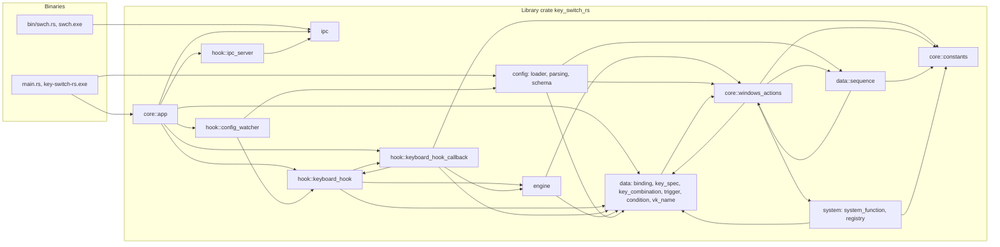
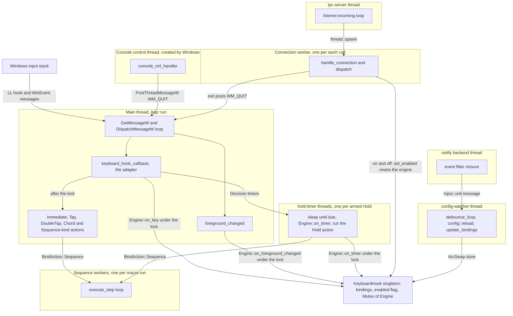
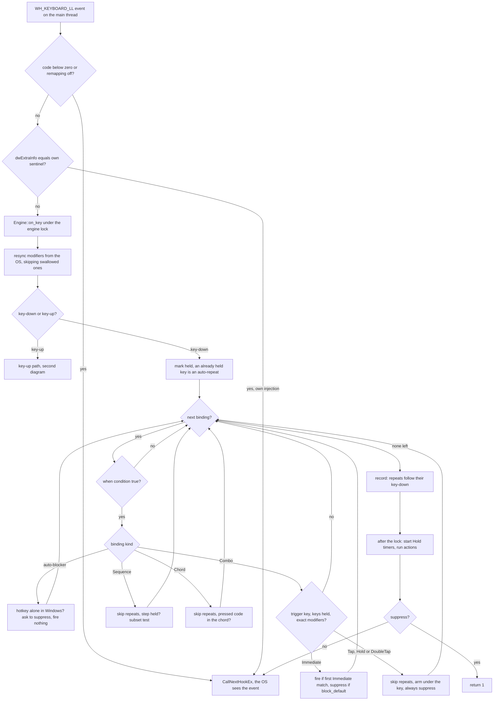
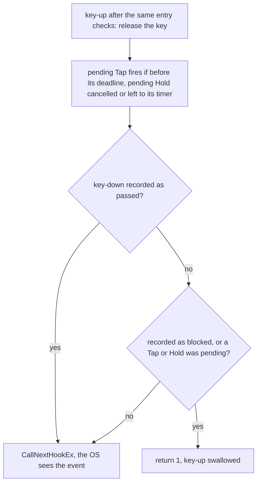
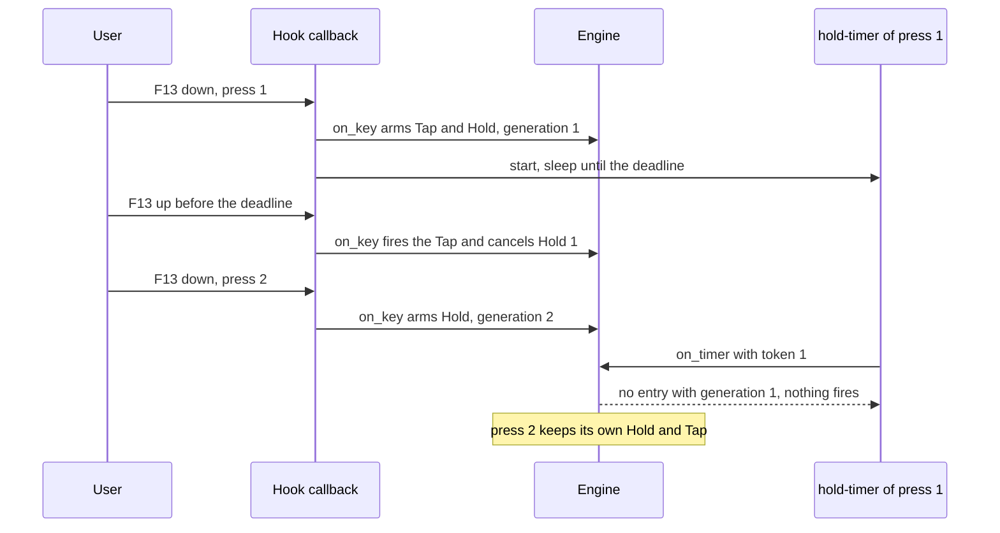
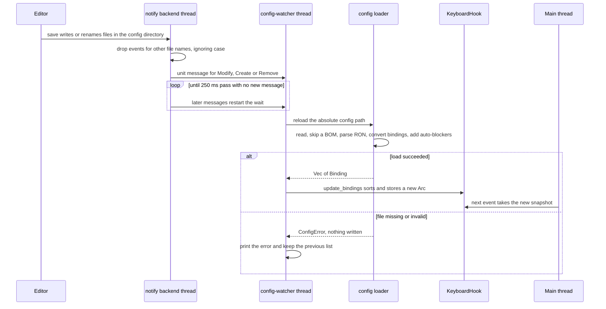
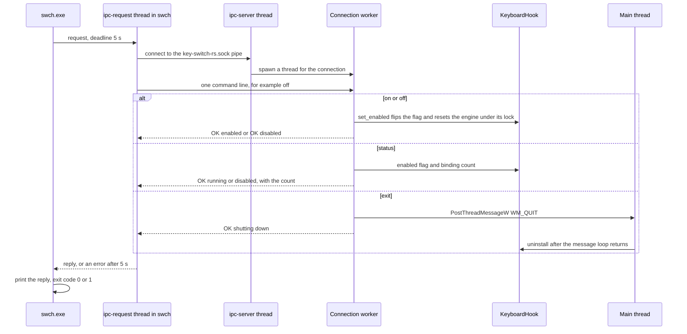

# Architecture

The key-switch-rs daemon is a single console process, elevated in release builds. Its main thread owns a `WH_KEYBOARD_LL` hook, a foreground WinEvent hook and the message loop that services both. Every keyboard event goes through a thin Win32 adapter into a pure decision core, `src/engine`, which says whether to swallow the event, which actions to run and which timers to start. The IPC server, hot reload, Hold timers and macro workers run on helper threads that share one process-wide `KeyboardHook` value. This chapter describes that structure as it exists in the code, and shows which defects listed in the [audit](audit.md) the structure explains and which ones Phase 0 removed.

> [!NOTE]
> Facts describe commit [`1dfd80a`](https://github.com/bluesteelll/key-switch-rs/tree/1dfd80a) (2026-10-16), the tip of `master` after roadmap Phase 0. Every code reference is a permalink to that commit. The audit described commit `7cb3521`, before the decision core existed; the [audit](audit.md) keeps that description, and each KS entry says what changed. Issue IDs such as [KS-04](audit.md#ks-04) link to their entries in the audit chapter. Run-time behaviour is derived from the code and the engine's scenario tests; the daemon was not run against live keyboard input.

## Crate layout

One Cargo package (edition 2024, version 0.1.0, `rust-version = "1.88"`) builds a library crate and two binaries. The library exists so that the CLI can share the IPC protocol with the daemon ([src/lib.rs:1-19](https://github.com/bluesteelll/key-switch-rs/blob/1dfd80a/src/lib.rs#L1-L19)).

| Target | Source | Role |
|---|---|---|
| `key_switch_rs` (library) | `src/lib.rs` | Declares the seven modules below. Both binaries import from it. |
| `key-switch-rs.exe` | `src/main.rs` | The daemon. Resolves the config path, loads it and runs `App`. Built with `test = false` and `bench = false` ([KS-38](audit.md#ks-38)). |
| `swch.exe` | `src/bin/swch.rs` | CLI driver. From the library it uses only the `ipc` module, which also holds the pipe client; it calls `ShellExecuteW` itself for `open`. |
| Build script | `build.rs` | Embeds a `requireAdministrator` manifest into the release daemon only, and only with the MSVC linker. |

The runtime dependencies are `windows` 0.62.2, `serde` 1.0.228, `ron` 0.10.1, `arc-swap` 1.9.1, `notify` 8.2.0 and `interprocess` 2.4.2 (versions from `Cargo.lock`, which has not changed since the audit).

| Module | Files | Responsibility |
|---|---|---|
| `config` | `loader.rs`, `parsing.rs`, `schema.rs`, `default_config.ron` | Reads `config.ron`, deserializes it into `Raw*` serde types, validates and converts each entry into a `Binding`, adds auto-blockers, and writes the bundled default file when `<exe_dir>\config.ron` is missing at startup. It exports `ConfigPath`, `load` and `reload` ([src/config/mod.rs:17](https://github.com/bluesteelll/key-switch-rs/blob/1dfd80a/src/config/mod.rs#L17)). |
| `core` | `app.rs`, `constants.rs`, `windows_actions.rs` | The `App` builder and process lifecycle, the daemon's side of the IPC commands (`DaemonHandle`), the injected-event sentinel, and `BindAction` with its execution code. |
| `data` | `binding.rs`, `key_spec.rs`, `key_combination.rs`, `trigger.rs`, `condition.rs`, `sequence.rs`, `vk_name.rs` | The runtime model: bindings, trigger keys (`KeySpec`), kinds, triggers, `when:` conditions, macro steps and key-name tables. `sequence.rs` also runs macros. |
| `engine` | `mod.rs`, `env.rs`, `keys.rs`, `matching.rs`, `gestures.rs`, `chords.rs`, `sequences.rs`; test-only `testing.rs`, `scenarios.rs`, `properties.rs` | The decision core: `Engine::on_key`, `Engine::on_timer`, the `Env` trait and `Decision`. Plain Rust with `#![forbid(unsafe_code)]`: no Win32 calls, threads, locks or clock of its own ([src/engine/mod.rs:1-161](https://github.com/bluesteelll/key-switch-rs/blob/1dfd80a/src/engine/mod.rs#L1-L161)). |
| `hook` | `keyboard_hook.rs`, `keyboard_hook_callback.rs`, `config_watcher.rs`, `ipc_server.rs` | Hook installation and shared state, the Win32 adapter that feeds the engine, and the two background services (file watcher and pipe server). |
| `ipc` | `ipc.rs` | Pipe name, the `Command` enum, the line-based wire format, and the client `swch` uses (`request`, with a 5 s deadline). |
| `system` | `system_function.rs`, `registry.rs` | The OS functions behind `SwitchLanguage` and `ToggleCapsLock`, and the registry lookup of the Windows language hotkey. |

The `hook` module holds more than the hook: the pipe server and the file watcher live there too. The pipe server no longer knows `KeyboardHook`: it talks to a `DaemonControl` trait, which the daemon implements in `core::app` and the integration tests implement with a stand-in ([src/hook/ipc_server.rs:28-40](https://github.com/bluesteelll/key-switch-rs/blob/1dfd80a/src/hook/ipc_server.rs#L28-L40)).

The modules are still not fully layered. `core::windows_actions` and `data::sequence` import each other, `core` and `data` import each other, and so do `core` and `system`. The engine uses `BindAction` from `core` only as data to fire, and never executes it; moving `BindAction` into `data` is a follow-up of roadmap [item 3.4](roadmap.md#34-core-consolidation).

## Startup sequence

1. `main` calls `run` and turns any error into `[FATAL] ...` followed by a blocking "Press Enter" prompt, so the console stays open ([src/main.rs:6-20](https://github.com/bluesteelll/key-switch-rs/blob/1dfd80a/src/main.rs#L6-L20)).
2. `run` resolves the config path once with `ConfigPath::from_arg`: the first argument, made absolute against the current folder, or `<exe_dir>\config.ron` ([src/main.rs:22-28](https://github.com/bluesteelll/key-switch-rs/blob/1dfd80a/src/main.rs#L22-L28), [src/config/loader.rs:110-149](https://github.com/bluesteelll/key-switch-rs/blob/1dfd80a/src/config/loader.rs#L110-L149); [KS-21](audit.md#ks-21) fixed).
3. `config::load` reads, parses, validates and expands the bindings ([src/main.rs:30](https://github.com/bluesteelll/key-switch-rs/blob/1dfd80a/src/main.rs#L30)). It writes the bundled default only when `<exe_dir>\config.ron` is missing; a missing command-line path is an error. Any error is fatal at startup. See [Config loading and hot reload](#config-loading-and-hot-reload).
4. The `App` builder collects the bindings and the watcher path: `App::new().with_config_watcher(path)`, then `add_binding` for each binding ([src/main.rs:32-36](https://github.com/bluesteelll/key-switch-rs/blob/1dfd80a/src/main.rs#L32-L36), [src/core/app.rs:75-97](https://github.com/bluesteelll/key-switch-rs/blob/1dfd80a/src/core/app.rs#L75-L97)).
5. `App::run` stores the main thread ID for the Ctrl+C handler, prints the binding banner and registers the console control handler ([src/core/app.rs:121-126](https://github.com/bluesteelll/key-switch-rs/blob/1dfd80a/src/core/app.rs#L121-L126)).
6. `get_hook()` initialises the singleton. `update_bindings` sorts and publishes the list, and `install()` registers the `WH_KEYBOARD_LL` hook and the `EVENT_SYSTEM_FOREGROUND` WinEvent hook on the main thread ([src/core/app.rs:128-132](https://github.com/bluesteelll/key-switch-rs/blob/1dfd80a/src/core/app.rs#L128-L132), [src/hook/keyboard_hook.rs:157-214](https://github.com/bluesteelll/key-switch-rs/blob/1dfd80a/src/hook/keyboard_hook.rs#L157-L214)). If the second hook fails, the first is removed again. A second `install` on an installed hook is an error.
7. `ipc_server::spawn` creates the pipe with an explicit security descriptor and starts the `ipc-server` thread, with a `DaemonHandle` that carries the hook and the main thread ID ([src/core/app.rs:134-153](https://github.com/bluesteelll/key-switch-rs/blob/1dfd80a/src/core/app.rs#L134-L153)). If it fails, the daemon only prints a warning and keeps running. The hook is already live at this point, so a second daemon keeps its hook without IPC ([KS-20](audit.md#ks-20), open).
8. `config_watcher::spawn_watcher` starts the file watcher. A failure also only warns ([src/core/app.rs:155-178](https://github.com/bluesteelll/key-switch-rs/blob/1dfd80a/src/core/app.rs#L155-L178)).
9. The main thread pumps `GetMessageW`/`DispatchMessageW` until `WM_QUIT` ([src/core/app.rs:180-186](https://github.com/bluesteelll/key-switch-rs/blob/1dfd80a/src/core/app.rs#L180-L186)). This loop is what delivers both hooks' callbacks.
10. After `WM_QUIT`, `hook.uninstall()?` removes the hooks on the main thread ([src/core/app.rs:188-189](https://github.com/bluesteelll/key-switch-rs/blob/1dfd80a/src/core/app.rs#L188-L189)). A foreground hook that cannot be removed is logged; a failed keyboard unhook is returned ([src/hook/keyboard_hook.rs:221-250](https://github.com/bluesteelll/key-switch-rs/blob/1dfd80a/src/hook/keyboard_hook.rs#L221-L250)). The watcher is dropped when `run` returns, which closes its channel and ends the debounce thread. The detached `ipc-server` thread ends with the process.

## Process and thread model

The main thread does the time-critical work. Windows delivers a low-level keyboard hook callback as a message to the thread that installed the hook, and that thread must pump messages. `WINEVENT_OUTOFCONTEXT` WinEvent callbacks use the same mechanism. Only the main thread installs and removes the hooks ([src/hook/keyboard_hook.rs:157-161](https://github.com/bluesteelll/key-switch-rs/blob/1dfd80a/src/hook/keyboard_hook.rs#L157-L161), `install` and `uninstall` are `pub(crate)`). Every other thread is either created by Windows (the console control handler) or a plain `std::thread` without a message loop.

| Thread | Created by | Runs | Lifetime |
|---|---|---|---|
| Main | Process start, then `App::run` | Startup config load, hook install, the message loop, `keyboard_hook_callback`, `foreground_changed`, condition evaluation, every Immediate action, Tap actions (on key-up), DoubleTap actions (on the second key-down), Chord and Sequence-kind completion actions, final uninstall | Process |
| Console control | Windows, on Ctrl+C or console close ([src/core/app.rs:114-119](https://github.com/bluesteelll/key-switch-rs/blob/1dfd80a/src/core/app.rs#L114-L119)) | `console_ctrl_handler`, which posts `WM_QUIT` to the main thread ([src/core/app.rs:195-211](https://github.com/bluesteelll/key-switch-rs/blob/1dfd80a/src/core/app.rs#L195-L211)) | One signal |
| `ipc-server` | `ipc_server::spawn` ([src/hook/ipc_server.rs:102-127](https://github.com/bluesteelll/key-switch-rs/blob/1dfd80a/src/hook/ipc_server.rs#L102-L127)) | The accept loop | Process (detached) |
| Connection worker (unnamed) | One `thread::spawn` per accepted connection ([src/hook/ipc_server.rs:118](https://github.com/bluesteelll/key-switch-rs/blob/1dfd80a/src/hook/ipc_server.rs#L118)) | Reads one line, then `dispatch`: `on`/`off` flip the enabled flag and reset the engine under its lock, `status`, `exit` | One request, or forever if the client never sends a line ([KS-26](audit.md#ks-26), open) |
| notify backend | `notify::recommended_watcher` | The filter closure ([src/hook/config_watcher.rs:107-115](https://github.com/bluesteelll/key-switch-rs/blob/1dfd80a/src/hook/config_watcher.rs#L107-L115)) | While the watcher value lives |
| `config-watcher` | `spawn_watcher` ([src/hook/config_watcher.rs:123-126](https://github.com/bluesteelll/key-switch-rs/blob/1dfd80a/src/hook/config_watcher.rs#L123-L126)) | Debounce, `config::reload` (including the registry read for auto-blockers), `update_bindings` | Until the channel closes |
| `hold-timer` | One per `TimerRequest` that a Hold arms ([src/hook/keyboard_hook_callback.rs:197-218](https://github.com/bluesteelll/key-switch-rs/blob/1dfd80a/src/hook/keyboard_hook_callback.rs#L197-L218)) | Sleeps until the due time, asks `Engine::on_timer`, runs the Hold action if one fires | One term; a cancelled Hold's timer wakes and finds nothing |
| Sequence worker (unnamed) | `spawn_sequence` for every `BindAction::Sequence` run ([src/data/sequence.rs:111-122](https://github.com/bluesteelll/key-switch-rs/blob/1dfd80a/src/data/sequence.rs#L111-L122)) | All steps, including `Delay` sleeps | Until the last step; no cancellation or limit |

Tap, DoubleTap, Chord and Sequence state needs no thread: each pending entry stores a deadline, and the next event compares its time with it. Until `16a0461` every armed Tap, Hold and DoubleTap started its own `tap-gc`, `hold-timer` or `double-tap-gc` thread ([KS-33](audit.md#ks-33), partly fixed).

### Threads and locking

The engine is single-threaded data, but three kinds of thread reach it: the main thread for every hook event and foreground change, a `hold-timer` thread when its Hold is due, and an IPC worker for `swch on` and `swch off`. Until roadmap [item 2.2](roadmap.md#22-timers-on-the-main-thread) moves the Hold timers onto the main thread, the engine therefore sits behind one `Mutex` in `KeyboardHook` ([src/hook/keyboard_hook.rs:40-67](https://github.com/bluesteelll/key-switch-rs/blob/1dfd80a/src/hook/keyboard_hook.rs#L40-L67)). The rules that keep this lock off the critical path:

- Only `KeyboardHook::with_engine` takes the lock, and only while the engine decides or resets ([src/hook/keyboard_hook.rs:82-104](https://github.com/bluesteelll/key-switch-rs/blob/1dfd80a/src/hook/keyboard_hook.rs#L82-L104)). The adapter runs every action, `SendInput` and thread spawn after it has released the lock and the binding snapshot ([src/hook/keyboard_hook_callback.rs:155-195](https://github.com/bluesteelll/key-switch-rs/blob/1dfd80a/src/hook/keyboard_hook_callback.rs#L155-L195)).
- `with_engine` refuses a nested call on the same thread instead of deadlocking: a thread-local flag marks the thread as deciding, and a nested call returns `None`, so the event passes ([src/hook/keyboard_hook.rs:18-38](https://github.com/bluesteelll/key-switch-rs/blob/1dfd80a/src/hook/keyboard_hook.rs#L18-L38)). Nothing under the lock pumps messages today, so this path is not taken. If it ever were, a refused key-up whose key-down was swallowed would pass and leave the key held in the engine ([src/hook/keyboard_hook_callback.rs:56-69](https://github.com/bluesteelll/key-switch-rs/blob/1dfd80a/src/hook/keyboard_hook_callback.rs#L56-L69)). Anything that adds a window to the daemon, such as roadmap items 2.3 and 4.6, has to deal with this first.
- The engine reads the clock once per event, under the lock, and a `hold-timer` takes the lock only once `Instant::now()` has reached its due time ([src/hook/keyboard_hook_callback.rs:220-231](https://github.com/bluesteelll/key-switch-rs/blob/1dfd80a/src/hook/keyboard_hook_callback.rs#L220-L231)). A key-up and the Hold timer of the same press are therefore decided in the order of one clock, which makes `Tap` and `Hold` with equal terms exclusive ([KS-25](audit.md#ks-25), partly fixed).
- The enabled flag is an `AtomicBool`. The callback reads it before the lock, to pass every event untouched while remapping is off, and again under the lock, where `set_enabled` flips it ([src/hook/keyboard_hook.rs:50-59](https://github.com/bluesteelll/key-switch-rs/blob/1dfd80a/src/hook/keyboard_hook.rs#L50-L59), [src/hook/keyboard_hook_callback.rs:174-182](https://github.com/bluesteelll/key-switch-rs/blob/1dfd80a/src/hook/keyboard_hook_callback.rs#L174-L182)).

### How `swch off` and `swch on` work (KS-01)

At the audit, `swch on` reinstalled both hooks on the short-lived IPC worker, whose exit removed them again, and `status` kept reporting `running` ([KS-01](audit.md#ks-01)). Since `a1b5a27` the hooks stay installed for the whole life of the daemon, and `on` and `off` only flip the enabled flag through `DaemonControl::set_enabled` ([src/core/app.rs:32-58](https://github.com/bluesteelll/key-switch-rs/blob/1dfd80a/src/core/app.rs#L32-L58), [src/hook/keyboard_hook.rs:129-155](https://github.com/bluesteelll/key-switch-rs/blob/1dfd80a/src/hook/keyboard_hook.rs#L129-L155)):

- While remapping is off, `keyboard_hook_callback` passes every event to `CallNextHookEx` without reading it, and `foreground_changed` does nothing ([src/hook/keyboard_hook_callback.rs:245-251](https://github.com/bluesteelll/key-switch-rs/blob/1dfd80a/src/hook/keyboard_hook_callback.rs#L245-L251), [src/hook/keyboard_hook_callback.rs:287-290](https://github.com/bluesteelll/key-switch-rs/blob/1dfd80a/src/hook/keyboard_hook_callback.rs#L287-L290)).
- A real switch, in either direction, resets the engine under its lock: every pending Tap, Hold, DoubleTap, chord and sequence is dropped, the Hold generation keeps counting, and the held keys are re-read from Windows as already pressed ([src/engine/mod.rs:342-363](https://github.com/bluesteelll/key-switch-rs/blob/1dfd80a/src/engine/mod.rs#L342-L363), [src/engine/keys.rs:107-130](https://github.com/bluesteelll/key-switch-rs/blob/1dfd80a/src/engine/keys.rs#L107-L130); [KS-31](audit.md#ks-31)). A repeated `on` or `off` resets nothing.
- `status` reports the flag, not the hook handle ([src/core/app.rs:40-45](https://github.com/bluesteelll/key-switch-rs/blob/1dfd80a/src/core/app.rs#L40-L45)).

What it does not cover: a running macro keeps running after `swch off` ([item 2.1](roadmap.md#21-action-executor)), and a key swallowed before `off` and released while remapping is off reaches Windows as a lone key-up.

### Why actions can stall all keyboard input (KS-08)

Windows does not pass a keystroke on to any application until the low-level hook callback returns. If the callback takes longer than `LowLevelHooksTimeout`, Windows skips it, and on Windows 7 and later it can remove the hook silently. The adapter runs the decided actions on the hook thread before it returns ([src/hook/keyboard_hook_callback.rs:257-263](https://github.com/bluesteelll/key-switch-rs/blob/1dfd80a/src/hook/keyboard_hook_callback.rs#L257-L263)). Only `BindAction::Sequence` moves its work to another thread ([src/core/windows_actions.rs:133-136](https://github.com/bluesteelll/key-switch-rs/blob/1dfd80a/src/core/windows_actions.rs#L133-L136)). `Launch` (`CreateProcessW` through `Command::spawn`) and `OpenUrl` (`ShellExecuteW`, with COM never initialised) run inside the callback ([src/core/windows_actions.rs:137-138](https://github.com/bluesteelll/key-switch-rs/blob/1dfd80a/src/core/windows_actions.rs#L137-L138)), and so do Tap and DoubleTap actions and Chord and Sequence-kind completions. Only Hold actions run elsewhere, on their `hold-timer` thread. Nothing watches whether the hook is still installed. See [KS-08](audit.md#ks-08), open until roadmap items [2.1](roadmap.md#21-action-executor) and [2.4](roadmap.md#24-hook-watchdog).

## The key-event path

`keyboard_hook_callback` ([src/hook/keyboard_hook_callback.rs:233-268](https://github.com/bluesteelll/key-switch-rs/blob/1dfd80a/src/hook/keyboard_hook_callback.rs#L233-L268)) runs on the main thread for every keyboard event on the desktop. It either returns `LRESULT(1)`, which drops the event, or calls `CallNextHookEx`, which passes it on. The adapter translates and carries out; the engine decides ([src/hook/keyboard_hook_callback.rs:1-30](https://github.com/bluesteelll/key-switch-rs/blob/1dfd80a/src/hook/keyboard_hook_callback.rs#L1-L30)).

1. **Negative code.** If `code < 0`, the event is passed on unchanged ([L238-L243](https://github.com/bluesteelll/key-switch-rs/blob/1dfd80a/src/hook/keyboard_hook_callback.rs#L238-L243)).
2. **Remapping off.** If `swch off` cleared the enabled flag, the event is passed on without being read ([L245-L251](https://github.com/bluesteelll/key-switch-rs/blob/1dfd80a/src/hook/keyboard_hook_callback.rs#L245-L251)).
3. **Sentinel check.** If `KBDLLHOOKSTRUCT::dwExtraInfo` equals the per-process sentinel, the event is the daemon's own `SendInput` output and is passed on before the engine sees it, so actions never trigger bindings ([L166-L168](https://github.com/bluesteelll/key-switch-rs/blob/1dfd80a/src/hook/keyboard_hook_callback.rs#L166-L168)). Only `vkCode` and `dwExtraInfo` are read ([L253-L257](https://github.com/bluesteelll/key-switch-rs/blob/1dfd80a/src/hook/keyboard_hook_callback.rs#L253-L257)). `scanCode` and `flags` (including `LLKHF_INJECTED` and the extended-key bit) are ignored, so input injected by other programs is matched like physical input, and the fake LCtrl that AltGr sends looks like a real Ctrl.
4. **Translation.** `WM_KEYDOWN`/`WM_SYSKEYDOWN` become a key-down event and `WM_KEYUP`/`WM_SYSKEYUP` a key-up event; any other message passes ([L143-L153](https://github.com/bluesteelll/key-switch-rs/blob/1dfd80a/src/hook/keyboard_hook_callback.rs#L143-L153)).
5. **Decision.** The adapter takes one snapshot of the binding list, creates a `HookEnv`, and asks `Engine::on_key` under the engine lock, if remapping is still on there ([L155-L183](https://github.com/bluesteelll/key-switch-rs/blob/1dfd80a/src/hook/keyboard_hook_callback.rs#L155-L183)). The list is sorted by key count, most keys first ([src/engine/mod.rs:261-267](https://github.com/bluesteelll/key-switch-rs/blob/1dfd80a/src/engine/mod.rs#L261-L267)).
6. **Modifier resync.** The engine reads the 11 modifier codes (generic and sided Shift, Ctrl and Alt, plus LWin and RWin) from `GetAsyncKeyState` through the `Env`. It skips the key being delivered, whose OS state lags until the hook returns, and every modifier whose key-down it swallowed, because Windows never saw it go down ([src/engine/keys.rs:90-105](https://github.com/bluesteelll/key-switch-rs/blob/1dfd80a/src/engine/keys.rs#L90-L105); [KS-14](audit.md#ks-14) fixed).
7. **Repeat detection.** On a key-down the key is marked held; if it already was, the event is an auto-repeat ([src/engine/keys.rs:141-148](https://github.com/bluesteelll/key-switch-rs/blob/1dfd80a/src/engine/keys.rs#L141-L148)).
8. **Binding loop.** Each binding is checked in order ([src/engine/mod.rs:373-500](https://github.com/bluesteelll/key-switch-rs/blob/1dfd80a/src/engine/mod.rs#L373-L500)). The `when:` condition is evaluated first ([Conditions](#conditions)), then the kind:
   - **Combo.** The key just pressed must be one of the combo's trigger keys, all of its keys must be held on their sides, and the modifier families held must be exactly its own unless it sets `allow_extra_modifiers` ([src/engine/matching.rs:53-79](https://github.com/bluesteelll/key-switch-rs/blob/1dfd80a/src/engine/matching.rs#L53-L79); [KS-04](audit.md#ks-04), [KS-07](audit.md#ks-07) fixed).
     - `Immediate`: only the first matching Immediate binding fires, and it fires on every auto-repeat ([KS-10](audit.md#ks-10), open). Every matching Immediate binding with `block_default` asks for suppression, including bindings that did not fire ([KS-13](audit.md#ks-13), open).
     - `Tap`/`Hold`/`DoubleTap`: repeats are skipped, the gesture is armed under the key just pressed, which is a key of the combo, and suppression is asked whatever `block_default` says. A Hold also asks for a timer.
     - An **auto-blocker** has its own rule: it asks for suppression when Windows would see its hotkey and nothing else, and it fires nothing ([src/engine/mod.rs:382-394](https://github.com/bluesteelll/key-switch-rs/blob/1dfd80a/src/engine/mod.rs#L382-L394); [KS-05](audit.md#ks-05) partly fixed, [KS-18](audit.md#ks-18) fixed).
   - **Sequence.** Repeats are skipped. A step matches when its keys are held, by a subset test ([KS-15](audit.md#ks-15), [KS-16](audit.md#ks-16), open). `Advanced` and `Completed` ask for suppression.
   - **Chord.** Repeats are skipped. The pressed code counts for a chord key that accepts it. Any key of the chord asks for suppression.
9. **Specificity.** The sort order affects only which Immediate binding fires. Less specific deferred, Sequence and Chord bindings still arm or advance, and a non-winning binding's `block_default` overrides `block_default: false` on the winner ([KS-13](audit.md#ks-13)).
10. **Suppression record.** A first key-down is suppressed if any binding asked, and the engine records the key as blocked; a first key-down that passes is recorded as passed. An auto-repeat follows that record, whatever the bindings asked this time. A completed chord or sequence also records the keys whose key-ups it swallows, but only keys still held whose key-down did not reach Windows ([src/engine/mod.rs:502-534](https://github.com/bluesteelll/key-switch-rs/blob/1dfd80a/src/engine/mod.rs#L502-L534); [KS-06](audit.md#ks-06), [KS-30](audit.md#ks-30), [KS-32](audit.md#ks-32) fixed).
11. **Key-up.** The key is released, a pending Tap fires if its deadline has not passed, and a pending Hold is cancelled before its deadline or left to its timer from the deadline on. The key-up of a key recorded as passed always passes. Otherwise it is suppressed if the key was recorded as blocked or a Tap or Hold of the press was pending ([src/engine/mod.rs:538-564](https://github.com/bluesteelll/key-switch-rs/blob/1dfd80a/src/engine/mod.rs#L538-L564)). `when:` conditions are not evaluated on key-up.
12. **Carry-out.** After the lock and the snapshot are released, the adapter starts a `hold-timer` thread for each requested timer and then runs the actions in order, on the hook thread ([src/hook/keyboard_hook_callback.rs:185-195](https://github.com/bluesteelll/key-switch-rs/blob/1dfd80a/src/hook/keyboard_hook_callback.rs#L185-L195)). Finally it returns `LRESULT(1)` if the decision suppresses the event, and `CallNextHookEx` otherwise.

The first diagram shows the checks every event passes and the key-down path; the second shows the key-up path.

> [!NOTE]
> **Foreground changes.** `foreground_changed` hands every `EVENT_SYSTEM_FOREGROUND` to `Engine::on_foreground_changed`: the engine resyncs the modifiers, again skipping swallowed ones, and forgets which key-ups were due to be swallowed ([src/engine/mod.rs:325-340](https://github.com/bluesteelll/key-switch-rs/blob/1dfd80a/src/engine/mod.rs#L325-L340)). A held key's repeats stay swallowed, but its release then reaches Windows as a lone key-up, unless a Tap or Hold of the press is still pending. Roadmap [item 2.3](roadmap.md#23-control-window-and-state-reset) revisits this.

> [!WARNING]
> **Lone Win or Alt ([KS-12](audit.md#ks-12)).** For a combo such as `Win+Q`, only the `Q` events are dropped. The OS sees Win down and Win up with nothing in between, which opens the Start menu; a lone Alt activates the menu bar. No mask key is injected: `Decision::mask` is reserved for roadmap [item 1.2](roadmap.md#12-mask-key-and-auto-blocker-v2) and never set ([src/engine/mod.rs:255-258](https://github.com/bluesteelll/key-switch-rs/blob/1dfd80a/src/engine/mod.rs#L255-L258)).

> [!WARNING]
> **Auto-blocker ([KS-05](audit.md#ks-05), partly fixed).** The blocker for the language hotkey acts only when Windows would see the hotkey and nothing else, so Alt+Shift+Tab with Tab held reaches Windows. Pressed modifiers first, Alt, Shift, X, it still swallows Shift, and the application gets Alt+X. Windows switches the language only on a bare press and release of the two modifiers; item 1.2 tests whether a mask key is enough to break that.

## Core data structures

All hot state lives in one `KeyboardHook` value ([src/hook/keyboard_hook.rs:40-67](https://github.com/bluesteelll/key-switch-rs/blob/1dfd80a/src/hook/keyboard_hook.rs#L40-L67)), held in a process-wide `LazyLock` static ([src/hook/keyboard_hook_callback.rs:86-98](https://github.com/bluesteelll/key-switch-rs/blob/1dfd80a/src/hook/keyboard_hook_callback.rs#L86-L98)). A `LazyLock` is used instead of a plain `static` because creating the `ArcSwap` allocates, so `KeyboardHook::new` cannot be `const`. `get_hook()` returns `&'static KeyboardHook`, which is what `spawn_watcher` and the daemon's `DaemonHandle` take. The reference is shared rather than `&'static mut`, so a re-entered callback stays memory-safe: all mutable state sits behind atomics, `ArcSwap` or the engine lock.

| Field or static | Type | Written by | Read by |
|---|---|---|---|
| `KEYBOARD_HOOK` | `LazyLock<KeyboardHook>` | First `get_hook()` call | Everything |
| `bindings` | `ArcSwap<Vec<Binding>>` | `update_bindings`: main thread at startup, `config-watcher` on reload | The callback (one snapshot per event), IPC `status` |
| `hook_handle`, `foreground_hook` | `AtomicPtr<c_void>` | `install`, `uninstall` (`swap` to null), main thread only | `is_installed` |
| `enabled` | `AtomicBool` | `set_enabled`, under the engine lock | Both callbacks, before and under the lock; IPC `status` |
| `engine` | `Mutex<Engine>` | `with_engine` only | `with_engine` only |
| `DECIDING` | `thread_local! Cell<bool>` ([src/hook/keyboard_hook.rs:18-38](https://github.com/bluesteelll/key-switch-rs/blob/1dfd80a/src/hook/keyboard_hook.rs#L18-L38)) | `with_engine` | `with_engine`, to refuse re-entry |
| `SENTINEL` | `OnceLock<usize>` ([src/core/constants.rs:5](https://github.com/bluesteelll/key-switch-rs/blob/1dfd80a/src/core/constants.rs#L5)) | First `injected_sentinel()` call | Every `SendInput` builder, the callback |
| `MAIN_THREAD_ID` | `AtomicU32` ([src/core/app.rs:20](https://github.com/bluesteelll/key-switch-rs/blob/1dfd80a/src/core/app.rs#L20)) | `App::run` | Ctrl+C handler; the IPC `exit` command uses the copy in `DaemonHandle` |

The engine's own state ([src/engine/mod.rs:269-275](https://github.com/bluesteelll/key-switch-rs/blob/1dfd80a/src/engine/mod.rs#L269-L275)) is plain data:

| Part | Type | Holds |
|---|---|---|
| `keys` | `KeyState { active: [bool; 256], last_down: [LastDown; 256] }` ([src/engine/keys.rs:51-80](https://github.com/bluesteelll/key-switch-rs/blob/1dfd80a/src/engine/keys.rs#L51-L80)) | The keys the engine believes are held, by the sided code the hook reports plus the generic modifier codes the resync writes; and for each key whether its latest key-down was suppressed, passed, unknown, or suppressed and then forgotten by a foreground change |
| `gestures` | three `Vec`s of pending entries and a generation counter ([src/engine/gestures.rs:36-82](https://github.com/bluesteelll/key-switch-rs/blob/1dfd80a/src/engine/gestures.rs#L36-L82)) | Pending Taps and DoubleTaps with deadlines, pending Holds with deadlines and generations |
| `chords`, `sequences` | `Vec`s of pending entries ([src/engine/chords.rs:30-43](https://github.com/bluesteelll/key-switch-rs/blob/1dfd80a/src/engine/chords.rs#L30-L43), [src/engine/sequences.rs:26-36](https://github.com/bluesteelll/key-switch-rs/blob/1dfd80a/src/engine/sequences.rs#L26-L36)) | The keys seen so far or the next step, the action and the deadline |

### The binding list

Reads are lock-free: the callback takes one `Guard` per event and iterates it. `update_bindings` sorts the new list by `key_count()` descending with a stable sort, then publishes it with one atomic store ([src/hook/keyboard_hook.rs:106-115](https://github.com/bluesteelll/key-switch-rs/blob/1dfd80a/src/hook/keyboard_hook.rs#L106-L115)). The stable sort keeps load order among bindings with the same key count; the loader appends auto-blockers after the file's bindings, so they come last among equals. `key_count` is the number of keys for a Combo or Chord and the number of steps for a Sequence ([src/data/binding.rs:34-47](https://github.com/bluesteelll/key-switch-rs/blob/1dfd80a/src/data/binding.rs#L34-L47)). The list is not engine state: the engine gets the snapshot on every call, so a reload never touches the engine, and pending gestures keep the clones of the actions they were armed with. A `BindAction::Sequence` holds its steps in an `Arc`, so a macro that is running keeps its steps after a reload.

### The per-key table

The engine's `KeyState` replaces the audit-era `[AtomicBool; 256]` active-keys table and `[AtomicU64; 4]` blocked-key bitmap. It has one writer, the engine, under its lock. Its two halves are the held keys, which also detect auto-repeat, and the suppression record that keeps a key's repeats and key-up in line with its key-down ([src/engine/keys.rs:1-12](https://github.com/bluesteelll/key-switch-rs/blob/1dfd80a/src/engine/keys.rs#L1-L12)):

| Record | Set when | Repeats | Key-up |
|---|---|---|---|
| `Unknown` | the key is up, or the resync found a modifier held whose key-down the engine never saw | follow what the bindings ask; once one passes, the key is recorded as passed | passes unless a Tap or Hold was pending |
| `Passed` | the key-down reached Windows | pass | passes |
| `Suppressed` | the key-down was swallowed | swallowed | swallowed |
| `Forgotten` | a foreground change while the key-down was recorded as suppressed | swallowed | passes unless a Tap or Hold was pending |

Only the modifier codes are resynced from the OS. A missed key-up of any other key leaves a phantom held key until its next press, which then reads as an auto-repeat. With the trigger-key rule such a key no longer makes combos fire on unrelated key-downs, and `swch off`/`on` rebuild the table from the OS ([KS-29](audit.md#ks-29), not independently verified; partly addressed).

### The PID-mixed sentinel

Every synthesized event carries `injected_sentinel()` in `dwExtraInfo`. On 64-bit targets it is `(pid << 32) | 0xDEADBEEF` ([src/core/constants.rs:15-28](https://github.com/bluesteelll/key-switch-rs/blob/1dfd80a/src/core/constants.rs#L15-L28)). The process ID makes collisions with other injectors (AutoHotkey, PowerToys), which tend to use small constants, very unlikely. `is_injected_event` is an exact comparison ([src/core/constants.rs:30-32](https://github.com/bluesteelll/key-switch-rs/blob/1dfd80a/src/core/constants.rs#L30-L32)).

### Decisions, timers and tokens

`Decision` carries `suppress`, the actions to `fire` in order, the `timers` to start, and a `mask` flag reserved for item 1.2 ([src/engine/mod.rs:243-259](https://github.com/bluesteelll/key-switch-rs/blob/1dfd80a/src/engine/mod.rs#L243-L259)). A `TimerRequest` pairs a due `Instant` with an opaque `TimerToken` of key code and generation ([src/engine/mod.rs:227-241](https://github.com/bluesteelll/key-switch-rs/blob/1dfd80a/src/engine/mod.rs#L227-L241)). The `Env` trait is the engine's only window on the world: the clock, the OS key state and the foreground app and title ([src/engine/env.rs:9-53](https://github.com/bluesteelll/key-switch-rs/blob/1dfd80a/src/engine/env.rs#L9-L53)). The adapter answers it with live Win32 calls in `HookEnv`; the test harness answers it with a fake clock and a modelled key state.

## Gesture state machines

### Tap, Hold and DoubleTap (`engine/gestures.rs`)

Each gesture kind has its own table of pending entries, keyed by the code of the key-down that armed it, so Tap and Hold on one key are armed and resolved independently ([src/engine/gestures.rs:1-27](https://github.com/bluesteelll/key-switch-rs/blob/1dfd80a/src/engine/gestures.rs#L1-L27)).

| Trigger | Key-down | Later | Key-up | Action runs on |
|---|---|---|---|---|
| `Tap(ms)` | Store a deadline, unless a live Tap is pending on the key ([L91-L112](https://github.com/bluesteelll/key-switch-rs/blob/1dfd80a/src/engine/gestures.rs#L91-L112)) | Nothing; an entry past its deadline counts as absent | Remove the entry; fire if the key-up came strictly before the deadline ([L114-L121](https://github.com/bluesteelll/key-switch-rs/blob/1dfd80a/src/engine/gestures.rs#L114-L121)) | Main thread |
| `Hold(ms)` | Store a deadline and a new generation, unless a Hold is pending; return a timer request ([L125-L154](https://github.com/bluesteelll/key-switch-rs/blob/1dfd80a/src/engine/gestures.rs#L125-L154)) | The `hold-timer` hands its token back; the entry with that key and generation fires ([L171-L179](https://github.com/bluesteelll/key-switch-rs/blob/1dfd80a/src/engine/gestures.rs#L171-L179)) | Before the deadline: cancel. From the deadline on: leave the entry to its timer ([L156-L169](https://github.com/bluesteelll/key-switch-rs/blob/1dfd80a/src/engine/gestures.rs#L156-L169)) | `hold-timer` thread |
| `DoubleTap(ms)` | If an entry is pending and its deadline has not passed, consume it and fire; otherwise store a new deadline ([L197-L219](https://github.com/bluesteelll/key-switch-rs/blob/1dfd80a/src/engine/gestures.rs#L197-L219)) | Nothing | Nothing in the gesture table; the suppression record swallows the key-up | Main thread |

The generation token is what fixed [KS-11](audit.md#ks-11): a timer from an earlier press finds a different generation and does nothing. Leaving an overdue Hold to its timer is what makes equal Tap and Hold terms exclusive ([KS-25](audit.md#ks-25)):

If a `hold-timer` thread cannot be started, the adapter logs the failure and tells the engine to forget that Hold, which then never fires ([src/hook/keyboard_hook_callback.rs:197-218](https://github.com/bluesteelll/key-switch-rs/blob/1dfd80a/src/hook/keyboard_hook_callback.rs#L197-L218); [KS-33](audit.md#ks-33), partly fixed). Tap and DoubleTap on the same key are still not disambiguated ([Tap versus DoubleTap disambiguation](gaps.md#tap-versus-doubletap-disambiguation)).

### Chord (`engine/chords.rs`)

A chord fires when all of its keys go down within `window` of the first one, in any order ([src/engine/chords.rs:58-116](https://github.com/bluesteelll/key-switch-rs/blob/1dfd80a/src/engine/chords.rs#L58-L116)). For each Chord binding on each non-repeat key-down:

1. If no chord key accepts the pressed code, the result is `NotInChord` ([L72-L74](https://github.com/bluesteelll/key-switch-rs/blob/1dfd80a/src/engine/chords.rs#L72-L74)). Chord keys are `KeySpec`s, so `"Shift"` accepts either Shift key and `"LShift"` only the left one ([KS-07](audit.md#ks-07) fixed). No list is allocated for the comparison.
2. Expired entries are dropped (lazy expiry, no timer thread), and the entry with the same key set is found or created with `expires_at = now + window` ([L76-L114](https://github.com/bluesteelll/key-switch-rs/blob/1dfd80a/src/engine/chords.rs#L76-L114)). The window is not extended by later keys.
3. When every chord key accepts a code seen so far, the chord completes: the action fires, and the seen keys that are still held and whose key-down did not pass are recorded for a swallowed key-up ([L92-L102](https://github.com/bluesteelll/key-switch-rs/blob/1dfd80a/src/engine/chords.rs#L92-L102); [KS-30](audit.md#ks-30) fixed).

Every key-down of a chord key is suppressed, whether or not the chord completes. Keys of a failed chord are lost; there is no replay buffer ([src/engine/chords.rs:10-16](https://github.com/bluesteelll/key-switch-rs/blob/1dfd80a/src/engine/chords.rs#L10-L16)). The loader rejects chord keys that overlap, so one press never counts twice.

### Sequence (`engine/sequences.rs`)

A sequence is a list of combo steps pressed in order, with at most `max_gap` between steps ([src/engine/sequences.rs:53-120](https://github.com/bluesteelll/key-switch-rs/blob/1dfd80a/src/engine/sequences.rs#L53-L120)). Pending entries are identified by the step list, so bindings with identical steps share one slot. For each Sequence binding on each non-repeat key-down:

1. Expired entries are dropped ([L72-L74](https://github.com/bluesteelll/key-switch-rs/blob/1dfd80a/src/engine/sequences.rs#L72-L74)).
2. If an entry is pending and the next step's keys are held, the entry advances and its deadline moves to `now + max_gap`. On the last step `Completed` returns the action and the last step's non-modifier keys for a swallowed key-up ([L76-L92](https://github.com/bluesteelll/key-switch-rs/blob/1dfd80a/src/engine/sequences.rs#L76-L92), [L122-L142](https://github.com/bluesteelll/key-switch-rs/blob/1dfd80a/src/engine/sequences.rs#L122-L142)).
3. Any other key-down removes the pending entry, and the same key-down is then checked as step 0 ([L93-L116](https://github.com/bluesteelll/key-switch-rs/blob/1dfd80a/src/engine/sequences.rs#L93-L116)).

The state machine still sees only the held keys, not which key was just pressed. Rollover therefore completes a step ([KS-15](audit.md#ks-15)), and a step that adds a modifier fails, because the modifier's own key-down does not cover the full step and aborts the sequence ([KS-16](audit.md#ks-16)). Both are open until roadmap [item 3.2](roadmap.md#32-sequence-and-chord-matching). Completion no longer swallows key-ups whose key-down reached the application ([KS-32](audit.md#ks-32), fixed).

## Conditions

`Condition` is a small expression tree: `Always`, `AppEquals`, `TitleContains`, `TitleEquals`, `Not`, `And` and `Or` ([src/data/condition.rs:28-51](https://github.com/bluesteelll/key-switch-rs/blob/1dfd80a/src/data/condition.rs#L28-L51)). It is evaluated against the `ForegroundInfo` trait, so the engine can evaluate it against a fake foreground in tests ([src/data/condition.rs:61-101](https://github.com/bluesteelll/key-switch-rs/blob/1dfd80a/src/data/condition.rs#L61-L101), [src/engine/env.rs:55-68](https://github.com/bluesteelll/key-switch-rs/blob/1dfd80a/src/engine/env.rs#L55-L68)). In the daemon the answers come from a `ForegroundContext` that `HookEnv` captures at most once per event, on the first question ([src/hook/keyboard_hook_callback.rs:100-141](https://github.com/bluesteelll/key-switch-rs/blob/1dfd80a/src/hook/keyboard_hook_callback.rs#L100-L141)):

- `capture()` makes one call, `GetForegroundWindow` ([src/data/condition.rs:113-125](https://github.com/bluesteelll/key-switch-rs/blob/1dfd80a/src/data/condition.rs#L113-L125)).
- `app()` and `title()` are `OnceCell`s. The Win32 calls run on first use and are cached for the rest of that keystroke ([src/data/condition.rs:127-137](https://github.com/bluesteelll/key-switch-rs/blob/1dfd80a/src/data/condition.rs#L127-L137)).
- `app()` opens the process with `PROCESS_QUERY_LIMITED_INFORMATION` and reads its image path with `QueryFullProcessImageNameW` in the native form; the file name is the part after the last `\` ([src/data/condition.rs:139-154](https://github.com/bluesteelll/key-switch-rs/blob/1dfd80a/src/data/condition.rs#L139-L154), [src/data/condition.rs:180-227](https://github.com/bluesteelll/key-switch-rs/blob/1dfd80a/src/data/condition.rs#L180-L227); [KS-03](audit.md#ks-03) fixed). The handle is closed by `Owned` on every path.
- All comparisons fold case with Unicode lowercasing; two ASCII strings compare without allocating ([src/data/condition.rs:83-92](https://github.com/bluesteelll/key-switch-rs/blob/1dfd80a/src/data/condition.rs#L83-L92); [KS-28](audit.md#ks-28) fixed).

`Always` never asks the foreground, so a config without `when:` pays nothing. The condition is evaluated before the binding's keys are matched ([src/engine/mod.rs:373-378](https://github.com/bluesteelll/key-switch-rs/blob/1dfd80a/src/engine/mod.rs#L373-L378)), so the first conditional binding triggers the process and title lookup on every key-down, on the hook thread and under the engine lock, even when its keys are not held. Roadmap [item 3.5](roadmap.md#35-hot-path-budget) moves the condition after the match and caches the names per window. Conditions are not evaluated on key-up or in timers: a Tap or Hold armed under a condition fires later without checking it again. Auto-blockers are always `Condition::Always`, whatever the owner's `when:` says ([KS-35](audit.md#ks-35), not independently verified).

## Actions and input synthesis

`BindAction` has ten variants ([src/core/windows_actions.rs:16-50](https://github.com/bluesteelll/key-switch-rs/blob/1dfd80a/src/core/windows_actions.rs#L16-L50)). `execute` dispatches them synchronously on the calling thread ([L117-L142](https://github.com/bluesteelll/key-switch-rs/blob/1dfd80a/src/core/windows_actions.rs#L117-L142)). For Immediate, Tap, DoubleTap, Chord and Sequence-kind bindings that thread is the main thread, and for Hold it is the `hold-timer` thread.

| Action | Implementation | Blocking work on the calling thread |
|---|---|---|
| `SwitchLanguage`, `SwitchLanguageBackward` | `SystemFunction`: `PostMessageW(GetForegroundWindow(), WM_INPUTLANGCHANGEREQUEST, INPUTLANGCHANGE_FORWARD or _BACKWARD)` ([src/system/system_function.rs:42-79](https://github.com/bluesteelll/key-switch-rs/blob/1dfd80a/src/system/system_function.rs#L42-L79)) | None (posted) |
| `ToggleCapsLock` | `SendInput` of `VK_CAPITAL` down and up ([src/system/system_function.rs:117-160](https://github.com/bluesteelll/key-switch-rs/blob/1dfd80a/src/system/system_function.rs#L117-L160)) | `SendInput` |
| `PressKey(vk)`, `Media(key)` | `press_vk`: `SendInput` down and up ([src/core/windows_actions.rs:161-202](https://github.com/bluesteelll/key-switch-rs/blob/1dfd80a/src/core/windows_actions.rs#L161-L202)) | `SendInput` |
| `PostMessage` | `PostMessageW` to the foreground window ([L204-L217](https://github.com/bluesteelll/key-switch-rs/blob/1dfd80a/src/core/windows_actions.rs#L204-L217)) | None |
| `Launch` | `std::process::Command::spawn` ([L219-L233](https://github.com/bluesteelll/key-switch-rs/blob/1dfd80a/src/core/windows_actions.rs#L219-L233)) | `CreateProcessW` ([KS-08](audit.md#ks-08)) |
| `OpenUrl` | `ShellExecuteW` with the `open` verb ([L235-L261](https://github.com/bluesteelll/key-switch-rs/blob/1dfd80a/src/core/windows_actions.rs#L235-L261)) | Shell handler start-up, no COM initialisation ([KS-08](audit.md#ks-08)) |
| `Sequence` | `spawn_sequence` ([src/data/sequence.rs:102-122](https://github.com/bluesteelll/key-switch-rs/blob/1dfd80a/src/data/sequence.rs#L102-L122)) | Only the thread spawn |
| `DoNothing` | Nothing; used by auto-blockers, whose action the engine never fires | None |

`SystemFunction` also implements `LockWorkstation`, `ShowDesktop` and `TaskManager` ([src/system/system_function.rs:81-115](https://github.com/bluesteelll/key-switch-rs/blob/1dfd80a/src/system/system_function.rs#L81-L115)), but `to_system_function` maps only the three language and CapsLock actions ([src/core/windows_actions.rs:144-151](https://github.com/bluesteelll/key-switch-rs/blob/1dfd80a/src/core/windows_actions.rs#L144-L151)) and the schema has no variant for them, so they cannot be reached from a config. `get_system_combination` routes through `registry::get_system_hotkey`, which provides the auto-blocker combo ([src/system/registry.rs:52-65](https://github.com/bluesteelll/key-switch-rs/blob/1dfd80a/src/system/registry.rs#L52-L65)). It reads `HKCU\Keyboard Layout\Toggle` (`Hotkey`, then `Language Hotkey`), and its modifiers mean either side. The value `"3"` means the OS hotkey is disabled, but it is parsed as "no value", so the default `Alt+Shift` is blocked anyway ([KS-17](audit.md#ks-17), open).

### Macros (`data/sequence.rs`)

`spawn_sequence` captures `GetForegroundWindow()` when the action fires, passes the `HWND` to a new thread as an integer, and runs the steps in order ([src/data/sequence.rs:111-135](https://github.com/bluesteelll/key-switch-rs/blob/1dfd80a/src/data/sequence.rs#L111-L135)). `Window(...)` steps act on that captured window, not on whatever has focus later ([L270-L297](https://github.com/bluesteelll/key-switch-rs/blob/1dfd80a/src/data/sequence.rs#L270-L297)). `Delay` sleeps in the worker, never in the callback. Workers have no limit and no cancellation, so `swch off`, a reload or a new trigger cannot stop a running macro, and an Immediate macro binding starts a new worker on every auto-repeat ([KS-10](audit.md#ks-10)).

### Input synthesis

There are three separate `SendInput` builders: `press_vk` in `windows_actions.rs`, `type_text`/`press_key`/`press_combo` in `sequence.rs` ([L137-L251](https://github.com/bluesteelll/key-switch-rs/blob/1dfd80a/src/data/sequence.rs#L137-L251)), and `SystemFunction::press_key`. All of them set `dwExtraInfo` to the sentinel. The virtual-key builders set `wScan` to 0 and never `KEYEVENTF_EXTENDEDKEY`; `type_text` puts the UTF-16 code unit in `wScan` (not independently verified as a defect: [KS-36](audit.md#ks-36)). `type_text` sends each UTF-16 code unit as a `KEYEVENTF_UNICODE` down/up pair, so text does not depend on the keyboard layout. `press_combo` splits the keys into modifiers and payload, presses modifiers, then payload, and releases them in reverse order. None of the builders releases modifiers the user is physically holding. The trigger's own modifiers (for example the `Ctrl+Alt` of `Ctrl+Alt+L`) reached the OS before the payload key was suppressed, so synthesized keys combine with them ([KS-19](audit.md#ks-19), [src/core/windows_actions.rs:163](https://github.com/bluesteelll/key-switch-rs/blob/1dfd80a/src/core/windows_actions.rs#L163)). Roadmap [item 3.1](roadmap.md#31-single-input-module) merges the builders.

## Config loading and hot reload

`config::load` runs at startup and `config::reload` on every reload ([src/config/loader.rs:151-182](https://github.com/bluesteelll/key-switch-rs/blob/1dfd80a/src/config/loader.rs#L151-L182)). They share one pipeline:

1. Read the file. A missing file, or a missing folder on its path, is `ConfigError::Missing` ([L184-L197](https://github.com/bluesteelll/key-switch-rs/blob/1dfd80a/src/config/loader.rs#L184-L197)). Only `load` with `<exe_dir>\config.ron` then writes the bundled `default_config.ron` and reads it again ([L160-L165](https://github.com/bluesteelll/key-switch-rs/blob/1dfd80a/src/config/loader.rs#L160-L165)); `reload` never writes ([KS-23](audit.md#ks-23) fixed).
2. Skip one leading UTF-8 byte-order mark ([L233-L236](https://github.com/bluesteelll/key-switch-rs/blob/1dfd80a/src/config/loader.rs#L233-L236); [KS-24](audit.md#ks-24) fixed).
3. Deserialize `RawConfig` with `IMPLICIT_SOME` ([L238-L248](https://github.com/bluesteelll/key-switch-rs/blob/1dfd80a/src/config/loader.rs#L238-L248)). Every struct of the schema has `deny_unknown_fields`, and `bindings` is required ([src/config/schema.rs:18-28](https://github.com/bluesteelll/key-switch-rs/blob/1dfd80a/src/config/schema.rs#L18-L28); [KS-22](audit.md#ks-22) fixed).
4. Convert each `RawBinding`. Errors from all entries are collected, and any error rejects the whole file ([L250-L262](https://github.com/bluesteelll/key-switch-rs/blob/1dfd80a/src/config/loader.rs#L250-L262)). Trigger keys become `KeySpec`s; timing values must be 1 to 10000 ms ([L484-L497](https://github.com/bluesteelll/key-switch-rs/blob/1dfd80a/src/config/loader.rs#L484-L497); [KS-27](audit.md#ks-27) fixed). An empty list only prints a warning ([L264-L266](https://github.com/bluesteelll/key-switch-rs/blob/1dfd80a/src/config/loader.rs#L264-L266)).
5. `expand_with_auto_blockers` appends one blocker per distinct system hotkey of the flagged bindings, unless a `keys` binding of the file uses exactly the hotkey's keys ([L271-L312](https://github.com/bluesteelll/key-switch-rs/blob/1dfd80a/src/config/loader.rs#L271-L312); [KS-18](audit.md#ks-18) fixed). The system hotkey comes from a function parameter, which tests replace so that they do not depend on the machine's registry ([L211-L232](https://github.com/bluesteelll/key-switch-rs/blob/1dfd80a/src/config/loader.rs#L211-L232)).

The watcher ([src/hook/config_watcher.rs:93-170](https://github.com/bluesteelll/key-switch-rs/blob/1dfd80a/src/hook/config_watcher.rs#L93-L170)) watches the parent directory without recursion, so editors that save through a temporary file and a rename keep working ([L117-L121](https://github.com/bluesteelll/key-switch-rs/blob/1dfd80a/src/hook/config_watcher.rs#L117-L121)). The filter closure forwards only `Modify`, `Create` and `Remove` events whose file name equals the config's, compared with `CompareStringOrdinal` ignoring case ([L63-L91](https://github.com/bluesteelll/key-switch-rs/blob/1dfd80a/src/hook/config_watcher.rs#L63-L91); [KS-21](audit.md#ks-21) fixed). The `config-watcher` thread waits until 250 ms pass without a new event ([L131-L154](https://github.com/bluesteelll/key-switch-rs/blob/1dfd80a/src/hook/config_watcher.rs#L131-L154)), then reloads.

The design keeps a broken save from taking the daemon down: on error the old list stays live ([L156-L170](https://github.com/bluesteelll/key-switch-rs/blob/1dfd80a/src/hook/config_watcher.rs#L156-L170)). The three paths around that guarantee that the audit found are closed: a relative path, a deleted file and a misspelled `bindings` ([KS-21](audit.md#ks-21), [KS-23](audit.md#ks-23), [KS-22](audit.md#ks-22)). Reload results still go only to the daemon console, and pending gesture entries from the old config are not cleared ([item 2.3](roadmap.md#23-control-window-and-state-reset)).

## IPC and the swch client

The transport is the `interprocess` crate's local socket, which on Windows is the named pipe `\\.\pipe\key-switch-rs.sock` ([src/ipc.rs:31-43](https://github.com/bluesteelll/key-switch-rs/blob/1dfd80a/src/ipc.rs#L31-L43)). Each connection carries exactly one request line and one response line, with no length prefix or other framing ([src/ipc.rs:1-17](https://github.com/bluesteelll/key-switch-rs/blob/1dfd80a/src/ipc.rs#L1-L17)).

| `swch` subcommand | Request line | Daemon side | Response line |
|---|---|---|---|
| `on` | `on` | `DaemonControl::set_enabled(true)` on the connection worker | `OK: enabled` |
| `off` | `off` | `set_enabled(false)` | `OK: disabled` |
| `status`, `ping` | `status` | The enabled flag and the binding count | `OK: running (N bindings live)`, with `disabled` in place of `running` while remapping is off |
| `exit`, `quit`, `shutdown`, `stop` | `exit` | `PostThreadMessageW(main_tid, WM_QUIT)` ([src/core/app.rs:47-57](https://github.com/bluesteelll/key-switch-rs/blob/1dfd80a/src/core/app.rs#L47-L57)) | `OK: shutting down` |
| `open`, `start`, `launch` | `status`, as a probe | Answers like `status`; if no daemon is listening, `swch` starts one with `ShellExecuteW("runas")` ([src/bin/swch.rs:71-142](https://github.com/bluesteelll/key-switch-rs/blob/1dfd80a/src/bin/swch.rs#L71-L142)) | none printed from the daemon |
| `help`, `--help`, `-h` | none | Not involved; `swch` prints its usage and exits with 0 | none |
| anything else | none | Not involved; `swch` prints `swch: unknown command "..."` and its usage, and exits with 1 ([src/bin/swch.rs:49-53](https://github.com/bluesteelll/key-switch-rs/blob/1dfd80a/src/bin/swch.rs#L49-L53)) | none |

The daemon parses requests case-insensitively after trimming and accepts `quit`/`shutdown` and `ping` as aliases ([src/ipc.rs:173-184](https://github.com/bluesteelll/key-switch-rs/blob/1dfd80a/src/ipc.rs#L173-L184)); `stop` is an alias only in `swch`. Another client that sends an unknown line gets `ERR: unknown command "..."`. A command the daemon cannot carry out gets `ERR: could not …`, for example `ERR: could not shut down: main thread id unknown, cannot post WM_QUIT` ([src/hook/ipc_server.rs:157-178](https://github.com/bluesteelll/key-switch-rs/blob/1dfd80a/src/hook/ipc_server.rs#L157-L178)). `swch` turns `OK` and `ERR` into exit code 0 or 1, and treats a reply without a prefix as success ([src/ipc.rs:207-219](https://github.com/bluesteelll/key-switch-rs/blob/1dfd80a/src/ipc.rs#L207-L219)).

The client side is `ipc::request`, which `swch` calls for every command ([src/ipc.rs:87-155](https://github.com/bluesteelll/key-switch-rs/blob/1dfd80a/src/ipc.rs#L87-L155)). It runs the exchange on its own `ipc-request` thread and waits at most 5 s for the connection and the reply together, because interprocess pipe streams take no I/O timeout. A connect error is sorted by what it says about the daemon: a missing pipe means not running, while access denied, a busy pipe and a timeout mean a daemon runs.

The listener is created with an explicit security descriptor, `PIPE_SDDL` ([src/hook/ipc_server.rs:51-100](https://github.com/bluesteelll/key-switch-rs/blob/1dfd80a/src/hook/ipc_server.rs#L51-L100); [KS-02](audit.md#ks-02) fixed): a protected DACL with full control for SYSTEM and Administrators, read and write for interactive users, and a medium mandatory label. A non-elevated `swch` can therefore reach an elevated daemon. Every interactive user of the machine can, too: under fast user switching or Remote Desktop another signed-in user can switch remapping, stop the daemon, or create a pipe instance that answers `swch` in the daemon's place, until roadmap [item 4.1](roadmap.md#41-ipc-hardening) gives each session its own pipe ([KS-40](audit.md#ks-40), open). A client that connects and never sends a newline still parks its worker in `read_line` forever ([src/hook/ipc_server.rs:137-142](https://github.com/bluesteelll/key-switch-rs/blob/1dfd80a/src/hook/ipc_server.rs#L137-L142); [KS-26](audit.md#ks-26), open). The `exit` reply is still written after `WM_QUIT` is posted ([KS-37](audit.md#ks-37), not independently verified).

## Elevation and integrity levels

`build.rs` adds two linker arguments, for the `key-switch-rs` binary only, only in release builds for a Windows target, and only when the target environment is `msvc`: `/MANIFEST:EMBED` and `/MANIFESTUAC:level='requireAdministrator' uiAccess='false'` ([build.rs:21-47](https://github.com/bluesteelll/key-switch-rs/blob/1dfd80a/build.rs#L21-L47)). Other Windows toolchains get a cargo warning that no UAC manifest is embedded ([KS-42](audit.md#ks-42) fixed). `swch.exe` gets no elevation request and runs `asInvoker`, and debug builds of the daemon run at the caller's level. The rationale is UIPI: a low-level hook in a medium-integrity process does not see keystrokes aimed at higher-integrity windows. `app.manifest` in the repository root is still not passed to the linker, so its `supportedOS` block never ships.

Elevation does not cover the Secure Desktop (UAC consent, Ctrl+Alt+Del, the lock screen). While it has focus, the hook misses key-ups. Two repairs exist for this:

- The modifier resync on every event, described in [the key-event path](#the-key-event-path).
- A WinEvent hook on `EVENT_SYSTEM_FOREGROUND` with `WINEVENT_OUTOFCONTEXT | WINEVENT_SKIPOWNPROCESS` ([src/hook/keyboard_hook.rs:183-211](https://github.com/bluesteelll/key-switch-rs/blob/1dfd80a/src/hook/keyboard_hook.rs#L183-L211)). Its callback `foreground_changed` makes the engine resync the modifiers and forget which key-ups are due to be swallowed ([src/hook/keyboard_hook_callback.rs:270-299](https://github.com/bluesteelll/key-switch-rs/blob/1dfd80a/src/hook/keyboard_hook_callback.rs#L270-L299)).

Both repairs resync only the modifier codes, and skip a modifier whose key-down the engine swallowed. Gesture state and the held state of the other keys are left as they are.

Running elevated has costs beyond the UAC prompt on every launch:

- Every `Launch` and `OpenUrl` child inherits the administrator token, and console children also share the daemon's console ([src/core/windows_actions.rs:219-233](https://github.com/bluesteelll/key-switch-rs/blob/1dfd80a/src/core/windows_actions.rs#L219-L233), [KS-09](audit.md#ks-09), open until roadmap [item 3.3](roadmap.md#33-launch-and-openurl-without-elevation)).
- The pipe has to admit medium-integrity clients, so it admits every interactive user (above).
- In debug builds both binaries run at the same level, which hides elevation problems during development.

## Design strengths and architectural root causes

### Strengths

- **A pure, tested decision core.** `src/engine` has no Win32 calls, threads, locks or clock of its own, and `#![forbid(unsafe_code)]`. Scenario tests drive it from a RON config, a script of key events and a fake clock, and property tests check the suppression invariant over generated key scripts. The audit's scenarios are now regression tests: at `1dfd80a`, `cargo test -- --list` shows 363 library tests, 108 of them in `engine::scenarios`.
- **One representation of trigger keys.** `KeySpec` is fixed at load time and used by combos, steps and chords alike, so sided and unsided names mean the same everywhere.
- **Lock-free, reload-safe binding list.** One `ArcSwap` load per event, and a reload is a single atomic store. Running macros keep their own `Arc`.
- **Sound shared state.** `&'static KeyboardHook` with interior mutability only. The single engine lock is held only while deciding, never across an action, and refuses re-entry instead of deadlocking.
- **Loop-proof injection.** The PID-mixed sentinel stops the daemon from reacting to its own `SendInput`.
- **Clear thread ownership.** Only the main thread installs and removes hooks; `on` and `off` are a flag.
- **Config pipeline.** Serde types are separate from the runtime types, unknown fields are rejected, all binding errors are collected in one pass, a failed reload keeps the old list, and watching the parent directory with a 250 ms debounce handles editors that save through a rename.
- **Macros off the hook thread**, with the target window captured once.

### Root causes

Most verified defects came from a few structural decisions rather than from isolated slips. The table lists the causes the audit found at `7cb3521` and where each stands now; the [roadmap](roadmap.md) orders the rest.

| Root cause at the audit | Status at `1dfd80a` | Issues |
|---|---|---|
| Thread affinity is implicit: hooks belong to the thread that installs them, but `install`/`uninstall` could be called from any thread | **Removed**: only the main thread installs, and `on`/`off` are a flag | [KS-01](audit.md#ks-01) |
| Actions run on whichever thread resolves a gesture, mostly the hook thread | Open: actions still run on the hook thread, except Hold actions ([item 2.1](roadmap.md#21-action-executor)) | [KS-08](audit.md#ks-08) |
| Matching tests a snapshot of held keys instead of the event: no trigger key, subset matching | **Removed for combos and blockers**: trigger-key rule and exact modifiers. Sequence steps still use a subset test ([item 3.2](roadmap.md#32-sequence-and-chord-matching)) | [KS-04](audit.md#ks-04), [KS-05](audit.md#ks-05), [KS-13](audit.md#ks-13), [KS-15](audit.md#ks-15), [KS-16](audit.md#ks-16) |
| Suppression is decided per event, with no model of the key's whole press | **Mostly removed**: repeats and key-ups follow the key-down. Mask keys and modifiers that already passed are still unhandled ([items 1.2](roadmap.md#12-mask-key-and-auto-blocker-v2), [3.1](roadmap.md#31-single-input-module)) | [KS-06](audit.md#ks-06), [KS-10](audit.md#ks-10), [KS-12](audit.md#ks-12), [KS-19](audit.md#ks-19) |
| Two sources of truth for key state: the hook's own tracking and `GetAsyncKeyState` | **Removed for swallowed modifiers**: the resync skips them | [KS-14](audit.md#ks-14) |
| Key identity is normalised only at match time, and differently for chords | **Removed**: `KeySpec` | [KS-07](audit.md#ks-07) |
| Time is handled by detached sleeper threads with no generation token | **Mostly removed**: deadlines and generation tokens; Hold still has a thread per press ([item 2.2](roadmap.md#22-timers-on-the-main-thread)) | [KS-11](audit.md#ks-11), [KS-25](audit.md#ks-25) |
| The auto-blocker is modelled as an ordinary binding | **Removed**: it has its own matching rule, fires nothing and follows the file's bindings | [KS-05](audit.md#ks-05), [KS-18](audit.md#ks-18); [KS-17](audit.md#ks-17) is a registry-parsing defect and stays open |
| The process boundary uses Win32 defaults: the default pipe DACL, the inherited admin token for children, no instance guard | **Partly removed**: an explicit pipe SDDL. Children still inherit the token, and there is still no instance guard | [KS-02](audit.md#ks-02), [KS-09](audit.md#ks-09), [KS-20](audit.md#ks-20), [KS-26](audit.md#ks-26) |
| Lenient, startup-oriented config handling is reused unchanged for hot reload | **Removed**: `load` and `reload` differ, and the loader is strict | [KS-21](audit.md#ks-21), [KS-22](audit.md#ks-22), [KS-23](audit.md#ks-23), [KS-24](audit.md#ks-24) |
| The decision logic is tied to Win32 calls and cannot be unit-tested | **Removed**: the engine | Allowed all of the above to ship |

The remaining structural step is the one the audit pointed at: the hook only decides, and a single worker executes. Roadmap items [2.1](roadmap.md#21-action-executor) and [2.2](roadmap.md#22-timers-on-the-main-thread) move actions to an executor and timers to the main thread, which also removes the engine lock.
