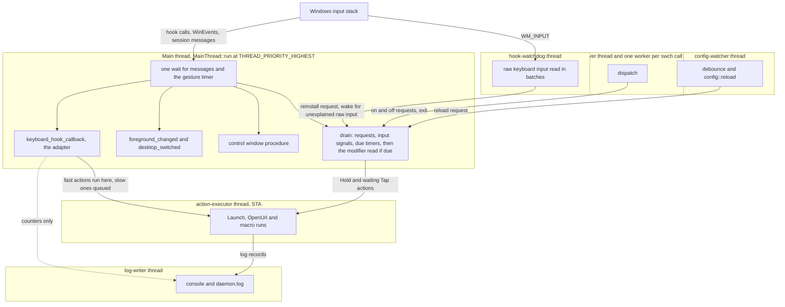
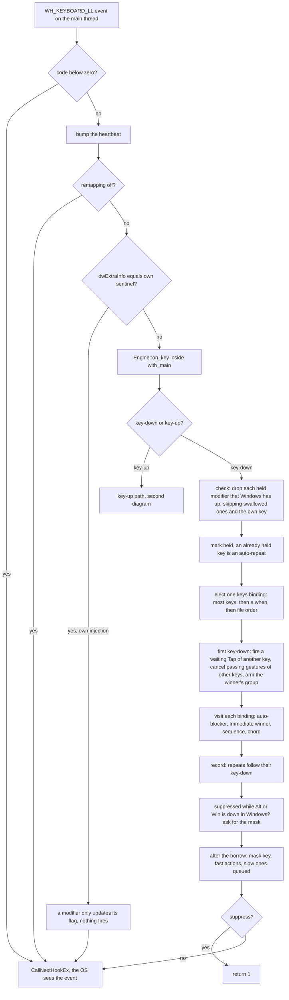
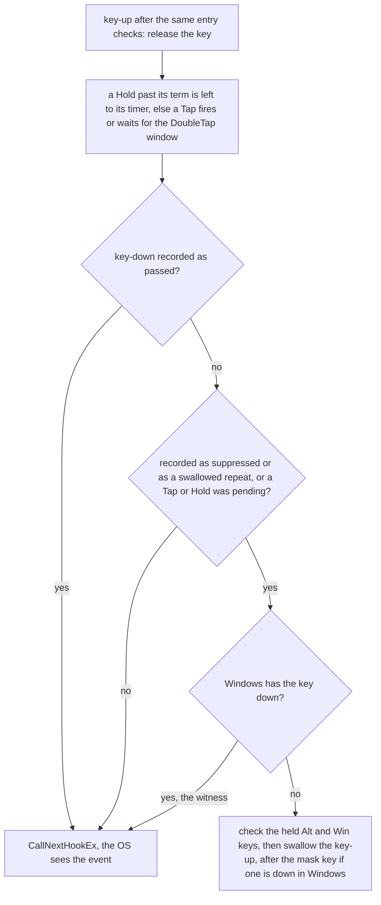
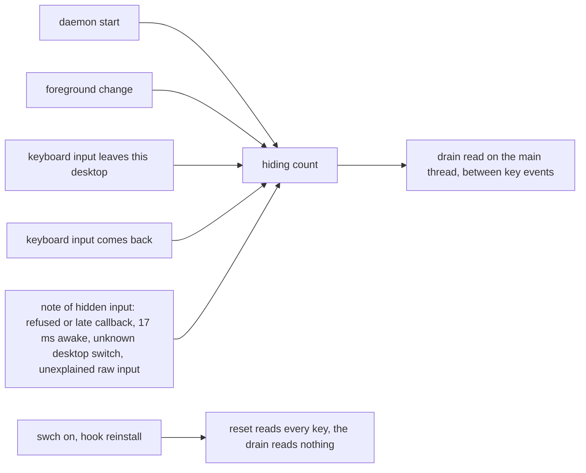
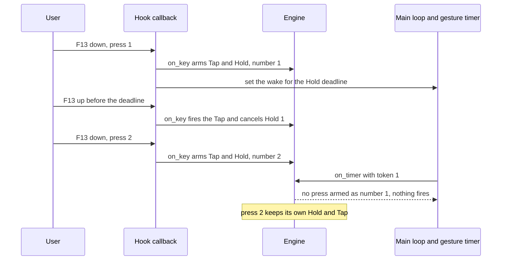
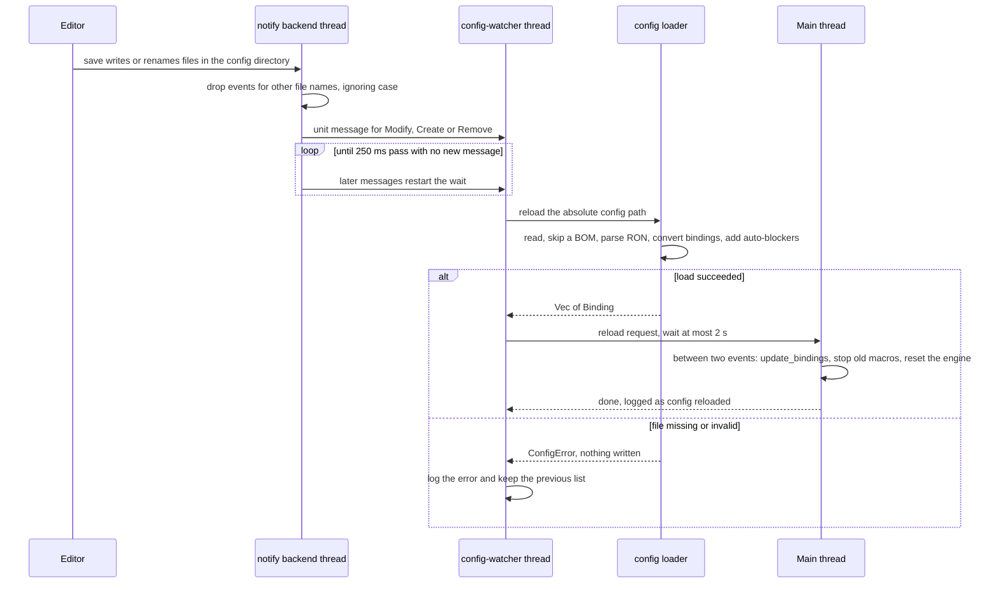
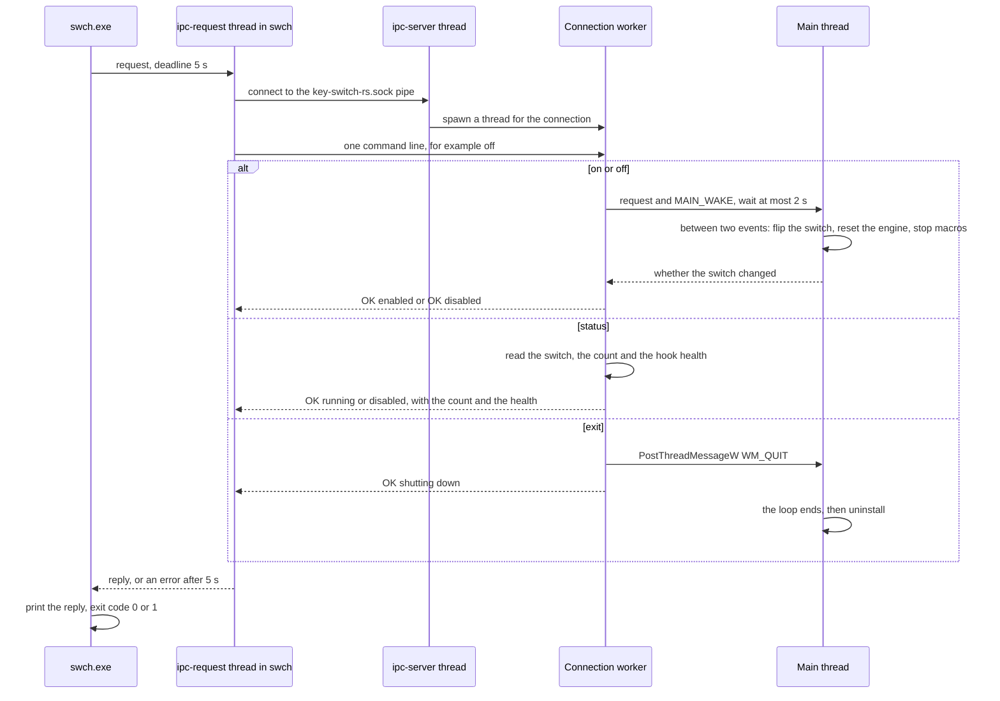

# Architecture

The key-switch-rs daemon is a single console process, elevated in release builds. Its main thread owns a `WH_KEYBOARD_LL` hook, two WinEvent hooks (the foreground window and the input desktop), a hidden control window, the decision core and every gesture timer, and it runs the loop that services all of them. Every keyboard event goes through a thin Win32 adapter into a pure decision core, `src/engine`, which says whether to swallow the event, which actions to run, which timers to start and whether to send the menu mask key. Slow actions go to an `action-executor` thread, a `hook-watchdog` thread checks that Windows still calls the hook, and one `log-writer` thread writes every log line. The IPC server and hot reload run on helper threads that hand their requests to the main thread. This chapter describes that structure as it exists in the code, and shows which defects listed in the [audit](audit.md) the structure explains and which ones roadmap Phases 0, 1 and 2 removed.

> [!NOTE]
> Facts describe commit [`f4c1fb6`](https://github.com/bluesteelll/key-switch-rs/tree/f4c1fb6) (2026-10-20), the merge of roadmap item 2.5, the last change of the program's behaviour on `master`. Every code reference is a permalink to that commit. The source at `252daef`, the tip of `master` when this page was written, differs from it only in two doc-comment lines of `src/engine/modifiers.rs`. The audit described commit `7cb3521`, before the decision core existed; the [audit](audit.md) keeps that description, and each KS entry says what changed. Issue IDs such as [KS-04](audit.md#ks-04) link to their entries in the audit chapter. Run-time behaviour is derived from the code and the engine's scenario tests, not observed: the daemon was not run against live keyboard input.

## Crate layout

One Cargo package (edition 2024, version 0.1.0, `rust-version = "1.88"`) builds a library crate and two binaries. The library exists so that the CLI can share the IPC protocol with the daemon ([src/lib.rs:1-25](https://github.com/bluesteelll/key-switch-rs/blob/f4c1fb6/src/lib.rs#L1-L25)).

| Target | Source | Role |
|---|---|---|
| `key_switch_rs` (library) | `src/lib.rs` | Declares the nine modules below, and two test-only ones: the latency bench and the logic of `build.rs`. Both binaries import from it. |
| `key-switch-rs.exe` | `src/main.rs` | The daemon. Starts the logger, takes the single-instance guard, resolves the config path, loads it and runs `App`. Built with `test = false` and `bench = false` ([KS-38](audit.md#ks-38)). |
| `swch.exe` | `src/bin/swch.rs` | CLI driver. From the library it uses only the `ipc` module, which also holds the pipe client; it calls `ShellExecuteW` itself for `open`. |
| Build script | `build.rs` | Embeds a `requireAdministrator` manifest into the release daemon only, and only with the MSVC linker. |

The runtime dependencies are `windows` 0.62.2, `serde` 1.0.228, `ron` 0.10.1, `arc-swap` 1.9.1, `notify` 8.2.0, `interprocess` 2.4.2 and `log` 0.4.29, from `Cargo.lock`. Phase 2 added no dependency, only `windows` features: `Win32_System_Com` (item 2.1), `Win32_Graphics_Gdi`, `Win32_System_LibraryLoader`, `Win32_System_RemoteDesktop` and `Win32_System_StationsAndDesktops` (item 2.3), and `Win32_UI_Input` (item 2.4), and `Win32_System_SystemInformation` for `GetTickCount` (item 2.5).

| Module | Files | Responsibility |
|---|---|---|
| `config` | `loader.rs`, `parsing.rs`, `schema.rs`, `default_config.ron` | Reads `config.ron`, deserializes it into `Raw*` serde types, validates and converts each entry into a `Binding`, resolves the defaults of `block_default` and `repeat`, warns about a binding that duplicates an earlier one, adds auto-blockers, and writes the bundled default file when `<exe_dir>\config.ron` is missing at startup. It exports `ConfigPath`, `load` and `reload` ([src/config/mod.rs:17](https://github.com/bluesteelll/key-switch-rs/blob/f4c1fb6/src/config/mod.rs#L17)). |
| `core` | `app.rs`, `constants.rs`, `windows_actions.rs`, `executor/` (`mod.rs`, `runs.rs`; test-only `testing.rs`) | The `App` builder and process lifecycle, the daemon's side of the IPC commands (`DaemonHandle`), the injected-event sentinel and the menu mask key code, `BindAction` with its split into fast actions and the rest, and the action executor ([src/core/executor/mod.rs:1-30](https://github.com/bluesteelll/key-switch-rs/blob/f4c1fb6/src/core/executor/mod.rs#L1-L30)). |
| `data` | `binding.rs`, `key_spec.rs`, `key_combination.rs`, `trigger.rs`, `condition.rs`, `sequence.rs`, `vk_name.rs` | The runtime model: bindings, trigger keys (`KeySpec`), kinds, triggers, `when:` conditions, macro steps and key-name tables. `sequence.rs` also runs one macro step; the executor walks the steps. |
| `engine` | `mod.rs`, `env.rs`, `keys.rs`, `modifiers.rs`, `resync.rs`, `matching.rs`, `winner.rs`, `gestures.rs`, `chords.rs`, `sequences.rs`, `schedule.rs`; test-only `testing.rs`, `scenarios.rs`, `properties.rs` | The decision core: `Engine::on_key`, `Engine::on_timer` and `Engine::reset`, the `Env` and `Scheduler` traits, `Decision` and the timer tokens, the `ModifierSet` of the 11 modifier codes and the [hiding count](#modifier-state-between-key-events) that tells the main thread when to read the modifiers. Plain Rust with `#![forbid(unsafe_code)]`: no Win32 calls, threads, locks or clock of its own ([src/engine/mod.rs:1-251](https://github.com/bluesteelll/key-switch-rs/blob/f4c1fb6/src/engine/mod.rs#L1-L251)). |
| `hook` | `keyboard_hook.rs`, `keyboard_hook_callback.rs`, `main_thread.rs`, `control_window.rs`, `health.rs`, `installer.rs`, `watchdog/` (`mod.rs`, `decision.rs`), `config_watcher.rs`, `ipc_server.rs`; `debug_hold.rs` in debug builds only | The shared hook state, the Win32 adapter that feeds the engine, the main thread's state and loop, the control window, the hook's health and the watchdog that checks it, the only code that installs hooks or registers for raw input, and the two background services (file watcher and pipe server). |
| `ipc` | `ipc.rs` | Pipe name, the `Command` enum, the line-based wire format, and the client `swch` uses (`request`, with a 5 s deadline). |
| `logging` | `mod.rs`, `sink.rs`, `writer.rs`, `counters.rs`, `panic.rs`; test-only `testing.rs` | The logger behind the `log` facade, the `log-writer` thread that owns the console output and `daemon.log`, the rotating file sink, the counters for what the hook path must not log per event, and the panic hook ([src/logging/mod.rs:1-19](https://github.com/bluesteelll/key-switch-rs/blob/f4c1fb6/src/logging/mod.rs#L1-L19)). |
| `platform` | `timers.rs`, `priority.rs`, `foreground.rs`, `desktop.rs`, `focus.rs` | Wrappers of Win32 primitives that threads use the same way: the high-resolution waitable timer, the main thread's priority, the cache of the foreground window for `when:`, whether this desktop has keyboard input, and the dialog class and a thread's focus window, for the target of a language request ([src/platform/mod.rs:1-15](https://github.com/bluesteelll/key-switch-rs/blob/f4c1fb6/src/platform/mod.rs#L1-L15)). |
| `system` | `system_function.rs`, `registry.rs`, `single_instance.rs`, `known_folder.rs` | The OS functions behind `SwitchLanguage` and `ToggleCapsLock`, the one post to the foreground window of `SwitchLanguage` and `PostMessage` with the choice of its target, the registry lookup of the Windows language hotkey, the single-instance mutex, and the lookup of the `LocalAppData` folder for the log. |

The `hook` module holds more than the hook: the main thread's state, the control window, the watchdog, the pipe server and the file watcher live there too. The pipe server does not know `KeyboardHook`: it talks to a `DaemonControl` trait, which the daemon implements in `core::app` and the integration tests implement with a stand-in ([src/hook/ipc_server.rs:32-55](https://github.com/bluesteelll/key-switch-rs/blob/f4c1fb6/src/hook/ipc_server.rs#L32-L55)). The watcher hands a reload to an `ApplyReload` sink, the main thread in the daemon ([src/hook/config_watcher.rs:41-52](https://github.com/bluesteelll/key-switch-rs/blob/f4c1fb6/src/hook/config_watcher.rs#L41-L52)).

```mermaid
flowchart LR
    subgraph BINS["Binaries"]
        MAINRS["main.rs, key-switch-rs.exe"]
        SWCH["bin/swch.rs, swch.exe"]
    end
    subgraph LIB["Library crate key_switch_rs"]
        APP["core::app"]
        EXE["core::executor"]
        ACT["core::windows_actions"]
        CFG["config"]
        IPCP["ipc"]
        IPCS["hook::ipc_server"]
        WATCH["hook::config_watcher"]
        MAINT["hook::main_thread"]
        KH["hook::keyboard_hook and installer"]
        CB["hook::keyboard_hook_callback"]
        CW["hook::control_window"]
        WD["hook::watchdog and health"]
        ENG["engine"]
        DATA["data"]
        PLAT["platform"]
        SYS["system"]
        LOGM["logging"]
    end
    MAINRS --> CFG
    MAINRS --> APP
    MAINRS --> SYS
    SWCH --> IPCP
    APP --> MAINT
    APP --> KH
    APP --> EXE
    APP --> CW
    APP --> WD
    APP --> IPCS
    APP --> WATCH
    IPCS --> IPCP
    WATCH --> CFG
    WATCH --> MAINT
    MAINT --> ENG
    MAINT --> CB
    MAINT --> KH
    CB --> ENG
    CB --> ACT
    CB --> KH
    CW --> MAINT
    WD --> MAINT
    WD --> KH
    KH --> EXE
    EXE --> ACT
    EXE --> DATA
    ENG --> DATA
    ENG --> ACT
    CFG --> DATA
    ACT --> SYS
    MAINT --> PLAT
    EXE --> PLAT
    WD --> PLAT
    CB --> PLAT
    SYS --> PLAT
```

Every module logs through the `log` macros, so the diagram leaves `logging` out; it shows the main dependencies, not every `use`. The modules are still not fully layered: `core` and `data` import each other, and so do `core` and `system`. The engine uses `BindAction` from `core` only as data to fire, and never executes it; moving `BindAction` into `data` is a follow-up of roadmap [item 3.4](roadmap.md#34-core-consolidation).

## Startup sequence

1. `main` starts the logger first. `logging::init` installs the logger behind the `log` facade, starts the `log-writer` thread with the console (stderr) as its only output, and installs the panic hook ([src/main.rs:14-19](https://github.com/bluesteelll/key-switch-rs/blob/f4c1fb6/src/main.rs#L14-L19), [src/logging/mod.rs:106-131](https://github.com/bluesteelll/key-switch-rs/blob/f4c1fb6/src/logging/mod.rs#L106-L131)).
2. `main` takes the single-instance guard before any config is read and before any hook or pipe exists: `InstanceGuard::acquire` creates the named mutex `Local\key-switch-rs` ([src/main.rs:20-36](https://github.com/bluesteelll/key-switch-rs/blob/f4c1fb6/src/main.rs#L20-L36), [src/system/single_instance.rs:35-65](https://github.com/bluesteelll/key-switch-rs/blob/f4c1fb6/src/system/single_instance.rs#L35-L65)). If another daemon of the same Windows session holds it, `main` logs `` [ERROR] already running in this session; use `swch status`, `swch off` or `swch exit` to control it ``, flushes the log and exits with code 2, without the Enter prompt ([KS-20](audit.md#ks-20) fixed, roadmap [item 1.5](roadmap.md#15-single-instance)).
3. `run` attaches `%LOCALAPPDATA%\key-switch-rs\daemon.log` to the logger and logs the start line into it, so a refused second start never writes to, or rotates, the running daemon's file ([src/main.rs:88-109](https://github.com/bluesteelll/key-switch-rs/blob/f4c1fb6/src/main.rs#L88-L109)).
4. `run` resolves the config path once with `ConfigPath::from_arg`: the first argument, made absolute against the current folder, or `<exe_dir>\config.ron` ([src/main.rs:71-76](https://github.com/bluesteelll/key-switch-rs/blob/f4c1fb6/src/main.rs#L71-L76), [src/config/loader.rs:110-149](https://github.com/bluesteelll/key-switch-rs/blob/f4c1fb6/src/config/loader.rs#L110-L149); [KS-21](audit.md#ks-21) fixed).
5. `config::load` reads, parses, validates and expands the bindings ([src/main.rs:78](https://github.com/bluesteelll/key-switch-rs/blob/f4c1fb6/src/main.rs#L78)). It writes the bundled default only when `<exe_dir>\config.ron` is missing; a missing command-line path is an error. See [Config loading and hot reload](#config-loading-and-hot-reload).
6. The `App` builder collects the bindings and the watcher path ([src/main.rs:80-84](https://github.com/bluesteelll/key-switch-rs/blob/f4c1fb6/src/main.rs#L80-L84)).
7. `App::run` stores the main thread ID for the Ctrl+C handler and creates the pipe with `ipc_server::bind`, with its explicit security descriptor, before any hook is installed ([src/core/app.rs:185-194](https://github.com/bluesteelll/key-switch-rs/blob/f4c1fb6/src/core/app.rs#L185-L194)). A pipe that cannot be created is an error that stops the daemon with nothing to undo; for a taken name the message names its likely owners ([src/core/app.rs:340-359](https://github.com/bluesteelll/key-switch-rs/blob/f4c1fb6/src/core/app.rs#L340-L359)).
8. It flushes the log, so that the loader's lines come first, prints the binding banner on stdout and registers the console control handler ([src/core/app.rs:139-166](https://github.com/bluesteelll/key-switch-rs/blob/f4c1fb6/src/core/app.rs#L139-L166), [L196-L197](https://github.com/bluesteelll/key-switch-rs/blob/f4c1fb6/src/core/app.rs#L196-L197)).
9. Still before any hook, it starts what the hooks rely on ([src/core/app.rs:199-240](https://github.com/bluesteelll/key-switch-rs/blob/f4c1fb6/src/core/app.rs#L199-L240)):
   - the action executor, `Executor::start`, which waits until its thread has its queue, its COM apartment and its `Delay` timer;
   - the main thread's state, `MainThread::new`: the engine, the gesture timer and the foreground cache, which belong to this thread;
   - `get_hook()`, which initialises the singleton, `update_bindings`, which sorts and publishes the list, and `attach_executor`;
   - the hook watchdog, `HookWatchdog::start`; if it cannot start, the daemon logs a `[WARN]` and runs without it;
   - the control window, `ControlWindow::create`, which also registers for the session notifications (a failed registration is a `[WARN]`);
   - in a debug build only, the debug hold of the callback, if `KS_DEBUG_HOOK_HOLD` asks for one.

   An executor, a gesture timer or a control window that cannot be made stops the daemon before any hook exists.
10. `install()` registers the `WH_KEYBOARD_LL` hook, the `EVENT_SYSTEM_FOREGROUND` WinEvent hook and the `EVENT_SYSTEM_DESKTOPSWITCH` WinEvent hook on the main thread, all through `hook::installer` ([L241-L249](https://github.com/bluesteelll/key-switch-rs/blob/f4c1fb6/src/core/app.rs#L241-L249), [src/hook/keyboard_hook.rs:147-205](https://github.com/bluesteelll/key-switch-rs/blob/f4c1fb6/src/hook/keyboard_hook.rs#L147-L205)). If a WinEvent hook fails, the hooks installed so far are removed again. A second `install` on an installed hook is an error. Right after it, the foreground cache reads the window that has the focus.
11. `serve` starts the `ipc-server` thread on the pipe, with a `DaemonHandle` that holds the hook and a handle to the main thread ([src/core/app.rs:251-266](https://github.com/bluesteelll/key-switch-rs/blob/f4c1fb6/src/core/app.rs#L251-L266), [src/hook/ipc_server.rs:122-148](https://github.com/bluesteelll/key-switch-rs/blob/f4c1fb6/src/hook/ipc_server.rs#L122-L148)). It runs only once the hooks are installed, so `swch status` never answers for a daemon whose install failed. If the thread cannot start, the main thread removes the hooks again and the error stops the daemon.
12. `config_watcher::spawn_watcher` starts the file watcher, with the main thread as the sink of its reloads. A failure, also a `config-watcher` thread that cannot start, only warns ([src/core/app.rs:268-292](https://github.com/bluesteelll/key-switch-rs/blob/f4c1fb6/src/core/app.rs#L268-L292)).
13. The main thread raises itself to `THREAD_PRIORITY_HIGHEST` and runs `MainThread::run` until `WM_QUIT` ([src/core/app.rs:294-310](https://github.com/bluesteelll/key-switch-rs/blob/f4c1fb6/src/core/app.rs#L294-L310)). This loop delivers the callbacks of the three hooks and of the control window, fires the gesture timers and serves the requests of the other threads ([Process and thread model](#process-and-thread-model)).
14. After the loop: normal priority again, the main thread's state is dropped, so a late `swch on` or `off` is told that the daemon is shutting down, `uninstall()` removes the hooks, the control window is destroyed, and the watchdog and the executor are stopped, in that order ([src/core/app.rs:310-325](https://github.com/bluesteelll/key-switch-rs/blob/f4c1fb6/src/core/app.rs#L310-L325)). A WinEvent hook that cannot be removed is logged; a failed keyboard unhook is returned ([src/hook/keyboard_hook.rs:215-254](https://github.com/bluesteelll/key-switch-rs/blob/f4c1fb6/src/hook/keyboard_hook.rs#L215-L254)). The executor gets at most 2 s for a step that still runs, and the watchdog 1 s. The watcher is dropped when `run` returns, and the single-instance guard with it. `main` then flushes the log ([src/main.rs:37-43](https://github.com/bluesteelll/key-switch-rs/blob/f4c1fb6/src/main.rs#L37-L43)). The detached `ipc-server` and `log-writer` threads end with the process.

Any error that `run` returns becomes a `[FATAL] ...` record. `main` flushes it, writes `Press Enter to exit...` and waits on stdin, so that a double-clicked console window stays open ([src/main.rs:46-62](https://github.com/bluesteelll/key-switch-rs/blob/f4c1fb6/src/main.rs#L46-L62)). The guard is already released then, so a corrected restart is not refused.

## Process and thread model

The main thread does the time-critical work. Windows calls a low-level keyboard hook by sending a message to the thread that installed it, so that thread must pump messages; `WINEVENT_OUTOFCONTEXT` WinEvent callbacks and window procedures use the same mechanism. Only the main thread installs, reinstalls and removes the hooks ([src/hook/keyboard_hook.rs:147-152](https://github.com/bluesteelll/key-switch-rs/blob/f4c1fb6/src/hook/keyboard_hook.rs#L147-L152)). It also owns the engine, every gesture timer and the foreground cache, so no lock guards them ([src/hook/main_thread.rs:1-73](https://github.com/bluesteelll/key-switch-rs/blob/f4c1fb6/src/hook/main_thread.rs#L1-L73)).

Every thread that logs queues its line for the `log-writer` thread; the diagram shows one of them. The hook callback itself never logs: it only updates counters, which the writer reports.

| Thread | Created by | Runs | Lifetime |
|---|---|---|---|
| Main | Process start, then `App::run` | Startup, config load, pipe creation, hook install, `MainThread::run` at `THREAD_PRIORITY_HIGHEST`: the keyboard callback, the two WinEvent callbacks, the control window's procedure, the engine, the gesture timers, the fast actions, the requests of the other threads (`swch on`/`off`, reloads, reinstalls), the resets and the modifier read between key events; the final uninstall | Process |
| Console control | Windows, on Ctrl+C or console close ([src/core/app.rs:158-166](https://github.com/bluesteelll/key-switch-rs/blob/f4c1fb6/src/core/app.rs#L158-L166)) | `console_ctrl_handler`, which posts `WM_QUIT` to the main thread and flushes the log, waiting at most 1 s ([src/core/app.rs:361-388](https://github.com/bluesteelll/key-switch-rs/blob/f4c1fb6/src/core/app.rs#L361-L388)) | One signal |
| `action-executor` | `Executor::start` ([src/core/executor/mod.rs:281-300](https://github.com/bluesteelll/key-switch-rs/blob/f4c1fb6/src/core/executor/mod.rs#L281-L300)) | `Launch`, `OpenUrl` and every `Sequence` macro, with COM initialised as a single-threaded apartment; one wait for its messages and its high-resolution `Delay` timer ([src/core/executor/mod.rs:587-701](https://github.com/bluesteelll/key-switch-rs/blob/f4c1fb6/src/core/executor/mod.rs#L587-L701)) | From before the hooks until after them; the stop waits at most 2 s |
| `hook-watchdog` | `HookWatchdog::start` ([src/hook/watchdog/mod.rs:476-499](https://github.com/bluesteelll/key-switch-rs/blob/f4c1fb6/src/hook/watchdog/mod.rs#L476-L499)) | A message-only window that receives the raw keyboard input of every keyboard (`RIDEV_INPUTSINK`), read in batches four times a second while keys are typed and compared with the callback's heartbeat; asks the main thread to reinstall the keyboard hook, and wakes it when a tick reads raw key events that no callback explains, so that its drain reads the modifiers ([L281-L286](https://github.com/bluesteelll/key-switch-rs/blob/f4c1fb6/src/hook/watchdog/mod.rs#L281-L286), roadmap item 2.5). One wake per burst of keys, no work per key event while it ticks, and no wake while idle ([src/hook/watchdog/mod.rs:1-63](https://github.com/bluesteelll/key-switch-rs/blob/f4c1fb6/src/hook/watchdog/mod.rs#L1-L63)) | From before the hooks until after them; the stop waits at most 1 s |
| `ipc-server` | `IpcListener::serve` ([src/hook/ipc_server.rs:122-148](https://github.com/bluesteelll/key-switch-rs/blob/f4c1fb6/src/hook/ipc_server.rs#L122-L148)) | The accept loop | Process (detached) |
| Connection worker (unnamed) | One `thread::spawn` per accepted connection ([src/hook/ipc_server.rs:138](https://github.com/bluesteelll/key-switch-rs/blob/f4c1fb6/src/hook/ipc_server.rs#L138)) | Reads one line, then `dispatch`: `on` and `off` are requests to the main thread, `status` reads atomics, `exit` posts `WM_QUIT` | One request, or forever if the client never sends a line ([KS-26](audit.md#ks-26), open) |
| notify backend | `notify::recommended_watcher` | The filter closure ([src/hook/config_watcher.rs:137-145](https://github.com/bluesteelll/key-switch-rs/blob/f4c1fb6/src/hook/config_watcher.rs#L137-L145)) | While the watcher value lives |
| `config-watcher` | `spawn_watcher` ([src/hook/config_watcher.rs:153-158](https://github.com/bluesteelll/key-switch-rs/blob/f4c1fb6/src/hook/config_watcher.rs#L153-L158)) | Debounce and `config::reload`, including the registry read for auto-blockers; the new list goes to the main thread, which it waits for at most 2 s | Until the channel closes |
| `log-writer` | `logging::init`, the first statement of `main` ([src/logging/writer.rs:38-57](https://github.com/bluesteelll/key-switch-rs/blob/f4c1fb6/src/logging/writer.rs#L38-L57)) | Every log record: the console line on stderr and, once attached, `daemon.log` with its rotation, the file first; the counter report every 60 s and at each flush. Every other thread only formats its line and queues it with `try_send` on a bounded queue (1024 lines); a full queue drops the line and counts it. No Win32 UI API, no message loop | Process (detached) |

No gesture starts a thread: Tap, DoubleTap, Chord and Sequence entries store deadlines, a Hold and a waiting Tap set the main thread's one gesture timer, and a macro runs on the executor ([KS-33](audit.md#ks-33), fixed).

### Threads and shared state

The engine is single-threaded data, and since roadmap [item 2.2](roadmap.md#22-timers-on-the-main-thread) only the main thread reaches it. Its state, `MainState`, is a thread-local that only `with_main` borrows ([src/hook/main_thread.rs:276-308](https://github.com/bluesteelll/key-switch-rs/blob/f4c1fb6/src/hook/main_thread.rs#L276-L308)). The rules that keep this off the critical path:

- Every caller of the engine runs on the main thread: the hook callbacks, which Windows dispatches inside the loop's message calls, and the loop's drain. No lock is taken, and no lock can be held across a callback or be inverted by a thread priority.
- Under the borrow only the engine decides, the gesture timer is set (one `SetWaitableTimer` at most), the foreground cache reads a process name (in the foreground callback), a title condition reads the title of another process's window, and the drain reads the modifiers with `GetAsyncKeyState` (roadmap item 2.5). No action runs, nothing is injected or queued, and no message is pumped or sent ([L8-L23](https://github.com/bluesteelll/key-switch-rs/blob/f4c1fb6/src/hook/main_thread.rs#L8-L23)).
- `with_main` uses `try_borrow_mut`: a callback that runs while the state is borrowed is refused, and its event passes, instead of a panic or a hang. Each refusal is counted in `main_state_refused` (roadmap item 2.4) and noted as hidden input, so the next drain reads the modifiers (roadmap item 2.5). Nothing re-enters the state today. If something did, a refused key-up whose key-down was swallowed would pass and leave the key held in the engine ([src/hook/keyboard_hook_callback.rs:94-131](https://github.com/bluesteelll/key-switch-rs/blob/f4c1fb6/src/hook/keyboard_hook_callback.rs#L94-L131)).
- The other threads never touch the engine. They queue a request for the main thread, a bounded queue of 8, and post `MAIN_WAKE` ([src/hook/main_thread.rs:539-559](https://github.com/bluesteelll/key-switch-rs/blob/f4c1fb6/src/hook/main_thread.rs#L539-L559), [src/hook/main_thread.rs:591-699](https://github.com/bluesteelll/key-switch-rs/blob/f4c1fb6/src/hook/main_thread.rs#L591-L699)): `swch on` and `swch off` from the IPC workers, a reload from the watcher, a reinstall from the watchdog. The IPC worker and the watcher wait at most 2 s for the answer; a request that times out still takes effect when the main thread reaches it.
- What other threads may read is atomics, `ArcSwap` and the counters: the remapping switch, the binding list, the executor's handle and the hook's health ([Core data structures](#core-data-structures)).

The loop, `MainThread::run`, repeats four steps ([src/hook/main_thread.rs:777-861](https://github.com/bluesteelll/key-switch-rs/blob/f4c1fb6/src/hook/main_thread.rs#L777-L861)):

1. **Drain**, until a whole pass finds nothing: the requests, then the input signals noted since the last pass, then every gesture timer whose due time has passed by the clock, each decided under the borrow and carried out after it. Last, the modifiers are read from Windows if the [hiding count](#modifier-state-between-key-events) moved since the last read ([L837-L861](https://github.com/bluesteelll/key-switch-rs/blob/f4c1fb6/src/hook/main_thread.rs#L837-L861)).
2. **Plan**: drop the timers no entry waits for, then set the wake for the earliest one left, unless it is set for it already, or cancel it. If the thread has been awake for 17 ms or more since its last wait, it notes hidden input, counts `hook_late` and goes back to step 1, so the modifiers are read before anything else is dispatched ([L798-L806](https://github.com/bluesteelll/key-switch-rs/blob/f4c1fb6/src/hook/main_thread.rs#L798-L806); roadmap item 2.5).
3. **Wait**: `MsgWaitForMultipleObjectsEx` on the gesture timer, for any message (`QS_ALLINPUT`), also one already seen but not removed (`MWMO_INPUTAVAILABLE`).
4. **Pump**: `PeekMessageW` until the queue is empty, a `MAIN_WAKE` comes (back to step 1) or `WM_QUIT` ends the loop ([src/hook/main_thread.rs:1005-1027](https://github.com/bluesteelll/key-switch-rs/blob/f4c1fb6/src/hook/main_thread.rs#L1005-L1027)).

The hook callbacks run inside those `PeekMessageW` calls, and a callback that asks for a timer sets the wake itself, so the wait always holds the earliest deadline. The gesture timer is a high-resolution waitable timer ([src/platform/timers.rs:1-12](https://github.com/bluesteelll/key-switch-rs/blob/f4c1fb6/src/platform/timers.rs#L1-L12)), so a deadline is met within about a millisecond, not on the 15.6 ms tick of the system clock. Before Windows 10 version 1803 it falls back to a plain timer, with one `[WARN]`. The main thread runs the loop at `THREAD_PRIORITY_HIGHEST`, base priority 10, and drops to normal priority for the shutdown ([src/platform/priority.rs:1-14](https://github.com/bluesteelll/key-switch-rs/blob/f4c1fb6/src/platform/priority.rs#L1-L14)).

### How `swch off` and `swch on` work (KS-01)

At the audit, `swch on` reinstalled both hooks on the short-lived IPC worker, whose exit removed them again, and `status` kept reporting `running` ([KS-01](audit.md#ks-01)). Since `a1b5a27` the hooks stay installed for the whole life of the daemon, and `on` and `off` only flip the remapping switch. Since item 2.2 the switch is flipped by the main thread: `DaemonHandle::set_enabled` sends a request and waits at most 2 s for the answer, and the main thread flips the switch and resets the engine between two key events ([src/core/app.rs:79-98](https://github.com/bluesteelll/key-switch-rs/blob/f4c1fb6/src/core/app.rs#L79-L98), [src/hook/main_thread.rs:310-334](https://github.com/bluesteelll/key-switch-rs/blob/f4c1fb6/src/hook/main_thread.rs#L310-L334), [src/hook/keyboard_hook.rs:136-145](https://github.com/bluesteelll/key-switch-rs/blob/f4c1fb6/src/hook/keyboard_hook.rs#L136-L145)):

- While remapping is off, `keyboard_hook_callback` bumps the heartbeat and passes every event to `CallNextHookEx` without reading it, and the WinEvent callbacks do nothing ([src/hook/keyboard_hook_callback.rs:406-415](https://github.com/bluesteelll/key-switch-rs/blob/f4c1fb6/src/hook/keyboard_hook_callback.rs#L406-L415)).
- A real switch, in either direction, resets the transient state: every pending Tap, Hold, DoubleTap, chord and sequence is dropped, the timer generation moves on, the held keys are read from Windows as already pressed, a key whose key-down was swallowed keeps that record, and every running macro and queued slow action is stopped ([src/engine/mod.rs:704-763](https://github.com/bluesteelll/key-switch-rs/blob/f4c1fb6/src/engine/mod.rs#L704-L763), [src/engine/keys.rs:161-202](https://github.com/bluesteelll/key-switch-rs/blob/f4c1fb6/src/engine/keys.rs#L161-L202); [KS-31](audit.md#ks-31)). A repeated `on` or `off` resets nothing.
- `status` reports the switch, the binding count and the hook's health, read from atomics, so it answers even while the main thread is busy ([src/core/app.rs:87-93](https://github.com/bluesteelll/key-switch-rs/blob/f4c1fb6/src/core/app.rs#L87-L93)).

What it does not cover: a key released while remapping is off reaches Windows unread, so the release of a key whose press a binding swallowed reaches Windows as a lone key-up ([known issue 59](config/known-issues.md#s19-9)).

### Slow actions and a removed hook (KS-08)

Windows does not pass a keystroke on to any application until the low-level hook callback returns. If the callback takes longer than `LowLevelHooksTimeout`, Windows skips it, and on Windows 7 and later it can remove the hook silently. At the audit `Launch` and `OpenUrl` ran inside the callback, and nothing watched the hook ([KS-08](audit.md#ks-08)). Both halves are fixed:

- **The action executor** (roadmap [item 2.1](roadmap.md#21-action-executor)). The callback runs only the fast actions, which post a message or send one key press, and queues `Launch`, `OpenUrl` and `Sequence` for the `action-executor` thread without waiting ([src/hook/keyboard_hook_callback.rs:322-334](https://github.com/bluesteelll/key-switch-rs/blob/f4c1fb6/src/hook/keyboard_hook_callback.rs#L322-L334), [src/core/windows_actions.rs:182-206](https://github.com/bluesteelll/key-switch-rs/blob/f4c1fb6/src/core/windows_actions.rs#L182-L206)). The executor initialises COM as a single-threaded apartment, as `ShellExecuteW` asks. Macros run side by side on it: a run goes up to its next `Delay`, stores the deadline and yields, and one high-resolution waitable timer wakes the thread for the nearest deadline ([src/core/executor/mod.rs:1-30](https://github.com/bluesteelll/key-switch-rs/blob/f4c1fb6/src/core/executor/mod.rs#L1-L30), [src/core/executor/runs.rs:1-11](https://github.com/bluesteelll/key-switch-rs/blob/f4c1fb6/src/core/executor/runs.rs#L1-L11)). A step that blocks inside Windows, a `Launch`, an `OpenUrl` or a dialog that `ShellExecuteW` shows, holds up the other jobs while it runs. Up to 32 jobs wait; another one is dropped and counted in `executor_jobs_dropped`. The callback records how long it ran, and a callback of 5 ms or more is reported in the counters line on its own.
- **The hook watchdog** (roadmap [item 2.4](roadmap.md#24-hook-watchdog)). The keyboard callback bumps a heartbeat at every call, one atomic increment on a cache line of its own ([src/hook/health.rs:11-68](https://github.com/bluesteelll/key-switch-rs/blob/f4c1fb6/src/hook/health.rs#L11-L68)). The `hook-watchdog` thread receives the raw input of every keyboard on a message-only window of its own and, while keys are typed, compares the two counts four times a second. When raw key events arrive and the callback stays silent for more than 1 s, it asks the main thread to reinstall the hook ([src/hook/watchdog/decision.rs:1-56](https://github.com/bluesteelll/key-switch-rs/blob/f4c1fb6/src/hook/watchdog/decision.rs#L1-L56)). The main thread first dispatches the hook calls that wait for it, then reinstalls only if the heartbeat has still not moved: the new hook goes in first, then the old one comes off, so a key never meets two hooks of the daemon or none ([src/hook/main_thread.rs:949-989](https://github.com/bluesteelll/key-switch-rs/blob/f4c1fb6/src/hook/main_thread.rs#L949-L989), [src/hook/keyboard_hook.rs:256-291](https://github.com/bluesteelll/key-switch-rs/blob/f4c1fb6/src/hook/keyboard_hook.rs#L256-L291)). A reinstall resets the engine with the keys read from Windows, as `swch on` does, and keeps the running macros. A reinstall that does not help is asked for again after 2, 4 … up to 64 s of silence. A tick that reads raw key events that no callback explains also notes them and wakes the main thread, whose drain then reads the modifiers, since Windows may have applied those keys without the daemon (roadmap item 2.5). The watchdog never injects input, so the idle timer and the screen saver work as before. `swch status` reports the result ([src/hook/health.rs:165-204](https://github.com/bluesteelll/key-switch-rs/blob/f4c1fb6/src/hook/health.rs#L165-L204)).

The keys typed between the loss of the hook and its reinstall, about 1 to 1.5 s, reach Windows unremapped. The watchdog's residuals are [known issues 81 to 87](config/known-issues.md#s19-9).

## The key-event path

`keyboard_hook_callback` ([src/hook/keyboard_hook_callback.rs:394-457](https://github.com/bluesteelll/key-switch-rs/blob/f4c1fb6/src/hook/keyboard_hook_callback.rs#L394-L457)) runs on the main thread for every keyboard event on the desktop. It either returns `LRESULT(1)`, which drops the event, or calls `CallNextHookEx`, which passes it on. The adapter translates and carries out; the engine decides ([src/hook/keyboard_hook_callback.rs:1-64](https://github.com/bluesteelll/key-switch-rs/blob/f4c1fb6/src/hook/keyboard_hook_callback.rs#L1-L64)).

1. **Negative code.** If `code < 0`, the event is passed on unchanged ([L399-L404](https://github.com/bluesteelll/key-switch-rs/blob/f4c1fb6/src/hook/keyboard_hook_callback.rs#L399-L404)).
2. **Heartbeat.** The callback bumps the heartbeat that the hook watchdog reads, also while remapping is off and for the daemon's own injected events, because raw input reports those too ([L406-L409](https://github.com/bluesteelll/key-switch-rs/blob/f4c1fb6/src/hook/keyboard_hook_callback.rs#L406-L409)).
3. **Remapping off.** If `swch off` turned remapping off, the event is passed on without being read ([L410-L415](https://github.com/bluesteelll/key-switch-rs/blob/f4c1fb6/src/hook/keyboard_hook_callback.rs#L410-L415)).
4. **Timing.** From here until the decision is carried out the callback measures its own work, for `longest_callback_us` ([L417-L421](https://github.com/bluesteelll/key-switch-rs/blob/f4c1fb6/src/hook/keyboard_hook_callback.rs#L417-L421), [L438](https://github.com/bluesteelll/key-switch-rs/blob/f4c1fb6/src/hook/keyboard_hook_callback.rs#L438)). In a debug build only, the debug hold of roadmap item 2.4 may sleep here for its manual check.
5. **Sentinel check.** If `KBDLLHOOKSTRUCT::dwExtraInfo` equals the per-process sentinel, the event is the daemon's own `SendInput` output, the menu mask key included. It passes undecided, so actions never trigger bindings and nothing fires. A modifier among these events only sets or clears the engine's flag for that modifier, because Windows applies it; a modifier whose key-down the engine swallowed is left alone (`track_injected`, roadmap item 2.5) ([src/hook/keyboard_hook_callback.rs:240-249](https://github.com/bluesteelll/key-switch-rs/blob/f4c1fb6/src/hook/keyboard_hook_callback.rs#L240-L249), [src/hook/keyboard_hook_callback.rs:281-296](https://github.com/bluesteelll/key-switch-rs/blob/f4c1fb6/src/hook/keyboard_hook_callback.rs#L281-L296), [src/engine/keys.rs:145-159](https://github.com/bluesteelll/key-switch-rs/blob/f4c1fb6/src/engine/keys.rs#L145-L159)). The callback copies four fields of the event ([L425-L430](https://github.com/bluesteelll/key-switch-rs/blob/f4c1fb6/src/hook/keyboard_hook_callback.rs#L425-L430)): `vkCode` and `dwExtraInfo` for the decision, and `time` and the `LLKHF_INJECTED` flag only for the late note of step 17. `scanCode` and the other flags, the extended-key bit included, are ignored, and `LLKHF_INJECTED` plays no part in matching, so input injected by other programs is matched like physical input, and the fake LCtrl that AltGr sends looks like a real Ctrl.
6. **Translation.** `WM_KEYDOWN`/`WM_SYSKEYDOWN` become a key-down event and `WM_KEYUP`/`WM_SYSKEYUP` a key-up event; any other message passes ([src/hook/keyboard_hook_callback.rs:220-230](https://github.com/bluesteelll/key-switch-rs/blob/f4c1fb6/src/hook/keyboard_hook_callback.rs#L220-L230)).
7. **Decision.** The adapter takes one snapshot of the binding list and asks `Engine::on_key` inside `with_main`, with a `HookEnv` that answers the engine's questions: the clock, the OS key state, the executable name from the foreground cache with no Win32 call, and the title, read at most once. Under the same borrow it hands the timers of the decision to the main thread's gesture timers ([src/hook/keyboard_hook_callback.rs:232-296](https://github.com/bluesteelll/key-switch-rs/blob/f4c1fb6/src/hook/keyboard_hook_callback.rs#L232-L296), [src/hook/keyboard_hook_callback.rs:177-218](https://github.com/bluesteelll/key-switch-rs/blob/f4c1fb6/src/hook/keyboard_hook_callback.rs#L177-L218)). The list is sorted by key count, most keys first ([src/engine/mod.rs:498-506](https://github.com/bluesteelll/key-switch-rs/blob/f4c1fb6/src/engine/mod.rs#L498-L506)).
8. **Modifier check.** The engine keeps its own flags for the 11 modifier codes: the left and right Shift, Ctrl, Alt and Win, and the generic Shift, Ctrl and Alt codes that another program can inject ([src/engine/modifiers.rs:13-28](https://github.com/bluesteelll/key-switch-rs/blob/f4c1fb6/src/engine/modifiers.rs#L13-L28)). It follows them from the key events it decides and from the daemon's own injected ones (step 5); since roadmap item 2.5 no key event reads them all from Windows. Before anything reads a flag, a key-down asks `GetAsyncKeyState`, through the `Env`, about each modifier the engine holds and drops the ones Windows has up. It skips the key being delivered, whose OS state lags until the hook returns, and every modifier whose key-down it swallowed, because Windows never saw it go down ([KS-14](audit.md#ks-14) fixed). The check never sets a flag ([src/engine/mod.rs:557-566](https://github.com/bluesteelll/key-switch-rs/blob/f4c1fb6/src/engine/mod.rs#L557-L566), [src/engine/keys.rs:118-143](https://github.com/bluesteelll/key-switch-rs/blob/f4c1fb6/src/engine/keys.rs#L118-L143)). So a key typed with no modifier held asks Windows nothing, and a shortcut asks once per modifier it holds. A modifier pressed where the hook could not see it is taken from Windows by the main thread between key events instead ([Modifier state between key events](#modifier-state-between-key-events)).
9. **Repeat detection.** On a key-down the key is marked held; if it already was, the event is an auto-repeat ([src/engine/keys.rs:218-225](https://github.com/bluesteelll/key-switch-rs/blob/f4c1fb6/src/engine/keys.rs#L218-L225)).
10. **One winner.** Among the `keys` bindings that are not auto-blockers, the engine elects one winner for this key-down, auto-repeats included ([src/engine/winner.rs:44-88](https://github.com/bluesteelll/key-switch-rs/blob/f4c1fb6/src/engine/winner.rs#L44-L88); [KS-13](audit.md#ks-13) fixed, roadmap [item 1.6](roadmap.md#16-one-winner-per-event)). A candidate matches the press: the key just pressed is one of its trigger keys, all of its keys are held on their sides, and the modifier families held are exactly its own unless it sets `allow_extra_modifiers` ([src/engine/matching.rs:69-83](https://github.com/bluesteelll/key-switch-rs/blob/f4c1fb6/src/engine/matching.rs#L69-L83); [KS-04](audit.md#ks-04), [KS-07](audit.md#ks-07) fixed). Its `when:` must hold, and is asked only once its keys match. The rank is the key count, then whether it has a `when:`, then the earlier place in the list, which is file order.
11. **Other gestures, then the winner's group.** On a first key-down, a `Tap` of another key that waits for its DoubleTap window fires now, ahead of the new key, and a pending gesture of another key whose key-down passed is cancelled, unless its `Hold` term has passed by the clock (owner decision, roadmap item 2.2; [known issue 67](config/known-issues.md#s19-9)). A key of a waiting gesture's own combination does not count as another key. Then a deferred winner's gesture group arms one press under the key just pressed, which can also complete the DoubleTap window of that key ([src/engine/mod.rs:777-803](https://github.com/bluesteelll/key-switch-rs/blob/f4c1fb6/src/engine/mod.rs#L777-L803), [src/engine/gestures.rs:291-349](https://github.com/bluesteelll/key-switch-rs/blob/f4c1fb6/src/engine/gestures.rs#L291-L349)).
12. **Binding loop.** Each binding is then visited in list order ([src/engine/mod.rs:805-918](https://github.com/bluesteelll/key-switch-rs/blob/f4c1fb6/src/engine/mod.rs#L805-L918)):
   - An **auto-blocker** has its own rule. It matches when the key just pressed is one of its hotkey's, all of them are held, and Windows would see the hotkey and nothing else ([src/engine/matching.rs:85-106](https://github.com/bluesteelll/key-switch-rs/blob/f4c1fb6/src/engine/matching.rs#L85-L106)). Its `when:`, the `when:` of the bindings that asked for it OR'ed, is asked only once the hotkey matches ([KS-35](audit.md#ks-35) fixed). A `true` blocker then asks for suppression. A `MaskOnly` blocker, experimental, lets the key-down pass and, on a first key-down, asks for the menu mask key on this event and on the next key event. A blocker fires nothing and never keeps a user binding from winning ([L808-L836](https://github.com/bluesteelll/key-switch-rs/blob/f4c1fb6/src/engine/mod.rs#L808-L836); [KS-05](audit.md#ks-05) partly fixed, [KS-18](audit.md#ks-18) fixed).
   - A **`keys` binding** acts only if it is the winner, or a member of the winner's gesture group: a `Tap`, `Hold` or `DoubleTap` binding next to a deferred winner, on the same keys in any order, with the same `when:` as written, that matches the press by its own `allow_extra_modifiers` ([src/engine/winner.rs:147-176](https://github.com/bluesteelll/key-switch-rs/blob/f4c1fb6/src/engine/winner.rs#L147-L176)). An `Immediate` winner fires on a first key-down, and on an auto-repeat only if it sets `repeat`, which by default only `PressKey`, `Media(VolumeUp)` and `Media(VolumeDown)` do ([KS-10](audit.md#ks-10) fixed); it asks for suppression if it sets `block_default` ([L843-L855](https://github.com/bluesteelll/key-switch-rs/blob/f4c1fb6/src/engine/mod.rs#L843-L855)). The group acted in step 11; its repeats arm nothing. A losing binding neither fires, arms nor asks for suppression.
   - **Sequence.** The `when:` is checked first, and repeats are skipped. A step matches when its keys are held, by a subset test ([KS-15](audit.md#ks-15), [KS-16](audit.md#ks-16), open). `Advanced` and `Completed` ask for suppression, whichever `keys` binding won the key-down, and every start or advance asks for an expiry timer ([L857-L890](https://github.com/bluesteelll/key-switch-rs/blob/f4c1fb6/src/engine/mod.rs#L857-L890)).
   - **Chord.** The `when:` is checked first, and repeats are skipped. The pressed code counts for a chord key that accepts it. Any key of the chord asks for suppression, and a new attempt asks for an expiry timer ([L891-L916](https://github.com/bluesteelll/key-switch-rs/blob/f4c1fb6/src/engine/mod.rs#L891-L916)).
13. **Suppression record.** A first key-down is suppressed if anything asked, and the engine records the key as suppressed; a first key-down that passes is recorded as passed. An auto-repeat follows that record, whatever the bindings asked this time. An auto-repeat of a key with no record, a modifier the main thread's read found held without the engine seeing its key-down, keeps what the bindings ask: if it passes it is recorded as passed, and if it is swallowed it is recorded as a swallowed repeat, whose key-up is then swallowed too unless Windows has the key down (roadmap item 2.5; before, that key-up passed, and Windows got a lone key-up) ([src/engine/mod.rs:940-948](https://github.com/bluesteelll/key-switch-rs/blob/f4c1fb6/src/engine/mod.rs#L940-L948), [src/engine/keys.rs:241-248](https://github.com/bluesteelll/key-switch-rs/blob/f4c1fb6/src/engine/keys.rs#L241-L248)). A completed chord or sequence also records the keys whose key-ups it swallows, but only keys still held whose key-down did not reach Windows ([L920-L956](https://github.com/bluesteelll/key-switch-rs/blob/f4c1fb6/src/engine/mod.rs#L920-L956); [KS-06](audit.md#ks-06), [KS-30](audit.md#ks-30), [KS-32](audit.md#ks-32) fixed).
14. **Key-up.** The key is released and its press resolves: a `Hold` whose term has passed leaves the press to its timer, which fires it; otherwise the Hold is cancelled, and a `Tap` whose term has not passed fires now or, with a `DoubleTap` in the group, waits for the DoubleTap window on a timer of its own. The key-up of a key recorded as passed always passes. Otherwise it is suppressed if the key was recorded as suppressed or as a swallowed repeat, or a Tap or Hold of the press was pending, unless Windows has the key down before the event: then Windows saw a key-down the hook did not, and the key-up passes so that the key does not stay down there (the witness, roadmap item 2.3) ([src/engine/mod.rs:961-1009](https://github.com/bluesteelll/key-switch-rs/blob/f4c1fb6/src/engine/mod.rs#L961-L1009)). `when:` conditions are not evaluated on key-up.
15. **Menu mask.** Once the record is updated, the decision asks for the menu mask key if the event is suppressed while Windows has an Alt or Win key down whose key-down it saw: one recorded as passed, or one held with no record, which the main thread's read found down ([src/engine/mod.rs:1011-1019](https://github.com/bluesteelll/key-switch-rs/blob/f4c1fb6/src/engine/mod.rs#L1011-L1019), [src/engine/keys.rs:298-309](https://github.com/bluesteelll/key-switch-rs/blob/f4c1fb6/src/engine/keys.rs#L298-L309); [KS-12](audit.md#ks-12) fixed, roadmap [item 1.2](roadmap.md#12-mask-key-and-auto-blocker-v2)). At a key-up that is swallowed, the held Alt and Win keys are first checked against Windows, as at a key-down in step 8, and a key-up that passes asks nothing ([L1000-L1006](https://github.com/bluesteelll/key-switch-rs/blob/f4c1fb6/src/engine/mod.rs#L1000-L1006)). An Alt or Win whose key-down was swallowed does not count. A timer never asks for the mask.
16. **Carry-out.** After the borrow and the snapshot are released, the adapter first sends the menu mask key if the decision asks for it: vk 0xE8 down and up in one `SendInput`, tagged with the sentinel. Then it runs the actions in order: a fast action runs here, before the hook returns, and `Launch`, `OpenUrl` and `Sequence` are queued for the executor ([src/hook/keyboard_hook_callback.rs:298-334](https://github.com/bluesteelll/key-switch-rs/blob/f4c1fb6/src/hook/keyboard_hook_callback.rs#L298-L334)). A `SendInput` that inserts fewer than the two mask events is counted in `menu_mask_short` ([src/hook/keyboard_hook_callback.rs:367-378](https://github.com/bluesteelll/key-switch-rs/blob/f4c1fb6/src/hook/keyboard_hook_callback.rs#L367-L378)).
17. **Late note and return.** The callback takes the event's age, `GetTickCount` minus the event's time stamp, and its own run time. An injected event's stamp is its injector's, so its age counts as 0. If either is 17 ms or more, Windows may have timed out the hook calls of the key events behind it, so the callback notes hidden input for the main thread's drain and counts `hook_late`; it logs nothing ([src/hook/keyboard_hook_callback.rs:438-449](https://github.com/bluesteelll/key-switch-rs/blob/f4c1fb6/src/hook/keyboard_hook_callback.rs#L438-L449), [src/hook/keyboard_hook_callback.rs:459-473](https://github.com/bluesteelll/key-switch-rs/blob/f4c1fb6/src/hook/keyboard_hook_callback.rs#L459-L473); roadmap item 2.5). Microsoft documents the stamp as what `GetMessageTime` would return for the event, but not that it counts on the clock of `GetTickCount`; manual check 56 of [Manual checks after Phase 2](roadmap.md#manual-checks-after-phase-2) settles it. Then the callback returns `LRESULT(1)` if the decision suppresses the event, and `CallNextHookEx` otherwise ([L450-L456](https://github.com/bluesteelll/key-switch-rs/blob/f4c1fb6/src/hook/keyboard_hook_callback.rs#L450-L456)).

The suppression invariant therefore reads: a key-up is suppressed if and only if its key-down was, or, for a press whose key-down the engine never saw, one of its auto-repeats was (a swallowed repeat, step 13; the `RepeatSuppressed` record of [the per-key table](#atomicbool-256-active-keys-table)), unless Windows has the key down at the key-up. The witness costs one `GetAsyncKeyState`, only at a key-up the engine would swallow; the latency bench measured it at about 0.6 µs. Roadmap item 2.5 kept it as it was (ruling W1): it is the one read of an event's own key.

The first diagram shows the checks every event passes and the key-down path; the second shows the key-up path.

> [!NOTE]
> **Foreground changes.** `foreground_changed` hands every `EVENT_SYSTEM_FOREGROUND` to the main thread's state: the foreground cache reads the new window's executable name, once per window and process, and the engine's [hiding count](#modifier-state-between-key-events) moves. The callback then posts `MAIN_WAKE`, so the drain that follows the current message reads the modifiers from Windows, again skipping swallowed ones; no key event pays for that read ([src/hook/keyboard_hook_callback.rs:475-503](https://github.com/bluesteelll/key-switch-rs/blob/f4c1fb6/src/hook/keyboard_hook_callback.rs#L475-L503), [src/hook/main_thread.rs:358-365](https://github.com/bluesteelll/key-switch-rs/blob/f4c1fb6/src/hook/main_thread.rs#L358-L365), [src/engine/mod.rs:642-659](https://github.com/bluesteelll/key-switch-rs/blob/f4c1fb6/src/engine/mod.rs#L642-L659)). Every record survives a foreground change (rule L, roadmap item 2.3): a held key whose key-down was swallowed keeps its repeats and its release swallowed, so Windows never gets a key-up whose press it never saw, and the release reaches Windows only if Windows has the key down by then ([KS-06](audit.md#ks-06) fixed).

> [!NOTE]
> **Keyboard input leaving the desktop.** A lock, the Ctrl+Alt+Del screen and a UAC prompt on the secure desktop move keyboard input to another desktop, where the hook sees nothing. The control window notes `WTS_SESSION_LOCK` and `WTS_SESSION_UNLOCK`, and `desktop_switched` notes an `EVENT_SYSTEM_DESKTOPSWITCH` with whether this desktop has input after it (`UOI_IO`) ([src/hook/control_window.rs:233-265](https://github.com/bluesteelll/key-switch-rs/blob/f4c1fb6/src/hook/control_window.rs#L233-L265), [src/hook/keyboard_hook_callback.rs:505-547](https://github.com/bluesteelll/key-switch-rs/blob/f4c1fb6/src/hook/keyboard_hook_callback.rs#L505-L547), [src/platform/desktop.rs:1-11](https://github.com/bluesteelll/key-switch-rs/blob/f4c1fb6/src/platform/desktop.rs#L1-L11)). Neither resets anything: they set a flag and post `MAIN_WAKE`. The drain then logs each signal and, for a signal that input left, resets the transient state once: gestures dropped, macros stopped, every key released without asking Windows, every record kept ([src/hook/main_thread.rs:877-907](https://github.com/bluesteelll/key-switch-rs/blob/f4c1fb6/src/hook/main_thread.rs#L877-L907)). A signal that input came back resets nothing, however late it comes; it reads the foreground window again and moves the hiding count, so the drain reads the modifiers. While input is away the drain reads nothing, because the key state of another desktop is no witness, until a return signal or the next key event the engine decides. So the next press of a key held when input left is a press, and a swallowed, non-repeating trigger fires again (owner decision, [open question 9](roadmap.md#open-questions-for-the-owner); [KS-29](audit.md#ks-29) fixed for these cases). What is not covered is in [known issues 63, 76 and 79](config/known-issues.md#s19-9).

> [!NOTE]
> **Lone Win or Alt ([KS-12](audit.md#ks-12), fixed).** For a combo such as `Win+Q`, only the `Q` events are dropped, and Windows has Win down. The engine therefore asks for the menu mask key, and Windows sees 0xE8 between Win down and Win up, so the release opens no Start menu; a lone Alt likewise activates no menu bar. 0xE8 types nothing, but applications and other hooks see the injected events. What Windows does with them is a manual check of item 1.2. Not covered: a `Tap`, `Hold` or `DoubleTap` on `Alt` or `Win` alone whose key passes, because nothing is swallowed there ([known issue 66](config/known-issues.md#s19-9)).

> [!WARNING]
> **Auto-blocker ([KS-05](audit.md#ks-05), partly fixed).** The blocker for the language hotkey acts only when Windows would see the hotkey and nothing else, so Alt+Shift+Tab with Tab held reaches Windows. Pressed modifiers first, Alt, Shift, X, the template's `block_original_combo: true` still swallows Shift, and the application gets Alt+X; the swallowed Shift is masked, so no menu opens. `block_original_combo: MaskOnly` swallows nothing and sends the mask key inside the hotkey instead. Whether that keeps Windows from switching the layout is an unverified hypothesis, so `MaskOnly` is marked experimental ([§15.5](config/matching.md#s15-5)).

### Modifier state between key events

Until roadmap item 2.5 the engine read all 11 modifier codes from `GetAsyncKeyState` at every key event, to repair modifiers whose events the hook never saw. That read was most of the 4.7 µs that an ordinary key cost at the median in the callback without a hook (bench row R12). Ruling W2 of roadmap [item 2.5](roadmap.md#25-latency-trim) took it off the key path. That ruling was the orchestrator's: the owner, asked about the lane's trade-offs, declined to choose and can still overrule it. The owner had asked that item to trim two other costs ([open question 13](roadmap.md#open-questions-for-the-owner)). Since [`f4c1fb6`](https://github.com/bluesteelll/key-switch-rs/commit/f4c1fb6) the flags follow the key events, and two reads repair what the hook did not see:

- **The check** at every key event the engine decides (step 8): a key-down asks Windows about each modifier the engine holds, and a swallowed key-up about each held Alt and Win, and drops the ones Windows has up. That repairs a key-up the hook did not see, and a key-down that a hook later in the chain swallowed after the daemon passed it. It never sets a flag.
- **The drain read** on the main thread, between key events and never inside a callback: the sided codes take the state Windows reports, and a generic code that the engine holds is cleared when Windows has it up ([src/engine/keys.rs:96-116](https://github.com/bluesteelll/key-switch-rs/blob/f4c1fb6/src/engine/keys.rs#L96-L116), [src/hook/main_thread.rs:376-390](https://github.com/bluesteelll/key-switch-rs/blob/f4c1fb6/src/hook/main_thread.rs#L376-L390)). This also takes a modifier that was pressed where the hook could not see it.

Both skip a modifier whose key-down the engine swallowed, because Windows never saw it go down ([KS-14](audit.md#ks-14)), and neither changes a record. The drain reads only when the **hiding count** has moved since its last read. `Resync` keeps that count; it is pure data and reads no clock and no key state ([src/engine/resync.rs:1-46](https://github.com/bluesteelll/key-switch-rs/blob/f4c1fb6/src/engine/resync.rs#L1-L46)). These sources move it:

- The daemon's start, so the first drain reads the modifiers held then.
- A foreground change: key events may have gone past the hook while a higher-integrity window had the focus.
- Keyboard input leaving the desktop, and its return. Nothing is read while it is away, until a signal that it came back, which moves the count again, or the next key event the engine decides, which proves that it did and moves nothing ([src/engine/resync.rs:65-86](https://github.com/bluesteelll/key-switch-rs/blob/f4c1fb6/src/engine/resync.rs#L65-L86)).
- A note of hidden input. The drain sums the main thread's own notes and the watchdog's count ([src/hook/main_thread.rs:122-143](https://github.com/bluesteelll/key-switch-rs/blob/f4c1fb6/src/hook/main_thread.rs#L122-L143)): a callback that `with_main` refused, a desktop switch whose destination Windows would not tell, a callback that ends 17 ms or more after its event or runs that long (step 17), a main thread awake that long without waiting for messages, and a watchdog tick that read raw key events no callback explains.
- `swch on` and a hook reinstall read every key from Windows in their reset ([The per-key table](#atomicbool-256-active-keys-table)), so the drain after them reads nothing. `swch off` and a reload move nothing.

A modifier that an event touched since the last read is left out of the read and owed to the next one. Its flag comes from its own event, and Windows applies that event only after the hook returns ([src/engine/resync.rs:96-116](https://github.com/bluesteelll/key-switch-rs/blob/f4c1fb6/src/engine/resync.rs#L96-L116)). While remapping is off nothing is read, because the reset of `swch on` reads every key.

The cost was measured by the latency bench in release builds, in the tester's session of item 2.5. The parent P (`62c9fd8`, `master` with the lane's new bench rows) and the head H (`d853a59`, the lane's last commit) ran three times each, alternately, on the lane's machine. Each figure is the median of the three p50 values, with the callback called without a hook:

| Row | What | P, µs | H, µs |
|---|---|---|---|
| R12 | an unbound key, down and up, nothing held | 4.7 | 0.2 |
| R12m | an unbound key-down with one modifier held | 4.7 | 0.8 |
| R12m2 | the same with two modifiers held | 4.7 | 1.4 |
| R11 | the key-up of a swallowed key, the witness included | 5.3 | 0.8 |
| R16 | a key-down that meets the wake of the idle hook watchdog | 52.6 | 0.9 |
| R18 | one drain read on the main thread | - | 4.5 |

One `GetAsyncKeyState` cost about 0.55 µs in that session (row R17a), so each held modifier adds about 0.6 µs. The developer's earlier runs of the same code measured R16 at 4.3 and 4.4 µs, about 4 µs above R12, the figure that the README and the watchdog's code documentation give. Each of these figures belongs to one machine and one session. A drain read runs after a move of the hiding count, with a short second read for the codes it owed, and never per key; how often that happens in normal typing has not been measured.

What the design gives up is [known issue 88](config/known-issues.md#s19-9). A modifier pressed where the daemon cannot see it, with nothing that the daemon notices after it, counts as up until the next drain read or the key's next event, so a binding with that modifier can miss. No key sticks and no key-up reaches Windows without its key-down: the records and the witness decide that, not the reads. Two assumptions are open and have manual checks: that Sticky Keys changes no modifier without an event the hook sees ([known issue 89](config/known-issues.md#s19-9)), and that the time stamp of a key event counts on the clock of `GetTickCount` ([known issue 90](config/known-issues.md#s19-9)).

## Core data structures

The state that other threads share lives in one `KeyboardHook` value ([src/hook/keyboard_hook.rs:23-58](https://github.com/bluesteelll/key-switch-rs/blob/f4c1fb6/src/hook/keyboard_hook.rs#L23-L58)), held in a process-wide `LazyLock` static ([src/hook/keyboard_hook_callback.rs:156-168](https://github.com/bluesteelll/key-switch-rs/blob/f4c1fb6/src/hook/keyboard_hook_callback.rs#L156-L168)). A `LazyLock` is used instead of a plain `static` because creating the `ArcSwap` allocates, so `KeyboardHook::new` cannot be `const`. `get_hook()` returns `&'static KeyboardHook`, which the daemon's `DaemonHandle` and the watchdog take. The reference is shared rather than `&'static mut`, so a re-entered callback stays memory-safe: all mutable state sits behind atomics or `ArcSwap`. The engine is not in it: it belongs to the main thread.

| Field or static | Type | Written by | Read by |
|---|---|---|---|
| `KEYBOARD_HOOK` | `LazyLock<KeyboardHook>` | First `get_hook()` call | Everything |
| `bindings` | `ArcSwap<Vec<Binding>>` | `update_bindings`: the main thread, at startup and in a reload | The callback (one snapshot per event), IPC `status` |
| `hook_handle`, `foreground_hook`, `desktop_hook` | `AtomicPtr<c_void>` | `install`, `uninstall` (`swap` to null) and, for the keyboard hook, `reinstall_keyboard_hook`; main thread only | `is_installed`, the reinstall |
| `enabled` | `AtomicBool` | `switch_enabled`, which takes `&mut MainState` and so runs only on the main thread, between callbacks | The callbacks, IPC `status` |
| `executor` | `ArcSwapOption<ExecutorHandle>` | `attach_executor`, on the main thread, around the hooks' lifetime | One load per slow action, `cancel_actions` |
| `health` | `HealthState`: the heartbeat on its own cache line, and flags and counts of the hook's state ([src/hook/health.rs:17-45](https://github.com/bluesteelll/key-switch-rs/blob/f4c1fb6/src/hook/health.rs#L17-L45)) | The callback (heartbeat), the main thread (installed, reinstalls), the watchdog (watched, timer failing, and `unseen_input`, its count of ticks with raw key events no callback explains, roadmap item 2.5) | The watchdog, the main thread's reinstall and drain, IPC `status` |
| `MAIN` | `thread_local! RefCell<Option<MainState>>` ([src/hook/main_thread.rs:112-114](https://github.com/bluesteelll/key-switch-rs/blob/f4c1fb6/src/hook/main_thread.rs#L112-L114)) | `MainThread::new`, then only `with_main` | `with_main` |
| `PENDING_SIGNALS` | `thread_local! Cell<PendingSignals>` | The control window's procedure and `desktop_switched` | The drain |
| `HIDDEN_INPUT` | `thread_local! Cell<u64>` ([src/hook/main_thread.rs:122-143](https://github.com/bluesteelll/key-switch-rs/blob/f4c1fb6/src/hook/main_thread.rs#L122-L143)) | `note_hidden_input` on the main thread: a refused `with_main`, a late callback, a long awake stretch of the loop, a desktop switch Windows could not place (roadmap item 2.5) | The drain, which hands the sum with `unseen_input` to the engine |
| `SENTINEL` | `OnceLock<usize>` ([src/core/constants.rs:5](https://github.com/bluesteelll/key-switch-rs/blob/f4c1fb6/src/core/constants.rs#L5)) | First `injected_sentinel()` call | Every `SendInput` builder, the callback |
| `MAIN_THREAD_ID` | `AtomicU32` ([src/core/app.rs:27](https://github.com/bluesteelll/key-switch-rs/blob/f4c1fb6/src/core/app.rs#L27)) | `App::run` | Ctrl+C handler |
| `LOGGER` | `DaemonLogger` holding a `OnceLock` of the writer's queue ([src/logging/mod.rs:51-59](https://github.com/bluesteelll/key-switch-rs/blob/f4c1fb6/src/logging/mod.rs#L51-L59)) | `logging::init`, once | Every `log` call, on any thread |
| `COUNTERS` | twelve `AtomicU64` counts and the longest callback ([src/logging/counters.rs:134-156](https://github.com/bluesteelll/key-switch-rs/blob/f4c1fb6/src/logging/counters.rs#L134-L156)) | `counters::bump` on any thread, the callback's timing; `AcqRel` | The `log-writer` thread, which takes and resets them for its report |

The single-instance guard is a local of `main`, not a static: it lives until `run` returns ([src/main.rs:64-68](https://github.com/bluesteelll/key-switch-rs/blob/f4c1fb6/src/main.rs#L64-L68)).

The main thread's state, `MainState`, holds the engine, the gesture timers (a `TimerQueue` and one waitable timer set for the earliest) and the foreground cache ([src/hook/main_thread.rs:276-283](https://github.com/bluesteelll/key-switch-rs/blob/f4c1fb6/src/hook/main_thread.rs#L276-L283), [src/hook/main_thread.rs:402-410](https://github.com/bluesteelll/key-switch-rs/blob/f4c1fb6/src/hook/main_thread.rs#L402-L410)). The engine's own state ([src/engine/mod.rs:508-521](https://github.com/bluesteelll/key-switch-rs/blob/f4c1fb6/src/engine/mod.rs#L508-L521)) is plain data:

| Part | Type | Holds |
|---|---|---|
| `keys` | `KeyState { active: [bool; 256], last_down: [LastDown; 256] }` ([src/engine/keys.rs:54-86](https://github.com/bluesteelll/key-switch-rs/blob/f4c1fb6/src/engine/keys.rs#L54-L86)) | The keys the engine believes are held, by the code of each event, which is sided for a keyboard's modifiers; a generic Shift, Ctrl or Alt code that a program injected is held from its key-down to its key-up. For each key, whether its latest key-down was suppressed, passed or is unknown, or whether a swallowed repeat stands for a key-down the engine never saw |
| `gestures` | The pending presses, one machine per press, and the Holds left to a late timer ([src/engine/gestures.rs:54-154](https://github.com/bluesteelll/key-switch-rs/blob/f4c1fb6/src/engine/gestures.rs#L54-L154)) | Each press's Tap, Hold and DoubleTap deadlines and actions, or its waiting second press with its group |
| `chords`, `sequences` | `Vec`s of pending entries ([src/engine/chords.rs:32-47](https://github.com/bluesteelll/key-switch-rs/blob/f4c1fb6/src/engine/chords.rs#L32-L47), [src/engine/sequences.rs:32-61](https://github.com/bluesteelll/key-switch-rs/blob/f4c1fb6/src/engine/sequences.rs#L32-L61)) | The keys seen so far or the next step, the action, the deadline and the number of its expiry timer |
| `mask_owed` | `bool` | A `MaskOnly` auto-blocker matched the last key-down, so the next key event asks for the menu mask key too |
| `ids` | the generation and the last arming number | What makes every timer token unique |
| `resync` | `Resync` ([src/engine/resync.rs:31-46](https://github.com/bluesteelll/key-switch-rs/blob/f4c1fb6/src/engine/resync.rs#L31-L46)) | The [hiding count](#modifier-state-between-key-events), the count at the last drain read, the modifiers an event touched since then and those owed to the next read, and whether keyboard input is away from this desktop |

### The binding list

Reads are lock-free: the callback takes one `Guard` per event and iterates it. `update_bindings` sorts the new list by `key_count()` descending with a stable sort, then publishes it with one atomic store, and stops the macros of the old list ([src/hook/keyboard_hook.rs:75-91](https://github.com/bluesteelll/key-switch-rs/blob/f4c1fb6/src/hook/keyboard_hook.rs#L75-L91)). The stable sort keeps load order among bindings with the same key count, which is the last tie-break of the winner election; the loader appends auto-blockers after the file's bindings, so they come last among equals. `key_count` is the number of keys for a Combo or Chord and the number of steps for a Sequence ([src/data/binding.rs:34-47](https://github.com/bluesteelll/key-switch-rs/blob/f4c1fb6/src/data/binding.rs#L34-L47)). The list is not engine state: the engine gets the snapshot on every call. Pending gestures keep clones of the actions they were armed with, so a reload resets the engine in the same main-thread step that swaps the list ([src/hook/main_thread.rs:336-344](https://github.com/bluesteelll/key-switch-rs/blob/f4c1fb6/src/hook/main_thread.rs#L336-L344)): no gesture armed with the old list fires after it ([KS-31](audit.md#ks-31) fixed). A reload does not read the keys from Windows, because no key event is lost on a reload. A `BindAction::Sequence` holds its steps in an `Arc`, so a macro that is running keeps its steps until the reload stops it.

### The per-key table

The engine's `KeyState` replaces the audit-era `[AtomicBool; 256]` active-keys table and `[AtomicU64; 4]` blocked-key bitmap. It has one writer, the engine, on the main thread. Its two halves are the held keys, which also detect auto-repeat, and the suppression record that keeps a key's repeats and key-up in line with its key-down ([src/engine/keys.rs:1-32](https://github.com/bluesteelll/key-switch-rs/blob/f4c1fb6/src/engine/keys.rs#L1-L32)):

| Record | Set when | Repeats | Key-up |
|---|---|---|---|
| `Unknown` | the key is up, or the main thread's read found a modifier held whose key-down the engine never saw | follow what the bindings ask; one that passes records the key as passed, one that is swallowed as a swallowed repeat | passes unless a Tap or Hold was pending |
| `Passed` | the key-down reached Windows | pass | passes |
| `Suppressed` | the key-down was swallowed | swallowed | swallowed, unless Windows has the key down (the witness) |
| `RepeatSuppressed` | an auto-repeat of a key with no record was swallowed (roadmap item 2.5) | follow what the bindings ask | swallowed, unless Windows has the key down (the witness) |

Only the key's own next key-down or its key-up replaces a `Suppressed` record: not a foreground change and not a reset. A reset keeps a `RepeatSuppressed` record too ([src/engine/keys.rs:54-71](https://github.com/bluesteelll/key-switch-rs/blob/f4c1fb6/src/engine/keys.rs#L54-L71)). What a reset does to the held keys depends on its reason ([src/engine/mod.rs:704-763](https://github.com/bluesteelll/key-switch-rs/blob/f4c1fb6/src/engine/mod.rs#L704-L763)):

| Reset | Held keys |
|---|---|
| `swch off` or `swch on`, a reinstalled hook | read from Windows, each on record as passed; a key Windows has up is up, and a swallowed key-down keeps its record. The generic Shift, Ctrl and Alt codes and the mouse buttons are not read. This read covers the drain's, so the next drain reads nothing ([src/engine/keys.rs:161-202](https://github.com/bluesteelll/key-switch-rs/blob/f4c1fb6/src/engine/keys.rs#L161-L202)) |
| A reload | unchanged: no key event was lost, and the OS state of a key whose key-down just passed may still lag |
| Keyboard input left the desktop | every key released, without asking Windows, every record kept ([src/engine/keys.rs:204-211](https://github.com/bluesteelll/key-switch-rs/blob/f4c1fb6/src/engine/keys.rs#L204-L211)) |

Between resets, only the modifier codes are repaired from the OS: by the check at each decided key event and by the main thread's read when something could have hidden one ([Modifier state between key events](#modifier-state-between-key-events)). A missed key-up of any other key leaves a phantom held key until its next press, which then reads as an auto-repeat, unless one of the resets above came in between. With the trigger-key rule such a key no longer makes combos fire on unrelated key-downs ([KS-29](audit.md#ks-29), not independently verified).

### The PID-mixed sentinel

Every synthesized event carries `injected_sentinel()` in `dwExtraInfo`. On 64-bit targets it is `(pid << 32) | 0xDEADBEEF` ([src/core/constants.rs:15-28](https://github.com/bluesteelll/key-switch-rs/blob/f4c1fb6/src/core/constants.rs#L15-L28)). The process ID makes collisions with other injectors (AutoHotkey, PowerToys), which tend to use small constants, very unlikely. `is_injected_event` is an exact comparison ([src/core/constants.rs:30-32](https://github.com/bluesteelll/key-switch-rs/blob/f4c1fb6/src/core/constants.rs#L30-L32)).

### Decisions, timers and tokens

`Decision` carries `suppress`, the actions to `fire` in order, the `timers` to start, and `mask`, which asks the adapter to send the menu mask key before the hook returns ([src/engine/mod.rs:387-406](https://github.com/bluesteelll/key-switch-rs/blob/f4c1fb6/src/engine/mod.rs#L387-L406)). The adapter destructures the whole `Decision`, so a new field does not compile until it is carried out. A `TimerRequest` pairs a due `Instant` with an opaque `TimerToken` of the engine's generation, the table its entry is in (a press, a chord or a sequence) and the number of its arming, so two armings never share a token ([src/engine/mod.rs:325-385](https://github.com/bluesteelll/key-switch-rs/blob/f4c1fb6/src/engine/mod.rs#L325-L385)). Each reset moves the generation on, so a timer started before it does nothing. The engine hands its timers to a `Scheduler`: the main thread's `GestureTimers` in the daemon, a `TimerQueue` on a fake clock in the scenario tests, both through `Engine::start_timers` ([src/engine/schedule.rs:1-28](https://github.com/bluesteelll/key-switch-rs/blob/f4c1fb6/src/engine/schedule.rs#L1-L28), [src/engine/mod.rs:602-640](https://github.com/bluesteelll/key-switch-rs/blob/f4c1fb6/src/engine/mod.rs#L602-L640)). A timer that cannot be set is forgotten: a Hold then never fires and is counted in `hold_timer_not_started`, while a Tap that waits for its DoubleTap window fires at the next key-down or with the next timer. The `Env` trait is the engine's only window on the world: the clock, the OS key state and the foreground app and title ([src/engine/env.rs:9-66](https://github.com/bluesteelll/key-switch-rs/blob/f4c1fb6/src/engine/env.rs#L9-L66)). The adapter answers it from `HookEnv`; the test harness answers it with a fake clock and a modelled key state.

## Gesture state machines

### Tap, Hold and DoubleTap (`engine/gestures.rs`)

A first key-down that a gesture group wins arms one press under the key just pressed, with every gesture of the group: a Tap deadline, a Hold deadline with a timer, and a DoubleTap window. The press resolves to exactly one of them, whatever the terms ([src/engine/gestures.rs:1-42](https://github.com/bluesteelll/key-switch-rs/blob/f4c1fb6/src/engine/gestures.rs#L1-L42); [KS-25](audit.md#ks-25) fixed, roadmap item 2.2).

| Trigger | Key-down | Later | Key-up | Action runs on |
|---|---|---|---|---|
| `Tap(ms)` | Stores the deadline in the press ([src/engine/gestures.rs:161-235](https://github.com/bluesteelll/key-switch-rs/blob/f4c1fb6/src/engine/gestures.rs#L161-L235)) | Nothing, unless the Tap waits for a DoubleTap window: then its own timer fires it when the window closes | Fires if the key-up came strictly before the deadline and no Hold resolved the press; with a `DoubleTap` in the group it waits for the window instead ([src/engine/gestures.rs:237-289](https://github.com/bluesteelll/key-switch-rs/blob/f4c1fb6/src/engine/gestures.rs#L237-L289)) | Main thread: in the callback, or in the loop for a waiting Tap |
| `Hold(ms)` | Stores the deadline and asks for a timer | The timer hands its token back; the press it was started for fires its Hold ([src/engine/gestures.rs:351-378](https://github.com/bluesteelll/key-switch-rs/blob/f4c1fb6/src/engine/gestures.rs#L351-L378)) | Before the deadline: cancels the Hold. From the deadline on: leaves the press to its timer, which fires it even after the key-up, and fires no Tap | Main thread, in the loop |
| `DoubleTap(ms)` | A second press of the key that the same group wins within the window fires it, and that press arms nothing ([L179-L199](https://github.com/bluesteelll/key-switch-rs/blob/f4c1fb6/src/engine/gestures.rs#L179-L199)) | Nothing | Opens the window if the key-up came before it closes | Main thread, in the callback |

A DoubleTap window belongs to its group, the keys and `when:` of the bindings that armed it: a press of the key that another group wins ends the window instead of completing it ([known issue 74](config/known-issues.md#s19-9), fixed). Only the winning binding or its gesture group arms, and only the first binding of each trigger kind in the group ([src/engine/winner.rs:179-202](https://github.com/bluesteelll/key-switch-rs/blob/f4c1fb6/src/engine/winner.rs#L179-L202)). A first key-down of another key fires a waiting Tap and cancels a pending press whose key-down passed, unless its Hold's term has passed by the clock; a press whose key-down was swallowed stays ([known issue 67](config/known-issues.md#s19-9)).

The arming number in every token is what keeps a late timer from acting on a newer press ([KS-11](audit.md#ks-11), fixed in `16a0461`). Leaving an overdue Hold to its timer is what makes equal Tap and Hold terms exclusive whichever of the timer and the key-up the loop sees first:

If the main thread cannot set the gesture timer, the Holds waiting for it are dropped and counted in `hold_timer_not_started`, and the loop logs `[ERROR] could not set the gesture timer (...); N pending Holds dropped` ([src/hook/main_thread.rs:469-507](https://github.com/bluesteelll/key-switch-rs/blob/f4c1fb6/src/hook/main_thread.rs#L469-L507); [KS-33](audit.md#ks-33) fixed). With `Tap(100)` and `Hold(200)` a release between the terms still fires neither, as item 2.2 declares.

### Chord (`engine/chords.rs`)

A chord fires when all of its keys go down within `window` of the first one, in any order ([src/engine/chords.rs:65-137](https://github.com/bluesteelll/key-switch-rs/blob/f4c1fb6/src/engine/chords.rs#L65-L137)). For each Chord binding on each non-repeat key-down:

1. If no chord key accepts the pressed code, the result is `NotInChord`. Chord keys are `KeySpec`s, so `"Shift"` accepts either Shift key and `"LShift"` only the left one ([KS-07](audit.md#ks-07) fixed). No list is allocated for the comparison.
2. Expired entries are dropped, and the entry with the same key set is found or created with `expires_at = now + window` ([L85-L125](https://github.com/bluesteelll/key-switch-rs/blob/f4c1fb6/src/engine/chords.rs#L85-L125)). The window is not extended by later keys. A new entry asks for an expiry timer, which drops it on time and fires nothing; the next key-down's check of the deadline stays the authority.
3. When every chord key accepts a code seen so far, the chord completes: the action fires, and the seen keys that are still held and whose key-down did not pass are recorded for a swallowed key-up ([KS-30](audit.md#ks-30) fixed).

Every key-down of a chord key is suppressed, whether or not the chord completes. Keys of a failed chord are lost; there is no replay buffer ([src/engine/chords.rs:12-18](https://github.com/bluesteelll/key-switch-rs/blob/f4c1fb6/src/engine/chords.rs#L12-L18)). The loader rejects chord keys that overlap, so one press never counts twice.

### Sequence (`engine/sequences.rs`)

A sequence is a list of combo steps pressed in order, with at most `max_gap` between steps ([src/engine/sequences.rs:63-148](https://github.com/bluesteelll/key-switch-rs/blob/f4c1fb6/src/engine/sequences.rs#L63-L148)). Pending entries are identified by the step list, so bindings with identical steps share one slot. For each Sequence binding on each non-repeat key-down:

1. Expired entries are dropped.
2. If an entry is pending and the next step's keys are held, the entry advances and its deadline moves to `now + max_gap`. On the last step `Completed` returns the action and the last step's non-modifier keys for a swallowed key-up ([L88-L107](https://github.com/bluesteelll/key-switch-rs/blob/f4c1fb6/src/engine/sequences.rs#L88-L107)).
3. Any other key-down removes the pending entry, and the same key-down is then checked as step 0 ([L108-L133](https://github.com/bluesteelll/key-switch-rs/blob/f4c1fb6/src/engine/sequences.rs#L108-L133)).

Every start and advance asks for an expiry timer at the new deadline, so the previous step's timer goes stale. The state machine still sees only the held keys, not which key was just pressed. Rollover therefore completes a step ([KS-15](audit.md#ks-15)), and a step that adds a modifier fails, because the modifier's own key-down does not cover the full step and aborts the sequence ([KS-16](audit.md#ks-16)). Both are open until roadmap [item 3.2](roadmap.md#32-sequence-and-chord-matching). Completion no longer swallows key-ups whose key-down reached the application ([KS-32](audit.md#ks-32), fixed).

## Conditions

`Condition` is a small expression tree: `Always`, `AppEquals`, `TitleContains`, `TitleEquals`, `Not`, `And` and `Or` ([src/data/condition.rs:18-45](https://github.com/bluesteelll/key-switch-rs/blob/f4c1fb6/src/data/condition.rs#L18-L45)). Its equality is the condition as written, which the gesture group and the duplicate warning use. It is evaluated against the `ForegroundInfo` trait, so the engine can evaluate it against a fake foreground in tests ([src/data/condition.rs:1-16](https://github.com/bluesteelll/key-switch-rs/blob/f4c1fb6/src/data/condition.rs#L1-L16), [src/engine/env.rs:68-81](https://github.com/bluesteelll/key-switch-rs/blob/f4c1fb6/src/engine/env.rs#L68-L81)). In the daemon the answers come from the main thread's foreground cache ([src/platform/foreground.rs:1-23](https://github.com/bluesteelll/key-switch-rs/blob/f4c1fb6/src/platform/foreground.rs#L1-L23)):

- The cache keeps the executable name of the foreground window, read once per window and process when `EVENT_SYSTEM_FOREGROUND` reports it, right after the hooks are installed, at `swch on` and when keyboard input comes back to the desktop, always on the main thread and never in the keyboard callback ([src/platform/foreground.rs:77-162](https://github.com/bluesteelll/key-switch-rs/blob/f4c1fb6/src/platform/foreground.rs#L77-L162)). The keyboard callback reads the name from the cache with no Win32 call and no allocation. Since roadmap item 2.3, 100 presses of a conditional binding in one window cause one process-name query.
- The name comes from `QueryFullProcessImageNameW` on a process opened with `PROCESS_QUERY_LIMITED_INFORMATION`; the file name is the part after the last `\` ([src/platform/foreground.rs:184-225](https://github.com/bluesteelll/key-switch-rs/blob/f4c1fb6/src/platform/foreground.rs#L184-L225); [KS-03](audit.md#ks-03) fixed).
- The title is read live, with `GetWindowTextW`, at most once per key-down that evaluates a title condition, because it changes inside one window. `GetWindowTextW` sends no message to another process's window; a window of the daemon's own process, whose title read would send one, is never asked and has no executable name for `when:`.
- All comparisons fold case with Unicode lowercasing; two ASCII strings compare without allocating ([src/data/condition.rs:77-86](https://github.com/bluesteelll/key-switch-rs/blob/f4c1fb6/src/data/condition.rs#L77-L86); [KS-28](audit.md#ks-28) fixed).

`Always` never asks the foreground, so a config without `when:` pays nothing. A `keys` binding's condition is evaluated only once its keys match the press, and an auto-blocker's only once its hotkey matches. `sequence` and `chord` bindings still evaluate theirs first, on every key-down that is not a repeat ([L857-L893](https://github.com/bluesteelll/key-switch-rs/blob/f4c1fb6/src/engine/mod.rs#L857-L893)); roadmap [item 3.5](roadmap.md#35-hot-path-budget) keeps that rule. Conditions are not evaluated on key-up or in timers: a Tap or Hold armed under a condition fires later without checking it again. A key that a program sends right after it activates a window can be decided before the foreground event, against the previous window ([known issue 80](config/known-issues.md#s19-9)). An auto-blocker carries the `when:` of the bindings that asked for it, OR'ed, and `Always` if one of them has none ([src/config/loader.rs:418-437](https://github.com/bluesteelll/key-switch-rs/blob/f4c1fb6/src/config/loader.rs#L418-L437); [KS-35](audit.md#ks-35) fixed).

## Actions and input synthesis

`BindAction` has ten variants ([src/core/windows_actions.rs:17-51](https://github.com/bluesteelll/key-switch-rs/blob/f4c1fb6/src/core/windows_actions.rs#L17-L51)). `as_fast` splits them: every arm is spelled out, so a new action does not compile until its place is decided ([src/core/windows_actions.rs:182-206](https://github.com/bluesteelll/key-switch-rs/blob/f4c1fb6/src/core/windows_actions.rs#L182-L206)). A fast action runs on the thread that fires it, the main thread, in the callback or in the loop; the others go to the action executor.

| Action | Where it runs | Implementation | Work |
|---|---|---|---|
| `SwitchLanguage`, `SwitchLanguageBackward` | Main thread | `SystemFunction` -> `post_to_foreground`: `PostMessageW(..., WM_INPUTLANGCHANGEREQUEST, INPUTLANGCHANGE_FORWARD or _BACKWARD, 0)` to the foreground window, or, when its class atom is the dialog's (`#32770`), to the focus window of its thread (`GetClassWord`, `GetWindowThreadProcessId`, `GetGUIThreadInfo`; `src/system/system_function.rs`, `src/platform/focus.rs`) | A class read and a post; in a dialog two more reads; a failure is counted in `post_message_failed` |
| `ToggleCapsLock` | Main thread | `SendInput` of `VK_CAPITAL` down and up ([src/system/system_function.rs:119-159](https://github.com/bluesteelll/key-switch-rs/blob/f4c1fb6/src/system/system_function.rs#L119-L159)) | `SendInput` |
| `PressKey(vk)`, `Media(key)` | Main thread | `press_vk`: `SendInput` down and up ([src/core/windows_actions.rs:252-291](https://github.com/bluesteelll/key-switch-rs/blob/f4c1fb6/src/core/windows_actions.rs#L252-L291)) | `SendInput`; a short count goes to `key_press_short` |
| `PostMessage` | Main thread | `post_to_foreground`: `PostMessageW` to the foreground window; `WM_INPUTLANGCHANGEREQUEST` takes `SwitchLanguage`'s target (`src/system/system_function.rs`) | A post; for `WM_INPUTLANGCHANGEREQUEST` the reads of `SwitchLanguage` |
| `DoNothing` | Main thread | Nothing; used by auto-blockers, whose action the engine never fires | None |
| `Launch` | `action-executor` | `std::process::Command::spawn` ([src/core/windows_actions.rs:312-326](https://github.com/bluesteelll/key-switch-rs/blob/f4c1fb6/src/core/windows_actions.rs#L312-L326)) | `CreateProcessW` |
| `OpenUrl` | `action-executor` | `ShellExecuteW` with the `open` verb, COM initialised ([src/core/windows_actions.rs:328-351](https://github.com/bluesteelll/key-switch-rs/blob/f4c1fb6/src/core/windows_actions.rs#L328-L351)) | Shell handler start-up |
| `Sequence` | `action-executor` | One run per macro ([src/core/executor/runs.rs:1-11](https://github.com/bluesteelll/key-switch-rs/blob/f4c1fb6/src/core/executor/runs.rs#L1-L11)) | Each step in turn |

The fast actions never log on the hook path: a failure is counted. A `Launch` or `OpenUrl` that fails logs one `[ERROR]` line on the executor, for example `[ERROR] Launch "no-such-program.exe": program not found`, which also goes into `daemon.log`. Under test a fast action is only recorded, so no test that carries out a decision types into, posts to or switches the layout of the machine that runs it ([src/core/windows_actions.rs:139-166](https://github.com/bluesteelll/key-switch-rs/blob/f4c1fb6/src/core/windows_actions.rs#L139-L166)).

`SystemFunction` also implements `LockWorkstation`, `ShowDesktop` and `TaskManager` ([src/system/system_function.rs:83-117](https://github.com/bluesteelll/key-switch-rs/blob/f4c1fb6/src/system/system_function.rs#L83-L117)), but `to_system_function` maps only the three language and CapsLock actions ([src/core/windows_actions.rs:208-215](https://github.com/bluesteelll/key-switch-rs/blob/f4c1fb6/src/core/windows_actions.rs#L208-L215)) and the schema has no variant for them, so they cannot be reached from a config. `get_system_combination` routes through `registry::get_system_hotkey`, which provides the auto-blocker combo ([src/system/registry.rs:65-78](https://github.com/bluesteelll/key-switch-rs/blob/f4c1fb6/src/system/registry.rs#L65-L78)). It reads `HKCU\Keyboard Layout\Toggle` (`Hotkey`, then `Language Hotkey`), only reads, and its modifiers mean either side. A pure function resolves the values: the first that names a hotkey (`"1"` Alt+Shift, `"2"` Ctrl+Shift, `"4"` the grave accent) decides, and so does `"3"`, "Not assigned", which gives no hotkey and therefore no auto-blocker. Only missing, unreadable or unknown values fall back to `Alt+Shift` ([src/system/registry.rs:80-114](https://github.com/bluesteelll/key-switch-rs/blob/f4c1fb6/src/system/registry.rs#L80-L114), [src/system/registry.rs:223-231](https://github.com/bluesteelll/key-switch-rs/blob/f4c1fb6/src/system/registry.rs#L223-L231); [KS-17](audit.md#ks-17) fixed, roadmap [item 1.4](roadmap.md#14-tri-state-language-hotkey)).

### Macros (`core/executor/`)

The thread that fires a `Sequence` captures the foreground window, `TargetWindow::for_action`, and queues the macro with it; `Launch` and `OpenUrl` carry no window, so they add no Win32 call to the firing thread ([src/core/executor/mod.rs:71-109](https://github.com/bluesteelll/key-switch-rs/blob/f4c1fb6/src/core/executor/mod.rs#L71-L109)). On the executor a macro is a run: it goes step after step until its next `Delay`, which stores the deadline and yields to the other runs and jobs; once the deadline has passed, the run goes on from the step after the `Delay`. Two macros fired together interleave at their `Delay` steps and never inside a stretch of steps between them. The executor waits for its messages and one high-resolution waitable timer, set for the nearest deadline, with one `MsgWaitForMultipleObjectsEx`, so a `Delay` ends within about a millisecond of its time and never before it ([L645-L672](https://github.com/bluesteelll/key-switch-rs/blob/f4c1fb6/src/core/executor/mod.rs#L645-L672)). Every step but a `Delay` goes through `run_step` ([src/data/sequence.rs:104-117](https://github.com/bluesteelll/key-switch-rs/blob/f4c1fb6/src/data/sequence.rs#L104-L117)). `Window(...)` steps act on the captured window with `ShowWindowAsync` or a posted `WM_CLOSE`, so a window that is Not Responding holds up neither the macro nor the other actions, and a step no longer waits for the window to change ([src/data/sequence.rs:246-279](https://github.com/bluesteelll/key-switch-rs/blob/f4c1fb6/src/data/sequence.rs#L246-L279)).

An epoch stops macros: `swch off`, `swch on` after `off`, a reload that loads, keyboard input leaving the desktop and `swch exit` move it on, and at the executor's next wake every queued job and every run of the old epoch is dropped; a step already running finishes first ([src/core/executor/mod.rs:240-263](https://github.com/bluesteelll/key-switch-rs/blob/f4c1fb6/src/core/executor/mod.rs#L240-L263)). A step that panics ends only its macro. Since item 1.1 a held `Immediate` macro binding starts one run per press, unless it sets `repeat: true` ([KS-10](audit.md#ks-10) fixed). The number of runs at once is not capped; at most 32 jobs wait to start ([known issue 36](config/known-issues.md#s19-5)).

### Input synthesis

There are four separate `SendInput` builders: `press_vk` in `windows_actions.rs`, `type_text`/`press_key`/`press_combo` in `sequence.rs` ([L123-L227](https://github.com/bluesteelll/key-switch-rs/blob/f4c1fb6/src/data/sequence.rs#L123-L227)), `SystemFunction::press_key`, and `menu_mask_inputs` in the hook adapter ([src/hook/keyboard_hook_callback.rs:336-353](https://github.com/bluesteelll/key-switch-rs/blob/f4c1fb6/src/hook/keyboard_hook_callback.rs#L336-L353)). All of them set `dwExtraInfo` to the sentinel. The virtual-key builders set `wScan` to 0 and never `KEYEVENTF_EXTENDEDKEY`; `type_text` puts the UTF-16 code unit in `wScan` (not independently verified as a defect: [KS-36](audit.md#ks-36)). `type_text` sends each UTF-16 code unit as a `KEYEVENTF_UNICODE` down/up pair, so text does not depend on the keyboard layout. `press_combo` splits the keys into modifiers and payload, presses modifiers, then payload, and releases them in reverse order. None of the builders releases modifiers the user is physically holding. The trigger's own modifiers (for example the `Ctrl+Alt` of `Ctrl+Alt+L`) reached the OS before the payload key was suppressed, so synthesized keys combine with them ([KS-19](audit.md#ks-19), [src/core/windows_actions.rs:257](https://github.com/bluesteelll/key-switch-rs/blob/f4c1fb6/src/core/windows_actions.rs#L257)). Roadmap [item 3.1](roadmap.md#31-single-input-module) merges the builders.

## Config loading and hot reload

`config::load` runs at startup and `config::reload` on every reload ([src/config/loader.rs:151-182](https://github.com/bluesteelll/key-switch-rs/blob/f4c1fb6/src/config/loader.rs#L151-L182)). Both log through `log`: `[INFO] loading config from <path>`, or `[INFO] generated default config at <path>` for a written template. They share one pipeline:

1. Read the file. A missing file, or a missing folder on its path, is `ConfigError::Missing` ([L184-L197](https://github.com/bluesteelll/key-switch-rs/blob/f4c1fb6/src/config/loader.rs#L184-L197)). Only `load` with `<exe_dir>\config.ron` then writes the bundled `default_config.ron` and reads it again ([L160-L165](https://github.com/bluesteelll/key-switch-rs/blob/f4c1fb6/src/config/loader.rs#L160-L165)); `reload` never writes ([KS-23](audit.md#ks-23) fixed).
2. Skip one leading UTF-8 byte-order mark ([L255-L258](https://github.com/bluesteelll/key-switch-rs/blob/f4c1fb6/src/config/loader.rs#L255-L258); [KS-24](audit.md#ks-24) fixed).
3. Deserialize `RawConfig` with `IMPLICIT_SOME` ([L260-L270](https://github.com/bluesteelll/key-switch-rs/blob/f4c1fb6/src/config/loader.rs#L260-L270)). Every struct of the schema has `deny_unknown_fields`, and `bindings` is required ([src/config/schema.rs:18-28](https://github.com/bluesteelll/key-switch-rs/blob/f4c1fb6/src/config/schema.rs#L18-L28); [KS-22](audit.md#ks-22) fixed).
4. Convert each `RawBinding`. Errors from all entries are collected, and any error rejects the whole file ([L272-L284](https://github.com/bluesteelll/key-switch-rs/blob/f4c1fb6/src/config/loader.rs#L272-L284)). Trigger keys become `KeySpec`s; timing values must be 1 to 10000 ms ([L636-L649](https://github.com/bluesteelll/key-switch-rs/blob/f4c1fb6/src/config/loader.rs#L636-L649); [KS-27](audit.md#ks-27) fixed). A missing `block_default` resolves to `false` for a `Tap`, `Hold` or `DoubleTap` combo made only of modifiers and to `true` otherwise, and `repeat: true` on a binding that never fires on a repeat is an error ([L499-L523](https://github.com/bluesteelll/key-switch-rs/blob/f4c1fb6/src/config/loader.rs#L499-L523)). An empty list only logs a warning ([L287-L289](https://github.com/bluesteelll/key-switch-rs/blob/f4c1fb6/src/config/loader.rs#L287-L289)).
5. Every binding that duplicates an earlier one gets a warning, such as `[WARN] binding #2 [capslock] duplicates binding #0 [CapsLock]; remove one of them`. The file still loads ([L298-L320](https://github.com/bluesteelll/key-switch-rs/blob/f4c1fb6/src/config/loader.rs#L298-L320); roadmap item 1.6).
6. `expand_with_auto_blockers` appends one blocker per distinct system hotkey and mode of the flagged bindings, unless a `keys` binding of the file uses exactly the hotkey's keys ([L322-L416](https://github.com/bluesteelll/key-switch-rs/blob/f4c1fb6/src/config/loader.rs#L322-L416); [KS-18](audit.md#ks-18) fixed). The blocker takes the `when:` of the bindings that asked for it. `MaskOnly` on a hotkey that is not made only of modifiers gives a blocker that swallows, as `true` does, and a warning where that blocker is added. The system hotkey comes from a function parameter, which tests replace so that they do not depend on the machine's registry ([L211-L234](https://github.com/bluesteelll/key-switch-rs/blob/f4c1fb6/src/config/loader.rs#L211-L234)). The loader returns its warnings, and the thread that loads logs them: the main thread at startup, `config-watcher` on a reload.

The watcher ([src/hook/config_watcher.rs:122-213](https://github.com/bluesteelll/key-switch-rs/blob/f4c1fb6/src/hook/config_watcher.rs#L122-L213)) watches the parent directory without recursion, so editors that save through a temporary file and a rename keep working ([L147-L151](https://github.com/bluesteelll/key-switch-rs/blob/f4c1fb6/src/hook/config_watcher.rs#L147-L151)). The filter closure forwards only `Modify`, `Create` and `Remove` events whose file name equals the config's, compared with `CompareStringOrdinal` ignoring case ([L92-L120](https://github.com/bluesteelll/key-switch-rs/blob/f4c1fb6/src/hook/config_watcher.rs#L92-L120); [KS-21](audit.md#ks-21) fixed). The `config-watcher` thread waits until 250 ms pass without a new event ([L163-L186](https://github.com/bluesteelll/key-switch-rs/blob/f4c1fb6/src/hook/config_watcher.rs#L163-L186)), then reloads, and hands the new list to the main thread, which swaps it and resets the engine in one step, between two key events ([L188-L213](https://github.com/bluesteelll/key-switch-rs/blob/f4c1fb6/src/hook/config_watcher.rs#L188-L213), [src/hook/main_thread.rs:921-947](https://github.com/bluesteelll/key-switch-rs/blob/f4c1fb6/src/hook/main_thread.rs#L921-L947)). The watcher waits at most 2 s for the answer; a reload that the main thread reaches later is logged when it lands.

The design keeps a broken save from taking the daemon down: on error the old list stays live. The three paths around that guarantee that the audit found are closed: a relative path, a deleted file and a misspelled `bindings` ([KS-21](audit.md#ks-21), [KS-23](audit.md#ks-23), [KS-22](audit.md#ks-22)). Reload results go to the daemon console and to `daemon.log`, every line of an error with its timestamp and `[ERROR]` (roadmap [item 1.7](roadmap.md#17-file-logging)). Since roadmap item 2.3 a reload drops the pending gestures of the old list and stops its running macros ([KS-31](audit.md#ks-31) fixed; [known issue 77](config/known-issues.md#s19-9)).

## IPC and the swch client

The transport is the `interprocess` crate's local socket, which on Windows is the named pipe `\\.\pipe\key-switch-rs.sock` ([src/ipc.rs:31-43](https://github.com/bluesteelll/key-switch-rs/blob/f4c1fb6/src/ipc.rs#L31-L43)). Each connection carries exactly one request line and one response line, with no length prefix or other framing ([src/ipc.rs:1-17](https://github.com/bluesteelll/key-switch-rs/blob/f4c1fb6/src/ipc.rs#L1-L17)).

| `swch` subcommand | Request line | Daemon side | Response line |
|---|---|---|---|
| `on` | `on` | `DaemonControl::set_enabled(true)`: a request to the main thread, which flips the switch and resets the engine; the worker waits at most 2 s | `OK: enabled` |
| `off` | `off` | `set_enabled(false)`, the same way | `OK: disabled` |
| `status`, `ping` | `status` | The remapping switch, the binding count and the hook's health, read from atomics | `OK: running (N bindings live; hook ok, reinstalls: 0)`, with `disabled` in place of `running` while remapping is off |
| `exit`, `quit`, `shutdown`, `stop` | `exit` | `PostThreadMessageW(main thread, WM_QUIT)` ([src/hook/main_thread.rs:661-669](https://github.com/bluesteelll/key-switch-rs/blob/f4c1fb6/src/hook/main_thread.rs#L661-L669)) | `OK: shutting down` |
| `open`, `start`, `launch` | `status`, as a probe | Answers like `status`; if no daemon is listening, `swch` starts one with `ShellExecuteW("runas")` ([src/bin/swch.rs:71-142](https://github.com/bluesteelll/key-switch-rs/blob/f4c1fb6/src/bin/swch.rs#L71-L142)) | none printed from the daemon |
| `help`, `--help`, `-h` | none | Not involved; `swch` prints its usage and exits with 0 | none |
| anything else | none | Not involved; `swch` prints `swch: unknown command "..."` and its usage, and exits with 1 ([src/bin/swch.rs:49-53](https://github.com/bluesteelll/key-switch-rs/blob/f4c1fb6/src/bin/swch.rs#L49-L53)) | none |

The daemon parses requests case-insensitively after trimming and accepts `quit`/`shutdown` and `ping` as aliases ([src/ipc.rs:173-184](https://github.com/bluesteelll/key-switch-rs/blob/f4c1fb6/src/ipc.rs#L173-L184)); `stop` is an alias only in `swch`. Another client that sends an unknown line gets `ERR: unknown command "..."`. A command the daemon cannot carry out gets `ERR: could not …`: for `on` and `off`, `the daemon's main thread did not answer within 2 s` (the request still takes effect when the main thread reaches it), `the daemon is shutting down` or `the daemon is busy; try again` ([src/hook/ipc_server.rs:178-205](https://github.com/bluesteelll/key-switch-rs/blob/f4c1fb6/src/hook/ipc_server.rs#L178-L205), [src/hook/main_thread.rs:561-583](https://github.com/bluesteelll/key-switch-rs/blob/f4c1fb6/src/hook/main_thread.rs#L561-L583)). The health part of `status` is `hook ok`, `hook not watched` (the watchdog does not run), `hook reinstall failed` or `hook watchdog timer failing`, then `reinstalls: N` and, after a reinstall, `last <UTC time>`. `swch` turns `OK` and `ERR` into exit code 0 or 1, and treats a reply without a prefix as success ([src/ipc.rs:207-219](https://github.com/bluesteelll/key-switch-rs/blob/f4c1fb6/src/ipc.rs#L207-L219)).

The client side is `ipc::request`, which `swch` calls for every command ([src/ipc.rs:87-155](https://github.com/bluesteelll/key-switch-rs/blob/f4c1fb6/src/ipc.rs#L87-L155)). It runs the exchange on its own `ipc-request` thread and waits at most 5 s for the connection and the reply together, because interprocess pipe streams take no I/O timeout. A connect error is sorted by what it says about the daemon: a missing pipe means not running, while access denied, a busy pipe and a timeout mean a daemon runs.

The listener is created by `ipc_server::bind` before the hooks are installed, with an explicit security descriptor, `PIPE_SDDL` ([src/hook/ipc_server.rs:57-106](https://github.com/bluesteelll/key-switch-rs/blob/f4c1fb6/src/hook/ipc_server.rs#L57-L106); [KS-02](audit.md#ks-02) fixed): a protected DACL with full control for SYSTEM and Administrators, read and write for interactive users, and a medium mandatory label. A non-elevated `swch` can therefore reach an elevated daemon. Every interactive user of the machine can, too: under fast user switching or Remote Desktop another signed-in user can switch remapping, stop the daemon, or create a pipe instance that answers `swch` in the daemon's place, until roadmap [item 4.1](roadmap.md#41-ipc-hardening) gives each session its own pipe ([KS-40](audit.md#ks-40), open). A client that connects and never sends a newline still parks its worker in `read_line` forever ([src/hook/ipc_server.rs:158-163](https://github.com/bluesteelll/key-switch-rs/blob/f4c1fb6/src/hook/ipc_server.rs#L158-L163); [KS-26](audit.md#ks-26), open). The `exit` reply is still written after `WM_QUIT` is posted ([KS-37](audit.md#ks-37), not independently verified).

## Elevation and integrity levels

`build.rs` adds two linker arguments, for the `key-switch-rs` binary only, only in release builds for a Windows target, and only when the target environment is `msvc`: `/MANIFEST:EMBED` and `/MANIFESTUAC:level='requireAdministrator' uiAccess='false'` ([build.rs:21-47](https://github.com/bluesteelll/key-switch-rs/blob/f4c1fb6/build.rs#L21-L47)). Other Windows toolchains get a cargo warning that no UAC manifest is embedded ([KS-42](audit.md#ks-42) fixed). `swch.exe` gets no elevation request and runs `asInvoker`, and debug builds of the daemon run at the caller's level. The rationale is UIPI: a low-level hook in a medium-integrity process does not see keystrokes aimed at higher-integrity windows. `app.manifest` in the repository root is still not passed to the linker, so its `supportedOS` block never ships.

Elevation does not cover the Secure Desktop (UAC consent, Ctrl+Alt+Del, the lock screen), and a medium-integrity daemon does not see keys sent to elevated windows. While another desktop has the input, the hook sees no key event, and key-ups can be lost. Four repairs exist for this:

- The modifier check at every key event the engine decides and the main thread's modifier read between key events after anything that could have hidden one, described in [Modifier state between key events](#modifier-state-between-key-events). Both skip a modifier whose key-down the engine swallowed.
- A WinEvent hook on `EVENT_SYSTEM_FOREGROUND` with `WINEVENT_OUTOFCONTEXT | WINEVENT_SKIPOWNPROCESS` ([src/hook/keyboard_hook.rs:171-187](https://github.com/bluesteelll/key-switch-rs/blob/f4c1fb6/src/hook/keyboard_hook.rs#L171-L187), [src/hook/installer.rs:104-121](https://github.com/bluesteelll/key-switch-rs/blob/f4c1fb6/src/hook/installer.rs#L104-L121)). Its callback fills the foreground cache, moves the hiding count and wakes the main thread, whose drain then reads the modifiers ([src/hook/keyboard_hook_callback.rs:475-503](https://github.com/bluesteelll/key-switch-rs/blob/f4c1fb6/src/hook/keyboard_hook_callback.rs#L475-L503)).
- The input-left reset of roadmap item 2.3: the session notifications of the control window and a WinEvent hook on `EVENT_SYSTEM_DESKTOPSWITCH` tell the main thread that keyboard input left the desktop, and it then releases every key, so the next press of a key released there is a press ([src/hook/keyboard_hook.rs:189-202](https://github.com/bluesteelll/key-switch-rs/blob/f4c1fb6/src/hook/keyboard_hook.rs#L189-L202)).
- The witness at a key-up the engine would swallow: when Windows has the key down, the key-up passes, so a key pressed again where the hook could not see it does not stay down in Windows ([src/engine/mod.rs:981-999](https://github.com/bluesteelll/key-switch-rs/blob/f4c1fb6/src/engine/mod.rs#L981-L999)). It relies on Windows reporting such a key as down to the daemon's hook, which is a manual check ([known issue 78](config/known-issues.md#s19-9)).

A control window that cannot register for the session notifications answers a lock only through the switch to the lock screen's desktop, and a UAC prompt counts as input leaving only while it shows on the secure desktop, the Windows default ([known issue 79](config/known-issues.md#s19-9)).

Running elevated has costs beyond the UAC prompt on every launch:

- Every `Launch` and `OpenUrl` child inherits the administrator token, and console children also share the daemon's console ([src/core/windows_actions.rs:312-326](https://github.com/bluesteelll/key-switch-rs/blob/f4c1fb6/src/core/windows_actions.rs#L312-L326), [KS-09](audit.md#ks-09), open until roadmap [item 3.3](roadmap.md#33-launch-and-openurl-without-elevation)).
- The pipe has to admit medium-integrity clients, so it admits every interactive user (above).
- In debug builds both binaries run at the same level, which hides elevation problems during development.

## Design strengths and architectural root causes

### Strengths

- **A pure, tested decision core.** `src/engine` has no Win32 calls, threads, locks or clock of its own, and `#![forbid(unsafe_code)]`. Scenario tests drive it from a RON config, a script of key events and a fake clock, through the same `TimerQueue` and `Engine::start_timers` as the daemon, and property tests check the suppression invariant over generated key scripts. The audit's scenarios are now regression tests: at `f4c1fb6` the library has 869 tests, 235 of them in `engine::scenarios` (the test names of the merge gate run of item 2.5).
- **One thread for every decision.** The engine, the gesture timers and the foreground cache live on the main thread, which also runs the hooks, so no lock guards them and a key event and a timer are decided in the order of one clock. The other threads only send requests.
- **Nothing slow on the key path.** The callback runs only fast actions; `Launch`, `OpenUrl` and macros go to the executor, and the process name of `when:` comes from a cache. Since item 2.5 a key typed with no modifier held asks Windows nothing, and the main thread reads the modifiers between key events instead. The latency bench, which every lane since item 2.2 has run on its parent and its head, keeps it so ([Rules for every item](roadmap.md#rules-for-every-item)).
- **A hook that is watched.** The watchdog finds a hook that Windows removed and has it reinstalled, with an anti-loop rule, and `swch status` reports the hook's health.
- **One representation of trigger keys.** `KeySpec` is fixed at load time and used by combos, steps and chords alike, so sided and unsided names mean the same everywhere.
- **Lock-free, reload-safe binding list.** One `ArcSwap` load per event, and a reload is one atomic store and one engine reset on the main thread.
- **Sound shared state.** `&'static KeyboardHook` with interior mutability only, and a main-thread state that refuses re-entry instead of panicking or deadlocking.
- **Loop-proof injection.** The PID-mixed sentinel stops the daemon from reacting to its own `SendInput`.
- **Clear thread ownership.** Only the main thread installs, reinstalls and removes hooks, and every install goes through `hook::installer`, which no test build compiles, so no test can put a hook on the machine that runs it. Only the `log-writer` thread writes log lines, so a slow console or disk never holds up the hook thread, which only counts what it would report.
- **One daemon per session.** The instance mutex is taken before anything else is touched, and the pipe is created before the hooks, so a daemon either owns its session and its pipe or installs nothing.
- **Config pipeline.** Serde types are separate from the runtime types, unknown fields are rejected, all binding errors are collected in one pass, a failed reload keeps the old list, and watching the parent directory with a 250 ms debounce handles editors that save through a rename.

### Root causes

Most verified defects came from a few structural decisions rather than from isolated slips. The table lists the causes the audit found at `7cb3521` and where each stands now; the [roadmap](roadmap.md) orders the rest.

| Root cause at the audit | Status at `f4c1fb6` | Issues |
|---|---|---|
| Thread affinity is implicit: hooks belong to the thread that installs them, but `install`/`uninstall` could be called from any thread | **Removed**: only the main thread installs, reinstalls and removes hooks, and `on`/`off` are a switch the main thread flips | [KS-01](audit.md#ks-01) |
| Actions run on whichever thread resolves a gesture, mostly the hook thread | **Removed**: the hook runs only fast actions, the executor the rest, and a watchdog finds a removed hook | [KS-08](audit.md#ks-08) |
| Matching tests a snapshot of held keys instead of the event: no trigger key, subset matching | **Removed for combos and blockers**: trigger-key rule, exact modifiers and one winner per key press. Sequence steps still use a subset test ([item 3.2](roadmap.md#32-sequence-and-chord-matching)) | [KS-04](audit.md#ks-04), [KS-05](audit.md#ks-05), [KS-13](audit.md#ks-13), [KS-15](audit.md#ks-15), [KS-16](audit.md#ks-16) |
| Suppression is decided per event, with no model of the key's whole press | **Mostly removed**: repeats and key-ups follow the key-down across focus changes and resets, an `Immediate` action fires on a repeat only with `repeat`, and a key swallowed while Windows has Alt or Win down is masked. Modifiers that already passed still combine with synthesized output ([item 3.1](roadmap.md#31-single-input-module)) | [KS-06](audit.md#ks-06), [KS-10](audit.md#ks-10), [KS-12](audit.md#ks-12), [KS-19](audit.md#ks-19) |
| Two sources of truth for key state: the hook's own tracking and `GetAsyncKeyState` | **Removed**: the flags follow the key events, and `GetAsyncKeyState` only repairs what the hook did not see, by the check at a decided key event and the main thread's read between events; both skip a swallowed modifier. The only read of an event's own key is the witness at a swallowed key-up | [KS-14](audit.md#ks-14) |
| Key identity is normalised only at match time, and differently for chords | **Removed**: `KeySpec` | [KS-07](audit.md#ks-07) |
| Time is handled by detached sleeper threads with no generation token | **Removed**: deadlines, unique timer tokens and one gesture timer on the main thread; the Tap, Hold and DoubleTap of a press are one machine | [KS-11](audit.md#ks-11), [KS-25](audit.md#ks-25) |
| The auto-blocker is modelled as an ordinary binding | **Removed**: it has its own matching rule, fires nothing, follows the file's bindings and takes their `when:` | [KS-05](audit.md#ks-05), [KS-18](audit.md#ks-18), [KS-35](audit.md#ks-35); [KS-17](audit.md#ks-17), a registry-parsing defect, is fixed too |
| The process boundary uses Win32 defaults: the default pipe DACL, the inherited admin token for children, no instance guard | **Mostly removed**: an explicit pipe SDDL and a single-instance guard per Windows session. Children still inherit the token, and one pipe name serves every session ([KS-40](audit.md#ks-40)) | [KS-02](audit.md#ks-02), [KS-09](audit.md#ks-09), [KS-20](audit.md#ks-20), [KS-26](audit.md#ks-26) |
| Lenient, startup-oriented config handling is reused unchanged for hot reload | **Removed**: `load` and `reload` differ, the loader is strict, and a reload resets the engine on the main thread | [KS-21](audit.md#ks-21), [KS-22](audit.md#ks-22), [KS-23](audit.md#ks-23), [KS-24](audit.md#ks-24) |
| The decision logic is tied to Win32 calls and cannot be unit-tested | **Removed**: the engine | Allowed all of the above to ship |

The structural step the audit pointed at is done: the hook only decides, one thread decides, and one worker executes. What remains of the design is in Phase 3: one input module for every `SendInput` ([item 3.1](roadmap.md#31-single-input-module)), sequence matching ([item 3.2](roadmap.md#32-sequence-and-chord-matching)) and the consolidation of the core ([item 3.4](roadmap.md#34-core-consolidation)).
