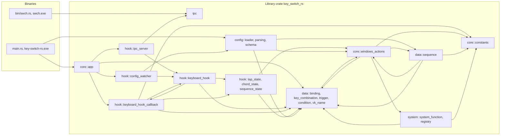
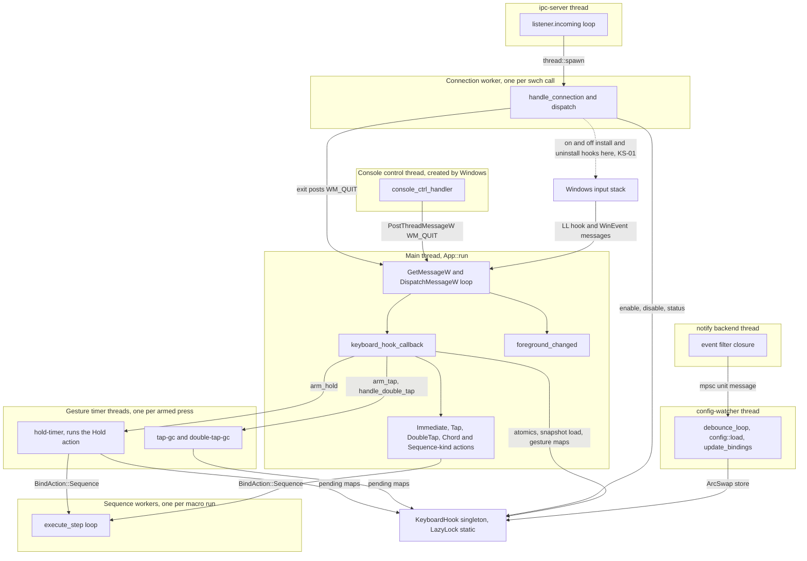
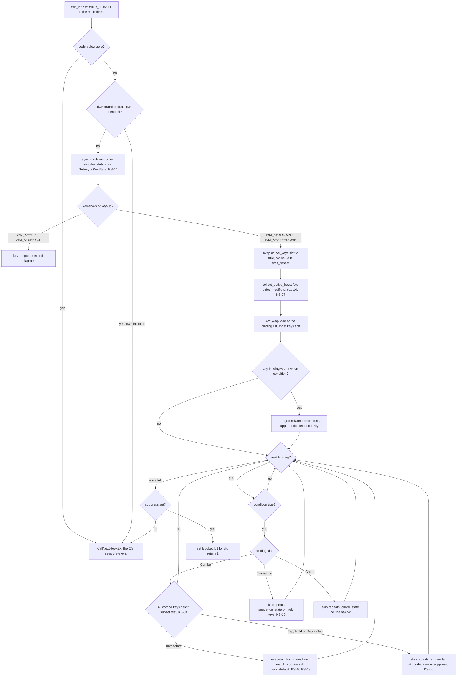
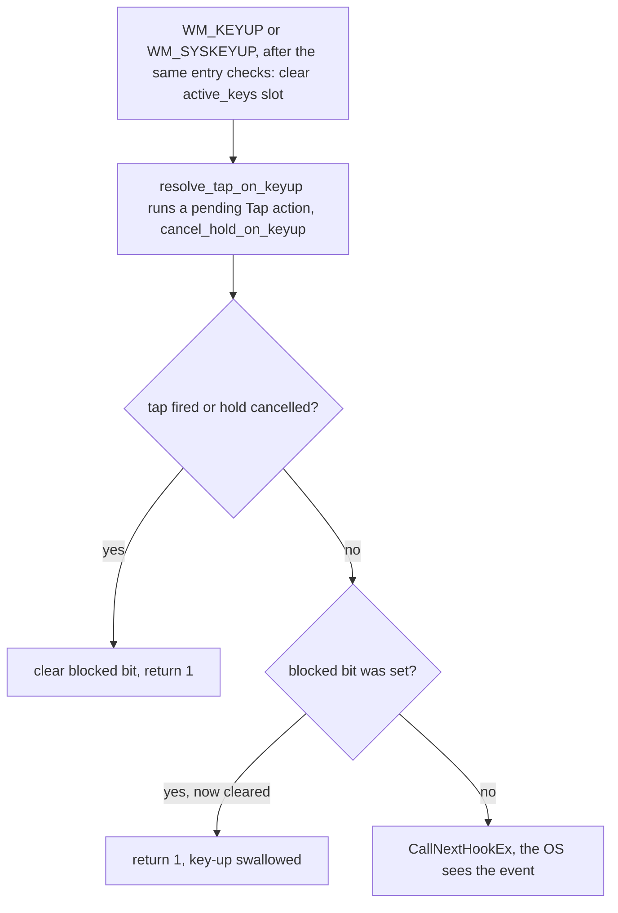
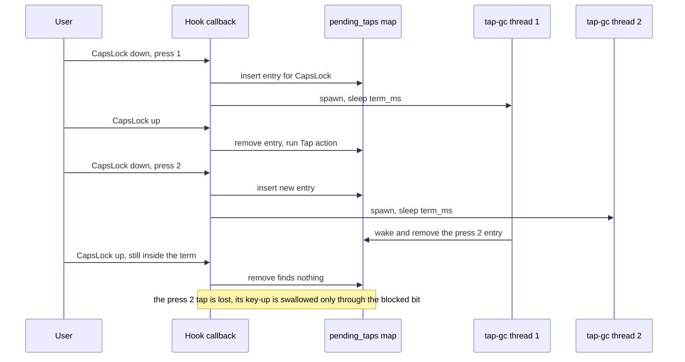
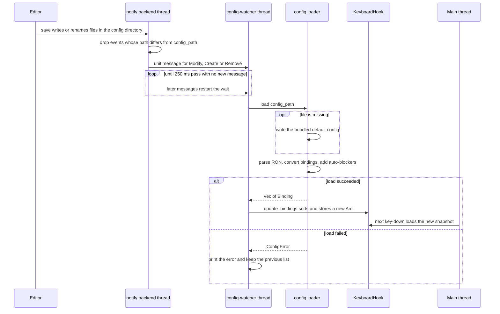
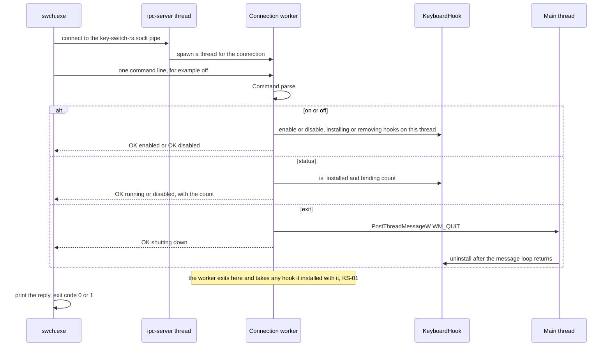

# Architecture

The key-switch-rs daemon is a single console process, elevated in release builds. Its main thread owns a `WH_KEYBOARD_LL` hook, a foreground WinEvent hook and the message loop that services both. The IPC server, hot reload, gesture timers and macro workers run on helper threads that share one process-wide `KeyboardHook` value. This chapter describes that structure as it exists in the code and shows where the structure itself, not just single lines, causes the defects listed in the [audit](audit.md).

> [!NOTE]
> Facts describe commit [`7cb3521`](https://github.com/bluesteelll/key-switch-rs/tree/7cb3521) (2026-05-20). The audit date is 2026-10-14. Every code reference is a permalink to that commit. Issue IDs such as [KS-04](audit.md#ks-04) link to their entries in the audit chapter.

## Crate layout

One Cargo package (edition 2024, version 0.1.0) builds a library crate and two binaries. The library exists so that the CLI can share the IPC protocol with the daemon ([src/lib.rs:1-10](https://github.com/bluesteelll/key-switch-rs/blob/7cb3521/src/lib.rs#L1-L10)).

| Target | Source | Role |
|---|---|---|
| `key_switch_rs` (library) | `src/lib.rs` | Declares the six modules below. Both binaries import from it. |
| `key-switch-rs.exe` | `src/main.rs` | The daemon. Resolves the config path, loads it and runs `App`. |
| `swch.exe` | `src/bin/swch.rs` | CLI driver. From the library it uses only the `ipc` module; it also calls `interprocess` directly and `ShellExecuteW` for `open`. |
| Build script | `build.rs` | Embeds a `requireAdministrator` manifest into the release daemon only. |

The runtime dependencies are `windows` 0.62.2, `serde` 1.0.228, `ron` 0.10.1, `arc-swap` 1.9.1, `notify` 8.2.0 and `interprocess` 2.4.2 (versions from `Cargo.lock`).

| Module | Files | Responsibility |
|---|---|---|
| `config` | `loader.rs`, `parsing.rs`, `schema.rs`, `default_config.ron` | Reads `config.ron`, deserializes it into `Raw*` serde types, validates and converts each entry into a `Binding`, adds auto-blockers, and writes the bundled default file on first run. Only `load` and `default_config_path` are exported ([src/config/mod.rs:15](https://github.com/bluesteelll/key-switch-rs/blob/7cb3521/src/config/mod.rs#L15)). |
| `core` | `app.rs`, `constants.rs`, `windows_actions.rs` | The `App` builder and process lifecycle, the injected-event sentinel, and `BindAction` with its execution code. |
| `data` | `binding.rs`, `key_combination.rs`, `trigger.rs`, `condition.rs`, `sequence.rs`, `vk_name.rs` | The runtime model: bindings, kinds, triggers, `when:` conditions, macro steps and key-name tables. `sequence.rs` also runs macros. |
| `hook` | `keyboard_hook.rs`, `keyboard_hook_callback.rs`, `tap_state.rs`, `chord_state.rs`, `sequence_state.rs`, `config_watcher.rs`, `ipc_server.rs` | Hook installation and shared state, the hook callback, the three gesture state machines, and the two background services (file watcher and pipe server). |
| `ipc` | `ipc.rs` | Pipe name, the `Command` enum and the line-based wire format. |
| `system` | `system_function.rs`, `registry.rs` | The OS functions behind `SwitchLanguage` and `ToggleCapsLock`, and the registry lookup of the Windows language hotkey. |

The `hook` module holds more than the hook: the pipe server and the file watcher live there too, and both take the `&'static KeyboardHook`.

The modules are not layered. `core::windows_actions` and `data::sequence` import each other. `core` and `data` import each other, and so do `core` and `system`. `core::app` sits above `hook`, while `hook` imports `core`. Rust allows cycles inside one crate, but they make it hard to test or replace one part on its own. That matters for the testing gap described in [Design strengths and architectural root causes](#design-strengths-and-architectural-root-causes).

## Startup sequence

1. `main` calls `run` and turns any error into `[FATAL] ...` followed by a blocking "Press Enter" prompt, so the console stays open ([src/main.rs:7-21](https://github.com/bluesteelll/key-switch-rs/blob/7cb3521/src/main.rs#L7-L21)).
2. `run` resolves the config path. The first argument is used as given; otherwise the path is `<exe_dir>\config.ron` ([src/main.rs:28-31](https://github.com/bluesteelll/key-switch-rs/blob/7cb3521/src/main.rs#L28-L31), [src/config/loader.rs:83-95](https://github.com/bluesteelll/key-switch-rs/blob/7cb3521/src/config/loader.rs#L83-L95)). The path is never made absolute, which disables hot reload for relative paths ([KS-21](audit.md#ks-21)).
3. `config::load` writes the bundled default if the file is missing, then parses, validates and expands the bindings ([src/main.rs:33](https://github.com/bluesteelll/key-switch-rs/blob/7cb3521/src/main.rs#L33)). Any error is fatal at startup. See [Config loading and hot reload](#config-loading-and-hot-reload).
4. The `App` builder collects the bindings and the watcher path: `App::new().with_config_watcher(path)`, then `add_binding` for each binding ([src/main.rs:35-38](https://github.com/bluesteelll/key-switch-rs/blob/7cb3521/src/main.rs#L35-L38), [src/core/app.rs:34-55](https://github.com/bluesteelll/key-switch-rs/blob/7cb3521/src/core/app.rs#L34-L55)).
5. `App::run` stores the main thread ID in two statics, one for the Ctrl+C handler and one for the IPC `exit` command. It then prints the binding banner and registers the console control handler ([src/core/app.rs:79-86](https://github.com/bluesteelll/key-switch-rs/blob/7cb3521/src/core/app.rs#L79-L86)).
6. `get_hook()` initialises the singleton. `update_bindings` sorts and publishes the list, and `install()` registers the `WH_KEYBOARD_LL` hook and the `EVENT_SYSTEM_FOREGROUND` WinEvent hook on the main thread ([src/core/app.rs:88-91](https://github.com/bluesteelll/key-switch-rs/blob/7cb3521/src/core/app.rs#L88-L91), [src/hook/keyboard_hook.rs:83-134](https://github.com/bluesteelll/key-switch-rs/blob/7cb3521/src/hook/keyboard_hook.rs#L83-L134)). If the second hook fails, the first is removed again.
7. `ipc_server::spawn` creates the pipe listener and starts the `ipc-server` thread. If it fails, the daemon only prints a warning and keeps running ([src/core/app.rs:94-98](https://github.com/bluesteelll/key-switch-rs/blob/7cb3521/src/core/app.rs#L94-L98)). The hook is already live at this point, so a second daemon keeps its hook without IPC ([KS-20](audit.md#ks-20)).
8. `config_watcher::spawn_watcher` starts the file watcher. A failure also only warns ([src/core/app.rs:106-123](https://github.com/bluesteelll/key-switch-rs/blob/7cb3521/src/core/app.rs#L106-L123)).
9. The main thread pumps `GetMessageW`/`DispatchMessageW` until `WM_QUIT` ([src/core/app.rs:125-131](https://github.com/bluesteelll/key-switch-rs/blob/7cb3521/src/core/app.rs#L125-L131)). This loop is what delivers both hooks' callbacks.
10. After `WM_QUIT`, `hook.uninstall()?` removes the hooks ([src/core/app.rs:134](https://github.com/bluesteelll/key-switch-rs/blob/7cb3521/src/core/app.rs#L134)). The watcher is dropped when `run` returns, which closes its channel and ends the debounce thread. The detached `ipc-server` thread ends with the process.

## Process and thread model

The main thread does the time-critical work. Windows delivers a low-level keyboard hook callback as a message to the thread that installed the hook, and that thread must pump messages. `WINEVENT_OUTOFCONTEXT` WinEvent callbacks use the same mechanism. The comment at [src/hook/keyboard_hook.rs:108-110](https://github.com/bluesteelll/key-switch-rs/blob/7cb3521/src/hook/keyboard_hook.rs#L108-L110) relies on this. Every other thread is either created by Windows (the console control handler) or a plain `std::thread` without a message loop.

| Thread | Created by | Runs | Lifetime |
|---|---|---|---|
| Main | Process start, then `App::run` | Startup config load, hook install, the message loop, `keyboard_hook_callback`, `foreground_changed`, condition evaluation, every Immediate action, Tap actions (on key-up), DoubleTap actions (on the second key-down), Chord and Sequence-kind completion actions, final uninstall | Process |
| Console control | Windows, on Ctrl+C or console close ([src/core/app.rs:72-77](https://github.com/bluesteelll/key-switch-rs/blob/7cb3521/src/core/app.rs#L72-L77)) | `console_ctrl_handler`, which posts `WM_QUIT` to the main thread ([src/core/app.rs:140-161](https://github.com/bluesteelll/key-switch-rs/blob/7cb3521/src/core/app.rs#L140-L161)) | One signal |
| `ipc-server` | `ipc_server::spawn` ([src/hook/ipc_server.rs:63-80](https://github.com/bluesteelll/key-switch-rs/blob/7cb3521/src/hook/ipc_server.rs#L63-L80)) | The accept loop | Process (detached) |
| Connection worker (unnamed) | One `thread::spawn` per accepted connection ([src/hook/ipc_server.rs:72](https://github.com/bluesteelll/key-switch-rs/blob/7cb3521/src/hook/ipc_server.rs#L72)) | Reads one line, then `dispatch`: `enable`/`disable` (hook install and uninstall), status, `exit` | One request, or forever if the client never sends a line ([KS-26](audit.md#ks-26)) |
| notify backend | `notify::recommended_watcher` | The filter closure ([src/hook/config_watcher.rs:44-59](https://github.com/bluesteelll/key-switch-rs/blob/7cb3521/src/hook/config_watcher.rs#L44-L59)) | While the watcher value lives |
| `config-watcher` | `spawn_watcher` ([src/hook/config_watcher.rs:71-74](https://github.com/bluesteelll/key-switch-rs/blob/7cb3521/src/hook/config_watcher.rs#L71-L74)) | Debounce, `config::load` (including the registry read for auto-blockers), `update_bindings` | Until the channel closes |
| `tap-gc`, `hold-timer`, `double-tap-gc` | Every arm in `TapState` ([src/hook/tap_state.rs:61-67](https://github.com/bluesteelll/key-switch-rs/blob/7cb3521/src/hook/tap_state.rs#L61-L67), [105-119](https://github.com/bluesteelll/key-switch-rs/blob/7cb3521/src/hook/tap_state.rs#L105-L119), [158-167](https://github.com/bluesteelll/key-switch-rs/blob/7cb3521/src/hook/tap_state.rs#L158-L167)) | Sleep for the term, remove the entry; `hold-timer` also runs the Hold action | One term, never cancelled |
| Sequence worker (unnamed) | `spawn_sequence` for every `BindAction::Sequence` run ([src/data/sequence.rs:114-125](https://github.com/bluesteelll/key-switch-rs/blob/7cb3521/src/data/sequence.rs#L114-L125)) | All steps, including `Delay` sleeps | Until the last step; no cancellation or limit |

### Why `swch on` kills the hook (KS-01)

`KeyboardHook::enable` and `disable` call `install` and `uninstall` directly on the calling thread ([src/hook/keyboard_hook.rs:143-157](https://github.com/bluesteelll/key-switch-rs/blob/7cb3521/src/hook/keyboard_hook.rs#L143-L157)). The only callers are `dispatch` for `on` and `off` ([src/hook/ipc_server.rs:115](https://github.com/bluesteelll/key-switch-rs/blob/7cb3521/src/hook/ipc_server.rs#L115), [123](https://github.com/bluesteelll/key-switch-rs/blob/7cb3521/src/hook/ipc_server.rs#L123)), and they run on a connection worker. At startup the hooks belong to the main thread. `swch off` still removes the keyboard hook, because `UnhookWindowsHookEx` works from any thread of the process, but the WinEvent hook leaks: `UnhookWinEvent` must be called from the installing thread and its result is ignored ([src/hook/keyboard_hook.rs:160-168](https://github.com/bluesteelll/key-switch-rs/blob/7cb3521/src/hook/keyboard_hook.rs#L160-L168)). `swch on` then registers both hooks on a worker that never pumps messages and exits right after it replies. Windows destroys hooks owned by a thread when that thread exits. `hook_handle` still holds the stale handle, so `is_installed()` keeps reporting `running` and every later `on` returns early. At shutdown, `UnhookWindowsHookEx` fails on the stale handle, `run` returns an error, and the daemon stops at the `[FATAL]` prompt. Nothing in the type system says which thread may call `install`. See [KS-01](audit.md#ks-01).

### Why actions can stall all keyboard input (KS-08)

Windows does not pass a keystroke on to any application until the low-level hook callback returns. If the callback takes longer than `LowLevelHooksTimeout`, Windows skips it, and on Windows 7 and later it can remove the hook silently. Only `BindAction::Sequence` moves its work to another thread ([src/core/windows_actions.rs:119-122](https://github.com/bluesteelll/key-switch-rs/blob/7cb3521/src/core/windows_actions.rs#L119-L122)). `Launch` (`CreateProcessW` through `Command::spawn`) and `OpenUrl` (`ShellExecuteW`, with COM never initialised) run inside the callback ([src/core/windows_actions.rs:123-124](https://github.com/bluesteelll/key-switch-rs/blob/7cb3521/src/core/windows_actions.rs#L123-L124)). The same happens for Tap actions on key-up ([src/hook/tap_state.rs:83](https://github.com/bluesteelll/key-switch-rs/blob/7cb3521/src/hook/tap_state.rs#L83)), DoubleTap actions, which also run while the `pending_double_taps` mutex is held ([src/hook/tap_state.rs:148](https://github.com/bluesteelll/key-switch-rs/blob/7cb3521/src/hook/tap_state.rs#L148)), and Chord and Sequence-kind completions. Nothing watches whether the hook is still installed. See [KS-08](audit.md#ks-08).

## The key-event path

`keyboard_hook_callback` ([src/hook/keyboard_hook_callback.rs:124-161](https://github.com/bluesteelll/key-switch-rs/blob/7cb3521/src/hook/keyboard_hook_callback.rs#L124-L161)) runs on the main thread for every keyboard event on the desktop. It either returns `LRESULT(1)`, which drops the event, or calls `CallNextHookEx`, which passes it on.

1. **Negative code.** If `code < 0`, the event is passed on unchanged ([L129-L131](https://github.com/bluesteelll/key-switch-rs/blob/7cb3521/src/hook/keyboard_hook_callback.rs#L129-L131)).
2. **Sentinel check.** If `KBDLLHOOKSTRUCT::dwExtraInfo` equals the per-process sentinel, the event is the daemon's own `SendInput` output and is passed on, so actions never trigger bindings ([L136-L138](https://github.com/bluesteelll/key-switch-rs/blob/7cb3521/src/hook/keyboard_hook_callback.rs#L136-L138)). Only `vkCode` and `dwExtraInfo` are read. `scanCode` and `flags` (including `LLKHF_INJECTED` and the extended-key bit) are ignored, so input injected by other programs is matched like physical input, and the fake LCtrl that AltGr sends looks like a real Ctrl.
3. **`sync_modifiers`.** For each of the 11 modifier codes (generic and sided Shift, Ctrl and Alt, plus LWin and RWin) except the key being delivered, the `active_keys` slot is overwritten with `GetAsyncKeyState` ([L86-L97](https://github.com/bluesteelll/key-switch-rs/blob/7cb3521/src/hook/keyboard_hook_callback.rs#L86-L97), called at [L146](https://github.com/bluesteelll/key-switch-rs/blob/7cb3521/src/hook/keyboard_hook_callback.rs#L146)). The current key is skipped because Windows updates its async state only after the hook returns. This repairs modifiers whose key-up was lost. It also clears modifiers whose key-down the hook itself suppressed, because a suppressed event never reaches the async state ([KS-14](audit.md#ks-14)).
4. **Direction.** `WM_KEYDOWN`/`WM_SYSKEYDOWN` go to `handle_key_down` and `WM_KEYUP`/`WM_SYSKEYUP` go to `handle_key_up` ([L148-L157](https://github.com/bluesteelll/key-switch-rs/blob/7cb3521/src/hook/keyboard_hook_callback.rs#L148-L157)).
5. **Repeat detection.** `was_repeat = active_keys[vk].swap(true)` ([L191-L195](https://github.com/bluesteelll/key-switch-rs/blob/7cb3521/src/hook/keyboard_hook_callback.rs#L191-L195)). It is true for every typematic auto-repeat, because no key-up arrives in between.
6. **Normalisation.** `collect_active_keys` scans all 256 slots, folds LShift/RShift to Shift, LCtrl/RCtrl to Ctrl, LAlt/RAlt to Alt and RWin to LWin, and deduplicates into a 16-entry stack buffer. Keys beyond 16 are dropped ([L327-L347](https://github.com/bluesteelll/key-switch-rs/blob/7cb3521/src/hook/keyboard_hook_callback.rs#L327-L347), [L50](https://github.com/bluesteelll/key-switch-rs/blob/7cb3521/src/hook/keyboard_hook_callback.rs#L50)). Binding keys are not normalised when the config is parsed, so a combo or sequence step written with `LShift`, `RCtrl` or `RWin` can never match ([KS-07](audit.md#ks-07)).
7. **Snapshot.** `hook.bindings()` loads the current `Arc<Vec<Binding>>` once. It stays valid for the rest of the callback even if a reload swaps the list ([L202](https://github.com/bluesteelll/key-switch-rs/blob/7cb3521/src/hook/keyboard_hook_callback.rs#L202)). The list is sorted by key count, most keys first ([src/hook/keyboard_hook.rs:71-74](https://github.com/bluesteelll/key-switch-rs/blob/7cb3521/src/hook/keyboard_hook.rs#L71-L74)).
8. **Foreground context.** If any binding in the snapshot has a `when:` other than `Always`, a `ForegroundContext` is captured ([L207-L211](https://github.com/bluesteelll/key-switch-rs/blob/7cb3521/src/hook/keyboard_hook_callback.rs#L207-L211)). See [Conditions](#conditions).
9. **Binding loop.** Each binding is checked in order ([L216-L292](https://github.com/bluesteelll/key-switch-rs/blob/7cb3521/src/hook/keyboard_hook_callback.rs#L216-L292)). The condition is evaluated first, then the kind:
   - **Combo.** `combo.matches(active_keys)` checks that every key of the combo is held ([src/data/key_combination.rs:49-51](https://github.com/bluesteelll/key-switch-rs/blob/7cb3521/src/data/key_combination.rs#L49-L51)). Nothing checks that the key just pressed belongs to the combo, so any key-down while the combo's keys are held matches again ([KS-04](audit.md#ks-04)).
     - `Immediate`: only the first matching Immediate binding executes (`immediate_fired`), and it executes on every auto-repeat ([KS-10](audit.md#ks-10)). Every matching Immediate binding with `block_default` sets `suppress`, including bindings that did not fire ([L229-L237](https://github.com/bluesteelll/key-switch-rs/blob/7cb3521/src/hook/keyboard_hook_callback.rs#L229-L237)).
     - `Tap`/`Hold`/`DoubleTap`: repeats are skipped, the gesture is armed under `vk_code`, which is the key just pressed and not necessarily the binding's key, and `suppress` is set whatever `block_default` says ([L238-L252](https://github.com/bluesteelll/key-switch-rs/blob/7cb3521/src/hook/keyboard_hook_callback.rs#L238-L252)).
   - **Sequence.** Repeats are skipped. `sequence_state.handle_keydown` gets the normalised set of held keys. `Advanced` and `Completed` set `suppress`, and `Completed` also marks every key of the last step as blocked ([L255-L272](https://github.com/bluesteelll/key-switch-rs/blob/7cb3521/src/hook/keyboard_hook_callback.rs#L255-L272)).
   - **Chord.** Repeats are skipped. `chord_state.handle_keydown` gets the raw, sided `vk_code`. Any key of the chord sets `suppress`, and completion marks all chord keys as blocked ([L273-L290](https://github.com/bluesteelll/key-switch-rs/blob/7cb3521/src/hook/keyboard_hook_callback.rs#L273-L290)).
10. **Specificity.** The sort order affects only which Immediate binding fires. Less specific deferred, Sequence and Chord bindings still arm or advance, and a non-winning binding's `block_default` overrides `block_default: false` on the winner ([KS-13](audit.md#ks-13)).
11. **Suppress decision.** If any binding asked for suppression, the key's bit is set in `blocked_keys` and the callback returns `LRESULT(1)` ([L294-L297](https://github.com/bluesteelll/key-switch-rs/blob/7cb3521/src/hook/keyboard_hook_callback.rs#L294-L297)). Only the current event is dropped. Modifier key-downs that passed earlier stay with the OS.
12. **Key-up.** `handle_key_up` clears the `active_keys` slot, resolves a pending Tap (running its action inline) and cancels a pending Hold. If either existed, it clears the blocked bit and swallows the key-up. Otherwise it swallows the key-up only if `take_blocked` finds the bit set ([L302-L325](https://github.com/bluesteelll/key-switch-rs/blob/7cb3521/src/hook/keyboard_hook_callback.rs#L302-L325)). `when:` conditions are not evaluated on key-up.

The first diagram shows the checks every event passes and the key-down path (steps 1 to 11); the second shows the key-up path (step 12).

> [!WARNING]
> **Stuck keys ([KS-06](audit.md#ks-06)).** The deferred, Sequence and Chord branches skip auto-repeats with `continue` before they set `suppress` ([L239](https://github.com/bluesteelll/key-switch-rs/blob/7cb3521/src/hook/keyboard_hook_callback.rs#L239), [244](https://github.com/bluesteelll/key-switch-rs/blob/7cb3521/src/hook/keyboard_hook_callback.rs#L244), [249](https://github.com/bluesteelll/key-switch-rs/blob/7cb3521/src/hook/keyboard_hook_callback.rs#L249), [256](https://github.com/bluesteelll/key-switch-rs/blob/7cb3521/src/hook/keyboard_hook_callback.rs#L256), [274](https://github.com/bluesteelll/key-switch-rs/blob/7cb3521/src/hook/keyboard_hook_callback.rs#L274)). The repeats therefore reach the OS, while the key-up is still swallowed through the blocked bit ([L324](https://github.com/bluesteelll/key-switch-rs/blob/7cb3521/src/hook/keyboard_hook_callback.rs#L324)). Applications see a key that goes down and never comes up. The same happens to an Immediate combo that stops matching while its key is held.

> [!WARNING]
> **Lone Win or Alt ([KS-12](audit.md#ks-12)).** For a combo such as `Win+Q`, only the `Q` events are dropped. The OS sees Win down and Win up with nothing in between, which opens the Start menu; a lone Alt activates the menu bar. No mask key is injected ([L294](https://github.com/bluesteelll/key-switch-rs/blob/7cb3521/src/hook/keyboard_hook_callback.rs#L294)).

> [!WARNING]
> **Auto-blocker ([KS-05](audit.md#ks-05)).** `block_original_combo: true` on the default `CapsLock -> SwitchLanguage` binding adds a `DoNothing` Immediate binding on the OS language hotkey, usually `Alt+Shift` ([src/config/loader.rs:172-191](https://github.com/bluesteelll/key-switch-rs/blob/7cb3521/src/config/loader.rs#L172-L191)). Because of the subset test, it matches as soon as both modifiers are held and swallows the second modifier's key-down ([L234](https://github.com/bluesteelll/key-switch-rs/blob/7cb3521/src/hook/keyboard_hook_callback.rs#L234)). `Alt+Shift+X` therefore never reaches the application: it arrives without one modifier or not at all. Windows switches language only on a bare press and release of the two modifiers, so only that case needs blocking.

## Core data structures

All hot state lives in one `KeyboardHook` value ([src/hook/keyboard_hook.rs:22-44](https://github.com/bluesteelll/key-switch-rs/blob/7cb3521/src/hook/keyboard_hook.rs#L22-L44)), held in a process-wide `LazyLock` static ([src/hook/keyboard_hook_callback.rs:24](https://github.com/bluesteelll/key-switch-rs/blob/7cb3521/src/hook/keyboard_hook_callback.rs#L24)). A `LazyLock` is used instead of a plain `static` because creating the `ArcSwap` allocates, so `KeyboardHook::new` cannot be `const`. `get_hook()` returns `&'static KeyboardHook`, which is what `ipc_server::spawn` and `spawn_watcher` take.

The reference is shared rather than `&'static mut`, and the doc comment of `get_hook()` gives re-entrant callback invocations as the reason ([src/hook/keyboard_hook_callback.rs:26-32](https://github.com/bluesteelll/key-switch-rs/blob/7cb3521/src/hook/keyboard_hook_callback.rs#L26-L32)). All mutable state sits behind atomics, `ArcSwap` or mutexes, so a re-entered callback stays memory-safe.

| Field or static | Type | Written by | Read by |
|---|---|---|---|
| `KEYBOARD_HOOK` | `LazyLock<KeyboardHook>` | First `get_hook()` call | Everything |
| `bindings` | `ArcSwap<Vec<Binding>>` ([L29](https://github.com/bluesteelll/key-switch-rs/blob/7cb3521/src/hook/keyboard_hook.rs#L29)) | `update_bindings`: main thread at startup, `config-watcher` on reload | The callback (one load per key-down), IPC `status` |
| `hook_handle`, `foreground_hook` | `AtomicPtr<c_void>` ([L30-L31](https://github.com/bluesteelll/key-switch-rs/blob/7cb3521/src/hook/keyboard_hook.rs#L30-L31)) | `install`, `uninstall` (`swap` to null) | `is_installed`, which only checks `hook_handle` for non-null |
| `active_keys` | `[AtomicBool; 256]` ([L37](https://github.com/bluesteelll/key-switch-rs/blob/7cb3521/src/hook/keyboard_hook.rs#L37)) | Key-down `swap(true)`, key-up `store(false)`, `sync_modifiers` | `collect_active_keys`, repeat detection |
| `blocked_keys` | `[AtomicU64; 4]` ([L36](https://github.com/bluesteelll/key-switch-rs/blob/7cb3521/src/hook/keyboard_hook.rs#L36)) | `mark_blocked`, `mark_completed_keys_blocked`, `clear_all_blocked` | `take_blocked` on key-up |
| `tap_state` | 3 x `Arc<Mutex<HashMap<u16, BindAction>>>` ([src/hook/tap_state.rs:21-34](https://github.com/bluesteelll/key-switch-rs/blob/7cb3521/src/hook/tap_state.rs#L21-L34)) | Callback, timer threads | Callback, timer threads |
| `chord_state` | `Arc<Mutex<Vec<PendingChord>>>` ([src/hook/chord_state.rs:37-39](https://github.com/bluesteelll/key-switch-rs/blob/7cb3521/src/hook/chord_state.rs#L37-L39)) | Callback | Callback |
| `sequence_state` | `Arc<Mutex<Vec<PendingSequence>>>` ([src/hook/sequence_state.rs:32-35](https://github.com/bluesteelll/key-switch-rs/blob/7cb3521/src/hook/sequence_state.rs#L32-L35)) | Callback | Callback |
| `SENTINEL` | `OnceLock<usize>` ([src/core/constants.rs:5](https://github.com/bluesteelll/key-switch-rs/blob/7cb3521/src/core/constants.rs#L5)) | First `injected_sentinel()` call | Every `SendInput` builder, the callback |
| `MAIN_THREAD_ID` (two copies) | `AtomicU32` ([src/core/app.rs:16](https://github.com/bluesteelll/key-switch-rs/blob/7cb3521/src/core/app.rs#L16), [src/hook/ipc_server.rs:29](https://github.com/bluesteelll/key-switch-rs/blob/7cb3521/src/hook/ipc_server.rs#L29)) | `App::run` | Ctrl+C handler, IPC `exit` |

### `ArcSwap<Vec<Binding>>`

Reads are lock-free: the callback takes one `Guard` per key-down and iterates it. `update_bindings` sorts the new list by `key_count()` descending with a stable sort, then publishes it with one atomic store ([src/hook/keyboard_hook.rs:71-74](https://github.com/bluesteelll/key-switch-rs/blob/7cb3521/src/hook/keyboard_hook.rs#L71-L74)). Clippy's only lint in the crate (`unnecessary_sort_by`) is on the sort line and is purely stylistic. The stable sort keeps load order among bindings with the same key count. The loader inserts each auto-blocker just before the binding that requested it, so the blocker shadows any later Immediate user binding on the same combo, including the requesting binding itself when its `keys` are the OS hotkey ([KS-18](audit.md#ks-18)). `key_count` is the number of keys for a Combo or Chord and the number of steps for a Sequence ([src/data/binding.rs:42-48](https://github.com/bluesteelll/key-switch-rs/blob/7cb3521/src/data/binding.rs#L42-L48)). A `BindAction::Sequence` holds its steps in an `Arc`, so a macro that is running keeps its steps after a reload.

### `[AtomicBool; 256]` active-keys table

One flag per virtual-key code. It serves two purposes: it is the set of held keys used for matching, and its previous value is the repeat detector. The table has two writers that disagree. The callback's own down/up tracking reflects what the hook saw, while `sync_modifiers` writes what the OS believes, and the OS never sees suppressed events. That conflict is the root of [KS-14](audit.md#ks-14). Only the 11 modifier slots are ever resynced. A missed key-up for any other key leaves a phantom held key (reported by one reviewer, not independently verified: [KS-29](audit.md#ks-29)).

### `[AtomicU64; 4]` blocked-key bitmap

One bit per virtual-key code, packed into four 64-bit words. `mark_blocked` uses `fetch_or`, and `take_blocked` uses `fetch_and` and reports whether the bit was set ([src/hook/keyboard_hook_callback.rs:99-122](https://github.com/bluesteelll/key-switch-rs/blob/7cb3521/src/hook/keyboard_hook_callback.rs#L99-L122)). It pairs a suppressed key-down with its key-up, so an application never sees a release without a press. It replaced an earlier single-key field that could track only the most recent block ([src/hook/keyboard_hook.rs:32-35](https://github.com/bluesteelll/key-switch-rs/blob/7cb3521/src/hook/keyboard_hook.rs#L32-L35)). It pairs only down with up; auto-repeats are not covered, which is [KS-06](audit.md#ks-06).

### The PID-mixed sentinel

Every synthesized event carries `injected_sentinel()` in `dwExtraInfo`. On 64-bit targets it is `(pid << 32) | 0xDEADBEEF` ([src/core/constants.rs:15-28](https://github.com/bluesteelll/key-switch-rs/blob/7cb3521/src/core/constants.rs#L15-L28)). The process ID makes collisions with other injectors (AutoHotkey, PowerToys), which tend to use small constants, very unlikely. `is_injected_event` is an exact comparison ([src/core/constants.rs:30-32](https://github.com/bluesteelll/key-switch-rs/blob/7cb3521/src/core/constants.rs#L30-L32)).

### Gesture state maps

`TapState` keeps its maps in `Arc<Mutex<...>>` so that timer threads can hold a clone without a `'static` borrow of `KeyboardHook`. `ChordState` and `SequenceState` use the same wrapper, although only the callback touches them. Entries hold cloned `BindAction` values. None of the maps is cleared on hot reload, on `swch off`/`on`, or on a foreground change (not independently verified as a defect: [KS-31](audit.md#ks-31)). Only the blocked bits are cleared, by `foreground_changed`.

## Gesture state machines

### Tap, Hold and DoubleTap (`tap_state.rs`)

The three maps are keyed only by the virtual-key code. A mutex serialises resolution: whichever side removes the entry first acts on it, and the other side finds nothing ([src/hook/tap_state.rs:1-10](https://github.com/bluesteelll/key-switch-rs/blob/7cb3521/src/hook/tap_state.rs#L1-L10)).

| Trigger | Key-down | Timer thread after `term_ms` | Key-up | Action runs on |
|---|---|---|---|---|
| `Tap(ms)` | Insert if absent, spawn `tap-gc` ([L46-L68](https://github.com/bluesteelll/key-switch-rs/blob/7cb3521/src/hook/tap_state.rs#L46-L68)) | Remove the entry; the press counts as too long | Remove the entry and run the action ([L74-L88](https://github.com/bluesteelll/key-switch-rs/blob/7cb3521/src/hook/tap_state.rs#L74-L88)) | Main thread |
| `Hold(ms)` | Insert if absent, spawn `hold-timer` ([L94-L120](https://github.com/bluesteelll/key-switch-rs/blob/7cb3521/src/hook/tap_state.rs#L94-L120)) | Remove the entry and run the action | Remove the entry, which cancels the gesture ([L125-L131](https://github.com/bluesteelll/key-switch-rs/blob/7cb3521/src/hook/tap_state.rs#L125-L131)) | `hold-timer` thread |
| `DoubleTap(ms)` | If an entry exists, remove it and run the action while the lock is held; otherwise insert and spawn `double-tap-gc` ([L140-L170](https://github.com/bluesteelll/key-switch-rs/blob/7cb3521/src/hook/tap_state.rs#L140-L170)) | Remove the entry | Nothing in `TapState`; the blocked bit swallows the key-up | Main thread |

Every armed press spawns its own sleeper thread, and these threads are never cancelled. A timer from an earlier press acts on whatever entry is present when it wakes, so it can delete a newer Tap or fire a newer Hold early ([KS-11](audit.md#ks-11)):

The comment in `arm_hold` says the timer removes and fires "under the same critical section" ([L109-L110](https://github.com/bluesteelll/key-switch-rs/blob/7cb3521/src/hook/tap_state.rs#L109-L110)). In fact the mutex guard is a temporary that is dropped at the end of the `let` statement, so the Hold action runs outside the lock. Tap and Hold on the same key are armed separately with nothing linking them, so with equal terms the outcome depends on thread scheduling ([KS-25](audit.md#ks-25)). A failed `thread::spawn` panics through `.expect` inside the callback, which aborts the daemon (reported by one reviewer, not independently verified: [KS-33](audit.md#ks-33)).

### Chord (`chord_state.rs`)

A chord fires when all of its keys go down within `window` of the first one, in any order ([src/hook/chord_state.rs:61-120](https://github.com/bluesteelll/key-switch-rs/blob/7cb3521/src/hook/chord_state.rs#L61-L120)). For each Chord binding on each non-repeat key-down:

1. The binding's keys are copied into a new `Vec` and sorted ([L70-L71](https://github.com/bluesteelll/key-switch-rs/blob/7cb3521/src/hook/chord_state.rs#L70-L71)). This allocation happens on every key-down, contrary to the README's "Hot-path allocations: none" ([README.md:497](https://github.com/bluesteelll/key-switch-rs/blob/7cb3521/README.md?plain=1#L497)).
2. If the raw `vk` is not in that list, the result is `NotInChord` ([L73](https://github.com/bluesteelll/key-switch-rs/blob/7cb3521/src/hook/chord_state.rs#L73)). The raw code is sided (`VK_LSHIFT`), while `"Shift"` parses to `VK_SHIFT`, so an unsided modifier never completes a chord ([KS-07](audit.md#ks-07)).
3. Expired entries are dropped (lazy expiry, no timer thread), and the entry with the same key set is found or created with `expires_at = now + window` ([L83-L116](https://github.com/bluesteelll/key-switch-rs/blob/7cb3521/src/hook/chord_state.rs#L83-L116)). The window is not extended by later keys.
4. When the seen set equals the chord set, the lock is released, the action runs on the main thread, and all chord keys are marked blocked ([L94-L103](https://github.com/bluesteelll/key-switch-rs/blob/7cb3521/src/hook/chord_state.rs#L94-L103), [L126-L134](https://github.com/bluesteelll/key-switch-rs/blob/7cb3521/src/hook/chord_state.rs#L126-L134)).

Every key-down of a chord key is suppressed, whether or not the chord completes. Keys of a failed chord are lost; there is no replay buffer ([src/hook/chord_state.rs:12-17](https://github.com/bluesteelll/key-switch-rs/blob/7cb3521/src/hook/chord_state.rs#L12-L17)).

### Sequence (`sequence_state.rs`)

A sequence is a list of combo steps pressed in order, with at most `max_gap` between steps ([src/hook/sequence_state.rs:55-120](https://github.com/bluesteelll/key-switch-rs/blob/7cb3521/src/hook/sequence_state.rs#L55-L120)). Pending entries are identified by the step list, so bindings with identical steps share one slot. For each Sequence binding on each non-repeat key-down:

1. Expired entries are dropped ([L71](https://github.com/bluesteelll/key-switch-rs/blob/7cb3521/src/hook/sequence_state.rs#L71)).
2. If an entry is pending and the next step matches the held keys, the entry advances and its deadline moves to `now + max_gap`. On the last step the lock is released, the action runs on the main thread, and `Completed` returns the last step's keys for blocking ([L74-L89](https://github.com/bluesteelll/key-switch-rs/blob/7cb3521/src/hook/sequence_state.rs#L74-L89)).
3. Any other key-down removes the pending entry ([L95](https://github.com/bluesteelll/key-switch-rs/blob/7cb3521/src/hook/sequence_state.rs#L95)). The code then checks whether the key-down matches step 0 ([L99](https://github.com/bluesteelll/key-switch-rs/blob/7cb3521/src/hook/sequence_state.rs#L99)), although the comment at [L91-L94](https://github.com/bluesteelll/key-switch-rs/blob/7cb3521/src/hook/sequence_state.rs#L91-L94) says it does not restart at step 0.

The state machine never sees which key was just pressed, only the held set. Rollover therefore completes a step ([KS-15](audit.md#ks-15)). A step that adds a modifier fails, because the modifier's own key-down does not match the full step and aborts the sequence ([KS-16](audit.md#ks-16)). Marking every key of the last step as blocked also swallows key-ups whose key-down reached the application (not independently verified: [KS-32](audit.md#ks-32)).

## Conditions

`Condition` is a small expression tree: `Always`, `AppEquals`, `TitleContains`, `TitleEquals`, `Not`, `And` and `Or` ([src/data/condition.rs:25-47](https://github.com/bluesteelll/key-switch-rs/blob/7cb3521/src/data/condition.rs#L25-L47)). It is evaluated against a `ForegroundContext` ([L85-L163](https://github.com/bluesteelll/key-switch-rs/blob/7cb3521/src/data/condition.rs#L85-L163)):

- `capture()` makes one call, `GetForegroundWindow` ([L95-L103](https://github.com/bluesteelll/key-switch-rs/blob/7cb3521/src/data/condition.rs#L95-L103)).
- `app()` and `title()` are `OnceCell`s. The Win32 calls run on first use and are cached for the rest of that keystroke ([L107-L119](https://github.com/bluesteelll/key-switch-rs/blob/7cb3521/src/data/condition.rs#L107-L119)).

The context is collected in `handle_key_down`, once per key-down, only if at least one binding in the current snapshot has a condition other than `Always` ([src/hook/keyboard_hook_callback.rs:207-211](https://github.com/bluesteelll/key-switch-rs/blob/7cb3521/src/hook/keyboard_hook_callback.rs#L207-L211)). A config without `when:` pays nothing. The condition is evaluated before the binding's keys are matched ([L217-L221](https://github.com/bluesteelll/key-switch-rs/blob/7cb3521/src/hook/keyboard_hook_callback.rs#L217-L221)), so the first conditional binding triggers the process or title lookup on every key-down, on the hook thread, even when its keys are not held. Conditions are not evaluated on key-up or in timer threads: a Tap or Hold armed under a condition fires later without checking it again. Auto-blockers are always `Condition::Always`, whatever the owner's `when:` says (not independently verified: [KS-35](audit.md#ks-35)).

> [!WARNING]
> **`AppEquals` never matches ([KS-03](audit.md#ks-03)).** `fetch_app` opens the process with `PROCESS_QUERY_LIMITED_INFORMATION` and calls `GetModuleBaseNameW` ([src/data/condition.rs:139-144](https://github.com/bluesteelll/key-switch-rs/blob/7cb3521/src/data/condition.rs#L139-L144)). That call reads the target's module list and needs `PROCESS_QUERY_INFORMATION | PROCESS_VM_READ`. It fails with `ERROR_ACCESS_DENIED`, which a probe confirmed on the audit machine. `app()` is therefore always `None`, `AppEquals` is always false and `Not(AppEquals(...))` is always true. The comment at [L133-L135](https://github.com/bluesteelll/key-switch-rs/blob/7cb3521/src/data/condition.rs#L133-L135) states the opposite.

`TitleContains` folds case with Unicode `to_lowercase`, while `TitleEquals` and `AppEquals` use `eq_ignore_ascii_case` ([L60-L73](https://github.com/bluesteelll/key-switch-rs/blob/7cb3521/src/data/condition.rs#L60-L73); not independently verified as a defect: [KS-28](audit.md#ks-28)).

## Actions and input synthesis

`BindAction` has ten variants ([src/core/windows_actions.rs:22-46](https://github.com/bluesteelll/key-switch-rs/blob/7cb3521/src/core/windows_actions.rs#L22-L46)). `execute` dispatches them synchronously on the calling thread ([L106-L128](https://github.com/bluesteelll/key-switch-rs/blob/7cb3521/src/core/windows_actions.rs#L106-L128)). For Immediate, Tap, DoubleTap, Chord and Sequence-kind bindings that thread is the main thread, and for Hold it is the `hold-timer` thread.

| Action | Implementation | Blocking work on the calling thread |
|---|---|---|
| `SwitchLanguage`, `SwitchLanguageBackward` | `SystemFunction`: `PostMessageW(GetForegroundWindow(), WM_INPUTLANGCHANGEREQUEST, INPUTLANGCHANGE_FORWARD or _BACKWARD)` ([src/system/system_function.rs:45-82](https://github.com/bluesteelll/key-switch-rs/blob/7cb3521/src/system/system_function.rs#L45-L82)) | None (posted) |
| `ToggleCapsLock` | `SendInput` of `VK_CAPITAL` down and up ([src/system/system_function.rs:117-157](https://github.com/bluesteelll/key-switch-rs/blob/7cb3521/src/system/system_function.rs#L117-L157)) | `SendInput` |
| `PressKey(vk)`, `Media(key)` | `press_vk`: `SendInput` down and up ([src/core/windows_actions.rs:149-188](https://github.com/bluesteelll/key-switch-rs/blob/7cb3521/src/core/windows_actions.rs#L149-L188)) | `SendInput` |
| `PostMessage` | `PostMessageW` to the foreground window ([L190-L203](https://github.com/bluesteelll/key-switch-rs/blob/7cb3521/src/core/windows_actions.rs#L190-L203)) | None |
| `Launch` | `std::process::Command::spawn` ([L205-L219](https://github.com/bluesteelll/key-switch-rs/blob/7cb3521/src/core/windows_actions.rs#L205-L219)) | `CreateProcessW` ([KS-08](audit.md#ks-08)) |
| `OpenUrl` | `ShellExecuteW` with the `open` verb ([L221-L247](https://github.com/bluesteelll/key-switch-rs/blob/7cb3521/src/core/windows_actions.rs#L221-L247)) | Shell handler start-up, no COM initialisation ([KS-08](audit.md#ks-08)) |
| `Sequence` | `spawn_sequence` ([src/data/sequence.rs:114-125](https://github.com/bluesteelll/key-switch-rs/blob/7cb3521/src/data/sequence.rs#L114-L125)) | Only the thread spawn |
| `DoNothing` | Nothing; used by auto-blockers | None |

`SystemFunction` also implements `LockWorkstation`, `ShowDesktop` and `TaskManager` ([src/system/system_function.rs:84-115](https://github.com/bluesteelll/key-switch-rs/blob/7cb3521/src/system/system_function.rs#L84-L115)), but `to_system_function` maps only the three language and CapsLock actions ([src/core/windows_actions.rs:130-137](https://github.com/bluesteelll/key-switch-rs/blob/7cb3521/src/core/windows_actions.rs#L130-L137)) and the schema has no variant for them, so they cannot be reached from a config. `get_system_combination` routes through `registry::get_system_hotkey`, which provides the auto-blocker combo ([src/system/registry.rs:60-73](https://github.com/bluesteelll/key-switch-rs/blob/7cb3521/src/system/registry.rs#L60-L73)). It reads `HKCU\Keyboard Layout\Toggle` (`Hotkey`, then `Language Hotkey`). The value `"3"` means the OS hotkey is disabled, but it is parsed as "no value", so the default `Alt+Shift` is blocked anyway ([KS-17](audit.md#ks-17)).

### Macros (`data/sequence.rs`)

`spawn_sequence` captures `GetForegroundWindow()` when the action fires, passes the `HWND` to a new thread as an integer, and runs the steps in order ([src/data/sequence.rs:114-138](https://github.com/bluesteelll/key-switch-rs/blob/7cb3521/src/data/sequence.rs#L114-L138)). `Window(...)` steps act on that captured window, not on whatever has focus later ([L266-L293](https://github.com/bluesteelll/key-switch-rs/blob/7cb3521/src/data/sequence.rs#L266-L293)). `Delay` sleeps in the worker, never in the callback. Workers have no limit and no cancellation, so `swch off`, a reload or a new trigger cannot stop a running macro, and an Immediate macro binding starts a new worker on every auto-repeat ([KS-10](audit.md#ks-10)).

### Input synthesis

There are three separate `SendInput` builders: `press_vk` in `windows_actions.rs`, `type_text`/`press_key`/`press_combo` in `sequence.rs` ([L144-L254](https://github.com/bluesteelll/key-switch-rs/blob/7cb3521/src/data/sequence.rs#L144-L254)), and `SystemFunction::press_key`. All of them set `dwExtraInfo` to the sentinel. The virtual-key builders set `wScan` to 0 and never `KEYEVENTF_EXTENDEDKEY`; `type_text` puts the UTF-16 code unit in `wScan` (not independently verified as a defect: [KS-36](audit.md#ks-36)). `type_text` sends each UTF-16 code unit as a `KEYEVENTF_UNICODE` down/up pair, so text does not depend on the keyboard layout. `press_combo` splits the keys into modifiers and payload, presses modifiers, then payload, and releases them in reverse order. None of the builders releases modifiers the user is physically holding. The trigger's own modifiers (for example the `Ctrl+Alt` of `Ctrl+Alt+L`) reached the OS before the payload key was suppressed, so synthesized keys combine with them ([KS-19](audit.md#ks-19), [src/core/windows_actions.rs:149](https://github.com/bluesteelll/key-switch-rs/blob/7cb3521/src/core/windows_actions.rs#L149)).

## Config loading and hot reload

`config::load` ([src/config/loader.rs:101-122](https://github.com/bluesteelll/key-switch-rs/blob/7cb3521/src/config/loader.rs#L101-L122)) runs the same pipeline at startup and on every reload:

1. If the path does not exist, write the bundled `default_config.ron` ([L102-L104](https://github.com/bluesteelll/key-switch-rs/blob/7cb3521/src/config/loader.rs#L102-L104)).
2. `fs::read_to_string`. A UTF-8 byte-order mark is kept and then breaks RON parsing ([L109](https://github.com/bluesteelll/key-switch-rs/blob/7cb3521/src/config/loader.rs#L109), [KS-24](audit.md#ks-24)).
3. `from_ron_str` deserializes `RawConfig` with `IMPLICIT_SOME` ([L130-L141](https://github.com/bluesteelll/key-switch-rs/blob/7cb3521/src/config/loader.rs#L130-L141)). The serde types have defaults for every optional field and no `deny_unknown_fields`, so a misspelled field is ignored ([src/config/schema.rs:18-56](https://github.com/bluesteelll/key-switch-rs/blob/7cb3521/src/config/schema.rs#L18-L56)).
4. Each `RawBinding` is converted. Errors from all entries are collected, and any error rejects the whole file ([L143-L155](https://github.com/bluesteelll/key-switch-rs/blob/7cb3521/src/config/loader.rs#L143-L155)). Deferred triggers on Sequence or Chord kinds are rejected ([L224-L230](https://github.com/bluesteelll/key-switch-rs/blob/7cb3521/src/config/loader.rs#L224-L230)). An empty list only prints a warning ([L157-L159](https://github.com/bluesteelll/key-switch-rs/blob/7cb3521/src/config/loader.rs#L157-L159)), so a misspelled `bindings` key yields an empty, valid config ([KS-22](audit.md#ks-22)).
5. `expand_with_auto_blockers` inserts a `DoNothing` blocker before every binding with `block_original_combo: true`, reading the OS hotkey from the registry each time ([L172-L191](https://github.com/bluesteelll/key-switch-rs/blob/7cb3521/src/config/loader.rs#L172-L191)). Its duplicate check looks only at entries already pushed ([KS-18](audit.md#ks-18)).

The watcher ([src/hook/config_watcher.rs:34-112](https://github.com/bluesteelll/key-switch-rs/blob/7cb3521/src/hook/config_watcher.rs#L34-L112)) watches the parent directory without recursion, so editors that save through a temporary file and a rename keep working ([L69](https://github.com/bluesteelll/key-switch-rs/blob/7cb3521/src/hook/config_watcher.rs#L69)). The filter closure forwards only `Modify`, `Create` and `Remove` events whose path equals `config_path` exactly ([L47-L58](https://github.com/bluesteelll/key-switch-rs/blob/7cb3521/src/hook/config_watcher.rs#L47-L58)). The `config-watcher` thread waits until 250 ms pass without a new event ([L29](https://github.com/bluesteelll/key-switch-rs/blob/7cb3521/src/hook/config_watcher.rs#L29), [L84-L98](https://github.com/bluesteelll/key-switch-rs/blob/7cb3521/src/hook/config_watcher.rs#L84-L98)), then reloads.

The design keeps a broken save from taking the daemon down: on error the old list stays live ([L100-L110](https://github.com/bluesteelll/key-switch-rs/blob/7cb3521/src/hook/config_watcher.rs#L100-L110)). Three paths get around that guarantee. They all come from reusing startup semantics for reload:

- A relative path never equals the absolute paths that notify reports, so the reload never fires ([KS-21](audit.md#ks-21)).
- A `Remove` event reaches `load`, which treats the missing file as a first run, writes the default config and swaps it in ([KS-23](audit.md#ks-23)).
- A config that parses to zero bindings is a success and replaces the live list ([KS-22](audit.md#ks-22)).

Reload results go only to the daemon console. Pending gesture entries from the old config are not cleared.

## IPC and the swch client

The transport is the `interprocess` crate's local socket, which on Windows is the named pipe `\\.\pipe\key-switch-rs.sock` ([src/ipc.rs:14-16](https://github.com/bluesteelll/key-switch-rs/blob/7cb3521/src/ipc.rs#L14-L16)). Each connection carries exactly one request line and one response line, with no length prefix or other framing ([src/ipc.rs:1-12](https://github.com/bluesteelll/key-switch-rs/blob/7cb3521/src/ipc.rs#L1-L12)).

| `swch` subcommand | Request line | Daemon side | Response line |
|---|---|---|---|
| `on` | `on` | `hook.enable()` on the connection worker ([KS-01](audit.md#ks-01)) | `OK: enabled` |
| `off` | `off` | `hook.disable()` | `OK: disabled` |
| `status`, `ping` | `status` | `is_installed()` and the binding count | `OK: running (N bindings live)`, with `disabled` in place of `running` when the hook is off |
| `exit`, `quit`, `shutdown`, `stop` | `exit` | `PostThreadMessageW(main_tid, WM_QUIT)` ([src/hook/ipc_server.rs:132-146](https://github.com/bluesteelll/key-switch-rs/blob/7cb3521/src/hook/ipc_server.rs#L132-L146)) | `OK: shutting down` |
| `open`, `start`, `launch` | none | Not involved; `swch` probes the pipe, then starts the daemon with `ShellExecuteW("runas")` ([src/bin/swch.rs:72-125](https://github.com/bluesteelll/key-switch-rs/blob/7cb3521/src/bin/swch.rs#L72-L125)) | none |
| `help`, `--help`, `-h` | none | Not involved; `swch` prints its usage and exits with 0 | none |
| anything else | none | Not involved; `swch` prints `swch: unknown command "..."` and its usage, and exits with 1 ([src/bin/swch.rs:51-55](https://github.com/bluesteelll/key-switch-rs/blob/7cb3521/src/bin/swch.rs#L51-L55)) | none |

The daemon parses requests case-insensitively after trimming and accepts `quit`/`shutdown` and `ping` as aliases ([src/ipc.rs:36-44](https://github.com/bluesteelll/key-switch-rs/blob/7cb3521/src/ipc.rs#L36-L44)); `stop` is an alias only in `swch`. Another client that sends an unknown line gets `ERR: unknown command "..."`. Replies are `OK: <msg>` or `ERR: <msg>`. `swch` turns them into exit code 0 or 1, and treats a reply without a prefix as success ([src/ipc.rs:69-79](https://github.com/bluesteelll/key-switch-rs/blob/7cb3521/src/ipc.rs#L69-L79)).

The server creates the listener with default options ([src/hook/ipc_server.rs:47](https://github.com/bluesteelll/key-switch-rs/blob/7cb3521/src/hook/ipc_server.rs#L47)). Without a security descriptor the pipe gets the default DACL, which gives Everyone only read access. A non-elevated `swch` cannot open the elevated daemon's pipe for writing ([KS-02](audit.md#ks-02)), and `swch open` treats that failure as "not running" and starts a second daemon ([src/bin/swch.rs:75](https://github.com/bluesteelll/key-switch-rs/blob/7cb3521/src/bin/swch.rs#L75), [KS-20](audit.md#ks-20)). A client that connects read-only and never sends a newline parks its worker in `read_line` forever ([src/hook/ipc_server.rs:95](https://github.com/bluesteelll/key-switch-rs/blob/7cb3521/src/hook/ipc_server.rs#L95), [KS-26](audit.md#ks-26)). On the client side there is no read timeout; the timeout placeholder is dead code ([src/bin/swch.rs:171-175](https://github.com/bluesteelll/key-switch-rs/blob/7cb3521/src/bin/swch.rs#L171-L175)).

## Elevation and integrity levels

`build.rs` adds two linker arguments, for the `key-switch-rs` binary only and only in release builds for a Windows target: `/MANIFEST:EMBED` and `/MANIFESTUAC:level='requireAdministrator' uiAccess='false'` ([build.rs:16-25](https://github.com/bluesteelll/key-switch-rs/blob/7cb3521/build.rs#L16-L25)). `swch.exe` gets no elevation request and runs `asInvoker`, and debug builds of the daemon run at the caller's level. The rationale is UIPI: a low-level hook in a medium-integrity process does not see keystrokes aimed at higher-integrity windows ([app.manifest:9-19](https://github.com/bluesteelll/key-switch-rs/blob/7cb3521/app.manifest#L9-L19)). That comment is in `app.manifest`, which `build.rs` never uses, so its `supportedOS` block never ships either. The flags are MSVC linker syntax and are emitted for every Windows target (not independently verified: [KS-42](audit.md#ks-42)).

Elevation does not cover the Secure Desktop (UAC consent, Ctrl+Alt+Del, the lock screen). While it has focus, the hook misses key-ups, and modifiers or blocked bits from before the switch would stay set. Commit [`b4c8acf`](https://github.com/bluesteelll/key-switch-rs/commit/b4c8acf) added two repairs for this:

- `sync_modifiers` on every event, described in [the key-event path](#the-key-event-path).
- A WinEvent hook on `EVENT_SYSTEM_FOREGROUND` with `WINEVENT_OUTOFCONTEXT | WINEVENT_SKIPOWNPROCESS` ([src/hook/keyboard_hook.rs:111-131](https://github.com/bluesteelll/key-switch-rs/blob/7cb3521/src/hook/keyboard_hook.rs#L111-L131)). Its callback `foreground_changed` resyncs all modifiers and clears the whole blocked-key bitmap ([src/hook/keyboard_hook_callback.rs:167-181](https://github.com/bluesteelll/key-switch-rs/blob/7cb3521/src/hook/keyboard_hook_callback.rs#L167-L181)).

Both repairs resync only the 11 modifier slots of `active_keys`. Gesture maps and the slots of non-modifier keys are left as they are.

Running elevated has costs beyond the UAC prompt on every launch:

- The pipe needs an explicit DACL that it does not have ([KS-02](audit.md#ks-02)).
- Every `Launch` and `OpenUrl` child inherits the administrator token, and console children also share the daemon's console ([src/core/windows_actions.rs:205-234](https://github.com/bluesteelll/key-switch-rs/blob/7cb3521/src/core/windows_actions.rs#L205-L234), [KS-09](audit.md#ks-09)).
- In debug builds both binaries run at the same level, which hides KS-02 during development but not KS-01.

## Design strengths and architectural root causes

### Strengths

- **Lock-free, reload-safe binding list.** One `ArcSwap` load per key-down, and a reload is a single atomic store. Running macros keep their own `Arc`. The audit found no unsafe-code or atomic-ordering problems in the core.
- **Sound shared state.** `&'static KeyboardHook` with interior mutability only, so callback re-entry and access from many threads are memory-safe.
- **Loop-proof injection.** The PID-mixed sentinel stops the daemon from reacting to its own `SendInput`.
- **Careful installation.** `install` removes the keyboard hook again if the WinEvent hook fails ([src/hook/keyboard_hook.rs:122-130](https://github.com/bluesteelll/key-switch-rs/blob/7cb3521/src/hook/keyboard_hook.rs#L122-L130)).
- **Config pipeline.** Serde types are separate from the runtime types, all errors are collected in one pass, a failed reload keeps the old list, and watching the parent directory with a 250 ms debounce handles editors that save through a rename. `config/loader.rs` has 41 of the crate's 120 unit tests.
- **Cheap conditions when unused.** The foreground context is skipped entirely when no binding has `when:`, and lazy when one does.
- **Macros off the hook thread**, with the target window captured once.
- **Small details.** The blocked-key bitmap tracks keys independently, and the elevation manifest is scoped to the daemon binary.

### Root causes

Most verified defects come from a few structural decisions rather than from isolated slips. Fixing the structure removes whole groups of issues; the [roadmap](roadmap.md) orders that work.

| Root cause | Where it shows | Issues |
|---|---|---|
| Thread affinity is implicit. Hooks belong to the thread that installs them, but `install`/`uninstall` can be called from any thread, and actions run on whichever thread resolves a gesture. | [src/hook/keyboard_hook.rs:143-157](https://github.com/bluesteelll/key-switch-rs/blob/7cb3521/src/hook/keyboard_hook.rs#L143-L157), [src/core/windows_actions.rs:123-124](https://github.com/bluesteelll/key-switch-rs/blob/7cb3521/src/core/windows_actions.rs#L123-L124) | [KS-01](audit.md#ks-01), [KS-08](audit.md#ks-08) |
| Matching tests a snapshot of held keys instead of the event. There is no notion of a trigger key, and matching is subset rather than exact. | [src/data/key_combination.rs:49-51](https://github.com/bluesteelll/key-switch-rs/blob/7cb3521/src/data/key_combination.rs#L49-L51), [src/hook/sequence_state.rs:76](https://github.com/bluesteelll/key-switch-rs/blob/7cb3521/src/hook/sequence_state.rs#L76) | [KS-04](audit.md#ks-04), [KS-05](audit.md#ks-05), [KS-13](audit.md#ks-13), [KS-15](audit.md#ks-15), [KS-16](audit.md#ks-16) |
| Suppression is decided per event, with no model of the key's whole lifetime. Down and up are paired, but repeats, modifiers that already passed, and mask keys are not handled. | [src/hook/keyboard_hook_callback.rs:229-297](https://github.com/bluesteelll/key-switch-rs/blob/7cb3521/src/hook/keyboard_hook_callback.rs#L229-L297) | [KS-06](audit.md#ks-06), [KS-10](audit.md#ks-10), [KS-12](audit.md#ks-12), [KS-19](audit.md#ks-19) |
| Two sources of truth for key state: the hook's own tracking and `GetAsyncKeyState`, which never sees suppressed events. | [src/hook/keyboard_hook_callback.rs:86-97](https://github.com/bluesteelll/key-switch-rs/blob/7cb3521/src/hook/keyboard_hook_callback.rs#L86-L97) | [KS-14](audit.md#ks-14) |
| Key identity is normalised only at match time, and differently for chords. | [src/data/vk_name.rs:134-143](https://github.com/bluesteelll/key-switch-rs/blob/7cb3521/src/data/vk_name.rs#L134-L143), [src/hook/keyboard_hook_callback.rs:335-341](https://github.com/bluesteelll/key-switch-rs/blob/7cb3521/src/hook/keyboard_hook_callback.rs#L335-L341), [src/hook/chord_state.rs:73](https://github.com/bluesteelll/key-switch-rs/blob/7cb3521/src/hook/chord_state.rs#L73) | [KS-07](audit.md#ks-07) |
| Time is handled by detached sleeper threads with no generation token. | [src/hook/tap_state.rs:61-66](https://github.com/bluesteelll/key-switch-rs/blob/7cb3521/src/hook/tap_state.rs#L61-L66) | [KS-11](audit.md#ks-11), [KS-25](audit.md#ks-25) |
| The auto-blocker is modelled as an ordinary binding, so it inherits subset matching and list order. | [src/config/loader.rs:172-191](https://github.com/bluesteelll/key-switch-rs/blob/7cb3521/src/config/loader.rs#L172-L191), [src/system/registry.rs:192-199](https://github.com/bluesteelll/key-switch-rs/blob/7cb3521/src/system/registry.rs#L192-L199) | [KS-05](audit.md#ks-05), [KS-17](audit.md#ks-17), [KS-18](audit.md#ks-18) |
| The process boundary uses Win32 defaults: the default pipe DACL, the inherited admin token for children, and no instance guard. | [src/hook/ipc_server.rs:47](https://github.com/bluesteelll/key-switch-rs/blob/7cb3521/src/hook/ipc_server.rs#L47), [src/core/windows_actions.rs:205-234](https://github.com/bluesteelll/key-switch-rs/blob/7cb3521/src/core/windows_actions.rs#L205-L234), [src/core/app.rs:91-98](https://github.com/bluesteelll/key-switch-rs/blob/7cb3521/src/core/app.rs#L91-L98) | [KS-02](audit.md#ks-02), [KS-09](audit.md#ks-09), [KS-20](audit.md#ks-20), [KS-26](audit.md#ks-26) |
| Lenient, startup-oriented config handling is reused unchanged for hot reload. | [src/config/loader.rs:101-109](https://github.com/bluesteelll/key-switch-rs/blob/7cb3521/src/config/loader.rs#L101-L109), [src/hook/config_watcher.rs:47](https://github.com/bluesteelll/key-switch-rs/blob/7cb3521/src/hook/config_watcher.rs#L47) | [KS-21](audit.md#ks-21), [KS-22](audit.md#ks-22), [KS-23](audit.md#ks-23), [KS-24](audit.md#ks-24) |
| The decision logic is tied to Win32 calls and cannot be unit-tested. | The callback and `handle_key_down`/`handle_key_up` are private and reach `GetAsyncKeyState`, `SendInput` and process APIs directly | Allowed all of the above to ship: the 120 tests cover parsing, helpers and isolated map operations, not one keystroke sequence through the callback |

The last row matters most for future work. A pure decision function (event plus state in, suppression decision and actions to run out) would let the scenarios in the [audit](audit.md) become regression tests. It would also allow the hot path to move to a design where the hook only decides and a single worker thread executes.
