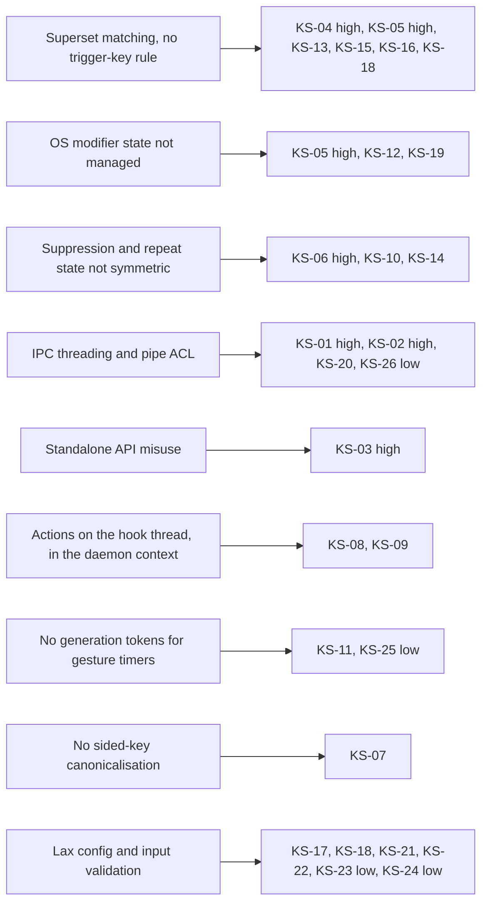
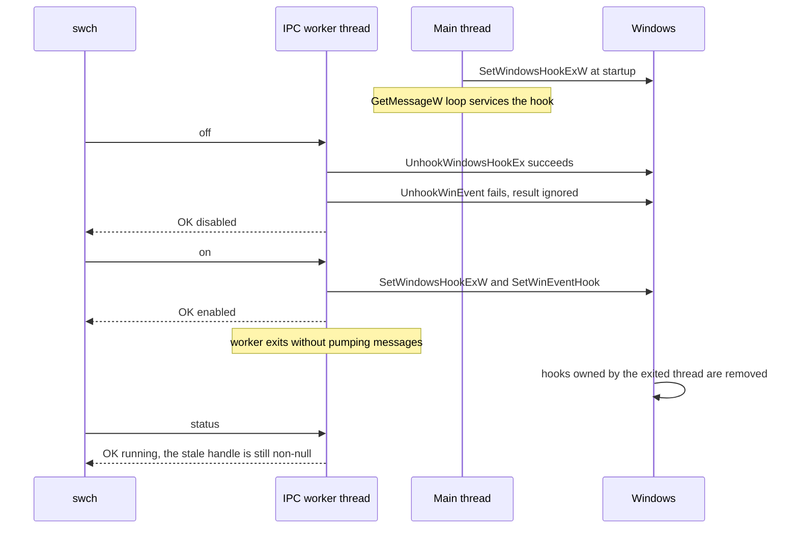
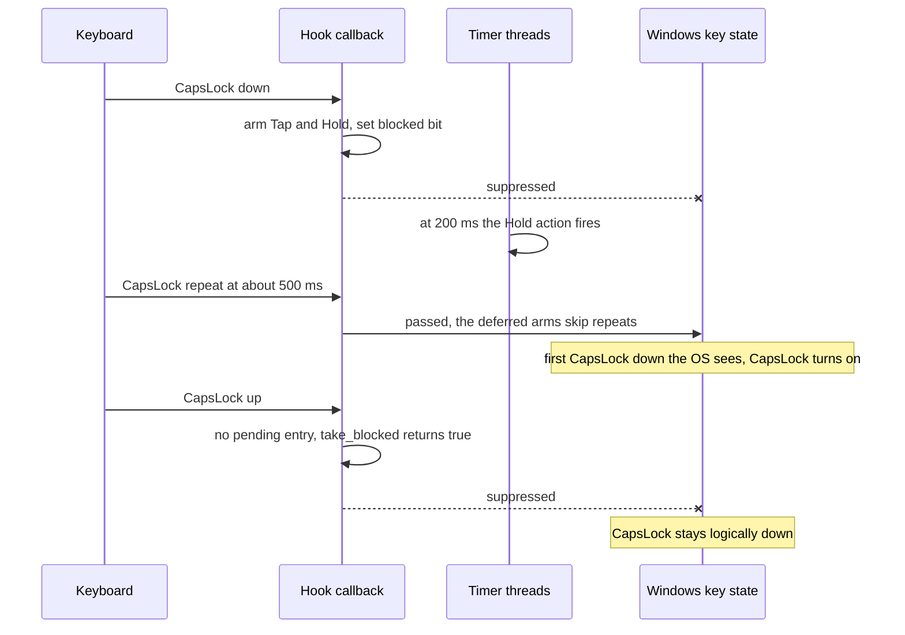

# Audit results

The audit of 2026-10-14 examined commit `7cb3521` (2026-05-20) and confirmed 26 issues: 6 high, 16 medium and 4 low severity (KS-01 to KS-26). A further 16 low-severity reports (KS-27 to KS-42), most of them from a single reviewer, were not independently verified. Most verified issues trace back to eight design causes, so fixing one cause usually closes several issues.

> [!NOTE]
> The findings come from code reading, the Win32 documentation, small probe programs and a scratch test crate. The daemon was not exercised with live keyboard input. [How the audit was done](methodology.md) describes the method. Every line reference below points at commit `7cb3521`.

> [!IMPORTANT]
> **Status at [`1dfd80a`](https://github.com/bluesteelll/key-switch-rs/commit/1dfd80a)** (2026-10-16), after roadmap Phase 0 merged. The findings below are kept as the audit wrote them for `7cb3521`. Each entry now carries a **Status** line with the merge commit and branch that fixed it, the fixing commit and the regression tests. Of the 26 verified issues, 13 are fixed, 3 are partly fixed (KS-05, KS-20, KS-25) and 10 are open. "Fixed" means the merged lane closed the issue with regression tests written before the fix. Checks that need a live hook, a live pipe between integrity levels or a focused window (KS-01, KS-02, KS-03) remain manual; the [roadmap](roadmap.md) lists them. The [Known configuration pitfalls](config/known-issues.md) page shows what still applies to a `config.ron`.

Conventions used in this chapter:

- **Severity.** High: breaks the default configuration or the documented main workflow. Medium: breaks a documented feature under a plausible configuration or ordinary timing. Low: needs an unusual action, or fails safely.
- **Default config.** The file the daemon writes on first run. Its active bindings are [src/config/default_config.ron:127-135](https://github.com/bluesteelll/key-switch-rs/blob/7cb3521/src/config/default_config.ron#L127-L135): `CapsLock` → `SwitchLanguage` with `block_original_combo: true`, and `Shift+CapsLock` → `ToggleCapsLock`. After loading, the list also holds an auto-blocker for the OS language hotkey (Alt+Shift unless the registry says otherwise, see [KS-05](#ks-05)).
- **README Tap/Hold example.** `CapsLock` with `Tap(200)` → `SwitchLanguage` plus `CapsLock` with `Hold(200)` → `PressKey("LShift")`, from [README.md:258-259](https://github.com/bluesteelll/key-switch-rs/blob/7cb3521/README.md?plain=1#L258-L259) and commented out in [src/config/default_config.ron:188-198](https://github.com/bluesteelll/key-switch-rs/blob/7cb3521/src/config/default_config.ron#L188-L198).
- **Verifier.** An independent agent that was given one claim and told to refute it. "Confirmed" means it traced the claim through the code and could not.

Terms such as *auto-blocker*, *blocked bit* and *typematic auto-repeat* are defined in the [Glossary](glossary.md). Configuration-side workarounds are collected in [Known configuration pitfalls](config/known-issues.md), and the order in which to fix the issues is in the [Roadmap](roadmap.md).

## Summary

| ID | Severity | Title | Area | Location | Status at `1dfd80a` |
| --- | --- | --- | --- | --- | --- |
| [KS-01](#ks-01) | High | `swch off` then `swch on` leaves the hook dead | IPC | [src/hook/ipc_server.rs:115](https://github.com/bluesteelll/key-switch-rs/blob/7cb3521/src/hook/ipc_server.rs#L115) | Fixed (`a1b5a27`) |
| [KS-02](#ks-02) | High | The default pipe DACL locks out a non-elevated `swch` | IPC | [src/hook/ipc_server.rs:47](https://github.com/bluesteelll/key-switch-rs/blob/7cb3521/src/hook/ipc_server.rs#L47) | Fixed (`a1b5a27`) |
| [KS-03](#ks-03) | High | `AppEquals` never matches | Conditions | [src/data/condition.rs:144](https://github.com/bluesteelll/key-switch-rs/blob/7cb3521/src/data/condition.rs#L144) | Fixed (`4177540`) |
| [KS-04](#ks-04) | High | Superset combo matching: rollover eats the next key | Hook | [src/hook/keyboard_hook_callback.rs:225](https://github.com/bluesteelll/key-switch-rs/blob/7cb3521/src/hook/keyboard_hook_callback.rs#L225) | Fixed (`82f542f`) |
| [KS-05](#ks-05) | High | The default auto-blocker breaks Alt+Shift+X and Ctrl+Shift+X | Hook | [src/config/loader.rs:172](https://github.com/bluesteelll/key-switch-rs/blob/7cb3521/src/config/loader.rs#L172) | Partly fixed (`82f542f`, `b056b72`); rest: item 1.2 |
| [KS-06](#ks-06) | High | Stuck keys: auto-repeat leaks while the key-up is swallowed | Hook | [src/hook/keyboard_hook_callback.rs:239](https://github.com/bluesteelll/key-switch-rs/blob/7cb3521/src/hook/keyboard_hook_callback.rs#L239) | Fixed (`82f542f`, `44f79ac`); lone key-up after a focus change: item 2.3 |
| [KS-07](#ks-07) | Medium | Sided modifiers never match; unsided ones never complete a chord | Keys | [src/data/vk_name.rs:134](https://github.com/bluesteelll/key-switch-rs/blob/7cb3521/src/data/vk_name.rs#L134) | Fixed (`82f542f`) |
| [KS-08](#ks-08) | Medium | Actions run synchronously inside the hook callback | Actions | [src/core/windows_actions.rs:123](https://github.com/bluesteelll/key-switch-rs/blob/7cb3521/src/core/windows_actions.rs#L123) | Open: items 2.1, 2.4 |
| [KS-09](#ks-09) | Medium | Launched programs inherit the elevated token and console | Actions | [src/core/windows_actions.rs:211](https://github.com/bluesteelll/key-switch-rs/blob/7cb3521/src/core/windows_actions.rs#L211) | Open: item 3.3 |
| [KS-10](#ks-10) | Medium | Immediate actions re-fire on auto-repeat | Hook | [src/hook/keyboard_hook_callback.rs:229](https://github.com/bluesteelll/key-switch-rs/blob/7cb3521/src/hook/keyboard_hook_callback.rs#L229) | Open: item 1.1 |
| [KS-11](#ks-11) | Medium | Stale gesture timers act on a newer press | Gestures | [src/hook/tap_state.rs:65](https://github.com/bluesteelll/key-switch-rs/blob/7cb3521/src/hook/tap_state.rs#L65) | Fixed (`16a0461`) |
| [KS-12](#ks-12) | Medium | Win/Alt combos open the Start menu or the menu bar | Hook | [src/hook/keyboard_hook_callback.rs:294](https://github.com/bluesteelll/key-switch-rs/blob/7cb3521/src/hook/keyboard_hook_callback.rs#L294) | Open: item 1.2 |
| [KS-13](#ks-13) | Medium | Specificity only decides between Immediate bindings | Hook | [src/hook/keyboard_hook_callback.rs:230](https://github.com/bluesteelll/key-switch-rs/blob/7cb3521/src/hook/keyboard_hook_callback.rs#L230) | Open: item 1.6 |
| [KS-14](#ks-14) | Medium | `sync_modifiers` erases modifiers the hook suppressed | Hook | [src/hook/keyboard_hook_callback.rs:95](https://github.com/bluesteelll/key-switch-rs/blob/7cb3521/src/hook/keyboard_hook_callback.rs#L95) | Fixed (`44f79ac`) |
| [KS-15](#ks-15) | Medium | Sequence steps match on all held keys | Gestures | [src/hook/sequence_state.rs:76](https://github.com/bluesteelll/key-switch-rs/blob/7cb3521/src/hook/sequence_state.rs#L76) | Open: item 3.2 |
| [KS-16](#ks-16) | Medium | A modifier key-down aborts a pending sequence | Gestures | [src/hook/sequence_state.rs:95](https://github.com/bluesteelll/key-switch-rs/blob/7cb3521/src/hook/sequence_state.rs#L95) | Open: item 3.2 |
| [KS-17](#ks-17) | Medium | Registry hotkey "3" falls back to blocking Alt+Shift | Config | [src/system/registry.rs:196](https://github.com/bluesteelll/key-switch-rs/blob/7cb3521/src/system/registry.rs#L196) | Open: item 1.4 |
| [KS-18](#ks-18) | Medium | The auto-blocker shadows a user binding on the same combo | Config | [src/config/loader.rs:181](https://github.com/bluesteelll/key-switch-rs/blob/7cb3521/src/config/loader.rs#L181) | Fixed (`b056b72`) |
| [KS-19](#ks-19) | Medium | Synthesized keys combine with held trigger modifiers | Actions | [src/core/windows_actions.rs:149](https://github.com/bluesteelll/key-switch-rs/blob/7cb3521/src/core/windows_actions.rs#L149) | Open: item 3.1 |
| [KS-20](#ks-20) | Medium | No single-instance guard | Process | [src/core/app.rs:91](https://github.com/bluesteelll/key-switch-rs/blob/7cb3521/src/core/app.rs#L91) | Partly fixed (`a1b5a27`); guard: item 1.5 |
| [KS-21](#ks-21) | Medium | A relative config path disables hot reload | Config | [src/hook/config_watcher.rs:47](https://github.com/bluesteelll/key-switch-rs/blob/7cb3521/src/hook/config_watcher.rs#L47) | Fixed (`1dfd80a`) |
| [KS-22](#ks-22) | Medium | Unknown fields are ignored; a misspelled `bindings` empties the config | Config | [src/config/loader.rs:157](https://github.com/bluesteelll/key-switch-rs/blob/7cb3521/src/config/loader.rs#L157) | Fixed (`1dfd80a`) |
| [KS-23](#ks-23) | Low | Deleting or renaming `config.ron` loads the defaults | Config | [src/config/loader.rs:102](https://github.com/bluesteelll/key-switch-rs/blob/7cb3521/src/config/loader.rs#L102) | Fixed (`1dfd80a`) |
| [KS-24](#ks-24) | Low | A UTF-8 BOM breaks parsing | Config | [src/config/loader.rs:109](https://github.com/bluesteelll/key-switch-rs/blob/7cb3521/src/config/loader.rs#L109) | Fixed (`1dfd80a`) |
| [KS-25](#ks-25) | Low | Tap and Hold on one key are not mutually exclusive | Gestures | [src/hook/tap_state.rs:105](https://github.com/bluesteelll/key-switch-rs/blob/7cb3521/src/hook/tap_state.rs#L105) | Partly fixed (`16a0461`); rest: item 2.2 |
| [KS-26](#ks-26) | Low | Read-only pipe connections park worker threads | IPC | [src/hook/ipc_server.rs:95](https://github.com/bluesteelll/key-switch-rs/blob/7cb3521/src/hook/ipc_server.rs#L95) | Open: item 4.1 |

## Root causes

The 26 issues are not independent. Eight design decisions explain all of them except KS-03, and several issues have two causes. Fixing a cause, rather than each symptom, is the cheaper route.

### Superset matching without a trigger-key rule

A combo matches when all of its keys are among the held keys ([src/data/key_combination.rs:49-51](https://github.com/bluesteelll/key-switch-rs/blob/7cb3521/src/data/key_combination.rs#L49-L51)). Nothing requires the key just pressed to belong to the combo, and sequence steps are matched the same way. Every key-down while a combo's keys are held therefore counts as pressing that combo again. Because matching looks only at the held set and never at the event, it also under-matches: a modifier pressed for the next sequence step counts as a wrong key. Specificity is resolved only between Immediate bindings, so less specific matches still arm, fire or suppress.

Explains [KS-04](#ks-04), [KS-05](#ks-05), [KS-13](#ks-13), [KS-15](#ks-15), [KS-16](#ks-16) and [KS-18](#ks-18).

### Actions run on the hook thread, in the daemon's context

Most actions execute inline in the `WH_KEYBOARD_LL` callback, and `Launch`/`OpenUrl` start their children directly from the elevated daemon. There is no executor that isolates slow or privileged work from the hook.

Explains [KS-08](#ks-08) and [KS-09](#ks-09).

### Gesture timers carry no generation token

Every armed Tap, Hold or DoubleTap spawns its own sleeping thread that later removes, or fires, whatever entry is stored under the key's code. Nothing ties a timer to the press that created it, and Tap and Hold on one key have no shared resolution record.

Explains [KS-11](#ks-11) and [KS-25](#ks-25).

### Sided keys are not canonicalised in one place

The parser keeps sided codes such as `VK_LSHIFT`, the combo matcher folds held keys to unsided codes, and the chord matcher compares raw sided codes. The three places use different representations of the same key.

Explains [KS-07](#ks-07).

### IPC runs commands on throwaway threads behind a default ACL

Each pipe connection gets a new thread that handles one command and exits, and the pipe is created without a security descriptor. Thread-affine Win32 calls (hook installation) end up on threads that die immediately, and the elevated daemon's pipe refuses writes from the user's normal token. The pipe's first-instance check is also the only single-instance check, and it runs after the hook is already live.

Explains [KS-01](#ks-01), [KS-02](#ks-02), [KS-20](#ks-20) and [KS-26](#ks-26).

### Suppression and repeat state are not kept symmetric

A suppressed key-down sets a blocked bit that later swallows the key-up, but nothing guarantees that the key-downs in between were also suppressed. Auto-repeat is handled differently per branch, and the modifier resync overwrites the hook's own record of suppressed keys with the OS view, which never saw them.

Explains [KS-06](#ks-06), [KS-10](#ks-10) and [KS-14](#ks-14).

### Lax configuration and input validation

The loader accepts unknown fields and treats a missing file on reload as a first run. It does not strip a BOM before parsing, and it uses a relative config path as given instead of making it absolute. The registry reader cannot distinguish "hotkey disabled" from "unreadable", and the auto-blocker dedup looks only backwards.

Explains [KS-17](#ks-17), [KS-18](#ks-18), [KS-21](#ks-21), [KS-22](#ks-22), [KS-23](#ks-23) and [KS-24](#ks-24).

### The OS modifier state is not managed

The hook decides suppression one key event at a time and never reconciles the result with the OS's modifier state. It swallows a modifier key-down, and later its key-up, when that modifier completes a combo ([KS-05](#ks-05)), and otherwise passes modifier events through. It never injects a mask key and never releases held modifiers around synthesized output. The OS's logical modifier state therefore drifts from what the binding intended.

Explains [KS-05](#ks-05), [KS-12](#ks-12) and [KS-19](#ks-19).

KS-03 has no shared cause. It is a single wrong assumption about the access rights `GetModuleBaseNameW` needs, and no test evaluates a condition against a real process.

The diagram maps each cause to the issues it explains. Issues are medium severity unless marked high or low; KS-05 and KS-18 appear under two causes.

## Verified issues

> [!WARNING]
> All 26 issues are open at commit `7cb3521`. Three of the six high-severity issues need nothing beyond the documented setup: KS-04 and KS-05 affect anyone running the default configuration, and KS-02 anyone who controls a release build with `swch` from a normal terminal. The other three need one ordinary extra step: `swch off` followed by `swch on` (KS-01), an `AppEquals` condition (KS-03), or the README Tap/Hold example (KS-06, which the default auto-blocker also reaches when Alt is released before Shift).

### KS-01: `swch off` then `swch on` leaves the hook dead

- **Severity:** high
- **Status:** Fixed in [`a1b5a27`](https://github.com/bluesteelll/key-switch-rs/commit/a1b5a27) (`fix/ipc-control`), fix commit [`7bdc72c`](https://github.com/bluesteelll/key-switch-rs/commit/7bdc72c). The hooks are installed once on the main thread; `on` and `off` flip an enabled flag. Tests: `hook::keyboard_hook::tests::toggling_reports_changes_and_never_installs_a_hook`, `hook::keyboard_hook_callback::tests::extern_callback_swallows_a_bound_key_only_while_remapping_is_on`. The live `swch off; swch on` check is manual ([Workstream A](roadmap.md#workstream-a--critical-hook-and-ipc-fixes)). Current behaviour: [Controlling the daemon with swch](build-and-run.md#controlling-the-daemon-with-swch).
- **Location:** [src/hook/ipc_server.rs:72](https://github.com/bluesteelll/key-switch-rs/blob/7cb3521/src/hook/ipc_server.rs#L72), [src/hook/ipc_server.rs:115](https://github.com/bluesteelll/key-switch-rs/blob/7cb3521/src/hook/ipc_server.rs#L115), [src/hook/ipc_server.rs:123](https://github.com/bluesteelll/key-switch-rs/blob/7cb3521/src/hook/ipc_server.rs#L123), [src/hook/keyboard_hook.rs:143-157](https://github.com/bluesteelll/key-switch-rs/blob/7cb3521/src/hook/keyboard_hook.rs#L143-L157)

**What happens.** With the daemon reachable over IPC (a debug build, or `swch` run from an elevated terminal; see [KS-02](#ks-02)), follow the README's typical session ([README.md:425-432](https://github.com/bluesteelll/key-switch-rs/blob/7cb3521/README.md?plain=1#L425-L432)) and run `swch off`, then `swch on`. The daemon answers the second command with `OK: enabled`, and `swch status` keeps reporting `running (N bindings live)`. No binding fires any more: CapsLock no longer switches the language. Further `swch on` calls change nothing. A later `swch exit` makes the daemon print `[FATAL]` and wait for Enter instead of exiting, while its IPC thread keeps serving the pipe.

**Why.**

1. Every connection runs on a new thread ([src/hook/ipc_server.rs:72](https://github.com/bluesteelll/key-switch-rs/blob/7cb3521/src/hook/ipc_server.rs#L72)) that reads one line, replies and returns ([src/hook/ipc_server.rs:85-111](https://github.com/bluesteelll/key-switch-rs/blob/7cb3521/src/hook/ipc_server.rs#L85-L111)).
2. `Command::On` calls `hook.enable()` on that worker ([src/hook/ipc_server.rs:115](https://github.com/bluesteelll/key-switch-rs/blob/7cb3521/src/hook/ipc_server.rs#L115)), and `enable()` calls `install()` directly ([src/hook/keyboard_hook.rs:143-148](https://github.com/bluesteelll/key-switch-rs/blob/7cb3521/src/hook/keyboard_hook.rs#L143-L148)). `install()` calls `SetWindowsHookExW(WH_KEYBOARD_LL, ...)` and `SetWinEventHook(..., WINEVENT_OUTOFCONTEXT ...)` on the calling thread ([src/hook/keyboard_hook.rs:94-121](https://github.com/bluesteelll/key-switch-rs/blob/7cb3521/src/hook/keyboard_hook.rs#L94-L121)). Its own SAFETY comment assumes that thread is the one the App message loop pumps ([src/hook/keyboard_hook.rs:108-110](https://github.com/bluesteelll/key-switch-rs/blob/7cb3521/src/hook/keyboard_hook.rs#L108-L110)).
3. Windows calls a low-level keyboard hook through the installing thread's message loop and removes a thread's hooks, WinEvent hooks included, when the thread exits. The worker never pumps messages and exits right after replying.
4. `hook_handle` still holds the dead handle, so `is_installed()` returns true ([src/hook/keyboard_hook.rs:137-139](https://github.com/bluesteelll/key-switch-rs/blob/7cb3521/src/hook/keyboard_hook.rs#L137-L139)): `status` reports `running` and `enable()` returns early ([src/hook/keyboard_hook.rs:144-146](https://github.com/bluesteelll/key-switch-rs/blob/7cb3521/src/hook/keyboard_hook.rs#L144-L146)).
5. `swch off` also runs on a worker. `UnhookWinEvent` fails when called from a thread other than the installer, and its result is discarded ([src/hook/keyboard_hook.rs:164](https://github.com/bluesteelll/key-switch-rs/blob/7cb3521/src/hook/keyboard_hook.rs#L164)) after the handle was already swapped to null ([src/hook/keyboard_hook.rs:160](https://github.com/bluesteelll/key-switch-rs/blob/7cb3521/src/hook/keyboard_hook.rs#L160)), so the main thread's foreground hook leaks. `UnhookWindowsHookEx` does work across threads, which is why `swch off` on its own does silence remapping.
6. At shutdown, `hook.uninstall()?` ([src/core/app.rs:134](https://github.com/bluesteelll/key-switch-rs/blob/7cb3521/src/core/app.rs#L134)) fails on the destroyed handle, and `main` prints `[FATAL]` and blocks on stdin ([src/main.rs:10-17](https://github.com/bluesteelll/key-switch-rs/blob/7cb3521/src/main.rs#L10-L17)).

**Suggested fix.** Install both hooks once, on the main thread, and keep them installed. Implement `on`/`off` as an `AtomicBool` checked at the top of `keyboard_hook_callback`, which passes events straight to `CallNextHookEx` while disabled. If reinstalling is ever needed, post a `WM_APP` message to the main thread with `PostThreadMessageW` and install from the message loop.

**Verification.** Reported separately by the hook-core, ipc-cli-app and docs-roadmap surveys. Three verifiers traced it against the code and the documented Win32 hook rules and could not refute it. Not reproduced live, because the daemon was not run with keyboard input.

### KS-02: The default pipe DACL locks out a non-elevated `swch`

- **Severity:** high
- **Status:** Fixed in [`a1b5a27`](https://github.com/bluesteelll/key-switch-rs/commit/a1b5a27) (`fix/ipc-control`), fix commit [`8dc6843`](https://github.com/bluesteelll/key-switch-rs/commit/8dc6843). The pipe gets an explicit SDDL: full control for SYSTEM and Administrators, read and write for interactive users, a medium mandatory label. Test: `hook::ipc_server::tests::pipe_sddl_grants_exactly_system_admins_and_interactive_users_and_labels_medium`. A non-elevated `swch` against an elevated daemon is a manual check. Current behaviour: [UAC and integrity levels](build-and-run.md#uac-and-integrity-levels).
- **Location:** [src/hook/ipc_server.rs:47](https://github.com/bluesteelll/key-switch-rs/blob/7cb3521/src/hook/ipc_server.rs#L47), [src/bin/swch.rs:75](https://github.com/bluesteelll/key-switch-rs/blob/7cb3521/src/bin/swch.rs#L75), [src/bin/swch.rs:158-163](https://github.com/bluesteelll/key-switch-rs/blob/7cb3521/src/bin/swch.rs#L158-L163)

**What happens.** Release build, normal (non-elevated) terminal. `swch open` shows the UAC prompt and starts the daemon elevated. Every following `swch status`, `on`, `off` or `exit` prints ``swch: cannot reach daemon (Access is denied. (os error 5)). Use `swch open` to start it.`` and exits with code 1. A second `swch open` concludes that no daemon is running and starts another one ([KS-20](#ks-20)). This contradicts the README, which says `swch` runs as a normal user with no UAC prompt ([README.md:422-423](https://github.com/bluesteelll/key-switch-rs/blob/7cb3521/README.md?plain=1#L422-L423)) and talks to a Scheduled Task daemon normally ([README.md:458-460](https://github.com/bluesteelll/key-switch-rs/blob/7cb3521/README.md?plain=1#L458-L460)).

**Why.**

- The listener is created with `ListenerOptions::new().name(name).create_sync()` and no security descriptor ([src/hook/ipc_server.rs:47](https://github.com/bluesteelll/key-switch-rs/blob/7cb3521/src/hook/ipc_server.rs#L47)). interprocess 2.4.2 then hands `CreateNamedPipeW` a `SECURITY_ATTRIBUTES` whose security descriptor is null, so Windows applies the default named-pipe DACL: full access for SYSTEM, Administrators and the creator's owner SID, read access for Everyone and Anonymous.
- Release builds embed `requireAdministrator` in the daemon ([build.rs:21-24](https://github.com/bluesteelll/key-switch-rs/blob/7cb3521/build.rs#L21-L24)), and `swch open` launches it with the `runas` verb ([src/bin/swch.rs:102](https://github.com/bluesteelll/key-switch-rs/blob/7cb3521/src/bin/swch.rs#L102)). By default the owner SID of an elevated admin token is BUILTIN\Administrators, which is deny-only in the user's filtered token.
- `swch` connects through interprocess with read and write access ([src/bin/swch.rs:158-163](https://github.com/bluesteelll/key-switch-rs/blob/7cb3521/src/bin/swch.rs#L158-L163)). No ACE grants write access to a medium-integrity caller, so `CreateFileW` fails with `ERROR_ACCESS_DENIED`.

Debug builds started with `cargo run` run at medium integrity with the user as owner, so `swch` can reach them.

**Suggested fix.** Create the listener with an explicit security descriptor through interprocess's Windows listener options. Grant read and write to SYSTEM and to the current user (or `IU`), and add a medium mandatory label so medium-integrity clients are admitted, for example `D:P(A;;GA;;;SY)(A;;GRGW;;;IU)S:(ML;;NW;;;ME)`. In `swch`, treat `ERROR_ACCESS_DENIED` and `ERROR_PIPE_BUSY` from connect as "daemon running".

**Verification.** Reported by the ipc-cli-app and docs-roadmap surveys; both verifiers confirmed it. Confirmed with a probe on the audit machine: a pipe created with NULL security attributes received `D:(A;;FA;;;SY)(A;;FA;;;BA)(A;;FA;;;<owner>)(A;;FR;;;WD)(A;;FR;;;AN)`, and against the DACL an elevated creator gets, a medium-integrity read/write open failed with `ERROR_ACCESS_DENIED` while a read-only open succeeded.

### KS-03: `AppEquals` never matches

- **Severity:** high
- **Status:** Fixed in [`4177540`](https://github.com/bluesteelll/key-switch-rs/commit/4177540) (`fix/app-equals`), fix commit [`de03573`](https://github.com/bluesteelll/key-switch-rs/commit/de03573). The name comes from `QueryFullProcessImageNameW`. Tests: `data::condition::tests::app_equals_matches_the_current_process`, `data::condition::tests::process_image_name_resolves_the_current_process`. A foreground check on a live daemon is manual (smoke step 7 of [Checkpoint 1](roadmap.md#checkpoint-1-smoke-checklist)). Current behaviour: [§12.3](config/triggers-conditions.md#s12-3).
- **Location:** [src/data/condition.rs:139-144](https://github.com/bluesteelll/key-switch-rs/blob/7cb3521/src/data/condition.rs#L139-L144)

**What happens.** Every `AppEquals` condition evaluates to false. The commented example `( keys: "Pause", action: Media(PlayPause), when: AppEquals("Spotify.exe") )` ([src/config/default_config.ron:170-174](https://github.com/bluesteelll/key-switch-rs/blob/7cb3521/src/config/default_config.ron#L170-L174)) never fires, even with Spotify focused. `when: Not(AppEquals("game.exe"))`, meant to switch a binding off inside a game, is always true, so the binding still fires in the game. `And([AppEquals(..), ..])` is always false. Conditions built only on window titles are unaffected.

**Why.** `ForegroundContext::fetch_app` opens the foreground process with `PROCESS_QUERY_LIMITED_INFORMATION` only ([src/data/condition.rs:139](https://github.com/bluesteelll/key-switch-rs/blob/7cb3521/src/data/condition.rs#L139)) and calls `GetModuleBaseNameW` on that handle ([src/data/condition.rs:144](https://github.com/bluesteelll/key-switch-rs/blob/7cb3521/src/data/condition.rs#L144)). `GetModuleBaseNameW` reads the target's loader data and needs `PROCESS_QUERY_INFORMATION | PROCESS_VM_READ`; on a limited handle it returns 0 with `ERROR_ACCESS_DENIED`. The comment at [src/data/condition.rs:133-135](https://github.com/bluesteelll/key-switch-rs/blob/7cb3521/src/data/condition.rs#L133-L135) claims the limited right is enough. A zero length becomes `None` ([src/data/condition.rs:145-147](https://github.com/bluesteelll/key-switch-rs/blob/7cb3521/src/data/condition.rs#L145-L147)), and `AppEquals` maps `None` to false ([src/data/condition.rs:60-65](https://github.com/bluesteelll/key-switch-rs/blob/7cb3521/src/data/condition.rs#L60-L65)). There is no fallback, and no test evaluates `AppEquals` against a real process.

**Suggested fix.** Keep the limited handle and call `QueryFullProcessImageNameW`, which works with `PROCESS_QUERY_LIMITED_INFORMATION`, including against elevated processes; take the file name after the last backslash. Add a test that evaluates `AppEquals` against the test binary's own process. Optionally cache the executable name and title per foreground window from the existing `EVENT_SYSTEM_FOREGROUND` hook instead of opening the process on every key-down.

**Verification.** Reported by the actions-data and docs-roadmap surveys; both verifiers confirmed it. Confirmed with a probe on the audit machine (Windows 11, build 26200): on a limited handle `GetModuleBaseNameW` returned length 0 with error 5 for the probe's own process and for `explorer.exe`, while `QueryFullProcessImageNameW` on the same handle returned the full path. With `PROCESS_QUERY_INFORMATION | PROCESS_VM_READ`, `GetModuleBaseNameW` returned the names.

### KS-04: Superset combo matching: rollover eats the next key

- **Severity:** high
- **Status:** Fixed in [`82f542f`](https://github.com/bluesteelll/key-switch-rs/commit/82f542f) (`fix/matching`), fix commit [`2271db2`](https://github.com/bluesteelll/key-switch-rs/commit/2271db2) (trigger-key rule), with exact modifier matching from [`cffb5eb`](https://github.com/bluesteelll/key-switch-rs/commit/cffb5eb). Tests: `engine::scenarios::key_pressed_while_an_immediate_binding_key_is_held_passes`, `engine::scenarios::deferred_combo_arms_only_on_its_trigger_key`, `engine::scenarios::ctrl_j_does_not_fire_on_ctrl_shift_j`. Current behaviour: [§7](config/kinds.md#s7).
- **Location:** [src/data/key_combination.rs:49-51](https://github.com/bluesteelll/key-switch-rs/blob/7cb3521/src/data/key_combination.rs#L49-L51), [src/hook/keyboard_hook_callback.rs:225](https://github.com/bluesteelll/key-switch-rs/blob/7cb3521/src/hook/keyboard_hook_callback.rs#L225), [src/hook/keyboard_hook_callback.rs:240](https://github.com/bluesteelll/key-switch-rs/blob/7cb3521/src/hook/keyboard_hook_callback.rs#L240), [src/hook/keyboard_hook_callback.rs:245](https://github.com/bluesteelll/key-switch-rs/blob/7cb3521/src/hook/keyboard_hook_callback.rs#L245), [src/hook/keyboard_hook_callback.rs:250](https://github.com/bluesteelll/key-switch-rs/blob/7cb3521/src/hook/keyboard_hook_callback.rs#L250)

**What happens.** Default config. Press CapsLock, then press `g` before CapsLock is fully released, which is ordinary fast-typing rollover. CapsLock switches the layout. The `g` key-down matches the `CapsLock` binding again, so `SwitchLanguage` runs a second time (with two layouts the user is back where they started), and `g` is swallowed together with its key-up. Pressing Shift while CapsLock is still held fires `Shift+CapsLock`: CapsLock turns on and Shift is eaten. With the README Tap/Hold example, every letter typed while CapsLock is held is swallowed and gets CapsLock's gestures: released within 200 ms it fires `SwitchLanguage`, held longer it sends a stray Shift tap.

**Why.**

1. `KeyCombination::matches` is a subset test: every combo key must be held, extra keys are allowed ([src/data/key_combination.rs:49-51](https://github.com/bluesteelll/key-switch-rs/blob/7cb3521/src/data/key_combination.rs#L49-L51)). The unit test `test_extra_keys` asserts exactly this ([src/data/key_combination.rs:77-80](https://github.com/bluesteelll/key-switch-rs/blob/7cb3521/src/data/key_combination.rs#L77-L80)).
2. `handle_key_down` matches each combo against all held keys ([src/hook/keyboard_hook_callback.rs:225](https://github.com/bluesteelll/key-switch-rs/blob/7cb3521/src/hook/keyboard_hook_callback.rs#L225)) and never checks that the key just pressed belongs to it.
3. CapsLock stays in the held set from its key-down ([src/hook/keyboard_hook_callback.rs:192](https://github.com/bluesteelll/key-switch-rs/blob/7cb3521/src/hook/keyboard_hook_callback.rs#L192)) until its key-up ([src/hook/keyboard_hook_callback.rs:306](https://github.com/bluesteelll/key-switch-rs/blob/7cb3521/src/hook/keyboard_hook_callback.rs#L306)), even though the key-down was suppressed. It is not in `MODIFIERS`, so `sync_modifiers` never clears it.
4. `immediate_fired` only stops a second binding within the same event ([src/hook/keyboard_hook_callback.rs:230](https://github.com/bluesteelll/key-switch-rs/blob/7cb3521/src/hook/keyboard_hook_callback.rs#L230)). Each key-down is a new event, so the Immediate action runs again. `block_default`, true by default, sets `suppress` ([src/hook/keyboard_hook_callback.rs:234-236](https://github.com/bluesteelll/key-switch-rs/blob/7cb3521/src/hook/keyboard_hook_callback.rs#L234-L236)), the pressed key's blocked bit is set ([src/hook/keyboard_hook_callback.rs:294-297](https://github.com/bluesteelll/key-switch-rs/blob/7cb3521/src/hook/keyboard_hook_callback.rs#L294-L297)) and its key-up is swallowed ([src/hook/keyboard_hook_callback.rs:324](https://github.com/bluesteelll/key-switch-rs/blob/7cb3521/src/hook/keyboard_hook_callback.rs#L324)).
5. Deferred triggers arm on `vk_code`, the key just pressed, not on a key of the combo ([src/hook/keyboard_hook_callback.rs:240](https://github.com/bluesteelll/key-switch-rs/blob/7cb3521/src/hook/keyboard_hook_callback.rs#L240), [src/hook/keyboard_hook_callback.rs:245](https://github.com/bluesteelll/key-switch-rs/blob/7cb3521/src/hook/keyboard_hook_callback.rs#L245), [src/hook/keyboard_hook_callback.rs:250](https://github.com/bluesteelll/key-switch-rs/blob/7cb3521/src/hook/keyboard_hook_callback.rs#L250)). The unrelated key gets its own pending Tap, Hold or DoubleTap entry, which resolves on that key's release or timer.

**Suggested fix.** Add a trigger-key rule: a Combo matches only when the normalised key just pressed is one of its keys, ideally its last non-modifier key. Consider exact modifier matching by default (extra held modifiers mean no match) with an opt-in wildcard. Arm deferred triggers only when `vk_code` is part of the combo.

**Verification.** Reported separately by the hook-core survey (Immediate path) and the gestures survey (deferred path). Both verifiers traced it through the default config and the README example and could not refute it.

### KS-05: The default auto-blocker breaks Alt+Shift+X and Ctrl+Shift+X

- **Severity:** high
- **Status:** Partly fixed. Auto-blockers match exactly since [`82f542f`](https://github.com/bluesteelll/key-switch-rs/commit/82f542f) (`fix/matching`), and since [`b056b72`](https://github.com/bluesteelll/key-switch-rs/commit/b056b72) (`fix/auto-blockers`) (fix commit [`f5595aa`](https://github.com/bluesteelll/key-switch-rs/commit/f5595aa)) a blocker acts only when Windows would see the hotkey and nothing else, and fires nothing. Tests: `engine::scenarios::shift_pressed_while_alt_and_tab_are_held_reaches_windows`, `engine::scenarios::alt_shift_pressed_while_a_letter_is_held_reaches_windows`. Still open: pressed modifiers first (Alt, Shift, X), the blocker swallows Shift, so the application gets Alt+X; [item 1.2](roadmap.md#12-mask-key-and-auto-blocker-v2) fixes the rest. Current behaviour: [§15](config/matching.md#s15).
- **Location:** [src/config/loader.rs:172-191](https://github.com/bluesteelll/key-switch-rs/blob/7cb3521/src/config/loader.rs#L172-L191), [src/hook/keyboard_hook_callback.rs:234](https://github.com/bluesteelll/key-switch-rs/blob/7cb3521/src/hook/keyboard_hook_callback.rs#L234)

**What happens.** Default config with the Windows default language hotkey, Alt+Shift. Every three-key shortcut on Alt+Shift loses a modifier, system-wide. In VS Code, pressing Alt, then Shift, then F (Format Document) delivers Alt+F, which opens the File menu; pressing Shift first delivers Shift+F, a capital F typed into the document. Alt+Shift+Tab becomes Alt+Tab, and AltGr+Shift typing on layouts such as Polish loses its Shift. If the registry sets Ctrl+Shift as the hotkey, Ctrl+Shift+Esc becomes Ctrl+Esc (Start menu instead of Task Manager) and Ctrl+Shift+T becomes Ctrl+T. The README describes the flag only as silencing the OS hotkey ([README.md:353](https://github.com/bluesteelll/key-switch-rs/blob/7cb3521/README.md?plain=1#L353)).

**Why.**

1. The default config sets `block_original_combo: true` on `CapsLock` ([src/config/default_config.ron:127-131](https://github.com/bluesteelll/key-switch-rs/blob/7cb3521/src/config/default_config.ron#L127-L131)). `expand_with_auto_blockers` ([src/config/loader.rs:172-191](https://github.com/bluesteelll/key-switch-rs/blob/7cb3521/src/config/loader.rs#L172-L191)) reads the OS hotkey and inserts `Binding::new_auto_blocker` ([src/data/binding.rs:89-99](https://github.com/bluesteelll/key-switch-rs/blob/7cb3521/src/data/binding.rs#L89-L99)): an Immediate `DoNothing` combo with `block_default: true` and no condition. The combo is Alt+Shift for registry value "1", for "3" ([KS-17](#ks-17)) and for a missing or unrecognised value, Ctrl+Shift for "2", and the grave-accent key for "4" ([src/system/registry.rs:68-78](https://github.com/bluesteelll/key-switch-rs/blob/7cb3521/src/system/registry.rs#L68-L78), [src/system/registry.rs:192-199](https://github.com/bluesteelll/key-switch-rs/blob/7cb3521/src/system/registry.rs#L192-L199)).
2. Alt goes down and passes, because nothing matches it alone. When Shift goes down the held set is {Alt, Shift}, the blocker matches, and its `block_default` suppresses the Shift key-down ([src/hook/keyboard_hook_callback.rs:234](https://github.com/bluesteelll/key-switch-rs/blob/7cb3521/src/hook/keyboard_hook_callback.rs#L234)).
3. A key-down swallowed by a low-level hook never updates the async key state. On the next key, `sync_modifiers` ([src/hook/keyboard_hook_callback.rs:86-97](https://github.com/bluesteelll/key-switch-rs/blob/7cb3521/src/hook/keyboard_hook_callback.rs#L86-L97)) reads Shift as up and clears it ([KS-14](#ks-14)), the held set becomes {Alt, F}, nothing matches, and F reaches the app with only Alt held. Without that resync, F would match the superset blocker ([KS-04](#ks-04)) and be swallowed instead. Either way the shortcut never arrives.
4. If no third key follows, Alt's release reaches the OS as a lone Alt tap and activates the menu bar ([KS-12](#ks-12)).

**Suggested fix.** Do not suppress modifier key-downs at all. Windows switches the layout only when the hotkey's modifiers are released with no other key pressed in between, so a blocker only needs to break that bare press-and-release, for example by injecting a mask key as in [KS-12](#ks-12). An alternative is to set the registry hotkey to "3" while the daemon runs and restore it on exit. At minimum, give auto-blockers exact matching.

**Verification.** Reported by the hook-core, actions-data and docs-roadmap surveys; all three verifiers confirmed it and traced both key orders. One verifier noted that what happens to the third key depends on the async state of the suppressed modifier; in both outcomes the shortcut is lost.

### KS-06: Stuck keys: auto-repeat leaks while the key-up is swallowed

- **Severity:** high
- **Status:** Fixed in [`82f542f`](https://github.com/bluesteelll/key-switch-rs/commit/82f542f) (`fix/matching`) (fix commits [`20672b7`](https://github.com/bluesteelll/key-switch-rs/commit/20672b7), [`938df54`](https://github.com/bluesteelll/key-switch-rs/commit/938df54)) and [`44f79ac`](https://github.com/bluesteelll/key-switch-rs/commit/44f79ac) (`fix/suppression-symmetry`) (fix commits [`cc3892d`](https://github.com/bluesteelll/key-switch-rs/commit/cc3892d), [`12be46b`](https://github.com/bluesteelll/key-switch-rs/commit/12be46b)): an auto-repeat follows its key-down, and a key-down that reaches Windows always lets its key-up through. Tests: `engine::scenarios::repeat_of_a_suppressed_key_is_suppressed_after_its_hold_fired`, `engine::scenarios::immediate_combo_that_stops_matching_mid_hold_keeps_its_key_suppressed_once`, `engine::scenarios::shift_held_after_the_auto_blocker_and_alt_released_stays_swallowed_for_its_whole_press`, and the property tests in `engine::properties`. Still open: a foreground change forgets which key-ups are due to be swallowed, so the release of a key whose key-down was swallowed reaches Windows as a lone key-up, unless a `Tap` or `Hold` of that press is still pending; its repeats stay swallowed ([item 2.3](roadmap.md#23-control-window-and-state-reset)). Current behaviour: [§10](config/kinds.md#s10).
- **Location:** [src/hook/keyboard_hook_callback.rs:239](https://github.com/bluesteelll/key-switch-rs/blob/7cb3521/src/hook/keyboard_hook_callback.rs#L239), [src/hook/keyboard_hook_callback.rs:244](https://github.com/bluesteelll/key-switch-rs/blob/7cb3521/src/hook/keyboard_hook_callback.rs#L244), [src/hook/keyboard_hook_callback.rs:249](https://github.com/bluesteelll/key-switch-rs/blob/7cb3521/src/hook/keyboard_hook_callback.rs#L249), [src/hook/keyboard_hook_callback.rs:256](https://github.com/bluesteelll/key-switch-rs/blob/7cb3521/src/hook/keyboard_hook_callback.rs#L256), [src/hook/keyboard_hook_callback.rs:274](https://github.com/bluesteelll/key-switch-rs/blob/7cb3521/src/hook/keyboard_hook_callback.rs#L274), [src/hook/keyboard_hook_callback.rs:324](https://github.com/bluesteelll/key-switch-rs/blob/7cb3521/src/hook/keyboard_hook_callback.rs#L324)

**What happens.** README Tap/Hold example: hold CapsLock for about a second. The Hold action fires at 200 ms. From the typematic delay on (about 500 ms by default, 250 ms at the fastest setting) the auto-repeat key-downs reach the OS, which sees CapsLock go down for the first time and turns CapsLock on. The key-up is then swallowed, so Windows keeps CapsLock logically held. Pressing CapsLock again does not repair it, because every later press and release is suppressed again. Holding one key of a chord, or the first key of a sequence, types repeated characters (`jjj`) and leaves that key logically down. The default config's `CapsLock` binding is not affected: it is Immediate and keeps matching on repeats, so they stay suppressed. Its auto-blocker is affected through the mid-hold case described below.

**Why.**

1. `was_repeat` comes from `active_keys[vk].swap(true)` ([src/hook/keyboard_hook_callback.rs:191-195](https://github.com/bluesteelll/key-switch-rs/blob/7cb3521/src/hook/keyboard_hook_callback.rs#L191-L195)) and is true for every auto-repeat.
2. The Tap, Hold and DoubleTap arms and the Sequence and Chord arms `continue` on a repeat before setting `suppress` (lines 239, 244, 249, 256 and 274 of `keyboard_hook_callback.rs`, linked above). Unless an Immediate binding also matches, the repeat passes to the OS through `CallNextHookEx`.
3. The first key-down set the key's blocked bit ([src/hook/keyboard_hook_callback.rs:294-297](https://github.com/bluesteelll/key-switch-rs/blob/7cb3521/src/hook/keyboard_hook_callback.rs#L294-L297)). Nothing clears that bit when a later key-down of the same key passes.
4. At key-up the gesture is already over: the tap timer removed the tap entry and the hold timer removed and fired the hold entry. `resolve_tap_on_keyup` and `cancel_hold_on_keyup` return false ([src/hook/keyboard_hook_callback.rs:314-315](https://github.com/bluesteelll/key-switch-rs/blob/7cb3521/src/hook/keyboard_hook_callback.rs#L314-L315)), and `take_blocked` finds the bit and swallows the release ([src/hook/keyboard_hook_callback.rs:324](https://github.com/bluesteelll/key-switch-rs/blob/7cb3521/src/hook/keyboard_hook_callback.rs#L324)).
5. `foreground_changed` clears the bitmap ([src/hook/keyboard_hook_callback.rs:176-181](https://github.com/bluesteelll/key-switch-rs/blob/7cb3521/src/hook/keyboard_hook_callback.rs#L176-L181)) but never sends the missing key-up to the OS.

The same happens to an Immediate combo that stops matching mid-hold: with `Ctrl+Alt+L`, releasing Ctrl and Alt while L is still held lets `lll` through and then swallows L's release. The default auto-blocker behaves the same way: after it has swallowed Shift, releasing Alt while Shift stays held lets Shift's repeats through and swallows Shift's release.

**Suggested fix.** Keep suppression symmetric. On a repeat whose blocked bit is set, suppress the repeat (read the bit without clearing it). When a key-down passes to the OS, clear its blocked bit so the matching key-up passes too.

**Verification.** Reported by the hook-core and gestures surveys; both verifiers confirmed it and kept the high rating.

### KS-07: Sided modifiers never match; unsided ones never complete a chord

- **Severity:** medium
- **Status:** Fixed in [`82f542f`](https://github.com/bluesteelll/key-switch-rs/commit/82f542f) (`fix/matching`), fix commit [`709d739`](https://github.com/bluesteelll/key-switch-rs/commit/709d739): trigger keys are `KeySpec`s, so `Shift` means either side and `LShift` the left one in `keys`, `sequence` and `chord`. Tests: `engine::scenarios::lshift_in_keys_fires_only_for_the_left_shift`, `engine::scenarios::unsided_shift_in_a_chord_fires_for_either_side`. Current behaviour: [§6.7](config/keys.md#s6-7).
- **Location:** [src/data/vk_name.rs:134-143](https://github.com/bluesteelll/key-switch-rs/blob/7cb3521/src/data/vk_name.rs#L134-L143), [src/hook/keyboard_hook_callback.rs:335-341](https://github.com/bluesteelll/key-switch-rs/blob/7cb3521/src/hook/keyboard_hook_callback.rs#L335-L341), [src/hook/chord_state.rs:73](https://github.com/bluesteelll/key-switch-rs/blob/7cb3521/src/hook/chord_state.rs#L73)

**What happens.** The commented example `( keys: "LShift", action: ToggleCapsLock, trigger: DoubleTap(250) )` ([src/config/default_config.ron:201-205](https://github.com/bluesteelll/key-switch-rs/blob/7cb3521/src/config/default_config.ron#L201-L205), also [README.md:262](https://github.com/bluesteelll/key-switch-rs/blob/7cb3521/README.md?plain=1#L262)) loads without error and never fires. Neither does any `keys` combo or sequence step that uses `LShift`, `RShift`, `LCtrl`, `RCtrl`, `LAlt`, `RAlt` or `RWin`, although the README lists `RWin` as a modifier and says sided names are normalised ([README.md:173](https://github.com/bluesteelll/key-switch-rs/blob/7cb3521/README.md?plain=1#L173), [README.md:181-183](https://github.com/bluesteelll/key-switch-rs/blob/7cb3521/README.md?plain=1#L181-L183)). Chords fail the other way round: `chord: (keys: ["Shift", "Space"])` never completes, but every Space key-down still arms a pending chord and is swallowed, so Space stops typing.

**Why.**

- `parse_vk` maps `lshift`, `rshift`, `lctrl`, `rctrl`, `lalt`, `ralt` and `rwin` to the sided codes 0xA0 to 0xA5 and 0x5C ([src/data/vk_name.rs:134-143](https://github.com/bluesteelll/key-switch-rs/blob/7cb3521/src/data/vk_name.rs#L134-L143)). `parse_combo` ([src/config/parsing.rs:28](https://github.com/bluesteelll/key-switch-rs/blob/7cb3521/src/config/parsing.rs#L28)) and the loader keep them unchanged.
- Before matching, `collect_active_keys` folds every held modifier to its unsided code and both Win keys to `VK_LWIN` ([src/hook/keyboard_hook_callback.rs:335-341](https://github.com/bluesteelll/key-switch-rs/blob/7cb3521/src/hook/keyboard_hook_callback.rs#L335-L341)). The held set never contains a sided code or `VK_RWIN`, so a subset test against a binding that contains one always fails. Sequence steps use the same held set.
- Chords receive the raw `vkCode` instead ([src/hook/keyboard_hook_callback.rs:276](https://github.com/bluesteelll/key-switch-rs/blob/7cb3521/src/hook/keyboard_hook_callback.rs#L276)) and compare it with the parsed chord keys ([src/hook/chord_state.rs:70-74](https://github.com/bluesteelll/key-switch-rs/blob/7cb3521/src/hook/chord_state.rs#L70-L74)). The low-level hook reports physical modifiers by side, never as 0x10 to 0x12, so a chord written with `Shift`, `Ctrl` or `Alt` ([src/config/loader.rs:298](https://github.com/bluesteelll/key-switch-rs/blob/7cb3521/src/config/loader.rs#L298)) never sees its modifier. Its other keys still return `Suppress`, because chord keys are suppressed on purpose with no replay. `Win` works in a chord for the left Win key only.

No single naming scheme works for both kinds: combos need unsided names, chords need sided ones. The loader warns about neither.

**Suggested fix.** Canonicalise keys in one place. Either reject sided names in `keys` and `sequence` with a clear load error, or implement real sided matching: put both the sided and the unsided code into the held set, so `Shift` matches either key and `LShift` only the left one. Feed the chord state machine the same representation, and canonicalise chord key sets once in `update_bindings`.

**Verification.** Reported by five surveys (config, hook-core, gestures, actions-data, docs-roadmap); all five verifiers confirmed both halves. A test program showed the loader stores VK 160 for an `LShift` combo and VK 16 for a chord's `Shift`. The chord half was reproduced in a scratch test crate (`chord_with_unsided_modifier_never_matches_raw_sided_vk`).

### KS-08: Actions run synchronously inside the hook callback

- **Severity:** medium
- **Status:** Open: [item 2.1](roadmap.md#21-action-executor) and [item 2.4](roadmap.md#24-hook-watchdog).
- **Location:** [src/core/windows_actions.rs:123-124](https://github.com/bluesteelll/key-switch-rs/blob/7cb3521/src/core/windows_actions.rs#L123-L124), [src/hook/tap_state.rs:83](https://github.com/bluesteelll/key-switch-rs/blob/7cb3521/src/hook/tap_state.rs#L83), [src/hook/tap_state.rs:148](https://github.com/bluesteelll/key-switch-rs/blob/7cb3521/src/hook/tap_state.rs#L148)

**What happens.** `( keys: "Win+Alt+G", action: OpenUrl("https://github.com") )` ([src/config/default_config.ron:158](https://github.com/bluesteelll/key-switch-rs/blob/7cb3521/src/config/default_config.ron#L158)) runs `ShellExecuteW` inside the keyboard hook. While it runs, keyboard input stalls system-wide. If it takes longer than `LowLevelHooksTimeout` (at most 1000 ms since Windows 10 1709), Windows passes the key on and, on Windows 7 and later, may remove the hook silently. Every binding then stops working while `swch status` still reports `running`. Calls usually return in tens to a few hundred milliseconds, but slow cases are realistic: a cold first `ShellExecuteW`, antivirus scanning a launched executable, a DDE file association, or a path on an unreachable network share.

**Why.**

- `BindAction::execute` runs `Launch` and `OpenUrl` inline ([src/core/windows_actions.rs:123-124](https://github.com/bluesteelll/key-switch-rs/blob/7cb3521/src/core/windows_actions.rs#L123-L124)): `launch_process` calls `Command::spawn`, which is `CreateProcessW` ([src/core/windows_actions.rs:205-219](https://github.com/bluesteelll/key-switch-rs/blob/7cb3521/src/core/windows_actions.rs#L205-L219)), and `shell_open` calls `ShellExecuteW` ([src/core/windows_actions.rs:221-247](https://github.com/bluesteelll/key-switch-rs/blob/7cb3521/src/core/windows_actions.rs#L221-L247)). No thread in the crate calls `CoInitializeEx`, although `ShellExecuteW` expects COM to be initialised.
- Actions execute on the hook thread from the Immediate path ([src/hook/keyboard_hook_callback.rs:231](https://github.com/bluesteelll/key-switch-rs/blob/7cb3521/src/hook/keyboard_hook_callback.rs#L231)), Tap resolution on key-up ([src/hook/tap_state.rs:83](https://github.com/bluesteelll/key-switch-rs/blob/7cb3521/src/hook/tap_state.rs#L83)), DoubleTap ([src/hook/tap_state.rs:148](https://github.com/bluesteelll/key-switch-rs/blob/7cb3521/src/hook/tap_state.rs#L148), while still holding the `pending_double_taps` lock), chord completion ([src/hook/chord_state.rs:100](https://github.com/bluesteelll/key-switch-rs/blob/7cb3521/src/hook/chord_state.rs#L100)) and sequence completion ([src/hook/sequence_state.rs:86](https://github.com/bluesteelll/key-switch-rs/blob/7cb3521/src/hook/sequence_state.rs#L86), [src/hook/sequence_state.rs:106](https://github.com/bluesteelll/key-switch-rs/blob/7cb3521/src/hook/sequence_state.rs#L106)). Only Hold actions (timer thread) and the `Sequence` action (worker thread, [src/data/sequence.rs:114-125](https://github.com/bluesteelll/key-switch-rs/blob/7cb3521/src/data/sequence.rs#L114-L125)) leave it.
- The hook lives on the main thread, which pumps `GetMessageW` ([src/core/app.rs:91](https://github.com/bluesteelll/key-switch-rs/blob/7cb3521/src/core/app.rs#L91), [src/core/app.rs:125-131](https://github.com/bluesteelll/key-switch-rs/blob/7cb3521/src/core/app.rs#L125-L131)). While the callback is busy, no further keyboard event is processed.
- `is_installed()` only checks that the stored handle is non-null ([src/hook/keyboard_hook.rs:137-139](https://github.com/bluesteelll/key-switch-rs/blob/7cb3521/src/hook/keyboard_hook.rs#L137-L139)), so nothing notices a silently removed hook.

The code's own rule is that the hook callback must return fast ([src/core/windows_actions.rs:28-30](https://github.com/bluesteelll/key-switch-rs/blob/7cb3521/src/core/windows_actions.rs#L28-L30)); the top-level `Launch` and `OpenUrl` actions do not follow it.

**Suggested fix.** Move every action with side effects off the hook thread. The callback only decides suppress-or-pass and pushes the action into a channel drained by one executor thread that has initialised COM as STA. Add a watchdog that detects a removed hook, for example from a last-callback timestamp or a periodic injected self-test, and report it in `swch status`.

**Verification.** Reported by four surveys (hook-core, gestures, actions-data, docs-roadmap); all four verifiers confirmed it. One verifier refuted a side claim about mutex poisoning in the DoubleTap path: a panic that unwinds out of the `extern "system"` callback aborts the process on current Rust, so poisoning never matters.

### KS-09: Launched programs inherit the elevated token and console

- **Severity:** medium
- **Status:** Open: [item 3.3](roadmap.md#33-launch-and-openurl-without-elevation).
- **Location:** [src/core/windows_actions.rs:205-234](https://github.com/bluesteelll/key-switch-rs/blob/7cb3521/src/core/windows_actions.rs#L205-L234)

**What happens.** Release builds run elevated, and so does every program they start. `Launch(exe: "code.exe")` ([src/config/default_config.ron:154-155](https://github.com/bluesteelll/key-switch-rs/blob/7cb3521/src/config/default_config.ron#L154-L155)) opens VS Code as Administrator, with its terminals and extensions; dragging files into it from the normal Explorer fails because of UIPI. `OpenUrl("https://...")` with no browser running can start the browser elevated; Chromium-based browsers try to de-elevate themselves, other handlers may not. Console programs started with `Launch` share the daemon's console. Because `config.ron` sits next to the executable and is hot-reloaded, any process that can write to that folder can add a `Launch` binding and get code run with admin rights the next time the hotkey fires.

**Why.** Release builds embed `requireAdministrator` in the daemon ([build.rs:21-24](https://github.com/bluesteelll/key-switch-rs/blob/7cb3521/build.rs#L21-L24)). `launch_process` is a plain `Command::new(exe).args(args).spawn()` ([src/core/windows_actions.rs:211](https://github.com/bluesteelll/key-switch-rs/blob/7cb3521/src/core/windows_actions.rs#L211)), which gives the child a copy of the caller's elevated token and, with no creation flags, its console. `shell_open` calls `ShellExecuteW` from the same elevated process ([src/core/windows_actions.rs:228-235](https://github.com/bluesteelll/key-switch-rs/blob/7cb3521/src/core/windows_actions.rs#L228-L235)), and sequence `Launch` and `OpenUrl` steps call the same two functions ([src/data/sequence.rs:134-135](https://github.com/bluesteelll/key-switch-rs/blob/7cb3521/src/data/sequence.rs#L134-L135)). Nothing de-elevates. The doc comment says the child is detached and gets no console ([src/core/windows_actions.rs:35-36](https://github.com/bluesteelll/key-switch-rs/blob/7cb3521/src/core/windows_actions.rs#L35-L36)), and the README calls `Launch` "Spawn a process detached" ([README.md:194](https://github.com/bluesteelll/key-switch-rs/blob/7cb3521/README.md?plain=1#L194)); only the comment inside `launch_process` admits the console inheritance ([src/core/windows_actions.rs:206-210](https://github.com/bluesteelll/key-switch-rs/blob/7cb3521/src/core/windows_actions.rs#L206-L210)). Neither the code nor the README mentions that launched programs run elevated.

**Suggested fix.** Start children with the user's normal token, for example through `IShellDispatch2::ShellExecute` on the shell's desktop window, or `CreateProcessWithTokenW` with Explorer's token. Add `CREATE_NEW_CONSOLE` or `DETACHED_PROCESS`. If elevated launches are wanted, make them an explicit per-binding opt-in.

**Verification.** Reported by three surveys (actions-data, ipc-cli-app, docs-roadmap); all three verifiers confirmed it.

### KS-10: Immediate actions re-fire on auto-repeat

- **Severity:** medium
- **Status:** Open: [item 1.1](roadmap.md#11-per-binding-repeat-flag).
- **Location:** [src/hook/keyboard_hook_callback.rs:229-237](https://github.com/bluesteelll/key-switch-rs/blob/7cb3521/src/hook/keyboard_hook_callback.rs#L229-L237)

**What happens.** Default config: hold CapsLock a little longer than the typematic delay. `SwitchLanguage` then runs on every auto-repeat, about 30 times per second, and the final layout depends on how many repeats arrived. Holding `Shift+CapsLock` makes CapsLock flicker the same way, whereas the native key toggles once per press. A held `Launch` hotkey starts a new process per repeat, and a held `Sequence` macro starts a new worker per repeat, typing its text several times from workers that can interleave.

**Why.** The Immediate branch ([src/hook/keyboard_hook_callback.rs:229-237](https://github.com/bluesteelll/key-switch-rs/blob/7cb3521/src/hook/keyboard_hook_callback.rs#L229-L237)) never checks `was_repeat`, unlike the deferred, Sequence and Chord branches. The comment at [src/hook/keyboard_hook_callback.rs:186-190](https://github.com/bluesteelll/key-switch-rs/blob/7cb3521/src/hook/keyboard_hook_callback.rs#L186-L190) calls this "debatable" for `Launch`. Repeats are physical events without the sentinel, so the injected-event check does not filter them ([src/hook/keyboard_hook_callback.rs:136-138](https://github.com/bluesteelll/key-switch-rs/blob/7cb3521/src/hook/keyboard_hook_callback.rs#L136-L138)). Nothing downstream debounces: `switch_language_forward` posts `WM_INPUTLANGCHANGEREQUEST` every time ([src/system/system_function.rs:45-63](https://github.com/bluesteelll/key-switch-rs/blob/7cb3521/src/system/system_function.rs#L45-L63)), and `spawn_sequence` starts a thread per call ([src/data/sequence.rs:119](https://github.com/bluesteelll/key-switch-rs/blob/7cb3521/src/data/sequence.rs#L119)).

**Suggested fix.** Skip repeats in the Immediate branch for actions that are not idempotent, or add a per-binding `repeat: bool` that defaults to true only for `PressKey` and `Media`.

**Verification.** Reported by three surveys (hook-core, actions-data, docs-roadmap); all three verifiers confirmed it.

### KS-11: Stale gesture timers act on a newer press

- **Severity:** medium
- **Status:** Fixed in [`16a0461`](https://github.com/bluesteelll/key-switch-rs/commit/16a0461) (`refactor/engine`): Hold timers carry a generation token, and Tap and DoubleTap expire by deadline. Tests: `engine::scenarios::two_quick_taps_fire_twice`, `engine::scenarios::stale_hold_timer_does_not_fire_the_next_press_early`, `engine::scenarios::four_quick_presses_double_tap_twice`. Current behaviour: [§11.5](config/triggers-conditions.md#s11-5).
- **Location:** [src/hook/tap_state.rs:61-66](https://github.com/bluesteelll/key-switch-rs/blob/7cb3521/src/hook/tap_state.rs#L61-L66), [src/hook/tap_state.rs:103-119](https://github.com/bluesteelll/key-switch-rs/blob/7cb3521/src/hook/tap_state.rs#L103-L119), [src/hook/tap_state.rs:156-167](https://github.com/bluesteelll/key-switch-rs/blob/7cb3521/src/hook/tap_state.rs#L156-L167)

**What happens.** README Tap/Hold example. Tap CapsLock at t=0 and release at t=80 ms: the tap fires `SwitchLanguage`. Press again at t=150. At t=200 the first press's timers wake: the tap timer deletes the second press's tap entry, and the hold timer removes the second press's hold entry and sends `PressKey("LShift")` 50 ms into the press. Releasing at t=230 fires nothing. Two quick taps produce one language switch and a stray Shift instead of two switches. DoubleTap loses fires the same way: with a 200 ms term and presses at 0, 100, 190 and 260 ms, the first timer deletes the entry armed at 190, so four taps fire once instead of twice.

**Why.** The three pending maps are keyed by virtual-key code only ([src/hook/tap_state.rs:26-33](https://github.com/bluesteelll/key-switch-rs/blob/7cb3521/src/hook/tap_state.rs#L26-L33)). Each arm spawns a thread that sleeps for the term and then removes whatever entry is stored under that code: the tap timer at [src/hook/tap_state.rs:61-66](https://github.com/bluesteelll/key-switch-rs/blob/7cb3521/src/hook/tap_state.rs#L61-L66), the hold timer at [src/hook/tap_state.rs:103-119](https://github.com/bluesteelll/key-switch-rs/blob/7cb3521/src/hook/tap_state.rs#L103-L119) (which also executes the action it removed), and the double-tap timer at [src/hook/tap_state.rs:156-167](https://github.com/bluesteelll/key-switch-rs/blob/7cb3521/src/hook/tap_state.rs#L156-L167). Key-up removes the entries ([src/hook/tap_state.rs:74-88](https://github.com/bluesteelll/key-switch-rs/blob/7cb3521/src/hook/tap_state.rs#L74-L88), [src/hook/tap_state.rs:125-131](https://github.com/bluesteelll/key-switch-rs/blob/7cb3521/src/hook/tap_state.rs#L125-L131)) but cannot cancel the sleeping thread, and the `contains_key` guards ([src/hook/tap_state.rs:51-53](https://github.com/bluesteelll/key-switch-rs/blob/7cb3521/src/hook/tap_state.rs#L51-L53), [src/hook/tap_state.rs:97-99](https://github.com/bluesteelll/key-switch-rs/blob/7cb3521/src/hook/tap_state.rs#L97-L99)) only stop stacking while an entry exists. The second key-up is still suppressed through its blocked bit, so the harm is a lost or premature action, not a leaked key. The unit tests use 10-second terms, so no timer ever fires in them.

**Suggested fix.** Give each armed entry a generation number and let a timer remove or fire only the entry whose generation it captured. Better, replace thread-per-press timers with one scheduler (a deadline heap on one thread, or `SetTimer` on the hook thread) and model Tap, Hold and DoubleTap as one per-key state machine (see [KS-25](#ks-25)).

**Verification.** Reported by three surveys. The gestures survey rated it high; its verifier and the other two rated it medium, because the Tap/Hold bindings are opt-in. Reproduced in a scratch test crate (`stale_tap_gc_eats_second_quick_tap`, `stale_hold_timer_fires_new_press_early`).

### KS-12: Win/Alt combos open the Start menu or the menu bar

- **Severity:** medium
- **Status:** Open: [item 1.2](roadmap.md#12-mask-key-and-auto-blocker-v2).
- **Location:** [src/hook/keyboard_hook_callback.rs:294](https://github.com/bluesteelll/key-switch-rs/blob/7cb3521/src/hook/keyboard_hook_callback.rs#L294)

**What happens.** `( keys: "Win+Q", action: PostMessage(msg: "WM_CLOSE") )` ([src/config/default_config.ron:143-146](https://github.com/bluesteelll/key-switch-rs/blob/7cb3521/src/config/default_config.ron#L143-L146), also in the README's example config at [README.md:155-158](https://github.com/bluesteelll/key-switch-rs/blob/7cb3521/README.md?plain=1#L155-L158)): the window closes, and the Start menu opens when Win is released. An Alt-based binding whose action injects no keystroke activates the foreground app's menu bar when Alt is released, and the next letters are taken as menu access keys. The default config hits this without any user binding: pressing Alt and then Shift, the habit the auto-blocker exists for, swallows Shift ([KS-05](#ks-05)), so the OS sees a lone Alt tap.

**Why.** Only the payload key is suppressed ([src/hook/keyboard_hook_callback.rs:294-296](https://github.com/bluesteelll/key-switch-rs/blob/7cb3521/src/hook/keyboard_hook_callback.rs#L294-L296)), and its key-up is swallowed through the blocked bit. The modifier's key-down passed earlier because nothing matched it alone, and its key-up passes too. The OS therefore sees Win down then Win up (or Alt down then up) with nothing in between, which it treats as a Start-menu tap or as `SC_KEYMENU`. Actions that inject nothing trigger it: `PostMessage` ([src/core/windows_actions.rs:190-203](https://github.com/bluesteelll/key-switch-rs/blob/7cb3521/src/core/windows_actions.rs#L190-L203)), `SwitchLanguage` and `SwitchLanguageBackward` ([src/system/system_function.rs:45-82](https://github.com/bluesteelll/key-switch-rs/blob/7cb3521/src/system/system_function.rs#L45-L82)), `DoNothing`, and `Launch` or `OpenUrl` when focus does not move. The code has no mask key anywhere. Actions that inject a key (`PressKey`, `Media`, `ToggleCapsLock`) mask the release by accident.

**Suggested fix.** When a key is suppressed while Win or Alt is held, inject a mask key (an unassigned virtual-key code such as 0xE8, tagged with the sentinel) before the modifier's release, as AutoHotkey's `#MenuMaskKey` does, so the OS no longer sees a lone Win or Alt tap.

**Verification.** Reported by three surveys (hook-core, actions-data, docs-roadmap); all three verifiers confirmed it. One verifier found that the reported `Alt+Up` → `Media(VolumeUp)` example probably does not trigger it, because the injected media key masks Alt, and found the default-config Alt-then-Shift case instead.

### KS-13: Specificity only decides between Immediate bindings

- **Severity:** medium
- **Status:** Open: [item 1.6](roadmap.md#16-one-winner-per-event).
- **Location:** [src/hook/keyboard_hook_callback.rs:230](https://github.com/bluesteelll/key-switch-rs/blob/7cb3521/src/hook/keyboard_hook_callback.rs#L230), [src/hook/keyboard_hook_callback.rs:238](https://github.com/bluesteelll/key-switch-rs/blob/7cb3521/src/hook/keyboard_hook_callback.rs#L238)

**What happens.** Default `Shift+CapsLock` → `ToggleCapsLock` plus the README Tap/Hold pair on `CapsLock`. A quick Shift+CapsLock toggles CapsLock on key-down and also fires `SwitchLanguage` on key-up; held for 200 ms it also sends `PressKey("LShift")`. Separately, with `Shift+X` set to `block_default: false` and a plain `X` binding left at the default, Shift+X runs only the `Shift+X` action but X is still swallowed. If the more specific binding is deferred and the less specific one is Immediate, both fire.

**Why.** Bindings are sorted by key count ([src/hook/keyboard_hook.rs:72](https://github.com/bluesteelll/key-switch-rs/blob/7cb3521/src/hook/keyboard_hook.rs#L72)), and the only specificity guard is `immediate_fired` ([src/hook/keyboard_hook_callback.rs:230](https://github.com/bluesteelll/key-switch-rs/blob/7cb3521/src/hook/keyboard_hook_callback.rs#L230)), which only stops later Immediate bindings from executing. Every matching binding with `block_default` still sets `suppress`, even when it did not execute ([src/hook/keyboard_hook_callback.rs:234-236](https://github.com/bluesteelll/key-switch-rs/blob/7cb3521/src/hook/keyboard_hook_callback.rs#L234-L236)). The Tap, Hold and DoubleTap arms ([src/hook/keyboard_hook_callback.rs:238-252](https://github.com/bluesteelll/key-switch-rs/blob/7cb3521/src/hook/keyboard_hook_callback.rs#L238-L252)) ignore `immediate_fired` and arm for every less specific subset match ([KS-04](#ks-04)). The README promises that more specific combinations are checked first ([README.md:493](https://github.com/bluesteelll/key-switch-rs/blob/7cb3521/README.md?plain=1#L493)), and the loader does not flag overlapping bindings.

**Suggested fix.** Pick one winner per event: the most specific matching binding across all trigger kinds, with a conditional binding beating an unconditional one at equal specificity. Only the winner decides execution and suppression.

**Verification.** Reported by the hook-core and gestures surveys; both verifiers confirmed it. The default config alone (all Immediate, all `block_default: true`) is not affected.

### KS-14: `sync_modifiers` erases modifiers the hook suppressed

- **Severity:** medium
- **Status:** Fixed in [`44f79ac`](https://github.com/bluesteelll/key-switch-rs/commit/44f79ac) (`fix/suppression-symmetry`), fix commit [`8772b73`](https://github.com/bluesteelll/key-switch-rs/commit/8772b73): the resync skips a modifier whose key-down was swallowed. Tests: `engine::scenarios::alt_shift_x_fires_after_the_auto_blocker_swallowed_the_second_modifier`, `engine::scenarios::shift_held_by_a_double_tap_still_counts_for_shift_capslock`, `engine::scenarios::one_long_press_of_shift_does_not_fire_its_double_tap`. Current behaviour: [The key-event path](architecture.md#the-key-event-path).
- **Location:** [src/hook/keyboard_hook_callback.rs:86-97](https://github.com/bluesteelll/key-switch-rs/blob/7cb3521/src/hook/keyboard_hook_callback.rs#L86-L97), [src/hook/keyboard_hook_callback.rs:146](https://github.com/bluesteelll/key-switch-rs/blob/7cb3521/src/hook/keyboard_hook_callback.rs#L146)

**What happens.** With the default config, a user binding on `Alt+Shift+X` (or `Ctrl+Shift+X` when the OS hotkey is Ctrl+Shift) can never match in either key order, because the auto-blocker suppresses the second modifier and the next event erases it. With `( keys: "Shift", action: ToggleCapsLock, trigger: DoubleTap(300) )` next to the default `Shift+CapsLock`, holding Shift and pressing CapsLock fires `CapsLock` → `SwitchLanguage` instead of `ToggleCapsLock`. A modifier gesture whose term is longer than the repeat delay, such as `DoubleTap(600)` on Shift with the default 500 ms delay, can fire from one long press once any other key event, even a key-up during rollover, has erased the bit.

**Why.** Every callback calls `sync_modifiers` before handling the event ([src/hook/keyboard_hook_callback.rs:146](https://github.com/bluesteelll/key-switch-rs/blob/7cb3521/src/hook/keyboard_hook_callback.rs#L146)). For the 11 modifier codes except the one being delivered, it stores `GetAsyncKeyState` into `active_keys` unconditionally ([src/hook/keyboard_hook_callback.rs:86-97](https://github.com/bluesteelll/key-switch-rs/blob/7cb3521/src/hook/keyboard_hook_callback.rs#L86-L97)). Windows updates the async key state only for events the hook lets through, so a modifier whose key-down was suppressed reads as up, and its slot is cleared on the next event for any other key. `was_repeat` uses the same slot ([src/hook/keyboard_hook_callback.rs:192](https://github.com/bluesteelll/key-switch-rs/blob/7cb3521/src/hook/keyboard_hook_callback.rs#L192)), so the next auto-repeat of that modifier looks like a fresh press.

**Suggested fix.** Do not resync modifiers whose blocked bit is set. Better, keep a hook-owned table of physically held keys separate from the OS view, and use `GetAsyncKeyState` only to repair keys that are stuck after a focus change.

**Verification.** Reported by the hook-core and gestures surveys; both verifiers confirmed it. One verifier found that the single-long-press DoubleTap case needs specific timing: another key event before the first repeat, and a term longer than the repeat delay.

### KS-15: Sequence steps match on all held keys

- **Severity:** medium
- **Status:** Open: [item 3.2](roadmap.md#32-sequence-and-chord-matching).
- **Location:** [src/hook/sequence_state.rs:76](https://github.com/bluesteelll/key-switch-rs/blob/7cb3521/src/hook/sequence_state.rs#L76), [src/hook/sequence_state.rs:99](https://github.com/bluesteelll/key-switch-rs/blob/7cb3521/src/hook/sequence_state.rs#L99)

**What happens.** Sequence `["F13", "F13"]` ([src/config/default_config.ron:210-213](https://github.com/bluesteelll/key-switch-rs/blob/7cb3521/src/config/default_config.ron#L210-L213)): press F13, then press A while F13 is still held. The sequence completes, its action fires, and A is swallowed with its key-up. With the `["g", "g"]` example from the config header ([src/config/default_config.ron:17-18](https://github.com/bluesteelll/key-switch-rs/blob/7cb3521/src/config/default_config.ron#L17-L18)), typing "go" with rollover (o pressed before g is released) fires the action. In a sequence whose next step differs from the first, any key pressed while step 0's keys are still held aborts and immediately re-arms the sequence, and that key is swallowed.

**Why.** `SequenceState::handle_keydown` receives only the held-key snapshot, never the key just pressed ([src/hook/sequence_state.rs:55-61](https://github.com/bluesteelll/key-switch-rs/blob/7cb3521/src/hook/sequence_state.rs#L55-L61)). It decides that a step was pressed with a subset test against that snapshot, for the next step ([src/hook/sequence_state.rs:76](https://github.com/bluesteelll/key-switch-rs/blob/7cb3521/src/hook/sequence_state.rs#L76)) and for a fresh start ([src/hook/sequence_state.rs:99](https://github.com/bluesteelll/key-switch-rs/blob/7cb3521/src/hook/sequence_state.rs#L99)). The chord state machine does check that the new key belongs to the chord ([src/hook/chord_state.rs:73](https://github.com/bluesteelll/key-switch-rs/blob/7cb3521/src/hook/chord_state.rs#L73)); the sequence state machine does not.

**Suggested fix.** Pass the normalised pressed key into `handle_keydown` and require it to be part of the step.

**Verification.** Reported by the gestures survey; the verifier confirmed it. Reproduced in a scratch test crate (`sequence_completes_on_rollover_of_unrelated_key`).

### KS-16: A modifier key-down aborts a pending sequence

- **Severity:** medium
- **Status:** Open: [item 3.2](roadmap.md#32-sequence-and-chord-matching).
- **Location:** [src/hook/sequence_state.rs:91-95](https://github.com/bluesteelll/key-switch-rs/blob/7cb3521/src/hook/sequence_state.rs#L91-L95)

**What happens.** `sequence: (steps: ["F13", "Ctrl+S"])`. Press and release F13, then press Ctrl: the pending sequence is dropped. S then completes Ctrl+S, which reaches the app as a normal save, and the F13 press is lost. The binding fires only if Ctrl is pressed before F13 and held until S, the shape that the README's Emacs example and the unit test `ctrl_x_ctrl_s_sequence` ([src/hook/sequence_state.rs:185](https://github.com/bluesteelll/key-switch-rs/blob/7cb3521/src/hook/sequence_state.rs#L185)) cover.

**Why.** While an entry is pending, a key-down counts only if it satisfies the whole next step ([src/hook/sequence_state.rs:76](https://github.com/bluesteelll/key-switch-rs/blob/7cb3521/src/hook/sequence_state.rs#L76)). Ctrl alone gives the held set {Ctrl}, which does not contain {Ctrl, S}, so the code falls through to `pending.remove(idx)` ([src/hook/sequence_state.rs:91-95](https://github.com/bluesteelll/key-switch-rs/blob/7cb3521/src/hook/sequence_state.rs#L91-L95)). The fresh-start check ([src/hook/sequence_state.rs:99](https://github.com/bluesteelll/key-switch-rs/blob/7cb3521/src/hook/sequence_state.rs#L99)) fails because F13 is no longer held. The README defines each step as a combo string ([README.md:212](https://github.com/bluesteelll/key-switch-rs/blob/7cb3521/README.md?plain=1#L212)) and states no rule about modifiers.

**Suggested fix.** When the held set is a strict subset of the expected step, typically its modifiers, keep the pending entry instead of aborting.

**Verification.** Reported by the gestures and docs-roadmap surveys; both verifiers confirmed it. Reproduced in a scratch test crate (`sequence_modifier_press_aborts_pending`).

### KS-17: Registry hotkey "3" falls back to blocking Alt+Shift

- **Severity:** medium
- **Status:** Open: [item 1.4](roadmap.md#14-tri-state-language-hotkey).
- **Location:** [src/system/registry.rs:68-72](https://github.com/bluesteelll/key-switch-rs/blob/7cb3521/src/system/registry.rs#L68-L72), [src/system/registry.rs:192-199](https://github.com/bluesteelll/key-switch-rs/blob/7cb3521/src/system/registry.rs#L192-L199)

**What happens.** A user who set the Windows language hotkey to "(Not assigned)" and runs the default config still gets an Alt+Shift auto-blocker, with all the breakage of [KS-05](#ks-05) and nothing to block.

**Why.** Windows stores "(Not assigned)" as "3" under `HKCU\Keyboard Layout\Toggle`. `parse_language_hotkey` maps "3" to `None` ([src/system/registry.rs:196](https://github.com/bluesteelll/key-switch-rs/blob/7cb3521/src/system/registry.rs#L196)), the same result as an unknown value. `read_from_registry` treats `None` as "nothing here" and tries the next value name ([src/system/registry.rs:131-137](https://github.com/bluesteelll/key-switch-rs/blob/7cb3521/src/system/registry.rs#L131-L137)), and `get_system_hotkey` then falls back to the default combination ([src/system/registry.rs:68-72](https://github.com/bluesteelll/key-switch-rs/blob/7cb3521/src/system/registry.rs#L68-L72)), which is Alt+Shift ([src/system/registry.rs:77-78](https://github.com/bluesteelll/key-switch-rs/blob/7cb3521/src/system/registry.rs#L77-L78)). "Explicitly disabled" and "unreadable" are indistinguishable.

**Suggested fix.** Return a tri-state (disabled, combo, unknown) from the registry reader and skip the auto-blocker when the hotkey is disabled.

**Verification.** Reported by the actions-data survey; the verifier confirmed it.

### KS-18: The auto-blocker shadows a user binding on the same combo

- **Severity:** medium
- **Status:** Fixed in [`b056b72`](https://github.com/bluesteelll/key-switch-rs/commit/b056b72) (`fix/auto-blockers`), fix commits [`bb4dfcd`](https://github.com/bluesteelll/key-switch-rs/commit/bb4dfcd) (dedup over the whole list, blockers after the file's bindings) and [`f5595aa`](https://github.com/bluesteelll/key-switch-rs/commit/f5595aa) (a blocker fires nothing). Tests: `engine::scenarios::user_binding_on_the_language_hotkey_fires_in_either_file_order`, `config::loader::tests::auto_blocker_is_skipped_when_the_flagged_binding_uses_the_hotkey_keys`. Current behaviour: [§15.3](config/matching.md#s15-3).
- **Location:** [src/config/loader.rs:172-191](https://github.com/bluesteelll/key-switch-rs/blob/7cb3521/src/config/loader.rs#L172-L191)

**What happens.** With the Alt+Shift hotkey and the bindings `( keys: "CapsLock", action: SwitchLanguage, block_original_combo: true )` followed by `( keys: "Alt+Shift", action: SwitchLanguageBackward )`, Alt+Shift does nothing. Swapping the two entries makes it work. `( keys: "Alt+Shift", action: SwitchLanguageBackward, block_original_combo: true )` on its own never fires. The startup list shows an `[AUTO-BLOCK]` line next to a user binding that looks active, with no warning.

**Why.** The doc comment promises that the blocker is not added when a user binding already covers the system combo ([src/config/loader.rs:169-171](https://github.com/bluesteelll/key-switch-rs/blob/7cb3521/src/config/loader.rs#L169-L171)), but `already_present` only inspects entries pushed so far ([src/config/loader.rs:181-183](https://github.com/bluesteelll/key-switch-rs/blob/7cb3521/src/config/loader.rs#L181-L183)), and the blocker is pushed before the binding that requested it ([src/config/loader.rs:185](https://github.com/bluesteelll/key-switch-rs/blob/7cb3521/src/config/loader.rs#L185), [src/config/loader.rs:188](https://github.com/bluesteelll/key-switch-rs/blob/7cb3521/src/config/loader.rs#L188)). The stable sort by key count ([src/hook/keyboard_hook.rs:72](https://github.com/bluesteelll/key-switch-rs/blob/7cb3521/src/hook/keyboard_hook.rs#L72)) keeps the two-key blocker ahead of an equal-length user binding, and only the first Immediate match executes ([src/hook/keyboard_hook_callback.rs:230](https://github.com/bluesteelll/key-switch-rs/blob/7cb3521/src/hook/keyboard_hook_callback.rs#L230)). Tap, Hold and DoubleTap user bindings on the combo still arm, because they ignore `immediate_fired` ([KS-13](#ks-13)).

**Suggested fix.** Check the whole user list before inserting a blocker and skip it when any user Combo binding has the same combo, or sort auto-blockers after user bindings of equal length. Add a test for the order dependence.

**Verification.** Reported by the config and actions-data surveys; both verifiers confirmed it, one rating it low and one medium. The resulting binding order was confirmed on a scratch copy of the code.

### KS-19: Synthesized keys combine with held trigger modifiers

- **Severity:** medium
- **Status:** Open: [item 3.1](roadmap.md#31-single-input-module).
- **Location:** [src/core/windows_actions.rs:149](https://github.com/bluesteelll/key-switch-rs/blob/7cb3521/src/core/windows_actions.rs#L149), [src/data/sequence.rs:185](https://github.com/bluesteelll/key-switch-rs/blob/7cb3521/src/data/sequence.rs#L185), [src/data/sequence.rs:205-239](https://github.com/bluesteelll/key-switch-rs/blob/7cb3521/src/data/sequence.rs#L205-L239)

**What happens.** The example `( keys: "Ctrl+Alt+L", action: PressKey("L") )` from the README's example config ([README.md:151-154](https://github.com/bluesteelll/key-switch-rs/blob/7cb3521/README.md?plain=1#L151-L154)) and the default config's header ([src/config/default_config.ron:15](https://github.com/bluesteelll/key-switch-rs/blob/7cb3521/src/config/default_config.ron#L15)) delivers Ctrl+Alt+L, not L. On layouts where Ctrl+Alt acts as AltGr it can type a character (for example ł on Polish layouts); elsewhere it triggers the app's own Ctrl+Alt+L. A remap such as `Alt+J` → `PressKey("Left")` sends Alt+Left, which is browser Back. In the macro example on `Ctrl+Alt+N` ([src/config/default_config.ron:223-235](https://github.com/bluesteelll/key-switch-rs/blob/7cb3521/src/config/default_config.ron#L223-L235)), `Key("Enter")` arrives as Ctrl+Alt+Enter if the user still holds the modifiers.

**Why.** The trigger's modifiers reached the OS because nothing matched them alone, so they are logically down when the action runs. `press_vk` sends only the key's down and up events ([src/core/windows_actions.rs:149-188](https://github.com/bluesteelll/key-switch-rs/blob/7cb3521/src/core/windows_actions.rs#L149-L188)), as do the sequence `Key` step's `press_key` ([src/data/sequence.rs:185-200](https://github.com/bluesteelll/key-switch-rs/blob/7cb3521/src/data/sequence.rs#L185-L200)), documented as "No modifiers" ([src/data/sequence.rs:36](https://github.com/bluesteelll/key-switch-rs/blob/7cb3521/src/data/sequence.rs#L36)), and `SystemFunction::press_key` ([src/system/system_function.rs:121](https://github.com/bluesteelll/key-switch-rs/blob/7cb3521/src/system/system_function.rs#L121)). Nothing releases and restores the held modifiers. `press_combo` ([src/data/sequence.rs:205-239](https://github.com/bluesteelll/key-switch-rs/blob/7cb3521/src/data/sequence.rs#L205-L239)) also sends key-ups for modifiers the user is physically holding, after which `sync_modifiers` reads them as up and the hook's state diverges from the keyboard.

**Suggested fix.** Around synthesized output, release the physically held modifiers that are not part of the output and restore them afterwards, all tagged with the sentinel. In `press_combo`, skip modifiers that are already held.

**Verification.** Reported by the actions-data survey; the verifier confirmed it.

### KS-20: No single-instance guard

- **Severity:** medium
- **Status:** Partly fixed in [`a1b5a27`](https://github.com/bluesteelll/key-switch-rs/commit/a1b5a27) (`fix/ipc-control`), fix commit [`bf669f3`](https://github.com/bluesteelll/key-switch-rs/commit/bf669f3): `swch open` counts a pipe that refuses the console, a busy pipe and a silent daemon as a running daemon, so it no longer starts a second one for those. There is still no single-instance guard ([item 1.5](roadmap.md#15-single-instance)).
- **Location:** [src/core/app.rs:91-98](https://github.com/bluesteelll/key-switch-rs/blob/7cb3521/src/core/app.rs#L91-L98)

**What happens.** Start the daemon twice: double-click it twice, or have the logon Scheduled Task running and use `swch open` from a normal shell, where [KS-02](#ks-02) makes the probe fail. Two elevated daemons now hook the keyboard. `swch off` and `swch exit` reach only the instance that owns the pipe; the second instance installed its hook later, so its hook runs first and keeps remapping. To the user, `swch off` does nothing. Each daemon also treats the other's injected keys as physical input, because the sentinel includes the process ID ([src/core/constants.rs:15-28](https://github.com/bluesteelll/key-switch-rs/blob/7cb3521/src/core/constants.rs#L15-L28)), so output can be remapped twice.

**Why.** `App::run` installs the hook ([src/core/app.rs:91](https://github.com/bluesteelll/key-switch-rs/blob/7cb3521/src/core/app.rs#L91)) before it starts IPC, and the result of `ipc_server::spawn` only selects which line to print ([src/core/app.rs:94-98](https://github.com/bluesteelll/key-switch-rs/blob/7cb3521/src/core/app.rs#L94-L98)). When the pipe already exists, `create_sync` fails and `spawn` only warns that another instance may be running ([src/hook/ipc_server.rs:47-60](https://github.com/bluesteelll/key-switch-rs/blob/7cb3521/src/hook/ipc_server.rs#L47-L60)). There is no named mutex. `swch open` decides whether a daemon is running with `connect().is_ok()` ([src/bin/swch.rs:75](https://github.com/bluesteelll/key-switch-rs/blob/7cb3521/src/bin/swch.rs#L75)), so any connect error, access denied included, reads as "not running".

**Suggested fix.** Create a named mutex per session (for example `Local\key-switch-rs`) before installing the hook, and exit with a clear message if it already exists. In `swch`, treat `ERROR_ACCESS_DENIED` and `ERROR_PIPE_BUSY` as "running".

**Verification.** Reported by the ipc-cli-app survey; the verifier confirmed it and added the sentinel cross-talk.

### KS-21: A relative config path disables hot reload

- **Severity:** medium
- **Status:** Fixed in [`1dfd80a`](https://github.com/bluesteelll/key-switch-rs/commit/1dfd80a) (`fix/config-edge-cases`), fix commit [`c568508`](https://github.com/bluesteelll/key-switch-rs/commit/c568508): the path is made absolute at startup, and the watcher compares file names the way Windows does. Tests: `config::loader::tests::a_relative_config_argument_is_made_absolute`, `hook::config_watcher::tests::a_spawned_watcher_reloads_a_path_whose_case_differs_from_the_file`. Current behaviour: [§2.3](config/structure.md#s2-3).
- **Location:** [src/hook/config_watcher.rs:47](https://github.com/bluesteelll/key-switch-rs/blob/7cb3521/src/hook/config_watcher.rs#L47), [src/main.rs:28-31](https://github.com/bluesteelll/key-switch-rs/blob/7cb3521/src/main.rs#L28-L31)

**What happens.** Run `key-switch-rs.exe my.ron` from `C:\tools`, or start the daemon from a Scheduled Task with a relative argument and a "Start in" folder. Startup prints `✓ Watching my.ron for changes`, but saving `my.ron` never reloads. The default launch with no argument is unaffected, because `default_config_path()` is absolute.

**Why.** `main` passes the first argument through unchanged ([src/main.rs:28-31](https://github.com/bluesteelll/key-switch-rs/blob/7cb3521/src/main.rs#L28-L31)) to `spawn_watcher` ([src/core/app.rs:107](https://github.com/bluesteelll/key-switch-rs/blob/7cb3521/src/core/app.rs#L107)). The watcher keeps it as `target_path` ([src/hook/config_watcher.rs:43](https://github.com/bluesteelll/key-switch-rs/blob/7cb3521/src/hook/config_watcher.rs#L43)) and forwards an event only when `p == &target_path` ([src/hook/config_watcher.rs:47](https://github.com/bluesteelll/key-switch-rs/blob/7cb3521/src/hook/config_watcher.rs#L47)). notify 8.2 on Windows resolves the watched directory against the current directory and reports absolute event paths, and `Path` equality compares components, so a relative target never matches. The reload itself would work with the relative path.

**Suggested fix.** Make the path absolute once in `main` (`std::path::absolute`) before both `load` and `spawn_watcher`. Optionally compare file names case-insensitively.

**Verification.** Reported by the config and ipc-cli-app surveys; both verifiers confirmed it. A test program confirmed it: after an edit, an absolute-path watcher had the new 3 bindings live while a relative-path watcher still had 1.

### KS-22: Unknown fields are ignored; a misspelled `bindings` empties the config

- **Severity:** medium
- **Status:** Fixed in [`1dfd80a`](https://github.com/bluesteelll/key-switch-rs/commit/1dfd80a) (`fix/config-edge-cases`), fix commit [`abd3031`](https://github.com/bluesteelll/key-switch-rs/commit/abd3031): `deny_unknown_fields` on every container, and `bindings` is required. Tests: `config::loader::tests::a_misspelled_bindings_field_is_an_error_that_names_it`, `config::loader::tests::unknown_fields_are_errors_that_name_the_field`, `hook::config_watcher::tests::a_save_with_a_misspelled_field_keeps_the_live_bindings`. Current behaviour: [§5.3](config/structure.md#s5-3).
- **Location:** [src/config/schema.rs:18-86](https://github.com/bluesteelll/key-switch-rs/blob/7cb3521/src/config/schema.rs#L18-L86), [src/config/loader.rs:157-159](https://github.com/bluesteelll/key-switch-rs/blob/7cb3521/src/config/loader.rs#L157-L159)

**What happens.** `( keys: "CapsLock", action: SwitchLanguage, tigger: Tap(200), block_defualt: false )` loads as an Immediate binding with `block_default: true`, without an error or a warning. A misspelled `whne: AppEquals("code.exe")` turns an app-specific binding into a global one. Saving `( bindingz: [ ... ] )` while the daemon runs leaves zero bindings live; the log shows only `[WARN] config contains no bindings` and `[INFO] config reloaded (0 bindings live)`, although the README promises that a malformed save never bricks the daemon ([README.md:122-124](https://github.com/bluesteelll/key-switch-rs/blob/7cb3521/README.md?plain=1#L122-L124)).

**Why.** `RawConfig`, `RawBinding`, `SequenceSpec` and `ChordSpec` ([src/config/schema.rs:18-86](https://github.com/bluesteelll/key-switch-rs/blob/7cb3521/src/config/schema.rs#L18-L86)) have no `#[serde(deny_unknown_fields)]`, and every optional field has a serde default, including `bindings` itself ([src/config/schema.rs:22-23](https://github.com/bluesteelll/key-switch-rs/blob/7cb3521/src/config/schema.rs#L22-L23)). Serde skips unknown keys. `from_ron_str` only prints a warning for an empty list and still returns `Ok` ([src/config/loader.rs:157-161](https://github.com/bluesteelll/key-switch-rs/blob/7cb3521/src/config/loader.rs#L157-L161)), and the reload worker swaps in any `Ok` result ([src/hook/config_watcher.rs:100-105](https://github.com/bluesteelll/key-switch-rs/blob/7cb3521/src/hook/config_watcher.rs#L100-L105)).

**Suggested fix.** Add `#[serde(deny_unknown_fields)]` to the four structs, and make `bindings` required or treat an empty list on hot reload as an error.

**Verification.** Reported by the config survey; the verifier reproduced both scenarios with a probe that uses ron 0.10.1 with the same options, struct shapes and defaults.

### KS-23: Deleting or renaming `config.ron` loads the defaults

- **Severity:** low
- **Status:** Fixed in [`1dfd80a`](https://github.com/bluesteelll/key-switch-rs/commit/1dfd80a) (`fix/config-edge-cases`), fix commit [`a03c9ac`](https://github.com/bluesteelll/key-switch-rs/commit/a03c9ac): a reload never writes the file; the template is written only at startup beside the exe. Tests: `hook::config_watcher::tests::a_deleted_config_keeps_the_live_bindings`, `config::loader::tests::reload_of_a_missing_config_is_an_error_and_writes_nothing`. Current behaviour: [§2.3](config/structure.md#s2-3).
- **Location:** [src/config/loader.rs:101-102](https://github.com/bluesteelll/key-switch-rs/blob/7cb3521/src/config/loader.rs#L101-L102), [src/hook/config_watcher.rs:53](https://github.com/bluesteelll/key-switch-rs/blob/7cb3521/src/hook/config_watcher.rs#L53)

**What happens.** Delete `config.ron`, or rename it to `config.bak`, while the daemon runs. About 250 ms later the daemon writes a fresh default `config.ron` and swaps the user's bindings for the defaults, so CapsLock starts switching layouts and the Alt+Shift blocker is back. Normal editor saves are not affected, because the file exists again before the debounce ends.

**Why.** The watcher forwards `Remove` events, and renames reported as `Modify`, for the config path ([src/hook/config_watcher.rs:51-54](https://github.com/bluesteelll/key-switch-rs/blob/7cb3521/src/hook/config_watcher.rs#L51-L54)). The reload worker calls `config::load`, which treats a missing file as a first run: it writes the default template and loads it ([src/config/loader.rs:101-104](https://github.com/bluesteelll/key-switch-rs/blob/7cb3521/src/config/loader.rs#L101-L104)). Only the `Err` branch keeps the previous bindings.

**Suggested fix.** Generate the default file only on the startup path. On reload, treat a missing file as "keep the current bindings and log".

**Verification.** Reported by the config survey as medium; the verifier confirmed it with a test program and lowered it to low, because it needs a deliberate delete or rename and loses no data.

### KS-24: A UTF-8 BOM breaks parsing

- **Severity:** low
- **Status:** Fixed in [`1dfd80a`](https://github.com/bluesteelll/key-switch-rs/commit/1dfd80a) (`fix/config-edge-cases`), fix commit [`249c7fa`](https://github.com/bluesteelll/key-switch-rs/commit/249c7fa). Tests: `config::loader::tests::a_utf8_bom_before_the_config_is_ignored`, `config::loader::tests::reload_reads_a_file_saved_with_a_bom`. Current behaviour: [§3.1](config/ron-syntax.md#s3-1).
- **Location:** [src/config/loader.rs:109](https://github.com/bluesteelll/key-switch-rs/blob/7cb3521/src/config/loader.rs#L109)

**What happens.** A `config.ron` saved as UTF-8 with BOM (Notepad's "UTF-8 with BOM", or Windows PowerShell 5.1 `Set-Content -Encoding UTF8` and `Out-File -Encoding utf8`) stops the daemon at startup with `[FATAL]` and the parse error ``1:1: Expected opening `(` for struct `RawConfig` ``, which neither mentions the encoding nor hides the internal type name. On hot reload every such save is rejected and the old bindings stay live.

**Why.** `load` reads the file with `fs::read_to_string` ([src/config/loader.rs:109](https://github.com/bluesteelll/key-switch-rs/blob/7cb3521/src/config/loader.rs#L109)), which keeps U+FEFF, and passes the text straight to RON. ron 0.10.1 does not treat U+FEFF as whitespace.

**Suggested fix.** Strip the BOM before parsing, for example with `text.strip_prefix('\u{feff}')`, and add a test.

**Verification.** Reported by the config survey as medium; the verifier reproduced it with ron 0.10.1 and lowered it to low, because the failure is safe and editors save without a BOM by default.

### KS-25: Tap and Hold on one key are not mutually exclusive

- **Severity:** low
- **Status:** Partly fixed in [`16a0461`](https://github.com/bluesteelll/key-switch-rs/commit/16a0461) (`refactor/engine`), fix commit [`a50e8d7`](https://github.com/bluesteelll/key-switch-rs/commit/a50e8d7): with equal `Tap` and `Hold` terms exactly one fires. Test: `engine::scenarios::equal_tap_and_hold_terms_with_a_late_timer_fire_exactly_one`. Different terms on one key still arm independently ([item 2.2](roadmap.md#22-timers-on-the-main-thread)). Current behaviour: [§11.6](config/triggers-conditions.md#s11-6).
- **Location:** [src/hook/tap_state.rs:61-67](https://github.com/bluesteelll/key-switch-rs/blob/7cb3521/src/hook/tap_state.rs#L61-L67), [src/hook/tap_state.rs:105-119](https://github.com/bluesteelll/key-switch-rs/blob/7cb3521/src/hook/tap_state.rs#L105-L119), [src/hook/keyboard_hook_callback.rs:314-315](https://github.com/bluesteelll/key-switch-rs/blob/7cb3521/src/hook/keyboard_hook_callback.rs#L314-L315)

**What happens.** `Tap(300)` and `Hold(200)` on the same key, released between 200 and 300 ms: both actions fire, every time. With the documented equal terms (`Tap(200)` plus `Hold(200)`), a release right at the threshold can fire both or neither, depending on thread scheduling. `Tap(100)` plus `Hold(200)` released between 100 and 200 ms fires neither. The comments promise that exactly one wins ([src/data/trigger.rs:9-12](https://github.com/bluesteelll/key-switch-rs/blob/7cb3521/src/data/trigger.rs#L9-L12), [src/config/default_config.ron:78-81](https://github.com/bluesteelll/key-switch-rs/blob/7cb3521/src/config/default_config.ron#L78-L81)), while the README says the two resolve independently ([README.md:253-254](https://github.com/bluesteelll/key-switch-rs/blob/7cb3521/README.md?plain=1#L253-L254)).

**Why.** Tap and Hold live in separate maps behind separate mutexes ([src/hook/tap_state.rs:26-30](https://github.com/bluesteelll/key-switch-rs/blob/7cb3521/src/hook/tap_state.rs#L26-L30)), each with its own sleeping thread, and nothing records that one of them has resolved. Key-up checks each map on its own ([src/hook/keyboard_hook_callback.rs:314-315](https://github.com/bluesteelll/key-switch-rs/blob/7cb3521/src/hook/keyboard_hook_callback.rs#L314-L315)). The comment at [src/hook/tap_state.rs:109-110](https://github.com/bluesteelll/key-switch-rs/blob/7cb3521/src/hook/tap_state.rs#L109-L110) says the hold action runs in the same critical section, but the lock guard is a temporary, so `execute()` runs after the lock is released. That does not change the outcome.

**Suggested fix.** Keep one gesture record per key (or one mutex over both maps), so that the first resolution, timer or key-up, consumes both Tap and Hold. Warn at load time when Tap and Hold terms on the same combo differ.

**Verification.** Reported by the gestures survey as medium; the verifier confirmed the mechanism and lowered it to low, because the pair exists only in commented-out examples and the equal-terms race window is narrow.

### KS-26: Read-only pipe connections park worker threads

- **Severity:** low
- **Status:** Open: [item 4.1](roadmap.md#41-ipc-hardening).
- **Location:** [src/hook/ipc_server.rs:66-95](https://github.com/bluesteelll/key-switch-rs/blob/7cb3521/src/hook/ipc_server.rs#L66-L95)

**What happens.** Any local process can open `\\.\pipe\key-switch-rs.sock` read-only and never write. Each such connection parks one daemon thread forever. The keyboard hook and legitimate `swch` connections keep working; the cost is one idle thread per handle the other process keeps open.

**Why.** Every accepted connection gets its own thread ([src/hook/ipc_server.rs:72](https://github.com/bluesteelll/key-switch-rs/blob/7cb3521/src/hook/ipc_server.rs#L72)), which blocks in `read_line` with no timeout and no size cap ([src/hook/ipc_server.rs:95](https://github.com/bluesteelll/key-switch-rs/blob/7cb3521/src/hook/ipc_server.rs#L95)). The default DACL ([KS-02](#ks-02)) grants read access to Everyone, so the client never needs write access.

**Suggested fix.** Cap the request size (`reader.take(256)`), give each connection a deadline, or serve connections from one handler thread.

**Verification.** Reported by the ipc-cli-app survey as medium. The verifier confirmed the parked threads and refuted the rest of the claim: interprocess creates the pipe with unlimited instances, so the reported busy loop at 255 connections and the hanging `swch` do not occur. Rated low.

## Unverified low-severity reports

> [!NOTE]
> The reports below come from the subsystem surveys, all but KS-28 and KS-41 from a single survey, and were **not independently verified**. Treat them as leads, not confirmed defects. The surveys made 20 low-severity claims. One duplicates [KS-21](#ks-21), two repeat the case-folding report [KS-28](#ks-28), and one (the default config's "Reload requires restarting the program" header) is documentation drift covered in [Gaps and documentation drift](gaps.md), which leaves the 16 below. Locations were re-checked against the code.

### KS-27: Zero timing values are accepted

- **Status:** not independently verified. Fixed in [`1dfd80a`](https://github.com/bluesteelll/key-switch-rs/commit/1dfd80a) (`fix/config-edge-cases`), fix commit [`983edeb`](https://github.com/bluesteelll/key-switch-rs/commit/983edeb): every timing value must be 1 to 10000 ms. Test: `config::loader::tests::timing_values_outside_1_to_10000_ms_are_errors_that_name_the_binding`.
- **Location:** [src/config/loader.rs:288](https://github.com/bluesteelll/key-switch-rs/blob/7cb3521/src/config/loader.rs#L288), [src/config/loader.rs:307](https://github.com/bluesteelll/key-switch-rs/blob/7cb3521/src/config/loader.rs#L307), [src/config/loader.rs:324-331](https://github.com/bluesteelll/key-switch-rs/blob/7cb3521/src/config/loader.rs#L324-L331)

`window_ms`, `max_gap_ms` and the Tap, Hold and DoubleTap terms are `u64` values copied without bounds. With `window_ms: 0` a chord entry expires at once (only entries with `expires_at > now` survive, [src/hook/chord_state.rs:83](https://github.com/bluesteelll/key-switch-rs/blob/7cb3521/src/hook/chord_state.rs#L83)), so `chord: (keys: ["F13", "F14"], window_ms: 0)` never completes, yet every press of F13 or F14 is still swallowed. `max_gap_ms: 0` does the same to sequences ([src/hook/sequence_state.rs:71](https://github.com/bluesteelll/key-switch-rs/blob/7cb3521/src/hook/sequence_state.rs#L71)), and `Tap(0)` suppresses the key while its action almost never fires. Very large terms such as `Hold(3_600_000)` are accepted as well.

### KS-28: `AppEquals` and `TitleEquals` fold case for ASCII only

- **Status:** not independently verified. Fixed in [`4177540`](https://github.com/bluesteelll/key-switch-rs/commit/4177540) (`fix/app-equals`), fix commit [`32703a8`](https://github.com/bluesteelll/key-switch-rs/commit/32703a8): `TitleEquals` and `AppEquals` fold case like `TitleContains`. Test: `data::condition::tests::equals_conditions_fold_case_like_title_contains`.
- **Location:** [src/data/condition.rs:62](https://github.com/bluesteelll/key-switch-rs/blob/7cb3521/src/data/condition.rs#L62), [src/data/condition.rs:67](https://github.com/bluesteelll/key-switch-rs/blob/7cb3521/src/data/condition.rs#L67), [src/data/condition.rs:71](https://github.com/bluesteelll/key-switch-rs/blob/7cb3521/src/data/condition.rs#L71)

The module comment and the README say all comparisons are case-insensitive ([src/data/condition.rs:9-11](https://github.com/bluesteelll/key-switch-rs/blob/7cb3521/src/data/condition.rs#L9-L11), [README.md:361](https://github.com/bluesteelll/key-switch-rs/blob/7cb3521/README.md?plain=1#L361)). `AppEquals` and `TitleEquals` use `eq_ignore_ascii_case`, while `TitleContains` lowercases with Unicode rules. `when: TitleEquals("калькулятор")` therefore does not match a window titled "Калькулятор", while `TitleContains("калькулятор")` does; non-ASCII executable names fail `AppEquals` the same way (which matters only once [KS-03](#ks-03) is fixed).

### KS-29: Non-modifier key state is never resynced

- **Status:** not independently verified. Partly addressed: since [`82f542f`](https://github.com/bluesteelll/key-switch-rs/commit/82f542f) (`fix/matching`) a phantom held key no longer makes a combo fire on an unrelated key-down (trigger-key rule), and since [`a1b5a27`](https://github.com/bluesteelll/key-switch-rs/commit/a1b5a27) (`fix/ipc-control`) `swch off` and `swch on` re-read the held keys from Windows. A foreground change still resyncs only the modifiers ([item 2.3](roadmap.md#23-control-window-and-state-reset)).
- **Location:** [src/hook/keyboard_hook_callback.rs:38-43](https://github.com/bluesteelll/key-switch-rs/blob/7cb3521/src/hook/keyboard_hook_callback.rs#L38-L43), [src/hook/keyboard_hook_callback.rs:176-181](https://github.com/bluesteelll/key-switch-rs/blob/7cb3521/src/hook/keyboard_hook_callback.rs#L176-L181), [src/hook/keyboard_hook_callback.rs:306](https://github.com/bluesteelll/key-switch-rs/blob/7cb3521/src/hook/keyboard_hook_callback.rs#L306)

Only the 11 modifier codes are reconciled with `GetAsyncKeyState`, on every event and on foreground change. Any other key's slot is cleared only by an observed key-up, so a key-up lost to the Secure Desktop or to an uninstalled hook leaves a phantom held key. Because matching is subset-based ([KS-04](#ks-04)), combos containing that key then fire on unrelated key-downs, and the key's next real press counts as a repeat. Example: Win+L locks the PC and L's key-up goes to the Winlogon desktop; afterwards, with a `Ctrl+Alt+L` binding, the next Ctrl+Alt key-down (AltGr included) fires it and is swallowed.

### KS-30: Chord completion leaves stale blocked bits

- **Status:** not independently verified. Fixed in [`44f79ac`](https://github.com/bluesteelll/key-switch-rs/commit/44f79ac) (`fix/suppression-symmetry`), fix commit [`12be46b`](https://github.com/bluesteelll/key-switch-rs/commit/12be46b): a completed chord marks only keys still held whose key-down did not reach Windows. Test: `engine::scenarios::chord_completion_keeps_the_key_up_of_a_chord_key_whose_down_passed`.
- **Location:** [src/hook/keyboard_hook_callback.rs:285-288](https://github.com/bluesteelll/key-switch-rs/blob/7cb3521/src/hook/keyboard_hook_callback.rs#L285-L288), [src/hook/chord_state.rs:126-134](https://github.com/bluesteelll/key-switch-rs/blob/7cb3521/src/hook/chord_state.rs#L126-L134)

On completion, `mark_completed_keys_blocked` sets the blocked bit of every chord key, including keys that were already released inside the window and whose key-up already consumed the bit. Example with chord J+K and a 50 ms window: tap and release J, press K within 50 ms; the chord fires and J's bit is set again with no key-up pending. If the chord is then removed by hot reload (no focus change clears the bit), the next J press reaches the app but its key-up is swallowed, and J sticks down.

### KS-31: Disable and enable do not reset state; `install()` is check-then-act

- **Status:** not independently verified. Fixed for `swch off` and `swch on` in [`a1b5a27`](https://github.com/bluesteelll/key-switch-rs/commit/a1b5a27) (`fix/ipc-control`), fix commits [`79b8760`](https://github.com/bluesteelll/key-switch-rs/commit/79b8760) and [`7bdc72c`](https://github.com/bluesteelll/key-switch-rs/commit/7bdc72c): each real switch resets the engine, and only the main thread installs hooks. Tests: `engine::scenarios::remapping_off_drops_a_pending_hold`, `hook::keyboard_hook::tests::turning_remapping_off_drops_a_pending_hold_and_a_repeated_on_keeps_it`. A reset on reload stays with [item 2.3](roadmap.md#23-control-window-and-state-reset).
- **Location:** [src/hook/keyboard_hook.rs:83-102](https://github.com/bluesteelll/key-switch-rs/blob/7cb3521/src/hook/keyboard_hook.rs#L83-L102), [src/hook/keyboard_hook.rs:159-178](https://github.com/bluesteelll/key-switch-rs/blob/7cb3521/src/hook/keyboard_hook.rs#L159-L178)

`uninstall()` leaves `active_keys`, the blocked-key bitmap and pending Tap, Hold and DoubleTap entries untouched, so a Hold armed just before `swch off` still fires its action while remapping is supposed to be off. `install()` checks `hook_handle` for null ([src/hook/keyboard_hook.rs:84](https://github.com/bluesteelll/key-switch-rs/blob/7cb3521/src/hook/keyboard_hook.rs#L84)) and stores the new handle later ([src/hook/keyboard_hook.rs:102](https://github.com/bluesteelll/key-switch-rs/blob/7cb3521/src/hook/keyboard_hook.rs#L102)) without a compare-and-swap, so two concurrent `swch on` workers can both install a hook and one handle is overwritten and leaked.

### KS-32: Sequence completion blocks the key-ups of every key in the last step

- **Status:** not independently verified. Fixed in [`82f542f`](https://github.com/bluesteelll/key-switch-rs/commit/82f542f) (`fix/matching`) (a modifier in the last step) and [`44f79ac`](https://github.com/bluesteelll/key-switch-rs/commit/44f79ac) (`fix/suppression-symmetry`), fix commit [`12be46b`](https://github.com/bluesteelll/key-switch-rs/commit/12be46b). Test: `engine::scenarios::sequence_completion_keeps_the_key_up_of_a_key_whose_down_passed`.
- **Location:** [src/hook/sequence_state.rs:82-83](https://github.com/bluesteelll/key-switch-rs/blob/7cb3521/src/hook/sequence_state.rs#L82-L83), [src/hook/keyboard_hook_callback.rs:269](https://github.com/bluesteelll/key-switch-rs/blob/7cb3521/src/hook/keyboard_hook_callback.rs#L269)

On completion all keys of the final step are marked blocked, whether or not their key-downs were suppressed. With steps `["F14+F15", "F14+F16"]`, F14's key-down reaches the app (nothing matches F14 alone), F15 advances and F16 completes, which marks F14 blocked; F14's key-up is swallowed and the app sees F14 held indefinitely. The step keys are unsided, so for a step such as `Ctrl+S` the bit for 0x11 is set, which no physical key-up (0xA2 or 0xA3) ever clears, leaving a stale bit until the next foreground change.

### KS-33: One thread per gesture, and a spawn failure aborts the daemon

- **Status:** not independently verified. Partly fixed in [`16a0461`](https://github.com/bluesteelll/key-switch-rs/commit/16a0461) (`refactor/engine`), fix commit [`255c9a0`](https://github.com/bluesteelll/key-switch-rs/commit/255c9a0): Tap and DoubleTap start no thread, and a Hold timer thread that cannot start is logged and its Hold dropped. Test: `engine::scenarios::hold_whose_timer_cannot_start_never_fires`. Each Hold still gets its own thread ([item 2.2](roadmap.md#22-timers-on-the-main-thread)).
- **Location:** [src/hook/tap_state.rs:61-67](https://github.com/bluesteelll/key-switch-rs/blob/7cb3521/src/hook/tap_state.rs#L61-L67), [src/hook/tap_state.rs:105-119](https://github.com/bluesteelll/key-switch-rs/blob/7cb3521/src/hook/tap_state.rs#L105-L119), [src/hook/tap_state.rs:158-167](https://github.com/bluesteelll/key-switch-rs/blob/7cb3521/src/hook/tap_state.rs#L158-L167)

Each non-repeat press of a deferred key spawns one OS thread per matching binding, from inside the hook callback, and calls `.expect()` on the spawn result. A spawn failure therefore panics inside an `extern "system"` function, which aborts the process. Resolving or cancelling a gesture does not stop its thread, and terms are unbounded ([KS-27](#ks-27)): with `Hold(600000)`, every press leaves a thread sleeping for ten minutes. Combined with [KS-04](#ks-04), typing while a Tap+Hold key is held spawns two threads per keystroke. This also contradicts the README's "Hot-path allocations: none" ([README.md:497](https://github.com/bluesteelll/key-switch-rs/blob/7cb3521/README.md?plain=1#L497)).

### KS-34: `Launch` is not detached from the daemon's console

- **Status:** not independently verified. Open: [item 3.3](roadmap.md#33-launch-and-openurl-without-elevation). The misleading doc comment was corrected in [`13ce323`](https://github.com/bluesteelll/key-switch-rs/commit/13ce323).
- **Location:** [src/core/windows_actions.rs:211](https://github.com/bluesteelll/key-switch-rs/blob/7cb3521/src/core/windows_actions.rs#L211), [src/core/windows_actions.rs:35-36](https://github.com/bluesteelll/key-switch-rs/blob/7cb3521/src/core/windows_actions.rs#L35-L36)

No creation flags are set and stdio is inherited, contrary to the doc comment and the README. `Launch(exe: "powershell.exe")` runs inside the daemon's console next to its log output, is invisible when the daemon was started hidden, and dies when the daemon window is closed. The child also inherits the daemon's working directory, which is `C:\Windows\System32` when the daemon was started by `swch open` (the `runas` call passes no directory, [src/bin/swch.rs:105-114](https://github.com/bluesteelll/key-switch-rs/blob/7cb3521/src/bin/swch.rs#L105-L114)), so `Launch(exe: "code.exe", args: ["."])` opens System32. The verified part of this, console inheritance, is covered in [KS-09](#ks-09).

### KS-35: The auto-blocker ignores the owning binding's `when:`

- **Status:** not independently verified. Open: [item 1.2](roadmap.md#12-mask-key-and-auto-blocker-v2).
- **Location:** [src/data/binding.rs:95](https://github.com/bluesteelll/key-switch-rs/blob/7cb3521/src/data/binding.rs#L95), [src/config/loader.rs:185](https://github.com/bluesteelll/key-switch-rs/blob/7cb3521/src/config/loader.rs#L185)

`new_auto_blocker` hard-codes `Condition::Always`, and `expand_with_auto_blockers` does not copy the user binding's condition. `( keys: "CapsLock", action: SwitchLanguage, block_original_combo: true, when: AppEquals("game.exe") )` therefore blocks Alt+Shift, and with [KS-05](#ks-05) every Alt+Shift+X, in every application. Because of [KS-03](#ks-03) the CapsLock binding itself never fires, so neither CapsLock nor Alt+Shift switches the language.

### KS-36: `SendInput` events carry no scan code and no extended flag

- **Status:** not independently verified. Open: [item 3.1](roadmap.md#31-single-input-module).
- **Location:** [src/core/windows_actions.rs:155-157](https://github.com/bluesteelll/key-switch-rs/blob/7cb3521/src/core/windows_actions.rs#L155-L157), [src/data/sequence.rs:241-254](https://github.com/bluesteelll/key-switch-rs/blob/7cb3521/src/data/sequence.rs#L241-L254), [src/system/system_function.rs:121-147](https://github.com/bluesteelll/key-switch-rs/blob/7cb3521/src/system/system_function.rs#L121-L147)

All three virtual-key `SendInput` builders send `wScan: 0` and never set `KEYEVENTF_EXTENDEDKEY`, including for arrows, Home, End, Page Up, Page Down, Insert, Delete, right Ctrl, right Alt, NumLock and media keys. Programs that read scan codes, such as RDP and VM clients or raw-input games, get no scan code or treat the key as its numpad or left-hand twin: `PressKey("Up")` sent into an RDP window can arrive as numpad 8 with NumLock on, and `PressKey("RAlt")` behaves as left Alt, not AltGr.

### KS-37: The `exit` reply races process teardown

- **Status:** not independently verified. Open: [item 4.1](roadmap.md#41-ipc-hardening).
- **Location:** [src/hook/ipc_server.rs:137-145](https://github.com/bluesteelll/key-switch-rs/blob/7cb3521/src/hook/ipc_server.rs#L137-L145), [src/hook/ipc_server.rs:107](https://github.com/bluesteelll/key-switch-rs/blob/7cb3521/src/hook/ipc_server.rs#L107), [src/ipc.rs:75-78](https://github.com/bluesteelll/key-switch-rs/blob/7cb3521/src/ipc.rs#L75-L78)

The comment says the response is built before `WM_QUIT` is posted so the client gets it, but the write happens later, after `dispatch` returns. Meanwhile the main thread can leave the message loop, unhook and return from `main`, ending the process before the worker writes. On the client side, `parse_response` treats a reply without an `OK:` or `ERR:` prefix, including an empty one, as success. `swch exit` can therefore print an empty line with exit code 0, or an IPC read error, and any server path that closes without writing is reported to scripts as success.

### KS-38: `cargo test --release` fails in a non-elevated shell

- **Status:** not independently verified. Fixed in [`da58f5f`](https://github.com/bluesteelll/key-switch-rs/commit/da58f5f) (`chore/ci-license`), fix commits [`3463839`](https://github.com/bluesteelll/key-switch-rs/commit/3463839) and [`e58f27c`](https://github.com/bluesteelll/key-switch-rs/commit/e58f27c): `test = false` and `bench = false` on the daemon binary, checked in CI. An explicit target selection such as `--all-targets` still builds the harness.
- **Location:** [build.rs:21-24](https://github.com/bluesteelll/key-switch-rs/blob/7cb3521/build.rs#L21-L24)

`cargo:rustc-link-arg-bin=key-switch-rs=...` also applies to the unit-test harness cargo builds from `src/main.rs`, so that harness gets the `requireAdministrator` manifest. The reviewer reproduced this with a probe crate using the same `build.rs` lines: `cargo test --release` passes the library tests and then stops with "The requested operation requires elevation. (os error 740)", so the `swch` and doc-test targets never run. Declaring the binary with `test = false` in `Cargo.toml` would avoid it.

### KS-39: The `swch open` probe causes a spurious warning

- **Status:** not independently verified. Fixed in [`a1b5a27`](https://github.com/bluesteelll/key-switch-rs/commit/a1b5a27) (`fix/ipc-control`), fix commit [`bf669f3`](https://github.com/bluesteelll/key-switch-rs/commit/bf669f3): the probe is a `status` request. Confirmed by reading the code; no test drives `swch open`.
- **Location:** [src/bin/swch.rs:75](https://github.com/bluesteelll/key-switch-rs/blob/7cb3521/src/bin/swch.rs#L75), [src/hook/ipc_server.rs:95-109](https://github.com/bluesteelll/key-switch-rs/blob/7cb3521/src/hook/ipc_server.rs#L95-L109)

`connect().is_ok()` opens a real connection and drops it without sending anything. The daemon then reads an empty line, answers "unknown command" to a closed pipe and logs `[WARN] IPC write error`, or logs `[WARN] IPC read error`. Every `swch open` against a running daemon adds a misleading warning to the daemon's console.

### KS-40: The global pipe name collides across sessions

- **Status:** not independently verified. Open: [item 4.1](roadmap.md#41-ipc-hardening).
- **Location:** [src/ipc.rs:16](https://github.com/bluesteelll/key-switch-rs/blob/7cb3521/src/ipc.rs#L16)

Named pipes share one machine-wide namespace, and `key-switch-rs.sock` contains no session or user identifier. Only the first daemon on the machine gets IPC; a second user's daemon, under fast user switching or RDP, runs without it ([src/hook/ipc_server.rs:47-60](https://github.com/bluesteelll/key-switch-rs/blob/7cb3521/src/hook/ipc_server.rs#L47-L60)), and an elevated `swch exit` in the second session shuts down the first user's daemon. Any user can also create the pipe first and squat the name.

### KS-41: Any first argument is treated as a config path and created

- **Status:** not independently verified. Partly fixed in [`1dfd80a`](https://github.com/bluesteelll/key-switch-rs/commit/1dfd80a) (`fix/config-edge-cases`), fix commit [`a03c9ac`](https://github.com/bluesteelll/key-switch-rs/commit/a03c9ac): a command-line path must exist, and nothing is created for it. Test: `config::loader::tests::a_missing_command_line_config_is_an_error_and_is_not_created`. Any first argument is still a config path ([item 4.2](roadmap.md#42-background-mode)).
- **Location:** [src/main.rs:28-31](https://github.com/bluesteelll/key-switch-rs/blob/7cb3521/src/main.rs#L28-L31), [src/config/loader.rs:101-104](https://github.com/bluesteelll/key-switch-rs/blob/7cb3521/src/config/loader.rs#L101-L104), [src/config/loader.rs:194-207](https://github.com/bluesteelll/key-switch-rs/blob/7cb3521/src/config/loader.rs#L194-L207)

There is no argument parsing. The first argument goes straight to `config::load`, which writes the default template, creating parent directories, to any path that does not exist. `key-switch-rs.exe --help` in an elevated `cmd` (current directory `C:\Windows\System32`) creates a file named `--help` there and starts with the default CapsLock bindings; a mistyped config path silently starts with defaults instead of reporting an error.

### KS-42: `build.rs` emits MSVC-only linker flags for every Windows target

- **Status:** not independently verified. Fixed in [`da58f5f`](https://github.com/bluesteelll/key-switch-rs/commit/da58f5f) (`chore/ci-license`), fix commit [`ce78fcd`](https://github.com/bluesteelll/key-switch-rs/commit/ce78fcd): the switches go only to the MSVC linker, and CI builds `x86_64-pc-windows-gnu`.
- **Location:** [build.rs:13-24](https://github.com/bluesteelll/key-switch-rs/blob/7cb3521/build.rs#L13-L24)

`build.rs` checks only `CARGO_CFG_WINDOWS` and the release profile before emitting `/MANIFEST:EMBED` and `/MANIFESTUAC:...`, which are options of the MSVC linker. GNU `ld` treats them as input files, so `cargo build --release --target x86_64-pc-windows-gnu` is reported to fail at link time. The script should also check `CARGO_CFG_TARGET_ENV == "msvc"`.

## What was not found

The surveys looked for, and did not find, the following classes of problem. The last two items summarise the verification and the build.

- **No soundness problems.** No `unsafe` block or atomic ordering was found to be unsound. The hook singleton hands out only shared references ([src/hook/keyboard_hook_callback.rs:21-32](https://github.com/bluesteelll/key-switch-rs/blob/7cb3521/src/hook/keyboard_hook_callback.rs#L21-L32)), and all mutable hook state lives behind atomics, mutexes or `ArcSwap`.
- **The blocked-key bitmap is clean.** `mark_blocked`, `take_blocked` and `clear_all_blocked` ([src/hook/keyboard_hook_callback.rs:99-122](https://github.com/bluesteelll/key-switch-rs/blob/7cb3521/src/hook/keyboard_hook_callback.rs#L99-L122)) set and clear independent bits atomically, and `take_blocked` reads and clears in one `fetch_and`. [KS-06](#ks-06), [KS-30](#ks-30) and [KS-32](#ks-32) concern when bits are set, not the bitmap itself.
- **The injected-event sentinel works.** It mixes the process ID into `dwExtraInfo` ([src/core/constants.rs:15-32](https://github.com/bluesteelll/key-switch-rs/blob/7cb3521/src/core/constants.rs#L15-L32)), and the callback passes the daemon's own injections straight through ([src/hook/keyboard_hook_callback.rs:136-138](https://github.com/bluesteelll/key-switch-rs/blob/7cb3521/src/hook/keyboard_hook_callback.rs#L136-L138)). The cross-talk in [KS-20](#ks-20) comes from running two instances.
- **The `ArcSwap` hot swap is sound.** `update_bindings` replaces the list atomically ([src/hook/keyboard_hook.rs:71-74](https://github.com/bluesteelll/key-switch-rs/blob/7cb3521/src/hook/keyboard_hook.rs#L71-L74)), and the callback takes one snapshot per event ([src/hook/keyboard_hook_callback.rs:199-202](https://github.com/bluesteelll/key-switch-rs/blob/7cb3521/src/hook/keyboard_hook_callback.rs#L199-L202)), so a reload never tears a running event.
- **Install rollback is correct.** If `SetWinEventHook` fails, `install()` removes the keyboard hook before returning the error ([src/hook/keyboard_hook.rs:122-130](https://github.com/bluesteelll/key-switch-rs/blob/7cb3521/src/hook/keyboard_hook.rs#L122-L130)).
- **No claim was refuted outright.** All 54 medium and high survey claims held up under a verifier told to refute them. Verifiers corrected details or side claims in several (the largest corrections are in [KS-08](#ks-08), [KS-12](#ks-12) and [KS-26](#ks-26)) and lowered the final severity of five ([KS-11](#ks-11) and [KS-23](#ks-23) to [KS-26](#ks-26)).
- **The build is healthy.** On the audit machine `cargo build --release` produced no warnings, all 120 unit tests passed, and `cargo clippy --all-targets` reported one style lint (`clippy::unnecessary_sort_by` at [src/hook/keyboard_hook.rs:72](https://github.com/bluesteelll/key-switch-rs/blob/7cb3521/src/hook/keyboard_hook.rs#L72)). The tests cover helpers and parsing; none exercises the key-down and key-up decision logic where most of the issues above live.
