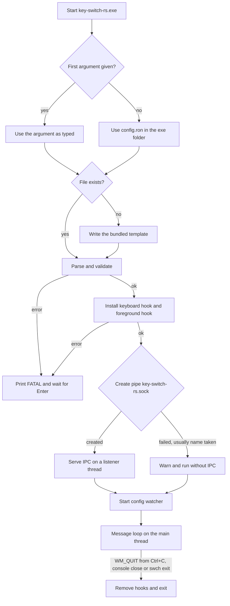
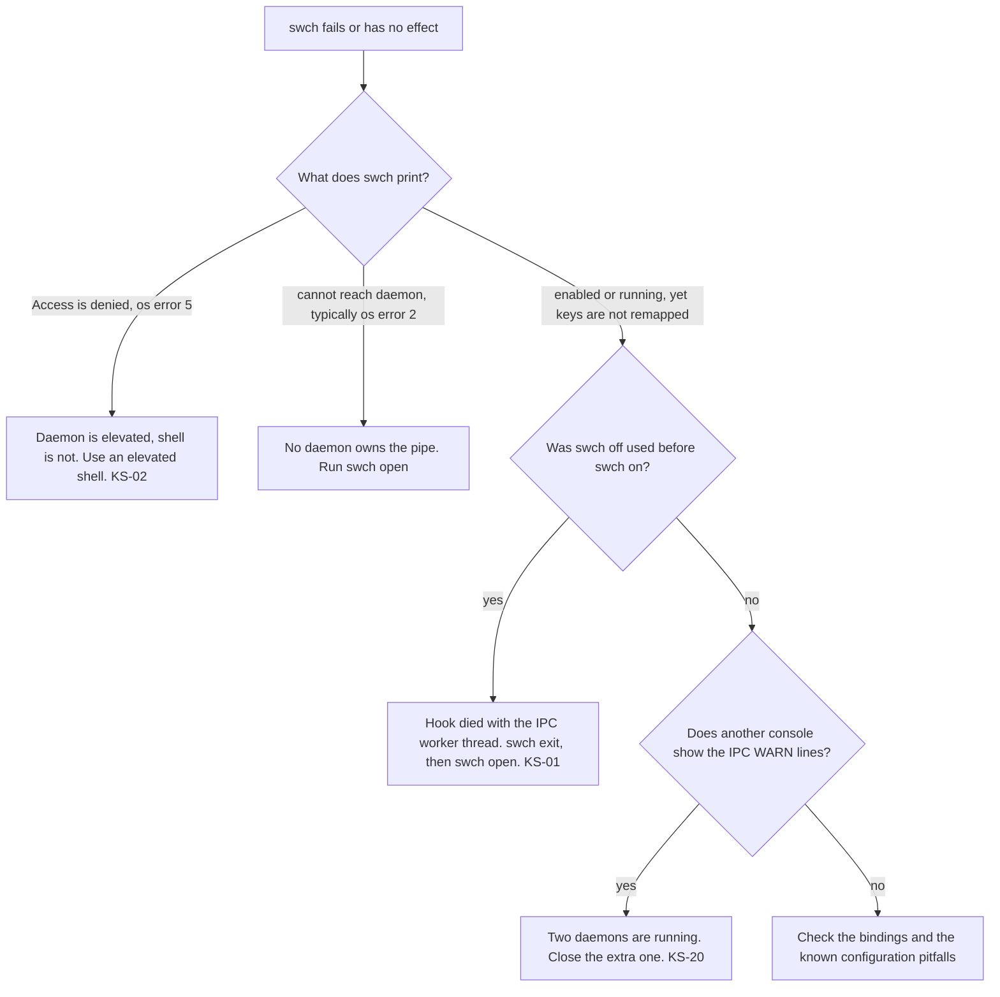

# Building, running and controlling the daemon

A build produces two Windows executables. `key-switch-rs.exe` is the daemon that owns the keyboard hook, and `swch.exe` is a small CLI that controls the daemon over a named pipe. This chapter covers building both, running and stopping the daemon, every `swch` command with its output and exit code, autostart, tests, this book, and workarounds for the defects you are most likely to hit.

> [!NOTE]
> Facts describe commit [`7cb3521`](https://github.com/bluesteelll/key-switch-rs/commit/7cb3521) (2026-05-20). Build, test and lint results come from the audit run of 2026-10-14 on Windows 11 with rustc and cargo 1.98.1. The audit did not run the daemon against live keyboard input. See [How the audit was done](methodology.md).

## Prerequisites

| Requirement | Value | Notes |
|---|---|---|
| Operating system | Windows 10 or 11, 64-bit | Windows only: the code calls Win32 throughout, through the `windows` crate 0.62 ([Cargo.toml:12](https://github.com/bluesteelll/key-switch-rs/blob/7cb3521/Cargo.toml#L12)). Rust's `x86_64-pc-windows-msvc` target itself requires Windows 10 or later. The audit built on Windows 11. |
| Target | `x86_64-pc-windows-msvc` | This is the only target the audit built. |
| Linker | MSVC `link.exe` | Install Visual Studio Build Tools with the "Desktop development with C++" workload, which includes MSVC and a Windows SDK. `build.rs` passes MSVC-only linker switches, so the `-gnu` targets are reported to fail to link ([KS-42](audit.md#ks-42), not independently verified). |
| Edition | 2024 | [Cargo.toml:4](https://github.com/bluesteelll/key-switch-rs/blob/7cb3521/Cargo.toml#L4) |
| Minimum rustc | At least 1.88, a lower bound derived from the code | `Cargo.toml` declares no `rust-version`. The code uses let chains (`if ... && let ...`), for example at [src/config/loader.rs:176-177](https://github.com/bluesteelll/key-switch-rs/blob/7cb3521/src/config/loader.rs#L176-L177), and these became stable for edition 2024 in Rust 1.88. No dependency built on Windows declares a `rust-version` above 1.85 (`notify-types` 2.1.0). Only 1.98.1 was tested. |
| Network | crates.io on the first build | `Cargo.lock` is committed. Build with `--locked`. |

```powershell
rustup default stable-x86_64-pc-windows-msvc
rustup component add clippy
rustc --version   # expect 1.88.0 or newer
```

## Building

Run these from the repository root.

| Command | Profile | Output folder | Daemon manifest |
|---|---|---|---|
| `cargo build --locked` | dev | `target\debug\` | no elevation request, so the daemon runs at the caller's level |
| `cargo build --release --locked` | release | `target\release\` | `requireAdministrator` |
| `cargo build --release --locked --bin swch` | release | `target\release\` | the daemon is not built |

In the audit, `cargo build --release` finished in about 39 s with 0 warnings.

### Debug and release differ in elevation

[build.rs:13-24](https://github.com/bluesteelll/key-switch-rs/blob/7cb3521/build.rs#L13-L24) checks two things: `CARGO_CFG_WINDOWS` is set and `PROFILE` is `release`. When both hold, it emits two linker arguments through `cargo:rustc-link-arg-bin=key-switch-rs=...`, which scopes them to the daemon binary:

```text
/MANIFEST:EMBED
/MANIFESTUAC:level='requireAdministrator' uiAccess='false'
```

Consequences:

- Only `key-switch-rs.exe` gets the elevation request. `swch.exe` keeps the default `asInvoker` level.
- A debug daemon makes no elevation request, so it runs at the integrity level of whatever starts it. This is the convenient mode for development: started from a normal shell, the daemon and `swch` share an integrity level and the pipe works (compare [KS-02](audit.md#ks-02)).
- Cargo sets `PROFILE=release` for every profile that inherits from `release`, so `cargo test --release` also links the manifest into the daemon's unit-test harness (see [Release-mode tests](#release-mode-tests)).
- `app.manifest` in the repository root is never used. `build.rs` does not reference it (there is no `/MANIFESTINPUT`), so its `supportedOS` block does not ship.

The audit checked the manifest by searching the binaries for the string. To repeat the check:

```powershell
Select-String -Path .\target\release\key-switch-rs.exe -Pattern requireAdministrator -SimpleMatch -Quiet   # True
```

### Output binaries

| File | Source | Release size (audit) | Requested level | Role |
|---|---|---|---|---|
| `key-switch-rs.exe` | `src/main.rs` and the library | 989,696 bytes (about 990 KB) | `requireAdministrator` in release builds | Daemon: keyboard hook, config watcher, IPC server |
| `swch.exe` | `src/bin/swch.rs` and the library | 215,040 bytes (about 215 KB) | `asInvoker` | CLI driver |

Both binaries link the library crate `key_switch_rs` (`src/lib.rs`). Install them side by side in one folder. `swch open` looks for `key-switch-rs.exe` in its own folder ([src/bin/swch.rs:81-90](https://github.com/bluesteelll/key-switch-rs/blob/7cb3521/src/bin/swch.rs#L81-L90)). Started without an argument, the daemon creates `config.ron` in its own folder on first run.

## Running the daemon directly

### Command line

```text
key-switch-rs.exe [CONFIG_PATH]
```

The daemon parses no options. [src/main.rs:28-31](https://github.com/bluesteelll/key-switch-rs/blob/7cb3521/src/main.rs#L28-L31) resolves the config path like this:

1. If there is an argument, the first one is the config path, used exactly as typed. Any further arguments are ignored.
2. With no argument, the path is `<exe_dir>\config.ron` ([src/config/loader.rs:83-95](https://github.com/bluesteelll/key-switch-rs/blob/7cb3521/src/config/loader.rs#L83-L95)).
3. If the file does not exist, the daemon writes the bundled template there, creating missing parent folders, and then loads it ([src/config/loader.rs:101-107](https://github.com/bluesteelll/key-switch-rs/blob/7cb3521/src/config/loader.rs#L101-L107)).

> [!WARNING]
> Pass an absolute path. A relative path loads, but hot reload never fires for it ([KS-21](audit.md#ks-21)). Also, any first argument counts as a path: `key-switch-rs.exe --help` creates a file named `--help` containing the default template and then runs with it ([KS-41](audit.md#ks-41), not independently verified).

A config error at startup is fatal, and so is any error that `App::run` returns, such as a failed hook install. `main` prints `[FATAL] <error>` and then `Press Enter to exit...`, and waits on stdin so that a double-clicked console window stays open ([src/main.rs:7-21](https://github.com/bluesteelll/key-switch-rs/blob/7cb3521/src/main.rs#L7-L21)). A config error during hot reload is not fatal (see the console lines below). The config format itself is covered in the [configuration reference](config/index.md).

### Startup and shutdown

On the main thread, `main` resolves and loads the config ([src/main.rs:23-41](https://github.com/bluesteelll/key-switch-rs/blob/7cb3521/src/main.rs#L23-L41)). [`App::run`](https://github.com/bluesteelll/key-switch-rs/blob/7cb3521/src/core/app.rs#L79-L137) then installs the hooks, starts the IPC listener and the config watcher on their own threads, and runs the message loop. The [architecture chapter](architecture.md) describes the threads involved.



The daemon logs only to its console. There is no log file, so when it was started by `swch open` or a Scheduled Task, look for errors in that console window.

| Console line | Printed when | Source |
|---|---|---|
| `[INFO] generated default config at <path>` or `[INFO] loading config from <path>` | Config load, at startup and on every reload | [loader.rs:104-106](https://github.com/bluesteelll/key-switch-rs/blob/7cb3521/src/config/loader.rs#L104-L106) |
| `[INFO] <function>: registry combination <keys>` or `[INFO] <function>: using default combination` | Config load, for each `block_original_combo` binding whose action has an OS hotkey | [registry.rs:60-73](https://github.com/bluesteelll/key-switch-rs/blob/7cb3521/src/system/registry.rs#L60-L73) |
| `[WARN] config contains no bindings` | The config parsed but has no bindings | [loader.rs:157-159](https://github.com/bluesteelll/key-switch-rs/blob/7cb3521/src/config/loader.rs#L157-L159) |
| `Key Switch started`, then one line per binding, auto-blockers included | Before the hook is installed | [app.rs:57-70](https://github.com/bluesteelll/key-switch-rs/blob/7cb3521/src/core/app.rs#L57-L70) |
| `✓ Hook installed successfully` | The hook is live | [app.rs:92](https://github.com/bluesteelll/key-switch-rs/blob/7cb3521/src/core/app.rs#L92) |
| `` ✓ IPC server listening (use `swch on/off/exit`) `` | The pipe was created | [app.rs:95](https://github.com/bluesteelll/key-switch-rs/blob/7cb3521/src/core/app.rs#L95) |
| `[WARN] could not create IPC listener at pipe "key-switch-rs.sock": <error>`, then `[INFO] another daemon instance may already be running. ...` | Creating the pipe failed, usually because the name is taken | [ipc_server.rs:49-60](https://github.com/bluesteelll/key-switch-rs/blob/7cb3521/src/hook/ipc_server.rs#L49-L60) |
| `✓ Watching <path> for changes` | The watcher started | [app.rs:109](https://github.com/bluesteelll/key-switch-rs/blob/7cb3521/src/core/app.rs#L109) |
| `[WARN] could not start config file watcher for <path>: <error>`, then `[INFO] continuing without hot-reload` | The watcher failed to start; the daemon keeps running | [app.rs:112-119](https://github.com/bluesteelll/key-switch-rs/blob/7cb3521/src/core/app.rs#L112-L119) |
| `[INFO] config reloaded (<n> bindings live)` | A save was applied | [config_watcher.rs:104](https://github.com/bluesteelll/key-switch-rs/blob/7cb3521/src/hook/config_watcher.rs#L104) |
| `[ERROR] config reload failed:`, the error, then `[INFO] keeping previous bindings live` | A save did not parse or validate | [config_watcher.rs:107-108](https://github.com/bluesteelll/key-switch-rs/blob/7cb3521/src/hook/config_watcher.rs#L107-L108) |
| `Received shutdown signal...` | Ctrl+C, or the console window was closed | [app.rs:143](https://github.com/bluesteelll/key-switch-rs/blob/7cb3521/src/core/app.rs#L143) |
| `Removing keyboard hook...` | The message loop ended | [app.rs:133](https://github.com/bluesteelll/key-switch-rs/blob/7cb3521/src/core/app.rs#L133) |

Hot reload collapses a burst of file events into one reload after 250 ms of quiet ([config_watcher.rs:29](https://github.com/bluesteelll/key-switch-rs/blob/7cb3521/src/hook/config_watcher.rs#L29), [:92-98](https://github.com/bluesteelll/key-switch-rs/blob/7cb3521/src/hook/config_watcher.rs#L92-L98)). It watches the parent folder and keeps only create, modify and remove events whose path equals the configured path exactly ([config_watcher.rs:44-69](https://github.com/bluesteelll/key-switch-rs/blob/7cb3521/src/hook/config_watcher.rs#L44-L69)). A reload calls the same loader as startup, so deleting or renaming the config file writes a fresh default and swaps the live bindings for the defaults ([KS-23](audit.md#ks-23)).

### Stopping

Each of these posts `WM_QUIT` to the main thread, which leaves its message loop and removes the hooks ([app.rs:125-134](https://github.com/bluesteelll/key-switch-rs/blob/7cb3521/src/core/app.rs#L125-L134)):

- Ctrl+C in the daemon console, or closing the console window. [app.rs:140-160](https://github.com/bluesteelll/key-switch-rs/blob/7cb3521/src/core/app.rs#L140-L160) handles `CTRL_C_EVENT` and `CTRL_CLOSE_EVENT`.
- `swch exit`.

The daemon is a console program with no background or tray mode. Closing its window stops it.

### Running through cargo

The package has two binaries and no `default-run` key, so `cargo run` always needs `--bin`.

| Command | Effect |
|---|---|
| `cargo run --locked --bin key-switch-rs` | Debug daemon at the shell's integrity level. The default config path is `target\debug\config.ron`. |
| `cargo run --locked --bin key-switch-rs -- C:\path\to\config.ron` | Same, with an explicit config. Use an absolute path. |
| `cargo run --locked --bin swch -- status` | Runs the CLI. |
| `cargo run --release --bin key-switch-rs` | Fails from a non-elevated shell with `The requested operation requires elevation. (os error 740)`, because cargo starts the process with `CreateProcess`, which refuses a `requireAdministrator` image. Run it from an elevated shell. |

## Controlling the daemon with swch

### Transport and protocol

- **Pipe name.** `PIPE_NAME` is `key-switch-rs.sock` ([src/ipc.rs:16](https://github.com/bluesteelll/key-switch-rs/blob/7cb3521/src/ipc.rs#L16)). The `interprocess` crate's `GenericNamespaced` maps it to `\\.\pipe\key-switch-rs.sock`. Named pipes share one machine-wide namespace, so only the first daemon on the machine gets the pipe, across all sessions and users ([KS-40](audit.md#ks-40), not independently verified).
- **One command per connection.** The client writes one newline-terminated ASCII line. The daemon answers with one line, `OK: <message>` or `ERR: <message>` ([src/ipc.rs:59-65](https://github.com/bluesteelll/key-switch-rs/blob/7cb3521/src/ipc.rs#L59-L65)), and the connection ends. Every connection gets a new worker thread ([src/hook/ipc_server.rs:72](https://github.com/bluesteelll/key-switch-rs/blob/7cb3521/src/hook/ipc_server.rs#L72)).
- **Daemon-side parsing.** The line is trimmed and matched case-insensitively: `on`, `off`, `exit` or `quit` or `shutdown`, and `status` or `ping`. Anything else gets `ERR: unknown command "<line>"`, with the line trimmed and lowercased ([src/ipc.rs:36-44](https://github.com/bluesteelll/key-switch-rs/blob/7cb3521/src/ipc.rs#L36-L44)).
- **What swch prints.** `parse_response` strips the `OK:` or `ERR:` prefix ([src/ipc.rs:69-79](https://github.com/bluesteelll/key-switch-rs/blob/7cb3521/src/ipc.rs#L69-L79)). `swch` prints an `OK` message on stdout, and an `ERR` message on stderr after a `swch: ` prefix ([src/bin/swch.rs:149-155](https://github.com/bluesteelll/key-switch-rs/blob/7cb3521/src/bin/swch.rs#L149-L155)). The README's [sample session](https://github.com/bluesteelll/key-switch-rs/blob/7cb3521/README.md?plain=1#L429) shows `OK: running (5 bindings live)`, but with the default config the real output is `running (3 bindings live)`. See [Gaps and documentation drift](gaps.md).

```mermaid
sequenceDiagram
    participant S as swch
    participant L as Listener thread
    participant W as Worker thread
    participant M as Main thread
    S->>L: connect to key-switch-rs.sock
    L->>W: spawn a worker for this connection
    S->>W: one command line
    alt on, off or status
        W->>W: enable, disable or read hook state on this thread
    else exit
        W->>M: PostThreadMessageW with WM_QUIT
    end
    W-->>S: one reply line, OK or ERR prefix
    Note over S: prints the message, exits 0 or 1
    Note over M: after WM_QUIT the loop ends and the hooks are removed
```



### Commands

Usage is `swch <command>`. The command name is matched case-insensitively and extra arguments are ignored ([src/bin/swch.rs:26-57](https://github.com/bluesteelll/key-switch-rs/blob/7cb3521/src/bin/swch.rs#L26-L57)).

| Command | Aliases | Line sent | Success: stdout, exit 0 | Failure: stderr, exit 1 |
|---|---|---|---|---|
| `swch open` | `start`, `launch` | nothing, only a connect probe | `swch: daemon is already running` or `swch: daemon launched` | `swch: daemon binary not found at <path>`, `swch: ShellExecuteW failed (code <n>) — user may have declined the UAC prompt`, or `swch: could not locate current_exe: <error>` |
| `swch on` | none | `on` | `enabled` | `swch: enable failed: <error>` |
| `swch off` | none | `off` | `disabled` | `swch: disable failed: <error>` |
| `swch status` | `ping` | `status` | `running (<n> bindings live)` or `disabled (<n> bindings live)` | none from the daemon |
| `swch exit` | `quit`, `shutdown`, `stop` | `exit` | `shutting down` | `swch: main thread id unknown — cannot post WM_QUIT` |
| `swch help` | `--help`, `-h` | nothing | usage text, written to stderr | none |

Sources: [`cmd_open`](https://github.com/bluesteelll/key-switch-rs/blob/7cb3521/src/bin/swch.rs#L72-L125) and [`dispatch`](https://github.com/bluesteelll/key-switch-rs/blob/7cb3521/src/hook/ipc_server.rs#L113-L147). `on` can also answer `enabled (but reports not installed — investigate)`, a branch that is unreachable in practice. `stop` exists only in `swch`, which sends `exit` for it.

The usage text ([src/bin/swch.rs:59-68](https://github.com/bluesteelll/key-switch-rs/blob/7cb3521/src/bin/swch.rs#L59-L68)) is below. The first line shows the program name as invoked (`argv[0]`), so it may be a full path.

```text
usage: swch <command>

Commands:
  open    Launch the daemon (UAC prompt)
  on      Enable the keyboard hook (daemon must be running)
  off     Disable the keyboard hook
  status  Show daemon state and binding count
  exit    Shut the daemon down
```

### Other swch errors

The first two rows apply to any invocation. The rest apply to `on`, `off`, `status` and `exit`, which talk to the pipe.

| Situation | Output | Exit code |
|---|---|---|
| No command | usage text on stderr | 1 |
| Unknown command | `swch: unknown command "<name>"` with the name lowercased, then usage, on stderr | 1 |
| Pipe cannot be opened | `` swch: cannot reach daemon (<error>). Use `swch open` to start it. `` on stderr | 1 |
| Write or read failed | `swch: IPC error: write: <error>` or `swch: IPC error: read: <error>` on stderr | 1 |
| Reply has no `OK:`/`ERR:` prefix, including an empty reply | the raw line on stdout | 0 |

Behaviour worth knowing when scripting against `swch`:

- **`status` does not test the hook.** It reports `running` whenever the stored hook handle is non-null ([keyboard_hook.rs:137-139](https://github.com/bluesteelll/key-switch-rs/blob/7cb3521/src/hook/keyboard_hook.rs#L137-L139)), so after [KS-01](audit.md#ks-01) it still says `running` while nothing is remapped.
- **The binding count includes auto-blockers.** `<n>` is the length of the live list ([src/hook/ipc_server.rs:129](https://github.com/bluesteelll/key-switch-rs/blob/7cb3521/src/hook/ipc_server.rs#L129)), which includes the auto-blockers that `block_original_combo` adds. The generated default config gives 3: two bindings plus one blocker.
- **No read timeout.** If the daemon never answers, `swch` waits forever; the code says so itself ([src/bin/swch.rs:171-175](https://github.com/bluesteelll/key-switch-rs/blob/7cb3521/src/bin/swch.rs#L171-L175)). Press Ctrl+C.
- **An empty reply counts as success** ([src/ipc.rs:75-78](https://github.com/bluesteelll/key-switch-rs/blob/7cb3521/src/ipc.rs#L75-L78)). `swch exit` can print an empty line and exit 0 if the daemon exits before its reply is written ([KS-37](audit.md#ks-37), not independently verified).
- **`open` does not wait for the daemon.** It returns as soon as `ShellExecuteW` does, so `daemon launched` means only that the UAC prompt was accepted and the process started, not that the config loaded. It passes no arguments ([src/bin/swch.rs:105-114](https://github.com/bluesteelll/key-switch-rs/blob/7cb3521/src/bin/swch.rs#L105-L114)), so a daemon started this way always uses `<exe_dir>\config.ron`. It always uses the `runas` verb, even for a debug build, so it always elevates.
- **`open` checks only whether a connect succeeds** ([src/bin/swch.rs:75-78](https://github.com/bluesteelll/key-switch-rs/blob/7cb3521/src/bin/swch.rs#L75-L78)). Any connect error, including "Access is denied", reads as "not running", and `open` then starts a second daemon ([KS-20](audit.md#ks-20)). The probe also leaves a `[WARN] IPC read error` or `[WARN] IPC write error` line in the daemon console ([KS-39](audit.md#ks-39), not independently verified).

> [!WARNING]
> Two defects make `swch` unreliable at commit 7cb3521. With an elevated daemon, `swch` works only from an elevated shell ([KS-02](audit.md#ks-02)). And `swch on` after `swch off` leaves remapping dead ([KS-01](audit.md#ks-01)): to pause remapping, use `swch exit`, and to resume, use `swch open`. See [Troubleshooting](#troubleshooting).

## UAC and integrity levels

User Interface Privilege Isolation (UIPI) stops a `WH_KEYBOARD_LL` hook in a medium-integrity process from seeing keystrokes sent to higher-integrity windows such as Task Manager, regedit and any app run as administrator. Commit `b4c8acf` (2026-02-15) added the `requireAdministrator` manifest to get around this. No user-mode process can hook the Secure Desktop at any integrity level; that covers the UAC prompt, the Ctrl+Alt+Del screen and the lock screen.

| How the daemon is started | Build | Daemon integrity | UAC prompt | `swch` from a normal shell |
|---|---|---|---|---|
| `cargo run`, or the exe started from a normal shell or Explorer | debug | medium | no | works |
| Double-click or "Run as administrator" | release | high | on every launch | fails ([KS-02](audit.md#ks-02)) |
| `swch open` | debug or release | high | on every launch | fails ([KS-02](audit.md#ks-02)) |
| From an elevated shell | either | high | no | fails; an elevated `swch` works |
| Scheduled Task with `/RL HIGHEST` | release | high | no | fails ([KS-02](audit.md#ks-02)) |

The README says `swch open` "Triggers UAC the first time" ([README.md:439](https://github.com/bluesteelll/key-switch-rs/blob/7cb3521/README.md?plain=1#L439)). In fact the prompt appears on every launch: `swch open` always uses the `runas` verb ([src/bin/swch.rs:102](https://github.com/bluesteelll/key-switch-rs/blob/7cb3521/src/bin/swch.rs#L102)), and a release daemon requests elevation each time it starts.

Running elevated has side effects beyond the hook:

- **The pipe refuses non-elevated clients.** The pipe gets the default DACL, which blocks a non-elevated `swch` ([KS-02](audit.md#ks-02)).
- **Launched programs run elevated.** `Launch` children inherit the daemon's elevated token, `OpenUrl` can start its handler elevated, and console programs started with `Launch` share the daemon's console ([KS-09](audit.md#ks-09)).
- **Config write access is admin access.** The elevated daemon hot-reloads `config.ron` from its own folder, and a `Launch` binding runs with the daemon's token. If normal processes can write to that folder, they can get code run as administrator without a UAC prompt ([KS-09](audit.md#ks-09)). Install into a folder only administrators can write, such as `C:\Program Files\key-switch-rs\`, and accept that editing the config then needs an elevated editor.
- **The prompt-free alternative was not pursued.** That alternative is `uiAccess="true"`, which needs a signed binary installed under `Program Files` ([app.manifest:16-18](https://github.com/bluesteelll/key-switch-rs/blob/7cb3521/app.manifest#L16-L18)).

## Autostart with a Scheduled Task

The README suggests a logon task with "Run with highest privileges" ([README.md:456-460](https://github.com/bluesteelll/key-switch-rs/blob/7cb3521/README.md?plain=1#L456-L460)), but nothing in the code creates one. Such a task starts the daemon elevated at logon without a UAC prompt.

> [!NOTE]
> These flags were checked against Microsoft's [schtasks create reference](https://learn.microsoft.com/en-us/windows-server/administration/windows-commands/schtasks-create) and [task settings documentation](https://learn.microsoft.com/en-us/windows/win32/taskschd/tasksettings-executiontimelimit). The commands were not run during the audit.

1. Copy `key-switch-rs.exe` and `swch.exe` into a fixed folder that only administrators can write (see [UAC and integrity levels](#uac-and-integrity-levels)), for example `C:\Program Files\key-switch-rs\`.
2. Open an elevated shell (creating a `HIGHEST` task needs administrator rights) and create the task. A path with spaces is quoted with `\"` inside the `/TR` value:

   ```bat
   schtasks /Create /TN "key-switch-rs" /TR "\"C:\Program Files\key-switch-rs\key-switch-rs.exe\"" /SC ONLOGON /RL HIGHEST /IT /F
   ```

3. Lift two Task Scheduler defaults that suit batch jobs, not daemons. By default a task is stopped 72 hours after it starts, and it does not start on battery power. `schtasks /Create` has no switch for either setting. In an elevated PowerShell:

   ```powershell
   $s = New-ScheduledTaskSettingsSet -ExecutionTimeLimit ([TimeSpan]::Zero) -AllowStartIfOnBatteries -DontStopIfGoingOnBatteries
   Set-ScheduledTask -TaskName "key-switch-rs" -Settings $s
   ```

   Alternatively, clear the matching options on the task's Settings and Conditions tabs in Task Scheduler.
4. Test the task without logging off: `schtasks /Run /TN "key-switch-rs"`. Inspect it with `schtasks /Query /TN "key-switch-rs" /V /FO LIST`.
5. To remove it: `schtasks /Delete /TN "key-switch-rs" /F`.

| Flag | Meaning, per Microsoft's reference | Why it is used here |
|---|---|---|
| `/SC ONLOGON` | Run whenever a user logs on | Start with the session |
| `/TN "key-switch-rs"` | Task name | Used by `/Run`, `/Query` and `/Delete` |
| `/TR <path>` | Program to run, as a fully qualified path | With no argument, the daemon uses `<exe_dir>\config.ron`, which is absolute |
| `/RL HIGHEST` | Run with the highest privileges; the default is `LIMITED` | High integrity without a UAC prompt |
| `/IT` | Run only while the run-as user is logged on | A low-level hook sees only the input of its own interactive session |
| `/F` | Suppress the warning if the task already exists | Lets you re-run the command |
| `/DELAY mmmm:ss` (optional) | Wait after the trigger; valid for `ONLOGON` | For example `/DELAY 0000:15` to let the shell settle |

The task runs as the account that created it. To use a non-default config, append an absolute path to `/TR`. A task's working folder is not the executable's folder, so a relative path would resolve somewhere else and also disable hot reload ([KS-21](audit.md#ks-21)):

```bat
schtasks /Create /TN "key-switch-rs" /TR "\"C:\Program Files\key-switch-rs\key-switch-rs.exe\" \"D:\config\keys.ron\"" /SC ONLOGON /RL HIGHEST /IT /F
```

At logon the daemon opens a console window, and closing that window stops the daemon.

> [!WARNING]
> While the task's daemon is running, a non-elevated `swch` cannot reach it ([KS-02](audit.md#ks-02)). A non-elevated `swch open` will not detect it either, and starts a second elevated daemon ([KS-20](audit.md#ks-20)). Run `swch` from an elevated shell, and do not combine the task with `swch open` or double-click launches.

## Tests and lints

### Unit tests

```powershell
cargo test --locked
```

The audit got 120 passed and 0 failed. All 120 are library unit tests. The two binary harnesses and the doc tests ran 0 tests, and there is no `tests/` directory. The counts below come from the audit's test log; [Tests per file](overview.md#tests-per-file) breaks them down by file, with what each file's tests cover.

| Module | Tests |
|---|---|
| `config::loader` | 41 |
| `data::vk_name` | 14 |
| `config::parsing` | 10 |
| `hook::tap_state` | 8 |
| `ipc` | 7 |
| `data::condition` | 6 |
| `system::registry`, `hook::chord_state`, `data::sequence` | 5 each |
| `hook::sequence_state`, `hook::keyboard_hook_callback`, `hook::keyboard_hook` | 4 each |
| `system::system_function`, `data::key_combination` | 3 each |
| `data::trigger` | 1 |

The tests install no hooks, inject no input and write no files; their only registry access is reading the system hotkeys. Several areas have no tests ([What no test exercises](gaps.md#what-no-test-exercises) has the full list):

- The key-down and key-up decisions in `keyboard_hook_callback.rs` (only its helpers are tested).
- The IPC server, `swch` and the config watcher.
- The Win32 side of conditions and actions.

### Release-mode tests

> [!WARNING]
> In a non-elevated shell, `cargo test --release` stops with os error 740 after the library tests. `rustc-link-arg-bin` also applies to the unit-test harness built from `src/main.rs`, so that harness carries the `requireAdministrator` manifest ([KS-38](audit.md#ks-38): one reviewer reproduced it with a probe crate, but it was not independently verified). Run it from an elevated shell, or restrict it to the library with `cargo test --release --lib` (the audit did not try this).

### Clippy

```powershell
cargo clippy --all-targets --locked
```

The audit got one warning, `clippy::unnecessary_sort_by`, at [src/hook/keyboard_hook.rs:72](https://github.com/bluesteelll/key-switch-rs/blob/7cb3521/src/hook/keyboard_hook.rs#L72). It is reported for the library and again for the library test target, and it is style only: clippy suggests `sort_by_key(|a| std::cmp::Reverse(a.kind.key_count()))`. Adding `-- -D warnings` therefore fails until it is fixed. Lint sets change between toolchains; this result is for 1.98.1.

No CI workflow builds, tests or lints the Rust code. The only workflow publishes this book.

## Building this book

Install the same tool versions that CI pins:

```powershell
cargo install mdbook --version 0.5.3 --locked
cargo install mdbook-mermaid --version 0.17.0 --locked
```

From the repository root:

| Command | Result |
|---|---|
| `mdbook serve book --open` | Builds, serves `http://localhost:3000` and rebuilds on every save |
| `mdbook build book` | Writes the site to `book\book\`, which `.gitignore` excludes |

`book/book.toml` runs `mdbook-mermaid` as a preprocessor and loads `book/mermaid.min.js` and `book/mermaid-init.js`, which are stored next to it. `mdbook-mermaid` must be on `PATH`; without it, mdbook 0.5 stops with an error that the `mermaid` preprocessor is not installed.

`.github/workflows/book.yml` publishes the book:

1. A push to `master` that touches `book/**` or the workflow file triggers it. It can also be started by hand (`workflow_dispatch`).
2. The `build` job runs on `ubuntu-latest`. It installs `mdbook@0.5.3` and `mdbook-mermaid@0.17.0` with `taiki-e/install-action`, runs `mdbook build book`, and uploads `book/book` as the Pages artifact.
3. The `deploy` job publishes that artifact to the `github-pages` environment with `actions/deploy-pages`.

One-time setup: in the repository, go to **Settings -> Pages -> Build and deployment -> Source** and select **GitHub Actions**. The book is then served at `https://bluesteelll.github.io/key-switch-rs/`, which matches `site-url = "/key-switch-rs/"` in `book.toml`.

> [!NOTE]
> The book sources and the workflow are not part of commit 7cb3521. They were added with this documentation.

## Troubleshooting

All six issues below are verified defects at commit 7cb3521. The [audit chapter](audit.md) has the full analysis of each one, and the [roadmap](roadmap.md) has the planned fixes.



| Symptom | Issue | Short workaround |
|---|---|---|
| `swch` says `Access is denied. (os error 5)` | [KS-02](audit.md#ks-02) | Run `swch` from an elevated shell |
| Remapping is dead after `swch off` then `swch on` | [KS-01](audit.md#ks-01) | `swch exit`, then `swch open` |
| Keys remapped twice, or `swch off` has no effect | [KS-20](audit.md#ks-20) | Close the extra daemon |
| Saving the config changes nothing | [KS-21](audit.md#ks-21) | Pass an absolute config path |
| Start menu or menu bar opens after a binding fires | [KS-12](audit.md#ks-12) | Press Esc; keep Win and Alt out of such combos |
| A key stays logically held down | [KS-06](audit.md#ks-06) | Stop the daemon, tap the key, restart |

### swch says "Access is denied" (KS-02)

**Symptom.** You start the daemon with `swch open`, a double-click or a Scheduled Task. After that, `swch status`, `on`, `off` and `exit` from a normal shell all print the following and exit with 1:

```text
swch: cannot reach daemon (Access is denied. (os error 5)). Use `swch open` to start it.
```

**Cause.** [src/hook/ipc_server.rs:47](https://github.com/bluesteelll/key-switch-rs/blob/7cb3521/src/hook/ipc_server.rs#L47) creates the pipe without a security descriptor, so it gets the default named-pipe DACL. That DACL gives full access to SYSTEM, Administrators and the creator's owner, and only read access to Everyone. An elevated creator's owner is Administrators, which is deny-only in a non-elevated token, so the read-write open that `swch` makes is refused. A probe on the audit machine confirmed this.

**Workaround.**

1. Run `swch` from an elevated shell, for example a terminal opened with "Run as administrator".
2. During development, run a debug daemon from a normal shell (`cargo run --bin key-switch-rs`). The daemon and `swch` then share an integrity level.
3. Do not answer the error with `swch open` from the same normal shell. That starts a second daemon ([KS-20](audit.md#ks-20)).

### swch on does nothing after swch off (KS-01)

**Symptom.** `swch off` prints `disabled`, `swch on` prints `enabled`, and `swch status` says `running (<n> bindings live)`, but no key is remapped. A further `swch off` prints `swch: disable failed: <error>`. You can only reach this path when `swch` can talk to the daemon: an elevated `swch`, or a debug daemon started from a normal shell.

**Cause.** `swch on` runs `enable()` on the short-lived IPC worker thread ([ipc_server.rs:72](https://github.com/bluesteelll/key-switch-rs/blob/7cb3521/src/hook/ipc_server.rs#L72), [:115](https://github.com/bluesteelll/key-switch-rs/blob/7cb3521/src/hook/ipc_server.rs#L115)). `enable()` calls `SetWindowsHookExW` and `SetWinEventHook` on whatever thread calls it ([keyboard_hook.rs:143-157](https://github.com/bluesteelll/key-switch-rs/blob/7cb3521/src/hook/keyboard_hook.rs#L143-L157)). A low-level hook is serviced by its installing thread's message loop. This worker has no message loop and exits right after replying, so Windows removes its hooks. The stale handle keeps `status` reporting `running`.

**Workaround.**

- Do not use `off` and `on`. To pause remapping, use `swch exit`. To resume, use `swch open`.
- If it has already happened:
  1. Run `swch exit`. The client prints `shutting down`.
  2. The daemon's own shutdown then fails. It prints a `[FATAL]` line about an invalid hook handle and waits at `Press Enter to exit...`. Until you press Enter or close its window, the daemon still serves the pipe: `swch open` says it is already running and `swch status` answers `disabled`.
  3. Run `swch open`.

### Two daemons are running (KS-20)

**Symptom.** Remapped output is remapped a second time, and a binding with `block_default: false` runs its action in both instances. `swch off` and `swch exit` seem to have no effect. One console shows:

```text
[WARN] could not create IPC listener at pipe "key-switch-rs.sock": <error>
[INFO] another daemon instance may already be running. `swch` commands will not reach this process.
```

**Cause.** There is no single-instance guard. The hook is installed ([app.rs:91](https://github.com/bluesteelll/key-switch-rs/blob/7cb3521/src/core/app.rs#L91)) before the pipe is created ([app.rs:94](https://github.com/bluesteelll/key-switch-rs/blob/7cb3521/src/core/app.rs#L94)), and failing to create the pipe only produces a warning. `swch` reaches only the instance that owns the pipe, while the instance started later has its hook called first. The sentinel that marks injected keys includes the process ID ([src/core/constants.rs:15-28](https://github.com/bluesteelll/key-switch-rs/blob/7cb3521/src/core/constants.rs#L15-L28)), so each daemon treats the other's synthesized keys as physical input. Common ways to get a second instance:

- Double-clicking the daemon twice.
- A Scheduled Task combined with `swch open` or a double-click.
- `swch open` from a normal shell while an elevated daemon runs, because [KS-02](audit.md#ks-02) makes its probe fail.

**Workaround.**

1. Close the console window of the extra instance, or press Ctrl+C in it. The instance that printed the `[WARN]` lines is the one `swch` cannot reach.
2. If it is unclear which window belongs to which process, open an elevated shell, list the daemons with `tasklist /FI "IMAGENAME eq key-switch-rs.exe"`, end all of them with `taskkill /IM key-switch-rs.exe /F`, and start one with `swch open`.
3. Use one start method only.

### Hot reload never fires (KS-21)

**Symptom.** Startup prints `✓ Watching my.ron for changes`, but saving the file never prints `[INFO] config reloaded`.

**Cause.** The watcher keeps only events whose path equals the configured path ([config_watcher.rs:47](https://github.com/bluesteelll/key-switch-rs/blob/7cb3521/src/hook/config_watcher.rs#L47)). `notify` reports absolute paths, and the CLI argument is used as typed ([main.rs:28-31](https://github.com/bluesteelll/key-switch-rs/blob/7cb3521/src/main.rs#L28-L31)), so a relative path never matches. Because the comparison is case-sensitive, a file name typed in a different letter case from the one on disk may also fail to match; only the relative-path part was verified.

**Workaround.** Start without an argument, which gives the absolute `<exe_dir>\config.ron`, or pass an absolute path. Type the file name in the same letter case as on disk.

```powershell
.\key-switch-rs.exe $((Resolve-Path .\my.ron).Path)
```

```bat
key-switch-rs.exe "%CD%\my.ron"
```

### The Start menu or a menu bar opens (KS-12)

**Symptom.** After a `Win+<key>` binding fires, releasing Win opens the Start menu. After an `Alt+<key>` binding, releasing Alt activates the foreground app's menu bar, and the next keystrokes go to the menu. With the default config and the default Alt+Shift language hotkey, pressing Alt and then Shift does the same, because the auto-blocker swallows Shift ([KS-05](audit.md#ks-05)).

**Cause.** Only the payload key is suppressed ([keyboard_hook_callback.rs:294-296](https://github.com/bluesteelll/key-switch-rs/blob/7cb3521/src/hook/keyboard_hook_callback.rs#L294-L296)). The OS sees Win or Alt go down and up with nothing in between, and no mask key is injected. Actions that synthesize a keystroke (`PressKey`, `Media`, `ToggleCapsLock`) mask the release by accident. `PostMessage`, `SwitchLanguage`, `SwitchLanguageBackward`, `Launch`, `OpenUrl` and `DoNothing` do not.

**Workaround.**

- Press Esc to close the Start menu or leave menu mode.
- Bind actions that inject no keystroke to combos without Win or Alt, for example a Ctrl-based combo or a spare key such as `F13`. The defect only concerns a lone Win or Alt release.
- For the Alt-then-Shift case with the default config, set `block_original_combo: false` on the CapsLock binding. The OS Alt+Shift hotkey then switches the language again, and this also avoids [KS-05](audit.md#ks-05). See [Known configuration pitfalls](config/known-issues.md).

### A key stays stuck down (KS-06)

**Symptom.** Suppose a key is bound with `Tap`, `Hold`, `DoubleTap`, a chord or a sequence, and you hold it past the keyboard repeat delay (about 500 ms by default). From then on its auto-repeat reaches the OS, so repeated characters appear. After you release it, the OS still treats the key as held. With the README's CapsLock `Tap(200)` and `Hold(200)` example, CapsLock turns on and stays logically held. Pressing the key again does not help.

**Cause.** Auto-repeat key-downs skip the gesture, chord and sequence branches (`if was_repeat { continue; }` at [keyboard_hook_callback.rs:239](https://github.com/bluesteelll/key-switch-rs/blob/7cb3521/src/hook/keyboard_hook_callback.rs#L239), 244, 249, 256 and 274), so they reach the OS. The key-up, however, is swallowed by the blocked bit set on the first press ([keyboard_hook_callback.rs:294-297](https://github.com/bluesteelll/key-switch-rs/blob/7cb3521/src/hook/keyboard_hook_callback.rs#L294-L297) and [:324](https://github.com/bluesteelll/key-switch-rs/blob/7cb3521/src/hook/keyboard_hook_callback.rs#L324)). Every later press of the bound key is suppressed again, so the key cannot release itself.

**Workaround.**

1. Stop the daemon. Press Ctrl+C in its console, close the window, or run `swch exit` from an elevated shell. `swch off` does not help, because `swch on` is broken ([KS-01](audit.md#ks-01)).
2. Press and release the stuck key once, so the OS sees its key-up. For CapsLock, press it again if the toggle state is now wrong.
3. Start the daemon again with `swch open`.

To avoid it, do not hold gesture, chord or sequence keys longer than the repeat delay. A longer repeat delay (Control Panel -> Keyboard -> Repeat delay) widens the margin. An `Immediate` combo can also stick when a modifier is released first, for example releasing Ctrl and Alt while still holding the L of `Ctrl+Alt+L`. Pressing and releasing L again clears that case.

### Other symptoms

| Symptom | Cause | What to do |
|---|---|---|
| `cargo run --release` fails with os error 740 | The release daemon requires elevation and cargo uses `CreateProcess` | Use an elevated shell |
| `cargo test --release` fails with os error 740 | The daemon's test harness gets the manifest ([KS-38](audit.md#ks-38), not independently verified) | Use an elevated shell, or `cargo test --release --lib` |
| `cargo run` could not determine which binary to run | There are two binaries and no `default-run` | Add `--bin key-switch-rs` or `--bin swch` |
| `swch` hangs | There is no read timeout | Press Ctrl+C and check the daemon console |
| `swch exit` prints an empty line | The reply races teardown, and an empty reply counts as success ([KS-37](audit.md#ks-37), not independently verified) | `swch status` should now fail to connect |
| `[WARN] IPC read error` or `[WARN] IPC write error` after `swch open` | The connect probe sends no command ([KS-39](audit.md#ks-39), not independently verified) | Harmless |
| A file named after a flag appears and the default bindings load | Any first argument is a config path ([KS-41](audit.md#ks-41), not independently verified) | Pass only an absolute config path |
| The daemon in a second user session prints the IPC `[WARN]` lines | The pipe name is machine-wide ([KS-40](audit.md#ks-40), not independently verified) | Only one daemon per machine can be controlled |
| A link error mentions `/MANIFEST:EMBED` | A `-gnu` target receives MSVC-only switches ([KS-42](audit.md#ks-42), not independently verified) | Build for `x86_64-pc-windows-msvc` |
