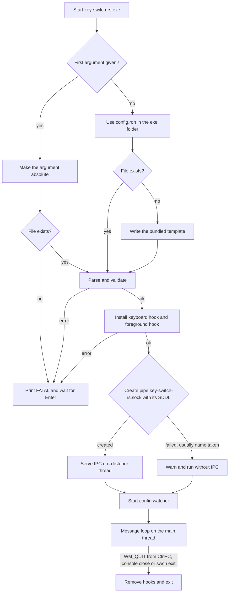
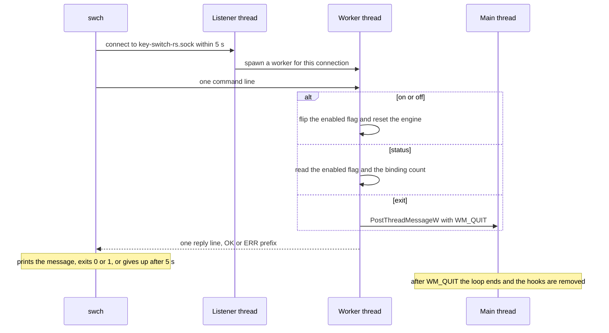
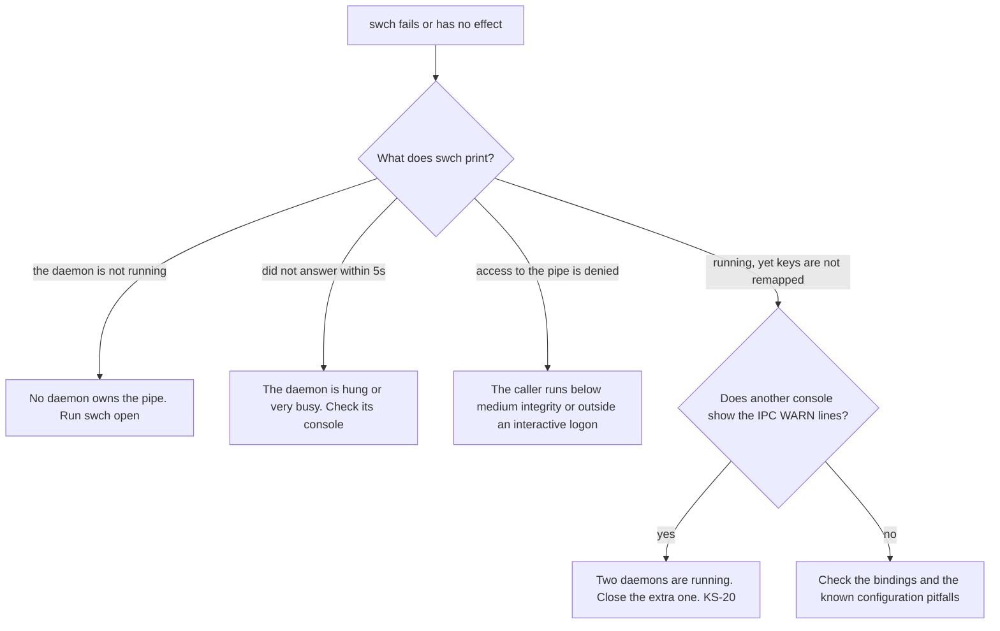

# Building, running and controlling the daemon

A build produces two Windows executables. `key-switch-rs.exe` is the daemon that owns the keyboard hook, and `swch.exe` is a small CLI that controls the daemon over a named pipe. This chapter covers building both, running and stopping the daemon, every `swch` command with its output and exit code, autostart, tests and CI, this book, and workarounds for the problems you are most likely to hit.

> [!NOTE]
> Facts describe commit [`1dfd80a`](https://github.com/bluesteelll/key-switch-rs/commit/1dfd80a) (2026-10-16), the tip of `master` after roadmap Phase 0. Build times and binary sizes come from the audit run of 2026-10-14 on Windows 11 with rustc and cargo 1.98.1, at `7cb3521`, and were not measured again. Test results come from the merge gate of `1dfd80a`. Nobody has run the daemon against live keyboard input; `swch` behaviour is derived from the code and from `tests/ipc_roundtrip.rs`, which runs the client against test pipes. See [How the audit was done](methodology.md).

## Prerequisites

| Requirement | Value | Notes |
|---|---|---|
| Operating system | Windows 10 or 11, 64-bit | Windows only: the code calls Win32 throughout, through the `windows` crate 0.62 ([Cargo.toml:41](https://github.com/bluesteelll/key-switch-rs/blob/1dfd80a/Cargo.toml#L41)). Rust's `x86_64-pc-windows-msvc` target itself requires Windows 10 or later. |
| Target | `x86_64-pc-windows-msvc` | Only this target embeds the UAC manifest. CI also builds `x86_64-pc-windows-gnu`, which links and warns that no manifest is embedded ([KS-42](audit.md#ks-42), fixed). |
| Linker | MSVC `link.exe` | Install Visual Studio Build Tools with the "Desktop development with C++" workload, which includes MSVC and a Windows SDK. |
| Edition | 2024 | [Cargo.toml:4](https://github.com/bluesteelll/key-switch-rs/blob/1dfd80a/Cargo.toml#L4) |
| Minimum rustc | 1.88 | Declared as `rust-version` ([Cargo.toml:5-8](https://github.com/bluesteelll/key-switch-rs/blob/1dfd80a/Cargo.toml#L5-L8)) and checked by the CI job `msrv` with `cargo check --all-targets`. |
| Network | crates.io on the first build | `Cargo.lock` is committed. Build with `--locked`. |

```powershell
rustup default stable-x86_64-pc-windows-msvc
rustup component add clippy rustfmt
rustc --version   # expect 1.88.0 or newer
```

## Building

Run these from the repository root.

| Command | Profile | Output folder | Daemon manifest |
|---|---|---|---|
| `cargo build --locked` | dev | `target\debug\` | no elevation request, so the daemon runs at the caller's level |
| `cargo build --release --locked` | release | `target\release\` | `requireAdministrator` |
| `cargo build --release --locked --bin swch` | release | `target\release\` | the daemon is not built |

In the audit, `cargo build --release` finished in about 39 s with 0 warnings.

### Debug and release differ in elevation

[build.rs:21-47](https://github.com/bluesteelll/key-switch-rs/blob/1dfd80a/build.rs#L21-L47) checks three things: `CARGO_CFG_WINDOWS` is set, `PROFILE` is `release`, and `CARGO_CFG_TARGET_ENV` is `msvc`. When all three hold, it emits two linker arguments through `cargo:rustc-link-arg-bin=key-switch-rs=...`, which scopes them to the daemon binary:

```text
/MANIFEST:EMBED
/MANIFESTUAC:level='requireAdministrator' uiAccess='false'
```

For a release build with another Windows toolchain it prints a cargo warning that no UAC manifest is embedded, and the daemon then does not request administrator rights. Consequences:

- Only `key-switch-rs.exe` gets the elevation request. `swch.exe` keeps the default `asInvoker` level.
- A debug daemon makes no elevation request, so it runs at the integrity level of whatever starts it. This is the convenient mode for development.
- The daemon binary is declared with `test = false` and `bench = false` ([Cargo.toml:18-34](https://github.com/bluesteelll/key-switch-rs/blob/1dfd80a/Cargo.toml#L18-L34)), so `cargo test --release` and `cargo bench` build no test harness from `src/main.rs` that would inherit the manifest (see [Release-mode tests](#release-mode-tests)).
- `app.manifest` in the repository root is never used. `build.rs` does not reference it (there is no `/MANIFESTINPUT`), so its `supportedOS` block does not ship.

CI checks the manifest by searching the binaries for the string. To repeat the check:

```powershell
Select-String -Path .\target\release\key-switch-rs.exe -Pattern requireAdministrator -SimpleMatch -Quiet   # True
```

### Output binaries

| File | Source | Release size (audit, `7cb3521`) | Requested level | Role |
|---|---|---|---|---|
| `key-switch-rs.exe` | `src/main.rs` and the library | 989,696 bytes (about 990 KB) | `requireAdministrator` in release builds | Daemon: keyboard hook, config watcher, IPC server |
| `swch.exe` | `src/bin/swch.rs` and the library | 215,040 bytes (about 215 KB) | `asInvoker` | CLI driver |

Both binaries link the library crate `key_switch_rs` (`src/lib.rs`). Install them side by side in one folder. `swch open` looks for `key-switch-rs.exe` in its own folder ([src/bin/swch.rs:96-103](https://github.com/bluesteelll/key-switch-rs/blob/1dfd80a/src/bin/swch.rs#L96-L103)). Started without an argument, the daemon creates `config.ron` in its own folder on first run.

## Running the daemon directly

### Command line

```text
key-switch-rs.exe [CONFIG_PATH]
```

The daemon parses no options. `ConfigPath::from_arg` ([src/config/loader.rs:110-149](https://github.com/bluesteelll/key-switch-rs/blob/1dfd80a/src/config/loader.rs#L110-L149)) resolves the config path once, at startup:

1. If there is an argument, the first one is the config path, made absolute against the current folder. Any further arguments are ignored. The file must exist: a missing file stops the daemon with `[FATAL] config file <path> does not exist`, and nothing is created.
2. With no argument, the path is `<exe_dir>\config.ron`. If that file does not exist, the daemon writes the bundled template there, creating the folder if needed, and then loads it ([src/config/loader.rs:151-173](https://github.com/bluesteelll/key-switch-rs/blob/1dfd80a/src/config/loader.rs#L151-L173)).

> [!NOTE]
> Any first argument still counts as a path: `key-switch-rs.exe --help` stops with `[FATAL] config file <current folder>\--help does not exist`. Until `1dfd80a` it created a file named `--help` with the default template and ran with it ([KS-41](audit.md#ks-41), not independently verified; partly fixed). Roadmap [item 4.2](roadmap.md#42-background-mode) adds argument parsing.

A config error at startup is fatal, and so is any error that `App::run` returns, such as a failed hook install. `main` prints `[FATAL] <error>` and then `Press Enter to exit...`, and waits on stdin so that a double-clicked console window stays open ([src/main.rs:6-20](https://github.com/bluesteelll/key-switch-rs/blob/1dfd80a/src/main.rs#L6-L20)). A config error during hot reload is not fatal (see the console lines below). The config format itself is covered in the [configuration reference](config/index.md).

### Startup and shutdown

On the main thread, `main` resolves and loads the config ([src/main.rs:22-38](https://github.com/bluesteelll/key-switch-rs/blob/1dfd80a/src/main.rs#L22-L38)). [`App::run`](https://github.com/bluesteelll/key-switch-rs/blob/1dfd80a/src/core/app.rs#L121-L192) then installs the hooks, starts the IPC listener and the config watcher on their own threads, and runs the message loop. The [architecture chapter](architecture.md#process-and-thread-model) describes the threads involved.



The daemon logs only to its console. There is no log file, so when it was started by `swch open` or a Scheduled Task, look for errors in that console window. Roadmap [item 1.7](roadmap.md#17-file-logging) adds a log file.

| Console line | Printed when | Source |
|---|---|---|
| `[INFO] generated default config at <path>` or `[INFO] loading config from <path>` | Config load, at startup and on every reload | [loader.rs:160-181](https://github.com/bluesteelll/key-switch-rs/blob/1dfd80a/src/config/loader.rs#L160-L181) |
| `[INFO] <function>: registry combination <keys>` or `[INFO] <function>: using default combination` | Config load, for each `block_original_combo` binding whose action has an OS hotkey | [registry.rs:52-65](https://github.com/bluesteelll/key-switch-rs/blob/1dfd80a/src/system/registry.rs#L52-L65) |
| `[INFO] no auto-blocker for <keys>: binding #<n> uses the same keys` | Config load, when a binding uses the hotkey's keys | [loader.rs:303](https://github.com/bluesteelll/key-switch-rs/blob/1dfd80a/src/config/loader.rs#L303) |
| `[WARN] config contains no bindings` | The config has `bindings: []` | [loader.rs:264-266](https://github.com/bluesteelll/key-switch-rs/blob/1dfd80a/src/config/loader.rs#L264-L266) |
| `Key Switch started`, then one line per binding, auto-blockers last | Before the hook is installed | [app.rs:99-112](https://github.com/bluesteelll/key-switch-rs/blob/1dfd80a/src/core/app.rs#L99-L112) |
| `✓ Hook installed successfully` | The hook is live | [app.rs:132](https://github.com/bluesteelll/key-switch-rs/blob/1dfd80a/src/core/app.rs#L132) |
| `` ✓ IPC server listening (use `swch on/off/exit`) `` | The pipe was created | [app.rs:140](https://github.com/bluesteelll/key-switch-rs/blob/1dfd80a/src/core/app.rs#L140) |
| `[WARN] could not create IPC listener at pipe "key-switch-rs.sock": <error>`, then `[INFO] another daemon instance may already be running. ...` | Creating the pipe failed, usually because the name is taken | [app.rs:141-152](https://github.com/bluesteelll/key-switch-rs/blob/1dfd80a/src/core/app.rs#L141-L152) |
| `✓ Watching <path> for changes` | The watcher started; the path is absolute | [app.rs:164](https://github.com/bluesteelll/key-switch-rs/blob/1dfd80a/src/core/app.rs#L164) |
| `[WARN] could not start config file watcher for <path>: <error>`, then `[INFO] continuing without hot-reload` | The watcher failed to start; the daemon keeps running | [app.rs:167-174](https://github.com/bluesteelll/key-switch-rs/blob/1dfd80a/src/core/app.rs#L167-L174) |
| `[INFO] config reloaded (<n> bindings live)` | A save was applied | [config_watcher.rs:163](https://github.com/bluesteelll/key-switch-rs/blob/1dfd80a/src/hook/config_watcher.rs#L163) |
| `[ERROR] config reload failed:`, the error, then `[INFO] keeping previous bindings live` | A save did not parse or validate, or the file is gone | [config_watcher.rs:165-168](https://github.com/bluesteelll/key-switch-rs/blob/1dfd80a/src/hook/config_watcher.rs#L165-L168) |
| `[WARN] could not start a hold timer, that Hold will not fire: <error>` | A `Hold` timer thread could not be started | [keyboard_hook_callback.rs:214-217](https://github.com/bluesteelll/key-switch-rs/blob/1dfd80a/src/hook/keyboard_hook_callback.rs#L214-L217) |
| `[WARN] IPC read error: <error>` or `[WARN] IPC write error: <error>` | A pipe client hung up without a complete exchange | [ipc_server.rs:139-153](https://github.com/bluesteelll/key-switch-rs/blob/1dfd80a/src/hook/ipc_server.rs#L139-L153) |
| `Received shutdown signal...` | Ctrl+C, or the console window was closed | [app.rs:198](https://github.com/bluesteelll/key-switch-rs/blob/1dfd80a/src/core/app.rs#L198) |
| `Removing keyboard hook...` | The message loop ended | [app.rs:188](https://github.com/bluesteelll/key-switch-rs/blob/1dfd80a/src/core/app.rs#L188) |
| `[WARN] could not remove the foreground hook: <error>` | Shutdown could not remove the WinEvent hook | [keyboard_hook.rs:235-237](https://github.com/bluesteelll/key-switch-rs/blob/1dfd80a/src/hook/keyboard_hook.rs#L235-L237) |

Hot reload collapses a burst of file events into one reload after 250 ms of quiet ([config_watcher.rs:131-154](https://github.com/bluesteelll/key-switch-rs/blob/1dfd80a/src/hook/config_watcher.rs#L131-L154)). It watches the parent folder and keeps only create, modify and remove events for the config's file name, compared ignoring case ([config_watcher.rs:63-91](https://github.com/bluesteelll/key-switch-rs/blob/1dfd80a/src/hook/config_watcher.rs#L63-L91)). A reload never writes a file: deleting or renaming the config keeps the live bindings ([KS-23](audit.md#ks-23), fixed). Details are in [File location, reload and top-level structure](config/structure.md#s2-3).

### Stopping

Each of these posts `WM_QUIT` to the main thread, which leaves its message loop and removes the hooks ([app.rs:180-189](https://github.com/bluesteelll/key-switch-rs/blob/1dfd80a/src/core/app.rs#L180-L189)):

- Ctrl+C in the daemon console, or closing the console window. [app.rs:195-211](https://github.com/bluesteelll/key-switch-rs/blob/1dfd80a/src/core/app.rs#L195-L211) handles `CTRL_C_EVENT` and `CTRL_CLOSE_EVENT`.
- `swch exit`.

The daemon is a console program with no background or tray mode. Closing its window stops it. Roadmap items [4.2](roadmap.md#42-background-mode) and [4.6](roadmap.md#46-tray-icon) add both.

### Running through cargo

The package has two binaries and no `default-run` key, so `cargo run` always needs `--bin`.

| Command | Effect |
|---|---|
| `cargo run --locked --bin key-switch-rs` | Debug daemon at the shell's integrity level. The default config path is `target\debug\config.ron`. |
| `cargo run --locked --bin key-switch-rs -- my.ron` | Same, with an explicit config, made absolute against the current folder. The file must exist. |
| `cargo run --locked --bin swch -- status` | Runs the CLI. |
| `cargo run --release --bin key-switch-rs` | Fails from a non-elevated shell with `The requested operation requires elevation. (os error 740)`, because cargo starts the process with `CreateProcess`, which refuses a `requireAdministrator` image. Run it from an elevated shell. |

## Controlling the daemon with swch

### Transport and protocol

- **Pipe name.** `PIPE_NAME` is `key-switch-rs.sock` ([src/ipc.rs:31-33](https://github.com/bluesteelll/key-switch-rs/blob/1dfd80a/src/ipc.rs#L31-L33)). The `interprocess` crate's `GenericNamespaced` maps it to `\\.\pipe\key-switch-rs.sock`. Named pipes share one machine-wide namespace, so only the first daemon on the machine gets the pipe, across all sessions and users ([KS-40](audit.md#ks-40), not independently verified).
- **Who may connect.** The pipe has an explicit security descriptor: full control for SYSTEM and Administrators, read and write for interactive users, and a medium mandatory label ([src/hook/ipc_server.rs:51-77](https://github.com/bluesteelll/key-switch-rs/blob/1dfd80a/src/hook/ipc_server.rs#L51-L77); [KS-02](audit.md#ks-02), fixed). A `swch` in a normal console therefore reaches an elevated daemon. So does any other user signed in to the machine, until roadmap [item 4.1](roadmap.md#41-ipc-hardening) gives each session its own pipe.
- **One command per connection.** The client writes one newline-terminated ASCII line. The daemon answers with one line, `OK: <message>` or `ERR: <message>` ([src/ipc.rs:197-205](https://github.com/bluesteelll/key-switch-rs/blob/1dfd80a/src/ipc.rs#L197-L205)), and the connection ends. Every connection gets a new worker thread ([src/hook/ipc_server.rs:118](https://github.com/bluesteelll/key-switch-rs/blob/1dfd80a/src/hook/ipc_server.rs#L118)).
- **A 5 s deadline.** `swch` connects, sends and reads on a helper thread and gives up after 5 s for the whole exchange ([src/ipc.rs:35-37](https://github.com/bluesteelll/key-switch-rs/blob/1dfd80a/src/ipc.rs#L35-L37), [src/ipc.rs:87-116](https://github.com/bluesteelll/key-switch-rs/blob/1dfd80a/src/ipc.rs#L87-L116)).
- **Daemon-side parsing.** The line is trimmed and matched case-insensitively: `on`, `off`, `exit` or `quit` or `shutdown`, and `status` or `ping`. Anything else gets `ERR: unknown command "<line>"`, with the line trimmed and lowercased ([src/ipc.rs:173-184](https://github.com/bluesteelll/key-switch-rs/blob/1dfd80a/src/ipc.rs#L173-L184)).
- **What swch prints.** `parse_response` strips the `OK:` or `ERR:` prefix ([src/ipc.rs:207-219](https://github.com/bluesteelll/key-switch-rs/blob/1dfd80a/src/ipc.rs#L207-L219)). `swch` prints an `OK` message on stdout, and an `ERR` message on stderr after a `swch: ` prefix ([src/bin/swch.rs:146-165](https://github.com/bluesteelll/key-switch-rs/blob/1dfd80a/src/bin/swch.rs#L146-L165)). With the default config, `swch status` prints `running (3 bindings live)`.



### Commands

Usage is `swch <command>`. The command name is matched case-insensitively and extra arguments are ignored ([src/bin/swch.rs:24-55](https://github.com/bluesteelll/key-switch-rs/blob/1dfd80a/src/bin/swch.rs#L24-L55)).

| Command | Aliases | Line sent | Success: stdout, exit 0 | Failure: stderr, exit 1 |
|---|---|---|---|---|
| `swch open` | `start`, `launch` | `status`, as a probe | `swch: daemon is already running`, `swch: daemon is already running (<reason>)` or `swch: daemon launched` | `swch: daemon binary not found at <path>`, `swch: ShellExecuteW failed (code <n>) — user may have declined the UAC prompt`, `swch: could not locate current_exe: <error>`, or `swch: cannot tell whether a daemon is running (<error>); not starting another` |
| `swch on` | none | `on` | `enabled` | `swch: could not turn remapping on: <reason>` |
| `swch off` | none | `off` | `disabled` | `swch: could not turn remapping off: <reason>` |
| `swch status` | `ping` | `status` | `running (<n> bindings live)` or `disabled (<n> bindings live)` | none from the daemon |
| `swch exit` | `quit`, `shutdown`, `stop` | `exit` | `shutting down` | `swch: could not shut down: <reason>` |
| `swch help` | `--help`, `-h` | nothing | usage text, written to stderr | none |

Sources: [`cmd_open`](https://github.com/bluesteelll/key-switch-rs/blob/1dfd80a/src/bin/swch.rs#L71-L142) and [`dispatch`](https://github.com/bluesteelll/key-switch-rs/blob/1dfd80a/src/hook/ipc_server.rs#L157-L178). `on` and `off` are idempotent: asking for the position remapping already has answers `enabled` or `disabled` and resets nothing. The `on`/`off` failure ("the engine is busy on this thread") cannot happen on an IPC worker, which never decides keys. `stop` exists only in `swch`, which sends `exit` for it.

The usage text ([src/bin/swch.rs:57-67](https://github.com/bluesteelll/key-switch-rs/blob/1dfd80a/src/bin/swch.rs#L57-L67)) is below. The first line shows the program name as invoked (`argv[0]`), so it may be a full path.

```text
usage: swch <command>

Commands:
  open    Launch the daemon (UAC prompt)
  on      Turn remapping on (daemon must be running)
  off     Turn remapping off (keys pass through)
  status  Show daemon state and binding count
  exit    Shut the daemon down
  help    Print this text
```

What `on` and `off` do in the daemon: the hooks stay installed, and `off` makes them pass every key on untouched. Each real switch drops pending `Tap`, `Hold`, `DoubleTap`, chord and sequence state, so a `Hold` armed just before `swch off` does not fire, and a key still held at `swch on` counts as already pressed ([KS-01](audit.md#ks-01) and [KS-31](audit.md#ks-31), fixed; [How swch off and swch on work](architecture.md#why-swch-on-kills-the-hook-ks-01)). A key swallowed by a binding and released while remapping is off reaches Windows as a lone key-up, and a running macro keeps running after `swch off`.

### Other swch errors

The first two rows apply to any invocation. The rest apply to the commands that talk to the pipe.

| Situation | Output | Exit code |
|---|---|---|
| No command | usage text on stderr | 1 |
| Unknown command | `swch: unknown command "<name>"` with the name lowercased, then usage, on stderr | 1 |
| No pipe exists | ``swch: the daemon is not running. Use `swch open` to start it.`` on stderr | 1 |
| The pipe refuses this process | `swch: cannot reach daemon (access to the daemon's pipe is denied).` on stderr | 1 |
| No pipe instance became free within 5 s | `swch: cannot reach daemon (the daemon's pipe is busy).` on stderr | 1 |
| The daemon did not answer within 5 s | `swch: cannot reach daemon (the daemon did not answer within 5s).` on stderr | 1 |
| Any other I/O error | `swch: cannot reach daemon (<error>).` on stderr | 1 |
| Reply has no `OK:`/`ERR:` prefix, including an empty reply | the raw line on stdout | 0 |

The messages come from `RequestError` ([src/ipc.rs:45-83](https://github.com/bluesteelll/key-switch-rs/blob/1dfd80a/src/ipc.rs#L45-L83)); `tests/ipc_roundtrip.rs` produces each case against a test pipe. Behaviour worth knowing when scripting against `swch`:

- **`status` does not test the hook.** It reports whether remapping is switched on ([src/core/app.rs:40-45](https://github.com/bluesteelll/key-switch-rs/blob/1dfd80a/src/core/app.rs#L40-L45)). If Windows removed the hook after a slow callback, `status` still says `running` ([KS-08](audit.md#ks-08); roadmap [item 2.4](roadmap.md#24-hook-watchdog)).
- **The binding count includes auto-blockers.** `<n>` is the length of the live list, which includes the auto-blockers that `block_original_combo` adds. The generated default config gives 3: two bindings plus one blocker.
- **An empty reply counts as success** ([src/ipc.rs:215-218](https://github.com/bluesteelll/key-switch-rs/blob/1dfd80a/src/ipc.rs#L215-L218)). `swch exit` can print an empty line and exit 0 if the daemon exits before its reply is written ([KS-37](audit.md#ks-37), not independently verified).
- **`open` does not wait for the daemon.** It returns as soon as `ShellExecuteW` does, so `daemon launched` means only that the UAC prompt was accepted and the process started, not that the config loaded. It passes no arguments ([src/bin/swch.rs:122-131](https://github.com/bluesteelll/key-switch-rs/blob/1dfd80a/src/bin/swch.rs#L122-L131)), so a daemon started this way always uses `<exe_dir>\config.ron`. It always uses the `runas` verb, even for a debug build, so it always elevates.
- **`open` starts a daemon only when no pipe exists** ([src/bin/swch.rs:71-94](https://github.com/bluesteelll/key-switch-rs/blob/1dfd80a/src/bin/swch.rs#L71-L94)). A pipe that refuses this console, a busy pipe and a daemon that does not answer count as a running daemon, so `open` no longer starts a second one for those ([KS-20](audit.md#ks-20), partly fixed). Its probe is a `status` request, so it leaves no IPC warning in the daemon console ([KS-39](audit.md#ks-39), fixed).

## UAC and integrity levels

User Interface Privilege Isolation (UIPI) stops a `WH_KEYBOARD_LL` hook in a medium-integrity process from seeing keystrokes sent to higher-integrity windows such as Task Manager, regedit and any app run as administrator. Commit `b4c8acf` (2026-02-15) added the `requireAdministrator` manifest to get around this. No user-mode process can hook the Secure Desktop at any integrity level; that covers the UAC prompt, the Ctrl+Alt+Del screen and the lock screen.

| How the daemon is started | Build | Daemon integrity | UAC prompt | `swch` from a normal shell |
|---|---|---|---|---|
| `cargo run`, or the exe started from a normal shell or Explorer | debug | medium | no | works |
| Double-click or "Run as administrator" | release | high | on every launch | works |
| `swch open` | debug or release | high | on every launch | works |
| From an elevated shell | either | high | no | works |
| Scheduled Task with `/RL HIGHEST` | release | high | no | works |

The "works" in the last column is derived from the pipe's security descriptor and its tests; the run against an elevated daemon is a manual check that has not been done ([Manual checks after Phase 0](roadmap.md#manual-checks-after-phase-0)). Until `1dfd80a` a non-elevated `swch` failed with "Access is denied" against every elevated daemon ([KS-02](audit.md#ks-02)).

Running elevated has side effects beyond the hook:

- **Launched programs run elevated.** `Launch` children inherit the daemon's elevated token, `OpenUrl` can start its handler elevated, and console programs started with `Launch` share the daemon's console ([KS-09](audit.md#ks-09); roadmap [item 3.3](roadmap.md#33-launch-and-openurl-without-elevation)).
- **Config write access is admin access.** The elevated daemon hot-reloads `config.ron` from its own folder, and a `Launch` binding runs with the daemon's token. If normal processes can write to that folder, they can get code run as administrator without a UAC prompt ([KS-09](audit.md#ks-09)). Install into a folder only administrators can write, such as `C:\Program Files\key-switch-rs\`, and accept that editing the config then needs an elevated editor.
- **Other users can control the daemon.** The pipe admits every interactive user ([KS-40](audit.md#ks-40)).
- **The prompt-free alternative was not pursued.** That alternative is `uiAccess="true"`, which needs a signed binary installed under `Program Files` ([app.manifest:16-18](https://github.com/bluesteelll/key-switch-rs/blob/1dfd80a/app.manifest#L16-L18)).

## Autostart with a Scheduled Task

The README suggests a logon task with "Run with highest privileges" ([README.md:616-620](https://github.com/bluesteelll/key-switch-rs/blob/1dfd80a/README.md?plain=1#L616-L620)), but nothing in the code creates one; roadmap [item 4.5](roadmap.md#45-swch-autostart) plans `swch autostart`. Such a task starts the daemon elevated at logon without a UAC prompt.

> [!NOTE]
> These flags were checked against Microsoft's [schtasks create reference](https://learn.microsoft.com/en-us/windows-server/administration/windows-commands/schtasks-create) and [task settings documentation](https://learn.microsoft.com/en-us/windows/win32/taskschd/tasksettings-executiontimelimit) during the audit. The commands were not run.

1. Copy `key-switch-rs.exe` and `swch.exe` into a fixed folder that only administrators can write (see [UAC and integrity levels](#uac-and-integrity-levels)), for example `C:\Program Files\key-switch-rs\`.
2. Open an elevated shell (creating a `HIGHEST` task needs administrator rights) and create the task. A path with spaces is quoted with `\"` inside the `/TR` value:

   ```bat
   schtasks /Create /TN "key-switch-rs" /TR "\"C:\Program Files\key-switch-rs\key-switch-rs.exe\"" /SC ONLOGON /RL HIGHEST /IT /F
   ```

3. Lift two Task Scheduler defaults that suit batch jobs, not daemons. By default a task is stopped 72 hours after it starts, and it does not start on battery power. `schtasks /Create` has no switch for either setting. In an elevated PowerShell:

   ```powershell
   $s = New-ScheduledTaskSettingsSet -ExecutionTimeLimit ([TimeSpan]::Zero) -AllowStartIfOnBatteries -DontStopIfGoingOnBatteries
   Set-ScheduledTask -TaskName "key-switch-rs" -Settings $s
   ```

   Alternatively, clear the matching options on the task's Settings and Conditions tabs in Task Scheduler.
4. Test the task without logging off: `schtasks /Run /TN "key-switch-rs"`. Inspect it with `schtasks /Query /TN "key-switch-rs" /V /FO LIST`.
5. To remove it: `schtasks /Delete /TN "key-switch-rs" /F`.

| Flag | Meaning, per Microsoft's reference | Why it is used here |
|---|---|---|
| `/SC ONLOGON` | Run whenever a user logs on | Start with the session |
| `/TN "key-switch-rs"` | Task name | Used by `/Run`, `/Query` and `/Delete` |
| `/TR <path>` | Program to run, as a fully qualified path | With no argument, the daemon uses `<exe_dir>\config.ron`, which is absolute |
| `/RL HIGHEST` | Run with the highest privileges; the default is `LIMITED` | High integrity without a UAC prompt |
| `/IT` | Run only while the run-as user is logged on | A low-level hook sees only the input of its own interactive session |
| `/F` | Suppress the warning if the task already exists | Lets you re-run the command |
| `/DELAY mmmm:ss` (optional) | Wait after the trigger; valid for `ONLOGON` | For example `/DELAY 0000:15` to let the shell settle |

The task runs as the account that created it. To use a non-default config, append a path to `/TR`. A relative path is resolved against the task's "Start in" folder, so an absolute path is clearer:

```bat
schtasks /Create /TN "key-switch-rs" /TR "\"C:\Program Files\key-switch-rs\key-switch-rs.exe\" \"D:\config\keys.ron\"" /SC ONLOGON /RL HIGHEST /IT /F
```

At logon the daemon opens a console window, and closing that window stops the daemon.

> [!WARNING]
> There is still no single-instance guard ([KS-20](audit.md#ks-20); roadmap [item 1.5](roadmap.md#15-single-instance)). `swch open` from a normal shell now sees the task's daemon and starts no second one, but a double-click on `key-switch-rs.exe` does start a second daemon. Use one start method only.

<a id="tests-and-lints"></a>
## Tests, lints and CI

<a id="unit-tests"></a>
### Unit and integration tests

```powershell
cargo test --locked
```

The merge gate of `1dfd80a` got 362 passed, 0 failed and 1 ignored library tests, and 6 passed integration tests in `tests/ipc_roundtrip.rs`; the `swch` binary and the doc tests have none. The ignored test, `data::condition::tests::foreground_context_names_the_focused_notepad`, is a manual check: run it with `--ignored` and focus a Notepad window within 5 s. The counts below come from `cargo test --locked -- --list` at `1dfd80a`.

| Module | Tests |
|---|---|
| `engine::scenarios` | 108 |
| `config::loader` | 67 |
| `engine::gestures` | 18 |
| `engine::keys` | 17 |
| `data::vk_name` | 14 |
| `data::condition` (1 ignored), `config::parsing` | 13 each |
| `ipc`, `data::key_spec` | 11 each |
| `hook::keyboard_hook`, `engine::matching` | 10 each |
| `hook::config_watcher`, `build_script` (the logic of `build.rs`) | 9 each |
| `engine::chords` | 8 |
| `hook::ipc_server`, `engine::sequences` | 7 each |
| `system::registry` | 6 |
| `data::sequence`, `data::key_combination` | 5 each |
| `hook::keyboard_hook_callback` | 4 |
| `system::system_function` | 3 |
| `engine` (module tests), `engine::properties`, `core::app` | 2 each |
| `data::trigger`, `data::binding` | 1 each |
| **Library total** | **363** |
| `tests/ipc_roundtrip.rs` | 6 |

No test installs a hook, injects input or writes the registry: tests that would need any of that are `#[ignore]`d manual checks. The scenario tests drive the decision core with a fake clock and key state. The watcher tests run a real `notify` watcher on a temporary folder, and the IPC tests use pipes with unique names, never the daemon's. Some tests read the live `HKCU` registry and capture the real foreground window. Areas without tests: the Win32 side of actions, the `swch` binary itself, and anything that needs a live hook ([What no test exercises](gaps.md#what-no-test-exercises)).

### Release-mode tests

`cargo test --release` builds no test harness for the daemon binary, so it runs in a non-elevated shell ([KS-38](audit.md#ks-38), fixed). An explicit target selection brings the harness back: `cargo test --release` or `cargo bench` together with `--all-targets`, `--bins` or `--bin key-switch-rs` builds a harness from `src/main.rs` that inherits the `requireAdministrator` manifest and fails with "The requested operation requires elevation" (os error 740). Run them without those flags. Debug builds embed no manifest, so `cargo test --all-targets` works.

<a id="clippy"></a>
### Clippy and rustfmt

```powershell
cargo fmt --check
cargo clippy --all-targets --locked -- -D warnings
```

Both pass at `1dfd80a` (merge gate). The audit's one warning, `clippy::unnecessary_sort_by`, was fixed in [`091e30e`](https://github.com/bluesteelll/key-switch-rs/commit/091e30e). These two commands and `cargo test --locked` are the project's quality gate.

### Continuous integration

`.github/workflows/ci.yml` runs on every push and pull request, on `windows-latest` ([.github/workflows/ci.yml](https://github.com/bluesteelll/key-switch-rs/blob/1dfd80a/.github/workflows/ci.yml)). No job runs `key-switch-rs.exe`.

| Job | Steps |
|---|---|
| `check` | `cargo fmt --check`; clippy with `-D warnings`; `cargo test --locked`; `cargo build --release --locked`; a check that `key-switch-rs.exe`, and not `swch.exe`, embeds `requireAdministrator`; a check of cargo's JSON messages that `cargo test --release --no-run` and `cargo bench --no-run` build no harness for the daemon ([KS-38](audit.md#ks-38)) |
| `msrv` | `cargo check --all-targets --locked` with Rust 1.88 |
| `windows-gnu` | `cargo build --release --locked --target x86_64-pc-windows-gnu`, which must link and warn that no UAC manifest is embedded ([KS-42](audit.md#ks-42)) |

## Building this book

Install the same tool versions that CI pins:

```powershell
cargo install mdbook --version 0.5.3 --locked
cargo install mdbook-mermaid --version 0.17.0 --locked
```

From the repository root:

| Command | Result |
|---|---|
| `mdbook serve book --open` | Builds, serves `http://localhost:3000` and rebuilds on every save |
| `mdbook build book` | Writes the site to `book\book\`, which `.gitignore` excludes |

`book/book.toml` runs `mdbook-mermaid` as a preprocessor and loads `book/mermaid.min.js` and `book/mermaid-init.js`, which are stored next to it. `mdbook-mermaid` must be on `PATH`; without it, mdbook 0.5 stops with an error that the `mermaid` preprocessor is not installed.

`.github/workflows/book.yml` publishes the book:

1. A push to `master` that touches `book/**` or the workflow file triggers it. It can also be started by hand (`workflow_dispatch`).
2. The `build` job runs on `ubuntu-latest`. It installs `mdbook@0.5.3` and `mdbook-mermaid@0.17.0` with `taiki-e/install-action`, runs `mdbook build book`, and uploads `book/book` as the Pages artifact.
3. The `deploy` job publishes that artifact to the `github-pages` environment with `actions/deploy-pages`.

One-time setup: in the repository, go to **Settings -> Pages -> Build and deployment -> Source** and select **GitHub Actions**. The book is then served at `https://bluesteelll.github.io/key-switch-rs/`, which matches `site-url = "/key-switch-rs/"` in `book.toml`.

## Troubleshooting

The [audit chapter](audit.md) has the full analysis of each issue, and the [roadmap](roadmap.md) has the planned fixes. The table lists what can still go wrong at `1dfd80a`.



| Symptom | Issue | Short workaround |
|---|---|---|
| Keys remapped twice, or `swch off` has no effect | [KS-20](audit.md#ks-20) | Close the extra daemon |
| Start menu or menu bar opens after a binding fires | [KS-12](audit.md#ks-12) | Press Esc; keep Win and Alt out of such combos |
| Alt, Shift, X arrives as Alt+X, or Shift, Alt, X as Shift+X | [KS-05](audit.md#ks-05), rest | Set `block_original_combo: false` on the CapsLock binding |
| A binding stopped firing while a modifier is held | exact modifiers ([§7](config/kinds.md#s7)) | Add `allow_extra_modifiers: true` to that binding |
| The left Shift no longer types capitals | `keys: "LShift"` with a deferred trigger ([§11.8](config/triggers-conditions.md#s11-8)) | Remove the binding until roadmap item 1.3 |
| Saving the config changes nothing | a rejected reload | Read the `[ERROR] config reload failed:` lines in the daemon console |
| Remapping stops working while `swch status` says `running` | [KS-08](audit.md#ks-08): Windows removed a slow hook | `swch exit`, then `swch open`; wrap `Launch` and `OpenUrl` in `Sequence([...])` |

<a id="swch-says-access-is-denied-ks-02"></a>
<a id="swch-on-does-nothing-after-swch-off-ks-01"></a>
<a id="hot-reload-never-fires-ks-21"></a>
<a id="a-key-stays-stuck-down-ks-06"></a>
### Fixed since the audit

These problems had their own sections in the audit version of this chapter. They are fixed at `1dfd80a`:

- **`swch` said "Access is denied"** against an elevated daemon: the pipe had the default DACL ([KS-02](audit.md#ks-02)).
- **`swch on` did nothing after `swch off`**: the hooks died with the IPC worker thread ([KS-01](audit.md#ks-01)).
- **Hot reload never fired** for a relative config path or a path in a different letter case ([KS-21](audit.md#ks-21)).
- **A key stayed stuck down** after a gesture, chord or sequence key was held past the repeat delay ([KS-06](audit.md#ks-06)). What remains is a lone key-up after a foreground change ([§10](config/kinds.md#s10)).

### Two daemons are running (KS-20)

**Symptom.** Remapped output is remapped a second time, and a binding with `block_default: false` runs its action in both instances. `swch off` and `swch exit` seem to have no effect. One console shows:

```text
[WARN] could not create IPC listener at pipe "key-switch-rs.sock": <error>
[INFO] another daemon instance may already be running. `swch` commands will not reach this process.
```

**Cause.** There is no single-instance guard. The hook is installed ([app.rs:131](https://github.com/bluesteelll/key-switch-rs/blob/1dfd80a/src/core/app.rs#L131)) before the pipe is created ([app.rs:139](https://github.com/bluesteelll/key-switch-rs/blob/1dfd80a/src/core/app.rs#L139)), and failing to create the pipe only produces a warning. `swch` reaches only the instance that owns the pipe, while the instance started later has its hook called first. The sentinel that marks injected keys includes the process ID ([src/core/constants.rs:15-28](https://github.com/bluesteelll/key-switch-rs/blob/1dfd80a/src/core/constants.rs#L15-L28)), so each daemon treats the other's synthesized keys as physical input. Common ways to get a second instance:

- Double-clicking the daemon twice.
- A Scheduled Task combined with a double-click.

`swch open` no longer causes it: it treats a pipe that refuses it, a busy pipe and a silent daemon as running.

**Workaround.**

1. Close the console window of the extra instance, or press Ctrl+C in it. The instance that printed the `[WARN]` lines is the one `swch` cannot reach.
2. If it is unclear which window belongs to which process, open an elevated shell, list the daemons with `tasklist /FI "IMAGENAME eq key-switch-rs.exe"`, end all of them with `taskkill /IM key-switch-rs.exe /F`, and start one with `swch open`.
3. Use one start method only.

### The Start menu or a menu bar opens (KS-12)

**Symptom.** After a `Win+<key>` binding fires, releasing Win opens the Start menu. After an `Alt+<key>` binding, releasing Alt activates the foreground app's menu bar, and the next keystrokes go to the menu. With the default config and the default Alt+Shift language hotkey, pressing Alt and then Shift does the same, because the auto-blocker swallows Shift ([KS-05](audit.md#ks-05)).

**Cause.** Only the payload key is suppressed. The OS sees Win or Alt go down and up with nothing in between, and no mask key is injected ([src/engine/mod.rs:255-258](https://github.com/bluesteelll/key-switch-rs/blob/1dfd80a/src/engine/mod.rs#L255-L258)). Actions that synthesize a keystroke (`PressKey`, `Media`, `ToggleCapsLock`) mask the release by accident. `PostMessage`, `SwitchLanguage`, `SwitchLanguageBackward`, `Launch`, `OpenUrl` and `DoNothing` do not.

**Workaround.**

- Press Esc to close the Start menu or leave menu mode.
- Bind actions that inject no keystroke to combos without Win or Alt, for example a Ctrl-based combo or a spare key such as `F13`. The defect only concerns a lone Win or Alt release.
- For the Alt-then-Shift case with the default config, set `block_original_combo: false` on the CapsLock binding. The OS Alt+Shift hotkey then switches the language again. See [Known configuration pitfalls](config/known-issues.md).

### Other symptoms

| Symptom | Cause | What to do |
|---|---|---|
| `cargo run --release` fails with os error 740 | The release daemon requires elevation and cargo uses `CreateProcess` | Use an elevated shell |
| `cargo test --release --all-targets` fails with os error 740 | An explicit target selection builds the daemon's test harness, which gets the manifest ([KS-38](audit.md#ks-38)) | Run `cargo test --release` without target flags |
| `cargo run` could not determine which binary to run | There are two binaries and no `default-run` | Add `--bin key-switch-rs` or `--bin swch` |
| `[FATAL] config file … does not exist` at startup | The command-line path is wrong, or a flag was taken as a path ([KS-41](audit.md#ks-41)) | Pass the path of an existing file, or no argument |
| `swch exit` prints an empty line | The reply races teardown, and an empty reply counts as success ([KS-37](audit.md#ks-37), not independently verified) | `swch status` should now say that the daemon is not running |
| The daemon in a second user session prints the IPC `[WARN]` lines | The pipe name is machine-wide ([KS-40](audit.md#ks-40), not independently verified) | Only one daemon per machine can be controlled |
