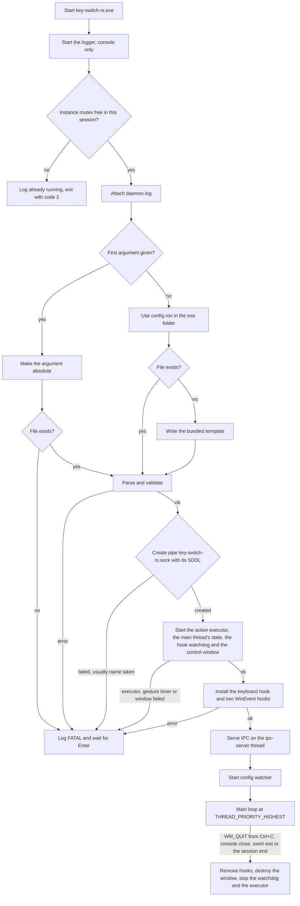
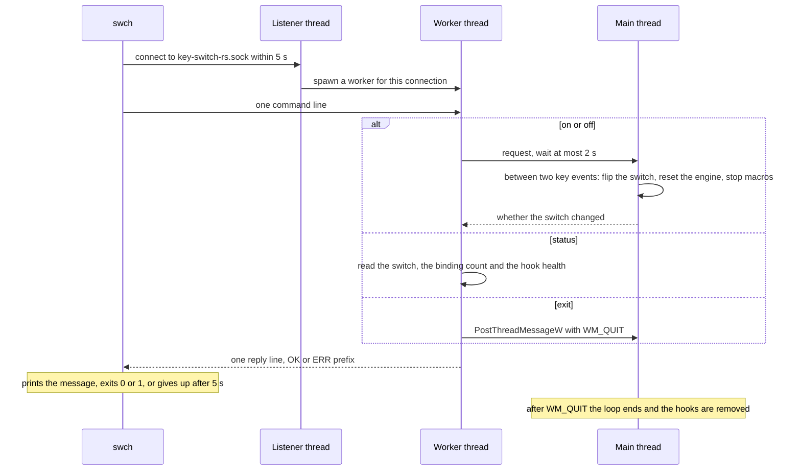
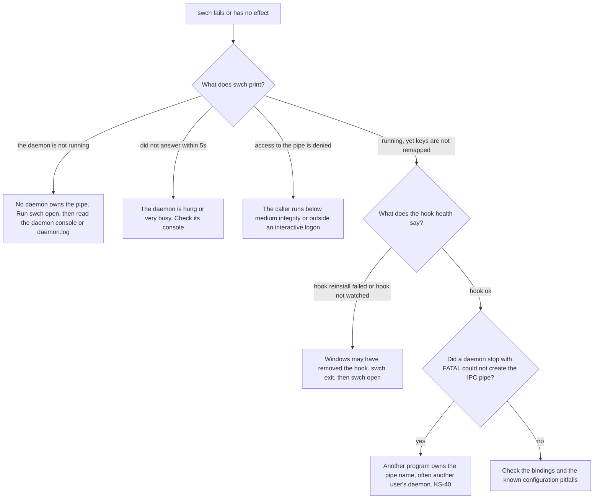

# Building, running and controlling the daemon

A build produces two Windows executables. `key-switch-rs.exe` is the daemon that owns the keyboard hook, and `swch.exe` is a small CLI that controls the daemon over a named pipe. This chapter covers building both, running and stopping the daemon, every `swch` command with its output and exit code, autostart, tests and CI, this book, and workarounds for the problems you are most likely to hit.

> [!NOTE]
> Facts describe commit [`f4c1fb6`](https://github.com/bluesteelll/key-switch-rs/commit/f4c1fb6) (2026-10-20), the merge of roadmap item 2.5 and the last change of the program's behaviour on `master`; the source at `252daef` differs from it only in two doc-comment lines. Build times and binary sizes come from the audit run of 2026-10-14 on Windows 11 with rustc and cargo 1.98.1, at `7cb3521`, and were not measured again. Test results come from the quality gate that the merge of item 2.5 ran on `f4c1fb6` (its log `merge_gate_master.log`), and the test list from `cargo test --locked -- --list` at `252daef`, run for this page. Nobody has run the daemon against live keyboard input; `swch` behaviour is derived from the code and from `tests/ipc_roundtrip.rs`, which runs the client against test pipes. See [How the audit was done](methodology.md).

## Prerequisites

| Requirement | Value | Notes |
|---|---|---|
| Operating system | Windows 10 or 11, 64-bit | Windows only: the code calls Win32 throughout, through the `windows` crate 0.62 ([Cargo.toml:41](https://github.com/bluesteelll/key-switch-rs/blob/f4c1fb6/Cargo.toml#L41)). Rust's `x86_64-pc-windows-msvc` target itself requires Windows 10 or later. |
| Target | `x86_64-pc-windows-msvc` | Only this target embeds the UAC manifest. CI also builds `x86_64-pc-windows-gnu`, which links and warns that no manifest is embedded ([KS-42](audit.md#ks-42), fixed). |
| Linker | MSVC `link.exe` | Install Visual Studio Build Tools with the "Desktop development with C++" workload, which includes MSVC and a Windows SDK. |
| Edition | 2024 | [Cargo.toml:4](https://github.com/bluesteelll/key-switch-rs/blob/f4c1fb6/Cargo.toml#L4) |
| Minimum rustc | 1.88 | Declared as `rust-version` ([Cargo.toml:5-8](https://github.com/bluesteelll/key-switch-rs/blob/f4c1fb6/Cargo.toml#L5-L8)) and checked by the CI job `msrv` with `cargo check --all-targets`. |
| Network | crates.io on the first build | `Cargo.lock` is committed. Build with `--locked`. |

```powershell
rustup default stable-x86_64-pc-windows-msvc
rustup component add clippy rustfmt
rustc --version   # expect 1.88.0 or newer
```

## Building

Run these from the repository root.

| Command | Profile | Output folder | Daemon manifest |
|---|---|---|---|
| `cargo build --locked` | dev | `target\debug\` | no elevation request, so the daemon runs at the caller's level |
| `cargo build --release --locked` | release | `target\release\` | `requireAdministrator` |
| `cargo build --release --locked --bin swch` | release | `target\release\` | the daemon is not built |

In the audit, `cargo build --release` finished in about 39 s with 0 warnings.

### Debug and release differ in elevation

[build.rs:21-47](https://github.com/bluesteelll/key-switch-rs/blob/f4c1fb6/build.rs#L21-L47) checks three things: `CARGO_CFG_WINDOWS` is set, `PROFILE` is `release`, and `CARGO_CFG_TARGET_ENV` is `msvc`. When all three hold, it emits two linker arguments through `cargo:rustc-link-arg-bin=key-switch-rs=...`, which scopes them to the daemon binary:

```text
/MANIFEST:EMBED
/MANIFESTUAC:level='requireAdministrator' uiAccess='false'
```

For a release build with another Windows toolchain it prints a cargo warning that no UAC manifest is embedded, and the daemon then does not request administrator rights. Consequences:

- Only `key-switch-rs.exe` gets the elevation request. `swch.exe` keeps the default `asInvoker` level.
- A debug daemon makes no elevation request, so it runs at the integrity level of whatever starts it. This is the convenient mode for development.
- The daemon binary is declared with `test = false` and `bench = false` ([Cargo.toml:18-34](https://github.com/bluesteelll/key-switch-rs/blob/f4c1fb6/Cargo.toml#L18-L34)), so `cargo test --release` and `cargo bench` build no test harness from `src/main.rs` that would inherit the manifest (see [Release-mode tests](#release-mode-tests)).
- `app.manifest` in the repository root is never used. `build.rs` does not reference it (there is no `/MANIFESTINPUT`), so its `supportedOS` block does not ship.

CI checks the manifest by searching the binaries for the string. To repeat the check:

```powershell
Select-String -Path .\target\release\key-switch-rs.exe -Pattern requireAdministrator -SimpleMatch -Quiet   # True
```

### Output binaries

| File | Source | Release size (audit, `7cb3521`) | Requested level | Role |
|---|---|---|---|---|
| `key-switch-rs.exe` | `src/main.rs` and the library | 989,696 bytes (about 990 KB) | `requireAdministrator` in release builds | Daemon: keyboard hook, config watcher, IPC server |
| `swch.exe` | `src/bin/swch.rs` and the library | 215,040 bytes (about 215 KB) | `asInvoker` | CLI driver |

Both binaries link the library crate `key_switch_rs` (`src/lib.rs`). Install them side by side in one folder. `swch open` looks for `key-switch-rs.exe` in its own folder ([src/bin/swch.rs:96-103](https://github.com/bluesteelll/key-switch-rs/blob/f4c1fb6/src/bin/swch.rs#L96-L103)). Started without an argument, the daemon creates `config.ron` in its own folder on first run.

## Running the daemon directly

### Command line

```text
key-switch-rs.exe [CONFIG_PATH]
```

The daemon parses no options. `ConfigPath::from_arg` ([src/config/loader.rs:110-149](https://github.com/bluesteelll/key-switch-rs/blob/f4c1fb6/src/config/loader.rs#L110-L149)) resolves the config path once, at startup:

1. If there is an argument, the first one is the config path, made absolute against the current folder. Any further arguments are ignored. The file must exist: a missing file stops the daemon with `[FATAL] config file <path> does not exist`, and nothing is created.
2. With no argument, the path is `<exe_dir>\config.ron`. If that file does not exist, the daemon writes the bundled template there, creating the folder if needed, and then loads it ([src/config/loader.rs:151-173](https://github.com/bluesteelll/key-switch-rs/blob/f4c1fb6/src/config/loader.rs#L151-L173)).

> [!NOTE]
> Any first argument still counts as a path: `key-switch-rs.exe --help` stops with `[FATAL] config file <current folder>\--help does not exist`. Until `1dfd80a` it created a file named `--help` with the default template and ran with it ([KS-41](audit.md#ks-41), not independently verified; partly fixed). Roadmap [item 4.2](roadmap.md#42-background-mode) adds argument parsing.

A config error at startup is fatal, and so is any error that `App::run` returns, such as a pipe it cannot create or a failed hook install. `main` logs `[FATAL] <error>`, on the console and in the [log file](#log-file), then prints `Press Enter to exit...` and waits on stdin so that a double-clicked console window stays open ([src/main.rs:46-62](https://github.com/bluesteelll/key-switch-rs/blob/f4c1fb6/src/main.rs#L46-L62)). A config error during hot reload is not fatal (see the console lines below). The config format itself is covered in the [configuration reference](config/index.md).

Only one daemon runs per Windows session (roadmap [item 1.5](roadmap.md#15-single-instance), [KS-20](audit.md#ks-20) fixed). A second start, from a double-click, a console or a Scheduled Task, finds the mutex `Local\key-switch-rs` held. It logs `` [ERROR] already running in this session; use `swch status`, `swch off` or `swch exit` to control it `` on the console, writes nothing to `daemon.log`, shows no prompt and exits with code 2 ([src/main.rs:25-36](https://github.com/bluesteelll/key-switch-rs/blob/f4c1fb6/src/main.rs#L25-L36)). It does so before it reads the config, so a wrong config path makes no difference. A daemon of another session is not covered: see [KS-40](audit.md#ks-40) below.

### Startup and shutdown

On the main thread, `main` starts the logger and takes the single-instance guard; `run` attaches the log file, then resolves and loads the config ([src/main.rs:14-86](https://github.com/bluesteelll/key-switch-rs/blob/f4c1fb6/src/main.rs#L14-L86)). [`App::run`](https://github.com/bluesteelll/key-switch-rs/blob/f4c1fb6/src/core/app.rs#L168-L326) then creates the pipe, starts the action executor, the main thread's engine and gesture timer, the hook watchdog and the control window, installs the three hooks, serves the pipe and starts the config watcher, and runs the main loop at `THREAD_PRIORITY_HIGHEST`. The [architecture chapter](architecture.md#startup-sequence) describes each step and the threads involved.



The daemon logs to its console and, once it owns its session, to the [log file](#log-file) `%LOCALAPPDATA%\key-switch-rs\daemon.log` (roadmap [item 1.7](roadmap.md#17-file-logging)). A daemon started by `swch open` or a Scheduled Task leaves its errors there too. The console lines below go to stderr; only the startup banner goes to stdout, and only the banner stays out of the file. In the file, each line starts with a UTC timestamp.

| Console line | Printed when | Source |
|---|---|---|
| `` [ERROR] already running in this session; use `swch status`, `swch off` or `swch exit` to control it `` | Another daemon of this session holds the instance mutex; this start exits with code 2, console only | [main.rs:27-34](https://github.com/bluesteelll/key-switch-rs/blob/f4c1fb6/src/main.rs#L27-L34), [single_instance.rs:87-98](https://github.com/bluesteelll/key-switch-rs/blob/f4c1fb6/src/system/single_instance.rs#L87-L98) |
| `[INFO] key-switch-rs <version> started (pid <n>), logging to <path>` | The daemon owns its session and attached the log file; the first line of a run in `daemon.log` | [main.rs:88-109](https://github.com/bluesteelll/key-switch-rs/blob/f4c1fb6/src/main.rs#L88-L109) |
| `[WARN] no log file: the LocalAppData folder is unknown: <error>`, or `[WARN] no log file in <folder>: <error>` when the log writer is not running | The daemon logs to the console only | [main.rs:92-107](https://github.com/bluesteelll/key-switch-rs/blob/f4c1fb6/src/main.rs#L92-L107) |
| `[INFO] generated default config at <path>` or `[INFO] loading config from <path>` | Config load, at startup and on every reload | [loader.rs:160-181](https://github.com/bluesteelll/key-switch-rs/blob/f4c1fb6/src/config/loader.rs#L160-L181) |
| `[INFO] <function>: registry combination <keys>`, `[INFO] <function>: hotkey not assigned in Windows, no auto-blocker` or `[INFO] <function>: using default combination` | Config load, for each `block_original_combo` binding whose action has an OS hotkey | [registry.rs:80-114](https://github.com/bluesteelll/key-switch-rs/blob/f4c1fb6/src/system/registry.rs#L80-L114) |
| `[INFO] no auto-blocker for <keys>: binding #<n> uses the same keys` | Config load, when a binding uses the hotkey's keys | [loader.rs:379](https://github.com/bluesteelll/key-switch-rs/blob/f4c1fb6/src/config/loader.rs#L379) |
| `[WARN] binding #<n> [<keys>] duplicates binding #<m> [<keys>]; remove one of them` | Config load, for a binding that repeats an earlier one; the file still loads | [loader.rs:298-320](https://github.com/bluesteelll/key-switch-rs/blob/f4c1fb6/src/config/loader.rs#L298-L320) |
| `[WARN] binding #<n>: block_original_combo: MaskOnly needs a Windows hotkey made only of modifiers; the <hotkey> hotkey is blocked as with true` | Config load, `MaskOnly` with the `` ` `` hotkey | [loader.rs:401-411](https://github.com/bluesteelll/key-switch-rs/blob/f4c1fb6/src/config/loader.rs#L401-L411) |
| `[WARN] config contains no bindings` | The config has `bindings: []` | [loader.rs:287-289](https://github.com/bluesteelll/key-switch-rs/blob/f4c1fb6/src/config/loader.rs#L287-L289) |
| `[FATAL] could not create the IPC pipe \\.\pipe\key-switch-rs.sock: <error>`; for a taken name it adds who is likely to own it | The pipe could not be created; the daemon stops before it installs a hook | [app.rs:340-359](https://github.com/bluesteelll/key-switch-rs/blob/f4c1fb6/src/core/app.rs#L340-L359) |
| `Key Switch started`, then one line per binding, auto-blockers last | Before the hooks are installed | [app.rs:139-156](https://github.com/bluesteelll/key-switch-rs/blob/f4c1fb6/src/core/app.rs#L139-L156) |
| `[FATAL] could not start the action executor: <error>`, `[FATAL] could not create the gesture timer: <error>` or `[FATAL] could not create the control window: <error>` | Before any hook is installed; the daemon stops with nothing to undo | [app.rs:199-236](https://github.com/bluesteelll/key-switch-rs/blob/f4c1fb6/src/core/app.rs#L199-L236) |
| `[WARN] the hook watchdog is off (<error>): a keyboard hook that Windows removes is not reinstalled until the daemon restarts` | The watchdog thread could not start; the daemon runs without it | [app.rs:217-229](https://github.com/bluesteelll/key-switch-rs/blob/f4c1fb6/src/core/app.rs#L217-L229) |
| `[WARN] could not register for session notifications (<error>); a lock is answered only by the switch to the lock screen's desktop` | The control window gets no lock notifications | [control_window.rs:168-178](https://github.com/bluesteelll/key-switch-rs/blob/f4c1fb6/src/hook/control_window.rs#L168-L178) |
| `[INFO] Hook installed successfully` | The hook is live | [app.rs:249](https://github.com/bluesteelll/key-switch-rs/blob/f4c1fb6/src/core/app.rs#L249) |
| `` [INFO] IPC server listening (use `swch on/off/exit`) `` | The pipe is served | [app.rs:266](https://github.com/bluesteelll/key-switch-rs/blob/f4c1fb6/src/core/app.rs#L266) |
| `[FATAL] could not start the IPC server thread: <error>` | The thread could not start; the hooks are removed again | [app.rs:259-265](https://github.com/bluesteelll/key-switch-rs/blob/f4c1fb6/src/core/app.rs#L259-L265) |
| `[INFO] Watching <path> for changes` | The watcher started; the path is absolute | [app.rs:279](https://github.com/bluesteelll/key-switch-rs/blob/f4c1fb6/src/core/app.rs#L279) |
| `[WARN] could not start config file watcher for <path>: <error>`, then `[INFO] continuing without hot-reload` | The watcher failed to start; the daemon keeps running | [app.rs:282-288](https://github.com/bluesteelll/key-switch-rs/blob/f4c1fb6/src/core/app.rs#L282-L288) |
| `[INFO] config reloaded (<n> bindings live)` | A save was applied | [config_watcher.rs:201](https://github.com/bluesteelll/key-switch-rs/blob/f4c1fb6/src/hook/config_watcher.rs#L201) |
| `[ERROR] config reload failed:`, the error, then `[INFO] keeping previous bindings live` | A save did not parse or validate, or the file is gone. In `daemon.log` every line of the error carries the timestamp and `[ERROR]` | [config_watcher.rs:193-197](https://github.com/bluesteelll/key-switch-rs/blob/f4c1fb6/src/hook/config_watcher.rs#L193-L197) |
| `[WARN] config reload: the daemon's main thread did not answer within 2 s; the new bindings go live when it does`, later `[INFO] config reload carried out late: <n> bindings live` | The main thread was busy; the reload still lands | [config_watcher.rs:202-204](https://github.com/bluesteelll/key-switch-rs/blob/f4c1fb6/src/hook/config_watcher.rs#L202-L204), [main_thread.rs:932-941](https://github.com/bluesteelll/key-switch-rs/blob/f4c1fb6/src/hook/main_thread.rs#L932-L941) |
| `[WARN] counters since the last report: menu_mask_short=<n> ... watchdog_desktop_check_failed=<n> hook_late=<n> longest_callback_us=<n>`, or `[INFO]` when `hook_late` is the only count that is not 0 | Every 60 s and at exit, while one of the twelve counts is not 0 or the longest keyboard callback since the last report took 5 ms or more: a menu mask key or a key press that `SendInput` cut short, a `Hold` whose gesture timer could not be set (that Hold never fires), log lines dropped from a full queue, slow actions dropped from a full executor queue, the watchdog's counts, and late callbacks, which only make the main thread read the modifiers again ([§18.6](config/errors.md#s18-6) explains each) | [writer.rs:228-241](https://github.com/bluesteelll/key-switch-rs/blob/f4c1fb6/src/logging/writer.rs#L228-L241) |
| `[WARN] log file <path>: could not write: <error>` or `[WARN] log file <path>: could not rotate, so daemon.log grows past its limit: <error>`, console only; later `[INFO] log file <path> works again` | The first of a run of failed writes to the log file, and the first success after it | [writer.rs:199-226](https://github.com/bluesteelll/key-switch-rs/blob/f4c1fb6/src/logging/writer.rs#L199-L226) |
| `[WARN] IPC read error: <error>` or `[WARN] IPC write error: <error>` | A pipe client hung up without a complete exchange | [ipc_server.rs:160-174](https://github.com/bluesteelll/key-switch-rs/blob/f4c1fb6/src/hook/ipc_server.rs#L160-L174) |
| `[INFO] Received shutdown signal...` | Ctrl+C, or the console window was closed; the queued lines are written before the handler returns | [app.rs:361-388](https://github.com/bluesteelll/key-switch-rs/blob/f4c1fb6/src/core/app.rs#L361-L388) |
| `[INFO] session locked`, `[INFO] keyboard input switched to another desktop`, then `[INFO] state reset: keyboard input left this desktop`; later `[INFO] keyboard input switched back to this desktop` or `[INFO] session unlocked` | A lock, the Ctrl+Alt+Del screen or a UAC prompt on the secure desktop: gestures dropped, macros stopped, every key released (roadmap item 2.3) | [main_thread.rs:877-907](https://github.com/bluesteelll/key-switch-rs/blob/f4c1fb6/src/hook/main_thread.rs#L877-L907) |
| `[WARN] the keyboard hook got no key event for <n> ms while keys were typed; reinstalled it (...)`, then `[INFO] state reset: the keyboard hook was reinstalled` | The hook watchdog found the keyboard hook removed, and the main thread reinstalled it (roadmap item 2.4) | [main_thread.rs:949-989](https://github.com/bluesteelll/key-switch-rs/blob/f4c1fb6/src/hook/main_thread.rs#L949-L989) |
| `[INFO] hook watchdog: raw keyboard input arrives` | The first raw key event of the run reached the watchdog | [watchdog/mod.rs:260-265](https://github.com/bluesteelll/key-switch-rs/blob/f4c1fb6/src/hook/watchdog/mod.rs#L260-L265) |
| `[ERROR] thread '<name>' panicked at <file>:<line>:<column>: <message>` | A thread panicked; the hook waits at most 250 ms for the line to be written | [panic.rs:1-26](https://github.com/bluesteelll/key-switch-rs/blob/f4c1fb6/src/logging/panic.rs#L1-L26) |
| `[INFO] the session is ending; removing the keyboard hook and exiting` | Sign-out or shutdown: the hooks are removed and the log is flushed before the session ends | [control_window.rs:216-231](https://github.com/bluesteelll/key-switch-rs/blob/f4c1fb6/src/hook/control_window.rs#L216-L231) |
| `[INFO] Removing keyboard hook...` | The message loop ended | [app.rs:315](https://github.com/bluesteelll/key-switch-rs/blob/f4c1fb6/src/core/app.rs#L315) |
| `[WARN] could not remove the desktop-switch hook: <error>` or `[WARN] could not remove the foreground hook: <error>` | Shutdown could not remove a WinEvent hook | [keyboard_hook.rs:228-244](https://github.com/bluesteelll/key-switch-rs/blob/f4c1fb6/src/hook/keyboard_hook.rs#L228-L244) |
| `[INFO] hook watchdog stopped after <n> wakes for <m> raw key events` | The watchdog stopped, after the hooks were removed; once per run | [watchdog/mod.rs:695-703](https://github.com/bluesteelll/key-switch-rs/blob/f4c1fb6/src/hook/watchdog/mod.rs#L695-L703) |

The table lists the lines you are most likely to see. [§18.6](config/errors.md#s18-6) lists every line the daemon logs at load time and at run time, with its cause.

Hot reload collapses a burst of file events into one reload after 250 ms of quiet ([config_watcher.rs:163-186](https://github.com/bluesteelll/key-switch-rs/blob/f4c1fb6/src/hook/config_watcher.rs#L163-L186)). The main thread applies the new list between two key events and drops the gestures still pending, so no gesture of the old bindings fires after the reload ([KS-31](audit.md#ks-31), fixed). It watches the parent folder and keeps only create, modify and remove events for the config's file name, compared ignoring case ([config_watcher.rs:92-120](https://github.com/bluesteelll/key-switch-rs/blob/f4c1fb6/src/hook/config_watcher.rs#L92-L120)). A reload never writes a file: deleting or renaming the config keeps the live bindings ([KS-23](audit.md#ks-23), fixed). Details are in [File location, reload and top-level structure](config/structure.md#s2-3).

### Log file

Once the file is attached, every console line above except the banner and the `[WARN] log file <path>: ...` lines also goes to `%LOCALAPPDATA%\key-switch-rs\daemon.log` (roadmap [item 1.7](roadmap.md#17-file-logging), [src/logging/](https://github.com/bluesteelll/key-switch-rs/blob/f4c1fb6/src/logging/mod.rs)):

- **Where.** `SHGetKnownFolderPath(FOLDERID_LocalAppData)` gives the folder of the account the daemon runs as, which with UAC consent on your own account is your own ([src/system/known_folder.rs](https://github.com/bluesteelll/key-switch-rs/blob/f4c1fb6/src/system/known_folder.rs)). The `key-switch-rs` folder and the file are created with the first line, and again after you delete them.
- **When.** `main` starts the logger first, with the console only. The file is attached after the single-instance guard, so a second start that finds a daemon running prints its `[ERROR] already running ...` line on the console and never writes to, or rotates, the running daemon's file ([KS-20](audit.md#ks-20)). A `[FATAL]` error before the guard, such as a failure to create the mutex, reaches the console only.
- **Line format.** `2026-10-16T09:41:07.123Z [INFO] config reloaded (2 bindings live)`: the time in UTC, ISO 8601 with milliseconds, then the tag and the message. A message of several lines repeats the time and the tag on each of its lines, and its trailing line breaks are dropped:

  ```text
  2026-10-16T09:52:30.518Z [ERROR] config reload failed:
  2026-10-16T09:52:30.518Z [ERROR] config has 1 invalid binding(s):
  2026-10-16T09:52:30.518Z [ERROR]   - binding #0 [F13]: PressKey: unknown key "Foo"
  2026-10-16T09:52:30.518Z [INFO] keeping previous bindings live
  ```

  The console shows the same record as `[ERROR] config reload failed:` followed by the error's lines as they are, without a blank line after them. A record of another crate, such as `notify`, names its target: `[WARN] notify::windows: ...`.
- **Rotation.** Before a line would take `daemon.log` past 1 MiB, the file becomes `daemon.1.log`, `daemon.1.log` becomes `daemon.2.log`, and the old `daemon.2.log` is deleted; three files are kept. No handle stays open between lines. A program that holds one of the files open without delete sharing stops the rotation at the first rename that fails, so no file is overwritten before its content moved on; `daemon.log` then grows until that program closes the file, and the console shows `[WARN] log file <path>: could not rotate, ...` once.
- **What is never logged.** No pressed key and no typed text. The hook callback logs nothing at all: what it would report per event is counted, and the `counters since the last report` line gives the counts. Lines about the config quote the config. The banner, whose binding lines can hold a macro's text, is not logged.
- **Threads.** A thread that logs only formats its line and queues it with `try_send` on a queue of 1024 lines; a full queue drops the line and counts it in `log_lines_dropped`. The `log-writer` thread writes each line to the file first, then to the console. In a `conhost.exe` window with QuickEdit on, a held selection stops that thread at its next console write, so later lines reach the file only once the selection is released; the keyboard is not slowed down. At exit, after Ctrl+C and after a closed console window, the daemon waits at most 1 s for the queued lines.

### Stopping

Each of these posts `WM_QUIT` to the main thread, which leaves its main loop, removes the hooks, destroys the control window and stops the hook watchdog and the action executor ([app.rs:306-325](https://github.com/bluesteelll/key-switch-rs/blob/f4c1fb6/src/core/app.rs#L306-L325)):

- Ctrl+C in the daemon console, or closing the console window. [app.rs:361-388](https://github.com/bluesteelll/key-switch-rs/blob/f4c1fb6/src/core/app.rs#L361-L388) handles `CTRL_C_EVENT` and `CTRL_CLOSE_EVENT`.
- `swch exit`.
- Signing out or shutting down: the control window removes the hooks at `WM_ENDSESSION`, logs one line and flushes the log before it ends the loop.

A step of a macro that still runs gets at most 2 s, and the watchdog 1 s; a running macro does not go on to its next step.

The daemon is a console program with no background or tray mode. Closing its window stops it. Roadmap items [4.2](roadmap.md#42-background-mode) and [4.6](roadmap.md#46-tray-icon) add both.

### Running through cargo

The package has two binaries and no `default-run` key, so `cargo run` always needs `--bin`.

| Command | Effect |
|---|---|
| `cargo run --locked --bin key-switch-rs` | Debug daemon at the shell's integrity level. The default config path is `target\debug\config.ron`. |
| `cargo run --locked --bin key-switch-rs -- my.ron` | Same, with an explicit config, made absolute against the current folder. The file must exist. |
| `cargo run --locked --bin swch -- status` | Runs the CLI. |
| `cargo run --release --bin key-switch-rs` | Fails from a non-elevated shell with `The requested operation requires elevation. (os error 740)`, because cargo starts the process with `CreateProcess`, which refuses a `requireAdministrator` image. Run it from an elevated shell. |

## Controlling the daemon with swch

### Transport and protocol

- **Pipe name.** `PIPE_NAME` is `key-switch-rs.sock` ([src/ipc.rs:31-33](https://github.com/bluesteelll/key-switch-rs/blob/f4c1fb6/src/ipc.rs#L31-L33)). The `interprocess` crate's `GenericNamespaced` maps it to `\\.\pipe\key-switch-rs.sock`. Named pipes share one machine-wide namespace, so only the first daemon on the machine gets the pipe, across all sessions and users ([KS-40](audit.md#ks-40), not independently verified). Since roadmap item 1.5 a daemon that cannot create the pipe stops before it installs a hook.
- **Who may connect.** The pipe has an explicit security descriptor: full control for SYSTEM and Administrators, read and write for interactive users, and a medium mandatory label ([src/hook/ipc_server.rs:57-83](https://github.com/bluesteelll/key-switch-rs/blob/f4c1fb6/src/hook/ipc_server.rs#L57-L83); [KS-02](audit.md#ks-02), fixed). A `swch` in a normal console therefore reaches an elevated daemon. So does any other user signed in to the machine, until roadmap [item 4.1](roadmap.md#41-ipc-hardening) gives each session its own pipe.
- **One command per connection.** The client writes one newline-terminated ASCII line. The daemon answers with one line, `OK: <message>` or `ERR: <message>` ([src/ipc.rs:197-205](https://github.com/bluesteelll/key-switch-rs/blob/f4c1fb6/src/ipc.rs#L197-L205)), and the connection ends. Every connection gets a new worker thread ([src/hook/ipc_server.rs:138](https://github.com/bluesteelll/key-switch-rs/blob/f4c1fb6/src/hook/ipc_server.rs#L138)).
- **A 5 s deadline.** `swch` connects, sends and reads on a helper thread and gives up after 5 s for the whole exchange ([src/ipc.rs:35-37](https://github.com/bluesteelll/key-switch-rs/blob/f4c1fb6/src/ipc.rs#L35-L37), [src/ipc.rs:87-116](https://github.com/bluesteelll/key-switch-rs/blob/f4c1fb6/src/ipc.rs#L87-L116)).
- **Daemon-side parsing.** The line is trimmed and matched case-insensitively: `on`, `off`, `exit` or `quit` or `shutdown`, and `status` or `ping`. Anything else gets `ERR: unknown command "<line>"`, with the line trimmed and lowercased ([src/ipc.rs:173-184](https://github.com/bluesteelll/key-switch-rs/blob/f4c1fb6/src/ipc.rs#L173-L184)).
- **What swch prints.** `parse_response` strips the `OK:` or `ERR:` prefix ([src/ipc.rs:207-219](https://github.com/bluesteelll/key-switch-rs/blob/f4c1fb6/src/ipc.rs#L207-L219)). `swch` prints an `OK` message on stdout, and an `ERR` message on stderr after a `swch: ` prefix ([src/bin/swch.rs:146-165](https://github.com/bluesteelll/key-switch-rs/blob/f4c1fb6/src/bin/swch.rs#L146-L165)). With the default config, `swch status` prints `running (3 bindings live; hook ok, reinstalls: 0)`.



### Commands

Usage is `swch <command>`. The command name is matched case-insensitively and extra arguments are ignored ([src/bin/swch.rs:24-55](https://github.com/bluesteelll/key-switch-rs/blob/f4c1fb6/src/bin/swch.rs#L24-L55)).

| Command | Aliases | Line sent | Success: stdout, exit 0 | Failure: stderr, exit 1 |
|---|---|---|---|---|
| `swch open` | `start`, `launch` | `status`, as a probe | `swch: daemon is already running`, `swch: daemon is already running (<reason>)` or `swch: daemon launched` | `swch: daemon binary not found at <path>`, `swch: ShellExecuteW failed (code <n>) — user may have declined the UAC prompt`, `swch: could not locate current_exe: <error>`, or `swch: cannot tell whether a daemon is running (<error>); not starting another` |
| `swch on` | none | `on` | `enabled` | `swch: could not turn remapping on: <reason>` |
| `swch off` | none | `off` | `disabled` | `swch: could not turn remapping off: <reason>` |
| `swch status` | `ping` | `status` | `running (<n> bindings live; <health>)` or `disabled (<n> bindings live; <health>)` | none from the daemon |
| `swch exit` | `quit`, `shutdown`, `stop` | `exit` | `shutting down` | `swch: could not shut down: <reason>` |
| `swch help` | `--help`, `-h` | nothing | usage text, written to stderr | none |

Sources: [`cmd_open`](https://github.com/bluesteelll/key-switch-rs/blob/f4c1fb6/src/bin/swch.rs#L71-L142) and [`dispatch`](https://github.com/bluesteelll/key-switch-rs/blob/f4c1fb6/src/hook/ipc_server.rs#L178-L205). `on` and `off` are idempotent: asking for the position remapping already has answers `enabled` or `disabled` and resets nothing. The IPC worker hands `on` and `off` to the main thread and waits at most 2 s, so their `<reason>` is one of `the daemon's main thread did not answer within 2 s`, after which the request still takes effect when the main thread reaches it, `the daemon is shutting down` or `the daemon is busy; try again` ([src/hook/main_thread.rs:561-583](https://github.com/bluesteelll/key-switch-rs/blob/f4c1fb6/src/hook/main_thread.rs#L561-L583)). `<health>` is `hook ok`, `hook not watched` (the hook watchdog does not run), `hook reinstall failed` (until the hook answers again or a later reinstall succeeds) or `hook watchdog timer failing`, then `reinstalls: <n>` and, after a reinstall, `last <UTC time>`, for example `running (3 bindings live; hook ok, reinstalls: 1, last 2026-10-19T09:41:07.123Z)` ([src/hook/health.rs:184-204](https://github.com/bluesteelll/key-switch-rs/blob/f4c1fb6/src/hook/health.rs#L184-L204)). `stop` exists only in `swch`, which sends `exit` for it.

The usage text ([src/bin/swch.rs:57-67](https://github.com/bluesteelll/key-switch-rs/blob/f4c1fb6/src/bin/swch.rs#L57-L67)) is below. The first line shows the program name as invoked (`argv[0]`), so it may be a full path.

```text
usage: swch <command>

Commands:
  open    Launch the daemon (UAC prompt)
  on      Turn remapping on (daemon must be running)
  off     Turn remapping off (keys pass through)
  status  Show daemon state and binding count
  exit    Shut the daemon down
  help    Print this text
```

What `on` and `off` do in the daemon: the hooks stay installed, and `off` makes them pass every key on untouched. The main thread flips the switch between two key events, and each real switch drops pending `Tap`, `Hold`, `DoubleTap`, chord and sequence state, so a `Hold` armed just before `swch off` does not fire; it stops every running macro and drops the slow actions still queued; and a key still held at `swch on` counts as already pressed, while a key whose press a binding swallowed keeps its release swallowed ([KS-01](audit.md#ks-01) and [KS-31](audit.md#ks-31), fixed; [How swch off and swch on work](architecture.md#why-swch-on-kills-the-hook-ks-01)). A key swallowed by a binding and released while remapping is off reaches Windows as a lone key-up ([known issue 59](config/known-issues.md#s19-9)).

### Other swch errors

The first two rows apply to any invocation. The rest apply to the commands that talk to the pipe.

| Situation | Output | Exit code |
|---|---|---|
| No command | usage text on stderr | 1 |
| Unknown command | `swch: unknown command "<name>"` with the name lowercased, then usage, on stderr | 1 |
| No pipe exists | ``swch: the daemon is not running. Use `swch open` to start it.`` on stderr | 1 |
| The pipe refuses this process | `swch: cannot reach daemon (access to the daemon's pipe is denied).` on stderr | 1 |
| No pipe instance became free within 5 s | `swch: cannot reach daemon (the daemon's pipe is busy).` on stderr | 1 |
| The daemon did not answer within 5 s | `swch: cannot reach daemon (the daemon did not answer within 5s).` on stderr | 1 |
| Any other I/O error | `swch: cannot reach daemon (<error>).` on stderr | 1 |
| Reply has no `OK:`/`ERR:` prefix, including an empty reply | the raw line on stdout | 0 |

The messages come from `RequestError` ([src/ipc.rs:45-83](https://github.com/bluesteelll/key-switch-rs/blob/f4c1fb6/src/ipc.rs#L45-L83)); `tests/ipc_roundtrip.rs` produces each case against a test pipe. Behaviour worth knowing when scripting against `swch`:

- **`status` reports the hook's health.** Since roadmap [item 2.4](roadmap.md#24-hook-watchdog) the reply goes on after the binding count with the health the hook watchdog keeps ([src/core/app.rs:87-93](https://github.com/bluesteelll/key-switch-rs/blob/f4c1fb6/src/core/app.rs#L87-L93)). If Windows removes the hook after a slow callback, the watchdog has it reinstalled within about 1.5 s of typing, and `reinstalls` counts up; `hook not watched` means the watchdog does not run ([KS-08](audit.md#ks-08), fixed). The reply still starts `running (<n> bindings live`, so a script that looks for that start is not affected, but one that compares the whole line must follow.
- **The binding count includes auto-blockers.** `<n>` is the length of the live list, which includes the auto-blockers that `block_original_combo` adds. The generated default config gives 3: two bindings plus one blocker.
- **An empty reply counts as success** ([src/ipc.rs:215-218](https://github.com/bluesteelll/key-switch-rs/blob/f4c1fb6/src/ipc.rs#L215-L218)). `swch exit` can print an empty line and exit 0 if the daemon exits before its reply is written ([KS-37](audit.md#ks-37), not independently verified).
- **`open` does not wait for the daemon.** It returns as soon as `ShellExecuteW` does, so `daemon launched` means only that the UAC prompt was accepted and the process started, not that the config loaded. It passes no arguments ([src/bin/swch.rs:122-131](https://github.com/bluesteelll/key-switch-rs/blob/f4c1fb6/src/bin/swch.rs#L122-L131)), so a daemon started this way always uses `<exe_dir>\config.ron`. It always uses the `runas` verb, even for a debug build, so it always elevates.
- **`open` starts a daemon only when no pipe exists** ([src/bin/swch.rs:71-94](https://github.com/bluesteelll/key-switch-rs/blob/f4c1fb6/src/bin/swch.rs#L71-L94)). A pipe that refuses this console, a busy pipe and a daemon that does not answer count as a running daemon, so `open` starts no second one for those. A second daemon started some other way refuses to run in the same session anyway ([KS-20](audit.md#ks-20), fixed); `open` does not wait for it, so it does not see that exit code 2. Its probe is a `status` request, so it leaves no IPC warning in the daemon console ([KS-39](audit.md#ks-39), fixed).

## UAC and integrity levels

User Interface Privilege Isolation (UIPI) stops a `WH_KEYBOARD_LL` hook in a medium-integrity process from seeing keystrokes sent to higher-integrity windows such as Task Manager, regedit and any app run as administrator. Commit `b4c8acf` (2026-02-15) added the `requireAdministrator` manifest to get around this. No user-mode process can hook the Secure Desktop at any integrity level; that covers the UAC prompt, the Ctrl+Alt+Del screen and the lock screen.

| How the daemon is started | Build | Daemon integrity | UAC prompt | `swch` from a normal shell |
|---|---|---|---|---|
| `cargo run`, or the exe started from a normal shell or Explorer | debug | medium | no | works |
| Double-click or "Run as administrator" | release | high | on every launch | works |
| `swch open` | debug or release | high | on every launch | works |
| From an elevated shell | either | high | no | works |
| Scheduled Task with `/RL HIGHEST` | release | high | no | works |

The "works" in the last column is derived from the pipe's security descriptor and its tests; the run against an elevated daemon is a manual check that has not been done ([Manual checks after Phase 0](roadmap.md#manual-checks-after-phase-0)). Until `1dfd80a` a non-elevated `swch` failed with "Access is denied" against every elevated daemon ([KS-02](audit.md#ks-02)).

Running elevated has side effects beyond the hook:

- **Launched programs run elevated.** `Launch` children inherit the daemon's elevated token, `OpenUrl` can start its handler elevated, and console programs started with `Launch` share the daemon's console ([KS-09](audit.md#ks-09); roadmap [item 3.3](roadmap.md#33-launch-and-openurl-without-elevation)).
- **Config write access is admin access.** The elevated daemon hot-reloads `config.ron` from its own folder, and a `Launch` binding runs with the daemon's token. If normal processes can write to that folder, they can get code run as administrator without a UAC prompt ([KS-09](audit.md#ks-09)). Install into a folder only administrators can write, such as `C:\Program Files\key-switch-rs\`, and accept that editing the config then needs an elevated editor.
- **Other users can control the daemon.** The pipe admits every interactive user ([KS-40](audit.md#ks-40)).
- **The prompt-free alternative was not pursued.** That alternative is `uiAccess="true"`, which needs a signed binary installed under `Program Files` ([app.manifest:16-18](https://github.com/bluesteelll/key-switch-rs/blob/f4c1fb6/app.manifest#L16-L18)).

## Autostart with a Scheduled Task

The README suggests a logon task with "Run with highest privileges" ([README.md:907-911](https://github.com/bluesteelll/key-switch-rs/blob/f4c1fb6/README.md?plain=1#L907-L911)), but nothing in the code creates one; roadmap [item 4.5](roadmap.md#45-swch-autostart) plans `swch autostart`. Such a task starts the daemon elevated at logon without a UAC prompt.

> [!NOTE]
> These flags were checked against Microsoft's [schtasks create reference](https://learn.microsoft.com/en-us/windows-server/administration/windows-commands/schtasks-create) and [task settings documentation](https://learn.microsoft.com/en-us/windows/win32/taskschd/tasksettings-executiontimelimit) during the audit. The commands were not run.

1. Copy `key-switch-rs.exe` and `swch.exe` into a fixed folder that only administrators can write (see [UAC and integrity levels](#uac-and-integrity-levels)), for example `C:\Program Files\key-switch-rs\`.
2. Open an elevated shell (creating a `HIGHEST` task needs administrator rights) and create the task. A path with spaces is quoted with `\"` inside the `/TR` value:

   ```bat
   schtasks /Create /TN "key-switch-rs" /TR "\"C:\Program Files\key-switch-rs\key-switch-rs.exe\"" /SC ONLOGON /RL HIGHEST /IT /F
   ```

3. Lift two Task Scheduler defaults that suit batch jobs, not daemons. By default a task is stopped 72 hours after it starts, and it does not start on battery power. `schtasks /Create` has no switch for either setting. In an elevated PowerShell:

   ```powershell
   $s = New-ScheduledTaskSettingsSet -ExecutionTimeLimit ([TimeSpan]::Zero) -AllowStartIfOnBatteries -DontStopIfGoingOnBatteries
   Set-ScheduledTask -TaskName "key-switch-rs" -Settings $s
   ```

   Alternatively, clear the matching options on the task's Settings and Conditions tabs in Task Scheduler.
4. Test the task without logging off: `schtasks /Run /TN "key-switch-rs"`. Inspect it with `schtasks /Query /TN "key-switch-rs" /V /FO LIST`.
5. To remove it: `schtasks /Delete /TN "key-switch-rs" /F`.

| Flag | Meaning, per Microsoft's reference | Why it is used here |
|---|---|---|
| `/SC ONLOGON` | Run whenever a user logs on | Start with the session |
| `/TN "key-switch-rs"` | Task name | Used by `/Run`, `/Query` and `/Delete` |
| `/TR <path>` | Program to run, as a fully qualified path | With no argument, the daemon uses `<exe_dir>\config.ron`, which is absolute |
| `/RL HIGHEST` | Run with the highest privileges; the default is `LIMITED` | High integrity without a UAC prompt |
| `/IT` | Run only while the run-as user is logged on | A low-level hook sees only the input of its own interactive session |
| `/F` | Suppress the warning if the task already exists | Lets you re-run the command |
| `/DELAY mmmm:ss` (optional) | Wait after the trigger; valid for `ONLOGON` | For example `/DELAY 0000:15` to let the shell settle |

The task runs as the account that created it. To use a non-default config, append a path to `/TR`. A relative path is resolved against the task's "Start in" folder, so an absolute path is clearer:

```bat
schtasks /Create /TN "key-switch-rs" /TR "\"C:\Program Files\key-switch-rs\key-switch-rs.exe\" \"D:\config\keys.ron\"" /SC ONLOGON /RL HIGHEST /IT /F
```

At logon the daemon opens a console window, and closing that window stops the daemon.

> [!NOTE]
> Since roadmap [item 1.5](roadmap.md#15-single-instance) a second daemon refuses to start in the same session ([KS-20](audit.md#ks-20), fixed). A double-click on `key-switch-rs.exe` while the task's daemon runs prints `[ERROR] already running in this session; ...` and exits with code 2, and `swch open` from a normal shell sees the task's daemon and starts nothing.

<a id="tests-and-lints"></a>
## Tests, lints and CI

<a id="unit-tests"></a>
### Unit and integration tests

```powershell
cargo test --locked
```

The merge gate of item 2.5 at `f4c1fb6` got 862 passed, 0 failed and 7 ignored library tests, and 7 passed integration tests in `tests/ipc_roundtrip.rs`; the `swch` binary and the doc tests have none. Six of the ignored tests are manual checks, and each says in its `ignore` reason what a human does; the seventh is the latency bench:

- `bench::latency_bench`: the latency bench of roadmap item 2.2, run by hand in a release build: `KS_BENCH_OUT=<file> cargo test --release --locked --lib bench::latency_bench -- --ignored --exact --test-threads=1`, with `KS_BENCH_LOAD=1` for row R8. It is counted apart from the manual checks and never as a pass.
- `core::executor::tests::the_win32_runner_opens_a_url`: opens https://example.com in the default browser through the real runner.
- `platform::foreground::tests::the_foreground_cache_names_the_focused_notepad`: focus a Notepad window within 5 s.
- `platform::desktop::tests::input_is_on_this_desktop_while_a_human_uses_it`: run it at the unlocked desktop.
- `hook::ipc_server::tests::hold_the_daemon_pipe_name_for_a_manual_start`: holds the daemon's pipe name for 60 s, so that a release daemon started meanwhile stops with `[FATAL] could not create the IPC pipe`.
- `hook::keyboard_hook_callback::tests::the_menu_mask_key_is_inserted_into_the_input_stream`: injects vk 0xE8 into the live input stream; run it while Notepad has focus.
- `system::registry::tests::live_registry_with_the_language_hotkey_not_assigned_has_no_combination`: set the Windows language hotkey to "Not assigned" first, and restore it afterwards.

The counts below come from the test names in that gate's log at `f4c1fb6`; `cargo test --locked -- --list` at `252daef` lists the same 869 library tests, 235 of them in `engine::scenarios`.

| Module | Tests |
|---|---|
| `engine::scenarios` | 235 |
| `config::loader` | 91 |
| `hook::watchdog` | 55 |
| `hook::main_thread` | 38 |
| `hook::keyboard_hook_callback` (1 ignored) | 29 |
| `core::executor` (1 ignored), `engine` (module tests) | 26 each |
| `engine::keys`, `hook::watchdog::decision` | 24 each |
| `hook::keyboard_hook` | 19 |
| `logging::sink` | 18 |
| `engine::gestures` | 15 |
| `data::vk_name`, `system::registry` (1 ignored) | 14 each |
| `config::parsing` | 13 |
| `data::key_spec`, `hook::config_watcher`, `ipc`, `logging::writer` | 11 each |
| `engine::matching`, `hook::health`, `hook::ipc_server` (1 ignored) | 10 each |
| `build_script` (the logic of `build.rs`), `core::executor::runs`, `logging` (module tests), `logging::counters`, `system::single_instance` | 9 each |
| `data::binding`, `data::condition`, `engine::chords`, `platform::foreground` (1 ignored) | 8 each |
| `engine::properties`, `engine::sequences` | 7 each |
| `data::key_combination`, `data::sequence`, `engine::resync`, `logging::panic` | 6 each |
| `core::app`, `hook::installer`, `platform::timers` | 5 each |
| `hook::control_window` | 4 |
| `core::windows_actions`, `system::system_function` | 3 each |
| `data::trigger`, `engine::schedule`, `engine::winner`, `hook::debug_hold` | 2 each |
| `bench` (1 ignored), `engine::modifiers`, `logging::testing`, `platform::desktop` (1 ignored), `platform::priority`, `system::known_folder` | 1 each |
| **Library total** | **869** |
| `tests/ipc_roundtrip.rs` | 7 |

No test installs a hook, registers for raw input, injects input or writes the registry: the calls that install hooks and register for raw input sit in `hook::installer`, which no test build compiles, and tests that would need any of that are `#[ignore]`d manual checks. The scenario tests drive the decision core with a fake clock and key state. The watcher tests run a real `notify` watcher on a temporary folder, the IPC tests use pipes with unique names, never the daemon's, the main-thread and executor tests run their loops on threads of their own, and the watchdog's thread tests use synthetic raw input. A few tests create a hidden window of their own, and the real-timer tests measure milliseconds. Some tests read the live `HKCU` registry and the foreground window. Areas without tests: the Win32 side of actions, the `swch` binary itself, and anything that needs a live hook ([What no test exercises](gaps.md#what-no-test-exercises)).

### Release-mode tests

`cargo test --release` builds no test harness for the daemon binary, so it runs in a non-elevated shell ([KS-38](audit.md#ks-38), fixed). An explicit target selection brings the harness back: `cargo test --release` or `cargo bench` together with `--all-targets`, `--bins` or `--bin key-switch-rs` builds a harness from `src/main.rs` that inherits the `requireAdministrator` manifest and fails with "The requested operation requires elevation" (os error 740). Run them without those flags. Debug builds embed no manifest, so `cargo test --all-targets` works.

<a id="clippy"></a>
### Clippy and rustfmt

```powershell
cargo fmt --check
cargo clippy --all-targets --locked -- -D warnings
```

Both pass at `f4c1fb6`, in the merge gate of item 2.5. The audit's one warning, `clippy::unnecessary_sort_by`, was fixed in [`091e30e`](https://github.com/bluesteelll/key-switch-rs/commit/091e30e). These two commands and `cargo test --locked` are the project's quality gate.

### Continuous integration

`.github/workflows/ci.yml` runs on every push and pull request, on `windows-latest` ([.github/workflows/ci.yml](https://github.com/bluesteelll/key-switch-rs/blob/f4c1fb6/.github/workflows/ci.yml)). No job runs `key-switch-rs.exe`.

| Job | Steps |
|---|---|
| `check` | `cargo fmt --check`; clippy with `-D warnings`; `cargo test --locked`; `cargo build --release --locked`; a check that `key-switch-rs.exe`, and not `swch.exe`, embeds `requireAdministrator`; a check of cargo's JSON messages that `cargo test --release --no-run` and `cargo bench --no-run` build no harness for the daemon ([KS-38](audit.md#ks-38)) |
| `msrv` | `cargo check --all-targets --locked` with Rust 1.88 |
| `windows-gnu` | `cargo build --release --locked --target x86_64-pc-windows-gnu`, which must link and warn that no UAC manifest is embedded ([KS-42](audit.md#ks-42)) |

## Building this book

Install the same tool versions that CI pins:

```powershell
cargo install mdbook --version 0.5.3 --locked
cargo install mdbook-mermaid --version 0.17.0 --locked
```

From the repository root:

| Command | Result |
|---|---|
| `mdbook serve book --open` | Builds, serves `http://localhost:3000` and rebuilds on every save |
| `mdbook build book` | Writes the site to `book\book\`, which `.gitignore` excludes |

`book/book.toml` runs `mdbook-mermaid` as a preprocessor and loads `book/mermaid.min.js` and `book/mermaid-init.js`, which are stored next to it. `mdbook-mermaid` must be on `PATH`; without it, mdbook 0.5 stops with an error that the `mermaid` preprocessor is not installed.

`.github/workflows/book.yml` publishes the book:

1. A push to `master` that touches `book/**` or the workflow file triggers it. It can also be started by hand (`workflow_dispatch`).
2. The `build` job runs on `ubuntu-latest`. It installs `mdbook@0.5.3` and `mdbook-mermaid@0.17.0` with `taiki-e/install-action`, runs `mdbook build book`, and uploads `book/book` as the Pages artifact.
3. The `deploy` job publishes that artifact to the `github-pages` environment with `actions/deploy-pages`.

One-time setup: in the repository, go to **Settings -> Pages -> Build and deployment -> Source** and select **GitHub Actions**. The book is then served at `https://bluesteelll.github.io/key-switch-rs/`, which matches `site-url = "/key-switch-rs/"` in `book.toml`.

## Troubleshooting

The [audit chapter](audit.md) has the full analysis of each issue, and the [roadmap](roadmap.md) has the planned fixes. The table lists what can still go wrong at `f4c1fb6`.



| Symptom | Issue | Short workaround |
|---|---|---|
| A second start prints `[ERROR] already running in this session` and exits | [KS-20](audit.md#ks-20), fixed: one daemon per session | Control the running daemon with `swch`, or `swch exit` it first |
| The daemon stops with `[FATAL] could not create the IPC pipe ...` | Another program owns the pipe name, usually another signed-in user's daemon ([KS-40](audit.md#ks-40)) | Run one daemon per machine until roadmap [item 4.1](roadmap.md#41-ipc-hardening) |
| Start menu or menu bar opens after a `Tap`, `Hold` or `DoubleTap` on a lone Win or Alt | [Known issue 66](config/known-issues.md#s19-9) | Bind another key, or set `block_default: true` and give up that key's own shortcuts |
| Alt, Shift, X arrives as Alt+X, or Shift, Alt, X as Shift+X | [KS-05](audit.md#ks-05), rest | Set `block_original_combo: false` on the CapsLock binding, or try the experimental `MaskOnly` ([§15.5](config/matching.md#s15-5)) |
| A binding stopped firing while a modifier is held | exact modifiers ([§7](config/kinds.md#s7)) | Add `allow_extra_modifiers: true` to that binding |
| A shortcut misses, and the binding without its modifier acts, while a modifier is held that the daemon did not see go down | rare cases such as a hook call that Windows dropped ([known issue 88](config/known-issues.md#s19-9)) | Release the modifier and press it again |
| `[INFO] counters since the last report: ... hook_late=<n>` lines during normal typing | late callbacks, or a time stamp on another clock ([known issue 90](config/known-issues.md#s19-9)); expected while the machine is used through Remote Desktop | Nothing to do: a count only makes the main thread read the modifiers again. Report it, because it is manual check 56 of [Manual checks after Phase 2](roadmap.md#manual-checks-after-phase-2) |
| A binding no longer fires when another binding matches the same press | one winner per key press ([§16](config/matching.md#s16)) | Give the binding that should win more keys or a `when:`, or move it up |
| A held key no longer repeats its action | `repeat` ([§11.3](config/triggers-conditions.md#s11-3)) | Add `repeat: true` to that `Immediate` binding |
| A `Tap` fires late, up to its `DoubleTap` term after the press | a `Tap` with a `DoubleTap` on the same keys waits for the DoubleTap window ([known issue 75](config/known-issues.md#s19-9)) | Bind the `Tap` to other keys, or use a shorter `DoubleTap` term |
| `swch on` or `swch off` says that the daemon's main thread did not answer within 2 s | The main thread was busy | Wait: the request still takes effect when the main thread reaches it; `swch status` shows the result |
| Saving the config changes nothing | a rejected reload | Read the `[ERROR] config reload failed:` lines in the daemon console or in `daemon.log` |
| Remapping stops for about a second, and `daemon.log` has `reinstalled it` | [KS-08](audit.md#ks-08), fixed: Windows removed the hook after a slow callback, and the hook watchdog had it reinstalled; the keys typed in between were not remapped | Nothing to do. If `swch status` says `hook reinstall failed` or `hook not watched` and keys are not remapped, `swch exit`, then `swch open` |

<a id="swch-says-access-is-denied-ks-02"></a>
<a id="swch-on-does-nothing-after-swch-off-ks-01"></a>
<a id="hot-reload-never-fires-ks-21"></a>
<a id="a-key-stays-stuck-down-ks-06"></a>
<a id="two-daemons-are-running-ks-20"></a>
### Fixed since the audit

These problems had their own sections in the audit version of this chapter, or in its Phase 0 version, or were fixed in Phase 2. They are fixed at `f4c1fb6`:

- **`swch` said "Access is denied"** against an elevated daemon: the pipe had the default DACL ([KS-02](audit.md#ks-02)).
- **`swch on` did nothing after `swch off`**: the hooks died with the IPC worker thread ([KS-01](audit.md#ks-01)).
- **Hot reload never fired** for a relative config path or a path in a different letter case ([KS-21](audit.md#ks-21)).
- **A key stayed stuck down** after a gesture, chord or sequence key was held past the repeat delay ([KS-06](audit.md#ks-06)). Since roadmap item 2.3 the release of a swallowed key also stays swallowed across a foreground change ([§10](config/kinds.md#s10)).
- **`OpenUrl` and `Launch` froze typing** while the browser or the program started, and a slow callback could make Windows remove the hook while `swch status` still said `running` ([KS-08](audit.md#ks-08)). They run on the action executor, and the hook watchdog reinstalls a removed hook.
- **A key held through Win+L acted as an auto-repeat afterwards**, so CapsLock did not switch the layout on its first press after the unlock ([KS-29](audit.md#ks-29)).
- **Holding CapsLock cycled the layouts** at the keyboard repeat rate ([KS-10](audit.md#ks-10)).
- **Two daemons ran in one session**, remapped keys twice, and only one of them answered `swch` ([KS-20](audit.md#ks-20)). A second start in the session now exits with code 2. A daemon that cannot create its pipe stops before it installs a hook, so no daemon remaps without `swch` control ([app.rs:191-194](https://github.com/bluesteelll/key-switch-rs/blob/f4c1fb6/src/core/app.rs#L191-L194)).

### The Start menu or a menu bar opens (KS-12)

**Symptom.** Releasing Win opens the Start menu, or releasing Alt activates the foreground app's menu bar, and the next keystrokes go to the menu.

**Cause.** Since roadmap item 1.2 the daemon sends the menu mask key, vk 0xE8, when it swallows a key while Windows has Win or Alt down, so `Win+<key>` and `Alt+<key>` bindings and the default config's Alt-then-Shift no longer do this ([KS-12](audit.md#ks-12), fixed; [src/engine/mod.rs:1011-1019](https://github.com/bluesteelll/key-switch-rs/blob/f4c1fb6/src/engine/mod.rs#L1011-L1019)). What Windows does with the mask is a manual check that has not been recorded. Still open: a `Tap`, `Hold` or `DoubleTap` on `Alt` or `Win` alone lets the key through by default, so nothing is swallowed and nothing is masked ([known issue 66](config/known-issues.md#s19-9)).

**Workaround.**

- Press Esc to close the Start menu or leave menu mode.
- For a gesture on a lone Win or Alt, bind another key, such as `F13`. With `block_default: true` Windows never sees that key while the binding matches it, so the key's own shortcuts, such as Win+E, stop working.

### Other symptoms

| Symptom | Cause | What to do |
|---|---|---|
| `cargo run --release` fails with os error 740 | The release daemon requires elevation and cargo uses `CreateProcess` | Use an elevated shell |
| `cargo test --release --all-targets` fails with os error 740 | An explicit target selection builds the daemon's test harness, which gets the manifest ([KS-38](audit.md#ks-38)) | Run `cargo test --release` without target flags |
| `cargo run` could not determine which binary to run | There are two binaries and no `default-run` | Add `--bin key-switch-rs` or `--bin swch` |
| `[FATAL] config file … does not exist` at startup | The command-line path is wrong, or a flag was taken as a path ([KS-41](audit.md#ks-41)) | Pass the path of an existing file, or no argument |
| `swch exit` prints an empty line | The reply races teardown, and an empty reply counts as success ([KS-37](audit.md#ks-37), not independently verified) | `swch status` should now say that the daemon is not running |
| The daemon in a second user session stops with `[FATAL] could not create the IPC pipe ...` | The pipe name is machine-wide ([KS-40](audit.md#ks-40), not independently verified) | Only one daemon per machine can run until roadmap [item 4.1](roadmap.md#41-ipc-hardening) |
