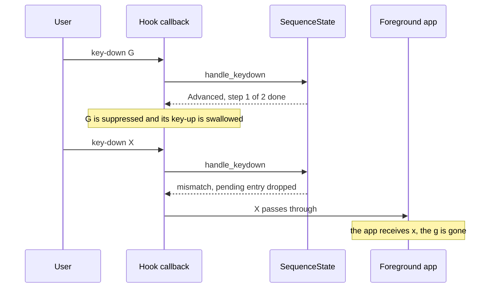
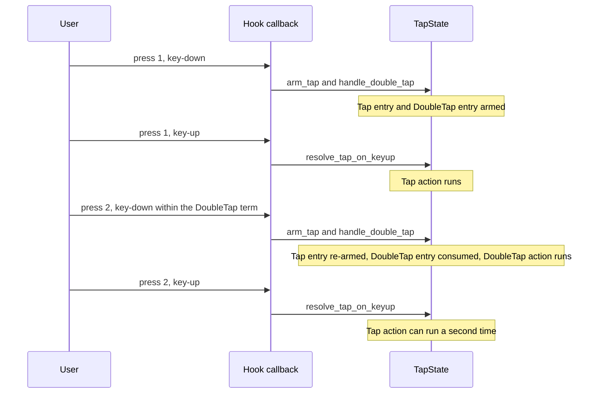
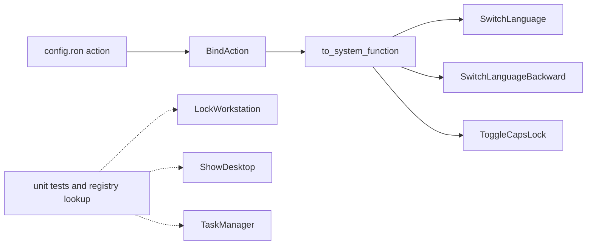

# Gaps and documentation drift

This chapter records what key-switch-rs does not do yet, where its documentation no longer matches the code, which project infrastructure is missing, and which code has no tests. Defects in code that does exist are described in [Audit results](audit.md); where a gap overlaps a defect, the issue ID links there.

> [!NOTE]
> Facts describe commit `7cb3521` (2026-05-20) and were checked during the audit on 2026-10-14. Code links are permalinks to that commit. Links into Markdown files use `?plain=1`, so GitHub highlights the cited line instead of rendering the page.

> [!IMPORTANT]
> **Status at [`f4c1fb6`](https://github.com/bluesteelll/key-switch-rs/commit/f4c1fb6)** (2026-10-20), after roadmap Phases 0, 1 and 2, item 2.5 included. The findings below are kept as the audit wrote them; a **Status** column or line says what changed. In short: Phase 0 closed the `swch` read timeout, range validation of timings, CI, the licence, the changelog, Cargo metadata, all 23 user-facing drift items and the 10 code-comment drift items, and gave the decision code, timing, conditions, the IPC server and the watcher tests. Phase 1 added file logging and the single-instance guard, and a warning for duplicate bindings. Phase 2 closed the Tap versus DoubleTap disambiguation, the cancellation of macros, the hook health check, the gesture reset on reload, the panic messages in the log and two gaps found in Phase 1. Item 2.5 changed how the modifier keys are repaired, which the rows on key state say; it closed no gap. The other unimplemented features and functional gaps are open, each with a roadmap item. Gaps found during Phases 1 and 2 are added to [Other functional gaps](#other-functional-gaps) and marked as such.

## At a glance

| Area | Count | Section |
|---|---|---|
| Features that are not built, or built but unreachable from config | 8 | [Unimplemented features](#unimplemented-features) |
| Further functional gaps found while reading the code | 9 | [Other functional gaps](#other-functional-gaps) |
| Statements that contradict the code | 23 user-facing, 10 in code and contributor docs | [Documentation drift](#documentation-drift) |
| Missing project infrastructure | 10 | [Missing project infrastructure](#missing-project-infrastructure) |
| Source files without tests | 15 of 30; 9 of them besides the module-declaration files | [Test coverage](#test-coverage) |
| Platform limitations documented in the README | 3 | [Platform limitations](#platform-limitations) |

The repository has no TODO or ROADMAP file, no GitHub issues, no releases and no branch other than `master`. README prose and code comments are the only record of planned work. The proposed order of work is in the [Roadmap](roadmap.md).

## Unimplemented features

| Feature | Where the gap shows | Behaviour at 7cb3521 | Status at `f4c1fb6` |
|---|---|---|---|
| Hold that keeps a synthesized modifier held | [README.md:294-297](https://github.com/bluesteelll/key-switch-rs/blob/7cb3521/README.md?plain=1#L294-L297) | Hold sends one key-down and key-up pair | Open: [new feature 6](roadmap.md#new-features-after-stabilisation) |
| Replay buffer for chord and sequence | [README.md:234-236](https://github.com/bluesteelll/key-switch-rs/blob/7cb3521/README.md?plain=1#L234-L236) | Suppressed keys of a failed gesture are lost | Open: [new feature 5](roadmap.md#new-features-after-stabilisation) |
| Tap versus DoubleTap disambiguation | [src/data/trigger.rs:9-12](https://github.com/bluesteelll/key-switch-rs/blob/7cb3521/src/data/trigger.rs#L9-L12) | Tap also fires on the first press of a double tap | **Closed** in [`283d8aa`](https://github.com/bluesteelll/key-switch-rs/commit/283d8aa) (item 2.2): with both, the Tap waits for the DoubleTap window |
| LockWorkstation, ShowDesktop, TaskManager | [src/system/system_function.rs:18-27](https://github.com/bluesteelll/key-switch-rs/blob/7cb3521/src/system/system_function.rs#L18-L27) | Implemented, unreachable from config | Open: [new feature 1](roadmap.md#new-features-after-stabilisation) |
| swch read timeout | [src/bin/swch.rs:171-175](https://github.com/bluesteelll/key-switch-rs/blob/7cb3521/src/bin/swch.rs#L171-L175) | swch blocks until the daemon replies | **Closed** in [`a1b5a27`](https://github.com/bluesteelll/key-switch-rs/commit/a1b5a27): a 5 s deadline |
| `Layout Hotkey` and Win+Space | [src/system/registry.rs:27](https://github.com/bluesteelll/key-switch-rs/blob/7cb3521/src/system/registry.rs#L27) | Not covered by `block_original_combo` | Open: [new feature 7](roadmap.md#new-features-after-stabilisation) |
| IPC reload, check and list commands | [src/ipc.rs:20-31](https://github.com/bluesteelll/key-switch-rs/blob/7cb3521/src/ipc.rs#L20-L31) | Only `on`, `off`, `exit`, `status` | Open: [item 4.3](roadmap.md#43-ipc-v2-commands) |
| Cancellation of macro workers | [src/data/sequence.rs:119](https://github.com/bluesteelll/key-switch-rs/blob/7cb3521/src/data/sequence.rs#L119) | A started `Sequence` always runs to the end | **Closed** in [`57871e3`](https://github.com/bluesteelll/key-switch-rs/commit/57871e3) (item 2.1): `swch off`, a reload and exit stop a running macro; no per-binding limit |

### Hold that keeps a synthesized modifier held

The README says that a continuously held synthesized modifier would need a dedicated action that is not yet implemented ([README.md:294-297](https://github.com/bluesteelll/key-switch-rs/blob/7cb3521/README.md?plain=1#L294-L297)). A `Hold(ms)` binding arms an entry, and after `ms` its timer thread removes the entry and calls `BindAction::execute` ([src/hook/tap_state.rs:103-119](https://github.com/bluesteelll/key-switch-rs/blob/7cb3521/src/hook/tap_state.rs#L103-L119)). For `PressKey` that is `press_vk`, which sends key-down and key-up in a single `SendInput` call ([src/core/windows_actions.rs:149-188](https://github.com/bluesteelll/key-switch-rs/blob/7cb3521/src/core/windows_actions.rs#L149-L188)). `Hold(200)` with `PressKey("LShift")` therefore produces one Shift tap at the 200 ms mark, and the release of the physical key is swallowed by the blocked-key bitmap ([src/hook/keyboard_hook_callback.rs:324](https://github.com/bluesteelll/key-switch-rs/blob/7cb3521/src/hook/keyboard_hook_callback.rs#L324)).

The README example ([README.md:256-259](https://github.com/bluesteelll/key-switch-rs/blob/7cb3521/README.md?plain=1#L256-L259), "holding sends LShift") and the template ([src/config/default_config.ron:186-198](https://github.com/bluesteelll/key-switch-rs/blob/7cb3521/src/config/default_config.ron#L186-L198)) present this pair as a dual-role key, which it is not. A real implementation needs an action that sends key-down when the hold threshold passes and key-up when the physical key is released. It also depends on per-key gesture state that is free of [KS-06](audit.md#ks-06), [KS-11](audit.md#ks-11) and [KS-25](audit.md#ks-25).

### Replay buffer for chord and sequence

The missing replay is acknowledged in five places: [README.md:234-236](https://github.com/bluesteelll/key-switch-rs/blob/7cb3521/README.md?plain=1#L234-L236), [src/config/default_config.ron:23-25](https://github.com/bluesteelll/key-switch-rs/blob/7cb3521/src/config/default_config.ron#L23-L25), [src/data/binding.rs:17-19](https://github.com/bluesteelll/key-switch-rs/blob/7cb3521/src/data/binding.rs#L17-L19), [src/hook/chord_state.rs:12-17](https://github.com/bluesteelll/key-switch-rs/blob/7cb3521/src/hook/chord_state.rs#L12-L17) and [src/hook/sequence_state.rs:11-15](https://github.com/bluesteelll/key-switch-rs/blob/7cb3521/src/hook/sequence_state.rs#L11-L15).

A Chord or Sequence binding suppresses every key-down that starts or advances it ([src/hook/keyboard_hook_callback.rs:255-290](https://github.com/bluesteelll/key-switch-rs/blob/7cb3521/src/hook/keyboard_hook_callback.rs#L255-L290)) and marks the key as blocked, so its key-up is swallowed as well ([src/hook/keyboard_hook_callback.rs:294-296](https://github.com/bluesteelll/key-switch-rs/blob/7cb3521/src/hook/keyboard_hook_callback.rs#L294-L296)). A pending chord is dropped when its window expires ([src/hook/chord_state.rs:83](https://github.com/bluesteelll/key-switch-rs/blob/7cb3521/src/hook/chord_state.rs#L83)); a pending sequence is dropped when its gap expires or a key-down does not match the next step ([src/hook/sequence_state.rs:71](https://github.com/bluesteelll/key-switch-rs/blob/7cb3521/src/hook/sequence_state.rs#L71), [src/hook/sequence_state.rs:95](https://github.com/bluesteelll/key-switch-rs/blob/7cb3521/src/hook/sequence_state.rs#L95)). Nothing records the suppressed events, so nothing can re-inject them. The template's own example, a sequence on `g`, `g`, shows the effect:

Deferred triggers have the same hole: a key bound only to `Tap` and held past its term, or bound only to `Hold` and released early, produces no action and no keystroke, apart from the auto-repeat events that leak through ([KS-06](audit.md#ks-06)). A replay buffer would queue each suppressed event (virtual key, scan code, flags) while a gesture is undecided and re-inject the queue in order through `SendInput`, tagged with the injected-event sentinel, when the gesture fails. Related sequence defects: [KS-15](audit.md#ks-15), [KS-16](audit.md#ks-16).

### Tap versus DoubleTap disambiguation

[src/data/trigger.rs:9-12](https://github.com/bluesteelll/key-switch-rs/blob/7cb3521/src/data/trigger.rs#L9-L12) and [README.md:252-254](https://github.com/bluesteelll/key-switch-rs/blob/7cb3521/README.md?plain=1#L252-L254) state that bindings with different triggers on the same combo resolve independently. `TapState` keeps three unrelated maps ([src/hook/tap_state.rs:22-34](https://github.com/bluesteelll/key-switch-rs/blob/7cb3521/src/hook/tap_state.rs#L22-L34)), so when a key has both a `Tap` and a `DoubleTap` binding, Tap never waits for the DoubleTap window:

Whether the second Tap runs depends on the stale timer thread from the first press ([KS-11](audit.md#ks-11)). The usual design holds the Tap action back until the DoubleTap window expires without a second press, and drops it when the second press arrives. That needs one per-key state machine in place of three independent maps.

**Status:** closed in [`283d8aa`](https://github.com/bluesteelll/key-switch-rs/commit/283d8aa) (`feat/main-thread-timers`, roadmap item 2.2) as the usual design: the `Tap`, `Hold` and `DoubleTap` of one press are one state machine, and with a `DoubleTap` on the same keys and `when:` the `Tap` waits until the DoubleTap window closes, so a double press fires only the DoubleTap (`engine::scenarios::a_double_press_of_a_tap_and_double_tap_key_fires_only_the_double_tap`). The waiting Tap comes up to the DoubleTap term late ([known issue 75](config/known-issues.md#s19-9)).

### LockWorkstation, ShowDesktop and TaskManager are unreachable

`SystemFunction` has six variants and carries `#[allow(dead_code)]` ([src/system/system_function.rs:18-27](https://github.com/bluesteelll/key-switch-rs/blob/7cb3521/src/system/system_function.rs#L18-L27)). Three of them have working implementations: `lock_workstation`, `show_desktop` and `open_task_manager` ([src/system/system_function.rs:84-115](https://github.com/bluesteelll/key-switch-rs/blob/7cb3521/src/system/system_function.rs#L84-L115)). A config action reaches `SystemFunction` only through `BindAction::to_system_function`, which maps three variants ([src/core/windows_actions.rs:130-137](https://github.com/bluesteelll/key-switch-rs/blob/7cb3521/src/core/windows_actions.rs#L130-L137)), and the on-disk `RawAction` has no variant for the other three ([src/config/schema.rs:121-150](https://github.com/bluesteelll/key-switch-rs/blob/7cb3521/src/config/schema.rs#L121-L150)).

Outside `SystemFunction` itself, the three variants are named only by tests ([src/system/system_function.rs:176-181](https://github.com/bluesteelll/key-switch-rs/blob/7cb3521/src/system/system_function.rs#L176-L181), [src/system/registry.rs:260-266](https://github.com/bluesteelll/key-switch-rs/blob/7cb3521/src/system/registry.rs#L260-L266), [src/system/registry.rs:274](https://github.com/bluesteelll/key-switch-rs/blob/7cb3521/src/system/registry.rs#L274)) and the registry lookup tables ([src/system/registry.rs:32-54](https://github.com/bluesteelll/key-switch-rs/blob/7cb3521/src/system/registry.rs#L32-L54), [src/system/registry.rs:80-88](https://github.com/bluesteelll/key-switch-rs/blob/7cb3521/src/system/registry.rs#L80-L88)). Either expose them as actions in the schema and loader, or delete them. Before exposing them, two details need checking against Windows behaviour, which the audit did not do: the `WM_COMMAND` id `419` posted to `Shell_TrayWnd` ([src/system/system_function.rs:103](https://github.com/bluesteelll/key-switch-rs/blob/7cb3521/src/system/system_function.rs#L103)), and the registry value names `LockWorkstationHotkey` and `ShowDesktopHotkey` ([src/system/registry.rs:36](https://github.com/bluesteelll/key-switch-rs/blob/7cb3521/src/system/registry.rs#L36), [src/system/registry.rs:45](https://github.com/bluesteelll/key-switch-rs/blob/7cb3521/src/system/registry.rs#L45)).

### swch read timeout

The comment at [src/bin/swch.rs:171-174](https://github.com/bluesteelll/key-switch-rs/blob/7cb3521/src/bin/swch.rs#L171-L174) admits that no read timeout is set and suggests Ctrl+C if the daemon hangs. The next line, `let _ = Duration::from_secs(5);` ([src/bin/swch.rs:175](https://github.com/bluesteelll/key-switch-rs/blob/7cb3521/src/bin/swch.rs#L175)), builds a value and discards it; it is the only use of the `Duration` import ([src/bin/swch.rs:19](https://github.com/bluesteelll/key-switch-rs/blob/7cb3521/src/bin/swch.rs#L19)). `round_trip` then blocks in `read_line` until the daemon answers or closes the pipe ([src/bin/swch.rs:177-181](https://github.com/bluesteelll/key-switch-rs/blob/7cb3521/src/bin/swch.rs#L177-L181)). A daemon that accepts the connection but never replies leaves `swch` hanging, which matters most for scripts that use `swch status` as a health check. A read on a helper thread with a bounded wait, or overlapped I/O, would close the gap.

**Status:** closed in [`a1b5a27`](https://github.com/bluesteelll/key-switch-rs/commit/a1b5a27) (`fix/ipc-control`). `swch` now goes through `ipc::request`, which runs the exchange on an `ipc-request` thread and gives up after 5 s for the connection and the reply together ([src/ipc.rs:87-116](https://github.com/bluesteelll/key-switch-rs/blob/f4c1fb6/src/ipc.rs#L87-L116)); `request_times_out_against_a_server_that_never_replies` in `tests/ipc_roundtrip.rs` pins it.

### `Layout Hotkey` and Win+Space

`block_original_combo` derives its blocker from `HKCU\Keyboard Layout\Toggle`. The code reads the values `Hotkey` and `Language Hotkey` ([src/system/registry.rs:24-29](https://github.com/bluesteelll/key-switch-rs/blob/7cb3521/src/system/registry.rs#L24-L29)) and maps them to Alt+Shift, Ctrl+Shift or the grave-accent key ([src/system/registry.rs:192-200](https://github.com/bluesteelll/key-switch-rs/blob/7cb3521/src/system/registry.rs#L192-L200)). Two OS switch shortcuts are not covered:

- `Layout Hotkey`, the third value under the same key, which switches between layouts of one language, is never read.
- Win+Space, the Windows input switcher, has no value there and is not handled anywhere in `src/`.

With `block_original_combo: true` the OS can therefore still change the layout through these shortcuts while CapsLock is remapped. Defects in what the blocker does cover: [KS-05](audit.md#ks-05), [KS-17](audit.md#ks-17), [KS-18](audit.md#ks-18).

**Status at `20af28d`:** open ([new feature 7](roadmap.md#new-features-after-stabilisation)). Since item 1.4 ([`f0048a3`](https://github.com/bluesteelll/key-switch-rs/commit/f0048a3)) the value `"3"` decides and gives no blocker ([KS-17](audit.md#ks-17), fixed), which leaves three related points:

- With `Language Hotkey` set to `"3"` and `Layout Hotkey` to `"1"`, the old fallback blocked Alt+Shift by accident, which then switched layouts. Now Alt+Shift reaches Windows and switches the layout (from code, not observed).
- Which of `Hotkey` and `Language Hotkey` Windows honours when the two differ is not known. The daemon takes the first that decides, so a hand-edited `("3", "1")` gives no blocker, which is the behaviour without the flag. Manual check 11 of [Manual checks after Phase 1](roadmap.md#manual-checks-after-phase-1) records the values Windows writes.
- The values are read from `HKCU` of the account the daemon runs as. A daemon elevated with another administrator account's credentials reads that account's setting, not the signed-in user's ([src/system/registry.rs:65-78](https://github.com/bluesteelll/key-switch-rs/blob/f4c1fb6/src/system/registry.rs#L65-L78)).

### No IPC reload, check or list commands

The protocol has four commands: `On`, `Off`, `Exit` and `Status` ([src/ipc.rs:20-31](https://github.com/bluesteelll/key-switch-rs/blob/7cb3521/src/ipc.rs#L20-L31)). `Status` reports only the hook state and the binding count ([src/hook/ipc_server.rs:127-131](https://github.com/bluesteelll/key-switch-rs/blob/7cb3521/src/hook/ipc_server.rs#L127-L131)). Missing:

| Command | Purpose |
|---|---|
| `reload` | Force a re-read. The file watcher is the only reload path, and it never fires for a relative config path ([KS-21](audit.md#ks-21)). |
| `check <path>` | Validate a file with the real loader without applying it. |
| `list` | Print the live bindings, including generated auto-blockers. |
| richer `status` | Config path, process id, version, result of the last reload. |

Reload errors go only to the daemon console ([src/hook/config_watcher.rs:107-108](https://github.com/bluesteelll/key-switch-rs/blob/7cb3521/src/hook/config_watcher.rs#L107-L108)), so a broken save is invisible when nobody watches that window. `swch open` also cannot pass a config path, because `ShellExecuteW` is called without parameters ([src/bin/swch.rs:105-114](https://github.com/bluesteelll/key-switch-rs/blob/7cb3521/src/bin/swch.rs#L105-L114)).

### No cancellation for macro workers

`spawn_sequence` starts one detached thread per execution and keeps no handle, token or counter ([src/data/sequence.rs:114-125](https://github.com/bluesteelll/key-switch-rs/blob/7cb3521/src/data/sequence.rs#L114-L125)). A running `Sequence` cannot be stopped: `swch off`, a hot reload that removes the binding and a second trigger all leave it running. Auto-repeat starts a new worker for every repeat ([KS-10](audit.md#ks-10)), and parallel workers interleave their `SendInput` output, which [README.md:339-342](https://github.com/bluesteelll/key-switch-rs/blob/7cb3521/README.md?plain=1#L339-L342) acknowledges. A fix needs a cancellation flag that is checked between steps and inside long `Delay` steps, set on `off` and on reload, plus a per-binding limit on concurrent runs.

**Status:** closed in [`57871e3`](https://github.com/bluesteelll/key-switch-rs/commit/57871e3) (`feat/action-executor`, roadmap item 2.1), without the per-binding limit. Macros run on the one `action-executor` thread, and an epoch that `swch off`, `swch on` after `off`, a reload that loads, keyboard input leaving the desktop and exit move on stops every running macro within 100 ms, also inside a `Delay`, and drops the actions still queued; a step already running finishes first (`core::executor::tests::delay_10000_stops_within_100_ms_of_an_epoch_change`, `hook::keyboard_hook::tests::swch_off_stops_a_running_macro_within_100_ms`). The number of macros running at once is not capped; at most 32 actions wait to start ([known issue 36](config/known-issues.md#s19-5)).

## Other functional gaps

None of these is tracked as planned work in the repository. Each was confirmed by reading the cited code.

| Gap | Evidence | Related | Status at `f4c1fb6` |
|---|---|---|---|
| No hook health check | `is_installed` only tests the stored handle ([src/hook/keyboard_hook.rs:136-139](https://github.com/bluesteelll/key-switch-rs/blob/7cb3521/src/hook/keyboard_hook.rs#L136-L139)). Windows silently removes a low-level hook whose callback exceeds `LowLevelHooksTimeout`; nothing detects that, and `swch status` still reports `running`. | [KS-08](audit.md#ks-08) | **Closed** in [`bf549c0`](https://github.com/bluesteelll/key-switch-rs/commit/bf549c0) (item 2.4): the hook watchdog compares raw keyboard input with a heartbeat of the callback, has the main thread reinstall a hook that Windows removed, and `swch status` reports the hook's health |
| Gesture state is never reset | A reload only swaps the list ([src/hook/keyboard_hook.rs:71-74](https://github.com/bluesteelll/key-switch-rs/blob/7cb3521/src/hook/keyboard_hook.rs#L71-L74), [src/hook/config_watcher.rs:103](https://github.com/bluesteelll/key-switch-rs/blob/7cb3521/src/hook/config_watcher.rs#L103)), and `on`/`off` only reinstall the hook ([src/hook/keyboard_hook.rs:143-157](https://github.com/bluesteelll/key-switch-rs/blob/7cb3521/src/hook/keyboard_hook.rs#L143-L157)). Pending Tap, Hold, DoubleTap, chord and sequence entries keep actions from the old config. | [KS-31](audit.md#ks-31) | **Closed**: `swch off` and `swch on` reset the engine since [`a1b5a27`](https://github.com/bluesteelll/key-switch-rs/commit/a1b5a27), and a reload since [`3befec7`](https://github.com/bluesteelll/key-switch-rs/commit/3befec7) (item 2.3), in the same main-thread step that swaps the list |
| No range or semantic validation | Timing values are copied unchanged ([src/config/loader.rs:288](https://github.com/bluesteelll/key-switch-rs/blob/7cb3521/src/config/loader.rs#L288), [src/config/loader.rs:307](https://github.com/bluesteelll/key-switch-rs/blob/7cb3521/src/config/loader.rs#L307), [src/config/loader.rs:324-331](https://github.com/bluesteelll/key-switch-rs/blob/7cb3521/src/config/loader.rs#L324-L331)); zero terms, windows and gaps are accepted. | [KS-27](audit.md#ks-27) | **Closed** for timings in [`1dfd80a`](https://github.com/bluesteelll/key-switch-rs/commit/1dfd80a): 1 to 10000 ms |
| No conflict detection | Only the first matching Immediate binding executes ([src/hook/keyboard_hook_callback.rs:230-233](https://github.com/bluesteelll/key-switch-rs/blob/7cb3521/src/hook/keyboard_hook_callback.rs#L230-L233)); a second Tap binding on the same key is dropped ([src/hook/tap_state.rs:51-53](https://github.com/bluesteelll/key-switch-rs/blob/7cb3521/src/hook/tap_state.rs#L51-L53)). The loader gives no warning. | [KS-13](audit.md#ks-13) | **Partly closed** in [`ece1767`](https://github.com/bluesteelll/key-switch-rs/commit/ece1767) (item 1.6): one binding wins each press, and the loader warns about a binding that duplicates an earlier one. An `Immediate` binding that shadows a `Tap`, `Hold` or `DoubleTap` binding on the same keys gets no warning ([known issue 69](config/known-issues.md#s19-9); [item 3.4](roadmap.md#34-core-consolidation)) |
| All-or-nothing loading | One invalid binding rejects the whole file ([src/config/loader.rs:153-155](https://github.com/bluesteelll/key-switch-rs/blob/7cb3521/src/config/loader.rs#L153-L155)); at startup that is fatal ([src/main.rs:33](https://github.com/bluesteelll/key-switch-rs/blob/7cb3521/src/main.rs#L33)). On reload the previous list stays live. | none | Open, by decision: [deliberately out of scope](roadmap.md#deliberately-out-of-scope) |
| Hook flags and scan code ignored | The callback reads only `vkCode` and `dwExtraInfo` ([src/hook/keyboard_hook_callback.rs:134-140](https://github.com/bluesteelll/key-switch-rs/blob/7cb3521/src/hook/keyboard_hook_callback.rs#L134-L140)). The synthetic left Ctrl that AltGr produces looks like a real one, so Ctrl+Alt bindings can fire while typing AltGr characters, and input injected by other programs counts as physical. | none | Open: [new feature 2](roadmap.md#new-features-after-stabilisation). Since item 2.5 the callback also reads `time` and `LLKHF_INJECTED`, only to note a late callback; matching still ignores the flags and the scan code |
| No longest match for overlapping gestures | Sequences with identical steps share one pending slot ([src/hook/sequence_state.rs:74](https://github.com/bluesteelll/key-switch-rs/blob/7cb3521/src/hook/sequence_state.rs#L74)), so only one of their actions fires, and not reliably the first binding's as the module comment says ([src/hook/sequence_state.rs:5-9](https://github.com/bluesteelll/key-switch-rs/blob/7cb3521/src/hook/sequence_state.rs#L5-L9)). A chord is keyed by its exact key set ([src/hook/chord_state.rs:86](https://github.com/bluesteelll/key-switch-rs/blob/7cb3521/src/hook/chord_state.rs#L86)), so a subset chord and its superset both run. | none | Open: [new feature 8](roadmap.md#new-features-after-stabilisation) |
| Missing key names | No name for the Apps (context menu) key, because `Menu` means Alt ([src/data/vk_name.rs:139](https://github.com/bluesteelll/key-switch-rs/blob/7cb3521/src/data/vk_name.rs#L139)); no numpad operators, no `VK_OEM_102`, no browser or launch keys, no raw `VK(n)` escape ([src/data/vk_name.rs:91-175](https://github.com/bluesteelll/key-switch-rs/blob/7cb3521/src/data/vk_name.rs#L91-L175)). | see [Key names](config/keys.md) | Open: [new feature 2](roadmap.md#new-features-after-stabilisation) |
| Non-modifier key state is not repaired | Focus-change repair resyncs only the 11 modifier keys ([src/hook/keyboard_hook_callback.rs:38-43](https://github.com/bluesteelll/key-switch-rs/blob/7cb3521/src/hook/keyboard_hook_callback.rs#L38-L43), [src/hook/keyboard_hook_callback.rs:167-181](https://github.com/bluesteelll/key-switch-rs/blob/7cb3521/src/hook/keyboard_hook_callback.rs#L167-L181)). | [KS-29](audit.md#ks-29) | Partly closed: only the modifiers are repaired between resets, by design. Since [`f4c1fb6`](https://github.com/bluesteelll/key-switch-rs/commit/f4c1fb6) (item 2.5) no key event reads them all: a decided key event drops a held modifier that Windows has up, and the main thread reads the modifiers between key events after a foreground change or anything else that could have hidden a key event ([Modifier state between key events](architecture.md#modifier-state-between-key-events); [known issue 88](config/known-issues.md#s19-9)). Since [`3befec7`](https://github.com/bluesteelll/key-switch-rs/commit/3befec7) (item 2.3) keyboard input leaving the desktop releases every key, and `swch on` and a hook reinstall read every key from Windows ([KS-29](audit.md#ks-29) status) |
| Re-entry into the hook callback under the engine lock (found after the audit) | `with_engine` refused a nested call on the same thread, so a re-entered event passed. For a key-up whose key-down was swallowed that left the key held in the engine. Since item 2.2 there is no lock: `with_main` refuses a nested call the same way ([src/hook/keyboard_hook_callback.rs:94-131](https://github.com/bluesteelll/key-switch-rs/blob/f4c1fb6/src/hook/keyboard_hook_callback.rs#L94-L131)) | none | Closed in part: item 2.2 removed the lock ([`283d8aa`](https://github.com/bluesteelll/key-switch-rs/commit/283d8aa)), and since [`bf549c0`](https://github.com/bluesteelll/key-switch-rs/commit/bf549c0) (item 2.4) every refusal is counted in `main_state_refused`; since [`f4c1fb6`](https://github.com/bluesteelll/key-switch-rs/commit/f4c1fb6) (item 2.5) it is also noted as hidden input, so the next drain reads the modifiers. Item 2.3 added a window whose procedure only notes signals, and a title condition never asks a window of the daemon's process, so nothing pumps messages under the borrow. The rule for a refused key-up stays; a change that pumps or injects under the borrow must deal with it first ([item 4.6](roadmap.md#46-tray-icon)) |
| `block_default` is accepted and ignored on `sequence` and `chord` bindings (found in Phase 1) | Since item 1.3 the flag applies to every `keys` trigger; `sequence` and `chord` bindings suppress their keys whatever it says, and the loader does not reject it there ([src/data/binding.rs:92-99](https://github.com/bluesteelll/key-switch-rs/blob/f4c1fb6/src/data/binding.rs#L92-L99)) | none | Open, no item: recorded in [§18.7](config/errors.md#s18-7) |
| A `Sequence` macro whose thread cannot start panics (found in Phase 1) | At `20af28d`, `spawn_sequence` started its worker with `thread::spawn`, which panics on failure; for an `Immediate` binding that happened on the hook thread ([src/data/sequence.rs:111-122](https://github.com/bluesteelll/key-switch-rs/blob/20af28d/src/data/sequence.rs#L111-L122)) | [KS-33](audit.md#ks-33) | **Closed** in [`57871e3`](https://github.com/bluesteelll/key-switch-rs/commit/57871e3) (item 2.1): a macro starts no thread; it runs on the action executor |

## Documentation drift

Each row was checked against the code at `7cb3521`. "Says" paraphrases the statement; "Reality" is what the code does.

> [!NOTE]
> All rows below are closed at `1dfd80a` and stay closed at `20af28d`; the **Status** column says how. Most were fixed in [`13ce323`](https://github.com/bluesteelll/key-switch-rs/commit/13ce323) (Workstream B, documentation drift); others became true when the code was fixed.

> [!WARNING]
> At the audit, three drift items misled users without any error message: the `LShift` DoubleTap example never fires, the template's `g, g` and `j, k` examples eat typed letters, and the template header tells users to restart for changes that are already applied live.

### User-facing documentation

| Where | Says | Reality | Status |
|---|---|---|---|
| [default_config.ron:3](https://github.com/bluesteelll/key-switch-rs/blob/7cb3521/src/config/default_config.ron#L3) | Reloading requires restarting the program. | Hot reload is implemented: the watcher reloads after a 250 ms debounce ([src/hook/config_watcher.rs:29](https://github.com/bluesteelll/key-switch-rs/blob/7cb3521/src/hook/config_watcher.rs#L29), [src/hook/config_watcher.rs:100-104](https://github.com/bluesteelll/key-switch-rs/blob/7cb3521/src/hook/config_watcher.rs#L100-L104)), and the daemon's own banner says so ([src/core/app.rs:67](https://github.com/bluesteelll/key-switch-rs/blob/7cb3521/src/core/app.rs#L67)). The header is copied into every generated `config.ron` ([src/config/loader.rs:101-104](https://github.com/bluesteelll/key-switch-rs/blob/7cb3521/src/config/loader.rs#L101-L104)). | Fixed in [`13ce323`](https://github.com/bluesteelll/key-switch-rs/commit/13ce323) |
| [default_config.ron:17-21](https://github.com/bluesteelll/key-switch-rs/blob/7cb3521/src/config/default_config.ron#L17-L21) | Example sequence on `g`, `g` and chord on `j`, `k`. | Both kinds suppress their keys while pending and never replay them ([replay buffer](#replay-buffer-for-chord-and-sequence)), so these examples eat typed g, j and k. The caveat directly below ([default_config.ron:23-25](https://github.com/bluesteelll/key-switch-rs/blob/7cb3521/src/config/default_config.ron#L23-L25)) contradicts them; the commented-out bindings later in the file correctly use F13 and F14 ([default_config.ron:207-219](https://github.com/bluesteelll/key-switch-rs/blob/7cb3521/src/config/default_config.ron#L207-L219)). | Fixed in [`13ce323`](https://github.com/bluesteelll/key-switch-rs/commit/13ce323): F13 and F14 |
| [default_config.ron:87-98](https://github.com/bluesteelll/key-switch-rs/blob/7cb3521/src/config/default_config.ron#L87-L98) | Lists five sequence step variants. | The schema accepts eight; `Launch`, `OpenUrl` and `Media` steps are missing from the template ([src/config/schema.rs:180-193](https://github.com/bluesteelll/key-switch-rs/blob/7cb3521/src/config/schema.rs#L180-L193)). | Fixed in [`13ce323`](https://github.com/bluesteelll/key-switch-rs/commit/13ce323) |
| [README.md:321](https://github.com/bluesteelll/key-switch-rs/blob/7cb3521/README.md?plain=1#L321) | "Five step variants". | The table right below lists eight ([README.md:325-332](https://github.com/bluesteelll/key-switch-rs/blob/7cb3521/README.md?plain=1#L325-L332)), matching the schema. | Fixed in [`13ce323`](https://github.com/bluesteelll/key-switch-rs/commit/13ce323): "Eight step variants" |
| [README.md:19-55](https://github.com/bluesteelll/key-switch-rs/blob/7cb3521/README.md?plain=1#L19-L55) | Module tree. | `src/data/condition.rs` and `src/data/trigger.rs` are missing ([README.md:38-42](https://github.com/bluesteelll/key-switch-rs/blob/7cb3521/README.md?plain=1#L38-L42)), and a stray branch line at [README.md:27](https://github.com/bluesteelll/key-switch-rs/blob/7cb3521/README.md?plain=1#L27) breaks the tree. | Fixed: the tree lists every module |
| [README.md:66-84](https://github.com/bluesteelll/key-switch-rs/blob/7cb3521/README.md?plain=1#L66-L84) | `BindAction` has six variants; `Binding` holds combo, action and two flags. | `BindAction` has ten variants; `Sequence`, `Launch`, `OpenUrl` and `Media` are missing ([src/core/windows_actions.rs:22-46](https://github.com/bluesteelll/key-switch-rs/blob/7cb3521/src/core/windows_actions.rs#L22-L46)). `Binding` holds a `kind` in place of the combo and adds `condition`, `trigger` and the crate-private `is_auto_blocker` ([src/data/binding.rs:51-68](https://github.com/bluesteelll/key-switch-rs/blob/7cb3521/src/data/binding.rs#L51-L68)). | Fixed in [`13ce323`](https://github.com/bluesteelll/key-switch-rs/commit/13ce323) |
| [README.md:465-472](https://github.com/bluesteelll/key-switch-rs/blob/7cb3521/README.md?plain=1#L465-L472) | Seven `windows` crate features. | [Cargo.toml:12-22](https://github.com/bluesteelll/key-switch-rs/blob/7cb3521/Cargo.toml#L12-L22) enables nine. `Win32_UI_Shell` (`ShellExecuteW` for `OpenUrl` and `swch open`) and `Win32_System_ProcessStatus` (`GetModuleBaseNameW` for `AppEquals`) are not listed. | Fixed: nine features listed, matching `Cargo.toml` |
| [README.md:481](https://github.com/bluesteelll/key-switch-rs/blob/7cb3521/README.md?plain=1#L481), [README.md:497](https://github.com/bluesteelll/key-switch-rs/blob/7cb3521/README.md?plain=1#L497) | Lock-free hot path; "Hot-path allocations: none". | Only the active-keys buffer is on the stack. The hook path allocates a `Vec` per Chord binding per key-down ([src/hook/chord_state.rs:70](https://github.com/bluesteelll/key-switch-rs/blob/7cb3521/src/hook/chord_state.rs#L70)), copies sequence steps ([src/hook/sequence_state.rs:111](https://github.com/bluesteelll/key-switch-rs/blob/7cb3521/src/hook/sequence_state.rs#L111)), clones each armed action, which allocates for `Launch` and `OpenUrl` strings ([src/hook/keyboard_hook_callback.rs:240](https://github.com/bluesteelll/key-switch-rs/blob/7cb3521/src/hook/keyboard_hook_callback.rs#L240)), spawns a thread per armed gesture ([src/hook/tap_state.rs:61](https://github.com/bluesteelll/key-switch-rs/blob/7cb3521/src/hook/tap_state.rs#L61)) and builds title and exe strings for `when:` ([src/data/condition.rs:148](https://github.com/bluesteelll/key-switch-rs/blob/7cb3521/src/data/condition.rs#L148), [src/data/condition.rs:161](https://github.com/bluesteelll/key-switch-rs/blob/7cb3521/src/data/condition.rs#L161)). Gesture state takes a `Mutex` ([src/hook/tap_state.rs:48](https://github.com/bluesteelll/key-switch-rs/blob/7cb3521/src/hook/tap_state.rs#L48), [src/hook/chord_state.rs:78](https://github.com/bluesteelll/key-switch-rs/blob/7cb3521/src/hook/chord_state.rs#L78), [src/hook/sequence_state.rs:67](https://github.com/bluesteelll/key-switch-rs/blob/7cb3521/src/hook/sequence_state.rs#L67)). | Fixed: the claim of no hot-path allocations is gone, and the README names the engine lock |
| [README.md:261-262](https://github.com/bluesteelll/key-switch-rs/blob/7cb3521/README.md?plain=1#L261-L262), [default_config.ron:200-205](https://github.com/bluesteelll/key-switch-rs/blob/7cb3521/src/config/default_config.ron#L200-L205) | Double-tapping `LShift` toggles CapsLock. | The binding never fires: `LShift` parses to `VK_LSHIFT`, but the hook folds it to `VK_SHIFT` before matching ([KS-07](audit.md#ks-07)). | Fixed in [`82f542f`](https://github.com/bluesteelll/key-switch-rs/commit/82f542f): the binding fires. Since [`9357cfa`](https://github.com/bluesteelll/key-switch-rs/commit/9357cfa) (item 1.3) the left Shift reaches Windows too, and the README says so |
| [README.md:173](https://github.com/bluesteelll/key-switch-rs/blob/7cb3521/README.md?plain=1#L173), [README.md:181-183](https://github.com/bluesteelll/key-switch-rs/blob/7cb3521/README.md?plain=1#L181-L183) | `RWin` is a modifier; sided names are parsed and the hook normalises left and right. | `parse_vk` keeps sided codes ([src/data/vk_name.rs:134-143](https://github.com/bluesteelll/key-switch-rs/blob/7cb3521/src/data/vk_name.rs#L134-L143)) while the hook folds them ([src/hook/keyboard_hook_callback.rs:335-341](https://github.com/bluesteelll/key-switch-rs/blob/7cb3521/src/hook/keyboard_hook_callback.rs#L335-L341)), so `LShift`, `RShift`, `LCtrl`, `RCtrl`, `LAlt`, `RAlt` and `RWin` never match in `keys` or `sequence` ([KS-07](audit.md#ks-07)). | Fixed in [`82f542f`](https://github.com/bluesteelll/key-switch-rs/commit/82f542f): sided names match their side |
| [README.md:487](https://github.com/bluesteelll/key-switch-rs/blob/7cb3521/README.md?plain=1#L487) | "Not macros": native API calls, no emulated action sequences. | The project has a macro engine ([src/data/sequence.rs](https://github.com/bluesteelll/key-switch-rs/blob/7cb3521/src/data/sequence.rs)) and synthesizes keys with `SendInput` for `ToggleCapsLock`, `PressKey`, `Media`, `Text`, `Key` and `Combo`. | Fixed in [`13ce323`](https://github.com/bluesteelll/key-switch-rs/commit/13ce323): names the `SendInput` output |
| [README.md:493](https://github.com/bluesteelll/key-switch-rs/blob/7cb3521/README.md?plain=1#L493) | More specific combinations are checked first. | Specificity decides only between Immediate bindings; less specific deferred bindings still arm ([KS-13](audit.md#ks-13)). | Fixed: since [`ece1767`](https://github.com/bluesteelll/key-switch-rs/commit/ece1767) (item 1.6) one binding wins each key press, whatever its trigger, and the README describes that rule |
| [README.md:289-291](https://github.com/bluesteelll/key-switch-rs/blob/7cb3521/README.md?plain=1#L289-L291) | Deferred triggers suppress the key while the gesture is pending. | Auto-repeat key-downs skip the suppress step ([src/hook/keyboard_hook_callback.rs:239](https://github.com/bluesteelll/key-switch-rs/blob/7cb3521/src/hook/keyboard_hook_callback.rs#L239)) and reach the OS while the key-up is swallowed ([KS-06](audit.md#ks-06)). | True since [`44f79ac`](https://github.com/bluesteelll/key-switch-rs/commit/44f79ac): repeats follow their key-down |
| [README.md:252-254](https://github.com/bluesteelll/key-switch-rs/blob/7cb3521/README.md?plain=1#L252-L254), [default_config.ron:78-81](https://github.com/bluesteelll/key-switch-rs/blob/7cb3521/src/config/default_config.ron#L78-L81) | Tap and Hold on one key both arm, and whichever wins resolves. | They are not mutually exclusive; the outcome depends on thread scheduling ([KS-25](audit.md#ks-25)). The Hold half sends one Shift press, not a held Shift ([Hold](#hold-that-keeps-a-synthesized-modifier-held)), and Tap is not disambiguated from DoubleTap ([Tap versus DoubleTap](#tap-versus-doubletap-disambiguation)). | Fixed: equal terms are exact since [`16a0461`](https://github.com/bluesteelll/key-switch-rs/commit/16a0461) |
| [README.md:122-124](https://github.com/bluesteelll/key-switch-rs/blob/7cb3521/README.md?plain=1#L122-L124), [README.md:492](https://github.com/bluesteelll/key-switch-rs/blob/7cb3521/README.md?plain=1#L492) | A malformed save never bricks the daemon; the previous bindings stay live. | Unknown fields are silently ignored and a misspelled `bindings` empties the live list ([KS-22](audit.md#ks-22)); deleting or renaming the file swaps in the defaults ([KS-23](audit.md#ks-23)). | True since [`1dfd80a`](https://github.com/bluesteelll/key-switch-rs/commit/1dfd80a): strict loader, deleted files keep the bindings |
| [README.md:361](https://github.com/bluesteelll/key-switch-rs/blob/7cb3521/README.md?plain=1#L361), [default_config.ron:115](https://github.com/bluesteelll/key-switch-rs/blob/7cb3521/src/config/default_config.ron#L115), [src/data/condition.rs:9-11](https://github.com/bluesteelll/key-switch-rs/blob/7cb3521/src/data/condition.rs#L9-L11) | All condition string comparisons are case-insensitive. | `AppEquals` and `TitleEquals` fold ASCII only ([src/data/condition.rs:62](https://github.com/bluesteelll/key-switch-rs/blob/7cb3521/src/data/condition.rs#L62), [src/data/condition.rs:71](https://github.com/bluesteelll/key-switch-rs/blob/7cb3521/src/data/condition.rs#L71)); only `TitleContains` folds Unicode ([src/data/condition.rs:67](https://github.com/bluesteelll/key-switch-rs/blob/7cb3521/src/data/condition.rs#L67)). See [KS-28](audit.md#ks-28). `AppEquals` never matches at all ([KS-03](audit.md#ks-03)). | True since [`4177540`](https://github.com/bluesteelll/key-switch-rs/commit/4177540): every comparison folds case, and `AppEquals` works |
| [README.md:194](https://github.com/bluesteelll/key-switch-rs/blob/7cb3521/README.md?plain=1#L194), [default_config.ron:57](https://github.com/bluesteelll/key-switch-rs/blob/7cb3521/src/config/default_config.ron#L57) | `Launch` spawns a detached process. | `Command::spawn` without creation flags ([src/core/windows_actions.rs:211](https://github.com/bluesteelll/key-switch-rs/blob/7cb3521/src/core/windows_actions.rs#L211)): console children share the daemon's console, and every child inherits its administrator token ([KS-09](audit.md#ks-09), [KS-34](audit.md#ks-34)). | Fixed in [`13ce323`](https://github.com/bluesteelll/key-switch-rs/commit/13ce323) |
| [README.md:419](https://github.com/bluesteelll/key-switch-rs/blob/7cb3521/README.md?plain=1#L419) | Elevation lets the hook observe the UAC consent UI. | The consent prompt runs on the Secure Desktop, which [README.md:509-511](https://github.com/bluesteelll/key-switch-rs/blob/7cb3521/README.md?plain=1#L509-L511) correctly says no process can hook. | Fixed in [`13ce323`](https://github.com/bluesteelll/key-switch-rs/commit/13ce323) |
| [README.md:428](https://github.com/bluesteelll/key-switch-rs/blob/7cb3521/README.md?plain=1#L428), [README.md:439](https://github.com/bluesteelll/key-switch-rs/blob/7cb3521/README.md?plain=1#L439) | UAC is accepted once, or only the first time. | `requireAdministrator` ([build.rs:23](https://github.com/bluesteelll/key-switch-rs/blob/7cb3521/build.rs#L23)) and the `runas` verb ([src/bin/swch.rs:102-114](https://github.com/bluesteelll/key-switch-rs/blob/7cb3521/src/bin/swch.rs#L102-L114)) prompt on every launch; only the Scheduled Task route avoids it. | Fixed in [`13ce323`](https://github.com/bluesteelll/key-switch-rs/commit/13ce323): "UAC prompt on every launch" |
| [README.md:422-423](https://github.com/bluesteelll/key-switch-rs/blob/7cb3521/README.md?plain=1#L422-L423) | `swch` runs as a normal user and controls the daemon. | A non-elevated `swch` cannot open the elevated daemon's pipe for writing ([KS-02](audit.md#ks-02)). | True since [`a1b5a27`](https://github.com/bluesteelll/key-switch-rs/commit/a1b5a27): the pipe SDDL |
| [README.md:440-441](https://github.com/bluesteelll/key-switch-rs/blob/7cb3521/README.md?plain=1#L440-L441) | `on` and `off` are idempotent toggles. | `off` followed by `on` leaves a dead hook ([KS-01](audit.md#ks-01)). | True since [`a1b5a27`](https://github.com/bluesteelll/key-switch-rs/commit/a1b5a27): `on`/`off` flip a flag |
| [README.md:171-179](https://github.com/bluesteelll/key-switch-rs/blob/7cb3521/README.md?plain=1#L171-L179), [default_config.ron:32-41](https://github.com/bluesteelll/key-switch-rs/blob/7cb3521/src/config/default_config.ron#L32-L41) | Key name tables. | Accepted names are missing: media keys ([src/data/vk_name.rs:166-172](https://github.com/bluesteelll/key-switch-rs/blob/7cb3521/src/data/vk_name.rs#L166-L172)) and aliases such as `Caps`, `Break`, `PrtSc`, `Scroll` and `LeftShift` ([src/data/vk_name.rs:133-163](https://github.com/bluesteelll/key-switch-rs/blob/7cb3521/src/data/vk_name.rs#L133-L163)). | Fixed in [`13ce323`](https://github.com/bluesteelll/key-switch-rs/commit/13ce323) |
| [README.md:435-444](https://github.com/bluesteelll/key-switch-rs/blob/7cb3521/README.md?plain=1#L435-L444) | The `swch` command table. | Undocumented aliases are accepted: `start`, `launch`, `quit`, `shutdown`, `stop`, `ping`, `--help`, `-h` ([src/bin/swch.rs:36-50](https://github.com/bluesteelll/key-switch-rs/blob/7cb3521/src/bin/swch.rs#L36-L50)). The usage text omits `help` ([src/bin/swch.rs:59-68](https://github.com/bluesteelll/key-switch-rs/blob/7cb3521/src/bin/swch.rs#L59-L68)). | Fixed in [`13ce323`](https://github.com/bluesteelll/key-switch-rs/commit/13ce323); the usage text lists `help` |

### Code comments and contributor documentation

| Where | Says | Reality | Status |
|---|---|---|---|
| [src/config/mod.rs:1](https://github.com/bluesteelll/key-switch-rs/blob/7cb3521/src/config/mod.rs#L1), [src/config/parsing.rs:39](https://github.com/bluesteelll/key-switch-rs/blob/7cb3521/src/config/parsing.rs#L39) | The config is `config.toml`; unmapped `WM_*` names are written as numeric literals "in TOML". | The file is `config.ron` ([src/config/loader.rs:94](https://github.com/bluesteelll/key-switch-rs/blob/7cb3521/src/config/loader.rs#L94)), parsed as RON ([src/config/loader.rs:135-138](https://github.com/bluesteelll/key-switch-rs/blob/7cb3521/src/config/loader.rs#L135-L138)). | Fixed in [`13ce323`](https://github.com/bluesteelll/key-switch-rs/commit/13ce323) |
| [app.manifest](https://github.com/bluesteelll/key-switch-rs/blob/7cb3521/app.manifest), [build.rs:5-10](https://github.com/bluesteelll/key-switch-rs/blob/7cb3521/build.rs#L5-L10) | A full application manifest with execution level, Windows 10/11 compatibility and version `1.0.0.0`; `build.rs` says the default manifest keeps the compatibility settings. | Nothing references `app.manifest`; `build.rs` only passes `/MANIFEST:EMBED` and `/MANIFESTUAC` ([build.rs:16-24](https://github.com/bluesteelll/key-switch-rs/blob/7cb3521/build.rs#L16-L24)). The `supportedOS` block ([app.manifest:30-37](https://github.com/bluesteelll/key-switch-rs/blob/7cb3521/app.manifest#L30-L37)) and the version ([app.manifest:6](https://github.com/bluesteelll/key-switch-rs/blob/7cb3521/app.manifest#L6)) never ship; the audit's probe build embedded only the `trustInfo` block. | `build.rs` fixed in [`13ce323`](https://github.com/bluesteelll/key-switch-rs/commit/13ce323); `app.manifest` is still unused (the roadmap's version item decides) |
| [src/data/condition.rs:133-135](https://github.com/bluesteelll/key-switch-rs/blob/7cb3521/src/data/condition.rs#L133-L135) | `PROCESS_QUERY_LIMITED_INFORMATION` is enough for `GetModuleBaseNameW`. | It is not; the call fails with access denied ([KS-03](audit.md#ks-03), confirmed with a probe). | Code replaced in [`4177540`](https://github.com/bluesteelll/key-switch-rs/commit/4177540) |
| [src/core/windows_actions.rs:35-36](https://github.com/bluesteelll/key-switch-rs/blob/7cb3521/src/core/windows_actions.rs#L35-L36) | `Launch` is detached and attaches no console to ours. | The same file says the opposite at [src/core/windows_actions.rs:206-210](https://github.com/bluesteelll/key-switch-rs/blob/7cb3521/src/core/windows_actions.rs#L206-L210): console children attach to the daemon's console. | Fixed in [`13ce323`](https://github.com/bluesteelll/key-switch-rs/commit/13ce323) |
| [src/config/loader.rs:169-171](https://github.com/bluesteelll/key-switch-rs/blob/7cb3521/src/config/loader.rs#L169-L171) | The auto-blocker is skipped when a user binding already covers the system combo. | Only bindings earlier in the list are checked ([src/config/loader.rs:181-183](https://github.com/bluesteelll/key-switch-rs/blob/7cb3521/src/config/loader.rs#L181-L183), [KS-18](audit.md#ks-18)). | Code changed to match in [`b056b72`](https://github.com/bluesteelll/key-switch-rs/commit/b056b72) |
| [src/hook/sequence_state.rs:91-94](https://github.com/bluesteelll/key-switch-rs/blob/7cb3521/src/hook/sequence_state.rs#L91-L94) | After a mismatch the sequence does not restart at step 0. | Execution falls through to the step-0 check ([src/hook/sequence_state.rs:98-99](https://github.com/bluesteelll/key-switch-rs/blob/7cb3521/src/hook/sequence_state.rs#L98-L99)), so a mismatching key that matches step 0 starts a new attempt. | File replaced by `src/engine/sequences.rs` in [`16a0461`](https://github.com/bluesteelll/key-switch-rs/commit/16a0461) |
| [src/hook/tap_state.rs:109-110](https://github.com/bluesteelll/key-switch-rs/blob/7cb3521/src/hook/tap_state.rs#L109-L110) | Lock, remove and fire happen in one critical section. | The guard is a temporary dropped at the end of the statement ([src/hook/tap_state.rs:111-114](https://github.com/bluesteelll/key-switch-rs/blob/7cb3521/src/hook/tap_state.rs#L111-L114)); the action runs outside the lock. The removal is atomic, so this is a comment error, not a race. | File replaced by `src/engine/gestures.rs` in [`16a0461`](https://github.com/bluesteelll/key-switch-rs/commit/16a0461) |
| [src/data/trigger.rs:34-35](https://github.com/bluesteelll/key-switch-rs/blob/7cb3521/src/data/trigger.rs#L34-L35) | `is_immediate` is used by the hot path. | Outside tests its only callers are the loader ([src/config/loader.rs:224](https://github.com/bluesteelll/key-switch-rs/blob/7cb3521/src/config/loader.rs#L224)) and `Display` ([src/data/binding.rs:148](https://github.com/bluesteelll/key-switch-rs/blob/7cb3521/src/data/binding.rs#L148)); the hot path matches on `Trigger` directly. | Fixed in [`13ce323`](https://github.com/bluesteelll/key-switch-rs/commit/13ce323) |
| [src/data/binding.rs:111-132](https://github.com/bluesteelll/key-switch-rs/blob/7cb3521/src/data/binding.rs#L111-L132), [src/core/windows_actions.rs:20](https://github.com/bluesteelll/key-switch-rs/blob/7cb3521/src/core/windows_actions.rs#L20) | `#[allow(dead_code)]`: the items are unused builder API or unused variants. | `with_block_default`, `with_condition` and `with_trigger` are called by the loader ([src/config/loader.rs:232-236](https://github.com/bluesteelll/key-switch-rs/blob/7cb3521/src/config/loader.rs#L232-L236)), and every `BindAction` variant is produced by it. | Fixed in [`13ce323`](https://github.com/bluesteelll/key-switch-rs/commit/13ce323) |
| [.claude/agents/key-switch-coder.md:17-36](https://github.com/bluesteelll/key-switch-rs/blob/7cb3521/.claude/agents/key-switch-coder.md?plain=1#L17-L36), [:63](https://github.com/bluesteelll/key-switch-rs/blob/7cb3521/.claude/agents/key-switch-coder.md?plain=1#L63), [:70](https://github.com/bluesteelll/key-switch-rs/blob/7cb3521/.claude/agents/key-switch-coder.md?plain=1#L70), [:76-78](https://github.com/bluesteelll/key-switch-rs/blob/7cb3521/.claude/agents/key-switch-coder.md?plain=1#L76-L78), [:158-161](https://github.com/bluesteelll/key-switch-rs/blob/7cb3521/.claude/agents/key-switch-coder.md?plain=1#L158-L161); [key-switch-reviewer.md:33-50](https://github.com/bluesteelll/key-switch-rs/blob/7cb3521/.claude/agents/key-switch-reviewer.md?plain=1#L33-L50); [key-switch-researcher.md:23-25](https://github.com/bluesteelll/key-switch-rs/blob/7cb3521/.claude/agents/key-switch-researcher.md?plain=1#L23-L25) | Project map without `config/`, `ipc`, gesture state, watcher or `swch`; `static mut KEYBOARD_HOOK`; `AtomicU16 blocked_key`; a `0xDEADBEEF` sentinel in `windows_actions.rs`; dependencies are `windows` and `once_cell`; never put a `Mutex` in the hook path. | The hook is a `LazyLock` ([src/hook/keyboard_hook_callback.rs:24](https://github.com/bluesteelll/key-switch-rs/blob/7cb3521/src/hook/keyboard_hook_callback.rs#L24)); blocked keys are `[AtomicU64; 4]` ([src/hook/keyboard_hook.rs:36](https://github.com/bluesteelll/key-switch-rs/blob/7cb3521/src/hook/keyboard_hook.rs#L36)); the sentinel is per-process ([src/core/constants.rs:15-28](https://github.com/bluesteelll/key-switch-rs/blob/7cb3521/src/core/constants.rs#L15-L28)); `Cargo.toml` has six dependencies and no `once_cell`; gesture state uses `Mutex`. These files steer the development agents, so their stale rules produce code for a layout that no longer exists. | The three agent files were replaced by new role files in [`5a86e9a`](https://github.com/bluesteelll/key-switch-rs/commit/5a86e9a) |

## Missing project infrastructure

| Item | State at 7cb3521 | Consequence | Status at `f4c1fb6` |
|---|---|---|---|
| Continuous integration | No `.github/` directory. The workflow added with this book, `.github/workflows/book.yml`, builds and publishes the book only. | Nothing runs `cargo build`, `cargo test` or `cargo clippy` on push. The one clippy lint (`clippy::unnecessary_sort_by` at [src/hook/keyboard_hook.rs:72](https://github.com/bluesteelll/key-switch-rs/blob/7cb3521/src/hook/keyboard_hook.rs#L72)) and any test regression are caught only locally. The crate links Win32, so CI needs a Windows runner. | **Done** in [`da58f5f`](https://github.com/bluesteelll/key-switch-rs/commit/da58f5f): `.github/workflows/ci.yml` ([Continuous integration](build-and-run.md#continuous-integration)) |
| LICENSE | No license file and no `license` field. | Default copyright applies: nobody else has permission to use, modify or redistribute the code. | **Done** in [`da58f5f`](https://github.com/bluesteelll/key-switch-rs/commit/da58f5f): `MIT OR Apache-2.0`, `LICENSE-MIT` and `LICENSE-APACHE` |
| CHANGELOG | None. | The six commit messages are the only change history. | **Done** in [`da58f5f`](https://github.com/bluesteelll/key-switch-rs/commit/da58f5f): `CHANGELOG.md` in the Keep a Changelog format |
| Cargo metadata | [Cargo.toml:1-5](https://github.com/bluesteelll/key-switch-rs/blob/7cb3521/Cargo.toml#L1-L5) sets only `name`, `version`, `edition`, `build`. | No `description`, `license`, `repository`, `authors`, `readme` or `rust-version`. Edition 2024 needs Rust 1.85, and let chains such as [src/system/registry.rs:61-62](https://github.com/bluesteelll/key-switch-rs/blob/7cb3521/src/system/registry.rs#L61-L62) need 1.88; neither minimum is declared. There are no `[[bin]]` sections, so `cargo test --release` also builds an elevation-requiring test harness ([KS-38](audit.md#ks-38), not independently verified). | **Done** in [`da58f5f`](https://github.com/bluesteelll/key-switch-rs/commit/da58f5f): description, licence, repository, homepage, readme, keywords, categories and `rust-version = "1.88"`; the daemon binary has `test = false` and `bench = false` ([KS-38](audit.md#ks-38)) |
| Versioning and `--version` | `version = "0.1.0"` ([Cargo.toml:3](https://github.com/bluesteelll/key-switch-rs/blob/7cb3521/Cargo.toml#L3)); no git tags; `app.manifest` says `1.0.0.0` but is unused; `CARGO_PKG_VERSION` is never read. | Neither binary reports its version. `key-switch-rs.exe --version` is taken as a config path ([src/main.rs:28-31](https://github.com/bluesteelll/key-switch-rs/blob/7cb3521/src/main.rs#L28-L31)), and the loader creates a file named `--version` holding the default config ([src/config/loader.rs:101-104](https://github.com/bluesteelll/key-switch-rs/blob/7cb3521/src/config/loader.rs#L101-L104), [KS-41](audit.md#ks-41)). `swch --version` is an unknown command ([src/bin/swch.rs:51-55](https://github.com/bluesteelll/key-switch-rs/blob/7cb3521/src/bin/swch.rs#L51-L55)). | Open. `key-switch-rs.exe --version` now stops with `config file <folder>\--version does not exist` instead of creating the file ([KS-41](audit.md#ks-41), partly fixed) |
| File logging | 63 `println!`/`eprintln!` calls in `src/`, no timestamps, no logging crate. | Output exists only in the console. Reload errors ([src/hook/config_watcher.rs:107-108](https://github.com/bluesteelll/key-switch-rs/blob/7cb3521/src/hook/config_watcher.rs#L107-L108)) and IPC warnings are lost when the window closes or is not visible. | **Done** in [`20af28d`](https://github.com/bluesteelll/key-switch-rs/commit/20af28d) (`feat/file-logging`, item 1.7): `%LOCALAPPDATA%\key-switch-rs\daemon.log`, with timestamps and rotation at 1 MiB into three files ([Log file](build-and-run.md#log-file)) |
| Log folder hardening | No log file. | Since item 1.7 the elevated daemon creates and renames files in `%LOCALAPPDATA%\key-switch-rs`, a folder the same user can write at medium integrity, so other code of that user can plant a junction or an object-manager link there and redirect a rotation rename. Microsoft does not treat UAC as a security boundary. | Open: follow-up of item 1.7, with [item 3.3](roadmap.md#33-launch-and-openurl-without-elevation) or [item 4.1](roadmap.md#41-ipc-hardening): refuse a folder or file that is a reparse point, or rename relative to an open folder handle |
| Panic messages in the log | No log file. | A panic message goes to stderr only, so a daemon without a watched console (Scheduled Task, background mode) loses it, and the queued log lines die with the process. | **Done** in [`bf549c0`](https://github.com/bluesteelll/key-switch-rs/commit/bf549c0) (item 2.4), through the log writer, not a synchronous file write: a panicking thread logs `[ERROR] thread '<name>' panicked at <file>:<line>:<column>: <message>` and waits at most 250 ms for the line to be written. With the writer gone and its queue still set, the line is lost ([Follow-ups from Phase 2](roadmap.md#follow-ups-from-phase-2)) |
| Tray or background mode | Console-subsystem binary: no `windows_subsystem` attribute in [src/main.rs](https://github.com/bluesteelll/key-switch-rs/blob/7cb3521/src/main.rs); the banner asks for Ctrl+C ([src/core/app.rs:57-70](https://github.com/bluesteelll/key-switch-rs/blob/7cb3521/src/core/app.rs#L57-L70)); `swch open` shows the window ([src/bin/swch.rs:112](https://github.com/bluesteelll/key-switch-rs/blob/7cb3521/src/bin/swch.rs#L112)). | A console window must stay open. Closing it sends `CTRL_CLOSE_EVENT`, which shuts the daemon down ([src/core/app.rs:140-161](https://github.com/bluesteelll/key-switch-rs/blob/7cb3521/src/core/app.rs#L140-L161)). There is no tray icon for on, off, reload or exit. | Open: items [4.2](roadmap.md#42-background-mode) and [4.6](roadmap.md#46-tray-icon) |
| Autostart | [README.md:456-460](https://github.com/bluesteelll/key-switch-rs/blob/7cb3521/README.md?plain=1#L456-L460) tells the user to create a Scheduled Task by hand; no code does it. | Every logon needs a manual start and a UAC prompt unless the user sets up the task. | Open: [item 4.5](roadmap.md#45-swch-autostart) |
| Single-instance guard | No named mutex; when the pipe already exists the second daemon only warns ([src/hook/ipc_server.rs:47-60](https://github.com/bluesteelll/key-switch-rs/blob/7cb3521/src/hook/ipc_server.rs#L47-L60)) and keeps its hook ([src/core/app.rs:91-98](https://github.com/bluesteelll/key-switch-rs/blob/7cb3521/src/core/app.rs#L91-L98)). | Two daemons both process every key ([KS-20](audit.md#ks-20)). | **Done** in [`1058ddb`](https://github.com/bluesteelll/key-switch-rs/commit/1058ddb) (`feat/single-instance`, item 1.5): the mutex `Local\key-switch-rs` allows one daemon per Windows session, a second start exits with code 2, and a pipe that cannot be created stops the daemon before it installs a hook ([KS-20](audit.md#ks-20), fixed) |
| Release packaging | No releases, tags, installer, archive or code signing; the README covers only building from source ([README.md:404-410](https://github.com/bluesteelll/key-switch-rs/blob/7cb3521/README.md?plain=1#L404-L410)). | Users need a Rust toolchain. The signed install under Program Files that `uiAccess` requires does not exist. | Open |

## Test coverage

> [!NOTE]
> **Status at `f4c1fb6`.** The merge gate of item 2.5 passed 862 library tests (plus 7 ignored: 6 manual checks and the latency bench) and 7 integration tests in `tests/ipc_roundtrip.rs`; at `bf549c0` a run for the book sync after Phase 2 passed 801, at `20af28d` it was 533 (plus 4 ignored) and 6, and at `1dfd80a` the merge gate ran 362 (plus 1 ignored). Of the untested areas listed below, items 1, 2, 6 and 7 have tests: the decision code and its timing through the engine's scenario tests with a fake clock, the IPC server and the `swch` client through test pipes, and the watcher and `load` through a real `notify` watcher on a temporary folder. Item 3 is covered for the code: the foreground cache and its Win32 queries are tested against the test's own process (`platform::foreground`), and the focused-window case is a manual check. Item 5 is covered with a fake: installing, reinstalling and removing the hooks go through `hook::installer`, which no test build compiles, and the tests hand in a fake that models the handles. Items 4 and 8 remain, together with the real hook: the Win32 side of actions, the `swch` binary itself, and a live hook. [Unit and integration tests](build-and-run.md#unit-tests) has the counts per module.

`cargo test` on a copy of `7cb3521`, run on 2026-10-14, ran 120 tests and all passed. Every test sits in a `#[cfg(test)]` module inside the library; there is no `tests/` directory, no integration test, and no test for `main.rs` or `swch`.

### Tests per file

Counts are the `#[test]` functions in each file at `7cb3521`; they add up to the 120 tests that ran. Line counts include the test modules; for example, the tests in `loader.rs` start at line 461. The six module-declaration files (`lib.rs` and the `mod.rs` files) are omitted. [Code size by module](overview.md#code-size-by-module) totals these lines per module, split into test and non-test code.

| File | Lines | Tests | What the tests exercise |
|---|---|---|---|
| `src/config/loader.rs` | 1,242 | 41 | RON parsing of every action, trigger, kind and condition; per-binding error collection; auto-blocker expansion; the bundled default config. All go through `from_ron_str`; none touches the file system. |
| `src/data/vk_name.rs` | 321 | 14 | Name-to-VK and VK-to-name tables. |
| `src/config/parsing.rs` | 133 | 10 | Combo strings and `WM_*` names. |
| `src/hook/tap_state.rs` | 284 | 8 | Insert and remove in the pending maps, with 10,000 ms terms. |
| `src/ipc.rs` | 131 | 7 | Command parsing and response framing. |
| `src/data/condition.rs` | 246 | 6 | `Always`, `Not`, `And`, `Or` composition. |
| `src/data/sequence.rs` | 336 | 5 | `Display` output and `is_modifier`. |
| `src/hook/chord_state.rs` | 227 | 5 | Arming, completion, key-order independence. |
| `src/system/registry.rs` | 297 | 5 | Hotkey value parsing and defaults; one test reads the live registry. |
| `src/hook/keyboard_hook.rs` | 260 | 4 | Binding sort and swap. |
| `src/hook/keyboard_hook_callback.rs` | 404 | 4 | The `ActiveKeys` buffer and blocked-key bitmap helpers. |
| `src/hook/sequence_state.rs` | 210 | 4 | Advance, complete, abort. |
| `src/data/key_combination.rs` | 81 | 3 | `matches()`, including a test that asserts superset matching. |
| `src/system/system_function.rs` | 194 | 3 | Hotkey lookups and the System32 path helper. |
| `src/data/trigger.rs` | 64 | 1 | The default trigger. |
| `src/core/windows_actions.rs` | 270 | 0 | |
| `src/config/schema.rs` | 205 | 0 | Serde declarations, exercised indirectly through the loader tests. |
| `src/data/binding.rs` | 188 | 0 | |
| `src/bin/swch.rs` | 184 | 0 | |
| `src/core/app.rs` | 161 | 0 | |
| `src/hook/ipc_server.rs` | 148 | 0 | |
| `src/hook/config_watcher.rs` | 112 | 0 | |
| `src/main.rs` | 41 | 0 | |
| `src/core/constants.rs` | 32 | 0 | |

### What no test exercises

1. **Key-down and key-up decisions.** `handle_key_down` ([src/hook/keyboard_hook_callback.rs:183-300](https://github.com/bluesteelll/key-switch-rs/blob/7cb3521/src/hook/keyboard_hook_callback.rs#L183-L300)) and `handle_key_up` ([src/hook/keyboard_hook_callback.rs:302-325](https://github.com/bluesteelll/key-switch-rs/blob/7cb3521/src/hook/keyboard_hook_callback.rs#L302-L325)) are private and untested: suppress or pass, auto-repeat, specificity, key-up pairing and trigger dispatch. [KS-04](audit.md#ks-04), [KS-06](audit.md#ks-06), [KS-10](audit.md#ks-10), [KS-12](audit.md#ks-12) and [KS-13](audit.md#ks-13) live in these functions, and [KS-14](audit.md#ks-14) in the `sync_modifiers` call that precedes them ([src/hook/keyboard_hook_callback.rs:146](https://github.com/bluesteelll/key-switch-rs/blob/7cb3521/src/hook/keyboard_hook_callback.rs#L146)). The test `test_extra_keys` ([src/data/key_combination.rs:76-80](https://github.com/bluesteelll/key-switch-rs/blob/7cb3521/src/data/key_combination.rs#L76-L80)) asserts the superset matching that KS-04 describes as a defect.
2. **Timing.** The gesture tests use 10,000 ms terms and windows (for example [src/hook/tap_state.rs:204](https://github.com/bluesteelll/key-switch-rs/blob/7cb3521/src/hook/tap_state.rs#L204)), so no timer fires during the run. Expiry, quick re-press ([KS-11](audit.md#ks-11)), the Tap and Hold boundary ([KS-25](audit.md#ks-25)) and chord or sequence timeouts are untested.
3. **Win32-facing conditions.** The condition tests evaluate only `Always` and its combinations. `AppEquals` and the title conditions are never evaluated, and `ForegroundContext::app()` is never called, which is how [KS-03](audit.md#ks-03) went unnoticed.
4. **Win32-facing actions.** `press_vk`, `post_message_to_foreground`, `launch_process` and `shell_open` ([src/core/windows_actions.rs:149-247](https://github.com/bluesteelll/key-switch-rs/blob/7cb3521/src/core/windows_actions.rs#L149-L247)) and the `SendInput` builders in `sequence.rs` have no tests; the `system_function.rs` tests check only hotkey lookups and a path. Related: [KS-08](audit.md#ks-08), [KS-09](audit.md#ks-09), [KS-19](audit.md#ks-19).
5. **Hook lifecycle.** `install`, `enable`, `disable` and `uninstall` ([src/hook/keyboard_hook.rs:83-178](https://github.com/bluesteelll/key-switch-rs/blob/7cb3521/src/hook/keyboard_hook.rs#L83-L178)) are untested ([KS-01](audit.md#ks-01)).
6. **IPC server.** `ipc_server.rs` has no tests, and the `ipc.rs` tests cover only text parsing. `PIPE_NAME` is a constant ([src/ipc.rs:16](https://github.com/bluesteelll/key-switch-rs/blob/7cb3521/src/ipc.rs#L16)), so a test cannot start a server on a private pipe. Related: [KS-01](audit.md#ks-01), [KS-02](audit.md#ks-02), [KS-26](audit.md#ks-26).
7. **Watcher and file loading.** `config_watcher.rs` and `load()` are untested: relative paths ([KS-21](audit.md#ks-21)), file deletion ([KS-23](audit.md#ks-23)) and a UTF-8 BOM ([KS-24](audit.md#ks-24)).
8. **swch and the process.** `swch.rs`, `main.rs` and `app.rs` have no tests, and no test runs a `swch` round trip against a live daemon.

> [!NOTE]
> Some tests depend on the machine. [src/system/registry.rs:260-266](https://github.com/bluesteelll/key-switch-rs/blob/7cb3521/src/system/registry.rs#L260-L266) and [src/system/system_function.rs:176-181](https://github.com/bluesteelll/key-switch-rs/blob/7cb3521/src/system/system_function.rs#L176-L181) read the live `HKCU` registry, and the condition tests capture the real foreground window. The assertions pass whatever the registry holds, because every lookup falls back to a built-in default ([src/system/registry.rs:68-72](https://github.com/bluesteelll/key-switch-rs/blob/7cb3521/src/system/registry.rs#L68-L72)), but the tests are not hermetic and never exercise a specific registry value.

## Platform limitations

The README documents three limits that changing the code alone cannot remove ([README.md:500-521](https://github.com/bluesteelll/key-switch-rs/blob/7cb3521/README.md?plain=1#L500-L521)).

| Limitation | Documented at | Effect | Notes at the audit |
|---|---|---|---|
| Secure Desktop | [README.md:507-514](https://github.com/bluesteelll/key-switch-rs/blob/7cb3521/README.md?plain=1#L507-L514) | No user-mode hook sees keys on the Ctrl+Alt+Del screen, the UAC prompt, the lock screen or the logon screen. | On return, `foreground_changed` resyncs modifiers and clears blocked bits ([src/hook/keyboard_hook_callback.rs:167-181](https://github.com/bluesteelll/key-switch-rs/blob/7cb3521/src/hook/keyboard_hook_callback.rs#L167-L181)); other keys are not resynced ([KS-29](audit.md#ks-29)). |
| Anti-cheat | [README.md:515-516](https://github.com/bluesteelll/key-switch-rs/blob/7cb3521/README.md?plain=1#L515-L516) | Games protected by kernel-mode anti-cheat may block or ignore low-level hooks. | The README suggests `swch off` for games ([README.md:441](https://github.com/bluesteelll/key-switch-rs/blob/7cb3521/README.md?plain=1#L441)); a later `swch on` leaves a dead hook ([KS-01](audit.md#ks-01)). |
| `uiAccess` deployment | [README.md:518-521](https://github.com/bluesteelll/key-switch-rs/blob/7cb3521/README.md?plain=1#L518-L521), [app.manifest:16-18](https://github.com/bluesteelll/key-switch-rs/blob/7cb3521/app.manifest#L16-L18) | `uiAccess="true"` would remove the UAC prompt, but needs a binary signed with a trusted certificate and installed under Program Files. | [build.rs:23](https://github.com/bluesteelll/key-switch-rs/blob/7cb3521/build.rs#L23) hard-codes `uiAccess='false'`, and no signing or installer exists. The chosen route, `requireAdministrator`, prompts on every launch, passes the administrator token to every launched program ([KS-09](audit.md#ks-09)) and locks a non-elevated `swch` out of the pipe ([KS-02](audit.md#ks-02)). |

Status at `f4c1fb6`: the limitations themselves stand, but notes changed. `swch on` after `swch off` no longer leaves a dead hook ([KS-01](audit.md#ks-01), fixed), so `swch off` for games is safe, and a non-elevated `swch` reaches the elevated daemon ([KS-02](audit.md#ks-02), fixed). Since roadmap item 2.3 ([`3befec7`](https://github.com/bluesteelll/key-switch-rs/commit/3befec7)) the daemon notices keyboard input leaving its desktop for the lock screen, the Ctrl+Alt+Del screen or a UAC prompt on the secure desktop, and then releases every key it holds, so the next press of a key released there is a press. A swallowed key's release reaches Windows when Windows has the key down. Since item 2.5 the main thread reads the modifiers held on the return after the return signal, or after the first key event it decides there, and not on every key event ([Architecture](architecture.md#elevation-and-integrity-levels)).

> [!NOTE]
> `build.rs` embeds the elevation manifest only in release builds ([build.rs:13-16](https://github.com/bluesteelll/key-switch-rs/blob/7cb3521/build.rs#L13-L16)). A debug daemon runs at the integrity level of whoever starts it, so from a normal shell it cannot observe keys sent to elevated windows such as Task Manager. Test elevated-window behaviour with a release build. See [Debug and release differ in elevation](build-and-run.md#debug-and-release-differ-in-elevation).
