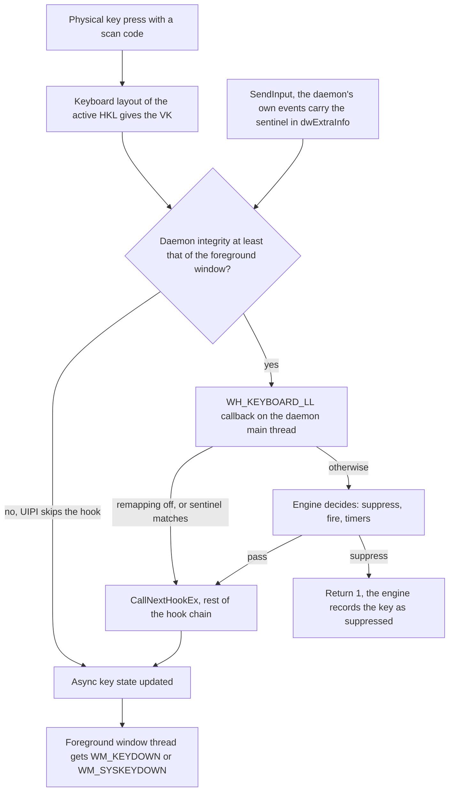

# Glossary

This glossary defines the Windows input, security and project terms that the other chapters use without explanation. Entries are in alphabetical order, and each one says what the term means for key-switch-rs and links to the chapter or issue where it matters.

> [!NOTE]
> Facts describe commit [`20af28d`](https://github.com/bluesteelll/key-switch-rs/tree/20af28d) (2026-10-18), the tip of `master` after roadmap Phase 1, and code links are permalinks to it. A few entries name structures of the audit commit `7cb3521` that no longer exist, such as the active-keys table; they say so and point to what replaced them, because the [audit](audit.md) uses those names.

[A](#a) · [B](#b) · [C](#c) · [D](#d) · [E](#e) · [F](#f) · [G](#g) · [H](#h) · [I](#i) · [K](#k) · [L](#l) · [M](#m) · [N](#n) · [P](#p) · [R](#r) · [S](#s) · [T](#t) · [U](#u) · [V](#v) · [W](#w)

## Where the terms meet

The diagram places the most common terms on the path of one keyboard event. It shows the order of the steps, not every Windows detail. Keys typed on the [Secure Desktop](#secure-desktop) never enter it.

## Terms that are easy to confuse

| Word | Meaning in key-switch-rs | Easily confused with |
|---|---|---|
| Combo | The `keys:` binding kind, keys held together; also the macro step `Combo("Ctrl+S")` | A QMK "combo", which is this project's [chord](#chord) |
| Chord | The `chord:` binding kind: keys pressed within `window_ms` of each other, in any order | A held key combination such as Ctrl+S, which the comments in `sequence.rs` also call a chord |
| Sequence | The `sequence:` binding kind: combos pressed one after another | The `Sequence([...])` action, which is a [macro](#macro) |
| Hold | The `Hold(ms)` trigger: one action, once the key has been held for the term | A [mod-tap](#mod-tap) hold, where the key acts as a modifier for as long as it is down |
| Suppressed | The hook dropped this one key event | The [suppression record](#suppression-record), which makes the key's repeats and key-up follow its key-down |
| Injected | Any event with the `LLKHF_INJECTED` flag, from any program | The daemon's own events, which it recognises only by the [sentinel](#sentinel) |
| Language | `SwitchLanguage` moves to the next installed input language and layout | The separate Windows Language Hotkey and Layout Hotkey ([language hotkey](#language-hotkey)) |
| Trigger | The `trigger:` field: `Immediate`, `Tap`, `Hold` or `DoubleTap` | The [trigger key](#trigger-key), the key whose key-down can fire a binding |
| Sequence step | One combo of a `sequence:` binding | A macro step such as `Delay(100)` |

## A

### Active-keys table

The audit-era `KeyboardHook::active_keys`, an `[AtomicBool; 256]` with one flag per virtual-key code, which `collect_active_keys` folded into the [held set](#held-set). Since `82f542f` the engine's [per-key table](#per-key-table) holds the same information by the codes the hook reports, and no list of held keys is built per event ([The per-key table](architecture.md#atomicbool-256-active-keys-table)).

### `allow_extra_modifiers`

A per-binding flag for `keys` bindings, `false` by default ([src/config/schema.rs:71-76](https://github.com/bluesteelll/key-switch-rs/blob/20af28d/src/config/schema.rs#L71-L76)). It turns off [exact modifier matching](#exact-modifier-matching) for one binding, so the binding fires while modifiers it does not name are held too. `true` on a `sequence` or `chord` binding is a load error. See [§7](config/kinds.md#s7).

### AltGr

The right Alt key on layouts that use it to type extra characters, such as Polish or German. Windows reports AltGr as right Alt plus an extra left Ctrl event. The hook reads only `vkCode`, so that left Ctrl counts as a real Ctrl: with exact modifiers, AltGr+X fires `Ctrl+Alt+X` but not `Alt+X` or `RAlt+X` ([§6.6](config/keys.md#s6-6), [Other functional gaps](gaps.md#other-functional-gaps)).

### ArcSwap

A type from the `arc-swap` crate (1.9.1) that holds an `Arc<T>`: readers load it without a lock, and a writer replaces it with one atomic store. key-switch-rs keeps the binding list in an `ArcSwap<Vec<Binding>>` ([src/hook/keyboard_hook.rs:40-47](https://github.com/bluesteelll/key-switch-rs/blob/20af28d/src/hook/keyboard_hook.rs#L40-L47)). The hook callback loads one snapshot per event, and [hot reload](#hot-reload) publishes a new sorted list through `update_bindings` ([src/hook/keyboard_hook.rs:106-115](https://github.com/bluesteelll/key-switch-rs/blob/20af28d/src/hook/keyboard_hook.rs#L106-L115)).

### Async key state

The up or down state of each key as Windows records it, read with `GetAsyncKeyState`. Windows updates it only for events that the low-level hook chain lets through, and only after the hook callback returns, so a key-down that key-switch-rs suppresses never shows up in it. The engine reads it through the [Env](#env) to resync the 11 modifier codes on every event, skipping any modifier whose key-down it swallowed ([src/engine/keys.rs:95-110](https://github.com/bluesteelll/key-switch-rs/blob/20af28d/src/engine/keys.rs#L95-L110); [KS-14](audit.md#ks-14), fixed). An [auto-blocker](#auto-blocker) and a reset at `swch on` read it too.

### Auto-blocker

A binding that the loader appends after the file's bindings for each distinct Windows hotkey, and mode, of the bindings with `block_original_combo: true` or `MaskOnly`, so that the OS hotkey does not act next to the remap ([src/config/loader.rs:321-401](https://github.com/bluesteelll/key-switch-rs/blob/20af28d/src/config/loader.rs#L321-L401), [src/data/binding.rs:156-171](https://github.com/bluesteelll/key-switch-rs/blob/20af28d/src/data/binding.rs#L156-L171)). Only `SwitchLanguage` and `SwitchLanguageBackward` have such a hotkey, the [language hotkey](#language-hotkey). None is added when a `keys` binding of the file uses exactly the hotkey's keys. The blocker acts only where the `when:` of a binding that asked for it holds. The engine matches it by its own rule: it acts only when Windows would see the hotkey and nothing else, and it fires nothing ([src/engine/matching.rs:81-102](https://github.com/bluesteelll/key-switch-rs/blob/20af28d/src/engine/matching.rs#L81-L102)). A `true` blocker swallows the key-down that completes the hotkey; a [`MaskOnly`](#maskonly) blocker lets it through and sends the [menu-mask key](#menu-mask-key) instead. It is printed as `[AUTO-BLOCK]` at startup. See [§15](config/matching.md#s15), [KS-05](audit.md#ks-05), [KS-18](audit.md#ks-18) and [KS-35](audit.md#ks-35).

### Auto-repeat

See [Typematic auto-repeat](#typematic-auto-repeat).

## B

### Binding

One entry of the `bindings` list in `config.ron`: a [binding kind](#binding-kind) with its keys, an action, a [trigger](#trigger), an optional `when:` [condition](#condition) and four flags: [`block_default`](#block_default), [`block_original_combo`](#block_original_combo), [`allow_extra_modifiers`](#allow_extra_modifiers) and [`repeat`](#repeat). At runtime it is a `Binding` value ([src/data/binding.rs:91-133](https://github.com/bluesteelll/key-switch-rs/blob/20af28d/src/data/binding.rs#L91-L133)). The syntax is in the [configuration reference](config/index.md).

### Binding kind

How a binding's keys are matched: `keys` ([combo](#combo)), `sequence` ([sequence](#sequence)) or `chord` ([chord](#chord)). A binding must set exactly one of the three ([src/config/loader.rs:513-543](https://github.com/bluesteelll/key-switch-rs/blob/20af28d/src/config/loader.rs#L513-L543)), and each is a variant of `BindingKind` ([src/data/binding.rs:21-32](https://github.com/bluesteelll/key-switch-rs/blob/20af28d/src/data/binding.rs#L21-L32)). See [Binding kinds and key suppression](config/kinds.md).

### `block_default`

Per-binding flag that says whether the key events that fire or arm a `keys` binding are [suppressed](#suppression), with the key's repeats and key-up, so that the foreground application never sees the key ([src/config/schema.rs:43-50](https://github.com/bluesteelll/key-switch-rs/blob/20af28d/src/config/schema.rs#L43-L50)). Without it, the loader takes `false` for a `Tap`, `Hold` or `DoubleTap` binding made only of modifiers, such as `"LShift"`, and `true` for every other binding ([src/data/binding.rs:178-188](https://github.com/bluesteelll/key-switch-rs/blob/20af28d/src/data/binding.rs#L178-L188); roadmap item 1.3). Only the [winner](#winner) of a key press, or a member of its [gesture group](#gesture-group), applies its flag, so a losing binding never swallows the key ([KS-13](audit.md#ks-13), fixed). `sequence` and `chord` bindings ignore the flag. See [§10](config/kinds.md#s10).

### `block_original_combo`

Per-binding flag, `false` by default, that asks the loader to add an [auto-blocker](#auto-blocker) for the OS hotkey of the binding's action: `true` for one that swallows the hotkey, or the experimental [`MaskOnly`](#maskonly) ([src/config/schema.rs:52-56](https://github.com/bluesteelll/key-switch-rs/blob/20af28d/src/config/schema.rs#L52-L56)). The shipped default config sets `true` on the `CapsLock` binding ([src/config/default_config.ron:226-236](https://github.com/bluesteelll/key-switch-rs/blob/20af28d/src/config/default_config.ron#L226-L236)).

### Blocked bit

The audit-era record of a suppressed key-down: one bit per virtual-key code in the `[AtomicU64; 4]` `blocked_keys` bitmap, set on a suppressed key-down and consumed on its key-up. It did not cover auto-repeats ([KS-06](audit.md#ks-06)). Since Phase 0 the [suppression record](#suppression-record) of the engine's per-key table plays this role and covers repeats too.

### Blocked-key bitmap

See [Blocked bit](#blocked-bit).

## C

### Chord

The `chord:` binding kind: two or more keys that must all go down within `window_ms` of the first one, in any order ([src/config/schema.rs:130-138](https://github.com/bluesteelll/key-switch-rs/blob/20af28d/src/config/schema.rs#L130-L138)); the window defaults to 50 ms. No two chord keys may overlap: `["Shift", "LShift"]` is a load error. Every key-down of a chord key is suppressed whether or not the chord completes, and nothing replays it ([src/engine/chords.rs:10-16](https://github.com/bluesteelll/key-switch-rs/blob/20af28d/src/engine/chords.rs#L10-L16)). QMK keyboard firmware calls this a *combo*, which is not this project's `keys` combo ([src/data/binding.rs:18-20](https://github.com/bluesteelll/key-switch-rs/blob/20af28d/src/data/binding.rs#L18-L20)).

### COM initialisation

Shell functions such as `ShellExecuteW` can hand work to COM-based shell extensions, so Microsoft asks callers to initialise COM on the calling thread with `CoInitializeEx`, usually as a single-threaded apartment (STA). No thread in key-switch-rs does this, yet `OpenUrl` calls `ShellExecuteW` inside the hook callback. Roadmap [item 2.1](roadmap.md#21-action-executor) plans one executor thread that initialises COM as STA and runs every action ([KS-08](audit.md#ks-08)).

### Combo

The `keys:` binding kind: a set of keys written like `"Ctrl+Alt+L"` that must all be held at once ([src/data/binding.rs:21-23](https://github.com/bluesteelll/key-switch-rs/blob/20af28d/src/data/binding.rs#L21-L23)). It fires on the key-down of one of its [trigger keys](#trigger-key), with [exact modifier matching](#exact-modifier-matching), and it is the only kind that accepts the Tap, Hold and DoubleTap triggers. The same word names the macro step `Combo("Ctrl+S")`, which presses its keys together.

### Condition

The optional `when:` field of a binding: `Always` (the default), `AppEquals`, `TitleContains`, `TitleEquals`, or a `Not`, `And` or `Or` of these ([src/data/condition.rs:28-55](https://github.com/bluesteelll/key-switch-rs/blob/20af28d/src/data/condition.rs#L28-L55)). It is evaluated on key-down only, against the [foreground window](#foreground-window), whose process name and title are fetched on first use; every comparison ignores case in every alphabet. See [Conditions](architecture.md#conditions) and [§12](config/triggers-conditions.md#s12).

### Console control handler

A function registered with `SetConsoleCtrlHandler`, which Windows calls on a thread of its own when the user presses Ctrl+C or closes the console window. The daemon's handler posts `WM_QUIT` to the main thread for `CTRL_C_EVENT` and `CTRL_CLOSE_EVENT` and then waits at most 1 s for the queued log lines ([src/core/app.rs:241-262](https://github.com/bluesteelll/key-switch-rs/blob/20af28d/src/core/app.rs#L241-L262)), which is why closing the daemon's console window stops it.

### Counters

Four atomic counts of what the hook thread must not log per event: `menu_mask_short` and `key_press_short` (a `SendInput` that inserted fewer events than asked), `hold_timer_not_started` (a Hold whose timer thread could not start, so it never fires) and `log_lines_dropped` (lines lost to a full log queue). While one is not 0, the [log writer](#log-file-and-log-writer-thread) reports all four every 60 s and at exit ([src/logging/counters.rs:1-27](https://github.com/bluesteelll/key-switch-rs/blob/20af28d/src/logging/counters.rs#L1-L27); roadmap item 1.7). See [Log file](build-and-run.md#log-file).

## D

### DACL and SDDL

A discretionary access control list (DACL) is the part of a Windows security descriptor that says which accounts may open an object and with which rights. SDDL is its string form: in `D:P(A;;GA;;;SY)(A;;GRGW;;;IU)`, `D:P` starts a protected DACL and each entry allows (`A`) a right, such as generic all (`GA`) or read and write (`GRGW`), to an account, such as SYSTEM (`SY`) or interactive users (`IU`); `S:(ML;;NWNR;;;ME)` adds a medium [integrity](#integrity-level) label that refuses lower levels. The daemon's [named pipe](#named-pipe) has an explicit descriptor of this form since `a1b5a27` ([src/hook/ipc_server.rs:54-80](https://github.com/bluesteelll/key-switch-rs/blob/20af28d/src/hook/ipc_server.rs#L54-L80); [KS-02](audit.md#ks-02), fixed).

### Daemon

`key-switch-rs.exe`, the long-running process that owns the keyboard hook, the IPC server and the config watcher, and writes `daemon.log`. It is a console program, a release build always runs [elevated](#elevation), and the [single-instance guard](#single-instance-guard) allows one per Windows session. See [The two binaries](overview.md#the-two-binaries).

### `DaemonControl`

The trait through which the IPC server carries out `on`, `off`, `status` and `exit` without knowing the keyboard hook ([src/hook/ipc_server.rs:31-52](https://github.com/bluesteelll/key-switch-rs/blob/20af28d/src/hook/ipc_server.rs#L31-L52)). The daemon implements it with `DaemonHandle` ([src/core/app.rs:23-59](https://github.com/bluesteelll/key-switch-rs/blob/20af28d/src/core/app.rs#L23-L59)), and the integration tests with a stand-in.

### Debounce

Waiting until a burst of events has stopped and then acting once. One editor save produces several file events, so the config watcher reloads only after 250 ms pass without a new one ([src/hook/config_watcher.rs:35-40](https://github.com/bluesteelll/key-switch-rs/blob/20af28d/src/hook/config_watcher.rs#L35-L40), [L131-L154](https://github.com/bluesteelll/key-switch-rs/blob/20af28d/src/hook/config_watcher.rs#L131-L154)). See [Config loading and hot reload](architecture.md#config-loading-and-hot-reload).

### Decision

What the [engine](#engine) returns for one event or timer: whether to `suppress` the event, the actions to `fire` in order, the `timers` to start, and `mask`, whether to send the [menu-mask key](#menu-mask-key) first ([src/engine/mod.rs:282-301](https://github.com/bluesteelll/key-switch-rs/blob/20af28d/src/engine/mod.rs#L282-L301)). The hook adapter carries it out after releasing the engine lock. The roadmap's planned `decide()` function is `Engine::on_key`.

### Default config

The `config.ron` that the daemon writes when it starts without an argument and finds no `config.ron` next to the exe: the template `src/config/default_config.ron`, embedded with `include_str!` ([src/config/loader.rs:30-32](https://github.com/bluesteelll/key-switch-rs/blob/20af28d/src/config/loader.rs#L30-L32), [src/config/loader.rs:151-173](https://github.com/bluesteelll/key-switch-rs/blob/20af28d/src/config/loader.rs#L151-L173)). A reload never writes it ([KS-23](audit.md#ks-23), fixed). Its two active bindings are `CapsLock` → `SwitchLanguage` with `block_original_combo: true` and `Shift+CapsLock` → `ToggleCapsLock` ([src/config/default_config.ron:226-236](https://github.com/bluesteelll/key-switch-rs/blob/20af28d/src/config/default_config.ron#L226-L236)); with the [auto-blocker](#auto-blocker) that makes 3 live bindings, or 2 when the Windows language hotkey is "Not assigned". The configuration reference also calls the file the template; see [Default bindings](overview.md#default-bindings).

### Deferred trigger

A Tap, Hold or DoubleTap [trigger](#trigger): the action does not run on the key-down but later, on key-up, from a timer, or on a second press. The engine suppresses the trigger key's press while the [gesture](#gesture) is pending only if the binding's [`block_default`](#block_default) says so, which it does not by default for a combo made only of modifiers ([src/engine/mod.rs:483-528](https://github.com/bluesteelll/key-switch-rs/blob/20af28d/src/engine/mod.rs#L483-L528)). The loader rejects deferred triggers on `sequence` and `chord` bindings ([src/config/loader.rs:463-472](https://github.com/bluesteelll/key-switch-rs/blob/20af28d/src/config/loader.rs#L463-L472)).

### DoubleTap

See [Tap, Hold and DoubleTap](#tap-hold-and-doubletap).

### `dwExtraInfo`

A pointer-sized field for application data in both `KEYBDINPUT`, which `SendInput` takes, and [`KBDLLHOOKSTRUCT`](#kbdllhookstruct), which a low-level hook receives; Windows carries the value from one to the other. key-switch-rs stores its [sentinel](#sentinel) there in every event it synthesizes and checks it in the hook adapter before the engine sees the event ([src/hook/keyboard_hook_callback.rs:180-182](https://github.com/bluesteelll/key-switch-rs/blob/20af28d/src/hook/keyboard_hook_callback.rs#L180-L182)).

## E

### Elevation

Running a process with an administrator's full token at high [integrity](#integrity-level), after a UAC consent prompt or from an already elevated parent. A release daemon always runs elevated. Programs it starts with `Launch` inherit that, and `OpenUrl` can start its handler elevated ([KS-09](audit.md#ks-09)); see [UAC and integrity levels](build-and-run.md#uac-and-integrity-levels).

### Enabled flag

`KeyboardHook::enabled`, an `AtomicBool` that `swch on` and `swch off` set ([src/hook/keyboard_hook.rs:50-59](https://github.com/bluesteelll/key-switch-rs/blob/20af28d/src/hook/keyboard_hook.rs#L50-L59)). While it is off, the hooks stay installed and pass every event untouched. A real switch also resets the engine ([KS-01](audit.md#ks-01), [KS-31](audit.md#ks-31), fixed).

### Engine

The decision core in `src/engine`: plain Rust with `#![forbid(unsafe_code)]`, no Win32 calls, threads, locks or clock of its own ([src/engine/mod.rs:1-198](https://github.com/bluesteelll/key-switch-rs/blob/20af28d/src/engine/mod.rs#L1-L198)). `Engine::on_key` decides a key event, `Engine::on_timer` a Hold timer, and `Engine::reset` a remapping switch; each returns or applies a [decision](#decision). Everything outside comes in through the [Env](#env). Until roadmap item 2.2 it sits behind one `Mutex` in `KeyboardHook` ([Threads and locking](architecture.md#threads-and-locking)).

### Env

The trait through which the [engine](#engine) learns everything outside the event: the clock, the OS key state and the foreground app and title ([src/engine/env.rs:9-53](https://github.com/bluesteelll/key-switch-rs/blob/20af28d/src/engine/env.rs#L9-L53)). The hook adapter implements it with live Win32 calls (`HookEnv`); the test harness with a fake clock and a modelled key state.

### Exact modifier matching

The owner's rule for `keys` bindings: the modifier families held, Shift, Ctrl, Alt and Win with either key of a pair counting as its family, must be exactly the ones the binding names ([src/engine/matching.rs:65-79](https://github.com/bluesteelll/key-switch-rs/blob/20af28d/src/engine/matching.rs#L65-L79)). `"CapsLock"` does not fire while Shift is held, and `"Ctrl+J"` does not fire on Ctrl+Shift+J. [`allow_extra_modifiers`](#allow_extra_modifiers) relaxes it per binding. It shipped with `82f542f`.

### Extended key

A key that Windows marks with the extended-key flag, such as right Ctrl, right Alt, the arrow keys and the Insert, Delete, Home, End, Page Up and Page Down keys outside the numeric keypad, NumLock, and the keypad's divide and Enter keys. Without the flag, a program that reads [scan codes](#scan-code) can take such a key for its left-hand or keypad twin. A low-level hook receives the flag as `LLKHF_EXTENDED`, and synthesized input must set `KEYEVENTF_EXTENDEDKEY`; key-switch-rs ignores the first and never sets the second ([KS-36](audit.md#ks-36), not independently verified).

## F

### Filtered token

The reduced access token that UAC gives an administrator's ordinary processes: medium integrity, with the Administrators group marked deny-only. A `swch` started from a normal shell runs with it. The daemon's pipe admits it through the interactive-users entry and the medium label; at the audit, the default DACL locked it out ([KS-02](audit.md#ks-02), fixed).

### Foreground window

The top-level window the user is working in, returned by `GetForegroundWindow`; keyboard input goes to its thread. key-switch-rs posts the messages of the `SwitchLanguage` and `PostMessage` actions to it, evaluates `when:` conditions against it ([src/data/condition.rs:117-129](https://github.com/bluesteelll/key-switch-rs/blob/20af28d/src/data/condition.rs#L117-L129)), and captures it once when a macro starts, so that `Window(...)` steps act on that window ([src/data/sequence.rs:111-122](https://github.com/bluesteelll/key-switch-rs/blob/20af28d/src/data/sequence.rs#L111-L122)). A change of foreground window fires the [WinEvent hook](#winevent-hook).

## G

### Generation token

A counter stored with each pending Hold and carried by the `TimerToken` of its timer, so that a timer left over from an earlier press finds a different generation and does nothing ([src/engine/gestures.rs:14-18](https://github.com/bluesteelll/key-switch-rs/blob/20af28d/src/engine/gestures.rs#L14-L18), [src/engine/mod.rs:266-280](https://github.com/bluesteelll/key-switch-rs/blob/20af28d/src/engine/mod.rs#L266-L280)). The audit-era gesture maps had none, which caused [KS-11](audit.md#ks-11), fixed in `16a0461`.

### Gesture

A key pattern that is resolved over time rather than on one event: a Tap, Hold or DoubleTap trigger, a chord or a sequence. While a gesture is pending, the engine keeps an entry for it with a deadline; creating that entry is called arming the gesture. Chord and sequence keys are suppressed while pending; Tap, Hold and DoubleTap keys only with [`block_default`](#block_default). See [Gesture state machines](architecture.md#gesture-state-machines).

### Gesture group

The `Tap`, `Hold` and `DoubleTap` bindings that act together on one key press: those on the same keys, in any order, with the same `when:` as written, as the [winner](#winner) of the press, if the winner is deferred too. Only the first binding of each trigger kind in the group arms, so the README's `Tap(200)` and `Hold(200)` pair on CapsLock still works ([src/engine/winner.rs:84-140](https://github.com/bluesteelll/key-switch-rs/blob/20af28d/src/engine/winner.rs#L84-L140); roadmap item 1.6). See [§11.6](config/triggers-conditions.md#s11-6).

## H

### Held set

The audit-era list of held keys that `collect_active_keys` built for every key-down, with sided modifiers folded and at most 16 keys. It no longer exists: the engine asks its [per-key table](#per-key-table) about one [KeySpec](#keyspec) at a time ([src/engine/matching.rs:28-46](https://github.com/bluesteelll/key-switch-rs/blob/20af28d/src/engine/matching.rs#L28-L46)).

### HKL and keyboard layout

A keyboard layout maps physical keys to virtual-key codes and characters. An HKL, also called an input locale identifier, names one installed language and layout, and Windows keeps the active HKL per thread. key-switch-rs never handles HKLs directly: `SwitchLanguage` and `SwitchLanguageBackward` post [`WM_INPUTLANGCHANGEREQUEST`](#wm_inputlangchangerequest) to the foreground window and leave the switch to it ([src/system/system_function.rs:43-80](https://github.com/bluesteelll/key-switch-rs/blob/20af28d/src/system/system_function.rs#L43-L80)); since the layout decides which VK a physical key produces, a binding on a letter key can follow a different physical key in another layout, for example AZERTY instead of QWERTY.

### Hold

See [Tap, Hold and DoubleTap](#tap-hold-and-doubletap).

### Hook chain

The ordered list of hook procedures of one type that Windows calls for each event, most recently installed first. A low-level keyboard hook passes an event on by calling `CallNextHookEx`, or keeps it from the rest of the chain and from the target window by returning a non-zero value, which key-switch-rs does with `LRESULT(1)` ([src/hook/keyboard_hook_callback.rs:343-353](https://github.com/bluesteelll/key-switch-rs/blob/20af28d/src/hook/keyboard_hook_callback.rs#L343-L353)). At the audit a second daemon could run, and its hook ran first ([KS-20](audit.md#ks-20)); since item 1.5 one Windows session has one daemon.

### Hook thread

The thread that installed the [`WH_KEYBOARD_LL`](#wh_keyboard_ll) hook and runs its callback: in the daemon, the main thread with the [message loop](#message-loop) ([src/core/app.rs:137-217](https://github.com/bluesteelll/key-switch-rs/blob/20af28d/src/core/app.rs#L137-L217)). Immediate, Tap and DoubleTap actions and chord and sequence completions run on it, so a slow action holds up every keystroke on the desktop ([KS-08](audit.md#ks-08)); only Hold actions, on a `hold-timer` thread, and `Sequence` macros, on a worker thread, leave it ([Process and thread model](architecture.md#process-and-thread-model)).

### Hot path

The code that runs for every keyboard event on the desktop: the hook callback, the engine and everything they call. No application receives the keystroke until it returns, so it must be short and must not block; [KS-08](audit.md#ks-08) lists the actions that break this rule, and roadmap [item 3.5](roadmap.md#35-hot-path-budget) the foreground lookups.

### Hot reload

Applying an edited `config.ron` without restarting the daemon. A `notify` watcher on the config's folder feeds the `config-watcher` thread, which [debounces](#debounce) the events, calls `config::reload` and swaps the list through [ArcSwap](#arcswap); a failed load, a missing file included, keeps the previous bindings ([src/hook/config_watcher.rs:93-170](https://github.com/bluesteelll/key-switch-rs/blob/20af28d/src/hook/config_watcher.rs#L93-L170)). The audit's ways around that guarantee ([KS-21](audit.md#ks-21), [KS-22](audit.md#ks-22), [KS-23](audit.md#ks-23)) are fixed.

## I

### Immediate trigger

The default [trigger](#trigger): the action fires on the key-down that makes the combo match ([src/data/trigger.rs:17-33](https://github.com/bluesteelll/key-switch-rs/blob/20af28d/src/data/trigger.rs#L17-L33)). The [winner](#winner) of the press fires; on an [auto-repeat](#typematic-auto-repeat) it fires again only if it sets [`repeat`](#repeat) ([KS-10](audit.md#ks-10), fixed).

### `IMPLICIT_SOME`

A [RON](#ron) extension that lets an `Option` field be written as its bare value, `keys: "CapsLock"`, instead of `keys: Some("CapsLock")`. The loader enables it for every config file ([src/config/loader.rs:260-265](https://github.com/bluesteelll/key-switch-rs/blob/20af28d/src/config/loader.rs#L260-L265)).

### Injected event

A keyboard event created by software, typically with [`SendInput`](#sendinput), rather than by a keyboard. A low-level hook sees it with the `LLKHF_INJECTED` flag, plus `LLKHF_LOWER_IL_INJECTED` when the injecting process has a lower integrity level. key-switch-rs ignores both flags, so input injected by other programs is matched like physical input, and it recognises only its own events, by the [sentinel](#sentinel).

### Integrity level

A mandatory label on every Windows process and securable object; the levels include low, medium, high and system. Ordinary user processes run at medium and elevated ones at high. [UIPI](#uipi) stops a process from injecting input into a process of higher integrity, and an object's label can refuse access from lower levels; a release daemon runs at high, and `swch` from a normal shell at medium ([UAC and integrity levels](build-and-run.md#uac-and-integrity-levels)).

## K

### `KBDLLHOOKSTRUCT`

The structure a [`WH_KEYBOARD_LL`](#wh_keyboard_ll) callback receives for each event, with the fields `vkCode`, `scanCode`, `flags`, `time` and `dwExtraInfo`. key-switch-rs reads only `vkCode` and `dwExtraInfo` ([src/hook/keyboard_hook_callback.rs:339-343](https://github.com/bluesteelll/key-switch-rs/blob/20af28d/src/hook/keyboard_hook_callback.rs#L339-L343)), so the scan code, the extended-key flag and the injected flag play no part in matching.

### Key rollover

Pressing the next key before the previous one is fully released, which is normal in fast typing. At the audit, rollover after a bound key made the next key match that key's binding again and be swallowed ([KS-04](audit.md#ks-04)); the [trigger-key rule](#trigger-key-rule) fixed that for combos. Rollover can still complete a sequence step ([KS-15](audit.md#ks-15)).

### Keyboard layout

See [HKL and keyboard layout](#hkl-and-keyboard-layout).

### KeyboardHook singleton

The one process-wide `KeyboardHook` value, created on first use in a `LazyLock` static and reached through `get_hook()`, which returns a shared `&'static KeyboardHook` ([src/hook/keyboard_hook_callback.rs:100-112](https://github.com/bluesteelll/key-switch-rs/blob/20af28d/src/hook/keyboard_hook_callback.rs#L100-L112)). It holds the binding list, the hook handles, the [enabled flag](#enabled-flag) and the [engine](#engine) behind its lock ([src/hook/keyboard_hook.rs:40-67](https://github.com/bluesteelll/key-switch-rs/blob/20af28d/src/hook/keyboard_hook.rs#L40-L67)).

### `KEYEVENTF_UNICODE`

A `SendInput` flag that sends a UTF-16 code unit in `wScan` instead of a virtual key. Windows delivers it as the pseudo key `VK_PACKET`, and the target window receives the character whatever keyboard layout is active. The macro `Text("...")` step uses it, one key-down and key-up pair per code unit ([src/data/sequence.rs:137-179](https://github.com/bluesteelll/key-switch-rs/blob/20af28d/src/data/sequence.rs#L137-L179)).

### KeySpec

One trigger key as the config names it: either one key on its side (`"LShift"`, `"RWin"`, `"A"`) or a modifier on either side (`"Shift"`, `"Win"`) ([src/data/key_spec.rs:116-182](https://github.com/bluesteelll/key-switch-rs/blob/20af28d/src/data/key_spec.rs#L116-L182)). Combos, sequence steps and chord keys all use it, fixed at load time, so sided and unsided names mean the same everywhere ([KS-07](audit.md#ks-07), fixed). Keys the daemon sends stay plain virtual-key codes.

### KS ID

The identifier of an audit finding, from KS-01 to KS-42. KS-01 to KS-26 were independently verified and are numbered by severity, high first; KS-27 to KS-42 are low-severity reports that never went to a verifier ([Audit results](audit.md), [Deduplication into KS IDs](methodology.md#deduplication-into-ks-ids)).

## L

### Language hotkey

The Windows shortcut that cycles input languages, stored as a string under `HKCU\Keyboard Layout\Toggle`: `"1"` is Alt+Shift, `"2"` Ctrl+Shift, `"3"` "Not assigned" and `"4"` the grave-accent key. key-switch-rs reads the values `Hotkey` and then `Language Hotkey` to build the [auto-blocker](#auto-blocker); the first value that names a hotkey or says `"3"` decides, and `"3"` gives no auto-blocker. Only missing, unreadable or unknown values fall back to Alt+Shift ([src/system/registry.rs:30-39](https://github.com/bluesteelll/key-switch-rs/blob/20af28d/src/system/registry.rs#L30-L39), [src/system/registry.rs:223-231](https://github.com/bluesteelll/key-switch-rs/blob/20af28d/src/system/registry.rs#L223-L231); [KS-17](audit.md#ks-17), fixed). The `Layout Hotkey` value, which switches layouts within one language, and Win+Space are not covered ([Unimplemented features](gaps.md#unimplemented-features)).

### Leader key

In Vim, a prefix key that starts a command typed as an ordered series of keys. The code comments call the `sequence` binding kind a "Vim/Emacs leader-key flow" ([src/data/binding.rs:13-17](https://github.com/bluesteelll/key-switch-rs/blob/20af28d/src/data/binding.rs#L13-L17)); see [Sequence](#sequence).

### Log file and log-writer thread

`%LOCALAPPDATA%\key-switch-rs\daemon.log`, where the daemon writes every log line with a UTC timestamp, rotating at 1 MiB into `daemon.1.log` and `daemon.2.log`. One `log-writer` thread owns the console output and the files; every other thread only queues its line, and the hook callback logs nothing but updates the [counters](#counters) ([src/logging/mod.rs:1-18](https://github.com/bluesteelll/key-switch-rs/blob/20af28d/src/logging/mod.rs#L1-L18); roadmap item 1.7). The file is attached only after the [single-instance guard](#single-instance-guard). See [Log file](build-and-run.md#log-file).

### LowLevelHooksTimeout

A per-user registry value under `HKCU\Control Panel\Desktop`, in milliseconds, that limits how long a low-level hook callback may run; Windows 10 1709 and later cap it at 1000 ms. When a callback exceeds it, Windows passes the event on without waiting, and on Windows 7 and later it can remove the hook silently, without telling the process. key-switch-rs runs `Launch`, `OpenUrl` and several gesture actions inside the callback and never checks whether its hook is still installed ([KS-08](audit.md#ks-08)).

### Low-level keyboard hook (LL hook)

See [`WH_KEYBOARD_LL`](#wh_keyboard_ll).

## M

### Macro

The `Sequence([...])` action: a list of steps (`Delay`, `Text`, `Key`, `Combo`, `Window`, `Launch`, `OpenUrl`, `Media`) that run in order on a new worker thread for each run ([src/data/sequence.rs:111-135](https://github.com/bluesteelll/key-switch-rs/blob/20af28d/src/data/sequence.rs#L111-L135)). A running macro cannot be cancelled, not even by `swch off` ([No cancellation for macro workers](gaps.md#no-cancellation-for-macro-workers)). It is unrelated to the `sequence:` [binding kind](#sequence).

### Mask key

See [Menu-mask key](#menu-mask-key).

### `MaskOnly`

The experimental value of [`block_original_combo`](#block_original_combo): an [auto-blocker](#auto-blocker) that swallows nothing. When Windows would see its hotkey alone, it lets the key-down through and sends the [menu-mask key](#menu-mask-key) on that key-down and on the next key event, so that Windows does not see a clean hotkey press. It rests on the unverified hypothesis that Windows then does not switch the layout ([§15.5](config/matching.md#s15-5), [KS-05](audit.md#ks-05); roadmap item 1.2). On a hotkey that is not made only of modifiers it blocks as `true` does.

### Menu-mask key

A harmless key event injected between a Win or Alt key-down and its key-up, so that Windows does not see a lone Win tap, which opens the Start menu, or a lone Alt tap, which activates the menu bar. AutoHotkey calls this `#MenuMaskKey`. key-switch-rs sends vk 0xE8, which is unassigned, down and up with its [sentinel](#sentinel), when it swallows a key event while Windows has an Alt or Win key down whose key-down it saw, and for [`MaskOnly`](#maskonly) ([src/core/constants.rs:36-48](https://github.com/bluesteelll/key-switch-rs/blob/20af28d/src/core/constants.rs#L36-L48), [src/hook/keyboard_hook_callback.rs:223-265](https://github.com/bluesteelll/key-switch-rs/blob/20af28d/src/hook/keyboard_hook_callback.rs#L223-L265); [KS-12](audit.md#ks-12), fixed). A `Tap`, `Hold` or `DoubleTap` on a lone Win or Alt whose key passes swallows nothing, so it is not masked.

### Message loop

The `GetMessageW` and `DispatchMessageW` loop on the daemon's main thread ([src/core/app.rs:205-211](https://github.com/bluesteelll/key-switch-rs/blob/20af28d/src/core/app.rs#L205-L211)). Windows delivers low-level hook callbacks and out-of-context WinEvent callbacks through the message queue of the thread that installed them, so that thread must keep pumping. The loop ends when `WM_QUIT` arrives from the [console control handler](#console-control-handler) or from the IPC `exit` command.

### Modifier key

Shift, Ctrl, Alt or Win. The engine tracks 11 modifier codes, the generic, left and right codes of Shift, Ctrl and Alt plus LWin and RWin, and resyncs them from the [async key state](#async-key-state) on every event ([src/engine/keys.rs:20-37](https://github.com/bluesteelll/key-switch-rs/blob/20af28d/src/engine/keys.rs#L20-L37)). For matching it groups them into the four families of [exact modifier matching](#exact-modifier-matching), and a [KeySpec](#keyspec) decides which side counts.

### Mod-tap

A dual-role key from QMK keyboard firmware: tapped, it sends one key; held, it acts as a modifier for as long as it stays down. key-switch-rs has no mod-tap. In the README's `Tap(200)` and `Hold(200)` pair on CapsLock, the Hold half, `PressKey("LShift")`, sends one Shift press and release at 200 ms, not a held Shift ([Hold that keeps a synthesized modifier held](gaps.md#hold-that-keeps-a-synthesized-modifier-held)).

## N

### Named pipe

A Windows IPC object at a path such as `\\.\pipe\key-switch-rs.sock`, in one namespace that all sessions on the machine share. The daemon serves its pipe through the `interprocess` crate ([src/ipc.rs:31-43](https://github.com/bluesteelll/key-switch-rs/blob/20af28d/src/ipc.rs#L31-L43), [src/hook/ipc_server.rs:94-145](https://github.com/bluesteelll/key-switch-rs/blob/20af28d/src/hook/ipc_server.rs#L94-L145)), and `swch` sends one command line and reads one reply per connection. Who may connect is decided by the pipe's [DACL](#dacl-and-sddl) ([KS-02](audit.md#ks-02), [KS-40](audit.md#ks-40)).

## P

### Payload key

The non-modifier key of a combo, such as `Q` in `Win+Q`. It is the combo's [trigger key](#trigger-key): only its key-down can fire the combo, and only its events are suppressed, so the modifier events that passed earlier stay with the OS ([KS-12](audit.md#ks-12), [KS-19](audit.md#ks-19)). The macro `Combo` step also splits its keys into modifiers and payload ([src/data/sequence.rs:197-230](https://github.com/bluesteelll/key-switch-rs/blob/20af28d/src/data/sequence.rs#L197-L230)).

### Per-key table

The engine's `KeyState`: for each virtual-key code, whether the engine believes the key is held, and the [suppression record](#suppression-record) of its latest key-down ([src/engine/keys.rs:56-85](https://github.com/bluesteelll/key-switch-rs/blob/20af28d/src/engine/keys.rs#L56-L85)). It replaced the audit's [active-keys table](#active-keys-table) and [blocked-key bitmap](#blocked-bit). See [The per-key table](architecture.md#atomicbool-256-active-keys-table).

### `PROCESS_QUERY_LIMITED_INFORMATION`

A process access right that Windows grants more widely than full query access, including against elevated processes. It is enough for `QueryFullProcessImageNameW` but not for `GetModuleBaseNameW`, which needs `PROCESS_QUERY_INFORMATION` and `PROCESS_VM_READ`. `AppEquals` opens the foreground process with this right and reads its image path with `QueryFullProcessImageNameW` ([src/data/condition.rs:188-223](https://github.com/bluesteelll/key-switch-rs/blob/20af28d/src/data/condition.rs#L188-L223)); at the audit it called `GetModuleBaseNameW` and never matched ([KS-03](audit.md#ks-03), fixed).

## R

### `repeat`

Per-binding flag of `keys` bindings with the `Immediate` trigger: whether the action fires again on every [auto-repeat](#typematic-auto-repeat) of its key. Without it, the action's default applies: `true` for `PressKey`, `Media(VolumeUp)` and `Media(VolumeDown)` and `false` for every other action (owner decision). The repeats of a swallowed key stay swallowed either way, and `repeat: true` on another kind or trigger is a load error ([src/config/schema.rs:78-84](https://github.com/bluesteelll/key-switch-rs/blob/20af28d/src/config/schema.rs#L78-L84); [KS-10](audit.md#ks-10), fixed). See [§11.3](config/triggers-conditions.md#s11-3).

### Replay buffer

A queue of the key events suppressed while a gesture is undecided, re-injected in order with `SendInput` if the gesture fails. key-switch-rs has none, so the keys of a failed chord or sequence are lost ([Replay buffer for chord and sequence](gaps.md#replay-buffer-for-chord-and-sequence)).

### `requireAdministrator`

See [UAC, requireAdministrator and asInvoker](#uac-requireadministrator-and-asinvoker).

### Rollover

See [Key rollover](#key-rollover).

### RON

Rusty Object Notation, a text format for serde data that looks like Rust literals: structs in parentheses, enum variants by name such as `Tap(200)`, lists in brackets, and `//` comments. `config.ron` is parsed with `ron` 0.10.1 ([src/config/loader.rs:260-270](https://github.com/bluesteelll/key-switch-rs/blob/20af28d/src/config/loader.rs#L260-L270)); unknown fields are errors, and a leading UTF-8 byte-order mark is skipped ([KS-22](audit.md#ks-22), [KS-24](audit.md#ks-24), fixed).

### `runas` verb

The `ShellExecuteW` verb that starts a program elevated after a UAC prompt. `swch open` always uses it ([src/bin/swch.rs:105-131](https://github.com/bluesteelll/key-switch-rs/blob/20af28d/src/bin/swch.rs#L105-L131)), so even a debug daemon started that way runs elevated.

## S

### Scan code

The number the keyboard reports for a physical key position, before any keyboard layout is applied. A low-level hook receives it in `KBDLLHOOKSTRUCT::scanCode`. key-switch-rs ignores it when matching and sends `wScan: 0` with every virtual-key event it synthesizes, which matters to programs that read scan codes, such as remote-desktop clients and games ([KS-36](audit.md#ks-36), not independently verified).

### Scheduled Task

A Task Scheduler entry that starts a program on a trigger such as logon. With "Run with highest privileges" (`/RL HIGHEST`) it starts the daemon elevated without a UAC prompt, which is the autostart method the README suggests ([Autostart with a Scheduled Task](build-and-run.md#autostart-with-a-scheduled-task)).

### Secure Desktop

The separate Windows desktop that shows the UAC consent prompt, the Ctrl+Alt+Del screen and the lock and logon screens. No user-mode hook sees keys typed there, at any integrity level, so key-ups can be lost while it has focus. Afterwards the [WinEvent hook](#winevent-hook) and the modifier resync repair the modifier state, but not other keys ([Platform limitations](gaps.md#platform-limitations), [KS-29](audit.md#ks-29)).

### `SendInput`

The Win32 function that adds synthesized keyboard and mouse events to the system input stream, where they pass through low-level hooks like physical input. It is subject to [UIPI](#uipi): input aimed at a window of higher integrity is blocked, and neither the return value nor `GetLastError` says that UIPI was the cause. key-switch-rs has three `SendInput` builders, and all of them tag their events with the [sentinel](#sentinel) ([Input synthesis](architecture.md#input-synthesis)).

### Sentinel

The value key-switch-rs writes into [`dwExtraInfo`](#dwextrainfo) of every event it synthesizes, the [menu-mask key](#menu-mask-key) included: `(pid << 32) | 0xDEADBEEF` on 64-bit builds ([src/core/constants.rs:15-28](https://github.com/bluesteelll/key-switch-rs/blob/20af28d/src/core/constants.rs#L15-L28)). The hook passes any event that carries exactly this value straight through, so the daemon never reacts to its own output ([src/core/constants.rs:30-32](https://github.com/bluesteelll/key-switch-rs/blob/20af28d/src/core/constants.rs#L30-L32)). Other chapters also call it the injected-event sentinel or the PID-mixed sentinel. Another daemon would have a different process ID and treat this one's output as physical input; the [single-instance guard](#single-instance-guard) keeps a second one out of the session ([KS-20](audit.md#ks-20)).

### Sequence

The `sequence:` binding kind: two or more combo steps pressed in order, with at most `max_gap_ms` between steps ([src/config/schema.rs:120-128](https://github.com/bluesteelll/key-switch-rs/blob/20af28d/src/config/schema.rs#L120-L128), [src/config/loader.rs:545-562](https://github.com/bluesteelll/key-switch-rs/blob/20af28d/src/config/loader.rs#L545-L562)); the gap defaults to 500 ms. Keys that start or advance a sequence are suppressed and lost if it fails, and a step is matched against all held keys, so rollover and modifier presses mis-step it ([KS-15](audit.md#ks-15), [KS-16](audit.md#ks-16)). It is unrelated to the `Sequence([...])` action, which is a [macro](#macro).

### Sided and unsided key codes

Windows has generic codes for Shift, Ctrl and Alt (`VK_SHIFT` 0x10, `VK_CONTROL` 0x11, `VK_MENU` 0x12) and sided codes for each physical key (`VK_LSHIFT` 0xA0 to `VK_RMENU` 0xA5, and `VK_LWIN` 0x5B and `VK_RWIN` 0x5C). A low-level hook always reports the sided code. Trigger keys are [KeySpecs](#keyspec): `Shift` accepts either side and the generic code, `LShift` the left side only. At the audit the hook folded held keys to the generic code but compared chord keys raw, so `LShift` never matched in `keys` and `Shift` never completed a chord ([KS-07](audit.md#ks-07), fixed).

### Single-instance guard

The named mutex `Local\key-switch-rs`, which the daemon creates before it reads the config or installs a hook. Only its existence matters: while one daemon of the Windows session holds it, another start logs `[ERROR] already running in this session; ...` and exits with code 2, and a crash frees the name ([src/system/single_instance.rs:1-65](https://github.com/bluesteelll/key-switch-rs/blob/20af28d/src/system/single_instance.rs#L1-L65); [KS-20](audit.md#ks-20), fixed). Daemons of other sessions still meet at the one pipe name ([KS-40](audit.md#ks-40)).

### Specificity

The number of keys of a combo or chord, or of steps of a sequence. The binding list is sorted by it, most specific first ([src/engine/mod.rs:303-311](https://github.com/bluesteelll/key-switch-rs/blob/20af28d/src/engine/mod.rs#L303-L311), [src/data/binding.rs:34-47](https://github.com/bluesteelll/key-switch-rs/blob/20af28d/src/data/binding.rs#L34-L47)). Among the `keys` bindings that match a press it is the first rank of the [winner](#winner) election; sequences and chords take no part in it ([KS-13](audit.md#ks-13), fixed).

### Subset test

See [Superset matching](#superset-matching).

### Superset matching

The combo rule at `7cb3521`: a combo matched when all of its keys were among the held keys, whatever else was held and whichever key was just pressed. The code tested whether the combo was a subset of the held keys, so the audit-era architecture chapter called it a subset test; the audit called it superset matching because the held set only had to contain the combo. It caused [KS-04](audit.md#ks-04) and [KS-05](audit.md#ks-05). Since `82f542f` combos use the [trigger-key rule](#trigger-key-rule) and [exact modifier matching](#exact-modifier-matching); sequence steps still use a subset test ([KS-15](audit.md#ks-15)).

### Suppression

Dropping a key event by returning a non-zero value from the low-level hook, so that no later hook and no application sees it. The engine suppresses a first key-down when the [winner](#winner) of the press or its [gesture group](#gesture-group) asks for it with [`block_default`](#block_default), or an auto-blocker, a sequence or a chord does, and the key's [suppression record](#suppression-record) then decides its repeats and key-up ([src/engine/mod.rs:580-644](https://github.com/bluesteelll/key-switch-rs/blob/20af28d/src/engine/mod.rs#L580-L644)). A suppressed event never reaches the [async key state](#async-key-state).

### Suppression record

What the engine remembers about a key's latest key-down: `Passed`, `Suppressed`, `Unknown`, or `Forgotten` (suppressed, then a foreground change forgot that its key-up is due to be swallowed) ([src/engine/keys.rs:56-71](https://github.com/bluesteelll/key-switch-rs/blob/20af28d/src/engine/keys.rs#L56-L71)). An auto-repeat follows it, and a key-up whose key-down passed always passes, which keeps "a key-up is suppressed if and only if its key-down was" ([KS-06](audit.md#ks-06), fixed). See [§10](config/kinds.md#s10).

### Suppression trap

The audit's name for the ways a key gets caught by suppression: a key-down suppressed while a gesture is pending is never re-delivered if the gesture fails. The visible result is letters lost to chords and sequences on typing keys ([Replay buffer for chord and sequence](gaps.md#replay-buffer-for-chord-and-sequence)). At the audit it also covered stuck keys whose repeats passed while the key-up was swallowed ([KS-06](audit.md#ks-06), fixed). The gestures survey checked for it ([Subsystem surveys](methodology.md#subsystem-surveys)).

### Survey, verifier and probe

The three kinds of evidence behind the audit. A survey was an agent that reviewed one subsystem and reported claims; a verifier was a fresh agent told to refute one high or medium claim; a probe was a small program or test run on the audit machine to settle a claim by execution ([Audit design](methodology.md#audit-design)).

### `swch`

`swch.exe`, the command-line client that controls the daemon over the [named pipe](#named-pipe) with `open`, `on`, `off`, `status` and `exit`, waiting at most 5 s for an answer ([src/bin/swch.rs](https://github.com/bluesteelll/key-switch-rs/blob/20af28d/src/bin/swch.rs)). It requests no elevation and runs with the caller's token. See [Controlling the daemon with swch](build-and-run.md#controlling-the-daemon-with-swch).

## T

### Tap, Hold and DoubleTap

The three deferred triggers, each with a [term](#term) in milliseconds ([src/data/trigger.rs:17-33](https://github.com/bluesteelll/key-switch-rs/blob/20af28d/src/data/trigger.rs#L17-L33)). `Tap(ms)` fires on key-up if the key was released within the term, `Hold(ms)` fires from a `hold-timer` thread once the key has been held for the term, and `DoubleTap(ms)` fires on a second key-down within the term of the first. Tap and DoubleTap store deadlines and start no thread; Hold timers carry a [generation token](#generation-token). With equal terms, Tap and Hold on one key are exclusive ([KS-25](audit.md#ks-25), partly fixed); see [Triggers and conditions](config/triggers-conditions.md).

### Term

The time limit of a Tap, Hold or DoubleTap trigger, the number in `Tap(200)`; QMK calls the same idea the tapping term. Chords have a window (`window_ms`) and sequences a gap (`max_gap_ms`) instead. All three must be 1 to 10000 ms ([KS-27](audit.md#ks-27), fixed in `1dfd80a`).

### Thread affinity

The rule that some Win32 objects belong to the thread that created them. A hook installed with `SetWindowsHookExW` or `SetWinEventHook` is serviced through that thread's message loop and is destroyed when the thread exits, and `UnhookWinEvent` must be called from the same thread. At the audit `swch on` installed the hooks on a short-lived IPC worker thread, which broke the rule ([KS-01](audit.md#ks-01)); since `a1b5a27` only the main thread installs and removes them ([Process and thread model](architecture.md#process-and-thread-model)).

### Trigger

The `trigger:` field of a `keys` binding, which decides when its action fires: `Immediate` (the default), `Tap(ms)`, `Hold(ms)` or `DoubleTap(ms)` ([src/data/trigger.rs:17-33](https://github.com/bluesteelll/key-switch-rs/blob/20af28d/src/data/trigger.rs#L17-L33)). It is unrelated to the [trigger key](#trigger-key).

### Trigger key

A key whose key-down can fire a `keys` binding, and for Tap, Hold and DoubleTap the key the gesture is armed on. For a combo with a non-modifier key, its trigger keys are its non-modifier keys; for a combo made only of modifiers, all of its keys ([src/engine/matching.rs:53-63](https://github.com/bluesteelll/key-switch-rs/blob/20af28d/src/engine/matching.rs#L53-L63)). See [§7](config/kinds.md#s7).

### Trigger-key rule

The rule that a combo fires only on the key-down of one of its [trigger keys](#trigger-key). The audit proposed it as the fix for [superset matching](#superset-matching) ([KS-04](audit.md#ks-04)), and it shipped with `82f542f`. With CapsLock held, typing `abc` delivers `abc`, and CapsLock, then Shift does not fire `"Shift+CapsLock"`.

### Typematic auto-repeat

The repeated key-down events that arrive while a key is held: the first after the repeat delay, also called the typematic delay (500 ms by default, 250 ms at the shortest setting), then at the repeat rate, up to about 30 per second, with no key-up in between. A low-level hook sees repeats as ordinary key-downs, and the engine recognises them because the key is already marked held ([src/engine/keys.rs:146-153](https://github.com/bluesteelll/key-switch-rs/blob/20af28d/src/engine/keys.rs#L146-L153)). A repeat follows the [suppression record](#suppression-record) of its key-down ([KS-06](audit.md#ks-06), fixed), and an Immediate action fires on it only if its binding sets [`repeat`](#repeat) ([KS-10](audit.md#ks-10), fixed).

## U

### UAC, requireAdministrator and asInvoker

User Account Control runs an administrator's programs with a [filtered token](#filtered-token) at medium integrity and asks for consent before a program gets the full token. The `requestedExecutionLevel` in an application manifest chooses the behaviour: `requireAdministrator` always asks for elevation, and `asInvoker` runs with the caller's token. `build.rs` embeds `requireAdministrator` in the release daemon only, and only with the MSVC linker ([build.rs:21-47](https://github.com/bluesteelll/key-switch-rs/blob/20af28d/build.rs#L21-L47)); `swch` and debug daemons request nothing and run with the caller's token ([Debug and release differ in elevation](build-and-run.md#debug-and-release-differ-in-elevation)).

### uiAccess

A manifest attribute that lets an accessibility program get around [UIPI](#uipi) and drive windows of higher integrity without being elevated. By default Windows honours it only for a binary signed with a trusted certificate and installed in a protected folder such as Program Files. `build.rs` hard-codes `uiAccess='false'` ([build.rs:33-36](https://github.com/bluesteelll/key-switch-rs/blob/20af28d/build.rs#L33-L36)); the README names `uiAccess="true"` as the prompt-free alternative ([Platform limitations](gaps.md#platform-limitations)).

### UIPI

User Interface Privilege Isolation: Windows blocks a process from injecting input into, sending most window messages to, or hooking the input of a process with a higher [integrity level](#integrity-level). A medium-integrity keyboard hook therefore does not see keystrokes sent to elevated windows such as Task Manager, which is why release builds run elevated ([app.manifest:9-19](https://github.com/bluesteelll/key-switch-rs/blob/20af28d/app.manifest#L9-L19)). It also explains why files dragged from a normal Explorer window cannot be dropped into a program the daemon launched elevated ([KS-09](audit.md#ks-09)).

## V

### Validation harness

`cfgcheck`, a small crate that starts the daemon's logger, loads one file through the real loader, `key_switch_rs::config::reload`, and prints the loader's lines and the resulting bindings without writing anything. The configuration reference calls it the validator, and every `ron` example in that reference was run through it ([Validation harness](methodology.md#validation-harness)). It checks parsing and validation only, not run-time behaviour.

### Virtual-key code (VK)

A number from 1 to 254 that Windows assigns to a key after applying the keyboard layout, for example `VK_CAPITAL` (0x14) for CapsLock or `VK_A` (0x41). Key names in `config.ron` are parsed to VKs ([src/data/vk_name.rs:76-173](https://github.com/bluesteelll/key-switch-rs/blob/20af28d/src/data/vk_name.rs#L76-L173)), trigger keys wrap them in a [KeySpec](#keyspec), and the engine's per-key table has one slot per VK. `VK_MENU` is the Windows name for Alt, which is why the key name `Menu` parses as Alt ([src/data/vk_name.rs:137](https://github.com/bluesteelll/key-switch-rs/blob/20af28d/src/data/vk_name.rs#L137)).

## W

### `WH_KEYBOARD_LL`

The low-level keyboard hook: a callback installed with `SetWindowsHookExW(WH_KEYBOARD_LL, ...)` that Windows calls for every keyboard event on the desktop before the event is posted to an application's input queue. The callback runs on the installing thread, receives a [`KBDLLHOOKSTRUCT`](#kbdllhookstruct), passes the event on or [suppresses](#suppression) it, and must return within [LowLevelHooksTimeout](#lowlevelhookstimeout). key-switch-rs installs it once, on the main thread, at startup ([src/hook/keyboard_hook.rs:170-181](https://github.com/bluesteelll/key-switch-rs/blob/20af28d/src/hook/keyboard_hook.rs#L170-L181)); see [The key-event path](architecture.md#the-key-event-path).

### WinEvent hook

An accessibility event callback installed with `SetWinEventHook`. key-switch-rs registers one for `EVENT_SYSTEM_FOREGROUND` with `WINEVENT_OUTOFCONTEXT | WINEVENT_SKIPOWNPROCESS` ([src/hook/keyboard_hook.rs:183-211](https://github.com/bluesteelll/key-switch-rs/blob/20af28d/src/hook/keyboard_hook.rs#L183-L211)), and on every foreground change `foreground_changed` makes the engine resync the modifiers and forget which key-ups are due to be swallowed ([src/hook/keyboard_hook_callback.rs:356-385](https://github.com/bluesteelll/key-switch-rs/blob/20af28d/src/hook/keyboard_hook_callback.rs#L356-L385)). Out-of-context events reach the installing thread through its message loop, so this hook has the same [thread affinity](#thread-affinity) as the keyboard hook.

### Winner

The one `keys` binding that acts on a key press, roadmap item 1.6: among the bindings whose keys match the press and whose `when:` holds, the one with more keys, then one with a `when:`, then the one higher in the file. Only the winner, or its [gesture group](#gesture-group), fires, arms or asks for [suppression](#suppression); auto-blockers, sequences and chords are not candidates. The winner is elected again on every auto-repeat ([src/engine/winner.rs:39-82](https://github.com/bluesteelll/key-switch-rs/blob/20af28d/src/engine/winner.rs#L39-L82); [KS-13](audit.md#ks-13), fixed). See [§16](config/matching.md#s16).

### `WM_INPUTLANGCHANGEREQUEST`

The window message that asks a window to change the input language; `INPUTLANGCHANGE_FORWARD` or `INPUTLANGCHANGE_BACKWARD` in `wParam` asks for the next or previous installed layout. `SwitchLanguage` and `SwitchLanguageBackward` post it to the foreground window with `lParam` set to 0 ([src/system/system_function.rs:43-80](https://github.com/bluesteelll/key-switch-rs/blob/20af28d/src/system/system_function.rs#L43-L80)). The window accepts the change by passing the message to `DefWindowProc` and can refuse it by not doing so.

### `WM_KEYDOWN` and `WM_SYSKEYDOWN`

The message identifiers a low-level hook receives in `wParam` for a key-down: `WM_SYSKEYDOWN` for Alt, F10 and keys pressed while Alt is held, and `WM_KEYDOWN` otherwise, with `WM_SYSKEYUP` and `WM_KEYUP` for the releases. The hook adapter treats both members of each pair alike ([src/hook/keyboard_hook_callback.rs:157-167](https://github.com/bluesteelll/key-switch-rs/blob/20af28d/src/hook/keyboard_hook_callback.rs#L157-L167)).
