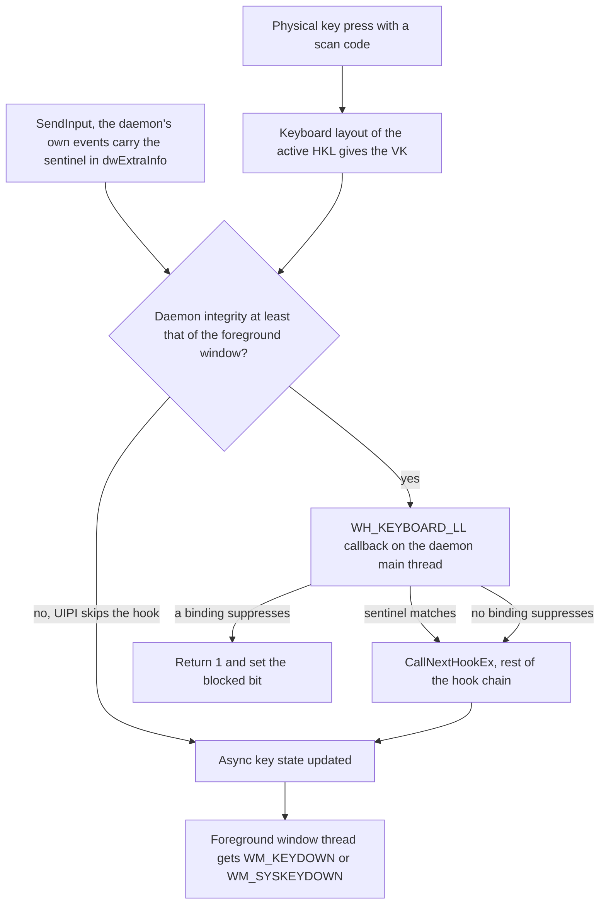

# Glossary

This glossary defines the Windows input, security and project terms that the other chapters use without explanation. Entries are in alphabetical order, and each one says what the term means for key-switch-rs and links to the chapter or issue where it matters.

> [!NOTE]
> Facts describe commit [`7cb3521`](https://github.com/bluesteelll/key-switch-rs/tree/7cb3521) (2026-05-20). The audit date is 2026-10-14. Code links are permalinks to that commit.

[A](#a) · [B](#b) · [C](#c) · [D](#d) · [E](#e) · [F](#f) · [G](#g) · [H](#h) · [I](#i) · [K](#k) · [L](#l) · [M](#m) · [N](#n) · [P](#p) · [R](#r) · [S](#s) · [T](#t) · [U](#u) · [V](#v) · [W](#w)

## Where the terms meet

The diagram places the most common terms on the path of one keyboard event. It shows the order of the steps, not every Windows detail. Keys typed on the [Secure Desktop](#secure-desktop) never enter it.

## Terms that are easy to confuse

| Word | Meaning in key-switch-rs | Easily confused with |
|---|---|---|
| Combo | The `keys:` binding kind, keys held together; also the macro step `Combo("Ctrl+S")` | A QMK "combo", which is this project's [chord](#chord) |
| Chord | The `chord:` binding kind: keys pressed within `window_ms` of each other, in any order | A held key combination such as Ctrl+S, which the comments in `sequence.rs` also call a chord |
| Sequence | The `sequence:` binding kind: combos pressed one after another | The `Sequence([...])` action, which is a [macro](#macro) |
| Hold | The `Hold(ms)` trigger: one action, once the key has been held for the term | A [mod-tap](#mod-tap) hold, where the key acts as a modifier for as long as it is down |
| Suppressed | The hook dropped this one key event | Blocked: the key's [blocked bit](#blocked-bit) is set, so its key-up will be dropped too |
| Injected | Any event with the `LLKHF_INJECTED` flag, from any program | The daemon's own events, which it recognises only by the [sentinel](#sentinel) |
| Language | `SwitchLanguage` moves to the next installed input language and layout | The separate Windows Language Hotkey and Layout Hotkey ([language hotkey](#language-hotkey)) |
| Trigger | The `trigger:` field: `Immediate`, `Tap`, `Hold` or `DoubleTap` | The [trigger-key rule](#trigger-key-rule), a proposed matching fix |

## A

### Active-keys table

`KeyboardHook::active_keys`, an `[AtomicBool; 256]` with one flag per [virtual-key code](#virtual-key-code-vk) ([src/hook/keyboard_hook.rs:37](https://github.com/bluesteelll/key-switch-rs/blob/7cb3521/src/hook/keyboard_hook.rs#L37)). A key-down sets the flag and a key-up clears it, and the flag's previous value is the repeat detector. `collect_active_keys` turns the set flags into the *held set* that bindings are matched against, folding sided modifiers and keeping at most 16 keys ([src/hook/keyboard_hook_callback.rs:327-347](https://github.com/bluesteelll/key-switch-rs/blob/7cb3521/src/hook/keyboard_hook_callback.rs#L327-L347)); see [Core data structures](architecture.md#core-data-structures).

### AltGr

The right Alt key on layouts that use it to type extra characters, such as Polish or German. Windows reports AltGr as right Alt plus an extra left Ctrl event. The hook reads only `vkCode`, so that left Ctrl counts as a real Ctrl, and `Ctrl+Alt` bindings can fire while the user types AltGr characters ([Other functional gaps](gaps.md#other-functional-gaps), [KS-19](audit.md#ks-19)).

### ArcSwap

A type from the `arc-swap` crate (1.9.1) that holds an `Arc<T>`: readers load it without a lock, and a writer replaces it with one atomic store. key-switch-rs keeps the binding list in an `ArcSwap<Vec<Binding>>` ([src/hook/keyboard_hook.rs:29](https://github.com/bluesteelll/key-switch-rs/blob/7cb3521/src/hook/keyboard_hook.rs#L29)). The hook callback loads one snapshot per key-down, and [hot reload](#hot-reload) publishes a new sorted list through `update_bindings` ([src/hook/keyboard_hook.rs:71-74](https://github.com/bluesteelll/key-switch-rs/blob/7cb3521/src/hook/keyboard_hook.rs#L71-L74)).

### Async key state

The up or down state of each key as Windows records it, read with `GetAsyncKeyState`. Windows updates it only for events that the low-level hook chain lets through, and only after the hook callback returns, so a key-down that key-switch-rs suppresses never shows up in it. `sync_modifiers` copies it into the [active-keys table](#active-keys-table) for the 11 modifier codes on every event ([src/hook/keyboard_hook_callback.rs:86-97](https://github.com/bluesteelll/key-switch-rs/blob/7cb3521/src/hook/keyboard_hook_callback.rs#L86-L97)), which is the root of [KS-14](audit.md#ks-14).

### Auto-blocker

A `DoNothing` binding that the loader inserts in front of each binding with `block_original_combo: true` whose action has a Windows hotkey, unless an earlier entry already has that combo, so that the OS hotkey is swallowed ([src/config/loader.rs:172-191](https://github.com/bluesteelll/key-switch-rs/blob/7cb3521/src/config/loader.rs#L172-L191), [src/data/binding.rs:89-99](https://github.com/bluesteelll/key-switch-rs/blob/7cb3521/src/data/binding.rs#L89-L99)). Only `SwitchLanguage` and `SwitchLanguageBackward` have such a hotkey, the [language hotkey](#language-hotkey). The blocker is an ordinary Immediate combo with `block_default: true` and no condition, printed as `[AUTO-BLOCK]` at startup; because it inherits [superset matching](#superset-matching) and list order, it causes [KS-05](audit.md#ks-05) and [KS-18](audit.md#ks-18).

### Auto-repeat

See [Typematic auto-repeat](#typematic-auto-repeat).

## B

### Binding

One entry of the `bindings` list in `config.ron`: a [binding kind](#binding-kind) with its keys, an action, a [trigger](#trigger), an optional `when:` [condition](#condition) and two blocking flags. At runtime it is a `Binding` value ([src/data/binding.rs:51-68](https://github.com/bluesteelll/key-switch-rs/blob/7cb3521/src/data/binding.rs#L51-L68)). The syntax is in the [configuration reference](config/index.md).

### Binding kind

How a binding's keys are matched: `keys` ([combo](#combo)), `sequence` ([sequence](#sequence)) or `chord` ([chord](#chord)). A binding must set exactly one of the three ([src/config/loader.rs:241-272](https://github.com/bluesteelll/key-switch-rs/blob/7cb3521/src/config/loader.rs#L241-L272)), and each is a variant of `BindingKind` ([src/data/binding.rs:24-34](https://github.com/bluesteelll/key-switch-rs/blob/7cb3521/src/data/binding.rs#L24-L34)). See [Binding kinds and key suppression](config/kinds.md).

### `block_default`

Per-binding flag, `true` by default ([src/config/schema.rs:38-39](https://github.com/bluesteelll/key-switch-rs/blob/7cb3521/src/config/schema.rs#L38-L39)). When an Immediate combo matches, the flag makes the hook [suppress](#suppression) the key-down and swallow the key-up, so the foreground application never sees the key. Deferred triggers, chords and sequences suppress whatever the flag says, and every matching Immediate binding with the flag set suppresses even when another binding was the one that executed ([KS-13](audit.md#ks-13)).

### `block_original_combo`

Per-binding flag, `false` by default ([src/config/schema.rs:41-42](https://github.com/bluesteelll/key-switch-rs/blob/7cb3521/src/config/schema.rs#L41-L42)), that asks the loader to add an [auto-blocker](#auto-blocker) for the OS hotkey of the binding's action. The shipped default config sets it on the `CapsLock` binding ([src/config/default_config.ron:127-131](https://github.com/bluesteelll/key-switch-rs/blob/7cb3521/src/config/default_config.ron#L127-L131)).

### Blocked bit

One bit per virtual-key code in `KeyboardHook::blocked_keys`, an `[AtomicU64; 4]` bitmap ([src/hook/keyboard_hook.rs:32-36](https://github.com/bluesteelll/key-switch-rs/blob/7cb3521/src/hook/keyboard_hook.rs#L32-L36)). The hook sets the bit when it suppresses a key-down and consumes it on the key-up, which it then swallows too, so an application never sees a release without its press ([src/hook/keyboard_hook_callback.rs:294-297](https://github.com/bluesteelll/key-switch-rs/blob/7cb3521/src/hook/keyboard_hook_callback.rs#L294-L297), [L324](https://github.com/bluesteelll/key-switch-rs/blob/7cb3521/src/hook/keyboard_hook_callback.rs#L324)). Every foreground change clears all bits; auto-repeats are not covered by the pairing, which is [KS-06](audit.md#ks-06).

### Blocked-key bitmap

See [Blocked bit](#blocked-bit).

## C

### Chord

The `chord:` binding kind: two or more distinct keys that must all go down within `window_ms` of the first one, in any order ([src/config/schema.rs:79-86](https://github.com/bluesteelll/key-switch-rs/blob/7cb3521/src/config/schema.rs#L79-L86)); the window defaults to 50 ms ([src/config/schema.rs:92-94](https://github.com/bluesteelll/key-switch-rs/blob/7cb3521/src/config/schema.rs#L92-L94)). Every key-down of a chord key is suppressed whether or not the chord completes, and nothing replays it ([src/hook/chord_state.rs:12-17](https://github.com/bluesteelll/key-switch-rs/blob/7cb3521/src/hook/chord_state.rs#L12-L17)). QMK keyboard firmware calls this a *combo*, which is not this project's `keys` combo ([src/data/binding.rs:20-22](https://github.com/bluesteelll/key-switch-rs/blob/7cb3521/src/data/binding.rs#L20-L22)).

### COM initialisation

Shell functions such as `ShellExecuteW` can hand work to COM-based shell extensions, so Microsoft asks callers to initialise COM on the calling thread with `CoInitializeEx`, usually as a single-threaded apartment (STA). No thread in key-switch-rs does this, yet `OpenUrl` calls `ShellExecuteW` inside the hook callback. The suggested fix for [KS-08](audit.md#ks-08) is one executor thread that initialises COM as STA and runs every action.

### Combo

The `keys:` binding kind: a set of keys written like `"Ctrl+Alt+L"` that must all be held at once ([src/data/binding.rs:24-25](https://github.com/bluesteelll/key-switch-rs/blob/7cb3521/src/data/binding.rs#L24-L25)). It matches by [superset matching](#superset-matching), and it is the only kind that accepts the Tap, Hold and DoubleTap triggers. The same word names the macro step `Combo("Ctrl+S")`, which presses its keys together ([src/data/sequence.rs:39-43](https://github.com/bluesteelll/key-switch-rs/blob/7cb3521/src/data/sequence.rs#L39-L43)).

### Condition

The optional `when:` field of a binding: `Always` (the default), `AppEquals`, `TitleContains`, `TitleEquals`, or a `Not`, `And` or `Or` of these ([src/data/condition.rs:25-47](https://github.com/bluesteelll/key-switch-rs/blob/7cb3521/src/data/condition.rs#L25-L47)). It is evaluated on key-down only, against a snapshot of the [foreground window](#foreground-window) whose process name and title are fetched on first use ([src/hook/keyboard_hook_callback.rs:207-221](https://github.com/bluesteelll/key-switch-rs/blob/7cb3521/src/hook/keyboard_hook_callback.rs#L207-L221)). `AppEquals` never matches at `7cb3521` ([KS-03](audit.md#ks-03)); see [Conditions](architecture.md#conditions).

### Console control handler

A function registered with `SetConsoleCtrlHandler`, which Windows calls on a thread of its own when the user presses Ctrl+C or closes the console window. The daemon's handler posts `WM_QUIT` to the main thread for `CTRL_C_EVENT` and `CTRL_CLOSE_EVENT` ([src/core/app.rs:140-161](https://github.com/bluesteelll/key-switch-rs/blob/7cb3521/src/core/app.rs#L140-L161)), which is why closing the daemon's console window stops it.

## D

### DACL and SDDL

A discretionary access control list (DACL) is the part of a Windows security descriptor that says which accounts may open an object and with which rights. SDDL is its string form: in `D:(A;;FA;;;SY)(A;;FR;;;WD)`, `D:` starts the DACL and each entry allows (`A`) a right, such as full access (`FA`) or read (`FR`), to an account, such as SYSTEM (`SY`) or Everyone (`WD`); `S:(ML;;NW;;;ME)` adds a medium [integrity](#integrity-level) label that refuses writes from lower levels. The daemon's [named pipe](#named-pipe) gets the default DACL, which gives Everyone read access only ([KS-02](audit.md#ks-02), [Win32 probes](methodology.md#win32-probes)).

### Daemon

`key-switch-rs.exe`, the long-running process that owns the keyboard hook, the IPC server and the config watcher. It is a console program, and a release build always runs [elevated](#elevation). See [The two binaries](overview.md#the-two-binaries).

### Debounce

Waiting until a burst of events has stopped and then acting once. One editor save produces several file events, so the config watcher reloads only after 250 ms pass without a new one ([src/hook/config_watcher.rs:29](https://github.com/bluesteelll/key-switch-rs/blob/7cb3521/src/hook/config_watcher.rs#L29), [L92-L98](https://github.com/bluesteelll/key-switch-rs/blob/7cb3521/src/hook/config_watcher.rs#L92-L98)). See [Config loading and hot reload](architecture.md#config-loading-and-hot-reload).

### Default config

The `config.ron` that the daemon writes whenever the file is missing at load time, on first run and also on a reload ([KS-23](audit.md#ks-23)): the template `src/config/default_config.ron`, embedded with `include_str!` ([src/config/loader.rs:28](https://github.com/bluesteelll/key-switch-rs/blob/7cb3521/src/config/loader.rs#L28), [src/config/loader.rs:101-104](https://github.com/bluesteelll/key-switch-rs/blob/7cb3521/src/config/loader.rs#L101-L104)). Its two active bindings are `CapsLock` → `SwitchLanguage` with `block_original_combo: true` and `Shift+CapsLock` → `ToggleCapsLock` ([src/config/default_config.ron:127-135](https://github.com/bluesteelll/key-switch-rs/blob/7cb3521/src/config/default_config.ron#L127-L135)); with the [auto-blocker](#auto-blocker) that makes 3 live bindings. The other 20 bindings in the file are commented-out examples. The configuration reference and [Gaps and documentation drift](gaps.md#documentation-drift) also call the file the template; see [Default bindings](overview.md#default-bindings).

### Deferred trigger

A Tap, Hold or DoubleTap [trigger](#trigger): the action does not run on the key-down but later, on key-up, from a timer, or on a second press. The hook suppresses the key-down while the [gesture](#gesture) is pending ([src/hook/keyboard_hook_callback.rs:238-252](https://github.com/bluesteelll/key-switch-rs/blob/7cb3521/src/hook/keyboard_hook_callback.rs#L238-L252)), and the loader rejects deferred triggers on `sequence` and `chord` bindings ([src/config/loader.rs:224-230](https://github.com/bluesteelll/key-switch-rs/blob/7cb3521/src/config/loader.rs#L224-L230)).

### DoubleTap

See [Tap, Hold and DoubleTap](#tap-hold-and-doubletap).

### `dwExtraInfo`

A pointer-sized field for application data in both `KEYBDINPUT`, which `SendInput` takes, and [`KBDLLHOOKSTRUCT`](#kbdllhookstruct), which a low-level hook receives; Windows carries the value from one to the other. key-switch-rs stores its [sentinel](#sentinel) there in every event it synthesizes and checks it first in the hook callback ([src/hook/keyboard_hook_callback.rs:136-138](https://github.com/bluesteelll/key-switch-rs/blob/7cb3521/src/hook/keyboard_hook_callback.rs#L136-L138)).

## E

### Elevation

Running a process with an administrator's full token at high [integrity](#integrity-level), after a UAC consent prompt or from an already elevated parent. A release daemon always runs elevated. Programs it starts with `Launch` inherit that, and `OpenUrl` can start its handler elevated ([KS-09](audit.md#ks-09)); see [UAC and integrity levels](build-and-run.md#uac-and-integrity-levels).

### Extended key

A key that Windows marks with the extended-key flag, such as right Ctrl, right Alt, the arrow keys and the Insert, Delete, Home, End, Page Up and Page Down keys outside the numeric keypad, NumLock, and the keypad's divide and Enter keys. Without the flag, a program that reads [scan codes](#scan-code) can take such a key for its left-hand or keypad twin. A low-level hook receives the flag as `LLKHF_EXTENDED`, and synthesized input must set `KEYEVENTF_EXTENDEDKEY`; key-switch-rs ignores the first and never sets the second ([KS-36](audit.md#ks-36), not independently verified).

## F

### Filtered token

The reduced access token that UAC gives an administrator's ordinary processes: medium integrity, with the Administrators group marked deny-only. A `swch` started from a normal shell runs with it, so of the elevated daemon's pipe DACL it matches only the read-only Everyone entry and cannot open the pipe for writing ([KS-02](audit.md#ks-02)).

### Foreground window

The top-level window the user is working in, returned by `GetForegroundWindow`; keyboard input goes to its thread. key-switch-rs posts the messages of the `SwitchLanguage` and `PostMessage` actions to it, evaluates `when:` conditions against it ([src/data/condition.rs:95-103](https://github.com/bluesteelll/key-switch-rs/blob/7cb3521/src/data/condition.rs#L95-L103)), and captures it once when a macro starts, so that `Window(...)` steps act on that window ([src/data/sequence.rs:114-125](https://github.com/bluesteelll/key-switch-rs/blob/7cb3521/src/data/sequence.rs#L114-L125)). A change of foreground window fires the [WinEvent hook](#winevent-hook).

## G

### Generation token

A counter stored with each pending gesture entry and captured by the timer that belongs to it, so that a timer left over from an earlier press recognises that the entry now belongs to a newer press and leaves it alone. The gesture maps have none, which is the cause of [KS-11](audit.md#ks-11) and part of [KS-25](audit.md#ks-25) ([Gesture timers carry no generation token](audit.md#gesture-timers-carry-no-generation-token)).

### Gesture

A key pattern that is resolved over time rather than on one event: a Tap, Hold or DoubleTap trigger, a chord or a sequence. While a gesture is pending, the hook keeps an entry for it in `TapState`, `ChordState` or `SequenceState` and suppresses the keys involved; creating that entry is called arming the gesture. See [Gesture state machines](architecture.md#gesture-state-machines).

## H

### Held set

See [Active-keys table](#active-keys-table).

### HKL and keyboard layout

A keyboard layout maps physical keys to virtual-key codes and characters. An HKL, also called an input locale identifier, names one installed language and layout, and Windows keeps the active HKL per thread. key-switch-rs never handles HKLs directly: `SwitchLanguage` and `SwitchLanguageBackward` post [`WM_INPUTLANGCHANGEREQUEST`](#wm_inputlangchangerequest) to the foreground window and leave the switch to it ([src/system/system_function.rs:45-82](https://github.com/bluesteelll/key-switch-rs/blob/7cb3521/src/system/system_function.rs#L45-L82)); since the layout decides which VK a physical key produces, a binding on a letter key can follow a different physical key in another layout, for example AZERTY instead of QWERTY.

### Hold

See [Tap, Hold and DoubleTap](#tap-hold-and-doubletap).

### Hook chain

The ordered list of hook procedures of one type that Windows calls for each event, most recently installed first. A low-level keyboard hook passes an event on by calling `CallNextHookEx`, or keeps it from the rest of the chain and from the target window by returning a non-zero value, which key-switch-rs does with `LRESULT(1)` ([src/hook/keyboard_hook_callback.rs:151-159](https://github.com/bluesteelll/key-switch-rs/blob/7cb3521/src/hook/keyboard_hook_callback.rs#L151-L159)). With two daemons running, the second one's hook runs first ([KS-20](audit.md#ks-20)).

### Hook thread

The thread that installed the [`WH_KEYBOARD_LL`](#wh_keyboard_ll) hook and runs its callback: in the daemon, the main thread with the [message loop](#message-loop) ([src/core/app.rs:88-131](https://github.com/bluesteelll/key-switch-rs/blob/7cb3521/src/core/app.rs#L88-L131)). Immediate, Tap and DoubleTap actions and chord and sequence completions run on it, so a slow action holds up every keystroke on the desktop ([KS-08](audit.md#ks-08)); only Hold actions, on a timer thread, and `Sequence` macros, on a worker thread, leave it ([Process and thread model](architecture.md#process-and-thread-model)).

### Hot path

The code that runs for every keyboard event on the desktop: the hook callback and everything it calls. No application receives the keystroke until it returns, so it must be short and must not block; [KS-08](audit.md#ks-08) lists the actions that break this rule. The README says the hot path does not allocate, which [Documentation drift](gaps.md#documentation-drift) shows is not true.

### Hot reload

Applying an edited `config.ron` without restarting the daemon. A `notify` watcher on the config's folder feeds the `config-watcher` thread, which [debounces](#debounce) the events, reloads with the same loader as at startup and swaps the list through [ArcSwap](#arcswap); a failed load keeps the previous bindings ([src/hook/config_watcher.rs:79-112](https://github.com/bluesteelll/key-switch-rs/blob/7cb3521/src/hook/config_watcher.rs#L79-L112)). [KS-21](audit.md#ks-21), [KS-22](audit.md#ks-22) and [KS-23](audit.md#ks-23) describe the ways around that guarantee.

## I

### Immediate trigger

The default [trigger](#trigger): the action runs synchronously on the key-down that makes the combo match ([src/data/trigger.rs:16-19](https://github.com/bluesteelll/key-switch-rs/blob/7cb3521/src/data/trigger.rs#L16-L19)). Only the first matching Immediate binding executes per event, but it executes again on every [auto-repeat](#typematic-auto-repeat) ([KS-10](audit.md#ks-10)).

### `IMPLICIT_SOME`

A [RON](#ron) extension that lets an `Option` field be written as its bare value, `keys: "CapsLock"`, instead of `keys: Some("CapsLock")`. The loader enables it for every config file ([src/config/loader.rs:131-136](https://github.com/bluesteelll/key-switch-rs/blob/7cb3521/src/config/loader.rs#L131-L136)).

### Injected event

A keyboard event created by software, typically with [`SendInput`](#sendinput), rather than by a keyboard. A low-level hook sees it with the `LLKHF_INJECTED` flag, plus `LLKHF_LOWER_IL_INJECTED` when the injecting process has a lower integrity level. key-switch-rs ignores both flags, so input injected by other programs is matched like physical input, and it recognises only its own events, by the [sentinel](#sentinel).

### Integrity level

A mandatory label on every Windows process and securable object; the levels include low, medium, high and system. Ordinary user processes run at medium and elevated ones at high. [UIPI](#uipi) stops a process from injecting input into a process of higher integrity, and an object's label can refuse writes from lower levels; a release daemon runs at high, and `swch` from a normal shell at medium ([UAC and integrity levels](build-and-run.md#uac-and-integrity-levels)).

## K

### `KBDLLHOOKSTRUCT`

The structure a [`WH_KEYBOARD_LL`](#wh_keyboard_ll) callback receives for each event, with the fields `vkCode`, `scanCode`, `flags`, `time` and `dwExtraInfo`. key-switch-rs reads only `vkCode` and `dwExtraInfo` ([src/hook/keyboard_hook_callback.rs:134-140](https://github.com/bluesteelll/key-switch-rs/blob/7cb3521/src/hook/keyboard_hook_callback.rs#L134-L140)), so the scan code, the extended-key flag and the injected flag play no part in matching.

### Key rollover

Pressing the next key before the previous one is fully released, which is normal in fast typing. Combos match whenever their keys are among the held keys, so rollover after a bound key makes the next key match that key's binding again and be swallowed ([KS-04](audit.md#ks-04)). Rollover can also complete a sequence step ([KS-15](audit.md#ks-15)).

### Keyboard layout

See [HKL and keyboard layout](#hkl-and-keyboard-layout).

### KeyboardHook singleton

The one process-wide `KeyboardHook` value, created on first use in a `LazyLock` static and reached through `get_hook()`, which returns a shared `&'static KeyboardHook` ([src/hook/keyboard_hook_callback.rs:21-32](https://github.com/bluesteelll/key-switch-rs/blob/7cb3521/src/hook/keyboard_hook_callback.rs#L21-L32)). It holds the binding list, the hook handles, the active-keys table, the blocked-key bitmap and the three gesture state machines, all behind atomics, `ArcSwap` or mutexes ([src/hook/keyboard_hook.rs:22-44](https://github.com/bluesteelll/key-switch-rs/blob/7cb3521/src/hook/keyboard_hook.rs#L22-L44)).

### `KEYEVENTF_UNICODE`

A `SendInput` flag that sends a UTF-16 code unit in `wScan` instead of a virtual key. Windows delivers it as the pseudo key `VK_PACKET`, and the target window receives the character whatever keyboard layout is active. The macro `Text("...")` step uses it, one key-down and key-up pair per code unit ([src/data/sequence.rs:144-183](https://github.com/bluesteelll/key-switch-rs/blob/7cb3521/src/data/sequence.rs#L144-L183)).

### KS ID

The identifier of an audit finding, from KS-01 to KS-42. KS-01 to KS-26 were independently verified and are numbered by severity, high first; KS-27 to KS-42 are low-severity reports that never went to a verifier ([Audit results](audit.md), [Deduplication into KS IDs](methodology.md#deduplication-into-ks-ids)).

## L

### Language hotkey

The Windows shortcut that cycles input languages, stored as a string under `HKCU\Keyboard Layout\Toggle`: `"1"` is Alt+Shift, `"2"` Ctrl+Shift, `"3"` none and `"4"` the grave-accent key. key-switch-rs reads the values `Hotkey` and then `Language Hotkey` to build the [auto-blocker](#auto-blocker), falls back to Alt+Shift, and treats `"3"` like a missing value ([src/system/registry.rs:21-30](https://github.com/bluesteelll/key-switch-rs/blob/7cb3521/src/system/registry.rs#L21-L30), [src/system/registry.rs:192-200](https://github.com/bluesteelll/key-switch-rs/blob/7cb3521/src/system/registry.rs#L192-L200), [KS-17](audit.md#ks-17)). The `Layout Hotkey` value, which switches layouts within one language, and Win+Space are not covered ([Unimplemented features](gaps.md#unimplemented-features)).

### Leader key

In Vim, a prefix key that starts a command typed as an ordered series of keys. The code comments call the `sequence` binding kind a "Vim/Emacs leader-key flow" ([src/data/binding.rs:15-19](https://github.com/bluesteelll/key-switch-rs/blob/7cb3521/src/data/binding.rs#L15-L19)); see [Sequence](#sequence).

### LowLevelHooksTimeout

A per-user registry value under `HKCU\Control Panel\Desktop`, in milliseconds, that limits how long a low-level hook callback may run; Windows 10 1709 and later cap it at 1000 ms. When a callback exceeds it, Windows passes the event on without waiting, and on Windows 7 and later it can remove the hook silently, without telling the process. key-switch-rs runs `Launch`, `OpenUrl` and several gesture actions inside the callback and never checks whether its hook is still installed ([KS-08](audit.md#ks-08)).

### Low-level keyboard hook (LL hook)

See [`WH_KEYBOARD_LL`](#wh_keyboard_ll).

## M

### Macro

The `Sequence([...])` action: a list of steps (`Delay`, `Text`, `Key`, `Combo`, `Window`, `Launch`, `OpenUrl`, `Media`) that run in order on a new worker thread for each run ([src/data/sequence.rs:114-138](https://github.com/bluesteelll/key-switch-rs/blob/7cb3521/src/data/sequence.rs#L114-L138)). A running macro cannot be cancelled ([No cancellation for macro workers](gaps.md#no-cancellation-for-macro-workers)). It is unrelated to the `sequence:` [binding kind](#sequence).

### Mask key

See [Menu-mask key](#menu-mask-key).

### Menu-mask key

A harmless key event injected between a Win or Alt key-down and its key-up, so that Windows does not see a lone Win tap, which opens the Start menu, or a lone Alt tap, which activates the menu bar. AutoHotkey calls this `#MenuMaskKey`. key-switch-rs has no mask key, so a `Win+Q` binding whose action injects nothing opens the Start menu when Win is released ([KS-12](audit.md#ks-12)).

### Message loop

The `GetMessageW` and `DispatchMessageW` loop on the daemon's main thread ([src/core/app.rs:125-131](https://github.com/bluesteelll/key-switch-rs/blob/7cb3521/src/core/app.rs#L125-L131)). Windows delivers low-level hook callbacks and out-of-context WinEvent callbacks through the message queue of the thread that installed them, so that thread must keep pumping. The loop ends when `WM_QUIT` arrives from the [console control handler](#console-control-handler) or from the IPC `exit` command.

### Modifier key

Shift, Ctrl, Alt or Win. The hook tracks 11 modifier codes, the generic, left and right codes of Shift, Ctrl and Alt plus LWin and RWin, and resyncs them from the [async key state](#async-key-state) on every event ([src/hook/keyboard_hook_callback.rs:38-43](https://github.com/bluesteelll/key-switch-rs/blob/7cb3521/src/hook/keyboard_hook_callback.rs#L38-L43)). For matching, it folds them to Shift, Ctrl, Alt and LWin ([sided and unsided key codes](#sided-and-unsided-key-codes)).

### Mod-tap

A dual-role key from QMK keyboard firmware: tapped, it sends one key; held, it acts as a modifier for as long as it stays down. key-switch-rs has no mod-tap. In the README's `Tap(200)` and `Hold(200)` pair on CapsLock, the Hold half, `PressKey("LShift")`, sends one Shift press and release at 200 ms, not a held Shift ([Hold that keeps a synthesized modifier held](gaps.md#hold-that-keeps-a-synthesized-modifier-held)).

## N

### Named pipe

A Windows IPC object at a path such as `\\.\pipe\key-switch-rs.sock`, in one namespace that all sessions on the machine share. The daemon serves its pipe through the `interprocess` crate ([src/ipc.rs:14-16](https://github.com/bluesteelll/key-switch-rs/blob/7cb3521/src/ipc.rs#L14-L16), [src/hook/ipc_server.rs:47](https://github.com/bluesteelll/key-switch-rs/blob/7cb3521/src/hook/ipc_server.rs#L47)), and `swch` sends one command line and reads one reply per connection. Who may connect is decided by the pipe's [DACL](#dacl-and-sddl) ([KS-02](audit.md#ks-02), [KS-40](audit.md#ks-40)).

## P

### Payload key

The non-modifier key of a combo, such as `Q` in `Win+Q`. When a combo matches, the hook suppresses only the key-down that made it match, usually the payload key, and the modifier events that passed earlier stay with the OS ([KS-12](audit.md#ks-12), [KS-19](audit.md#ks-19)). The macro `Combo` step also splits its keys into modifiers and payload ([src/data/sequence.rs:205-239](https://github.com/bluesteelll/key-switch-rs/blob/7cb3521/src/data/sequence.rs#L205-L239)).

### `PROCESS_QUERY_LIMITED_INFORMATION`

A process access right that Windows grants more widely than full query access, including against elevated processes. It is enough for `QueryFullProcessImageNameW` but not for `GetModuleBaseNameW`, which needs `PROCESS_QUERY_INFORMATION` and `PROCESS_VM_READ`. `AppEquals` calls `GetModuleBaseNameW` on a limited handle and therefore never matches ([src/data/condition.rs:139-144](https://github.com/bluesteelll/key-switch-rs/blob/7cb3521/src/data/condition.rs#L139-L144), [KS-03](audit.md#ks-03)).

## R

### Replay buffer

A queue of the key events suppressed while a gesture is undecided, re-injected in order with `SendInput` if the gesture fails. key-switch-rs has none, so the keys of a failed chord or sequence are lost ([Replay buffer for chord and sequence](gaps.md#replay-buffer-for-chord-and-sequence)).

### `requireAdministrator`

See [UAC, requireAdministrator and asInvoker](#uac-requireadministrator-and-asinvoker).

### Rollover

See [Key rollover](#key-rollover).

### RON

Rusty Object Notation, a text format for serde data that looks like Rust literals: structs in parentheses, enum variants by name such as `Tap(200)`, lists in brackets, and `//` comments. `config.ron` is parsed with `ron` 0.10.1 ([src/config/loader.rs:130-141](https://github.com/bluesteelll/key-switch-rs/blob/7cb3521/src/config/loader.rs#L130-L141)); unknown fields are ignored, and a UTF-8 byte-order mark fails the parse ([KS-22](audit.md#ks-22), [KS-24](audit.md#ks-24)).

### `runas` verb

The `ShellExecuteW` verb that starts a program elevated after a UAC prompt. `swch open` always uses it ([src/bin/swch.rs:102-114](https://github.com/bluesteelll/key-switch-rs/blob/7cb3521/src/bin/swch.rs#L102-L114)), so even a debug daemon started that way runs elevated.

## S

### Scan code

The number the keyboard reports for a physical key position, before any keyboard layout is applied. A low-level hook receives it in `KBDLLHOOKSTRUCT::scanCode`. key-switch-rs ignores it when matching and sends `wScan: 0` with every virtual-key event it synthesizes, which matters to programs that read scan codes, such as remote-desktop clients and games ([KS-36](audit.md#ks-36), not independently verified).

### Scheduled Task

A Task Scheduler entry that starts a program on a trigger such as logon. With "Run with highest privileges" (`/RL HIGHEST`) it starts the daemon elevated without a UAC prompt, which is the autostart method the README suggests ([Autostart with a Scheduled Task](build-and-run.md#autostart-with-a-scheduled-task)).

### Secure Desktop

The separate Windows desktop that shows the UAC consent prompt, the Ctrl+Alt+Del screen and the lock and logon screens. No user-mode hook sees keys typed there, at any integrity level, so key-ups can be lost while it has focus. Afterwards the [WinEvent hook](#winevent-hook) and `sync_modifiers` repair the modifier state, but not other keys ([Platform limitations](gaps.md#platform-limitations), [KS-29](audit.md#ks-29)).

### `SendInput`

The Win32 function that adds synthesized keyboard and mouse events to the system input stream, where they pass through low-level hooks like physical input. It is subject to [UIPI](#uipi): input aimed at a window of higher integrity is blocked, and neither the return value nor `GetLastError` says that UIPI was the cause. key-switch-rs has three `SendInput` builders, and all of them tag their events with the [sentinel](#sentinel) ([Input synthesis](architecture.md#input-synthesis)).

### Sentinel

The value key-switch-rs writes into [`dwExtraInfo`](#dwextrainfo) of every event it synthesizes: `(pid << 32) | 0xDEADBEEF` on 64-bit builds ([src/core/constants.rs:15-28](https://github.com/bluesteelll/key-switch-rs/blob/7cb3521/src/core/constants.rs#L15-L28)). The hook passes any event that carries exactly this value straight through, so the daemon never reacts to its own output ([src/core/constants.rs:30-32](https://github.com/bluesteelll/key-switch-rs/blob/7cb3521/src/core/constants.rs#L30-L32)). Other chapters also call it the injected-event sentinel or the PID-mixed sentinel. A second daemon has a different process ID and treats the first one's output as physical input ([KS-20](audit.md#ks-20)).

### Sequence

The `sequence:` binding kind: two or more combo steps pressed in order, with at most `max_gap_ms` between steps ([src/config/schema.rs:70-77](https://github.com/bluesteelll/key-switch-rs/blob/7cb3521/src/config/schema.rs#L70-L77), [src/config/loader.rs:274-290](https://github.com/bluesteelll/key-switch-rs/blob/7cb3521/src/config/loader.rs#L274-L290)); the gap defaults to 500 ms ([src/config/schema.rs:88-90](https://github.com/bluesteelll/key-switch-rs/blob/7cb3521/src/config/schema.rs#L88-L90)). Keys that start or advance a sequence are suppressed and lost if it fails, and steps are matched against all held keys, so rollover and modifier presses mis-step it ([KS-15](audit.md#ks-15), [KS-16](audit.md#ks-16)). It is unrelated to the `Sequence([...])` action, which is a [macro](#macro).

### Sided and unsided key codes

Windows has generic codes for Shift, Ctrl and Alt (`VK_SHIFT` 0x10, `VK_CONTROL` 0x11, `VK_MENU` 0x12) and sided codes for each physical key (`VK_LSHIFT` 0xA0 to `VK_RMENU` 0xA5, and `VK_LWIN` 0x5B and `VK_RWIN` 0x5C). A low-level hook always reports the sided code. key-switch-rs folds held keys to the generic code, and both Win keys to `VK_LWIN`, before it matches combos and sequences, but compares chord keys raw, so `LShift` never matches in `keys` and `Shift` never completes a chord ([KS-07](audit.md#ks-07)).

### Specificity

The number of keys of a combo or chord, or of steps of a sequence. The binding list is sorted by it, most specific first ([src/hook/keyboard_hook.rs:71-74](https://github.com/bluesteelll/key-switch-rs/blob/7cb3521/src/hook/keyboard_hook.rs#L71-L74), [src/data/binding.rs:42-48](https://github.com/bluesteelll/key-switch-rs/blob/7cb3521/src/data/binding.rs#L42-L48)). It only decides which Immediate binding executes; less specific deferred, chord and sequence bindings still arm or advance ([KS-13](audit.md#ks-13)).

### Subset test

See [Superset matching](#superset-matching).

### Superset matching

The combo rule at `7cb3521`: a combo matches when all of its keys are among the held keys, whatever else is held and whichever key was just pressed ([src/data/key_combination.rs:49-51](https://github.com/bluesteelll/key-switch-rs/blob/7cb3521/src/data/key_combination.rs#L49-L51)). The code tests whether the combo is a subset of the held keys, so the architecture chapter calls it a subset test; the audit calls it superset matching because the held set only has to contain the combo. It is the root cause of [KS-04](audit.md#ks-04) and [KS-05](audit.md#ks-05), and the fixes discussed are a [trigger-key rule](#trigger-key-rule) and exact modifier matching.

### Suppression

Dropping a key event by returning a non-zero value from the low-level hook, so that no later hook and no application sees it. key-switch-rs suppresses a key-down when any matching binding asks for it, sets the key's [blocked bit](#blocked-bit), and later swallows the matching key-up ([src/hook/keyboard_hook_callback.rs:294-297](https://github.com/bluesteelll/key-switch-rs/blob/7cb3521/src/hook/keyboard_hook_callback.rs#L294-L297), [src/hook/keyboard_hook_callback.rs:302-325](https://github.com/bluesteelll/key-switch-rs/blob/7cb3521/src/hook/keyboard_hook_callback.rs#L302-L325)). A suppressed event never reaches the [async key state](#async-key-state).

### Suppression trap

The audit's name for the ways a key gets caught by suppression: a key-down suppressed while a gesture is pending is never re-delivered if the gesture fails, and the key's later repeats and key-up are then handled by rules that do not know what happened to it. The visible results are letters lost to chords and sequences on typing keys ([Replay buffer for chord and sequence](gaps.md#replay-buffer-for-chord-and-sequence)) and stuck keys whose repeats pass while the key-up is swallowed ([KS-06](audit.md#ks-06)). The gestures survey checked for it ([Subsystem surveys](methodology.md#subsystem-surveys)).

### Survey, verifier and probe

The three kinds of evidence behind the audit. A survey was an agent that reviewed one subsystem and reported claims; a verifier was a fresh agent told to refute one high or medium claim; a probe was a small program or test run on the audit machine to settle a claim by execution ([Audit design](methodology.md#audit-design)).

### `swch`

`swch.exe`, the command-line client that controls the daemon over the [named pipe](#named-pipe) with `open`, `on`, `off`, `status` and `exit` ([src/bin/swch.rs](https://github.com/bluesteelll/key-switch-rs/blob/7cb3521/src/bin/swch.rs)). It requests no elevation and runs with the caller's token. See [Controlling the daemon with swch](build-and-run.md#controlling-the-daemon-with-swch).

## T

### Tap, Hold and DoubleTap

The three deferred triggers, each with a [term](#term) in milliseconds ([src/data/trigger.rs:20-30](https://github.com/bluesteelll/key-switch-rs/blob/7cb3521/src/data/trigger.rs#L20-L30)). `Tap(ms)` runs the action on key-up if the key was released within the term, `Hold(ms)` runs it from a timer thread once the key has been held for the term, and `DoubleTap(ms)` runs it on a second key-down within the term of the first. Every armed press starts its own sleeping thread, and Tap and Hold on one key are not mutually exclusive ([KS-11](audit.md#ks-11), [KS-25](audit.md#ks-25)); see [Triggers and conditions](config/triggers-conditions.md).

### Term

The time limit of a Tap, Hold or DoubleTap trigger, the number in `Tap(200)`; QMK calls the same idea the tapping term. Chords have a window (`window_ms`) and sequences a gap (`max_gap_ms`) instead. The loader accepts any value, including 0 ([KS-27](audit.md#ks-27), not independently verified).

### Thread affinity

The rule that some Win32 objects belong to the thread that created them. A hook installed with `SetWindowsHookExW` or `SetWinEventHook` is serviced through that thread's message loop and is destroyed when the thread exits, and `UnhookWinEvent` must be called from the same thread. `swch on` installs the hooks on a short-lived IPC worker thread, which breaks the rule ([KS-01](audit.md#ks-01), [Process and thread model](architecture.md#process-and-thread-model)).

### Trigger

The `trigger:` field of a `keys` binding, which decides when its action runs: `Immediate` (the default), `Tap(ms)`, `Hold(ms)` or `DoubleTap(ms)` ([src/data/trigger.rs:15-31](https://github.com/bluesteelll/key-switch-rs/blob/7cb3521/src/data/trigger.rs#L15-L31)). It is unrelated to the [trigger-key rule](#trigger-key-rule).

### Trigger key

The key whose key-down makes a binding match, and for Tap, Hold and DoubleTap the key the gesture is armed on: `vk_code`, the key just pressed ([src/hook/keyboard_hook_callback.rs:238-252](https://github.com/bluesteelll/key-switch-rs/blob/7cb3521/src/hook/keyboard_hook_callback.rs#L238-L252)). Because of [superset matching](#superset-matching) it does not have to belong to the combo ([KS-04](audit.md#ks-04)); the proposed [trigger-key rule](#trigger-key-rule) would require it to.

### Trigger-key rule

The fix the audit proposes for [superset matching](#superset-matching): a combo matches only when the key just pressed is one of its keys, ideally its last non-modifier key ([KS-04](audit.md#ks-04)). At `7cb3521` the combo and sequence matchers see only the held keys, never the key just pressed; only the chord matcher checks it ([src/hook/chord_state.rs:73](https://github.com/bluesteelll/key-switch-rs/blob/7cb3521/src/hook/chord_state.rs#L73)).

### Typematic auto-repeat

The repeated key-down events that arrive while a key is held: the first after the repeat delay, also called the typematic delay (500 ms by default, 250 ms at the shortest setting), then at the repeat rate, up to about 30 per second, with no key-up in between. A low-level hook sees repeats as ordinary key-downs, and key-switch-rs recognises them because the key's flag in the [active-keys table](#active-keys-table) is already set ([src/hook/keyboard_hook_callback.rs:191-195](https://github.com/bluesteelll/key-switch-rs/blob/7cb3521/src/hook/keyboard_hook_callback.rs#L191-L195)). Immediate actions run again on every repeat ([KS-10](audit.md#ks-10)), and the other branches let repeats through while the key-up is still swallowed ([KS-06](audit.md#ks-06)).

## U

### UAC, requireAdministrator and asInvoker

User Account Control runs an administrator's programs with a [filtered token](#filtered-token) at medium integrity and asks for consent before a program gets the full token. The `requestedExecutionLevel` in an application manifest chooses the behaviour: `requireAdministrator` always asks for elevation, and `asInvoker` runs with the caller's token. `build.rs` embeds `requireAdministrator` in the release daemon only ([build.rs:16-25](https://github.com/bluesteelll/key-switch-rs/blob/7cb3521/build.rs#L16-L25)); `swch` and debug daemons request nothing and run with the caller's token ([Debug and release differ in elevation](build-and-run.md#debug-and-release-differ-in-elevation)).

### uiAccess

A manifest attribute that lets an accessibility program get around [UIPI](#uipi) and drive windows of higher integrity without being elevated. By default Windows honours it only for a binary signed with a trusted certificate and installed in a protected folder such as Program Files. `build.rs` hard-codes `uiAccess='false'` ([build.rs:23](https://github.com/bluesteelll/key-switch-rs/blob/7cb3521/build.rs#L23)); the README names `uiAccess="true"` as the prompt-free alternative ([Platform limitations](gaps.md#platform-limitations)).

### UIPI

User Interface Privilege Isolation: Windows blocks a process from injecting input into, sending most window messages to, or hooking the input of a process with a higher [integrity level](#integrity-level). A medium-integrity keyboard hook therefore does not see keystrokes sent to elevated windows such as Task Manager, which is why release builds run elevated ([app.manifest:9-19](https://github.com/bluesteelll/key-switch-rs/blob/7cb3521/app.manifest#L9-L19)). It also explains why files dragged from a normal Explorer window cannot be dropped into a program the daemon launched elevated ([KS-09](audit.md#ks-09)).

## V

### Validation harness

`cfgcheck`, a small crate that loads one file through the real `key_switch_rs::config::load` and prints the resulting bindings. The configuration reference calls it the validator, and every `ron` example in that reference was run through it ([Validation harness](methodology.md#validation-harness)). It checks parsing and validation only, not run-time behaviour.

### Virtual-key code (VK)

A number from 1 to 254 that Windows assigns to a key after applying the keyboard layout, for example `VK_CAPITAL` (0x14) for CapsLock or `VK_A` (0x41). key-switch-rs works entirely in VKs: key names in `config.ron` are parsed to VKs ([src/data/vk_name.rs:91-175](https://github.com/bluesteelll/key-switch-rs/blob/7cb3521/src/data/vk_name.rs#L91-L175)), the hook matches `vkCode`, and the active-keys table and the blocked-key bitmap have one slot per VK. `VK_MENU` is the Windows name for Alt, which is why the key name `Menu` parses as Alt ([src/data/vk_name.rs:139](https://github.com/bluesteelll/key-switch-rs/blob/7cb3521/src/data/vk_name.rs#L139)).

## W

### `WH_KEYBOARD_LL`

The low-level keyboard hook: a callback installed with `SetWindowsHookExW(WH_KEYBOARD_LL, ...)` that Windows calls for every keyboard event on the desktop before the event is posted to an application's input queue. The callback runs on the installing thread, receives a [`KBDLLHOOKSTRUCT`](#kbdllhookstruct), passes the event on or [suppresses](#suppression) it, and must return within [LowLevelHooksTimeout](#lowlevelhookstimeout). key-switch-rs installs it on the main thread at startup ([src/hook/keyboard_hook.rs:91-102](https://github.com/bluesteelll/key-switch-rs/blob/7cb3521/src/hook/keyboard_hook.rs#L91-L102)); see [The key-event path](architecture.md#the-key-event-path).

### WinEvent hook

An accessibility event callback installed with `SetWinEventHook`. key-switch-rs registers one for `EVENT_SYSTEM_FOREGROUND` with `WINEVENT_OUTOFCONTEXT | WINEVENT_SKIPOWNPROCESS` ([src/hook/keyboard_hook.rs:111-121](https://github.com/bluesteelll/key-switch-rs/blob/7cb3521/src/hook/keyboard_hook.rs#L111-L121)), and on every foreground change `foreground_changed` resyncs the modifiers and clears all blocked bits ([src/hook/keyboard_hook_callback.rs:167-181](https://github.com/bluesteelll/key-switch-rs/blob/7cb3521/src/hook/keyboard_hook_callback.rs#L167-L181)). Out-of-context events reach the installing thread through its message loop, so this hook has the same [thread affinity](#thread-affinity) as the keyboard hook.

### `WM_INPUTLANGCHANGEREQUEST`

The window message that asks a window to change the input language; `INPUTLANGCHANGE_FORWARD` or `INPUTLANGCHANGE_BACKWARD` in `wParam` asks for the next or previous installed layout. `SwitchLanguage` and `SwitchLanguageBackward` post it to the foreground window with `lParam` set to 0 ([src/system/system_function.rs:45-82](https://github.com/bluesteelll/key-switch-rs/blob/7cb3521/src/system/system_function.rs#L45-L82)). The window accepts the change by passing the message to `DefWindowProc` and can refuse it by not doing so.

### `WM_KEYDOWN` and `WM_SYSKEYDOWN`

The message identifiers a low-level hook receives in `wParam` for a key-down: `WM_SYSKEYDOWN` for Alt, F10 and keys pressed while Alt is held, and `WM_KEYDOWN` otherwise, with `WM_SYSKEYUP` and `WM_KEYUP` for the releases. The hook callback treats both members of each pair alike ([src/hook/keyboard_hook_callback.rs:148-157](https://github.com/bluesteelll/key-switch-rs/blob/7cb3521/src/hook/keyboard_hook_callback.rs#L148-L157)).
