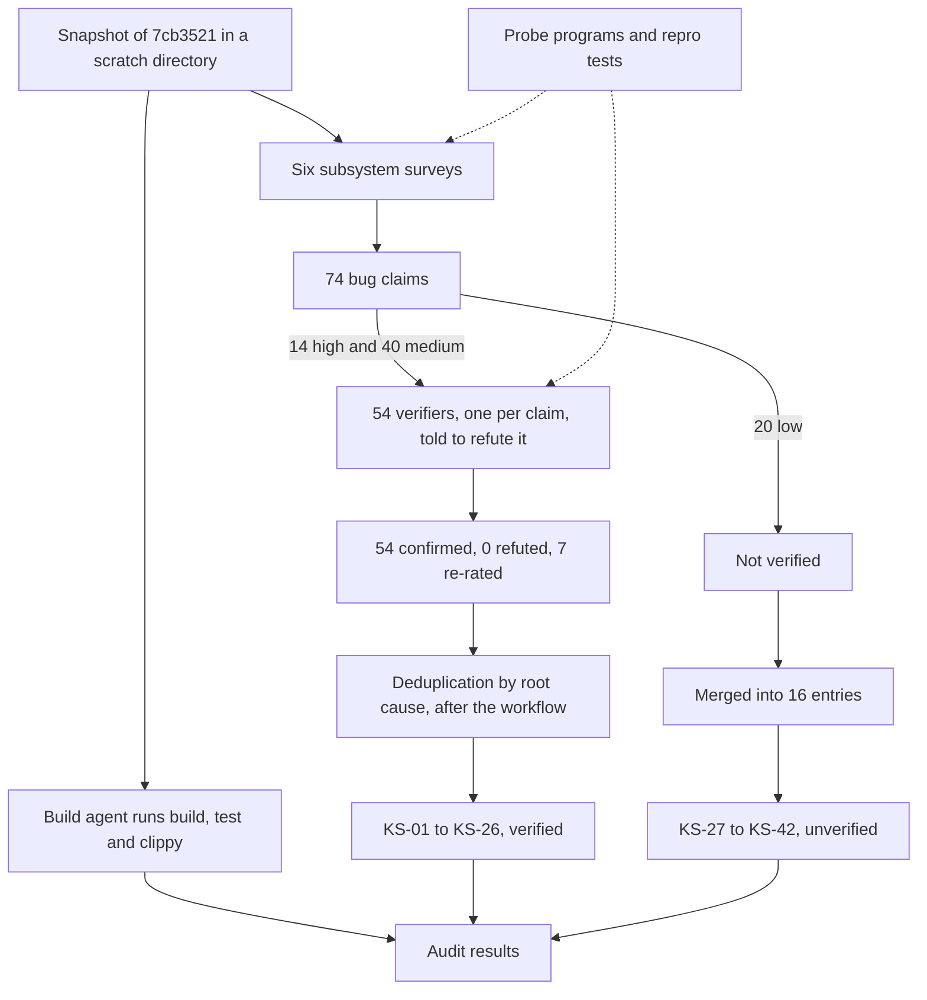
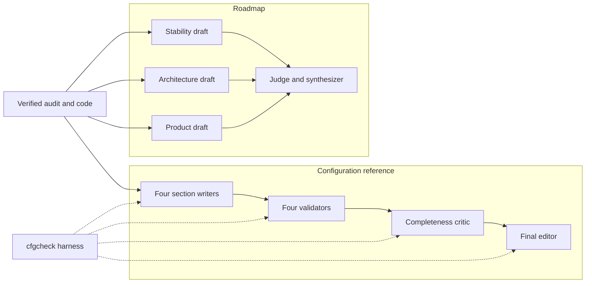

# How the audit was done

The findings in this book rest on a clean build of commit `7cb3521`, a multi-agent code review in which every medium- or high-severity claim went to a separate agent told to refute it, small probe programs run on the audit machine, and a harness that runs configuration examples through the real loader. This chapter records each step, its inputs and its limits, so the checks can be repeated on `7cb3521` or on a later commit.

## Scope

| Item | Value |
|---|---|
| Commit | `7cb3521` (2026-05-20), the tip of `origin/master` on the audit date |
| Audit date | 2026-10-14 |
| Machine | One Windows 11 PC, build 26200, x86_64. UAC on; the account is an administrator running with a filtered, medium-integrity token |
| Toolchain | rustc and cargo 1.98.1, host `x86_64-pc-windows-msvc`, clippy 0.1.98 |
| Locked dependencies | `windows` 0.62.2, `ron` 0.10.1, `notify` 8.2.0, `interprocess` 2.4.2, `arc-swap` 1.9.1, `serde` 1.0.228 |
| Code size | 5,811 lines of Rust in 30 files under `src/` |
| Review | 61 agents, all running the same model (`claude-opus-5-5`); about 5.7 million tokens, 670 tool calls and 17 minutes of wall-clock time |

## Repository sync and the snapshot

The local clone was four commits behind the remote, with `master` still at `053f043` (mvp). The audit did not analyse that working copy. It exported a single commit into a scratch directory and analysed the export.

1. A fetch from `origin` moved `origin/master` from `053f043` to `7cb3521`. The working copy and the index were not changed.
2. `git archive` exported that commit into `<scratch>\snapshot`, a directory outside the repository. The export has no `.git` directory, so it cannot drift to another commit.
3. Every agent received the snapshot path and three rules: analyse only the snapshot, do not modify it, and do not read the working copy.
4. The build, test and clippy runs used `CARGO_TARGET_DIR=<scratch>\target`; the probe crates used target directories of their own, also outside the snapshot. The MD5 of the snapshot's `Cargo.lock`, `29f5168bd843ed67fdb7b27b5a4256a1`, was the same before and after the build, test and clippy runs, and no `target\` directory appeared in the snapshot.
5. After the audit, the working copy was fast-forwarded to `7cb3521` with `git pull --ff-only`. Later steps (the configuration harness and this book) read the working copy but never ran cargo inside it. The harness compiles it as a path dependency, and that writes only to the harness's own target directory.

> [!NOTE]
> The clone has `core.autocrlf=true`, so `git archive` wrote CRLF line endings. Apart from line endings, all 41 tracked files in the snapshot are identical to `7cb3521`. This was re-checked file by file while this chapter was written, and a fresh export of `7cb3521` produced the same `Cargo.lock` hash.

## Build, test and lint

The build agent ran three commands from the snapshot root:

```powershell
$env:CARGO_TARGET_DIR = "<scratch>\target"
cargo build --release
cargo test
cargo clippy --all-targets
```

| Check | Result |
|---|---|
| `cargo build --release` | Succeeded from an empty target directory in 39.24 s with 0 warnings |
| `cargo test` | 120 passed, 0 failed, 0 ignored. All are unit tests inside the library. `src/main.rs`, `src/bin/swch.rs` and the doc-tests have none, and there is no `tests/` directory |
| `cargo clippy --all-targets` | One lint, `clippy::unnecessary_sort_by` at [src/hook/keyboard_hook.rs:72](https://github.com/bluesteelll/key-switch-rs/blob/7cb3521/src/hook/keyboard_hook.rs#L72). It is style only |
| `key-switch-rs.exe` | 989,696 bytes, embeds `requestedExecutionLevel level='requireAdministrator' uiAccess='false'` |
| `swch.exe` | 215,040 bytes, has no `requestedExecutionLevel`, so it runs with the caller's token |

The unit tests run in memory. They install no hook, inject no input and write no files, and the registry tests only read. `cargo test` uses the debug profile, and [build.rs:16-25](https://github.com/bluesteelll/key-switch-rs/blob/7cb3521/build.rs#L16-L25) embeds the UAC manifest only in release builds, so the test run needs no elevation. One reviewer reported that a release-profile test run fails in a non-elevated shell ([KS-38](audit.md#ks-38), not verified).

## Audit design

The audit ran as one workflow script with three phases: Build, Survey and Verify. The build agent and the six surveys started together. As soon as a survey finished, each of its high and medium claims went to its own verifier, so verification overlapped with the slower surveys. Deduplication happened after the workflow.



### Subsystem surveys

Each survey agent received a file list and a checklist. It returned structured output with five parts: a summary, what is implemented, what is unfinished (each item with evidence), bugs, and ideas for improvement. A bug had to give a file, a line, a severity (high, medium or low), a description and a concrete failure scenario. Style nits were excluded. Each survey took about 10 to 12 minutes.

| Survey | Files | Checklist |
|---|---|---|
| config | `src/config/*`, `src/hook/config_watcher.rs` | Schema against the README, validation, error reporting, default-config generation, hot-reload debounce and swap, path resolution, empty file, BOM, rename-on-save, deleted file |
| hook-core | `src/hook/keyboard_hook.rs`, `src/hook/keyboard_hook_callback.rs`, `src/core/constants.rs` | Hot-path correctness, modifier sync, blocked-key bitmap, injected-event sentinel, atomic orderings, `unsafe` soundness, enable/disable, key-up handling, stuck keys, matching priority |
| gestures | `src/hook/tap_state.rs`, `chord_state.rs`, `sequence_state.rs`, `src/data/trigger.rs` and their use in the callback | Races between timer threads and key events, a thread per event, lost or duplicated fires, auto-repeat, the suppression trap, Tap and Hold on one key, memory growth |
| actions-data | `src/data/*` except `trigger.rs`, `src/core/windows_actions.rs`, `src/system/registry.rs`, `src/system/system_function.rs` | `SendInput`, language switching, CapsLock, Launch, OpenUrl, Media, conditions, registry hotkeys, key-name tables against the README, macro worker threads |
| ipc-cli-app | `src/main.rs`, `src/lib.rs`, `src/core/app.rs`, `src/ipc.rs`, `src/hook/ipc_server.rs`, `src/bin/swch.rs`, `build.rs`, `app.manifest`, `Cargo.toml` | Pipe security, single instance, shutdown, `swch open`, manifest scoping, logging, running without a console, autostart |
| docs-roadmap | `README.md` against the code | Promised features that are missing or different, documented limitations, missing project infrastructure |

### Adversarial verification

Each high or medium claim went to a fresh agent that saw only the shared context and that one claim. Its instructions, in short:

- Try to refute the claim by reading the actual code: follow callers and callees, check invariants, and check whether the scenario is reachable on Windows.
- If the claim cannot be refuted, confirm it and assign the correct severity.
- If, after careful reading, the claim is speculative or unreachable, default to "not real".

A verdict had three fields: `real`, `severity` (high, medium, low or not-a-bug) and `reasoning`. Low claims skipped this step. Each verifier took about 40 seconds to 4.5 minutes.

| Survey | Claims | High | Medium | Low | Sent to verifiers | Re-rated by the verifier |
|---|---|---|---|---|---|---|
| config | 8 | 0 | 6 | 2 | 6 | 3, medium to low |
| hook-core | 14 | 4 | 7 | 3 | 11 | 0 |
| gestures | 12 | 3 | 7 | 2 | 10 | 2, one high to medium and one medium to low |
| actions-data | 14 | 2 | 8 | 4 | 10 | 0 |
| ipc-cli-app | 11 | 2 | 4 | 5 | 6 | 1, medium to low |
| docs-roadmap | 15 | 3 | 8 | 4 | 11 | 1, medium to high |
| **Total** | **74** | **14** | **40** | **20** | **54** | **7** |

None of the 54 claims was refuted. 47 kept their severity. Five medium claims became low, the stale-timer claim from the gestures survey went from high to medium ([KS-11](audit.md#ks-11)), and a docs-roadmap claim about the pipe DACL went from medium to high ([KS-02](audit.md#ks-02)).

Some verifiers also narrowed a claim. For example, the report about read-only pipe connections ([KS-26](audit.md#ks-26)) also predicted a busy-spinning accept loop at the 255-instance limit and a hanging `swch`. The verifier refuted those two parts, and only the parked worker threads remain in the issue.

> [!NOTE]
> "Could not refute" is weaker than "reproduced". Most verdicts rest on code reading, the sources of the locked dependencies and the Win32 documentation. Only the claims listed under [Probes and reproductions](#probes-and-reproductions) were exercised by running code.

### Deduplication into KS IDs

The surveys overlap by design, so the same defect was often reported more than once. KS-01 was reported by three surveys (hook-core, ipc-cli-app and docs-roadmap), and KS-07 by five. After the workflow finished, the orchestrating session (the Claude Code session that launched the workflow) merged the confirmed claims:

1. Claims that describe the same mechanism in the same code became one issue, even when they reported different symptoms.
2. A merged issue takes the highest severity any verifier gave its claims. For example, one verifier rated [KS-18](audit.md#ks-18) low and another rated it medium, so it is listed as medium.
3. Issues are numbered by severity: KS-01 to KS-06 are high, KS-07 to KS-22 medium, and KS-23 to KS-26 low.
4. The 20 unverified low claims were merged the same way into 16 entries, KS-27 to KS-42:
   - three reports of ASCII-only case folding became one entry, [KS-28](audit.md#ks-28);
   - a report about relative config paths was folded into [KS-21](audit.md#ks-21) and [KS-41](audit.md#ks-41);
   - a comment in `default_config.ron` that contradicts hot reload is treated as documentation drift in [gaps.md](gaps.md).

The result is 26 verified issues (6 high, 16 medium, 4 low) plus 16 unverified reports, all listed in [audit.md](audit.md).

## Probes and reproductions

When code reading could not settle a claim, the survey and verifier agents wrote small programs in the scratch directory. None of them installs a keyboard hook or injects input. The Rust probes, the repro crate and one of the PowerShell variants were run again while this chapter was written and fact-checked, and gave the same results.

| Probe | Kind | Issues |
|---|---|---|
| `probe-modname`, plus PowerShell P/Invoke variants | Rust binary on `windows` 0.62, and PowerShell scripts | [KS-03](audit.md#ks-03) |
| Pipe DACL checks | Ad hoc P/Invoke and .NET checks by the ipc-cli-app survey and two verifiers; the sources were not kept. A PowerShell equivalent is shown below | [KS-02](audit.md#ks-02) |
| `full_probe`: example `watch_probe` | Copy of the snapshot plus an example binary | [KS-21](audit.md#ks-21), [KS-22](audit.md#ks-22), [KS-23](audit.md#ks-23), [KS-24](audit.md#ks-24) |
| `full_probe`: two extra unit tests in `loader.rs` | Unit tests in the copy | [KS-18](audit.md#ks-18), [KS-07](audit.md#ks-07) |
| `ron_probe`, `ronprobe`, `bomtest` | Small crates on `ron` 0.10 | [KS-22](audit.md#ks-22), [KS-24](audit.md#ks-24), [KS-27](audit.md#ks-27) |
| `gesture-repro` | Integration-test crate against the snapshot | [KS-07](audit.md#ks-07), [KS-11](audit.md#ks-11), [KS-15](audit.md#ks-15), [KS-16](audit.md#ks-16) |

### Win32 probes

`AppEquals` reads the foreground process name with `GetModuleBaseNameW` on a handle opened with `PROCESS_QUERY_LIMITED_INFORMATION` ([src/data/condition.rs:139-144](https://github.com/bluesteelll/key-switch-rs/blob/7cb3521/src/data/condition.rs#L139-L144)). The probe repeats that call on its own process and on the foreground process:

```rust
use windows::Win32::{
    Foundation::*,
    System::{ProcessStatus::GetModuleBaseNameW, Threading::*},
    UI::WindowsAndMessaging::{GetForegroundWindow, GetWindowThreadProcessId},
};
use windows::core::PWSTR;

fn probe(label: &str, pid: u32) {
    unsafe {
        let h = match OpenProcess(PROCESS_QUERY_LIMITED_INFORMATION, false, pid) {
            Ok(h) => h,
            Err(e) => { println!("{label}: OpenProcess failed {e:?}"); return; }
        };
        let mut buf = [0u16; 260];
        let len = GetModuleBaseNameW(h, None, &mut buf);
        let err = GetLastError();
        println!("{label} pid={pid}: GetModuleBaseNameW(LIMITED) len={len} lastErr={err:?} name={:?}",
            String::from_utf16_lossy(&buf[..len as usize]));
        let mut buf2 = [0u16; 1024];
        let mut sz = buf2.len() as u32;
        let r = QueryFullProcessImageNameW(h, PROCESS_NAME_WIN32, PWSTR(buf2.as_mut_ptr()), &mut sz);
        println!("{label}: QueryFullProcessImageNameW(LIMITED) ok={} path={:?}", r.is_ok(),
            String::from_utf16_lossy(&buf2[..sz as usize]));
        let _ = CloseHandle(h);
    }
}

fn main() {
    unsafe {
        probe("self", GetCurrentProcessId());
        let hwnd = GetForegroundWindow();
        let mut pid = 0u32;
        GetWindowThreadProcessId(hwnd, Some(&mut pid));
        probe("foreground", pid);
    }
}
```

Its `Cargo.toml` depends on `windows = "0.62"` with the features `Win32_Foundation`, `Win32_UI_WindowsAndMessaging`, `Win32_System_Threading` and `Win32_System_ProcessStatus`. Output on the audit machine, with process IDs and paths elided:

```text
self pid=…: GetModuleBaseNameW(LIMITED) len=0 lastErr=WIN32_ERROR(5) name=""
self: QueryFullProcessImageNameW(LIMITED) ok=true path="…"
foreground pid=…: GetModuleBaseNameW(LIMITED) len=0 lastErr=WIN32_ERROR(5) name=""
foreground: QueryFullProcessImageNameW(LIMITED) ok=true path="…"
```

Error 5 is `ERROR_ACCESS_DENIED`. It occurs even on the probe's own process. A PowerShell P/Invoke variant shows that `GetModuleBaseNameW` succeeds when the handle is opened with `PROCESS_QUERY_INFORMATION | PROCESS_VM_READ` instead. The cause is therefore the access right, not the API. `QueryFullProcessImageNameW` works on the limited handle, which makes it the natural replacement.

For [KS-02](audit.md#ks-02), a verifier created a pipe with a null security descriptor, which is what `interprocess` passes when no descriptor is set ([src/hook/ipc_server.rs:47](https://github.com/bluesteelll/key-switch-rs/blob/7cb3521/src/hook/ipc_server.rs#L47)). It read back `D:(A;;FA;;;SY)(A;;FA;;;BA)(A;;FA;;;<owner>)(A;;FR;;;WD)(A;;FR;;;AN)`: SYSTEM, Administrators and the creator's token owner get full access, and Everyone and Anonymous get read access only. For an elevated administrator the token owner is `BUILTIN\Administrators` by default, and a non-elevated token has that group as deny-only. A non-elevated `swch` therefore matches only the read-only Everyone entry and cannot open the elevated daemon's pipe for writing. A second verifier created a pipe with that DACL and confirmed that a non-elevated client can open it read-only but not read-write. The default DACL can also be observed from Windows PowerShell 5.1. A `NamedPipeServerStream` created without a `PipeSecurity` object gets it; in a non-elevated shell the owner entry is the user's own SID:

```powershell
$p = New-Object System.IO.Pipes.NamedPipeServerStream("ks-dacl-probe", [System.IO.Pipes.PipeDirection]::InOut)
try { $p.GetAccessControl().GetSecurityDescriptorSddlForm([System.Security.AccessControl.AccessControlSections]::Access) }
finally { $p.Dispose() }
# D:(A;;FR;;;WD)(A;;FR;;;AN)(A;;FA;;;SY)(A;;FA;;;BA)(A;;FA;;;<user SID>)
```

### Configuration and watcher probes

`full_probe` is a copy of the snapshot with two additions. Its example `watch_probe` calls the real `config::load`, `KeyboardHook::update_bindings` and `config_watcher::spawn_watcher` without installing a hook. It runs the same steps twice, once with an absolute config path and once with a relative one, and counts the live bindings after each step:

| Step | Absolute path | Relative path |
|---|---|---|
| Edit the file from 1 to 3 bindings | 3 live | 1 live: the edit is never seen ([KS-21](audit.md#ks-21)) |
| Misspell the top-level `bindings` | 0 live ([KS-22](audit.md#ks-22)) | 1 live |
| Restore, then delete the file | The file is re-created from the default config, and its 3 bindings, including the auto-blocker, are live ([KS-23](audit.md#ks-23)) | 1 live, the file is not re-created |
| Save the file with a UTF-8 BOM | Parse error ``1:1: Expected opening `(` for struct `RawConfig` ``; the previous bindings stay ([KS-24](audit.md#ks-24)) | 1 live |

The second addition is two unit tests at the end of `src/config/loader.rs`. The first shows that the auto-blocker is placed in front of a user binding on the same combo when that binding comes later in the list, or is itself the binding that requested the blocker. In both cases the `DoNothing` blocker wins ([KS-18](audit.md#ks-18)). The second shows that `LShift` parses to VK `0xA0` and that a chord written with `Shift` holds VK `0x10` ([KS-07](audit.md#ks-07)).

`ron_probe` deserializes a verbatim copy of `src/config/schema.rs` with `ron` 0.10 and `IMPLICIT_SOME`. Misspelled field names are dropped silently, and a misspelled top-level field yields an empty binding list ([KS-22](audit.md#ks-22)). `Tap(0)` and `window_ms: 0` are accepted ([KS-27](audit.md#ks-27)), and a leading U+FEFF fails at 1:1 ([KS-24](audit.md#ks-24)). `ronprobe` is a smaller version of the same check. `bomtest` shows that UTF-8 decoding keeps a leading U+FEFF (`fs::read_to_string` does not strip it either) and that `ron` then rejects the text at 1:1.

### Gesture repro crate

`gesture-repro` drives the gesture state machines directly, through their public APIs, with `DoNothing` actions. Its `src/lib.rs` is empty. `Cargo.toml`:

```toml
[package]
name = "gesture-repro"
version = "0.0.0"
edition = "2024"
publish = false

[dependencies]
key-switch-rs = { path = "../snapshot" }
windows = { version = "0.62", features = ["Win32_UI_Input_KeyboardAndMouse"] }
```

`tests/repro.rs`:

```rust
use std::thread::sleep;
use std::time::Duration;
use key_switch_rs::core::windows_actions::BindAction;
use key_switch_rs::data::key_combination::KeyCombination;
use key_switch_rs::hook::chord_state::{ChordOutcome, ChordState};
use key_switch_rs::hook::sequence_state::{SequenceOutcome, SequenceState};
use key_switch_rs::hook::tap_state::TapState;
use windows::Win32::UI::Input::KeyboardAndMouse::*;

#[test]
fn stale_tap_gc_eats_second_quick_tap() {
    let s = TapState::new();
    // press #1 at t=0, released at t~20 -> fires
    s.arm_tap(VK_F13, BindAction::DoNothing, 200);
    sleep(Duration::from_millis(20));
    assert!(s.resolve_tap_on_keyup(VK_F13));
    // press #2 at t~120 (well within its own 200ms window)
    sleep(Duration::from_millis(100));
    s.arm_tap(VK_F13, BindAction::DoNothing, 200);
    // stale gc#1 wakes at t=200 and removes press #2's entry
    sleep(Duration::from_millis(110));
    // release #2 at t~230: only ~110ms after press #2 -> should fire, but:
    let fired = s.resolve_tap_on_keyup(VK_F13);
    println!("second tap fired = {fired}");
    assert!(!fired, "expected the bug: second tap lost");
}

#[test]
fn stale_hold_timer_fires_new_press_early() {
    let s = TapState::new();
    s.arm_hold(VK_F14, BindAction::DoNothing, 200);
    sleep(Duration::from_millis(20));
    assert!(s.cancel_hold_on_keyup(VK_F14)); // short tap -> cancel
    sleep(Duration::from_millis(100));
    s.arm_hold(VK_F14, BindAction::DoNothing, 200); // press #2 at ~120
    sleep(Duration::from_millis(110)); // t~230: stale timer#1 fired at 200
    let still_pending = s.cancel_hold_on_keyup(VK_F14);
    println!("press#2 hold still pending at +110ms = {still_pending}");
    assert!(!still_pending, "expected the bug: stale timer consumed+fired press #2 hold");
}

#[test]
fn sequence_completes_on_rollover_of_unrelated_key() {
    let s = SequenceState::new();
    let steps = vec![KeyCombination::from_keys(vec![VK_F13]), KeyCombination::from_keys(vec![VK_F13])];
    let gap = Duration::from_millis(500);
    assert!(matches!(s.handle_keydown(&[VK_F13], &BindAction::DoNothing, &steps, gap), SequenceOutcome::Advanced));
    // F13 still held, user presses A (fresh key-down) -> should NOT complete F13,F13
    let o = s.handle_keydown(&[VK_F13, VK_A], &BindAction::DoNothing, &steps, gap);
    let completed = matches!(o, SequenceOutcome::Completed { .. });
    println!("completed on A = {completed}");
    assert!(completed, "expected the bug");
}

#[test]
fn sequence_modifier_press_aborts_pending() {
    let s = SequenceState::new();
    let steps = vec![KeyCombination::from_keys(vec![VK_F13]), KeyCombination::from_keys(vec![VK_CONTROL, VK_S])];
    let gap = Duration::from_millis(1000);
    assert!(matches!(s.handle_keydown(&[VK_F13], &BindAction::DoNothing, &steps, gap), SequenceOutcome::Advanced));
    // F13 released; user presses Ctrl (normalized active = [Ctrl])
    let o1 = s.handle_keydown(&[VK_CONTROL], &BindAction::DoNothing, &steps, gap);
    assert!(matches!(o1, SequenceOutcome::NotMatching));
    // then S with Ctrl held
    let o2 = s.handle_keydown(&[VK_CONTROL, VK_S], &BindAction::DoNothing, &steps, gap);
    let completed = matches!(o2, SequenceOutcome::Completed { .. });
    println!("F13, Ctrl+S completed = {completed}");
    assert!(!completed, "expected the bug: Ctrl key-down aborted the pending sequence");
}

#[test]
fn chord_with_unsided_modifier_never_matches_raw_sided_vk() {
    let s = ChordState::new();
    let w = Duration::from_millis(50);
    // LL hook delivers VK_LSHIFT, binding parsed "Shift" -> VK_SHIFT
    let o = s.handle_keydown(VK_LSHIFT, &BindAction::DoNothing, &[VK_SHIFT, VK_F13], w);
    let not_in = matches!(o, ChordOutcome::NotInChord);
    println!("LShift NotInChord = {not_in}");
    assert!(not_in);
}
```

| Test | What it shows | Issue |
|---|---|---|
| `stale_tap_gc_eats_second_quick_tap` | The clean-up thread of a first tap removes the pending entry of a second tap on the same key, so the second tap is lost | [KS-11](audit.md#ks-11) |
| `stale_hold_timer_fires_new_press_early` | The timer of a cancelled first press fires the Hold armed by a second press about 80 ms after that press, not 200 ms | [KS-11](audit.md#ks-11) |
| `sequence_completes_on_rollover_of_unrelated_key` | With `F13` still held, pressing `A` completes the sequence `F13, F13` | [KS-15](audit.md#ks-15) |
| `sequence_modifier_press_aborts_pending` | The `Ctrl` key-down needed for the step `Ctrl+S` aborts the pending sequence `F13, Ctrl+S` | [KS-16](audit.md#ks-16) |
| `chord_with_unsided_modifier_never_matches_raw_sided_vk` | The hook delivers `VK_LSHIFT`, but a chord written with `Shift` holds `VK_SHIFT`, so the key is not part of the chord | [KS-07](audit.md#ks-07) |

> [!TIP]
> Each test asserts the defect, so a passing test means the defect is present. After a fix, invert the assertion and move the test into the crate as a regression test. The two Tap/Hold tests depend on `sleep` timings against a 200 ms term. Run them with `--test-threads=1` on an idle machine.

## How the configuration reference and roadmap were produced

A second workflow used the verified audit to produce the configuration reference and the roadmap. It treated the working copy (by then at `7cb3521`) as strictly read-only and never ran cargo inside it.



### Validation harness

`cfgcheck` is a tiny crate in the scratch directory. It loads one file through the real `key_switch_rs::config::load`, the only public loading function; the module re-exports just `load` and `default_config_path` ([src/config/mod.rs:15](https://github.com/bluesteelll/key-switch-rs/blob/7cb3521/src/config/mod.rs#L15)), and the in-memory `from_ron_str` is `pub(crate)` ([src/config/loader.rs:130](https://github.com/bluesteelll/key-switch-rs/blob/7cb3521/src/config/loader.rs#L130)). It then prints every resulting binding. Its `Cargo.toml`, verbatim:

```toml
[package]
name = "cfgcheck"
version = "0.1.0"
edition = "2024"

[dependencies]
key-switch-rs = { path = "D:/key-switch-rs/key-switch-rs" }
```

`src/main.rs`, verbatim:

```rust
//! Validates a config.ron through the real key-switch-rs loader.
//! Usage: cfgcheck <path-to-config.ron>   (never creates the file)
use std::path::PathBuf;

fn main() {
    let path = PathBuf::from(std::env::args().nth(1).expect("usage: cfgcheck <file>"));
    if !path.exists() {
        eprintln!("ERR: file does not exist (refusing: loader would write the default)");
        std::process::exit(2);
    }
    match key_switch_rs::config::load(&path) {
        Ok(bindings) => {
            println!("OK: {} bindings (after auto-blocker expansion)", bindings.len());
            for (i, b) in bindings.iter().enumerate() {
                println!(
                    "  #{i}: kind={:?} action={:?} block_default={} block_original_combo={} condition={:?} trigger={:?}",
                    b.kind, b.action, b.block_default, b.block_original_combo, b.condition, b.trigger
                );
            }
        }
        Err(e) => {
            println!("ERR: {e}");
            std::process::exit(1);
        }
    }
}
```

The existence check matters because `load` writes the default config to any path that does not exist ([src/config/loader.rs:101-104](https://github.com/bluesteelll/key-switch-rs/blob/7cb3521/src/config/loader.rs#L101-L104), see also [KS-41](audit.md#ks-41)). The exit codes are:

| Exit code | Meaning |
|---|---|
| 0 | The file loaded; `OK: N bindings` and one line per binding on stdout |
| 1 | The loader returned an error; `ERR: <message>` on stdout |
| 2 | The file does not exist; nothing was written |
| 101 | No argument given (panic from `expect`) |

A `cfgcheck` built against a tree after roadmap Workstream B calls `key_switch_rs::config::reload(&path)` in place of `config::load(&path)`: there `load` takes a `config::ConfigPath`, and `reload` is the loader that takes a path. The rest of the harness is unchanged.

Output for the shipped `src/config/default_config.ron` on the audit machine:

```text
[INFO] loading config from …\src\config\default_config.ron
[INFO] SwitchLanguage: using default combination
OK: 3 bindings (after auto-blocker expansion)
  #0: kind=Combo(KeyCombination { keys: [VIRTUAL_KEY(18), VIRTUAL_KEY(16)] }) action=DoNothing block_default=true block_original_combo=false condition=Always trigger=Immediate
  #1: kind=Combo(KeyCombination { keys: [VIRTUAL_KEY(20)] }) action=SwitchLanguage block_default=true block_original_combo=true condition=Always trigger=Immediate
  #2: kind=Combo(KeyCombination { keys: [VIRTUAL_KEY(16), VIRTUAL_KEY(20)] }) action=ToggleCapsLock block_default=true block_original_combo=false condition=Always trigger=Immediate
```

Binding `#0` is the auto-blocker (Alt = 18, Shift = 16) that `expand_with_auto_blockers` inserts for the CapsLock binding ([src/config/loader.rs:172-192](https://github.com/bluesteelll/key-switch-rs/blob/7cb3521/src/config/loader.rs#L172-L192)). Its keys come from the registry, with Alt+Shift as the fallback ([src/system/registry.rs:60-73](https://github.com/bluesteelll/key-switch-rs/blob/7cb3521/src/system/registry.rs#L60-L73)). The second `[INFO]` line shows that the audit machine's registry gave no combination, so the fallback was used. On another machine binding `#0` can differ.

The section writers returned their examples as a JSON list of `{ name, ron, expect, note }` records, where `expect` is `ok` or `error`. The runner below, used by two of the validators, wrote each record to its own `.ron` file, ran the harness, dropped the loader's `[INFO]` lines, and printed `PASS` or `MISMATCH`:

```python
import json, subprocess, sys, os
sys.stdout.reconfigure(encoding="utf-8")
D = os.path.dirname(os.path.abspath(__file__))
EXE = os.path.join(D, "..", "..", "cfgcheck-target", "debug", "cfgcheck.exe")

def run(path):
    p = subprocess.run([EXE, path], capture_output=True)
    out = p.stdout.decode("utf-8", "replace") + p.stderr.decode("utf-8", "replace")
    out = "\n".join(l for l in out.splitlines() if not l.startswith("[INFO]"))
    return p.returncode, out

if __name__ == "__main__":
    src = sys.argv[1] if len(sys.argv) > 1 else os.path.join(D, "examples.json")
    ex = json.load(open(src, encoding="utf-8"))
    sub = os.path.join(D, "ex")
    os.makedirs(sub, exist_ok=True)
    for e in ex:
        f = os.path.join(sub, e["name"] + ".ron")
        with open(f, "w", encoding="utf-8", newline="\n") as fh:
            fh.write(e["ron"])
        rc, out = run(f)
        got = "ok" if rc == 0 else "error"
        flag = "PASS" if got == e["expect"] else "MISMATCH"
        print(f"=== {e['name']} expect={e['expect']} got={got} [{flag}]")
        print("NOTE:", e["note"])
        print(out)
```

### Reference pipeline

The [configuration reference](config/index.md) was built in four steps. Each step's brief required the harness:

1. **Write.** Four agents each wrote one section: file structure, key names, actions, and binding kinds with triggers and conditions. Each read the relevant code, tested its examples and any doubtful edge case with the harness, and returned the section with positive examples for every syntax form and negative examples for every validation rule.
2. **Validate.** A second agent per section ran every example and every RON snippet embedded in the text through the harness. It checked the outcome, the error text and the resulting binding shapes against what the section says, and probed claims about defaults, aliases, case-insensitivity and accepted values. Runtime claims, which the loader cannot test, it checked by reading the code. It then fixed the mismatches. The four validators reported 604 harness runs and 70 fixes between them.
3. **Critic.** One agent compared the assembled draft with the code: every field and variant in `src/config/schema.rs`, every name accepted by `parse_vk` in `src/data/vk_name.rs`, every `WM_*` name in `src/config/parsing.rs`, and every validation rule and error in `src/config/loader.rs`. It listed what was missing, what was wrong and where sections contradicted each other.
4. **Assemble.** A final editor was told to apply the critic's findings, to make the complete example config load with `OK` in the harness, and to run every changed snippet again.

### How the roadmap drafts were judged

Three agents drafted a roadmap independently. They had the same inputs (the verified audit, its digests and read-only access to the code) and different lenses:

| Lens | Brief |
|---|---|
| Stability | Group the confirmed bugs by root cause, order the fixes by user impact against risk, prefer minimal safe changes with a regression test each, and decide what must be fixed before daily use |
| Architecture | Propose refactors that remove whole bug classes, map each confirmed bug to the refactor that fixes it, and sequence the refactors with the least churn |
| Product | Decide what makes the tool dependable for daily use and fit to distribute, such as background mode, logging, autostart, de-elevated Launch, CI and packaging; rank new features by value against effort, noting which depend on correctness fixes |

Every item in every draft had to state what to do, why (with a link to the confirmed bug or gap), the main files, the effort (S under half a day, M one to two days, L three days or more), its dependencies and a concrete acceptance criterion. Items were grouped into ordered phases. All three drafts were told that two fix sessions had already been proposed to the owner, "Fix critical hook and IPC bugs" and "Fix config edge cases and docs drift", and that these come first.

A fourth agent judged the drafts. Its brief was to score each one first on four criteria:

| Criterion | Question |
|---|---|
| Groundedness | Is every item tied to the code and to a verified finding? |
| Prioritisation | Does the order follow impact, risk and dependencies? |
| Effort realism | Are the S/M/L estimates plausible for the code involved? |
| Testable acceptance | Can each acceptance criterion be checked by a test or a concrete observation? |

It then had to synthesize one roadmap: take the best ordering, graft in the strongest ideas from the other drafts, and spot-check doubtful claims against the code. It also had to list the open decisions for the owner, such as the default auto-repeat policy, a signed `uiAccess` deployment, exact against superset modifier matching, and whether to keep RON. The [roadmap](roadmap.md) chapter is based on its output.

## How this book was checked

The overview, architecture, build-and-run, audit, gaps and methodology chapters were each drafted by one agent and then fact-checked by a second. The checker's brief was to open every permalink and confirm that the line shows what the text claims, to check names, defaults, command strings and KS references against the code, to check the mermaid syntax, and to remove statements the code does not support. The glossary and the introduction were written after the checks; the glossary agent read the finished chapters first. The configuration and roadmap pages were written separately, from the validated reference and the judged roadmap described above.

## Limitations

- **No live keyboard input.** The daemon was never run with its hook installed, and no keystrokes were typed or injected against it. Behaviour that depends on Windows delivering events is inferred from the code and the Win32 documentation. This covers the dead hook after `swch on` ([KS-01](audit.md#ks-01)), stuck keys ([KS-06](audit.md#ks-06)), the `LowLevelHooksTimeout` risk ([KS-08](audit.md#ks-08)), auto-repeat ([KS-10](audit.md#ks-10)) and the Start menu opening ([KS-12](audit.md#ks-12)). The repro crate calls the state machines directly instead of through hook events.
- **One machine.** Everything ran on one Windows 11 PC (build 26200, x86_64, MSVC toolchain) under one user account and its registry. That registry gave no language-hotkey combination (`HKCU\Keyboard Layout\Toggle` has no values), so the Alt+Shift fallback was in effect. Windows 10, ARM64, the GNU toolchain ([KS-42](audit.md#ks-42)), other keyboard layouts and other `Hotkey` values ([KS-17](audit.md#ks-17)) were not tried.
- **One model.** All 61 agents ran the same model. The verifiers were fresh sessions with an instruction to refute, which reduces confirmation bias but cannot remove blind spots the surveys and verifiers share. Severity is a judgement: seven of the 54 verdicts changed it.
- **Unverified low reports.** KS-27 to KS-42 never went to a verifier. Most come from a single survey; only KS-28 (three surveys) and KS-41 (two) were reported more than once. Some may be wrong or overstated.
- **Pinned line numbers.** Every line reference is to `7cb3521`. The permalinks keep working, but after any later commit the line numbers in the text no longer match `master`.
- **Dependency behaviour.** The behaviour of `notify`, `interprocess` and `ron` was read from their sources at the locked versions (8.2.0, 2.4.2, 0.10.1). Three findings depend on it: [KS-02](audit.md#ks-02) on `interprocess` passing a null security descriptor, [KS-21](audit.md#ks-21) on the absolute event paths `notify` reports, and [KS-24](audit.md#ks-24) on `ron` not treating U+FEFF as whitespace. An upgrade can change them.
- **Harness scope.** The harness checks parsing and validation only. Runtime statements in the configuration reference were checked by reading code.
- **No measurements.** No latency, CPU or memory figures were taken.
- **Temporary artefacts.** The scratch directory with the snapshot, probes and digests, and the raw workflow output, are temporary. This chapter reproduces the sources of `probe-modname`, the gesture repro crate, the harness and its runner. The watcher, RON and BOM probes are described above but not reproduced.

### Live checks not yet performed

These checks would turn three of the high-severity code-reading findings into observed behaviour. They change keyboard behaviour while the daemon runs.

| Issue | Steps | Result if the defect is present |
|---|---|---|
| [KS-02](audit.md#ks-02) | With no daemon running, start one with `swch open`, then run `swch status` in a non-elevated terminal | ``swch: cannot reach daemon (…). Use `swch open` to start it.`` |
| [KS-01](audit.md#ks-01) | With the default config, in an elevated terminal run `swch off`, then `swch on`, then press CapsLock | The layout does not switch, while `swch status` still reports `running (3 bindings live)` |
| [KS-03](audit.md#ks-03) | Load a config whose only binding is `( keys: "F9", action: PressKey("A"), when: AppEquals("notepad.exe") )`, focus Notepad and press F9 | Nothing is typed. With `when: TitleContains("Notepad")` instead, F9 types `a` |

Both test configs for KS-03 load with `OK` in the harness.

## Re-running the checks

The commands below use Windows PowerShell and a work directory outside the clone. Replace `7cb3521` with another commit to audit a later state.

1. Export the commit:

   ```powershell
   $Repo = "D:\key-switch-rs\key-switch-rs"   # your clone
   $Work = "$env:TEMP\ks-audit"               # any directory outside the clone
   New-Item -ItemType Directory -Force "$Work\snapshot" | Out-Null
   git -C $Repo fetch origin
   git -C $Repo archive --format=tar -o "$Work\snapshot.tar" 7cb3521
   tar -xf "$Work\snapshot.tar" -C "$Work\snapshot"
   (Get-FileHash "$Work\snapshot\Cargo.lock" -Algorithm MD5).Hash
   # 29F5168BD843ED67FDB7B27B5A4256A1 when core.autocrlf=true
   ```

2. Build, test and lint with the target directory outside the snapshot, then check which binary asks for elevation:

   ```powershell
   $env:CARGO_TARGET_DIR = "$Work\target"
   Push-Location "$Work\snapshot"
   cargo build --release
   cargo test
   cargo clippy --all-targets
   Pop-Location
   Remove-Item Env:CARGO_TARGET_DIR
   Select-String -Path "$Work\target\release\*.exe" -Pattern "requireAdministrator" -SimpleMatch -List |
       Select-Object Filename
   ```

   Expected: 120 tests pass, clippy reports the one `unnecessary_sort_by` lint, and only `key-switch-rs.exe` is listed.

3. Create `$Work\cfgcheck` with the `Cargo.toml` and `src/main.rs` shown above, changing the dependency to `key-switch-rs = { path = "../snapshot" }`. Then build it and run it:

   ```powershell
   cargo build --manifest-path "$Work\cfgcheck\Cargo.toml" --target-dir "$Work\cfgcheck-target"
   & "$Work\cfgcheck-target\debug\cfgcheck.exe" "$Work\snapshot\src\config\default_config.ron"
   ```

   Expected: `OK: 3 bindings`. To run a list of examples, put the runner script in `$Work\cfgtest\<name>\run.py` (its `EXE` path is relative to that location) and run `python run.py examples.json`.

4. Create `$Work\gesture-repro` with the `Cargo.toml` and `tests/repro.rs` shown above and an empty `src/lib.rs`, and run it:

   ```powershell
   cargo test --manifest-path "$Work\gesture-repro\Cargo.toml" --target-dir "$Work\target-gesture" -- --test-threads=1 --nocapture
   ```

   Expected while the defects exist: 5 passed.

5. Create `$Work\probe-modname` with the probe source and dependency shown above, and run it with the command below. The pipe DACL snippet under [Win32 probes](#win32-probes) needs no build.

   ```powershell
   cargo run --manifest-path "$Work\probe-modname\Cargo.toml" --target-dir "$Work\target-probe"
   ```

   Expected while [KS-03](audit.md#ks-03) exists: `len=0` and `WIN32_ERROR(5)` for both processes.

6. To repeat the review itself, give each row of the survey table to a reviewer with its file list and checklist. Then give every high or medium claim, alone, to a second reviewer with the refute instruction from [Adversarial verification](#adversarial-verification). Merge the confirmed claims with the rules in [Deduplication into KS IDs](#deduplication-into-ks-ids).

> [!TIP]
> Give each crate its own target directory. While this chapter was being written, a target directory shared between the snapshot and the modified `full_probe` copy (same package name and version) made cargo reuse the snapshot's build, and the extra probe tests silently did not run.
