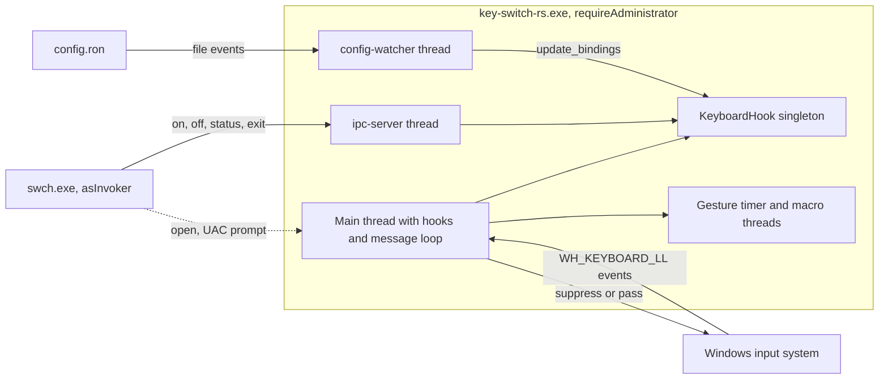

# Overview and current state

key-switch-rs is a Windows-only keyboard remapper written in Rust. An elevated daemon intercepts every key event with a low-level hook, matches it against bindings from a hot-reloaded RON file and runs an action, and a small CLI controls the daemon over a named pipe. At commit `7cb3521` the code builds without warnings and passes all 120 unit tests, and the architecture and low-level code are sound. Per-keystroke behaviour is MVP quality. Of the six high-severity defects, two break the shipped default config during normal typing, a third can leave a key stuck with it, and two break the `swch` control path.

> [!NOTE]
> Facts on this page describe commit [`7cb3521`](https://github.com/bluesteelll/key-switch-rs/commit/7cb3521) (2026-05-20). The build, test and audit runs were done on 2026-10-14.

## What key-switch-rs does

The daemon `key-switch-rs.exe` installs a `WH_KEYBOARD_LL` hook on its main thread. On every key-down the hook callback builds the set of held keys and walks the binding list, most specific binding first. It runs at most one `Immediate` action, arms deferred triggers and decides whether the original event still reaches other applications. Bindings come from `config.ron`. The daemon writes a default `config.ron` on first run and reloads it whenever the file changes.

### Features

| Area | Implemented at 7cb3521 | Main code | Main caveats |
|---|---|---|---|
| Interception | A `WH_KEYBOARD_LL` hook, plus an `EVENT_SYSTEM_FOREGROUND` WinEvent hook. After a focus change, the WinEvent hook resyncs the 11 modifier keys and clears the blocked-key bitmap. Synthesized input carries a PID-mixed sentinel in `dwExtraInfo`, so the hook skips the daemon's own output. | [src/hook/keyboard_hook.rs:83-134](https://github.com/bluesteelll/key-switch-rs/blob/7cb3521/src/hook/keyboard_hook.rs#L83-L134), [src/hook/keyboard_hook_callback.rs:167-181](https://github.com/bluesteelll/key-switch-rs/blob/7cb3521/src/hook/keyboard_hook_callback.rs#L167-L181), [src/core/constants.rs:15-32](https://github.com/bluesteelll/key-switch-rs/blob/7cb3521/src/core/constants.rs#L15-L32) | [KS-01](audit.md#ks-01), [KS-12](audit.md#ks-12), [KS-14](audit.md#ks-14) |
| Binding kinds | `keys` (keys held together), `sequence` (at least 2 steps, `max_gap_ms` defaults to 500), `chord` (at least 2 distinct keys within `window_ms`, default 50) | [src/data/binding.rs:24-34](https://github.com/bluesteelll/key-switch-rs/blob/7cb3521/src/data/binding.rs#L24-L34), [src/config/schema.rs:72-94](https://github.com/bluesteelll/key-switch-rs/blob/7cb3521/src/config/schema.rs#L72-L94) | [KS-04](audit.md#ks-04), [KS-07](audit.md#ks-07), [KS-15](audit.md#ks-15), [KS-16](audit.md#ks-16) |
| Triggers | `Immediate` (default), `Tap(ms)`, `Hold(ms)`, `DoubleTap(ms)`. The loader accepts the three deferred triggers only on `keys` bindings. | [src/data/trigger.rs:15-31](https://github.com/bluesteelll/key-switch-rs/blob/7cb3521/src/data/trigger.rs#L15-L31), [src/config/loader.rs:224-230](https://github.com/bluesteelll/key-switch-rs/blob/7cb3521/src/config/loader.rs#L224-L230) | [KS-06](audit.md#ks-06), [KS-11](audit.md#ks-11), [KS-25](audit.md#ks-25) |
| Actions | `SwitchLanguage`, `SwitchLanguageBackward`, `ToggleCapsLock`, `PressKey`, `PostMessage`, `Launch`, `OpenUrl`, `Media` (7 keys), `Sequence`, `DoNothing` | [src/core/windows_actions.rs:22-46](https://github.com/bluesteelll/key-switch-rs/blob/7cb3521/src/core/windows_actions.rs#L22-L46) | [KS-08](audit.md#ks-08), [KS-09](audit.md#ks-09), [KS-10](audit.md#ks-10) |
| Macros | The `Sequence` action runs 8 step kinds (`Delay`, `Text`, `Key`, `Combo`, `Window`, `Launch`, `OpenUrl`, `Media`) on a worker thread of its own. | [src/data/sequence.rs:30-62](https://github.com/bluesteelll/key-switch-rs/blob/7cb3521/src/data/sequence.rs#L30-L62), [src/data/sequence.rs:114-125](https://github.com/bluesteelll/key-switch-rs/blob/7cb3521/src/data/sequence.rs#L114-L125) | [KS-19](audit.md#ks-19) |
| Conditions | `when:` takes `Always`, `AppEquals`, `TitleContains`, `TitleEquals`, `Not`, `And` or `Or`. | [src/data/condition.rs:25-47](https://github.com/bluesteelll/key-switch-rs/blob/7cb3521/src/data/condition.rs#L25-L47) | [KS-03](audit.md#ks-03) |
| Per-binding flags | `block_default` (default `true`) and `block_original_combo` (default `false`). The second flag adds a `DoNothing` auto-blocker for the OS hotkey of the action. Only `SwitchLanguage` and `SwitchLanguageBackward` have one: the language hotkey, read from `HKCU\Keyboard Layout\Toggle`. | [src/config/loader.rs:172-191](https://github.com/bluesteelll/key-switch-rs/blob/7cb3521/src/config/loader.rs#L172-L191), [src/system/registry.rs:21-30](https://github.com/bluesteelll/key-switch-rs/blob/7cb3521/src/system/registry.rs#L21-L30) | [KS-05](audit.md#ks-05), [KS-13](audit.md#ks-13), [KS-17](audit.md#ks-17), [KS-18](audit.md#ks-18) |
| Config loading | RON with the `IMPLICIT_SOME` extension. A default file is written on first run, and all per-binding errors are reported in one pass. | [src/config/loader.rs:101-162](https://github.com/bluesteelll/key-switch-rs/blob/7cb3521/src/config/loader.rs#L101-L162) | [KS-22](audit.md#ks-22), [KS-24](audit.md#ks-24) |
| Hot reload | A `notify` watcher on the config's parent directory with a 250 ms debounce. New bindings are swapped in atomically through `ArcSwap`, and a failed reload keeps the previous bindings. | [src/hook/config_watcher.rs:29-110](https://github.com/bluesteelll/key-switch-rs/blob/7cb3521/src/hook/config_watcher.rs#L29-L110) | [KS-21](audit.md#ks-21), [KS-23](audit.md#ks-23) |
| Control | The `swch` CLI talks to the daemon with a one-line protocol over `\\.\pipe\key-switch-rs.sock`. | [src/ipc.rs:16](https://github.com/bluesteelll/key-switch-rs/blob/7cb3521/src/ipc.rs#L16) | [KS-01](audit.md#ks-01), [KS-02](audit.md#ks-02), [KS-20](audit.md#ks-20) |
| Elevation | A `requireAdministrator` manifest is linked into the release daemon only. | [build.rs:16-25](https://github.com/bluesteelll/key-switch-rs/blob/7cb3521/build.rs#L16-L25) | [KS-09](audit.md#ks-09) |

The [configuration reference](config/index.md) documents the syntax, and [Gaps and documentation drift](gaps.md) lists the places where the README promises more than the code does.

### Default bindings

The embedded default config ([src/config/default_config.ron:127-135](https://github.com/bluesteelll/key-switch-rs/blob/7cb3521/src/config/default_config.ron#L127-L135)) enables two bindings, and the loader generates a third.

| Keys | Action | Origin | Effect |
|---|---|---|---|
| `CapsLock` | `SwitchLanguage` | config, with `block_original_combo: true` | Posts `WM_INPUTLANGCHANGEREQUEST` (forward) to the foreground window. |
| `Shift+CapsLock` | `ToggleCapsLock` | config | Synthesizes a CapsLock press, so the CapsLock toggle stays reachable. |
| `Alt+Shift` (or `Ctrl+Shift`, or the grave-accent key) | `DoNothing`, suppressing | auto-blocker generated by the loader | Silences the Windows language hotkey. The combo comes from the registry value `Hotkey`, then `Language Hotkey`: `"1"` gives Alt+Shift, `"2"` gives Ctrl+Shift and `"4"` gives the grave accent. If neither value yields a combo, the built-in default Alt+Shift is used. That includes `"3"`, which means the OS hotkey is disabled ([KS-17](audit.md#ks-17), [src/system/registry.rs:68-72](https://github.com/bluesteelll/key-switch-rs/blob/7cb3521/src/system/registry.rs#L68-L72), [src/system/registry.rs:192-199](https://github.com/bluesteelll/key-switch-rs/blob/7cb3521/src/system/registry.rs#L192-L199)). |

With the default config, `swch status` therefore reports 3 live bindings. The rest of the bindings list is 20 commented-out examples. Some of them cannot work as written: the `LShift` DoubleTap example runs into [KS-07](audit.md#ks-07), and the `AppEquals` examples run into [KS-03](audit.md#ks-03). Line 3 of the file still says that a reload requires a restart, even though hot reload exists.

> [!WARNING]
> The default config alone is enough to trigger three high-severity issues. If you hold CapsLock and press another key, `SwitchLanguage` runs again and the other key is swallowed ([KS-04](audit.md#ks-04)). The auto-blocker suppresses the second modifier of the language hotkey and every key pressed after it, so Alt+Shift+X shortcuts break, or Ctrl+Shift+X ones when the OS hotkey is Ctrl+Shift ([KS-05](audit.md#ks-05)). After the auto-blocker has fired, releasing Alt while Shift stays held lets Shift's auto-repeat reach the OS, but its key-up is still swallowed, so Shift sticks ([KS-06](audit.md#ks-06)). On top of that, holding CapsLock cycles layouts at the keyboard repeat rate ([KS-10](audit.md#ks-10), medium severity).

## The two binaries

| Binary | Source | UAC manifest | Release size | Role |
|---|---|---|---|---|
| `key-switch-rs.exe` | [src/main.rs](https://github.com/bluesteelll/key-switch-rs/blob/7cb3521/src/main.rs) on top of the `key_switch_rs` library ([src/lib.rs](https://github.com/bluesteelll/key-switch-rs/blob/7cb3521/src/lib.rs)) | `requireAdministrator`, release builds only | about 990 KB | Daemon. It loads the config, installs both hooks, runs the message loop, serves the pipe and watches the config file. |
| `swch.exe` | [src/bin/swch.rs](https://github.com/bluesteelll/key-switch-rs/blob/7cb3521/src/bin/swch.rs) | none embedded, so it runs `asInvoker` | about 215 KB | CLI. `open` starts the daemon through `ShellExecuteW` with the `runas` verb. `on`, `off`, `status` and `exit` each send one line over the pipe ([src/bin/swch.rs:35-56](https://github.com/bluesteelll/key-switch-rs/blob/7cb3521/src/bin/swch.rs#L35-L56)). |

The code is split into a library so that both binaries can share the protocol module `src/ipc.rs`. The daemon takes its config path from the first command-line argument. Without an argument it uses `<exe_dir>\config.ron` ([src/main.rs:28-31](https://github.com/bluesteelll/key-switch-rs/blob/7cb3521/src/main.rs#L28-L31)). Debug builds of the daemon do not get the `requireAdministrator` manifest and run at the caller's integrity level, unless `swch open` starts them, which always uses `runas`. `build.rs` never references the `app.manifest` file in the repository root, so neither binary embeds it.

The main thread owns both hooks and pumps messages, so the hook callback runs there ([src/core/app.rs:88-131](https://github.com/bluesteelll/key-switch-rs/blob/7cb3521/src/core/app.rs#L88-L131)). The daemon also runs these other threads:

- the `ipc-server` accept loop, which starts one short-lived worker per connection;
- the `config-watcher` debounce thread, plus the internal thread of the `notify` backend;
- one timer thread per armed Tap, Hold or DoubleTap;
- one worker per running `Sequence` macro.

[Architecture](architecture.md) describes the threads in detail, and [Building, running and controlling the daemon](build-and-run.md) covers the commands.

## Commit history

| Commit | Date | Subject | Files | Lines | What it added |
|---|---|---|---|---|---|
| [`7cb3521`](https://github.com/bluesteelll/key-switch-rs/commit/7cb3521) | 2026-05-20 | CLI: split into daemon + swch + named-pipe IPC, README + dev agents | 9 | +1,559 / -72 | `src/lib.rs`, `src/ipc.rs`, `src/hook/ipc_server.rs`, `src/bin/swch.rs`, a README rewrite, and three Claude Code agent definitions plus their README in `.claude/agents/` |
| [`143eaea`](https://github.com/bluesteelll/key-switch-rs/commit/143eaea) | 2026-04-08 | Bindings: per-app conditions + Tap/Hold/DoubleTap triggers + Chord/Sequence kinds | 5 | +1,031 | `data/condition.rs`, `data/trigger.rs`, `hook/tap_state.rs`, `hook/chord_state.rs`, `hook/sequence_state.rs` |
| [`0a429b1`](https://github.com/bluesteelll/key-switch-rs/commit/0a429b1) | 2026-03-12 | Config: RON-driven bindings with file-watcher hot-reload | 7 | +2,280 | `src/config/` (4 modules plus `default_config.ron`), `data/sequence.rs`, `hook/config_watcher.rs` |
| [`b4c8acf`](https://github.com/bluesteelll/key-switch-rs/commit/b4c8acf) | 2026-02-15 | Core: fix Task Manager UIPI bug, harden state, add admin manifest | 18 | +2,063 / -324 | `build.rs`, `app.manifest`, `Cargo.lock`, `core/constants.rs` and `data/vk_name.rs`, plus changes to 13 existing files |
| [`053f043`](https://github.com/bluesteelll/key-switch-rs/commit/053f043) | 2025-12-19 | mvp | 16 | +1,263 / -1 | The first code (13 `.rs` files, 1,084 lines): `App`, `KeyboardHook` and its callback, `BindAction`, `Binding`, `KeyCombination`, the registry reader and the system functions |
| [`2f3bd3d`](https://github.com/bluesteelll/key-switch-rs/commit/2f3bd3d) | 2025-12-12 | Initial commit | 1 | +1 | `README.md` |

The repository has one author (Celtokisa) and one branch (`master`). It has no tags, no GitHub issues or pull requests, and no TODO or ROADMAP file. Nothing was committed between `7cb3521` and the audit, almost five months later.

> [!NOTE]
> Only `7cb3521` is a consistent tree. Every source file that exists in `b4c8acf` is already identical to its `7cb3521` version: `git diff b4c8acf 7cb3521` only adds files and changes `README.md`. As a result, `b4c8acf` already declares `hook/chord_state.rs`, `hook/ipc_server.rs` and other modules, and its `main.rs` imports the `key_switch_rs` library. None of those exist until later commits. `b4c8acf`, `0a429b1` and `143eaea` therefore cannot compile on their own: `cargo check` on each fails with `unresolved import key_switch_rs` (E0432). `git bisect` is of no use before `7cb3521`. The commit subjects describe which files each commit adds, not when a behaviour first appeared.

## Build, test and lint status

These checks were run on 2026-10-14 on Windows 11 with rustc and cargo 1.98.1, against a copy of `7cb3521`.

| Check | Command | Result |
|---|---|---|
| Release build | `cargo build --release` | Pass: 0 warnings, about 39 s from a clean target directory. |
| Unit tests | `cargo test` | Pass: 120 passed, 0 failed, 0 ignored. All 120 are library unit tests. The two binary targets and the doc-tests contain no tests. |
| Integration tests | none | There is no `tests/` directory. Nothing tests the hook path, the IPC server or the config watcher end to end. |
| Lint | `cargo clippy --all-targets` | 1 warning: `clippy::unnecessary_sort_by` at [src/hook/keyboard_hook.rs:72](https://github.com/bluesteelll/key-switch-rs/blob/7cb3521/src/hook/keyboard_hook.rs#L72). It is a style lint with no change in behaviour. |
| Manifest scoping | inspection of the release binaries | `key-switch-rs.exe` embeds `requireAdministrator`; `swch.exe` does not. |
| CI | none | `7cb3521` has no workflow files. |
| Minimum toolchain | not declared | Edition 2024 with let chains ([src/config/loader.rs:176-177](https://github.com/bluesteelll/key-switch-rs/blob/7cb3521/src/config/loader.rs#L176-L177)) needs Rust 1.88 or newer. `Cargo.toml` sets no `rust-version`. |

The tests install no hooks, inject no input and write no files. Their only registry access is read-only.

> [!TIP]
> Run `cargo test` in the debug profile. One reviewer reported that `cargo test --release` fails in a non-elevated shell, because the release test harness of the daemon also gets the `requireAdministrator` manifest. This was not independently verified ([KS-38](audit.md#ks-38)).

## Code size by module

Lines were counted with `wc -l` at `7cb3521`. "Test" counts the `#[cfg(test)]` module, which sits at the end of every file that has tests.

| Module | Files | Lines | Non-test | Test | Contents |
|---|---:|---:|---:|---:|---|
| `src/hook/` | 8 | 1,651 | 1,235 | 416 | Hook install and callback, Tap/Hold/DoubleTap state, chord and sequence state machines, config watcher, IPC server |
| `src/config/` | 4 | 1,595 | 742 | 853 | RON schema, parsing of combos and `WM_*` names, loader with validation and auto-blockers |
| `src/data/` | 7 | 1,241 | 976 | 265 | Binding model, conditions, triggers, macro engine, key-name tables |
| `src/system/` | 3 | 493 | 418 | 75 | Registry hotkey reader, language switching, CapsLock toggle |
| `src/core/` | 4 | 465 | 465 | 0 | `App` lifecycle and message loop, actions, injected-event sentinel |
| `src/bin/` | 1 | 184 | 184 | 0 | `swch` CLI |
| `src/` root | 3 | 182 | 131 | 51 | `main.rs`, `lib.rs`, `ipc.rs` |
| **Total** | **30** | **5,811** | **4,151** | **1,660** | |

The table leaves out `build.rs` (28 lines) and `src/config/default_config.ron` (237 lines, embedded with `include_str!`). The largest file is `src/config/loader.rs` with 1,242 lines, 782 of which are tests. `src/config/` is the only module with more test code than production code. The largest production files are `loader.rs` (460 non-test lines), `keyboard_hook_callback.rs` (348), `data/sequence.rs` (294), `core/windows_actions.rs` (270) and `system/registry.rs` (245).

## Tests per file

| File | Tests | What they cover |
|---|---:|---|
| `config/loader.rs` | 41 | Parsing of every action, trigger and kind, and of most conditions (no test parses `Or` or `TitleEquals`); validation errors; auto-blocker expansion; a check that the default config parses |
| `data/vk_name.rs` | 14 | Key-name parsing and display, aliases, round trips |
| `config/parsing.rs` | 10 | Combo strings (case, whitespace, duplicates, stray `+`) and `WM_*` names |
| `hook/tap_state.rs` | 8 | Inserting and removing pending entries for Tap, Hold and DoubleTap. The terms are 10 s, so no timer ever fires. |
| `ipc.rs` | 7 | Command and response wire format, aliases |
| `data/condition.rs` | 6 | `Always`, `Not`, `And` and `Or` only. No test evaluates `AppEquals` or the `Title*` conditions. |
| `hook/chord_state.rs` | 5 | Chord arming and completion, independence from key order |
| `data/sequence.rs` | 5 | `Display` of macro steps, modifier classification |
| `system/registry.rs` | 5 | Parsing of hotkey values, default combos, and one test that does live read-only registry lookups |
| `hook/keyboard_hook.rs` | 4 | Sorting of the binding list by specificity, `ArcSwap` replacement |
| `hook/keyboard_hook_callback.rs` | 4 | The `ActiveKeys` buffer and the blocked-key bitmap helpers |
| `hook/sequence_state.rs` | 4 | Advancing, completing and aborting a sequence |
| `data/key_combination.rs` | 3 | Subset matching, including with extra held keys |
| `system/system_function.rs` | 3 | System hotkeys of Lock, Show Desktop and Task Manager (through the registry reader), no hotkey for CapsLock, System32 path |
| `data/trigger.rs` | 1 | The default trigger is `Immediate` |
| **Total** | **120** | |

These files have no tests: `main.rs`, `bin/swch.rs`, `core/app.rs`, `core/windows_actions.rs`, `core/constants.rs`, `data/binding.rs`, `config/schema.rs`, `hook/config_watcher.rs` and `hook/ipc_server.rs`, as well as `lib.rs` and the `mod.rs` files. The most important gap is the decision code in `keyboard_hook_callback.rs`: the callback itself, `handle_key_down` and `handle_key_up`. This code decides whether each event is suppressed or passed on, and KS-04, KS-05, KS-06, KS-10, KS-13 and KS-14 all pass through it. No test exercises it. [Test coverage](gaps.md#test-coverage) adds line counts per file and lists every untested area.

## Maturity verdict

The architecture is clean, and the `unsafe` code and atomics are sound. Event-level behaviour, meaning what happens on each key-down and key-up, is MVP quality.

| Aspect | Rating | Basis |
|---|---|---|
| Structure | Good | The code is a library plus two thin binaries, split by concern into `config`, `data`, `hook`, `core` and `system`. It has typed config errors and RAII guards for process and registry handles, and it is heavily commented. |
| `unsafe` and atomics | Sound | There are 35 `unsafe` blocks in 11 files, documented by 29 `// SAFETY:` comments. All shared hook state is held in atomics, `ArcSwap` or `Mutex`. `install()` rolls back the LL hook if `SetWinEventHook` fails. The audit found no defect in `unsafe` code or memory ordering. |
| Config parsing | Good but lax | 51 tests cover it, and errors are collected per binding. On the other hand, unknown fields are ignored, a BOM breaks parsing and there are no range checks ([KS-22](audit.md#ks-22), [KS-24](audit.md#ks-24), [KS-27](audit.md#ks-27)). |
| Event-level behaviour | MVP | A single isolated press works. Normal typing runs into rollover, auto-repeat and modifier-sync defects ([KS-04](audit.md#ks-04), [KS-05](audit.md#ks-05), [KS-06](audit.md#ks-06), [KS-10](audit.md#ks-10), [KS-13](audit.md#ks-13), [KS-14](audit.md#ks-14)), and no test covers the decision code. |
| Gestures | MVP | Every armed gesture gets its own thread, and there is no generation token, so a stale timer can act on a newer press. Tap and Hold are not mutually exclusive ([KS-11](audit.md#ks-11), [KS-25](audit.md#ks-25)). |
| Process, IPC, elevation | Not yet dependable when elevated | A non-elevated `swch` cannot reach the elevated daemon, and `off` followed by `on` kills the hook ([KS-01](audit.md#ks-01), [KS-02](audit.md#ks-02)). There is no single-instance guard ([KS-20](audit.md#ks-20)). Launched programs inherit the admin token ([KS-09](audit.md#ks-09)). Logging goes to the console only. |
| Project infrastructure | Missing | There is no CI, LICENSE, CHANGELOG, release packaging, tag or Cargo package metadata. |
| Documentation | Detailed, with drift | The README matches most of the code but over-promises in places ([gaps.md](gaps.md)). |

In short, key-switch-rs works for isolated presses of simple `Immediate` bindings, with `swch` and the daemon at the same integrity level and without `swch off`/`on`. It is not yet the dependable, always-on elevated daemon that the README describes. Most high-severity fixes are local changes: an `enabled` flag instead of reinstalling the hook, an explicit pipe security descriptor, `QueryFullProcessImageNameW`, a rule that the key just pressed must belong to the combo, and symmetric suppression of repeats. See the [roadmap](roadmap.md).

> [!NOTE]
> The findings come from reading the code, the sources of the locked dependencies and the Win32 documentation, and from small probe programs and repro tests run on the audit machine. None of them installs a keyboard hook, and the daemon was not run with live keyboard input. [How the audit was done](methodology.md) describes the method and its limits.

## High-severity issues

The audit verified 26 unique issues: 6 high, 16 medium and 4 low severity. Another 16 low-severity items (KS-27 to KS-42), most of them reported by a single reviewer, were not independently verified. The six high-severity issues are listed here; [Audit results](audit.md) gives the full list, with evidence and fix directions.

| ID | Issue | Where | When it bites |
|---|---|---|---|
| [KS-01](audit.md#ks-01) | `swch off` then `swch on` leaves the hook dead. `enable()` reinstalls the hooks on a short-lived IPC worker thread, while `status` still reports "running". | [src/hook/ipc_server.rs:115](https://github.com/bluesteelll/key-switch-rs/blob/7cb3521/src/hook/ipc_server.rs#L115), [src/hook/keyboard_hook.rs:143-157](https://github.com/bluesteelll/key-switch-rs/blob/7cb3521/src/hook/keyboard_hook.rs#L143-L157) | Any config, after `swch off` and `swch on` |
| [KS-02](audit.md#ks-02) | The named pipe gets the default DACL, so a non-elevated `swch` cannot open the elevated daemon's pipe for writing. | [src/hook/ipc_server.rs:47](https://github.com/bluesteelll/key-switch-rs/blob/7cb3521/src/hook/ipc_server.rs#L47) | Any config: an elevated daemon with `swch` run from a normal shell |
| [KS-03](audit.md#ks-03) | `AppEquals` never matches. `GetModuleBaseNameW` is called on a `PROCESS_QUERY_LIMITED_INFORMATION` handle and fails with access denied. | [src/data/condition.rs:139-144](https://github.com/bluesteelll/key-switch-rs/blob/7cb3521/src/data/condition.rs#L139-L144) | Only bindings that use `AppEquals` |
| [KS-04](audit.md#ks-04) | Combos and deferred triggers fire, arm or suppress on any key-down while their keys are held, so key rollover eats the next key. | [src/data/key_combination.rs:49-51](https://github.com/bluesteelll/key-switch-rs/blob/7cb3521/src/data/key_combination.rs#L49-L51), [src/hook/keyboard_hook_callback.rs:225](https://github.com/bluesteelll/key-switch-rs/blob/7cb3521/src/hook/keyboard_hook_callback.rs#L225) | Default config: typing while CapsLock is held |
| [KS-05](audit.md#ks-05) | The language-hotkey auto-blocker swallows every Alt+Shift+X (or, with a Ctrl+Shift hotkey, Ctrl+Shift+X) and drops a modifier from 3-key shortcuts. | [src/config/loader.rs:172-191](https://github.com/bluesteelll/key-switch-rs/blob/7cb3521/src/config/loader.rs#L172-L191), [src/hook/keyboard_hook_callback.rs:234](https://github.com/bluesteelll/key-switch-rs/blob/7cb3521/src/hook/keyboard_hook_callback.rs#L234) | Default config: shortcuts that use the language-hotkey modifiers |
| [KS-06](audit.md#ks-06) | Stuck keys: auto-repeat of a suppressed key reaches the OS while its key-up is still swallowed. | [src/hook/keyboard_hook_callback.rs:239](https://github.com/bluesteelll/key-switch-rs/blob/7cb3521/src/hook/keyboard_hook_callback.rs#L239), [src/hook/keyboard_hook_callback.rs:324](https://github.com/bluesteelll/key-switch-rs/blob/7cb3521/src/hook/keyboard_hook_callback.rs#L324) | Default config through the auto-blocker, and any Tap, Hold, DoubleTap, chord or sequence key |

> [!WARNING]
> Together, KS-01 and KS-02 break the typical `swch` session that the README describes. From a normal shell, `swch on`, `off`, `status` and `exit` cannot connect to the elevated daemon. From an elevated shell they connect, but `off` followed by `on` silently stops all remapping. Checks on the audit machine reproduced the access-denied failures behind KS-02 and KS-03: a read-write open of a pipe with the DACL an elevated daemon gets, and a probe binary that calls `GetModuleBaseNameW` the way `AppEquals` does.

## What to read next

| If you want to | Read |
|---|---|
| Follow the hook callback, the threads and the data flow | [Architecture](architecture.md) |
| Build, run and control the daemon | [Building, running and controlling the daemon](build-and-run.md) |
| Write or debug `config.ron` | [Configuration reference](config/index.md), then [Known configuration pitfalls](config/known-issues.md) |
| See every issue with its evidence and fix direction | [Audit results](audit.md) |
| Compare the README with the code | [Gaps and documentation drift](gaps.md) |
| Plan the next work | [Roadmap](roadmap.md) |
| Judge how far to trust the findings | [How the audit was done](methodology.md) |
| Look up terms such as LL hook, UIPI, auto-blocker or rollover | [Glossary](glossary.md) |
