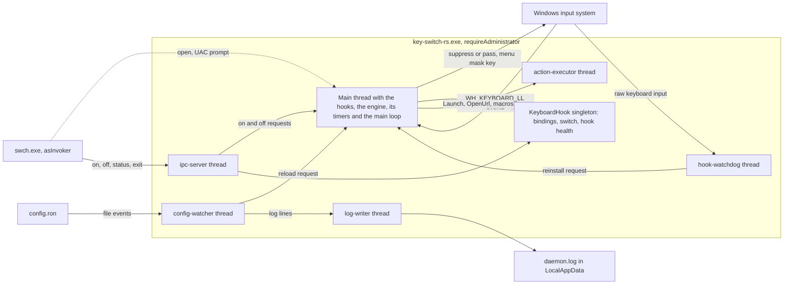

# Overview and current state

key-switch-rs is a Windows-only keyboard remapper written in Rust. An elevated daemon intercepts every key event with a low-level hook, decides in a pure decision core whether the event matches a binding from a hot-reloaded RON file, runs the action, and a small CLI controls the daemon over a named pipe. The audit of 2026-10-14 found 26 verified defects at commit `7cb3521`, six of them high severity. Roadmap Phases 0, 1 and 2 fixed all six high-severity issues except the rest of [KS-05](audit.md#ks-05), and 20 of the 26 in all, and pinned them with tests.

> [!NOTE]
> The sections up to and including [Build, test and lint status](#build-test-and-lint-status) describe commit [`f4c1fb6`](https://github.com/bluesteelll/key-switch-rs/commit/f4c1fb6) (2026-10-20), the merge of roadmap item 2.5 and the last change of the program's behaviour on `master`; the source at `252daef` differs from it only in two doc-comment lines. The sections from [The audit snapshot](#the-audit-snapshot) on keep the audit's picture of commit [`7cb3521`](https://github.com/bluesteelll/key-switch-rs/commit/7cb3521) (2026-05-20), as measured on 2026-10-14. Run-time behaviour is derived from the code and its tests; the daemon was not run against live keyboard input.

## What key-switch-rs does

The daemon `key-switch-rs.exe` installs a `WH_KEYBOARD_LL` hook on its main thread. For every key event the hook callback asks the decision core, `Engine::on_key`, which elects one winning `keys` binding for a key press and walks the rest of the binding list. The engine decides which actions fire, which gesture timers start, whether the original event still reaches other applications and whether to send the menu mask key; the callback carries that out. The main thread also owns the engine's gesture timers, so a `Hold` fires there, between key events. Fast actions such as `PressKey` and `SwitchLanguage` run before the hook returns; `Launch`, `OpenUrl` and macros go to an `action-executor` thread, and a `hook-watchdog` thread has the hook reinstalled if Windows removes it. Bindings come from `config.ron`. The daemon writes a default `config.ron` next to the exe on first run, reloads the file whenever it changes, and logs to its console and to `%LOCALAPPDATA%\key-switch-rs\daemon.log`. [Architecture](architecture.md) describes the structure.

### Features

| Area | Implemented at `f4c1fb6` | Main code | Open caveats |
|---|---|---|---|
| Interception | A `WH_KEYBOARD_LL` hook and two WinEvent hooks, `EVENT_SYSTEM_FOREGROUND` and `EVENT_SYSTEM_DESKTOPSWITCH`, installed once on the main thread, plus a hidden control window for the session notifications. `swch off` makes them pass every key untouched. The engine follows the modifier keys from the key events; the main thread reads them from Windows between key events after a focus change or anything else that could have hidden one, so a key typed with no modifier held asks Windows nothing ([Modifier state between key events](architecture.md#modifier-state-between-key-events)). A key whose press was swallowed keeps its release swallowed; when keyboard input leaves the desktop (a lock, Ctrl+Alt+Del, a UAC prompt) every held key is released. Synthesized input carries a PID-mixed sentinel in `dwExtraInfo`, so the hook skips the daemon's own output. A key swallowed while Windows has Alt or Win down is preceded by the menu mask key, vk 0xE8, so the release opens neither Start nor the menu bar. | [src/hook/keyboard_hook.rs:147-205](https://github.com/bluesteelll/key-switch-rs/blob/f4c1fb6/src/hook/keyboard_hook.rs#L147-L205), [src/hook/keyboard_hook_callback.rs:394-547](https://github.com/bluesteelll/key-switch-rs/blob/f4c1fb6/src/hook/keyboard_hook_callback.rs#L394-L547), [src/core/constants.rs:15-48](https://github.com/bluesteelll/key-switch-rs/blob/f4c1fb6/src/core/constants.rs#L15-L48) | a passing gesture on a lone Alt or Win ([known issue 66](config/known-issues.md#s19-9)); [known issues 76 to 80 and 88 to 90](config/known-issues.md#s19-9) |
| Hook health | A heartbeat of the keyboard callback, compared with the raw keyboard input on a `hook-watchdog` thread; a hook that Windows removed is reinstalled by the main thread within about 1.5 s of typing, and `swch status` reports the health. Raw key events that no callback explains also make the main thread read the modifiers again. The watchdog never injects input and does not wake up while idle. | [src/hook/watchdog/mod.rs:1-63](https://github.com/bluesteelll/key-switch-rs/blob/f4c1fb6/src/hook/watchdog/mod.rs#L1-L63), [src/hook/health.rs:1-5](https://github.com/bluesteelll/key-switch-rs/blob/f4c1fb6/src/hook/health.rs#L1-L5) | keys typed before the reinstall are not remapped; [known issues 81 to 87](config/known-issues.md#s19-9) |
| Decision core | `src/engine`: pure Rust with `#![forbid(unsafe_code)]`, driven through the `Env` and `Scheduler` traits, on the main thread with no lock; scenario and property tests | [src/engine/mod.rs:1-251](https://github.com/bluesteelll/key-switch-rs/blob/f4c1fb6/src/engine/mod.rs#L1-L251) | sequence matching ([KS-15](audit.md#ks-15), [KS-16](audit.md#ks-16)) |
| Binding kinds | `keys` (keys held together, fired by one of its own keys, modifiers matched exactly), `sequence` (at least 2 steps, `max_gap_ms` defaults to 500), `chord` (at least 2 keys that do not overlap, within `window_ms`, default 50). Sided names such as `LShift` work in all three. One `keys` binding wins each key press: the one with more keys, then one with a `when:`, then the one higher in the file. | [src/data/binding.rs:21-32](https://github.com/bluesteelll/key-switch-rs/blob/f4c1fb6/src/data/binding.rs#L21-L32), [src/engine/matching.rs:57-106](https://github.com/bluesteelll/key-switch-rs/blob/f4c1fb6/src/engine/matching.rs#L57-L106), [src/engine/winner.rs:1-24](https://github.com/bluesteelll/key-switch-rs/blob/f4c1fb6/src/engine/winner.rs#L1-L24) | [KS-15](audit.md#ks-15), [KS-16](audit.md#ks-16) |
| Triggers | `Immediate` (default), `Tap(ms)`, `Hold(ms)`, `DoubleTap(ms)`, 1 to 10000 ms. The loader accepts the three deferred triggers only on `keys` bindings. The `Tap`, `Hold` and `DoubleTap` of one press are one gesture, of which exactly one fires; a key-down of another key cancels a pending gesture whose key passes. A `Hold` fires on the main thread's high-resolution timer, within about 1 ms of its term. | [src/data/trigger.rs:17-33](https://github.com/bluesteelll/key-switch-rs/blob/f4c1fb6/src/data/trigger.rs#L17-L33), [src/engine/gestures.rs:1-42](https://github.com/bluesteelll/key-switch-rs/blob/f4c1fb6/src/engine/gestures.rs#L1-L42) | with `Tap(100)` and `Hold(200)` a release between the terms fires nothing ([KS-25](audit.md#ks-25)); a `Tap` with a `DoubleTap` waits for the window ([known issue 75](config/known-issues.md#s19-9)) |
| Actions | `SwitchLanguage`, `SwitchLanguageBackward`, `ToggleCapsLock`, `PressKey`, `PostMessage`, `Media` (7 keys) and `DoNothing` run before the hook returns; `Launch`, `OpenUrl` and `Sequence` run on the `action-executor` thread, with COM initialised | [src/core/windows_actions.rs:17-51](https://github.com/bluesteelll/key-switch-rs/blob/f4c1fb6/src/core/windows_actions.rs#L17-L51), [src/core/windows_actions.rs:182-206](https://github.com/bluesteelll/key-switch-rs/blob/f4c1fb6/src/core/windows_actions.rs#L182-L206) | [KS-09](audit.md#ks-09), [KS-19](audit.md#ks-19) |
| Macros | The `Sequence` action runs 8 step kinds (`Delay`, `Text`, `Key`, `Combo`, `Window`, `Launch`, `OpenUrl`, `Media`) on the action executor, side by side with other macros; a `Delay` ends within about 1 ms of its time. `swch off`, a reload and a lock stop a running macro. | [src/core/executor/mod.rs:1-30](https://github.com/bluesteelll/key-switch-rs/blob/f4c1fb6/src/core/executor/mod.rs#L1-L30), [src/data/sequence.rs:104-117](https://github.com/bluesteelll/key-switch-rs/blob/f4c1fb6/src/data/sequence.rs#L104-L117) | a step that blocks inside Windows holds up the other jobs; [KS-19](audit.md#ks-19) |
| Conditions | `when:` takes `Always`, `AppEquals`, `TitleContains`, `TitleEquals`, `Not`, `And` or `Or`; every comparison ignores case in every alphabet. A `keys` binding's condition is asked only once its keys match. The executable name comes from a cache per window, filled outside the keyboard callback; the title is read live. | [src/data/condition.rs:18-95](https://github.com/bluesteelll/key-switch-rs/blob/f4c1fb6/src/data/condition.rs#L18-L95), [src/platform/foreground.rs:1-23](https://github.com/bluesteelll/key-switch-rs/blob/f4c1fb6/src/platform/foreground.rs#L1-L23) | a key a program sends right after it activates a window ([known issue 80](config/known-issues.md#s19-9)) |
| Per-binding flags | `block_default` (default `true`; `false` for a `Tap`, `Hold` or `DoubleTap` combo made only of modifiers), `repeat` (`keys` bindings with `Immediate` only; default `true` only for `PressKey`, `Media(VolumeUp)` and `Media(VolumeDown)`), `block_original_combo` (`false` by default, `true`, or the experimental `MaskOnly`) and `allow_extra_modifiers` (default `false`, `keys` only). `block_original_combo` adds an auto-blocker for the OS hotkey of the action, which acts where the `when:` of the bindings that asked for it holds. Only `SwitchLanguage` and `SwitchLanguageBackward` have one: the language hotkey, read from `HKCU\Keyboard Layout\Toggle`. | [src/config/loader.rs:466-526](https://github.com/bluesteelll/key-switch-rs/blob/f4c1fb6/src/config/loader.rs#L466-L526), [src/config/loader.rs:322-437](https://github.com/bluesteelll/key-switch-rs/blob/f4c1fb6/src/config/loader.rs#L322-L437), [src/system/registry.rs:30-39](https://github.com/bluesteelll/key-switch-rs/blob/f4c1fb6/src/system/registry.rs#L30-L39) | [KS-05](audit.md#ks-05) rest; `MaskOnly` rests on an unverified hypothesis |
| Config loading | RON with the `IMPLICIT_SOME` extension, a BOM accepted, unknown fields rejected, timings range-checked. A default file is written on first run beside the exe, all per-binding errors are reported in one pass, and a binding that duplicates an earlier one gets a warning. | [src/config/loader.rs:151-320](https://github.com/bluesteelll/key-switch-rs/blob/f4c1fb6/src/config/loader.rs#L151-L320) | none |
| Hot reload | A `notify` watcher on the config's parent directory, matching the file name ignoring case, with a 250 ms debounce. The main thread swaps the new list in and resets the pending gestures in one step, between two key events; a failed reload, a deleted file included, keeps the previous bindings. | [src/hook/config_watcher.rs:1-24](https://github.com/bluesteelll/key-switch-rs/blob/f4c1fb6/src/hook/config_watcher.rs#L1-L24), [src/hook/main_thread.rs:336-344](https://github.com/bluesteelll/key-switch-rs/blob/f4c1fb6/src/hook/main_thread.rs#L336-L344) | a transient read error is not retried |
| Control | The `swch` CLI talks to the daemon with a one-line protocol over `\\.\pipe\key-switch-rs.sock`, protected by an explicit security descriptor, with a 5 s deadline. The daemon creates the pipe before its hooks, and a pipe it cannot create stops it. `swch on` and `off` are carried out by the main thread; `swch status` also reports the hook's health. | [src/ipc.rs:31-37](https://github.com/bluesteelll/key-switch-rs/blob/f4c1fb6/src/ipc.rs#L31-L37), [src/hook/ipc_server.rs:57-83](https://github.com/bluesteelll/key-switch-rs/blob/f4c1fb6/src/hook/ipc_server.rs#L57-L83) | [KS-26](audit.md#ks-26), [KS-40](audit.md#ks-40) |
| Single instance | The mutex `Local\key-switch-rs`, taken before the config is read: a second daemon in the same Windows session logs `[ERROR] already running in this session; ...` and exits with code 2. | [src/system/single_instance.rs:21-65](https://github.com/bluesteelll/key-switch-rs/blob/f4c1fb6/src/system/single_instance.rs#L21-L65), [src/main.rs:20-36](https://github.com/bluesteelll/key-switch-rs/blob/f4c1fb6/src/main.rs#L20-L36) | other sessions ([KS-40](audit.md#ks-40)) |
| Logging | The `log` crate with an in-house sink: every line on stderr and, once the daemon owns its session, in `daemon.log`, with a UTC timestamp; rotation at 1 MiB into three files. The hook callback logs nothing and only counts. A panic is logged through the writer with a bounded wait. | [src/logging/mod.rs:1-19](https://github.com/bluesteelll/key-switch-rs/blob/f4c1fb6/src/logging/mod.rs#L1-L19) | log folder hardening ([gaps](gaps.md#missing-project-infrastructure)) |
| Elevation | A `requireAdministrator` manifest is linked into the release daemon only, by the MSVC linker. | [build.rs:21-47](https://github.com/bluesteelll/key-switch-rs/blob/f4c1fb6/build.rs#L21-L47) | [KS-09](audit.md#ks-09) |

The [configuration reference](config/index.md) documents the syntax, and [Gaps and documentation drift](gaps.md) lists what is still missing.

### Default bindings

The embedded default config ([src/config/default_config.ron:236-246](https://github.com/bluesteelll/key-switch-rs/blob/f4c1fb6/src/config/default_config.ron#L236-L246)) enables two bindings, and the loader appends a third.

| Keys | Action | Origin | Effect |
|---|---|---|---|
| `CapsLock` | `SwitchLanguage` | config, with `block_original_combo: true` | Posts `WM_INPUTLANGCHANGEREQUEST` (forward) to the foreground window. Fires only with no modifier held, once per press. |
| `Shift+CapsLock` | `ToggleCapsLock` | config | Synthesizes a CapsLock press, so the CapsLock toggle stays reachable. Fires with either Shift and no other modifier. |
| `Alt+Shift` (or `Ctrl+Shift`, or the grave-accent key) | suppress only | auto-blocker appended by the loader | Silences the Windows language hotkey when it is pressed on its own. The combo comes from the registry value `Hotkey`, then `Language Hotkey`: `"1"` gives Alt+Shift, `"2"` gives Ctrl+Shift and `"4"` gives the grave accent. `"3"`, "Not assigned", gives no hotkey and no auto-blocker ([KS-17](audit.md#ks-17), fixed; [src/system/registry.rs:223-231](https://github.com/bluesteelll/key-switch-rs/blob/f4c1fb6/src/system/registry.rs#L223-L231)). Only when neither value decides is the built-in default Alt+Shift used. |

With the default config, `swch status` therefore reports 3 live bindings, or 2 with the Windows hotkey set to "Not assigned". The rest of the bindings list is commented-out examples. The `LShift` DoubleTap example fires and, since roadmap [item 1.3](roadmap.md#13-block_default-for-tap-hold-and-doubletap), lets every left-Shift event through; since item 2.2 a key typed between the two presses cancels it, so two quick left-Shift capitals leave CapsLock alone, and the template says so.

> [!WARNING]
> The default config still runs into one high-severity remainder. The auto-blocker swallows the second modifier of a three-key shortcut on Alt and Shift: Alt, Shift, X reaches the application as Alt+X ([KS-05](audit.md#ks-05)). The swallowed Shift is masked, so no menu opens. The experimental `block_original_combo: MaskOnly` lets that Shift through, if Windows behaves as the unverified hypothesis of roadmap item 1.2 says. The audit's other findings on the default config, rollover eating keys ([KS-04](audit.md#ks-04)), a stuck Shift ([KS-06](audit.md#ks-06)) and layouts cycling while CapsLock is held ([KS-10](audit.md#ks-10)), are fixed.

## The two binaries

| Binary | Source | UAC manifest | Release size (audit) | Role |
|---|---|---|---|---|
| `key-switch-rs.exe` | [src/main.rs](https://github.com/bluesteelll/key-switch-rs/blob/f4c1fb6/src/main.rs) on top of the `key_switch_rs` library ([src/lib.rs](https://github.com/bluesteelll/key-switch-rs/blob/f4c1fb6/src/lib.rs)) | `requireAdministrator`, release builds with the MSVC linker only | about 990 KB | Daemon. It takes the single-instance guard, loads the config, creates the pipe, installs its three hooks, runs the main loop with the engine and its timers, runs slow actions on the action executor, watches its own hook, serves the pipe, watches the config file and writes `daemon.log`. |
| `swch.exe` | [src/bin/swch.rs](https://github.com/bluesteelll/key-switch-rs/blob/f4c1fb6/src/bin/swch.rs) | none embedded, so it runs `asInvoker` | about 215 KB | CLI. `open` checks for a running daemon and starts one through `ShellExecuteW` with the `runas` verb. `on`, `off`, `status` and `exit` each send one line over the pipe ([src/bin/swch.rs:33-54](https://github.com/bluesteelll/key-switch-rs/blob/f4c1fb6/src/bin/swch.rs#L33-L54)). |

The code is split into a library so that both binaries can share the protocol module `src/ipc.rs`, which also holds the client. The daemon takes its config path from the first command-line argument, made absolute; without an argument it uses `<exe_dir>\config.ron` ([src/main.rs:71-76](https://github.com/bluesteelll/key-switch-rs/blob/f4c1fb6/src/main.rs#L71-L76)). Debug builds of the daemon do not get the `requireAdministrator` manifest and run at the caller's integrity level, unless `swch open` starts them, which always uses `runas`. `build.rs` never references the `app.manifest` file in the repository root, so neither binary embeds it.

The main thread owns the three hooks and the control window, runs the engine and its gesture timers, and pumps messages, so the hook callback runs there ([src/core/app.rs:168-326](https://github.com/bluesteelll/key-switch-rs/blob/f4c1fb6/src/core/app.rs#L168-L326)). The daemon also runs these other threads:

- the `action-executor` thread, which runs `Launch`, `OpenUrl` and every `Sequence` macro (roadmap [item 2.1](roadmap.md#21-action-executor));
- the `hook-watchdog` thread, which reads the raw keyboard input and has a removed hook reinstalled (roadmap [item 2.4](roadmap.md#24-hook-watchdog));
- the `ipc-server` accept loop, which starts one short-lived worker per connection;
- the `config-watcher` debounce thread, plus the internal thread of the `notify` backend;
- the `log-writer` thread, which writes every log line to the console and to `%LOCALAPPDATA%\key-switch-rs\daemon.log` (roadmap [item 1.7](roadmap.md#17-file-logging)).

No gesture starts a thread ([KS-33](audit.md#ks-33), fixed). [Architecture](architecture.md) describes the threads in detail, and [Building, running and controlling the daemon](build-and-run.md) covers the commands.

## Changes since the audit

Every change after the book was merged into `master` with `git merge --no-ff`; each lane of Phases 0, 1 and 2 had a written plan, a review and a test report before its merge. The [roadmap](roadmap.md) has the status of each item, and the [audit](audit.md) the status of each issue.

| Merge | Date | Branch | What it changed | Issues |
|---|---|---|---|---|
| [`3b6dcec`](https://github.com/bluesteelll/key-switch-rs/commit/3b6dcec) | 2026-10-14 | (direct commit) | This book, published to GitHub Pages | none |
| [`da58f5f`](https://github.com/bluesteelll/key-switch-rs/commit/da58f5f) | 2026-10-14 | `chore/ci-license` | CI, the `MIT OR Apache-2.0` licence, package metadata, `CHANGELOG.md`, `cargo fmt`; roadmap item 0.1 | [KS-38](audit.md#ks-38), [KS-42](audit.md#ks-42) |
| [`16a0461`](https://github.com/bluesteelll/key-switch-rs/commit/16a0461) | 2026-10-15 | `refactor/engine` | The decision core `src/engine`; the hook callback becomes an adapter | [KS-11](audit.md#ks-11); [KS-25](audit.md#ks-25), [KS-33](audit.md#ks-33) partly |
| [`82f542f`](https://github.com/bluesteelll/key-switch-rs/commit/82f542f) | 2026-10-15 | `fix/matching` | Trigger-key rule, exact modifiers with `allow_extra_modifiers`, sided keys | [KS-04](audit.md#ks-04), [KS-06](audit.md#ks-06), [KS-07](audit.md#ks-07) |
| [`44f79ac`](https://github.com/bluesteelll/key-switch-rs/commit/44f79ac) | 2026-10-15 | `fix/suppression-symmetry` | Suppression symmetry on auto-repeat and across focus changes | [KS-14](audit.md#ks-14), [KS-30](audit.md#ks-30), [KS-32](audit.md#ks-32) |
| [`b056b72`](https://github.com/bluesteelll/key-switch-rs/commit/b056b72) | 2026-10-15 | `fix/auto-blockers` | Exact auto-blockers and their dedup | [KS-18](audit.md#ks-18); [KS-05](audit.md#ks-05) partly |
| [`a1b5a27`](https://github.com/bluesteelll/key-switch-rs/commit/a1b5a27) | 2026-10-16 | `fix/ipc-control` | `on`/`off` as a flag, the pipe SDDL, `swch` timeouts | [KS-01](audit.md#ks-01), [KS-02](audit.md#ks-02), [KS-31](audit.md#ks-31), [KS-39](audit.md#ks-39); [KS-20](audit.md#ks-20) partly |
| [`4177540`](https://github.com/bluesteelll/key-switch-rs/commit/4177540) | 2026-10-16 | `fix/app-equals` | `AppEquals` through `QueryFullProcessImageNameW`, Unicode case folding | [KS-03](audit.md#ks-03), [KS-28](audit.md#ks-28) |
| [`1dfd80a`](https://github.com/bluesteelll/key-switch-rs/commit/1dfd80a) | 2026-10-16 | `fix/config-edge-cases` | Absolute config path, strict loader, BOM, timing range, documentation drift | [KS-21](audit.md#ks-21), [KS-22](audit.md#ks-22), [KS-23](audit.md#ks-23), [KS-24](audit.md#ks-24), [KS-27](audit.md#ks-27); [KS-41](audit.md#ks-41) partly |
| [`efea317`](https://github.com/bluesteelll/key-switch-rs/commit/efea317) | 2026-10-16 | `docs/book-phase-0` | This book describes `master` after Phase 0 | none |
| [`1afa720`](https://github.com/bluesteelll/key-switch-rs/commit/1afa720) | 2026-10-16 | `feat/repeat-flag` | Per-binding `repeat`; `Immediate` actions fire once per press by default; roadmap item 1.1 | [KS-10](audit.md#ks-10) |
| [`9357cfa`](https://github.com/bluesteelll/key-switch-rs/commit/9357cfa) | 2026-10-16 | `feat/deferred-block-default` | `block_default` for `Tap`, `Hold` and `DoubleTap`, off by default for combos made only of modifiers; item 1.3 | none |
| [`ece1767`](https://github.com/bluesteelll/key-switch-rs/commit/ece1767) | 2026-10-16 | `feat/one-winner` | One binding wins each key press; a warning for duplicate bindings; item 1.6 | [KS-13](audit.md#ks-13) |
| [`f28da35`](https://github.com/bluesteelll/key-switch-rs/commit/f28da35) | 2026-10-16 | `feat/mask-key` | The menu mask key, the experimental `block_original_combo: MaskOnly`, the blocker's `when:`; item 1.2 | [KS-12](audit.md#ks-12), [KS-35](audit.md#ks-35); [KS-05](audit.md#ks-05) partly |
| [`f0048a3`](https://github.com/bluesteelll/key-switch-rs/commit/f0048a3) | 2026-10-16 | `fix/language-hotkey-tristate` | `"3"` ("Not assigned") gives no auto-blocker; item 1.4 | [KS-17](audit.md#ks-17) |
| [`1058ddb`](https://github.com/bluesteelll/key-switch-rs/commit/1058ddb) | 2026-10-16 | `feat/single-instance` | One daemon per session; the pipe before the hooks, fatal on failure; item 1.5 | [KS-20](audit.md#ks-20) |
| [`20af28d`](https://github.com/bluesteelll/key-switch-rs/commit/20af28d) | 2026-10-18 | `feat/file-logging` | The `log` crate, `daemon.log` with rotation, counters on the hook path; item 1.7 | [KS-33](audit.md#ks-33) partly |
| [`f7f3a68`](https://github.com/bluesteelll/key-switch-rs/commit/f7f3a68) | 2026-10-18 | `docs/book-phase-1` | This book describes `master` after Phase 1 | none |
| [`57871e3`](https://github.com/bluesteelll/key-switch-rs/commit/57871e3) | 2026-10-19 | `feat/action-executor` | The `action-executor` thread for `Launch`, `OpenUrl` and macros, with a high-resolution `Delay` timer and cancellation; item 2.1 | [KS-08](audit.md#ks-08) partly, [KS-33](audit.md#ks-33) partly |
| [`283d8aa`](https://github.com/bluesteelll/key-switch-rs/commit/283d8aa) | 2026-10-19 | `feat/main-thread-timers` | The engine and its gesture timers on the main thread, one gesture per press, the cancel rule, the latency bench; item 2.2 | [KS-25](audit.md#ks-25), [KS-33](audit.md#ks-33) |
| [`3befec7`](https://github.com/bluesteelll/key-switch-rs/commit/3befec7) | 2026-10-19 | `feat/control-window` | The control window and the input-left reset, the reload on the main thread, the witness, the foreground cache; item 2.3 | [KS-06](audit.md#ks-06) rest, [KS-29](audit.md#ks-29), [KS-31](audit.md#ks-31) |
| [`bf549c0`](https://github.com/bluesteelll/key-switch-rs/commit/bf549c0) | 2026-10-19 | `feat/hook-watchdog` | The hook watchdog, the hook's health in `swch status`, the panic hook; item 2.4 | [KS-08](audit.md#ks-08) |
| [`7c26671`](https://github.com/bluesteelll/key-switch-rs/commit/7c26671) | 2026-10-19 | `docs/book-phase-2` | This book describes `master` after Phase 2 | none |
| [`f4c1fb6`](https://github.com/bluesteelll/key-switch-rs/commit/f4c1fb6) | 2026-10-20 | `perf/latency-trim` | No key event reads every modifier from Windows: the flags follow the key events, a key-down asks Windows only about the modifiers it holds, and the main thread reads them between key events; a swallowed repeat with no record keeps its key-up; the `hook_late` counter; item 2.5 | none |

Five merges that change only the agent workflow and its instructions (`5a86e9a`, `73bbf40`, `e67e5cb`, `dbd55ca`, `2a207a3`) are left out of the table, and so are the orchestrator's merges and commits that update `CLAUDE.md`, the agent files and, for owner decisions, the roadmap (`7d757a1`, `62e36a6`, `c9c1373`, `c3dab6a`, `fa20b30`, `3e779f8`, `50b56a8`, `3cde1d0`, `252daef`). `252daef` also brings `28566a4`, which updates `README.md` and two rustdoc lines of `src/engine/modifiers.rs` after item 2.5 and changes no behaviour. Several changes are breaking for existing configs: exact modifiers, sided names, overlapping chord keys, unknown fields, a required `bindings`, the timing range, a command-line path that must exist, `Immediate` actions that no longer repeat, modifier-only gestures that let their keys through, one winner per key press, an auto-blocker that follows its binding's `when:`, one gesture per press, and another key-down cancelling a pending gesture whose key passes. `CHANGELOG.md` lists each under *Changed* with a **Breaking:** prefix, and [Known configuration pitfalls](config/known-issues.md#s19-9) lists the traps they create.

## Build, test and lint status

At `f4c1fb6`, from the quality gate that the merge of item 2.5 ran on the merge commit on 2026-10-20, unless the row says otherwise. The test list was run again for this page at `252daef`, whose source differs only in comments, with a fresh target directory.

| Check | Command | Result |
|---|---|---|
| Format | `cargo fmt --check` | Pass |
| Lint | `cargo clippy --all-targets --locked -- -D warnings` | Pass |
| Tests | `cargo test --locked` | 862 library tests passed, 0 failed, 7 ignored (6 manual checks and the latency bench); 7 integration tests in `tests/ipc_roundtrip.rs` passed. The `swch` binary and the doc tests have none. |
| Test count | `cargo test --locked -- --list` | 869 library tests, 235 of them engine scenarios, plus the 7 integration tests ([per module](build-and-run.md#unit-tests)) |
| Release build | `cargo build --release --locked` | Built by CI on every push; the audit measured about 39 s at `7cb3521`. |
| Manifest scoping | CI step | `key-switch-rs.exe` embeds `requireAdministrator`; `swch.exe` does not. |
| CI | `.github/workflows/ci.yml` | `check`, `msrv` (Rust 1.88) and `windows-gnu` jobs ([Continuous integration](build-and-run.md#continuous-integration)) |
| Minimum toolchain | `rust-version = "1.88"` in `Cargo.toml` | Checked by the `msrv` job |

No test installs hooks, registers for raw input or injects input: the installers are compiled out of the test build, and the tests that would need a live hook are ignored manual checks. Some tests read the live `HKCU` registry and the foreground window, and the watcher, logging and IPC tests create temporary files and test pipes.

The source at `f4c1fb6` has 40,201 lines of Rust in 67 files under `src/`, 14,568 of them outside test code, plus `tests/ipc_roundtrip.rs` (281 lines) and `build.rs` (214 lines). The engine is the largest module, with 13,565 lines, 2,883 of them outside test code; `hook` has the most code outside tests, 4,793 of its 11,536 lines; the `platform` module has 883, 475 of them outside test code. Lines were counted with a script that treats a trailing `#[cfg(test)] mod tests` block and the test-only files `engine/testing.rs`, `engine/scenarios.rs`, `engine/properties.rs`, `config/testing.rs`, `logging/testing.rs`, `core/executor/testing.rs` and `bench.rs` as test code; the same script gives 37,234 lines in 65 files, 13,816 outside test code, for `bf549c0`, 20,547 lines in 47 files, 7,825 outside test code, for `20af28d`, and 13,978 lines in 39 files, 6,025 outside test code, for `1dfd80a`.

## The audit snapshot

Everything below describes commit `7cb3521` as the audit found it on 2026-10-14. It is kept as the baseline that the [audit](audit.md) and the [roadmap](roadmap.md) refer to.

### Commit history

| Commit | Date | Subject | Files | Lines | What it added |
|---|---|---|---|---|---|
| [`7cb3521`](https://github.com/bluesteelll/key-switch-rs/commit/7cb3521) | 2026-05-20 | CLI: split into daemon + swch + named-pipe IPC, README + dev agents | 9 | +1,559 / -72 | `src/lib.rs`, `src/ipc.rs`, `src/hook/ipc_server.rs`, `src/bin/swch.rs`, a README rewrite, and three Claude Code agent definitions plus their README in `.claude/agents/` |
| [`143eaea`](https://github.com/bluesteelll/key-switch-rs/commit/143eaea) | 2026-04-08 | Bindings: per-app conditions + Tap/Hold/DoubleTap triggers + Chord/Sequence kinds | 5 | +1,031 | `data/condition.rs`, `data/trigger.rs`, `hook/tap_state.rs`, `hook/chord_state.rs`, `hook/sequence_state.rs` |
| [`0a429b1`](https://github.com/bluesteelll/key-switch-rs/commit/0a429b1) | 2026-03-12 | Config: RON-driven bindings with file-watcher hot-reload | 7 | +2,280 | `src/config/` (4 modules plus `default_config.ron`), `data/sequence.rs`, `hook/config_watcher.rs` |
| [`b4c8acf`](https://github.com/bluesteelll/key-switch-rs/commit/b4c8acf) | 2026-02-15 | Core: fix Task Manager UIPI bug, harden state, add admin manifest | 18 | +2,063 / -324 | `build.rs`, `app.manifest`, `Cargo.lock`, `core/constants.rs` and `data/vk_name.rs`, plus changes to 13 existing files |
| [`053f043`](https://github.com/bluesteelll/key-switch-rs/commit/053f043) | 2025-12-19 | mvp | 16 | +1,263 / -1 | The first code (13 `.rs` files, 1,084 lines): `App`, `KeyboardHook` and its callback, `BindAction`, `Binding`, `KeyCombination`, the registry reader and the system functions |
| [`2f3bd3d`](https://github.com/bluesteelll/key-switch-rs/commit/2f3bd3d) | 2025-12-12 | Initial commit | 1 | +1 | `README.md` |

At the audit the repository had one author (Celtokisa) and one branch (`master`). It had no tags, no GitHub issues or pull requests, and no TODO or ROADMAP file. Nothing was committed between `7cb3521` and the audit, almost five months later. The work since then is in [Changes since the audit](#changes-since-the-audit).

> [!NOTE]
> Only `7cb3521` is a consistent tree of that history. Every source file that exists in `b4c8acf` is already identical to its `7cb3521` version: `git diff b4c8acf 7cb3521` only adds files and changes `README.md`. As a result, `b4c8acf` already declares `hook/chord_state.rs`, `hook/ipc_server.rs` and other modules, and its `main.rs` imports the `key_switch_rs` library. None of those exist until later commits. `b4c8acf`, `0a429b1` and `143eaea` therefore cannot compile on their own: `cargo check` on each fails with `unresolved import key_switch_rs` (E0432). `git bisect` is of no use before `7cb3521`. The commit subjects describe which files each commit adds, not when a behaviour first appeared.

### Build, test and lint status at the audit

These checks were run on 2026-10-14 on Windows 11 with rustc and cargo 1.98.1, against a copy of `7cb3521`.

| Check | Command | Result |
|---|---|---|
| Release build | `cargo build --release` | Pass: 0 warnings, about 39 s from a clean target directory. |
| Unit tests | `cargo test` | Pass: 120 passed, 0 failed, 0 ignored. All 120 are library unit tests. The two binary targets and the doc-tests contain no tests. |
| Integration tests | none | There was no `tests/` directory. Nothing tested the hook path, the IPC server or the config watcher end to end. |
| Lint | `cargo clippy --all-targets` | 1 warning: `clippy::unnecessary_sort_by` at [src/hook/keyboard_hook.rs:72](https://github.com/bluesteelll/key-switch-rs/blob/7cb3521/src/hook/keyboard_hook.rs#L72). It is a style lint with no change in behaviour. |
| Manifest scoping | inspection of the release binaries | `key-switch-rs.exe` embeds `requireAdministrator`; `swch.exe` does not. |
| CI | none | `7cb3521` has no workflow files. |
| Minimum toolchain | not declared | Edition 2024 with let chains ([src/config/loader.rs:176-177](https://github.com/bluesteelll/key-switch-rs/blob/7cb3521/src/config/loader.rs#L176-L177)) needs Rust 1.88 or newer. `Cargo.toml` set no `rust-version`. |

### Code size by module

Lines were counted with `wc -l` at `7cb3521`. "Test" counts the `#[cfg(test)]` module, which sits at the end of every file that has tests. The size at `f4c1fb6` is in [Build, test and lint status](#build-test-and-lint-status).

| Module | Files | Lines | Non-test | Test | Contents |
|---|---:|---:|---:|---:|---|
| `src/hook/` | 8 | 1,651 | 1,235 | 416 | Hook install and callback, Tap/Hold/DoubleTap state, chord and sequence state machines, config watcher, IPC server |
| `src/config/` | 4 | 1,595 | 742 | 853 | RON schema, parsing of combos and `WM_*` names, loader with validation and auto-blockers |
| `src/data/` | 7 | 1,241 | 976 | 265 | Binding model, conditions, triggers, macro engine, key-name tables |
| `src/system/` | 3 | 493 | 418 | 75 | Registry hotkey reader, language switching, CapsLock toggle |
| `src/core/` | 4 | 465 | 465 | 0 | `App` lifecycle and message loop, actions, injected-event sentinel |
| `src/bin/` | 1 | 184 | 184 | 0 | `swch` CLI |
| `src/` root | 3 | 182 | 131 | 51 | `main.rs`, `lib.rs`, `ipc.rs` |
| **Total** | **30** | **5,811** | **4,151** | **1,660** | |

The table leaves out `build.rs` (28 lines) and `src/config/default_config.ron` (237 lines, embedded with `include_str!`). The largest file was `src/config/loader.rs` with 1,242 lines, 782 of which were tests. `src/config/` was the only module with more test code than production code. The largest production files were `loader.rs` (460 non-test lines), `keyboard_hook_callback.rs` (348), `data/sequence.rs` (294), `core/windows_actions.rs` (270) and `system/registry.rs` (245).

### Tests per file

The 120 tests of `7cb3521`. The counts at `f4c1fb6` are in [Unit and integration tests](build-and-run.md#unit-tests).

| File | Tests | What they cover |
|---|---:|---|
| `config/loader.rs` | 41 | Parsing of every action, trigger and kind, and of most conditions (no test parsed `Or` or `TitleEquals`); validation errors; auto-blocker expansion; a check that the default config parses |
| `data/vk_name.rs` | 14 | Key-name parsing and display, aliases, round trips |
| `config/parsing.rs` | 10 | Combo strings (case, whitespace, duplicates, stray `+`) and `WM_*` names |
| `hook/tap_state.rs` | 8 | Inserting and removing pending entries for Tap, Hold and DoubleTap. The terms were 10 s, so no timer ever fired. |
| `ipc.rs` | 7 | Command and response wire format, aliases |
| `data/condition.rs` | 6 | `Always`, `Not`, `And` and `Or` only. No test evaluated `AppEquals` or the `Title*` conditions. |
| `hook/chord_state.rs` | 5 | Chord arming and completion, independence from key order |
| `data/sequence.rs` | 5 | `Display` of macro steps, modifier classification |
| `system/registry.rs` | 5 | Parsing of hotkey values, default combos, and one test that does live read-only registry lookups |
| `hook/keyboard_hook.rs` | 4 | Sorting of the binding list by specificity, `ArcSwap` replacement |
| `hook/keyboard_hook_callback.rs` | 4 | The `ActiveKeys` buffer and the blocked-key bitmap helpers |
| `hook/sequence_state.rs` | 4 | Advancing, completing and aborting a sequence |
| `data/key_combination.rs` | 3 | Subset matching, including with extra held keys |
| `system/system_function.rs` | 3 | System hotkeys of Lock, Show Desktop and Task Manager (through the registry reader), no hotkey for CapsLock, System32 path |
| `data/trigger.rs` | 1 | The default trigger is `Immediate` |
| **Total** | **120** | |

At the audit the most important gap was the decision code in `keyboard_hook_callback.rs`: the callback itself, `handle_key_down` and `handle_key_up`. KS-04, KS-05, KS-06, KS-10, KS-13 and KS-14 all passed through it, and no test exercised it. That code is now the engine, which the scenario tests drive. [Test coverage](gaps.md#test-coverage) has the audit's line counts per file and its list of untested areas.

### Maturity verdict at the audit

The audit rated the architecture clean, and the `unsafe` code and atomics sound. Event-level behaviour, meaning what happens on each key-down and key-up, was MVP quality.

| Aspect | Rating at `7cb3521` | Basis |
|---|---|---|
| Structure | Good | The code is a library plus two thin binaries, split by concern into `config`, `data`, `hook`, `core` and `system`. It has typed config errors and RAII guards for process and registry handles, and it is heavily commented. |
| `unsafe` and atomics | Sound | There were 35 `unsafe` blocks in 11 files, documented by 29 `// SAFETY:` comments. All shared hook state was held in atomics, `ArcSwap` or `Mutex`. `install()` rolls back the LL hook if `SetWinEventHook` fails. The audit found no defect in `unsafe` code or memory ordering. |
| Config parsing | Good but lax | 51 tests covered it, and errors were collected per binding. On the other hand, unknown fields were ignored, a BOM broke parsing and there were no range checks ([KS-22](audit.md#ks-22), [KS-24](audit.md#ks-24), [KS-27](audit.md#ks-27)). |
| Event-level behaviour | MVP | A single isolated press worked. Normal typing ran into rollover, auto-repeat and modifier-sync defects ([KS-04](audit.md#ks-04), [KS-05](audit.md#ks-05), [KS-06](audit.md#ks-06), [KS-10](audit.md#ks-10), [KS-13](audit.md#ks-13), [KS-14](audit.md#ks-14)), and no test covered the decision code. |
| Gestures | MVP | Every armed gesture got its own thread, and there was no generation token, so a stale timer could act on a newer press. Tap and Hold were not mutually exclusive ([KS-11](audit.md#ks-11), [KS-25](audit.md#ks-25)). |
| Process, IPC, elevation | Not yet dependable when elevated | A non-elevated `swch` could not reach the elevated daemon, and `off` followed by `on` killed the hook ([KS-01](audit.md#ks-01), [KS-02](audit.md#ks-02)). There was no single-instance guard ([KS-20](audit.md#ks-20)). Launched programs inherit the admin token ([KS-09](audit.md#ks-09)). Logging went to the console only. |
| Project infrastructure | Missing | There was no CI, LICENSE, CHANGELOG, release packaging, tag or Cargo package metadata. |
| Documentation | Detailed, with drift | The README matched most of the code but over-promised in places ([gaps.md](gaps.md)). |

The audit's summary was that key-switch-rs worked for isolated presses of simple `Immediate` bindings, with `swch` and the daemon at the same integrity level and without `swch off`/`on`. Most high-severity fixes it proposed were local changes: an `enabled` flag instead of reinstalling the hook, an explicit pipe security descriptor, `QueryFullProcessImageNameW`, a rule that the key just pressed must belong to the combo, and symmetric suppression of repeats. Phase 0 made each of them, plus the decision core. The audit did not re-rate the code afterwards, and this page does not either; the open issues are in the [audit](audit.md) and the [roadmap](roadmap.md).

> [!NOTE]
> The audit's findings come from reading the code, the sources of the locked dependencies and the Win32 documentation, and from small probe programs and repro tests run on the audit machine. None of them installs a keyboard hook, and the daemon was not run with live keyboard input. [How the audit was done](methodology.md) describes the method and its limits.

### High-severity issues

The audit verified 26 unique issues: 6 high, 16 medium and 4 low severity. Another 16 low-severity items (KS-27 to KS-42), most of them reported by a single reviewer, were not independently verified. The six high-severity issues are listed here with their location at `7cb3521` and their status now; [Audit results](audit.md) gives the full list, with evidence and fix directions.

| ID | Issue | Where at `7cb3521` | When it bit | Status at `f4c1fb6` |
|---|---|---|---|---|
| [KS-01](audit.md#ks-01) | `swch off` then `swch on` left the hook dead. `enable()` reinstalled the hooks on a short-lived IPC worker thread, while `status` still reported "running". | [src/hook/ipc_server.rs:115](https://github.com/bluesteelll/key-switch-rs/blob/7cb3521/src/hook/ipc_server.rs#L115), [src/hook/keyboard_hook.rs:143-157](https://github.com/bluesteelll/key-switch-rs/blob/7cb3521/src/hook/keyboard_hook.rs#L143-L157) | Any config, after `swch off` and `swch on` | Fixed in `a1b5a27` |
| [KS-02](audit.md#ks-02) | The named pipe got the default DACL, so a non-elevated `swch` could not open the elevated daemon's pipe for writing. | [src/hook/ipc_server.rs:47](https://github.com/bluesteelll/key-switch-rs/blob/7cb3521/src/hook/ipc_server.rs#L47) | Any config: an elevated daemon with `swch` run from a normal shell | Fixed in `a1b5a27` |
| [KS-03](audit.md#ks-03) | `AppEquals` never matched. `GetModuleBaseNameW` was called on a `PROCESS_QUERY_LIMITED_INFORMATION` handle and failed with access denied. | [src/data/condition.rs:139-144](https://github.com/bluesteelll/key-switch-rs/blob/7cb3521/src/data/condition.rs#L139-L144) | Only bindings that use `AppEquals` | Fixed in `4177540` |
| [KS-04](audit.md#ks-04) | Combos and deferred triggers fired, armed or suppressed on any key-down while their keys were held, so key rollover ate the next key. | [src/data/key_combination.rs:49-51](https://github.com/bluesteelll/key-switch-rs/blob/7cb3521/src/data/key_combination.rs#L49-L51), [src/hook/keyboard_hook_callback.rs:225](https://github.com/bluesteelll/key-switch-rs/blob/7cb3521/src/hook/keyboard_hook_callback.rs#L225) | Default config: typing while CapsLock is held | Fixed in `82f542f` |
| [KS-05](audit.md#ks-05) | The language-hotkey auto-blocker swallowed every Alt+Shift+X (or, with a Ctrl+Shift hotkey, Ctrl+Shift+X) and dropped a modifier from 3-key shortcuts. | [src/config/loader.rs:172-191](https://github.com/bluesteelll/key-switch-rs/blob/7cb3521/src/config/loader.rs#L172-L191), [src/hook/keyboard_hook_callback.rs:234](https://github.com/bluesteelll/key-switch-rs/blob/7cb3521/src/hook/keyboard_hook_callback.rs#L234) | Default config: shortcuts that use the language-hotkey modifiers | Partly fixed in `82f542f`, `b056b72` and `f28da35`; with `block_original_combo: true` the second modifier is still swallowed, but masked, and the experimental `MaskOnly` lets it through |
| [KS-06](audit.md#ks-06) | Stuck keys: auto-repeat of a suppressed key reached the OS while its key-up was still swallowed. | [src/hook/keyboard_hook_callback.rs:239](https://github.com/bluesteelll/key-switch-rs/blob/7cb3521/src/hook/keyboard_hook_callback.rs#L239), [src/hook/keyboard_hook_callback.rs:324](https://github.com/bluesteelll/key-switch-rs/blob/7cb3521/src/hook/keyboard_hook_callback.rs#L324) | Default config through the auto-blocker, and any Tap, Hold, DoubleTap, chord or sequence key | Fixed in `82f542f` and `44f79ac`; the rest, a lone key-up after a focus change, in `3befec7` |

## What to read next

| If you want to | Read |
|---|---|
| Follow the hook callback, the engine, the threads and the data flow | [Architecture](architecture.md) |
| Build, run and control the daemon | [Building, running and controlling the daemon](build-and-run.md) |
| Write or debug `config.ron` | [Configuration reference](config/index.md), then [Known configuration pitfalls](config/known-issues.md) |
| See every issue with its evidence, fix direction and status | [Audit results](audit.md) |
| Compare the README with the code | [Gaps and documentation drift](gaps.md) |
| Plan the next work | [Roadmap](roadmap.md) |
| Judge how far to trust the findings | [How the audit was done](methodology.md) |
| Look up terms such as LL hook, UIPI, auto-blocker or trigger key | [Glossary](glossary.md) |
