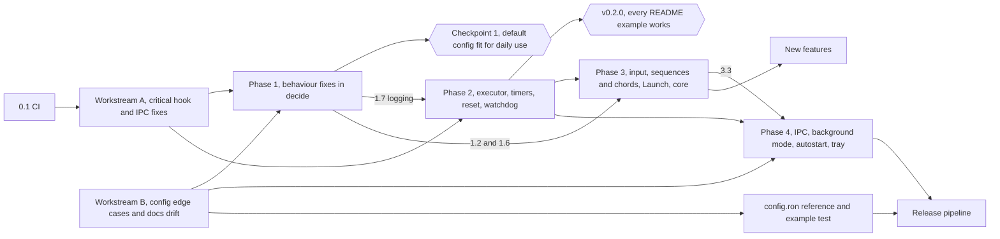

# Roadmap

This chapter sets out the order of work that would make key-switch-rs at commit `7cb3521` dependable enough for daily use. The verified defects from the [audit](audit.md) come first. The runtime and input-handling work behind them comes next, then operations (logging, background mode, autostart, tray), and new features last. Every item gives its effort, its dependencies, the issues it closes and an acceptance check.

> [!NOTE]
> The plan was synthesized from three independent drafts, written with a stability, an architecture and a product lens ([How the roadmap drafts were judged](methodology.md#how-the-roadmap-drafts-were-judged)). It is based on commit `7cb3521` and the verified audit of that commit. Effort: **S** is under half a day, **M** one to two days, **L** three days or more.

> [!IMPORTANT]
> **Progress at [`bf549c0`](https://github.com/bluesteelll/key-switch-rs/commit/bf549c0)** (2026-10-19). Phases 0, 1 and 2 are done. Phase 0 is [0.1 CI](#01-ci), [Workstream A](#workstream-a--critical-hook-and-ipc-fixes) and [Workstream B](#workstream-b--config-edge-cases-and-docs-drift); [Phase 1](#phase-1--default-configuration-fit-for-daily-use) is items 1.1 to 1.7; [Phase 2](#phase-2--the-hook-callback-only-decides) is items 2.1 to 2.4. Each item is merged into `master` and has a status block below. Phases 3 and 4 have not started. The item texts keep the plan as written against `7cb3521`, so their "Why" links show the old code. The owner has decided open questions [1, 2, 4, 8, 9 and 10](#open-questions-for-the-owner), the owner's latency priority decided question 7, and item 2.2 implemented question 5 as recommended; questions 11 to 14 are new with Phase 2. The checks of [Checkpoint 1](#checkpoint-1-smoke-checklist) and [Checkpoint 2](#checkpoint-2-v020) need a human, and this book has no record that they were run. [Follow-ups from Phase 1](#follow-ups-from-phase-1) and [Follow-ups from Phase 2](#follow-ups-from-phase-2) list what the lanes left for later items. The [issue coverage](#issue-coverage) table shows where each KS issue stands.

> [!NOTE]
> **Issue counts.** The drafts counted 27 confirmed bugs, 7 of them high severity. This chapter uses the audit's numbers and IDs: 26 verified issues, 6 high, 16 medium and 4 low ([KS-01](audit.md#ks-01) to [KS-26](audit.md#ks-26)), plus 16 unverified low-severity reports ([KS-27](audit.md#ks-27) to [KS-42](audit.md#ks-42)). The difference is one high-severity bug counted twice. The drafts listed the two paths of superset matching as separate bugs. On the Immediate path, rollover eats the next key. On the deferred path, a Tap, Hold or DoubleTap trigger arms on an unrelated key. Both come from the same subset test in `KeyCombination::matches`. The audit's [deduplication rules](methodology.md#deduplication-into-ks-ids) make one mechanism in the same code a single issue, so it merged them into [KS-04](audit.md#ks-04). The medium and low counts are the same in both.

## Summary

- **Current state.** The feature set is broad, and all 120 unit tests pass. No test covers the decision to suppress, pass or execute ([`handle_key_down`](https://github.com/bluesteelll/key-switch-rs/blob/7cb3521/src/hook/keyboard_hook_callback.rs#L183) and [`handle_key_up`](https://github.com/bluesteelll/key-switch-rs/blob/7cb3521/src/hook/keyboard_hook_callback.rs#L302)). The default configuration, used the way the README documents, runs into five of the six high-severity issues. It hits [KS-04](audit.md#ks-04) and [KS-05](audit.md#ks-05) directly, [KS-06](audit.md#ks-06) through the auto-blocker when Alt is released while Shift is still held, [KS-02](audit.md#ks-02) whenever `swch` in a normal terminal controls a release build, and [KS-01](audit.md#ks-01) after `swch off` followed by `swch on`. There is no CI, no log file, no autostart and no background mode.
- **Root causes.** The 26 verified issues reduce to eight root causes, RC1 to RC8 ([below](#root-causes)). Three of them are fixed first because their issues show up in everyday typing. Together they explain 12 of the 26 issues, including the high-severity KS-04, KS-05 and KS-06:
  - RC1: a combo matches any superset of the held keys, and there is no trigger-key rule;
  - RC2: auto-repeat breaks the symmetry between key-down and key-up;
  - RC5: heavy work runs on the hook thread.
- **Order.**
  - **Phase 0.** Workstreams A and B close the high-severity issues and extract a pure `decide()` function with tests.
  - **Phase 1.** Small behaviour fixes inside `decide()`.
  - **Phase 2.** The hook runtime.
  - **Phase 3.** Input correctness and consolidation of the core.
  - **Phase 4.** Operations.
  - New features come last.
- **Target architecture.** One main thread services the low-level keyboard hook, the WinEvent hook and the `SetTimer` timers, so the engine state lives on that thread without a `Mutex`. Side effects go to a separate executor thread. The move happens step by step, without a big rewrite. Since Phase 2 this is the design, with one difference: the main thread and the executor wait on high-resolution waitable timers instead of `SetTimer`. [Process and thread model](architecture.md#process-and-thread-model) describes it.
- **Checkpoints.**
  - After Phase 1 the default configuration is fit for daily use. Including A and B, this takes about two weeks.
  - After Phase 2 (tag v0.2.0) every README example works, including Tap/Hold and `Launch`/`OpenUrl`.

## Root causes

| RC | Cause | Typical symptoms | Issues | Closed by |
| --- | --- | --- | --- | --- |
| RC1 | A combo matches a superset of the held keys; nothing checks that the key just pressed belongs to the combo | Rollover eats a key; a deferred trigger arms on an unrelated key; the auto-blocker breaks Alt+Shift+X; a Sequence completes on rollover | [KS-04](audit.md#ks-04), [KS-05](audit.md#ks-05), [KS-13](audit.md#ks-13), [KS-15](audit.md#ks-15), [KS-16](audit.md#ks-16), [KS-18](audit.md#ks-18) | A, 1.2, 1.6, 3.2 |
| RC2 | Auto-repeat breaks the rule "a key-up is suppressed if and only if its key-down was suppressed" (since item 2.3 the rule has one exception, the witness: a key-up passes when Windows has the key down) | Stuck keys; `sync_modifiers` erases suppressed modifiers; an Immediate binding fires on every repeat | [KS-06](audit.md#ks-06), [KS-14](audit.md#ks-14), [KS-10](audit.md#ks-10) | A, 1.1, 3.4 |
| RC3 | The OS sees modifiers that the hook does not account for | A lone Win or Alt opens the Start menu or the menu bar; `Alt+J -> PressKey("Left")` arrives as Alt+Left | [KS-12](audit.md#ks-12), [KS-19](audit.md#ks-19) | 1.2, 3.1 |
| RC4 | Modifier sides are not normalised | `LShift` or `RWin` in `keys`, and `Shift` in `chord`, never fire | [KS-07](audit.md#ks-07) | A |
| RC5 | Actions run inside the hook callback, and every timer is a thread of its own per press | Windows silently removes the hook; a stale timer corrupts the next press; Tap and Hold are not mutually exclusive | [KS-08](audit.md#ks-08), [KS-11](audit.md#ks-11), [KS-25](audit.md#ks-25) | 2.1, 2.2 |
| RC6 | Ownership of Win32 resources and privilege boundaries | The hook is installed on a short-lived thread; the pipe DACL; a second instance; `Launch` children get the administrator token | [KS-01](audit.md#ks-01), [KS-02](audit.md#ks-02), [KS-20](audit.md#ks-20), [KS-09](audit.md#ks-09), [KS-26](audit.md#ks-26) | A, 1.5, 3.3, 4.1 |
| RC7 | Incorrect use of a Win32 API | `AppEquals` never matches; `Hotkey = "3"` turns into an Alt+Shift blocker | [KS-03](audit.md#ks-03), [KS-17](audit.md#ks-17) | A, 1.4 |
| RC8 | Config edge cases and hot reload | Relative path, BOM, misspelled fields, deleted file | [KS-21](audit.md#ks-21), [KS-24](audit.md#ks-24), [KS-22](audit.md#ks-22), [KS-23](audit.md#ks-23) | B |

### Correspondence with the audit's root causes

The audit also names eight causes ([Root causes](audit.md#root-causes)), but it draws two boundaries differently and gives KS-03 no shared cause. Each issue appears in exactly one RC above. The audit lists KS-05 and KS-18 under two causes each.

| Roadmap | Audit root cause | Difference |
| --- | --- | --- |
| RC1 | [Superset matching without a trigger-key rule](audit.md#superset-matching-without-a-trigger-key-rule) | Same issues. The audit also lists KS-18 under lax validation, because the auto-blocker dedup looks only backwards. The roadmap keeps it in RC1, since Workstream A fixes it together with the exact auto-blockers. |
| RC2 | [Suppression and repeat state are not kept symmetric](audit.md#suppression-and-repeat-state-are-not-kept-symmetric) | Same. |
| RC3 | [The OS modifier state is not managed](audit.md#the-os-modifier-state-is-not-managed) | Same, except that the audit also lists KS-05 here. Item 1.2 removes this half of KS-05. |
| RC4 | [Sided keys are not canonicalised in one place](audit.md#sided-keys-are-not-canonicalised-in-one-place) | Same. |
| RC5 | [Actions run on the hook thread, in the daemon's context](audit.md#actions-run-on-the-hook-thread-in-the-daemons-context) (KS-08) and [Gesture timers carry no generation token](audit.md#gesture-timers-carry-no-generation-token) (KS-11, KS-25) | The roadmap joins the hook-thread half of the first cause with the second, because one main-thread executor and scheduler (2.1, 2.2) fixes both. |
| RC6 | [IPC runs commands on throwaway threads behind a default ACL](audit.md#ipc-runs-commands-on-throwaway-threads-behind-a-default-acl) (KS-01, KS-02, KS-20, KS-26) and the daemon-context half of [Actions run on the hook thread, in the daemon's context](audit.md#actions-run-on-the-hook-thread-in-the-daemons-context) (KS-09) | The roadmap groups the elevated child processes with the IPC issues as privilege-boundary problems. |
| RC7 | None for KS-03, which the audit gives no shared cause; [Lax configuration and input validation](audit.md#lax-configuration-and-input-validation) for KS-17 | The roadmap groups the two Win32 API mistakes. |
| RC8 | [Lax configuration and input validation](audit.md#lax-configuration-and-input-validation) (KS-21 to KS-24) | The rest of that cause, without KS-17 (RC7) and KS-18 (RC1). |

## Rules for every item

- One item, one branch merged with `--no-ff`: first a regression test that fails on the current code, then the fix.
- Logic is tested through `decide()` from Workstream A. Tests substitute the clock, an `Env` (the foreground window, `GetAsyncKeyState`) and the action sink. A test that needs a real hook or `SendInput` is marked `#[ignore]` and gets a line in the smoke checklist.
- When the meaning of the config changes, the same branch updates `README.md`, `src/config/default_config.ron` and the *Unreleased* section of `CHANGELOG.md`.
- New dependencies are added only where an item names them.
- Pressed keys are never logged, except with an explicit `--trace-keys`.
- **Latency first** (owner, 2026-10-19). Binds must run with the lowest possible delay. Every item states its effect on the key-to-action path: per-event work, allocations, locks, Win32 calls, timer resolution and wake-ups. From item 2.2 on, a latency bench runs on the parent and on the branch, and an added delay is a defect unless the item justifies it.

## Phase 0 — scoped workstreams

> [!NOTE]
> Workstreams A and B and item 0.1 are merged; their status blocks below give the commits. The later phases build on them, and "A" and "B" in the dependency columns refer to them.

### Workstream A — critical hook and IPC fixes

Effort L, no dependencies.

**What it does.**

- Implements `on` and `off` as an `AtomicBool` on the main thread, so the hook stays installed ([KS-01](audit.md#ks-01)). Gives the pipe an explicit SDDL ([KS-02](audit.md#ks-02)). Adds timeouts to `swch` ([swch read timeout](gaps.md#swch-read-timeout)).
- Reads the process name for `AppEquals` with `QueryFullProcessImageNameW` ([KS-03](audit.md#ks-03)).
- Adds a trigger-key rule for combos and for deferred triggers ([KS-04](audit.md#ks-04)).
- Makes auto-blockers match exactly and fixes their dedup ([KS-05](audit.md#ks-05), [KS-18](audit.md#ks-18)).
- Suppresses repeats symmetrically ([KS-06](audit.md#ks-06)), and makes `sync_modifiers` skip blocked keys ([KS-14](audit.md#ks-14)).
- Normalises modifier sides: `Shift` means either side, `LShift` only the left one ([KS-07](audit.md#ks-07)).
- Extracts `decide()` with regression tests.

**Scope additions before work starts.** They cost almost nothing now and avoid rework in 3.4:

1. `decide()` lives in `src/engine/`.
2. It returns `Decision { suppress, fire, arm, mask }` and executes nothing itself.
3. All Win32 access goes through an `Env` trait.
4. Tests take the form "RON plus a scenario of key events", without `TapState` or `ChordState`.

**Acceptance.**

- After `swch off; swch on` the bindings work.
- A non-elevated `swch status` gets an answer from an elevated daemon.
- With a hung daemon, `swch` exits within 5 s.
- `AppEquals` matches the test's own process.
- `decide()` tests: with CapsLock held, `a` passes through. A repeat of a suppressed key is suppressed, and its key-up is suppressed exactly once. `LShift` and `RWin` in `keys`, and `Shift` in `chord`, fire.

**Status: done.** Workstream A was merged as six lanes:

| Lane | Merge commit | Branch | What it delivered | Issues |
| --- | --- | --- | --- | --- |
| Decision core | [`16a0461`](https://github.com/bluesteelll/key-switch-rs/commit/16a0461) | `refactor/engine` | `src/engine`: `Engine::on_key`, `Engine::on_timer`, the `Env` trait and `Decision`; the scenario harness; the hook callback becomes an adapter | [KS-11](audit.md#ks-11); [KS-25](audit.md#ks-25) and [KS-33](audit.md#ks-33) partly |
| Matching | [`82f542f`](https://github.com/bluesteelll/key-switch-rs/commit/82f542f) | `fix/matching` | Trigger-key rule, exact modifiers with `allow_extra_modifiers`, sided keys through `KeySpec`, exact auto-blockers, auto-repeats that follow their key-down | [KS-04](audit.md#ks-04), [KS-06](audit.md#ks-06), [KS-07](audit.md#ks-07); [KS-32](audit.md#ks-32) partly |
| Suppression | [`44f79ac`](https://github.com/bluesteelll/key-switch-rs/commit/44f79ac) | `fix/suppression-symmetry` | The modifier resync skips swallowed modifiers; a key-down that reached Windows keeps its key-up; repeats stay swallowed across a foreground change | [KS-14](audit.md#ks-14), the rest of [KS-06](audit.md#ks-06), [KS-30](audit.md#ks-30), [KS-32](audit.md#ks-32) |
| Auto-blockers | [`b056b72`](https://github.com/bluesteelll/key-switch-rs/commit/b056b72) | `fix/auto-blockers` | Dedup over the whole file; a blocker acts only on the hotkey pressed on its own and fires nothing | [KS-18](audit.md#ks-18); [KS-05](audit.md#ks-05) partly |
| IPC | [`a1b5a27`](https://github.com/bluesteelll/key-switch-rs/commit/a1b5a27) | `fix/ipc-control` | `on` and `off` flip an enabled flag and reset the engine; an explicit pipe SDDL; a 5 s deadline in `swch`; `swch open` probes with `status` | [KS-01](audit.md#ks-01), [KS-02](audit.md#ks-02), [KS-31](audit.md#ks-31) for `on`/`off`, [KS-39](audit.md#ks-39); [KS-20](audit.md#ks-20) partly |
| AppEquals | [`4177540`](https://github.com/bluesteelll/key-switch-rs/commit/4177540) | `fix/app-equals` | `QueryFullProcessImageNameW`; Unicode case folding for `TitleEquals` and `AppEquals` | [KS-03](audit.md#ks-03), [KS-28](audit.md#ks-28) |

The scope additions as built:

1. The decision core lives in `src/engine/`, with `#![forbid(unsafe_code)]`.
2. `decide()` is `Engine::on_key`. It returns `Decision { suppress, fire, timers, mask }`: `timers` plays the role of `arm`, and `mask` is reserved for item 1.2 and never set. Item 1.2 sets it since [`f28da35`](https://github.com/bluesteelll/key-switch-rs/commit/f28da35).
3. All Win32 access goes through the `Env` trait: the clock, the OS key state and the foreground app and title.
4. Tests are scenarios in `engine::scenarios` on the `engine::testing::Scenario` harness: a RON config, a script of key events and a fake clock.

One departure from the target design: until item 2.2 the engine sat behind one `Mutex` in `KeyboardHook`, because Hold timers still ran on their own threads. Item 2.2 removed it in [`283d8aa`](https://github.com/bluesteelll/key-switch-rs/commit/283d8aa): the engine is part of the main thread's state, which no lock guards ([Threads and shared state](architecture.md#threads-and-locking)).

How each acceptance line is met:

| Acceptance | Evidence |
| --- | --- |
| After `swch off; swch on` the bindings work | `hook::keyboard_hook::tests::toggling_reports_changes_and_never_installs_a_hook`, `hook::keyboard_hook_callback::tests::extern_callback_swallows_a_bound_key_only_while_remapping_is_on`. The run against a live daemon is a manual check |
| A non-elevated `swch status` gets an answer from an elevated daemon | `hook::ipc_server::tests::pipe_sddl_grants_exactly_system_admins_and_interactive_users_and_labels_medium`. The cross-integrity run is a manual check |
| With a hung daemon, `swch` exits within 5 s | `request_times_out_against_a_server_that_never_replies` in `tests/ipc_roundtrip.rs` |
| `AppEquals` matches the test's own process | `data::condition::tests::app_equals_matches_the_current_process` |
| With CapsLock held, `a` passes through | `engine::scenarios::key_pressed_while_an_immediate_binding_key_is_held_passes` |
| A repeat of a suppressed key is suppressed, and its key-up is suppressed exactly once | `engine::scenarios::repeat_of_a_suppressed_key_is_suppressed_after_its_hold_fired`, `engine::scenarios::immediate_combo_that_stops_matching_mid_hold_keeps_its_key_suppressed_once` |
| `LShift` and `RWin` in `keys`, and `Shift` in `chord`, fire | `engine::scenarios::lshift_in_keys_fires_only_for_the_left_shift`, `engine::scenarios::rwin_and_lwin_in_keys_fire_only_for_their_side`, `engine::scenarios::unsided_shift_in_a_chord_fires_for_either_side` |

[Manual checks after Phase 0](#manual-checks-after-phase-0) lists the checks that need a live hook.

> [!WARNING]
> The exact blocker from Workstream A still swallows the second modifier. With Ctrl+Shift as the Windows language hotkey, pressing Ctrl, Shift, T reaches the application as Ctrl+T. Item 1.2 masks the swallowed key, so no menu opens, and adds the experimental `block_original_combo: MaskOnly` for this rest of [KS-05](audit.md#ks-05). With `true`, the template's setting, the second modifier is still swallowed ([open question 6](#open-questions-for-the-owner)).

### Workstream B — config edge cases and docs drift

Effort M, no dependencies, runs in parallel with A.

**What it does.**

- Makes the config path absolute ([KS-21](audit.md#ks-21)) and compares the file name in the watcher case-insensitively.
- Keeps the current bindings when the file is gone at reload time ([KS-23](audit.md#ks-23)).
- Adds `deny_unknown_fields` ([KS-22](audit.md#ks-22)) and strips a BOM ([KS-24](audit.md#ks-24)).
- Accepts only 1..=10000 ms for `Tap`, `Hold`, `DoubleTap`, `window_ms` and `max_gap_ms` ([KS-27](audit.md#ks-27), unverified).
- Fixes [documentation drift](gaps.md#documentation-drift): "Reload requires restarting" ([src/config/default_config.ron:3](https://github.com/bluesteelll/key-switch-rs/blob/7cb3521/src/config/default_config.ron#L3)), "Five step variants" ([README.md:321](https://github.com/bluesteelll/key-switch-rs/blob/7cb3521/README.md?plain=1#L321)), and the references to TOML ([src/config/mod.rs:1](https://github.com/bluesteelll/key-switch-rs/blob/7cb3521/src/config/mod.rs#L1), [src/config/parsing.rs:39](https://github.com/bluesteelll/key-switch-rs/blob/7cb3521/src/config/parsing.rs#L39)).
- In the template, replaces the `["g","g"]` and `["j","k"]` examples ([src/config/default_config.ron:17-20](https://github.com/bluesteelll/key-switch-rs/blob/7cb3521/src/config/default_config.ron#L17-L20)), which eat typed letters ([KS-15](audit.md#ks-15)), with F13 and F14. Marks the `LShift` + `DoubleTap` example as not working until 1.3.

**Acceptance.** Tests for a relative path, a deleted file, the typo `bindngs:` (an error that names the field), a BOM, and `Tap(0)` (an error that names the binding number).

**Status: done** in [`1dfd80a`](https://github.com/bluesteelll/key-switch-rs/commit/1dfd80a) (`fix/config-edge-cases`). Two points differ from the plan:

- A config path given on the command line must now exist: a missing one is an error, and nothing is created for it. Only `<exe_dir>\config.ron` is still written from the template, and only at startup. This also closes part of [KS-41](audit.md#ks-41).
- The documentation drift was fixed in [`13ce323`](https://github.com/bluesteelll/key-switch-rs/commit/13ce323). The template marks the `LShift` + `DoubleTap` example as swallowing every left Shift until item 1.3, because Workstream A made it fire. Since item 1.3 ([`9357cfa`](https://github.com/bluesteelll/key-switch-rs/commit/9357cfa)) the example lets the left Shift through, and the template says so.

| Acceptance | Test |
| --- | --- |
| Relative path | `config::loader::tests::a_relative_config_argument_is_made_absolute`, `hook::config_watcher::tests::an_event_for_a_relative_config_path_matches` |
| Deleted file | `hook::config_watcher::tests::a_deleted_config_keeps_the_live_bindings`, `config::loader::tests::reload_of_a_missing_config_is_an_error_and_writes_nothing` |
| The typo `bindngs:` | `config::loader::tests::a_misspelled_bindings_field_is_an_error_that_names_it` |
| BOM | `config::loader::tests::a_utf8_bom_before_the_config_is_ignored` |
| `Tap(0)` | `config::loader::tests::a_zero_tap_term_is_an_error_that_names_the_binding`, `config::loader::tests::timing_values_outside_1_to_10000_ms_are_errors_that_name_the_binding` |

### 0.1 CI

Effort S. This is not a workstream but a separate branch, preferably merged before A.

**What it does.**

- Adds `.github/workflows/ci.yml` on `windows-latest`: `cargo fmt --check`, `cargo clippy --all-targets --locked -- -D warnings` and `cargo test --locked`, cached with `Swatinem/rust-cache`.
- Fixes the lint at [src/hook/keyboard_hook.rs:72](https://github.com/bluesteelll/key-switch-rs/blob/7cb3521/src/hook/keyboard_hook.rs#L72).
- Adds `[[bin]] name = "key-switch-rs", path = "src/main.rs", test = false`, so that `cargo test --release` does not build a test binary with the `requireAdministrator` manifest ([build.rs:21-24](https://github.com/bluesteelll/key-switch-rs/blob/7cb3521/build.rs#L21-L24), [KS-38](audit.md#ks-38), unverified).

**Acceptance.** `master` is green; a push with a broken test is red.

**Status: done** in [`da58f5f`](https://github.com/bluesteelll/key-switch-rs/commit/da58f5f) (`chore/ci-license`). `.github/workflows/ci.yml` runs `cargo fmt --check`, clippy with `-D warnings`, `cargo test --locked` and a release build on `windows-latest`. It also checks the daemon's UAC manifest, that no test or bench harness is built for the daemon ([KS-38](audit.md#ks-38)), a `cargo check` with Rust 1.88, and a release build for `x86_64-pc-windows-gnu` ([KS-42](audit.md#ks-42)). The lint was fixed in [`091e30e`](https://github.com/bluesteelll/key-switch-rs/commit/091e30e). [Building, running and controlling the daemon](build-and-run.md#continuous-integration) describes the jobs.

### Merge order

A and B both touch `src/config/loader.rs` (different functions), the README and the template. A merges first, B rebases onto it, and the README edits go into the last commit.

As merged: the six lanes of A went in first, then B, each with `git merge --no-ff` into `master` ([commit history](overview.md#changes-since-the-audit)).

### Manual checks after Phase 0

Every acceptance line of Phase 0 has an automated test, but these checks need a live hook, injected keys or a second integrity level, and nobody has run them yet. Use a release build started with `swch open` from a normal console and the default config unless the row says otherwise. `osk.exe` shows which modifiers Windows holds.

| # | Setup | Steps | Expected | Lane |
| --- | --- | --- | --- | --- |
| 1 | Default config | `swch status`; CapsLock; `swch off`; CapsLock; `swch on`; CapsLock | `running`, the layout switches; after `off` CapsLock reaches Windows; after `on` the layout switches again | IPC |
| 2 | Daemon started elevated by `swch open` | From the same normal console: `swch status`, `swch off`, `swch on`, `swch exit` | Every command gets an answer; after `exit` the window closes without `[FATAL]` | IPC |
| 3 | Daemon running elevated | A second `swch open` from a normal console | `swch: daemon is already running`, no UAC prompt, one process | IPC |
| 4 | Default config, Notepad | Hold CapsLock and type `abc` within 0.4 s | `abc` appears, and the layout switched once | Matching |
| 5 | Add `( keys: "Ctrl+J", action: DoNothing )`, a Chromium browser | Ctrl+J, then Ctrl+Shift+J | Ctrl+J is swallowed; Ctrl+Shift+J opens the DevTools console | Matching |
| 6 | Uncomment the `keys: "LShift"` `DoubleTap(250)` example | Double-tap the left Shift, then the right Shift | The left one toggles CapsLock; the right one does not. Since item 1.3 the left Shift also keeps typing capitals | Matching |
| 7 | README Tap/Hold pair on CapsLock, replacing the default `CapsLock` binding (since item 1.6 the pair is inert below it) | Tap CapsLock 20 times quickly; then hold it 2 s and release | 20 switches; after the hold nothing is stuck in `osk.exe` | Decision core, Suppression |
| 8 | Default config + `( keys: "Alt+Shift+X", action: ToggleCapsLock )` | Alt, Shift, X; release all; then Shift, Alt, X | CapsLock toggles once per round, no `x` is typed, nothing is stuck | Suppression |
| 9 | Default config, three windows | Hold Alt, hold Tab, press Shift while Tab is still held | The Alt+Tab switcher steps backward; nothing is stuck | Auto-blockers |
| 10 | Flagged `CapsLock` plus `( keys: "Alt+Shift", action: SwitchLanguageBackward )` | Read the startup lines; press Alt+Shift twice | `[INFO] no auto-blocker for Alt+Shift: binding #1 uses the same keys`; each Alt+Shift switches backward | Auto-blockers |
| 11 | `( keys: "F9", action: PressKey("A"), when: AppEquals("notepad.exe") )` | F9 in Notepad, then in a browser address bar | The A key is pressed in Notepad only | AppEquals |
| 12 | Default config | Delete `config.ron`, wait 2 s, press CapsLock, restore the file | `[ERROR] config reload failed:` with `config file … does not exist`; CapsLock still switches; no new file appears; the restore reloads | Config |
| 13 | A config named `my.ron` in a folder, elevated console there | `key-switch-rs.exe my.ron`; add a binding and save | `Watching <full path>\my.ron for changes`, then `[INFO] config reloaded` | Config |

Results of these runs belong in the [audit](audit.md) status lines.

## Phase 1 — default configuration fit for daily use

About 5 to 7 days. Items 1.1 to 1.3 and 1.6 change `decide()`; once A has merged they can proceed in parallel.

| # | Item | Effort | Depends on | Issues |
| --- | --- | --- | --- | --- |
| 1.1 | Per-binding `repeat` flag | S | A | [KS-10](audit.md#ks-10) |
| 1.2 | Mask key and auto-blocker v2 | M | A | [KS-12](audit.md#ks-12), [KS-05](audit.md#ks-05); unverified: [KS-35](audit.md#ks-35) |
| 1.3 | `block_default` for Tap, Hold and DoubleTap | S | A | none |
| 1.4 | Tri-state language hotkey | S | none | [KS-17](audit.md#ks-17) |
| 1.5 | Single instance | S | A (pipe SDDL) | [KS-20](audit.md#ks-20) |
| 1.6 | One winner per event | M | A | [KS-13](audit.md#ks-13) |
| 1.7 | File logging | M | A and B merged | none |

**Status: done.** All seven items are merged, in this order: 1.1 ([`1afa720`](https://github.com/bluesteelll/key-switch-rs/commit/1afa720)), 1.3 ([`9357cfa`](https://github.com/bluesteelll/key-switch-rs/commit/9357cfa)), 1.6 ([`ece1767`](https://github.com/bluesteelll/key-switch-rs/commit/ece1767)), 1.2 ([`f28da35`](https://github.com/bluesteelll/key-switch-rs/commit/f28da35)), 1.4 ([`f0048a3`](https://github.com/bluesteelll/key-switch-rs/commit/f0048a3)), 1.5 ([`1058ddb`](https://github.com/bluesteelll/key-switch-rs/commit/1058ddb)) and 1.7 ([`20af28d`](https://github.com/bluesteelll/key-switch-rs/commit/20af28d)). Each item below has a status block, and [Manual checks after Phase 1](#manual-checks-after-phase-1) lists the checks that need a human.

### 1.1 Per-binding `repeat` flag

**What.** A `repeat: bool` field. It defaults to `true` for `PressKey` and for `Media(VolumeUp)` and `Media(VolumeDown)`, and to `false` otherwise. A repeat of a binding without `repeat` does not run the action, but it is still suppressed when the original key-down was suppressed.

**Why.** Immediate bindings fire on every repeat ([src/hook/keyboard_hook_callback.rs:229-237](https://github.com/bluesteelll/key-switch-rs/blob/7cb3521/src/hook/keyboard_hook_callback.rs#L229-L237), [KS-10](audit.md#ks-10)). Holding CapsLock switches the layout about 30 times per second, and `Launch` and `Sequence` start a new process or thread per repeat ([src/data/sequence.rs:119](https://github.com/bluesteelll/key-switch-rs/blob/7cb3521/src/data/sequence.rs#L119)).

**Files.** `src/config/schema.rs`, `src/config/loader.rs`, `src/data/binding.rs`, `src/engine/`.

**Acceptance.** CapsLock down, 10 repeats and CapsLock up give one `SwitchLanguage`, and every event is suppressed. `PressKey("Backspace")` runs 11 times. `repeat: true` restores the old behaviour.

**Status: done** in [`1afa720`](https://github.com/bluesteelll/key-switch-rs/commit/1afa720) (`feat/repeat-flag`), fix commits [`96528bb`](https://github.com/bluesteelll/key-switch-rs/commit/96528bb) (the field and its defaults per action) and [`9461a41`](https://github.com/bluesteelll/key-switch-rs/commit/9461a41) (the engine). One point goes beyond the plan: `repeat: true` on a `Tap`, `Hold`, `DoubleTap`, `sequence` or `chord` binding is a load error, because those never fire on an auto-repeat.

| Acceptance | Test |
| --- | --- |
| CapsLock down, 10 repeats and up give one `SwitchLanguage`, every event suppressed | `engine::scenarios::default_capslock_held_with_ten_repeats_switches_the_language_once` |
| `PressKey("Backspace")` runs 11 times | `engine::scenarios::press_key_backspace_held_with_ten_repeats_fires_eleven_times` |
| `repeat: true` restores the old behaviour | `engine::scenarios::repeat_true_on_switch_language_fires_on_every_repeat` |

A press that follows a key-up the hook never saw now reads as an auto-repeat, so a binding that does not repeat fires nothing for it ([known issue 63](config/known-issues.md#s19-9), [open question 9](#open-questions-for-the-owner)).

### 1.2 Mask key and auto-blocker v2

**What.**

- **Mask.** When `decide()` suppresses an event while Win or Alt is held, and that modifier's key-down has already reached the OS, the hook immediately injects `vk 0xE8` (down and up) tagged with the sentinel, as AutoHotkey's `#MenuMaskKey` does.
- **Blocker v2.** Starts with a half-day spike. The hypothesis is that Windows switches the language only on a "clean" release of Alt+Shift or Ctrl+Shift, with no other key in between. If it holds, the blocker stops suppressing the modifier and only injects the mask on an exact match. If it does not hold, the exact blocker from A stays and gains the mask.
- The blocker inherits the `when:` of the binding that requested it ([src/data/binding.rs:95](https://github.com/bluesteelll/key-switch-rs/blob/7cb3521/src/data/binding.rs#L95), [KS-35](audit.md#ks-35), unverified).

**Why.** A lone Win or Alt tap reaches the OS ([src/hook/keyboard_hook_callback.rs:294-297](https://github.com/bluesteelll/key-switch-rs/blob/7cb3521/src/hook/keyboard_hook_callback.rs#L294-L297), [KS-12](audit.md#ks-12)): `Win+Q -> PostMessage(WM_CLOSE)` opens the Start menu. With the default configuration, Shift pressed after Alt is swallowed and the menu bar activates; in Notepad, F then X runs File, Exit. This is the rest of the high-severity Alt+Shift+X issue, [KS-05](audit.md#ks-05).

**Files.** `src/engine/`, `src/hook/keyboard_hook_callback.rs`, `src/config/loader.rs`, `src/core/constants.rs`.

**Acceptance.** A test shows `mask = true` only when an event is suppressed after Alt or Win reached the OS. By hand: Alt then Shift in Notepad does not open the menu, and `Win+Q` does not open Start. For v2: `Ctrl+Shift+T` works, and a bare Alt+Shift does not switch the language.

**Status: done** in [`f28da35`](https://github.com/bluesteelll/key-switch-rs/commit/f28da35) (`feat/mask-key`), fix commits [`82ae3f2`](https://github.com/bluesteelll/key-switch-rs/commit/82ae3f2) and [`11fa3e9`](https://github.com/bluesteelll/key-switch-rs/commit/11fa3e9) (the mask), [`58b71dd`](https://github.com/bluesteelll/key-switch-rs/commit/58b71dd) (blocker v2) and [`ad7fe86`](https://github.com/bluesteelll/key-switch-rs/commit/ad7fe86) (the blocker's `when:`). Two points differ from the plan:

- The hypothesis was not checked by hand first. Blocker v2 shipped as the opt-in `block_original_combo: MaskOnly`, marked experimental, and the template keeps `true` ([open question 6](#open-questions-for-the-owner)). On a hotkey that is not made only of modifiers, the `` ` `` hotkey, `MaskOnly` blocks as `true` does and the loader warns.
- The mask is sent for every swallowed event while Windows has Alt or Win down, auto-repeats and key-ups included, not once per press.

| Acceptance | Evidence |
| --- | --- |
| `mask = true` only when an event is suppressed after Alt or Win reached the OS | `engine::scenarios::win_q_post_message_masks_the_swallowed_q_and_its_release`, `engine::scenarios::a_passed_event_is_not_masked`, `engine::scenarios::a_swallowed_key_is_not_masked_when_the_alt_or_win_key_down_was_swallowed`; the property tests check the rule on every generated event |
| Alt then Shift in Notepad, and `Win+Q` | `engine::scenarios::alt_then_shift_with_the_template_blocker_masks_the_swallowed_shift` for the decision; what Windows does is manual checks 1 and 2 |
| v2: `Ctrl+Shift+T` works, a bare Alt+Shift does not switch | `engine::scenarios::mask_only_blocker_lets_ctrl_shift_t_reach_the_application` for the decision, with `MaskOnly` only; whether Windows still switches is manual checks 4 and 5 |
| The blocker inherits the `when:` of its binding | `engine::scenarios::a_blocker_asked_for_by_a_binding_with_when_app_equals_is_inactive_in_other_apps`, `config::loader::tests::blockers_of_one_hotkey_combine_the_when_of_their_owners` |

Not covered: a `Tap`, `Hold` or `DoubleTap` on `Alt` or `Win` alone whose key passes still activates the menu bar or opens Start, because nothing is swallowed there ([known issue 66](config/known-issues.md#s19-9), [follow-ups](#follow-ups-from-phase-1)).

> [!NOTE]
> The audit's suggested fix for KS-05 relies on the same Windows behaviour as the v2 hypothesis. [Open question 6](#open-questions-for-the-owner) asked for a manual check before v2 was built; v2 shipped as an opt-in instead, and the check is still to do.

### 1.3 `block_default` for Tap, Hold and DoubleTap

**What.** `block_default`, which becomes an `Option<bool>`, applies to `Tap`, `Hold` and `DoubleTap`. For a combo made only of modifiers it defaults to `false`. A key-up is suppressed only if its key-down was.

**Why.** Deferred triggers suppress the key unconditionally ([src/hook/keyboard_hook_callback.rs:241](https://github.com/bluesteelll/key-switch-rs/blob/7cb3521/src/hook/keyboard_hook_callback.rs#L241), [:246](https://github.com/bluesteelll/key-switch-rs/blob/7cb3521/src/hook/keyboard_hook_callback.rs#L246), [:251](https://github.com/bluesteelll/key-switch-rs/blob/7cb3521/src/hook/keyboard_hook_callback.rs#L251)). Once A makes sided names work, the README example `LShift` + `DoubleTap` starts swallowing every left Shift. With `keys: "Shift"` that already happens today.

**Files.** `src/engine/`, `src/config/schema.rs`, `src/config/loader.rs`.

**Acceptance.** A double LShift fires `ToggleCapsLock`, and every LShift event reaches the OS. LShift + A types "A".

**Status: done** in [`9357cfa`](https://github.com/bluesteelll/key-switch-rs/commit/9357cfa) (`feat/deferred-block-default`), fix commits [`5adf19c`](https://github.com/bluesteelll/key-switch-rs/commit/5adf19c) (`KeyCombination::is_modifier_only`) and [`eea58bf`](https://github.com/bluesteelll/key-switch-rs/commit/eea58bf) (the engine). The loader resolves a missing `block_default`, so the engine holds no default. Two consequences the plan did not name:

- A key pressed while such a gesture is pending does not cancel it: an `LShift` `DoubleTap` also fires on two quick capitals ([known issue 67](config/known-issues.md#s19-9), [open question 10](#open-questions-for-the-owner)).
- The output of a modifier-only `Hold` or `DoubleTap` is sent while Windows has that modifier down ([known issue 68](config/known-issues.md#s19-9), [KS-19](audit.md#ks-19)).

| Acceptance | Test |
| --- | --- |
| A double LShift fires `ToggleCapsLock`, and every LShift event reaches the OS | `engine::scenarios::lshift_double_tap_fires_and_every_lshift_event_passes` |
| LShift + A types "A" | `engine::scenarios::lshift_held_with_its_double_tap_bound_types_a_capital_a` for the decision; the typed text is manual check 9 |

### 1.4 Tri-state language hotkey

**What.** `parse_language_hotkey` returns `Combo`, `Disabled` or `Unknown`. With `Disabled` there is no blocker and no fallback to Alt+Shift.

**Why.** A language hotkey that is switched off in Windows becomes an Alt+Shift blocker ([src/system/registry.rs:60-72](https://github.com/bluesteelll/key-switch-rs/blob/7cb3521/src/system/registry.rs#L60-L72), [src/system/registry.rs:196](https://github.com/bluesteelll/key-switch-rs/blob/7cb3521/src/system/registry.rs#L196), [KS-17](audit.md#ks-17)).

**Files.** `src/system/registry.rs`.

**Acceptance.** The registry values (`Hotkey`, `Language Hotkey`) = ("3", "3") give no blocker; ("2", anything) gives Ctrl+Shift; no values give Alt+Shift.

**Status: done** in [`f0048a3`](https://github.com/bluesteelll/key-switch-rs/commit/f0048a3) (`fix/language-hotkey-tristate`), fix commit [`38029df`](https://github.com/bluesteelll/key-switch-rs/commit/38029df). The values are read in the order `Hotkey`, `Language Hotkey`; the first that names a hotkey or says `"3"` decides, and the registry is only read. A pure function resolves the value strings, so the tests feed them directly.

| Acceptance | Test |
| --- | --- |
| ("3", "3") gives no blocker | `system::registry::tests::a_language_hotkey_not_assigned_in_windows_has_no_combination`, `config::loader::tests::a_language_hotkey_not_assigned_in_windows_gives_no_auto_blocker` |
| ("2", anything) gives Ctrl+Shift | `system::registry::tests::the_hotkey_value_decides_before_the_language_hotkey_value` |
| No values give Alt+Shift | `system::registry::tests::no_usable_value_falls_back_to_alt_shift` |

The run against a real "Not assigned" setting is manual check 11.

### 1.5 Single instance

**What.** The daemon creates the mutex `Local\key-switch-rs` with `CreateMutexW` before it loads the config and installs the hook; a second instance exits with code 2. A failure to create the pipe is fatal. `swch open` treats `ERROR_ACCESS_DENIED` and `ERROR_PIPE_BUSY` as "the daemon is running".

**Why.** The hook is installed before the pipe exists ([src/core/app.rs:91-98](https://github.com/bluesteelll/key-switch-rs/blob/7cb3521/src/core/app.rs#L91-L98), [KS-20](audit.md#ks-20)). Two hooks both see every key the newer one passes on, so a binding with `block_default: false` fires twice, and a double `SwitchLanguage` leaves the layout unchanged. Each daemon also takes the other's injected keys as physical input, and `swch off` reaches only the instance that owns the pipe.

**Files.** `src/main.rs`, `src/core/app.rs`, `src/hook/ipc_server.rs`, `src/bin/swch.rs`.

**Acceptance.** A second acquisition returns `Err(AlreadyRunning)`; a second start prints "already running".

**Status: done** in [`1058ddb`](https://github.com/bluesteelll/key-switch-rs/commit/1058ddb) (`feat/single-instance`), fix commits [`32704d0`](https://github.com/bluesteelll/key-switch-rs/commit/32704d0) (the guard), [`9fe63ea`](https://github.com/bluesteelll/key-switch-rs/commit/9fe63ea) (exit code 2), [`e83e977`](https://github.com/bluesteelll/key-switch-rs/commit/e83e977) and [`5725499`](https://github.com/bluesteelll/key-switch-rs/commit/5725499) (the pipe before the hooks, fatal on failure). The `swch open` handling of `ERROR_ACCESS_DENIED` and `ERROR_PIPE_BUSY` shipped with Workstream A and is unchanged. The `Local\` mutex covers one Windows session. Pipe names are machine-wide ([KS-40](audit.md#ks-40)), so a second signed-in user's daemon now stops at the pipe, until item 4.1.

| Acceptance | Evidence |
| --- | --- |
| A second acquisition returns `Err(AlreadyRunning)` | `system::single_instance::tests::a_second_acquisition_of_a_held_name_is_already_running`, `system::single_instance::tests::a_mutex_this_process_may_not_open_counts_as_already_running` |
| A second start prints "already running" | Manual check 12: the daemon binary has no test harness ([KS-38](audit.md#ks-38)). Since item 1.7 the line is `` [ERROR] already running in this session; use `swch status`, `swch off` or `swch exit` to control it ``, and the exit code is 2 |
| A failure to create the pipe is fatal | `hook::ipc_server::tests::a_second_listener_on_a_taken_pipe_name_is_refused`; that it comes before the hooks is manual check 13 |

### 1.6 One winner per event

**What.** Among the candidates that pass the trigger-key rule, exactly one wins: the one with more keys, then one with a `when:`, then the one earlier in the file. `Tap`, `Hold` and `DoubleTap` bindings with the same combo and condition form one group. Only the winner decides execution and suppression. The loader warns about duplicates. The owner decided [open question 2](#open-questions-for-the-owner): modifiers match exactly, with a per-binding `allow_extra_modifiers`. That rule already shipped with Workstream A ([`82f542f`](https://github.com/bluesteelll/key-switch-rs/commit/82f542f)), so this item covers only the choice of one winner.

**Why.** Specificity applies only between Immediate bindings ([src/hook/keyboard_hook_callback.rs:213-238](https://github.com/bluesteelll/key-switch-rs/blob/7cb3521/src/hook/keyboard_hook_callback.rs#L213-L238), [KS-13](audit.md#ks-13)), so a losing binding with `block_default: true` still swallows the key.

**Files.** `src/engine/`, `src/hook/keyboard_hook.rs`, `src/config/loader.rs`.

**Acceptance.** `Shift+CapsLock` (Immediate) together with `CapsLock` (Tap) fires only `ToggleCapsLock`. A conditional `Pause` binding wins in either file order. A winner with `block_default: false` lets the key through.

**Status: done** in [`ece1767`](https://github.com/bluesteelll/key-switch-rs/commit/ece1767) (`feat/one-winner`), fix commits [`006ff5e`](https://github.com/bluesteelll/key-switch-rs/commit/006ff5e) (the election) and [`ed623c5`](https://github.com/bluesteelll/key-switch-rs/commit/ed623c5) (the duplicate warning). Auto-blockers, `sequence` and `chord` bindings are not candidates and keep their own rules. A `keys` binding's `when:` is now asked only once its keys match the press, which is part of [item 3.5](#35-hot-path-budget). The winner is elected again on every auto-repeat ([known issue 73](config/known-issues.md#s19-9)).

| Acceptance | Test |
| --- | --- |
| `Shift+CapsLock` with `CapsLock` (Tap) fires only `ToggleCapsLock` | `engine::scenarios::shift_capslock_fires_only_toggle_capslock_next_to_a_capslock_tap_that_allows_extra_modifiers`; under exact modifiers the Tap needs `allow_extra_modifiers: true` to match with Shift held at all |
| A conditional `Pause` binding wins in either file order | `engine::scenarios::a_conditional_pause_binding_wins_over_an_unconditional_one_in_either_file_order` |
| A winner with `block_default: false` lets the key through | `engine::scenarios::a_more_specific_winner_with_block_default_false_lets_the_key_through`; a deferred winner: `engine::scenarios::a_more_specific_tap_keeps_a_less_specific_immediate_binding_from_firing` |
| The loader warns about duplicates | `config::loader::tests::a_binding_that_duplicates_an_earlier_one_is_warned_about` |

### 1.7 File logging

**What.** The `log` crate with an in-house rotating file sink (owner decision; [open question 8](#open-questions-for-the-owner)). The log goes to `%LOCALAPPDATA%\key-switch-rs\daemon.log`, with timestamps and rotation at 1 MB with three files. The hook callback only updates counters.

**Why.** When Task Scheduler starts the daemon, nobody sees reload errors ([src/hook/config_watcher.rs:107](https://github.com/bluesteelll/key-switch-rs/blob/7cb3521/src/hook/config_watcher.rs#L107)) or `Launch` errors. The change is mechanical but spread over many files, so done later it would conflict with every branch.

**Files.** The nine files outside `src/bin` that call `println!` or `eprintln!`, and `Cargo.toml`.

**Acceptance.** A reload error lands in the file with a timestamp. The log contains no typed text. `rg "println!|eprintln!" src --glob '!src/bin/**'` finds only the startup banner.

**Status: done** in [`20af28d`](https://github.com/bluesteelll/key-switch-rs/commit/20af28d) (`feat/file-logging`), fix commits [`8217583`](https://github.com/bluesteelll/key-switch-rs/commit/8217583) (the `log` facade and the sink), [`95c9b3a`](https://github.com/bluesteelll/key-switch-rs/commit/95c9b3a) (the daemon's wiring), [`ef3f656`](https://github.com/bluesteelll/key-switch-rs/commit/ef3f656) and [`0dc008e`](https://github.com/bluesteelll/key-switch-rs/commit/0dc008e) (the call sites) and [`783f383`](https://github.com/bluesteelll/key-switch-rs/commit/783f383) (counters on the hook path). The size limit is 1 MiB, and the times are UTC. The file is attached only once the daemon owns its session, so a refused second start never writes to it. The hook callback logs nothing: four counters (`menu_mask_short`, `key_press_short`, `hold_timer_not_started`, `log_lines_dropped`) are reported every 60 s and at exit while one is not 0. [Log file](build-and-run.md#log-file) describes the result.

| Acceptance | Evidence |
| --- | --- |
| A reload error lands in the file with a timestamp | `hook::config_watcher::tests::a_reload_error_is_logged_with_a_timestamp`; rotation: `logging::sink::tests::daemon_log_rotates_at_one_mebibyte` |
| The log contains no typed text | A review of every log call; a gate test fails if the hook callback names `log::` outside its tests; manual check 18 |
| `rg` finds only the startup banner | `logging::tests::only_the_startup_banner_prints_outside_src_bin` |

Checkpoint 1 item 8 is now deliverable (manual check 17).

### Checkpoint 1 smoke checklist

Release build, daemon started with `swch open`, `swch` run from a non-elevated console. Every item needs a human; [Manual checks after Phase 1](#manual-checks-after-phase-1) gives the steps.

1. After `swch off; swch on`, CapsLock switches the language. (A; [KS-01](audit.md#ks-01))
2. Holding CapsLock for 2 s gives one switch, and nothing is stuck after release; check in `osk.exe`. (A, 1.1; [KS-06](audit.md#ks-06), [KS-10](audit.md#ks-10))
3. With CapsLock held, typing `abc` delivers `abc`. (A; [KS-04](audit.md#ks-04))
4. `Ctrl+Shift+T` and `Alt+Shift+Tab` work; a bare Alt+Shift does not switch the language. (A, 1.2; [KS-05](audit.md#ks-05)) With the template's `block_original_combo: true` this item fails by design, because the hotkey's second modifier is still swallowed. It can pass only with `MaskOnly` opted in ([open question 6](#open-questions-for-the-owner)).
5. Alt then Shift in Notepad does not activate the menu; `Win+Q` does not open Start. (1.2; [KS-12](audit.md#ks-12))
6. A double `LShift` toggles CapsLock; left Shift + A types "A". (A, 1.3; [KS-07](audit.md#ks-07))
7. A binding with `when: AppEquals("notepad.exe")` fires only in Notepad. (A; [KS-03](audit.md#ks-03))
8. A typo in the config writes an error to the log and the old bindings keep working; a deleted `config.ron` is not recreated. (B, 1.7; [KS-22](audit.md#ks-22), [KS-23](audit.md#ks-23))
9. A second start prints "already running" and exits with code 2. (1.5; [KS-20](audit.md#ks-20))
10. With the pipe name held by another program, the daemon stops with `[FATAL] could not create the IPC pipe ...` before it installs a hook. (1.5; [KS-20](audit.md#ks-20))

### Manual checks after Phase 1

Every acceptance line of Phase 1 that a test can reach has an automated test. These checks need a live hook, injected keys or a Windows setting, and this book has no record that any of them was run. Use a release build started with `swch open` from a normal console and the default config unless the row says otherwise; `osk.exe` shows which modifiers Windows holds. Restore any Windows setting a row changes.

| # | Setup | Steps | Expected | Item |
| --- | --- | --- | --- | --- |
| 1 | Default config, Alt+Shift as the Windows hotkey, Notepad | Alt down, Shift down, Shift up, Alt up; type `fx` | No menu bar; `fx` is typed; the layout does not switch | 1.2; Checkpoint 1 item 5 |
| 2 | `( keys: "Win+Q", action: PostMessage(msg: "WM_CLOSE") )` | Win+Q on Notepad; release Win | Notepad closes; Start stays closed | 1.2; Checkpoint 1 item 5 |
| 3 | Default config, three windows | Hold Alt, tap Tab, press Shift, tap Tab, release all | The switcher stays open and steps forward; no menu bar. If the mask breaks the switcher, item 1.2's mask rule needs another look | 1.2 |
| 4 | The CapsLock binding with `block_original_combo: MaskOnly`, Ctrl+Shift as the Windows hotkey | In a browser close a tab, then Ctrl+Shift+T; press and release a bare Ctrl+Shift five times | The tab reopens; the layout never switches; CapsLock still switches it | 1.2; [open question 6](#open-questions-for-the-owner) |
| 5 | As 4, with Alt+Shift as the Windows hotkey | A bare Alt+Shift five times; Alt+Shift+Tab with three windows; in Notepad Alt, Shift, release | No switch; the switcher steps back; no menu bar | 1.2; open question 6 |
| 6 | `( keys: "CapsLock", action: SwitchLanguage, block_original_combo: true, when: AppEquals("notepad.exe") )` | Alt+Shift in Notepad, then in another window | Notepad: no switch and no menu bar; elsewhere Windows switches the layout | 1.2 ([KS-35](audit.md#ks-35)) |
| 7 | Default config, two layouts | Hold CapsLock 2 s; then hold Shift+CapsLock 2 s | The layout switches once; CapsLock toggles once; nothing is held in `osk.exe` | 1.1; Checkpoint 1 item 2 |
| 8 | Add `( keys: "F9", action: PressKey("Backspace") )`; Notepad with text | Hold F9 1.5 s | Characters are deleted at the auto-repeat rate | 1.1 |
| 9 | Uncomment the template's `LShift` `DoubleTap(250)` example | Hold the left Shift and type `abc`; double-tap the left Shift; double-tap the right Shift; type `<T>` quickly with the left Shift | `ABC`; CapsLock toggles; the right Shift toggles nothing; since item 2.2 `<T>` leaves CapsLock alone, because the `T` cancels the pending double tap ([known issue 67](config/known-issues.md#s19-9)) | 1.3; Checkpoint 1 item 6 |
| 10 | `( keys: "LWin", action: ToggleCapsLock, trigger: Tap(200) )` | Tap LWin | CapsLock toggles, and Start opens ([known issue 66](config/known-issues.md#s19-9)) | 1.3 |
| 11 | Windows setting "Switch Input Language" set to Not assigned; note the old setting first | Run `reg query "HKCU\Keyboard Layout\Toggle"` (read only) and note `Hotkey`, `Language Hotkey` and `Layout Hotkey`; start the daemon; read its lines; in Notepad press Alt, Shift, X | `[INFO] SwitchLanguage: hotkey not assigned in Windows, no auto-blocker` and no `[AUTO-BLOCK]` line; `swch status` shows 2 bindings; no key is lost | 1.4 |
| 12 | A daemon running | In an elevated PowerShell start `key-switch-rs.exe` again, then read `$LASTEXITCODE`; repeat with a config path that does not exist | `` [ERROR] already running in this session; use `swch status`, `swch off` or `swch exit` to control it ``, then `2`; no prompt; no line is added to `daemon.log`; the missing path changes nothing | 1.5; Checkpoint 1 item 9 |
| 13 | No daemon; in one console `cargo test --locked -- --ignored --nocapture hold_the_daemon_pipe_name_for_a_manual_start` | Within 60 s start the release daemon in an elevated console; press CapsLock in Notepad; press Enter in the daemon console | `[FATAL] could not create the IPC pipe \\.\pipe\key-switch-rs.sock: ...` and `Press Enter to exit...`, with no banner; CapsLock toggles caps lock, because no hook is installed | 1.5; Checkpoint 1 item 10 |
| 14 | The `CapsLock` binding replaced by the README `Tap(200)` and `Hold(200)` pair, both with `allow_extra_modifiers: true`; `Shift+CapsLock` kept | Shift+CapsLock quickly; Shift+CapsLock held 1 s | CapsLock toggles once per press; the layout does not change; no extra Shift in `osk.exe` | 1.6 |
| 15 | Default config plus a copy of its first binding at the end | Save; then restart the daemon | `[WARN] binding #2 [CapsLock] duplicates binding #0 [CapsLock]; remove one of them` after the save and again at startup | 1.6 |
| 16 | Debug build, no daemon, no `%LOCALAPPDATA%\key-switch-rs` folder | `cargo run --locked --bin key-switch-rs`; wait 2 s; Ctrl+C | The folder and `daemon.log` exist; the first line is `<time> [INFO] key-switch-rs 0.1.0 started (pid <n>), logging to <path>`; the file has `[INFO] Removing keyboard hook...` near its end, followed since item 2.4 by `[INFO] hook watchdog stopped after <n> wakes for <m> raw key events` | 1.7 |
| 17 | A daemon running | Save `config.ron` with `bindngs:` instead of `bindings:`; press CapsLock | `daemon.log` gets `<time> [ERROR] config reload failed:`, the error with its own time and `[ERROR]` on each line, and `<time> [INFO] keeping previous bindings live`; CapsLock still switches | 1.7; Checkpoint 1 item 8 |
| 18 | A daemon running | Type a sentence in Notepad; `swch exit`; search the three log files for a typed word with `Select-String` | Nothing is found | 1.7 |

Results of these runs belong in the [audit](audit.md) status lines.

### Known issues until Phases 2 and 3

> [!WARNING]
> These remain after Checkpoint 1 and belong in the README until the listed item lands. [Known configuration pitfalls](config/known-issues.md) collects the workarounds.
>
> - `Launch` starts programs as administrator (3.3; [KS-09](audit.md#ks-09)).
> - `Alt+J -> PressKey("Left")` arrives as Alt+Left (3.1; [KS-19](audit.md#ks-19)), and the output of a `Hold` or `DoubleTap` made only of modifiers is sent with that modifier down in Windows (3.1; [known issue 68](config/known-issues.md#s19-9)).
> - Sequences with modifiers in later steps are unreliable (3.2; [KS-16](audit.md#ks-16)).
> - A `Tap`, `Hold` or `DoubleTap` on a lone Alt or Win opens the menu bar or Start (no item yet; [known issue 66](config/known-issues.md#s19-9)).
>
> Phase 2 removed three entries of this list: `OpenUrl` no longer freezes input while the browser starts cold (2.1; [KS-08](audit.md#ks-08)), a Tap+Hold pair on CapsLock is one gesture with its timers on the main thread (2.2; [KS-11](audit.md#ks-11), [KS-25](audit.md#ks-25)), and a key pressed during a pending modifier-only gesture cancels it (2.2; [known issue 67](config/known-issues.md#s19-9)).

## Phase 2 — the hook callback only decides

About 7 to 9 days, ending with tag v0.2.0.

| # | Item | Effort | Depends on | Issues |
| --- | --- | --- | --- | --- |
| 2.1 | Action executor | M | A | [KS-08](audit.md#ks-08) |
| 2.2 | Timers on the main thread | M | 2.1 | [KS-11](audit.md#ks-11), [KS-25](audit.md#ks-25); unverified: [KS-33](audit.md#ks-33) |
| 2.3 | Control window and state reset | M | 2.2 | the rest of [KS-06](audit.md#ks-06); unverified: [KS-29](audit.md#ks-29), [KS-31](audit.md#ks-31) |
| 2.4 | Hook watchdog | M | 2.3, 1.7 | [KS-08](audit.md#ks-08) |

**Status: done.** All four items are merged, in this order: 2.1 ([`57871e3`](https://github.com/bluesteelll/key-switch-rs/commit/57871e3)), 2.2 ([`283d8aa`](https://github.com/bluesteelll/key-switch-rs/commit/283d8aa)), 2.3 ([`3befec7`](https://github.com/bluesteelll/key-switch-rs/commit/3befec7)) and 2.4 ([`bf549c0`](https://github.com/bluesteelll/key-switch-rs/commit/bf549c0)). Each item below has a status block, and [Manual checks after Phase 2](#manual-checks-after-phase-2) lists the checks that need a human. From item 2.2 on, each lane ran the latency bench on its parent and on its head ([Rules for every item](#rules-for-every-item)), and each status block gives its effect on the key path. [Follow-ups from Phase 2](#follow-ups-from-phase-2) lists what the lanes left for later items.

### 2.1 Action executor

**What.**

- An executor thread with a `GetMessageW` loop and single-threaded COM (`COINIT_APARTMENTTHREADED | COINIT_DISABLE_OLE1DDE`), fed by a bounded queue. On overflow the job is dropped and logged.
- A job is `(Arc<BindAction>, hwnd, epoch)`. `Sequence` runs on the executor as well. A change of epoch (`swch off`, reload, exit) interrupts a `Delay` step.
- Only the fast actions stay in the callback, so that their output stays in order with the keys that follow: `PressKey`, `Media`, `ToggleCapsLock`, `SwitchLanguage*` and `PostMessage`.
- A counter records the longest callback duration.

**Why.** Six of the seven `.execute()` calls in `src/hook` run on the hook thread: [src/hook/keyboard_hook_callback.rs:231](https://github.com/bluesteelll/key-switch-rs/blob/7cb3521/src/hook/keyboard_hook_callback.rs#L231), [src/hook/tap_state.rs:83](https://github.com/bluesteelll/key-switch-rs/blob/7cb3521/src/hook/tap_state.rs#L83), [src/hook/tap_state.rs:148](https://github.com/bluesteelll/key-switch-rs/blob/7cb3521/src/hook/tap_state.rs#L148), [src/hook/chord_state.rs:100](https://github.com/bluesteelll/key-switch-rs/blob/7cb3521/src/hook/chord_state.rs#L100), [src/hook/sequence_state.rs:86](https://github.com/bluesteelll/key-switch-rs/blob/7cb3521/src/hook/sequence_state.rs#L86) and [src/hook/sequence_state.rs:106](https://github.com/bluesteelll/key-switch-rs/blob/7cb3521/src/hook/sequence_state.rs#L106). The seventh, the Hold action at [src/hook/tap_state.rs:116](https://github.com/bluesteelll/key-switch-rs/blob/7cb3521/src/hook/tap_state.rs#L116), runs on its timer thread, which 2.2 removes. `ShellExecuteW` is called with COM uninitialised. If the callback runs longer than `LowLevelHooksTimeout` (at most 1000 ms), Windows silently removes the hook ([KS-08](audit.md#ks-08)). A running `Sequence` cannot be cancelled ([No cancellation for macro workers](gaps.md#no-cancellation-for-macro-workers)).

**Files.** New `src/core/executor.rs`; `src/core/windows_actions.rs`, `src/data/sequence.rs`, `src/hook/tap_state.rs`, `src/hook/chord_state.rs`, `src/hook/sequence_state.rs`.

**Acceptance.** `rg "\.execute\(\)" src/hook` finds nothing. 100 `Sequence` runs in a row create no threads. `Delay(10000)` stops within 100 ms of `swch off`. With 20 `OpenUrl` calls against a cold browser, the callback stays under 5 ms.

**Status after Phase 0.** The three gesture files are gone: Workstream A moved their state into `src/engine/gestures.rs`, `chords.rs` and `sequences.rs` ([`16a0461`](https://github.com/bluesteelll/key-switch-rs/commit/16a0461)), which decide but execute nothing. Every action now runs from one place, `carry_out` in the hook adapter ([src/hook/keyboard_hook_callback.rs:185-195](https://github.com/bluesteelll/key-switch-rs/blob/1dfd80a/src/hook/keyboard_hook_callback.rs#L185-L195)), on the hook thread or, for a Hold, on its `hold-timer` thread. That is where the executor plugs in; the acceptance above is unchanged.

**Status: done** in [`57871e3`](https://github.com/bluesteelll/key-switch-rs/commit/57871e3) (`feat/action-executor`), fix commits [`dc2529c`](https://github.com/bluesteelll/key-switch-rs/commit/dc2529c) (the executor thread with resumable macro runs), [`5ea07d8`](https://github.com/bluesteelll/key-switch-rs/commit/5ea07d8) (the queue is drained before every wait), [`8e28876`](https://github.com/bluesteelll/key-switch-rs/commit/8e28876) (`Window(...)` steps), [`a4a2e32`](https://github.com/bluesteelll/key-switch-rs/commit/a4a2e32) (the hook runs the fast actions and queues `Launch`, `OpenUrl` and `Sequence`), [`4db3bb2`](https://github.com/bluesteelll/key-switch-rs/commit/4db3bb2) (the longest callback), [`63f0caf`](https://github.com/bluesteelll/key-switch-rs/commit/63f0caf) and [`4cfd789`](https://github.com/bluesteelll/key-switch-rs/commit/4cfd789) (the `Delay` timer). Points that differ from the plan or go beyond it:

- The executor waits for its messages and for one high-resolution waitable timer at once, with `MsgWaitForMultipleObjectsEx`, instead of a `GetMessageW` loop. A macro `Delay` therefore ends within about a millisecond of its time and never before it, as the `thread::sleep` it replaces did. The timer wrapper is the new `src/platform/timers.rs`, which item 2.2 reuses.
- Macros run side by side on that one thread: a run goes up to its next `Delay`, stores the deadline and yields. A step that blocks inside Windows, a `Launch`, an `OpenUrl` or a dialog `ShellExecuteW` shows, holds up the other jobs while it runs.
- A job carries its action by value, with the window a macro's `Window(...)` steps act on and the epoch; a full queue of 32 drops the job and counts it in `executor_jobs_dropped` instead of logging it.
- `Window(...)` steps use `ShowWindowAsync`, so a window that is Not Responding holds up neither the macro nor the other actions; a step no longer waits for the window to change.
- The counter of the longest callback is `longest_callback_us` in the counters line, which a callback of 5 ms or more reports on its own. A failed post of `SwitchLanguage`, `SwitchLanguageBackward` or `PostMessage` is counted in `post_message_failed`, because the hook path logs nothing.

| Acceptance | Evidence |
| --- | --- |
| `rg "\.execute\(\)" src/hook` finds nothing | `hook::keyboard_hook_callback::tests::the_hook_path_names_no_execute_call` |
| 100 `Sequence` runs in a row create no threads | `core::executor::tests::a_hundred_sequence_runs_use_the_one_executor_thread` |
| `Delay(10000)` stops within 100 ms of `swch off` | `core::executor::tests::delay_10000_stops_within_100_ms_of_an_epoch_change`, `hook::keyboard_hook::tests::swch_off_stops_a_running_macro_within_100_ms`; live: manual checks 2 to 4 and 10 |
| With 20 `OpenUrl` calls against a cold browser, the callback stays under 5 ms | `core::executor::tests::twenty_slow_jobs_each_enqueue_in_under_5_ms`, `hook::keyboard_hook_callback::tests::carry_out_returns_in_under_5_ms_while_slow_actions_block`; live: manual check 1 |
| A macro `Delay` keeps its precision (the owner's latency priority) | `core::executor::tests::a_delay_ends_within_a_few_ms_of_its_deadline`; live: manual check 13 |

Effect on the key path: the hook queues a slow action without waiting, and a fast action runs where it did before. The results of the lane measured about 6 µs for queueing one slow action from the callback; a `Launch` or `OpenUrl` used to run inside it.

### 2.2 Timers on the main thread

**What.**

- One-shot `SetTimer(None, 0, ms, timer_proc)` timers arrive through the `GetMessageW` loop ([src/core/app.rs:125-131](https://github.com/bluesteelll/key-switch-rs/blob/7cb3521/src/core/app.rs#L125-L131)) in the same queue as keyboard events, so races between them cannot happen.
- Each timer carries a `TimerToken { generation, slot, seq }`; a stale token does nothing.
- Tap, Hold and DoubleTap on one key form one mutually exclusive state machine. When a key has both Tap and DoubleTap, Tap waits until the DoubleTap window closes.
- Chord and Sequence entries expire on their own timers.
- A `Scheduler` trait replaces the timers in tests.
- **Latency** ([owner priority](#rules-for-every-item), 2026-10-19; decides [open question 7](#open-questions-for-the-owner)). Gesture deadlines are not rounded to the 15.6 ms system tick: the main loop waits on a high-resolution waitable timer (`CREATE_WAITABLE_TIMER_HIGH_RESOLUTION`) instead of relying on `SetTimer`, unless the cut shows a better way. The item adds the latency bench that every later item runs: `Engine::on_key` and `on_timer` per event, and the adapter path without a hook. The cut also evaluates, with evidence, whether raising the priority of the thread that runs the hook lowers latency under CPU load without starving other input.

**Why.** A stale timer removes or fires the entry of the next press ([src/hook/tap_state.rs:61-66](https://github.com/bluesteelll/key-switch-rs/blob/7cb3521/src/hook/tap_state.rs#L61-L66), [src/hook/tap_state.rs:103-119](https://github.com/bluesteelll/key-switch-rs/blob/7cb3521/src/hook/tap_state.rs#L103-L119), [src/hook/tap_state.rs:156-167](https://github.com/bluesteelll/key-switch-rs/blob/7cb3521/src/hook/tap_state.rs#L156-L167), [KS-11](audit.md#ks-11)). Tap and Hold are not mutually exclusive ([KS-25](audit.md#ks-25)). Every press spawns a thread, and `.expect` on a failed spawn aborts the daemon ([KS-33](audit.md#ks-33), unverified).

**Files.** `src/engine/gestures.rs`, which Workstream A created in place of `src/hook/tap_state.rs`; `src/hook/keyboard_hook_callback.rs` and `src/hook/keyboard_hook.rs`, which still start a `hold-timer` thread per Hold and keep the engine behind a `Mutex`; new `src/platform/timers.rs`; `src/core/app.rs`.

**Status after Phase 0.** Hold timers already carry a generation token and Tap and DoubleTap expire by deadline ([`16a0461`](https://github.com/bluesteelll/key-switch-rs/commit/16a0461)), so [KS-11](audit.md#ks-11) is fixed and equal Tap and Hold terms are exclusive. What remains is moving the timers onto the main thread, removing the engine lock, and arbitrating different terms on one key.

**Status after Phase 1.** `Engine::on_timer` never asks for the menu mask key of item 1.2, and the test harness asserts that (`engine::scenarios::a_hold_timer_never_masks`); timers moved to the main thread must keep it so. Two items of [Follow-ups from Phase 1](#follow-ups-from-phase-1) name this item.

**Acceptance.** The tests `stale_tap_gc_eats_second_quick_tap` and `stale_hold_timer_fires_new_press_early` from the [gesture repro crate](methodology.md#gesture-repro-crate) are ported with their assertions inverted and pass; at `7cb3521` the inverted tests fail. With `Tap(200)` and `Hold(200)`, a release at 199 ms fires only Tap, and one at 201 ms only Hold. The thread count does not grow over 1000 presses. A real-timer test shows a 200 ms gesture deadline met within a few milliseconds (the cut fixes the bound). Another key-down cancels a pending `Tap`, `Hold` or `DoubleTap` whose key passes, so the two scenarios that pin [known issue 67](config/known-issues.md#s19-9) flip ([open question 10](#open-questions-for-the-owner), decided).

**Status: done** in [`283d8aa`](https://github.com/bluesteelll/key-switch-rs/commit/283d8aa) (`feat/main-thread-timers`), fix commits [`cfd7be6`](https://github.com/bluesteelll/key-switch-rs/commit/cfd7be6) (timer tokens, the `Scheduler` trait and the `TimerQueue`), [`464d3d4`](https://github.com/bluesteelll/key-switch-rs/commit/464d3d4) (the engine and its gesture timers live on the main thread), [`506aad3`](https://github.com/bluesteelll/key-switch-rs/commit/506aad3) (one gesture machine per press), [`c5ef59a`](https://github.com/bluesteelll/key-switch-rs/commit/c5ef59a) (another key-down cancels a passing gesture), [`3e516f9`](https://github.com/bluesteelll/key-switch-rs/commit/3e516f9) (chord and sequence expiry timers), [`2f11917`](https://github.com/bluesteelll/key-switch-rs/commit/2f11917) (the main thread's priority) and [`611c83f`](https://github.com/bluesteelll/key-switch-rs/commit/611c83f) (the latency bench). Points that differ from the plan or go beyond it:

- No `SetTimer`: the main loop, `MainThread::run`, waits for its messages and for one high-resolution waitable timer at once with `MsgWaitForMultipleObjectsEx`, as the latency bullet asks. A gesture deadline is met about 0.4 ms late at the median in the bench. The **Files** line says "new `src/platform/timers.rs`": item 2.1 created that file, and this item reuses it.
- The engine, the gesture timers and later the foreground cache are a thread-local of the main thread, reached only through `with_main`, which refuses a nested call instead of locking; the `Mutex<Engine>` is gone.
- `swch on` and `swch off` are requests to the main thread, which flips the switch and resets the engine between two key events; the IPC worker waits at most 2 s for the answer. New replies: `could not turn remapping off: the daemon's main thread did not answer within 2 s` (the request still takes effect), `... the daemon is shutting down` and `... the daemon is busy; try again`.
- The main thread runs its loop at `THREAD_PRIORITY_HIGHEST`, base priority 10. The cut weighed it with bench row R8 (a sent message delivered under full CPU load): 0 of 3 runs were worse at the higher priority, and its p99 was 23 to 48 % lower ([open question 14](#open-questions-for-the-owner)).
- Declared, not fixed: with `Tap(100)` and `Hold(200)` a release between the terms fires nothing ([KS-25](audit.md#ks-25)); a `Tap` that waits for its DoubleTap window comes up to the DoubleTap term late ([known issue 75](config/known-issues.md#s19-9)); a mouse click does not cancel a passing gesture ([known issue 67](config/known-issues.md#s19-9)).

| Acceptance | Evidence |
| --- | --- |
| The two ported repro tests pass; at `7cb3521` the inverted tests fail | `engine::scenarios::stale_tap_gc_eats_second_quick_tap`, `engine::scenarios::stale_hold_timer_fires_new_press_early`; the failure at `7cb3521` comes from the tester's replay of the [gesture repro crate](methodology.md#gesture-repro-crate) |
| `Tap(200)` and `Hold(200)`: a release at 199 ms fires only Tap, at 201 ms only Hold | `engine::scenarios::tap_and_hold_with_equal_terms_fire_exactly_one` |
| The thread count does not grow over 1000 presses | `hook::keyboard_hook_callback::tests::the_gesture_path_starts_no_thread`, `hook::keyboard_hook_callback::tests::a_thousand_hold_presses_through_the_adapter_keep_at_most_one_timer_queued` |
| A real-timer test meets a 200 ms deadline within a few milliseconds | `hook::main_thread::tests::a_200_ms_hold_fires_within_a_few_ms_of_its_deadline`: never early, a median lateness under 5 ms |
| Another key-down cancels a pending gesture whose key passes | `engine::scenarios::a_key_typed_between_two_passing_lshift_presses_cancels_the_double_tap`, `engine::scenarios::a_quick_ctrl_shortcut_cancels_a_passing_ctrl_tap`, `engine::scenarios::selecting_words_with_ctrl_shift_held_cancels_a_passing_ctrl_shift_hold`; live: manual checks 15 to 17 |
| The latency bench exists, and later items run it | `bench::latency_bench`, an ignored test with a `bench:` reason: `KS_BENCH_OUT=<file> cargo test --release --locked --lib bench::latency_bench -- --ignored --exact --test-threads=1`, and `KS_BENCH_LOAD=1` for row R8. Each lane runs it in a release build on its parent and its head, three runs each, and compares every row with a bound set from the parent's numbers in its cut |

Effect on the key path, from the tester's three runs per commit: the engine's cost per event and the callback without a hook are unchanged within the clock's resolution (rows R1, R2, R4), a `Hold` key-down got 6.7 times cheaper because it starts no thread (R5), and a sent message to the main loop takes about 3 µs longer at the median (R7), which the cut's rule allows. Residual R-7 of item 2.1, a wake from a `hold-timer` thread at exit, is gone with those threads.

### 2.3 Control window and state reset

**What.**

- A hidden top-level control window. It is not a message-only (`HWND_MESSAGE`) window, because those do not receive `TaskbarCreated`, which the tray (4.6) needs. `WTSRegisterSessionNotification`, `WM_QUERYENDSESSION`, `WM_ENDSESSION` and the `WM_APP_*` messages go through it.
- `reset_transient_state()` clears gestures, cancels macros and resyncs all 256 keys, except blocked ones. It runs on `swch off` and `swch on`, after a reload, on `WTS_SESSION_UNLOCK` and on `EVENT_SYSTEM_DESKTOPSWITCH`.

**Status after Phase 0.** `swch off` and `swch on` already reset the engine ([`a1b5a27`](https://github.com/bluesteelll/key-switch-rs/commit/a1b5a27), [`Engine::reset`](https://github.com/bluesteelll/key-switch-rs/blob/1dfd80a/src/engine/mod.rs#L342-L363)): pending gestures are dropped and every held key is taken from Windows as passed, with no blocked record kept. "Except blocked ones" therefore applies only to the reset after a reload and on unlock. Still open: cancelling macros, the reset on reload and unlock, and the foreground change itself. It forgets which key-ups are due to be swallowed, so the release of a key whose key-down was swallowed reaches Windows as a lone key-up unless a `Tap` or `Hold` of that press is still pending; the key's repeats stay swallowed ([KS-06](audit.md#ks-06) status). Whether a key acts on such a lone key-up (PrintScreen is a candidate) has not been checked; the acceptance of this item should pin the case.
- In an elevated daemon, `foreground_changed` no longer clears every blocked bit.
- **Latency** (owner priority, 2026-10-19; moved here from [3.5](#35-hot-path-budget)). The executable name and window title are cached per HWND from `EVENT_SYSTEM_FOREGROUND`, so evaluating a `when:` on the hook path never queries the process. Today each key-down that evaluates a `when:` captures the foreground context once.

**Why.** A reload does not reset gestures, and pending entries keep actions from the old config ([src/hook/tap_state.rs:54](https://github.com/bluesteelll/key-switch-rs/blob/7cb3521/src/hook/tap_state.rs#L54), [src/hook/chord_state.rs:114](https://github.com/bluesteelll/key-switch-rs/blob/7cb3521/src/hook/chord_state.rs#L114); see also [KS-31](audit.md#ks-31), unverified). Win+L does not resync the keys ([KS-29](audit.md#ks-29), unverified). Clearing the blocked bits on every focus change ([src/hook/keyboard_hook_callback.rs:176-181](https://github.com/bluesteelll/key-switch-rs/blob/7cb3521/src/hook/keyboard_hook_callback.rs#L176-L181)) lets the trigger key's auto-repeat into a window that `Launch` just opened (compare step 5 of [KS-06](audit.md#ks-06)).

**Files.** `src/core/app.rs`, `src/hook/keyboard_hook.rs`, `src/hook/keyboard_hook_callback.rs`, `src/hook/config_watcher.rs`, `Cargo.toml` (feature `Win32_System_RemoteDesktop`).

**Acceptance.** With a Tap armed, a reload followed by the key-up does not run the old action. Holding `Win+Alt+T` while the foreground window changes keeps the T repeats suppressed. Nothing is stuck after Win+L. 100 presses of a conditional binding in one window cause one process-name query. After Win+L with a swallowed, non-repeating trigger key held, the next press of that key fires ([open question 9](#open-questions-for-the-owner), decided).

**Note after Phase 1.** Since item 1.1, the press after a key-up the hook never saw fires nothing for a binding that does not repeat. The resync above skips swallowed keys, the usual trigger keys. The owner decided [open question 9](#open-questions-for-the-owner) on 2026-10-18: the acceptance above now pins that the next press fires ([known issue 63](config/known-issues.md#s19-9)).

**Status: done** in [`3befec7`](https://github.com/bluesteelll/key-switch-rs/commit/3befec7) (`feat/control-window`), fix commits [`7eabce9`](https://github.com/bluesteelll/key-switch-rs/commit/7eabce9) (the witness), [`3246339`](https://github.com/bluesteelll/key-switch-rs/commit/3246339) (a swallowed key-down's record survives focus changes and resets; input leaving the desktop releases every key), [`4fbcc37`](https://github.com/bluesteelll/key-switch-rs/commit/4fbcc37) (a reload on the main thread), [`a5140fe`](https://github.com/bluesteelll/key-switch-rs/commit/a5140fe) (the foreground cache) and [`bc0a929`](https://github.com/bluesteelll/key-switch-rs/commit/bc0a929) (the control window and the desktop-switch hook). Points that differ from the plan:

- The reset answers keyboard input leaving this desktop: `WTS_SESSION_LOCK`, or an `EVENT_SYSTEM_DESKTOPSWITCH` after which this desktop has no input (`UOI_IO`). It does not answer `WTS_SESSION_UNLOCK` or the switch back, which reset nothing, so no reset discards a press made after the return, however late the return signals arrive.
- What a reset does to the held keys depends on its reason: input leaving releases every key without asking Windows, `swch off` and `swch on` take the keys from Windows, and a reload leaves them as they are. Every reset keeps the record of a swallowed key-down, so the key's release stays swallowed.
- The witness: a key-up that the engine would swallow passes when Windows has the key down, so a key pressed again where the hook cannot see it does not stay down in Windows. This amends the suppression invariant: a key-up is suppressed if and only if its key-down was, unless Windows has the key down. It costs one `GetAsyncKeyState`, only at such a key-up, measured at +0.6 µs ([open question 13](#open-questions-for-the-owner)).
- The cache keeps the executable name per window and process, filled from `EVENT_SYSTEM_FOREGROUND` on the main thread. The title is read live, at most once per key-down that needs it, because it changes inside one window, and never for a window of the daemon's own process ([open question 12](#open-questions-for-the-owner)).
- The bullet "In an elevated daemon, `foreground_changed` no longer clears every blocked bit" holds for every daemon: a foreground change only resyncs the modifiers.
- `MAIN_WAKE` stays a thread message; the window takes the session notifications and the session end.

| Acceptance | Evidence |
| --- | --- |
| With a Tap armed, a reload followed by the key-up does not run the old action | `engine::scenarios::a_tap_armed_before_a_reload_fires_nothing_at_its_key_up`, `hook::main_thread::tests::a_reload_on_the_main_thread_drops_an_armed_tap_so_its_key_up_fires_nothing`; live: manual check 30 |
| Holding `Win+Alt+T` while the foreground window changes keeps the T repeats suppressed | `engine::scenarios::win_alt_t_held_across_a_focus_change_keeps_the_t_repeats_and_release_suppressed`, `engine::properties::every_press_is_suppressed_or_passed_as_a_whole_across_focus_changes`; live: manual check 31 |
| Nothing is stuck after Win+L | `engine::scenarios::nothing_is_stuck_after_win_l`, `hook::main_thread::tests::a_lock_signal_drops_gestures_cancels_macros_and_releases_a_swallowed_key`, `hook::control_window::tests::the_session_messages_note_the_lock_and_the_unlock`; live: manual checks 24, 25 and 28 |
| 100 presses of a conditional binding in one window cause one process-name query | `hook::keyboard_hook_callback::tests::a_hundred_conditional_presses_in_one_window_query_its_process_once` |
| After Win+L with a swallowed, non-repeating trigger key held, the next press fires | `engine::scenarios::after_a_lock_the_next_press_of_a_swallowed_non_repeating_key_fires`, `engine::scenarios::after_input_leaves_for_the_secure_desktop_the_next_press_of_a_swallowed_key_fires`; live: manual check 24 |
| The lone key-up after a reset is pinned (Status after Phase 0) | No key-up reaches Windows alone: `engine::scenarios::a_swallowed_key_held_through_a_lock_keeps_its_key_up_swallowed`, `engine::scenarios::a_key_swallowed_before_remapping_off_and_released_after_remapping_on_keeps_its_key_up_swallowed`; live: manual check 34 |

Effect on the key path, from the tester's three runs per commit: a key-down under `when: AppEquals` now costs what an unbound key costs, 4.9 µs against 4.8 µs at the median (rows R9 and R12), where it cost 9.9 µs before; an ordinary key is unchanged; the witness adds 0.6 µs to the key-up of a swallowed key (R11). Residuals are [known issues 76 to 80](config/known-issues.md#s19-9). The live checks of a real lock, Ctrl+Alt+Del and a UAC prompt are manual checks 24 to 37.

### 2.4 Hook watchdog

**What.** Keyboard Raw Input (`RIDEV_INPUTSINK` on the 2.3 window) is compared with the callback counter. If key events arrive but the callback stays silent for more than 1 s, the hook is reinstalled on the main thread and the event is logged. `swch status` shows a `HookHealth` value. The watchdog does not ping with `SendInput`, because injected input resets the idle timer.

**Why.** `is_installed()` only checks that the stored handle is non-null ([src/hook/keyboard_hook.rs:137-139](https://github.com/bluesteelll/key-switch-rs/blob/7cb3521/src/hook/keyboard_hook.rs#L137-L139), [KS-08](audit.md#ks-08)).

**Files.** `src/core/app.rs`, `src/hook/keyboard_hook.rs`, `src/hook/keyboard_hook_callback.rs`, `src/hook/ipc_server.rs`.

**Acceptance.** A debug flag that holds the callback for 1.5 s leads to `reinstalls: 1` within 2 s. Ten minutes of idle time produce no injected input.

**Status: done** in [`bf549c0`](https://github.com/bluesteelll/key-switch-rs/commit/bf549c0) (`feat/hook-watchdog`), fix commits [`2904d04`](https://github.com/bluesteelll/key-switch-rs/commit/2904d04) (no test build compiles a hook installer), [`c914a9f`](https://github.com/bluesteelll/key-switch-rs/commit/c914a9f) (the heartbeat), [`2fcac6b`](https://github.com/bluesteelll/key-switch-rs/commit/2fcac6b) (the reinstall on the main thread), [`a09ce5a`](https://github.com/bluesteelll/key-switch-rs/commit/a09ce5a) (the decision), [`2b42857`](https://github.com/bluesteelll/key-switch-rs/commit/2b42857) (the `hook-watchdog` thread), [`a0aaf7c`](https://github.com/bluesteelll/key-switch-rs/commit/a0aaf7c) (batched reads), [`0c1153d`](https://github.com/bluesteelll/key-switch-rs/commit/0c1153d) (`swch status`), [`a013ee2`](https://github.com/bluesteelll/key-switch-rs/commit/a013ee2) (the panic hook) and [`c9aa86e`](https://github.com/bluesteelll/key-switch-rs/commit/c9aa86e) (the debug hold). Points that differ from the plan or go beyond it:

- The raw input goes to a message-only window of its own, on the `hook-watchdog` thread, not to the 2.3 control window: the main thread then does nothing per key event for the watchdog but the heartbeat, one atomic increment in the callback. While keys are typed the thread reads the raw input in batches four times a second; idle, it does not wake up.
- The reinstall runs on the main thread, between two key events: the new hook goes in first, then the old one comes off, so a key never meets two hooks of the daemon or none. A hook that answers once a busy main thread is free is kept, and a reinstall that does not help is asked for again after 2, 4 … up to 64 s of silence. The reinstall resets the engine with the keys read from Windows, as `swch on` does, and keeps the running macros.
- `swch status` answers `running (3 bindings live; hook ok, reinstalls: 0)`; the start of the reply is unchanged.
- The bound of the acceptance's first sentence is measured from the ScrollLock key-down of the debug hold, with keys typed before, during and after the hold.
- No test can install a hook or register for raw input: those calls sit in `hook::installer`, which `#[cfg(not(test))]` keeps out of the test build. The debug hold, `KS_DEBUG_HOOK_HOLD`, exists in debug builds only.
- Two Phase 1 follow-ups landed here: a panic hook that logs the message through the log writer and waits at most 250 ms, and the counter `main_state_refused` for a refused re-entry of the main thread's state.

| Acceptance | Evidence |
| --- | --- |
| A debug flag that holds the callback for 1.5 s leads to `reinstalls: 1` within 2 s | Below the hook: `hook::watchdog::tests::synthetic_raw_events_with_a_silent_heartbeat_send_one_reinstall_request`, `hook::main_thread::tests::a_reinstall_resets_the_engine_and_keeps_the_macros`, `hook::keyboard_hook_callback::tests::the_debug_hold_is_compiled_only_into_debug_builds`; live: manual check 38 |
| Ten minutes of idle time produce no injected input | `hook::watchdog::tests::the_watchdog_injects_no_input`, `hook::watchdog::decision::tests::idle_asks_for_nothing_and_stops_ticking`; live: manual check 39 |
| A silent callback while keys arrive draws one reinstall; a busy main thread draws no loop | `hook::watchdog::decision::tests::key_events_with_a_silent_callback_for_more_than_1_s_ask_for_exactly_one_reinstall`, `hook::watchdog::decision::tests::a_busy_main_thread_gives_no_reinstall_loop`, `hook::main_thread::tests::a_reinstall_request_finds_a_hook_that_answered_and_changes_nothing` |
| Never two hooks of the daemon, never none | `hook::keyboard_hook::tests::a_reinstall_installs_the_new_hook_before_it_removes_the_old_one`, `hook::keyboard_hook::tests::a_failed_reinstall_keeps_the_old_hook` |
| `swch status` shows the hook's health | `status_reports_the_hook_health_over_the_pipe` in `tests/ipc_roundtrip.rs`, `hook::ipc_server::tests::dispatch_status_appends_the_hook_health`; live: manual check 45 |

Effect on the key path, from the tester's three runs per commit: an ordinary key costs 4.7 µs at the median before and after (row R12); in steady typing with the watchdog ticking, 4.8 µs, equal to its control without a watchdog (R14 against R14c). The first key after at least 2 s without keys wakes the idle watchdog once, and a callback that runs at the same moment is about 50 µs slower at the median (R16). That row is declared, measured and not gated; whether a real key ever meets it depends on the order of a key's raw input and its hook call, which manual check 44 settles ([open question 13](#open-questions-for-the-owner)). Residuals are [known issues 81 to 87](config/known-issues.md#s19-9).

### Checkpoint 2 (v0.2.0)

Release build, daemon started with `swch open`, `swch` run from a non-elevated console. Every item needs a human; [Manual checks after Phase 2](#manual-checks-after-phase-2) gives the steps.

1. 20 quick CapsLock presses with `Tap(200)` and `Hold(200)` give 20 switches. (2.2; [KS-11](audit.md#ks-11), [KS-25](audit.md#ks-25)) Manual check 14.
2. `OpenUrl` does not freeze input. (2.1; [KS-08](audit.md#ks-08)) Manual check 1.
3. Nothing is stuck after Win+L. (2.3; [KS-29](audit.md#ks-29)) Manual checks 24 and 25.

### Manual checks after Phase 2

Every acceptance line of Phase 2 that a test can reach has an automated test. These checks need a live hook, injected keys, a lock screen, the secure desktop or a Windows setting, and this book has no record that any of them was run. Use a release build started with `swch open` from a normal console and the default config unless the row says otherwise; `osk.exe` shows which modifiers Windows holds. Rows 38 and 44 use a debug build, which needs the release daemon stopped first, because only one daemon runs per session. Every registry and `powercfg` step only reads. The **Item** column names the item and the check's number in its lane.

| # | Setup | Steps | Expected | Item |
| --- | --- | --- | --- | --- |
| 1 | `( keys: "F13", action: OpenUrl("https://example.com") )`; every browser window closed for at least 1 min | Press F13 20 times within about 5 s, typing `abc` between the presses; `swch status`; tap CapsLock; `swch exit`; read `daemon.log` | Typing never pauses; 20 tabs open; `running`; the layout switches; no counters line with `longest_callback_us` of 5000 or more; if a counters line appears, `executor_jobs_dropped=0` and `executor_unavailable=0` | 2.1 (M1); Checkpoint 2 item 2 |
| 2 | `( keys: "F13", action: Sequence([Text("a"), Delay(10000), Text("b")]) )` | F13; within 3 s `swch off`; wait 12 s; `swch on`; F13; wait 12 s | The first run types only `a`; the second types `a`, then `b` 10 s later | 2.1 (M2) |
| 3 | As 2 | F13; within 3 s save `config.ron` unchanged | `[INFO] config reloaded (…)`; only `a` | 2.1 (M3) |
| 4 | As 2, with the daemon console visible | F13; within 3 s `swch exit` | The daemon exits within about 1 s, and no `b` is typed; `daemon.log` has `[INFO] Removing keyboard hook...`, followed by the hook watchdog's stop line and possibly a counters line | 2.1 (M4) |
| 5 | `( keys: "F16", action: Sequence([Text("1"), Delay(2000), Text("2")]) )` and `( keys: "F13", action: OpenUrl("https://example.com") )` | (a) F16 twice within 1 s; (b) F16, then F13 within 1 s | (a) `1122` over about 3 s: the two runs go side by side; (b) the browser opens at once, and `2` appears 2 s after F16 | 2.1 (M5) |
| 6 | `( keys: "F14", action: OpenUrl("https://example.com"), trigger: Hold(500) )` and `( keys: "F15", action: PressKey("A"), trigger: Hold(300) )` | Hold F14 for 1 s; hold F15 for 1 s | The browser opens; one `a` | 2.1 (M6) |
| 7 | Default config plus `( keys: "F9", action: PressKey("Backspace") )` | Tap CapsLock; press Shift+CapsLock; hold F9 for 1.5 s in text | The layout switches; CapsLock toggles once; Backspace repeats at the auto-repeat rate | 2.1 (M7) |
| 8 | `( keys: "F17", action: OpenUrl("ms-settings:display") )` and `( keys: "F18", action: OpenUrl("C:\\Windows") )` | Press each | Settings opens at Display; Explorer opens `C:\Windows` | 2.1 (M8) |
| 9 | A default browser installed | `cargo test --locked -- --ignored the_win32_runner_opens_a_url` | The browser opens example.com, and the test passes | 2.1 (M9); ignored test `core::executor::tests::the_win32_runner_opens_a_url` |
| 10 | As 2, the daemon in its own console | F13; Ctrl+C within 3 s | The daemon exits at once, and no `b` is typed | 2.1 (M10) |
| 11 | `( keys: "F19", action: Sequence([Window(Minimize)]) )` and `( keys: "F13", action: OpenUrl("https://example.com") )`; in a separate console `powershell -NoProfile -Command "Add-Type -AssemblyName System.Windows.Forms; $f = New-Object System.Windows.Forms.Form; $f.Text = 'hung'; $f.Show(); Start-Sleep -Seconds 60"` | Click the `hung` window and wait until its title shows "(Not Responding)", about 5 s; press F19, then F13 within 2 s; `swch status`; `swch exit` before the 60 s are over. Run the same once with a daemon built from `62e36a6`, before item 2.1, as the control | The browser opens within about 1 s of F13; the window, or its ghost, minimises when Windows handles it; no `[WARN] window step failed`; `swch exit` returns within about 1 s, with no `[WARN] the action executor did not stop within 2 s`. If the control does not hang either, because Windows shows a ghost window, record that the check does not reproduce the hazard | 2.1 (M11) |
| 12 | `( keys: "F19", action: Sequence([Window(Minimize), Delay(2000), Window(Restore)]) )`; Notepad focused | F19 | Record whether Notepad comes back to the front after 2 s. If it does not, the `CHANGELOG.md` entry on `ShowWindowAsync` needs a sentence that says so | 2.1 (M12) |
| 13 | On F20, a `Sequence` of 20 pairs `Key("F13"), Delay(50)`; F13 bound to nothing, or watched in a key viewer | F20 | The macro finishes in about 1.00 to 1.05 s | 2.1 (M13) |
| 14 | The `CapsLock` binding replaced by the README pair `( keys: "CapsLock", action: SwitchLanguage, trigger: Tap(200), block_original_combo: true )` and `( keys: "CapsLock", action: PressKey("LShift"), trigger: Hold(200) )`; `Shift+CapsLock` kept | Tap CapsLock 20 times quickly; then hold it for 1 s | 20 switches; one LShift press after 200 ms, with no input stall; nothing stuck in `osk.exe` | 2.2 (M1); Checkpoint 2 item 1 |
| 15 | The template's `LShift` `DoubleTap(250)` example uncommented | Type `<T>` with the left Shift for both; then double-tap the left Shift alone | `<T>` is typed and CapsLock is unchanged ([known issue 67](config/known-issues.md#s19-9)); the lone double tap toggles CapsLock | 2.2 (M2) |
| 16 | `( keys: "LCtrl", action: PressKey("A"), trigger: Tap(200) )` | Select text and press Ctrl+C quickly; then tap Ctrl alone quickly; then a quick Ctrl+click | Ctrl+C copies and types nothing; the lone tap types `a`; the Ctrl+click types `a` too, as declared: a mouse click does not cancel | 2.2 (M3) |
| 17 | `( keys: "Ctrl+Shift", action: SwitchLanguage, trigger: Hold(1000) )` | Hold Ctrl+Shift and press Right 5 times over 2 s; then hold Ctrl+Shift alone for 1.5 s | Words are selected and the layout is unchanged; the lone hold switches it once | 2.2 (M4) |
| 18 | `( keys: "F9", action: PressKey("A"), trigger: Tap(200) )` and `( keys: "F9", action: PressKey("B"), trigger: DoubleTap(300) )` | Tap F9; double-tap F9; tap F9 and type `x` at once | `a` about 0.3 s after the press; only `b`; `ax`, in that order | 2.2 (M5) |
| 19 | `( keys: "CapsLock", action: PressKey("A"), trigger: DoubleTap(300) )` and `( keys: "Shift+CapsLock", action: PressKey("B"), trigger: DoubleTap(300) )` | CapsLock, then Shift+CapsLock quickly; then Shift+CapsLock twice | Nothing is typed; then `B` ([known issue 74](config/known-issues.md#s19-9)) | 2.2 (M6) |
| 20 | Default config, the daemon elevated | `swch off`, CapsLock, `swch on`, CapsLock, `swch status`, `swch exit` | Every command answers within 1 s; CapsLock reaches Windows only while remapping is off; the window closes without `[FATAL]` | 2.2 (M7) |
| 21 | `( keys: "F9", action: PressKey("A"), trigger: Hold(5000) )` | Hold F9; press Ctrl+C in the daemon console within 2 s | The daemon exits at once, without `[FATAL]`, and nothing is typed | 2.2 (M8) |
| 22 | Default config | Type for 30 s with frequent Alt+Tab, one Win+L and the unlock | No stuck modifier in `osk.exe`; no `[ERROR]` in `daemon.log` | 2.2 (M9) |
| 23 | Default config; a `cargo build --release` of any crate running, so that every core is busy | Type in Notepad and tap CapsLock; in Process Explorer open key-switch-rs.exe, Threads | Typing is as responsive as when the machine is idle; the main thread shows base priority 10 | 2.2 (M10) |
| 24 | Default config, two layouts | Hold CapsLock, press Win+L, release everything on the lock screen, unlock, press CapsLock once | The layout switches once. `daemon.log` has `session locked` and/or `keyboard input switched to another desktop`, one or two `state reset: keyboard input left this desktop`, then `keyboard input switched back to this desktop` and/or `session unlocked`. Pass rule: every `state reset` line comes before the first return line. Lines of one drain share a time and come in the order lock, unlock, switch away, switch back, then the reset. Keep the lines with their times; a lock line after a return line goes to the orchestrator | 2.3 (M1); Checkpoint 2 item 3 |
| 25 | Default config plus `( keys: "F9", action: SwitchLanguage, block_default: false )` | Hold F9, press Win+L, release F9 on the lock screen, unlock, press F9; then hold Shift, press Win+L, release Shift there, unlock, press F9 | The layout switches each time; F9 is not read as Shift+F9 | 2.3 (M2); Checkpoint 2 item 3 |
| 26 | `( keys: "F9", action: PressKey("A"), when: AppEquals("notepad.exe") )` | F9 in Notepad; Alt+Tab to another application and press F9 at once; back in Notepad, F9 | `a`; F9 reaches the other application; `a` | 2.3 (M3) |
| 27 | `( keys: "F10", action: PressKey("A"), when: TitleContains("GitHub") )`; a browser with a GitHub tab and another tab | Switch tabs with Ctrl+Tab and press F10 in each | `a` only in the GitHub tab | 2.3 (M4) |
| 28 | Default config; "User Account Control: Switch to the secure desktop when prompting for elevation" on, the Windows default: read only, `HKLM\SOFTWARE\Microsoft\Windows\CurrentVersion\Policies\System`, value `PromptOnSecureDesktop` = 1 | Start an elevated program and cancel the UAC prompt; press Ctrl+Alt+Del, then Esc; type in Notepad | Each time `keyboard input switched to another desktop`, `state reset: keyboard input left this desktop`, then `keyboard input switched back to this desktop`, with their times; typing and CapsLock work | 2.3 (M5) |
| 29 | A daemon running | Sign out, sign in, read `daemon.log` | It ends with `[INFO] the session is ending; removing the keyboard hook and exiting`. From the code, the lines of a normal exit can follow it if Windows lets the process run on after the session-end message | 2.3 (M6) |
| 30 | `( keys: "F9", action: Launch(exe: "notepad.exe"), trigger: Hold(3000) )` | Hold F9, save the config in the editor so that it loads, release F9 after 4 s | No Notepad starts; `config reloaded` is in the log | 2.3 (M7) |
| 31 | `( keys: "Win+Alt+T", action: Launch(exe: "wt.exe") )` | Hold Win+Alt+T until the terminal opens, keep T held for 1 s, release | No `t` in the terminal; no key stuck in `osk.exe` | 2.3 (M8) |
| 32 | A daemon running | Press Alt+Tab; look at the taskbar | No window of the daemon besides its console | 2.3 (M9) |
| 33 | Notepad open | `cargo test --locked -- --ignored --exact platform::foreground::tests::the_foreground_cache_names_the_focused_notepad`, then focus Notepad within 5 s | The test passes | 2.3 (M10) |
| 34 | `( keys: "PrintScreen", action: DoNothing )` | Hold PrintScreen, press Ctrl+Alt+Del, then Esc, release PrintScreen | No screenshot is taken and no Snipping Tool opens | 2.3 (M11) |
| 35 | A debug daemon that is not elevated, with the default config, started after `swch exit` of the release daemon (one daemon per session); Notepad and an elevated Task Manager | Hold CapsLock in Notepad; click into Task Manager; release CapsLock; press and hold it again; click back into Notepad; release it | CapsLock is not stuck in `osk.exe`; the next CapsLock switches the layout once | 2.3 (M12) |
| 36 | Default config | Hold CapsLock; press Ctrl+Alt+Del; there release CapsLock, press it again and keep it held; press Esc; release it on the desktop | CapsLock is not stuck; the next press switches the layout once | 2.3 (M13) |
| 37 | At the unlocked desktop | `cargo test --locked -- --ignored --exact platform::desktop::tests::input_is_on_this_desktop_while_a_human_uses_it` | The test passes (`Ok(true)`) | 2.3 (M14) |
| 38 | Stop the release daemon first: `swch exit`, then `swch status` says that the daemon is not running. `cargo build --locked` (debug, not elevated). Note `reg query "HKCU\Control Panel\Desktop" /v LowLevelHooksTimeout` (read only; "absent" is an answer) | In a console: `$env:KS_DEBUG_HOOK_HOLD='ScrollLock'; .\target\debug\key-switch-rs.exe`. In a second console: `while(1){ "$(Get-Date -f HH:mm:ss.fff) $(.\target\debug\swch.exe status)"; Start-Sleep -m 250 }`. In Notepad hold `a` for 1 s, press ScrollLock once while holding it, keep holding `a` for 3 s, release it, then press CapsLock. Afterwards `swch exit`, and start the release daemon again with `swch open` | At startup `[WARN] debug build: the keyboard callback holds 1.5 s at each ScrollLock key-down (KS_DEBUG_HOOK_HOLD)`; within 2 s of the ScrollLock key-down the poll shows `hook ok, reinstalls: 1, last ...`; `daemon.log` has `the keyboard hook got no key event for ... ms while keys were typed; reinstalled it (...)` and `[INFO] state reset: the keyboard hook was reinstalled`; CapsLock switches the layout afterwards; a counters line, if any, shows `main_state_refused=0`. Note the time from ScrollLock to the reinstall line, and whether an `answered before its reinstall` line came first. `reinstalls: 0` with CapsLock working means that Windows kept the hook: report it as evidence against the design's premise ([known issue 83](config/known-issues.md#s19-9)), not as a defect. Remapping dead with `reinstalls: 0` is a defect | 2.4 (M1, on the build with batched reads); acceptance of item 2.4 |
| 39 | The release daemon started with `swch open`; note `powercfg /requests` (read only) | Leave the machine untouched for 10 minutes; then `swch exit` and, read only, `Select-String 'hook watchdog stopped' "$env:LOCALAPPDATA\key-switch-rs\daemon.log" \| Select-Object -Last 1` | `powercfg /requests` lists nothing for key-switch-rs; the display turns off as the power plan says, if its timeout is 10 minutes or less; `daemon.log` has no watchdog line for those minutes; the stop line reads `[INFO] hook watchdog stopped after W wakes for K raw key events` with W ≤ 100. The start and the two typed commands give about 45; a watchdog that ticked through the idle minutes would show about 2400 | 2.4 (M2, as amended); acceptance of item 2.4 |
| 40 | Release daemon | Type for 5 minutes across programs, an elevated one such as Task Manager included | `swch status` stays `hook ok, reinstalls: 0`; `daemon.log` has exactly one `hook watchdog: raw keyboard input arrives` line for the run | 2.4 (M3) |
| 41 | Release daemon | Press Win+L, type the PIN or password, unlock, type | No reinstall line; `reinstalls` unchanged | 2.4 (M4) |
| 42 | Release daemon, `PromptOnSecureDesktop` = 1 (read only, as in check 28) | Open a UAC prompt and press Tab and Esc in it; open the Ctrl+Alt+Del screen and type there | No reinstall line | 2.4 (M5) |
| 43 | Release daemon started with `swch open`; then an AutoHotkey script with `CapsLock::return`, started after it | Hold CapsLock alone for 3 s, then type normally for 10 s | At most one reinstall line ([known issue 81](config/known-issues.md#s19-9)), and none after it. No reinstall line: Windows makes raw input only after the hook chain, and check 44 is optional. One line within about 1.5 s of CapsLock: check 44 decides | 2.4 (M6, part A) |
| 44 | Quit the AutoHotkey script; `swch exit`, then `swch status` says that the daemon is not running; `cargo build --locked` (debug, not elevated); note `reg query "HKCU\Control Panel\Desktop" /v LowLevelHooksTimeout` (read only); a key the config does not bind, here F9 | 1. In console B: `while(1){ $k=[Console]::ReadKey($true); "$((Get-Date).ToUniversalTime().ToString('HH:mm:ss.fff')) $($k.Key)" }`. 2. In console A: `$env:KS_DEBUG_HOOK_HOLD='F9'; Start-Sleep -s 3; .\target\debug\key-switch-rs.exe`, Enter, then hands off the keyboard. 3. After the `[WARN] debug build: ... F9 key-down` line, click console B with the mouse and wait 3 s. 4. Press F9 once and wait 5 s. 5. Read console B's F9 line (t_key, UTC), then, read only, `Select-String 'raw keyboard input arrives' "$env:LOCALAPPDATA\key-switch-rs\daemon.log" \| Select-Object -Last 1` (t_raw, UTC). 6. Stop console B's loop, `swch exit`, `swch open` | t_raw earlier than t_key by about the hook timeout (100 ms or more): raw input comes before the hook call, so the first key of each burst pays bench row R16, about 50 µs at the median, and follow-up FU-4 applies. t_raw within about 20 ms of t_key, either way: raw input comes after the hook chain, and FU-4 lapses. Anything else, or no `raw keyboard input arrives` line: report both times and the timeout value. A key typed between the start and F9 voids the run | 2.4 (M6, part B) |
| 45 | Release daemon running | `swch status`, then `swch open` | `running (N bindings live; hook ok, reinstalls: 0)`, then `swch: daemon is already running` | 2.4 (M7) |
| 46 | The debug daemon of check 38 | `swch exit` | The process ends within 3 s, with no `the hook watchdog did not stop within 1 s` line | 2.4 (M8) |
| 47 | `cargo build --release --locked`; `swch exit` any running daemon and check that `swch status` says that it is not running; start the release daemon fresh with `swch open`; open Notepad | 1. Leave the machine untouched for 60 s. 2. In Notepad hold `a` for 20 s, then release it. 3. Wait 5 s. 4. Run `swch status` and record the output. 5. `swch exit`. 6. Read only: `Select-String 'hook watchdog stopped' "$env:LOCALAPPDATA\key-switch-rs\daemon.log" \| Select-Object -Last 1` | Step 4 shows `hook ok, reinstalls: 0`; step 6 shows `[INFO] hook watchdog stopped after W wakes for K raw key events`; no counters line with `raw_input_unread` above 0. Pass if and only if K ≥ 400 and W ≤ K / 2. One wake per key event gives W ≥ K: report that failure, which decides whether the watchdog needs the kernel-wait fallback its design names. K < 400, from a slow repeat rate, voids the run: repeat it with a 40 s hold | 2.4 (M9) |
| 48 | Release daemon running; Task Manager, Details, with the columns Handles, USER objects, GDI objects and Memory (private working set) | Record the daemon's four values; in Notepad hold `a` for 60 s, release it, wait 10 s and record again; repeat the hold once and record a third time | Handles, USER objects and GDI objects are unchanged, within 2, between the second and the third record; the private working set grows by less than 1 MB between them | 2.4 (M10) |

Results of these runs belong in the [audit](audit.md) status lines. Checks 43 and 44 also decide follow-up FU-4, and check 47 decides whether item 2.4 needs its kernel-wait fallback ([Follow-ups from Phase 2](#follow-ups-from-phase-2)).

## Phase 3 — input correctness and the core

About 10 to 13 days.

| # | Item | Effort | Depends on | Issues |
| --- | --- | --- | --- | --- |
| 3.1 | Single input module | M | 1.2 | [KS-19](audit.md#ks-19); unverified: [KS-36](audit.md#ks-36) |
| 3.2 | Sequence and Chord matching | M | A, 2.2 | [KS-15](audit.md#ks-15), [KS-16](audit.md#ks-16); unverified: [KS-30](audit.md#ks-30), [KS-32](audit.md#ks-32) |
| 3.3 | `Launch` and `OpenUrl` without elevation | M, risk of L | 2.1 | [KS-09](audit.md#ks-09); unverified: [KS-34](audit.md#ks-34) |
| 3.4 | Core consolidation | L | 1.6, 2.2, 3.2 | RC1, RC2 and RC5 by construction |
| 3.5 | Hot-path budget | M | 3.4 | none; unverified [KS-28](audit.md#ks-28) was fixed in Workstream A |

### 3.1 Single input module

**What.** One module becomes the only place that calls `SendInput`. A pure function `build_inputs(payload, held_mods)` releases the modifiers that reached the OS, sends the payload, restores the physically held modifiers, and adds the `0xE8` mask after Alt or Win. `wScan` comes from `MapVirtualKeyW(MAPVK_VK_TO_VSC_EX)`, and `KEYEVENTF_EXTENDEDKEY` is set for the arrows, Ins, Del, Home, End, PgUp, PgDn, RCtrl, RAlt, Win and Apps. In `Text`, `\n` becomes Enter and `\t` becomes Tab.

**Why.** Synthesized keys combine with held modifiers ([KS-19](audit.md#ks-19)), and no scan code is sent ([KS-36](audit.md#ks-36), unverified). There are three copies of the `INPUT` builder, with five `SendInput` calls in three files: [src/core/windows_actions.rs:179](https://github.com/bluesteelll/key-switch-rs/blob/7cb3521/src/core/windows_actions.rs#L179), [src/data/sequence.rs:160](https://github.com/bluesteelll/key-switch-rs/blob/7cb3521/src/data/sequence.rs#L160), [:191](https://github.com/bluesteelll/key-switch-rs/blob/7cb3521/src/data/sequence.rs#L191), [:231](https://github.com/bluesteelll/key-switch-rs/blob/7cb3521/src/data/sequence.rs#L231) and [src/system/system_function.rs:152](https://github.com/bluesteelll/key-switch-rs/blob/7cb3521/src/system/system_function.rs#L152).

**Files.** New `src/platform/input.rs`; `src/core/windows_actions.rs`, `src/data/sequence.rs`, `src/system/system_function.rs`.

**Acceptance.** `rg "SendInput\(" src` finds one place. `(Left, [LAlt])` builds LAlt up, Left down (extended), Left up (extended), LAlt down, E8 down, E8 up. `Alt+J -> PressKey("Left")` moves the cursor in Notepad.

**Status after Phase 1.** Item 1.2 added a fourth `INPUT` builder, `menu_mask_inputs` in `src/hook/keyboard_hook_callback.rs` ([L223-L252](https://github.com/bluesteelll/key-switch-rs/blob/20af28d/src/hook/keyboard_hook_callback.rs#L223-L252)). It sends vk 0xE8 down and up with `wScan` 0 and no extended flag, before the actions of the same decision. Four items of [Follow-ups from Phase 1](#follow-ups-from-phase-1) name this item.

### 3.2 Sequence and Chord matching

**What.** A sequence step counts only if the key just pressed belongs to it. A strict subset of the next step, usually its modifier, does not abort the wait. On completion, only keys whose key-down was suppressed are blocked. A chord does not mark keys that were already released.

**Why.** Rollover completes a sequence ([src/hook/sequence_state.rs:76](https://github.com/bluesteelll/key-switch-rs/blob/7cb3521/src/hook/sequence_state.rs#L76), [:99](https://github.com/bluesteelll/key-switch-rs/blob/7cb3521/src/hook/sequence_state.rs#L99), [KS-15](audit.md#ks-15)), and the modifier of the next step aborts it ([src/hook/sequence_state.rs:91-95](https://github.com/bluesteelll/key-switch-rs/blob/7cb3521/src/hook/sequence_state.rs#L91-L95), [KS-16](audit.md#ks-16)). Completion also blocks keys whose key-downs were never suppressed ([KS-32](audit.md#ks-32), [KS-30](audit.md#ks-30), both unverified).

**Files.** `src/hook/sequence_state.rs`, `src/hook/chord_state.rs`, `src/engine/`.

**Acceptance.** `sequence_completes_on_rollover_of_unrelated_key`, `sequence_modifier_press_aborts_pending` and `chord_with_unsided_modifier_never_matches_raw_sided_vk` from the gesture repro crate are ported, inverted, and pass. `["F13", "Ctrl+S"]` fires, and Ctrl's key-up reaches the OS.

**Status after Phase 0.** The state machines now live in `src/engine/sequences.rs` and `src/engine/chords.rs`. Part of this item is done: completion marks only keys still held whose key-down did not reach Windows ([KS-30](audit.md#ks-30), [KS-32](audit.md#ks-32), fixed in [`44f79ac`](https://github.com/bluesteelll/key-switch-rs/commit/44f79ac)), and an unsided modifier completes a chord ([KS-07](audit.md#ks-07), fixed in [`82f542f`](https://github.com/bluesteelll/key-switch-rs/commit/82f542f)). The trigger-key rule and the modifier handling for sequence steps ([KS-15](audit.md#ks-15), [KS-16](audit.md#ks-16)) remain.

### 3.3 `Launch` and `OpenUrl` without elevation

**What.** Programs start through Explorer: `IShellWindows::FindWindowSW(SWC_DESKTOP)`, then `IShellBrowser`, `IShellView`, `IShellFolderViewDual` and finally `IShellDispatch2::ShellExecute`, called on the executor's STA thread. New fields `cwd:` and `elevated: true`, the second an explicit opt-in. If Explorer is not running, the action is refused and logged.

**Why.** Children inherit the administrator token and the daemon's console ([src/core/windows_actions.rs:205-247](https://github.com/bluesteelll/key-switch-rs/blob/7cb3521/src/core/windows_actions.rs#L205-L247), [KS-09](audit.md#ks-09); see also [KS-34](audit.md#ks-34), unverified).

**Files.** New `src/platform/launch.rs`; `src/core/windows_actions.rs`, `src/data/sequence.rs`, `src/config/schema.rs`, `Cargo.toml` (features `Win32_System_Com`, `Win32_System_Ole`, `Win32_System_Variant`).

**Acceptance.** `Launch(exe: "cmd.exe", args: ["/k", "whoami /groups"])` reports `Medium Mandatory Level`. A browser started by `OpenUrl` is not elevated; with `elevated: true` it is.

### 3.4 Core consolidation

**What.**

- `KeyState { physical[256], suppressed[256] }` replaces `active_keys: [AtomicBool; 256]`, `blocked_keys`, `sync_modifiers` and `ACTIVE_KEYS_CAP`.
- `CompiledBindings` in an `ArcSwap` holds a generation number, `KeySpec` values, a `by_vk[256]` index and `os_guards` (the auto-blockers) kept apart from user bindings. It also produces diagnostics for duplicates and for the suppression trap.
- Gesture state becomes fields of an `Engine` held in a `thread_local!` on the main thread. On re-entry, `try_borrow_mut` fails; the event is skipped and a counter is incremented.
- `#![forbid(unsafe_code)]` in `src/engine`.

**Status after Phase 0.** Part of this exists: Workstream A created `src/engine` with `#![forbid(unsafe_code)]`, an `Engine` that owns all gesture state, and a per-key table that replaces `active_keys` and `blocked_keys` ([`16a0461`](https://github.com/bluesteelll/key-switch-rs/commit/16a0461), [`82f542f`](https://github.com/bluesteelll/key-switch-rs/commit/82f542f)). The engine is still reached through a `Mutex` in `KeyboardHook`, not a `thread_local!`, and `CompiledBindings` does not exist yet.

**Status after Phase 2.** The third bullet of **What** is done: since [`283d8aa`](https://github.com/bluesteelll/key-switch-rs/commit/283d8aa) (item 2.2) the engine is part of a `thread_local!` of the main thread, reached through `with_main`, whose `try_borrow_mut` refuses a re-entry and passes the event, and since [`bf549c0`](https://github.com/bluesteelll/key-switch-rs/commit/bf549c0) (item 2.4) each refusal is counted in `main_state_refused`. `CompiledBindings` and the allocation-free `on_key` remain. Several [Follow-ups from Phase 2](#follow-ups-from-phase-2) name this item.

**Why.** RC1, RC2 and RC5 disappear by construction. [README.md:92](https://github.com/bluesteelll/key-switch-rs/blob/7cb3521/README.md?plain=1#L92) ("lock-free") and [README.md:497](https://github.com/bluesteelll/key-switch-rs/blob/7cb3521/README.md?plain=1#L497) ("Hot-path allocations: none") become true ([Documentation drift](gaps.md#documentation-drift)).

**Files.** `src/engine/*`. `src/hook/keyboard_hook_callback.rs` becomes an adapter. `src/hook/tap_state.rs`, `src/hook/chord_state.rs` and `src/hook/sequence_state.rs` are removed.

**Acceptance.** `rg "Mutex|thread::|unsafe" src/engine` finds nothing. All regression tests from the earlier items pass. A pseudo-random test over 10,000 scenarios holds the invariant that a suppressed key-down implies a suppressed repeat and key-up. With a counting `#[global_allocator]`, `Engine::on_key` does not allocate.

### 3.5 Hot-path budget

**What.** `when:` is evaluated after the keys match. Today it is evaluated first, and as soon as one binding has a `when:`, `ForegroundContext::capture` runs on every key-down ([src/hook/keyboard_hook_callback.rs:207-221](https://github.com/bluesteelll/key-switch-rs/blob/7cb3521/src/hook/keyboard_hook_callback.rs#L207-L221)). The executable name and window title are cached per HWND from `EVENT_SYSTEM_FOREGROUND`. Case-insensitive comparison follows Unicode rules ([src/data/condition.rs:62](https://github.com/bluesteelll/key-switch-rs/blob/7cb3521/src/data/condition.rs#L62), [:71](https://github.com/bluesteelll/key-switch-rs/blob/7cb3521/src/data/condition.rs#L71), [KS-28](audit.md#ks-28), unverified).

**Why.** After A, every key press under a conditional binding makes a real process-name query, and all input on the system waits for it.

**Files.** `src/data/condition.rs`, new `src/platform/foreground.rs`.

**Acceptance.** 100 presses in one window cause one name query. `TitleEquals("КАЛЬКУЛЯТОР")` matches a window titled "Калькулятор". The callback stays under 100 µs with 50 bindings.

**Status after Phase 1.** Part of the first sentence of **What** is done. Since [`ece1767`](https://github.com/bluesteelll/key-switch-rs/commit/ece1767) (item 1.6) a `keys` binding's `when:` is evaluated only once its keys match the press, and since [`f28da35`](https://github.com/bluesteelll/key-switch-rs/commit/f28da35) (item 1.2) an auto-blocker's only once its hotkey matches. `sequence` and `chord` bindings still evaluate theirs before matching, on every key-down that is not a repeat ([src/engine/mod.rs:531-560](https://github.com/bluesteelll/key-switch-rs/blob/20af28d/src/engine/mod.rs#L531-L560)). The Unicode comparison shipped with Workstream A ([KS-28](audit.md#ks-28)). The per-window cache and the budget remain. The owner's latency priority (2026-10-19) moved the per-window cache to [2.3](#23-control-window-and-state-reset) and the latency bench to [2.2](#22-timers-on-the-main-thread); this item keeps the `when:`-after-match rule for `sequence` and `chord` and the 100 µs budget with 50 bindings.

**Status after Phase 2.** The per-window cache and the acceptance line "100 presses in one window cause one name query" are done in [`3befec7`](https://github.com/bluesteelll/key-switch-rs/commit/3befec7) (item 2.3; `hook::keyboard_hook_callback::tests::a_hundred_conditional_presses_in_one_window_query_its_process_once`), and `src/platform/foreground.rs` exists. The cache keeps the executable name; the title is read live ([open question 12](#open-questions-for-the-owner)). This item keeps the `when:`-after-match rule for `sequence` and `chord`, the 100 µs budget with 50 bindings, and three follow-ups of Phase 2: measuring the foreground race of [known issue 80](config/known-issues.md#s19-9), skipping the witness read when nothing could have hidden a key-down, and FU-4 of item 2.4.

## Phase 4 — operations: install and forget

About 8 to 10 days.

| # | Item | Effort | Depends on | Issues |
| --- | --- | --- | --- | --- |
| 4.1 | IPC hardening | M | A, B | [KS-26](audit.md#ks-26); unverified: [KS-37](audit.md#ks-37), [KS-40](audit.md#ks-40) |
| 4.2 | Background mode | M | 1.7, 2.3 | unverified: [KS-41](audit.md#ks-41) |
| 4.3 | IPC v2 commands | M | 4.1 | none |
| 4.4 | Config location | S | B | none |
| 4.5 | `swch autostart` | M | 1.5, 4.2 | none |
| 4.6 | Tray icon | M | 4.2, 4.3, 3.3 | none |

### 4.1 IPC hardening

**What.** `reader.take(256)`, a read deadline, and one handler instead of a thread per connection. The reply to `exit` is written before `WM_QUIT` is posted. A reply without `OK:` or `ERR:` counts as an error. The pipe name comes from `KEY_SWITCH_PIPE` and includes the session ID. Integration tests.

**Why.** Read-only connections park threads forever ([src/hook/ipc_server.rs:72](https://github.com/bluesteelll/key-switch-rs/blob/7cb3521/src/hook/ipc_server.rs#L72), [:95](https://github.com/bluesteelll/key-switch-rs/blob/7cb3521/src/hook/ipc_server.rs#L95), [KS-26](audit.md#ks-26)). The `exit` reply races process teardown ([KS-37](audit.md#ks-37), unverified), and one machine-wide pipe name serves every session ([KS-40](audit.md#ks-40), unverified). IPC, `swch` and the watcher have no tests, which is how the broken `off`/`on` ([KS-01](audit.md#ks-01)) and `AppEquals` ([KS-03](audit.md#ks-03)) reached `master`.

**Files.** `src/hook/ipc_server.rs`, `src/ipc.rs`, `src/bin/swch.rs`, `tests/`.

**Acceptance.** `tests/ipc_roundtrip.rs` (`on`, `off`, `on`, `status`, `exit`) passes in CI without elevation. 50 silent clients do not block a command. A `config_watcher` test exists.

**Status after Phase 0.** Workstream A added `tests/ipc_roundtrip.rs`, which runs the `swch` client against test pipes, and the daemon's pipe server through `status`, `off`, `on`, `status` with a stand-in for the daemon and no hook. Workstream B added `config_watcher` tests. `exit`, the read deadline and the single handler are still to do.

### 4.2 Background mode

**What.** `#![windows_subsystem = "windows"]` plus a `--console` flag. Fatal errors go to the log and to a `MessageBoxW` instead of "Press Enter to exit" ([src/main.rs:15-17](https://github.com/bluesteelll/key-switch-rs/blob/7cb3521/src/main.rs#L15-L17)). An argument that starts with `-` is not taken as a config path ([src/main.rs:28-31](https://github.com/bluesteelll/key-switch-rs/blob/7cb3521/src/main.rs#L28-L31), [KS-41](audit.md#ks-41), unverified). A broken config at startup falls back to the last known good copy in `%LOCALAPPDATA%\key-switch-rs\last-good.ron`.

**Why.** The daemon keeps a console window open ([src/bin/swch.rs:112](https://github.com/bluesteelll/key-switch-rs/blob/7cb3521/src/bin/swch.rs#L112), `SW_SHOWNORMAL`), and a broken config at startup is fatal ([src/main.rs:33](https://github.com/bluesteelll/key-switch-rs/blob/7cb3521/src/main.rs#L33)).

**Files.** `src/main.rs`, `src/core/app.rs`, `src/bin/swch.rs`.

**Acceptance.** `swch open` shows no console. With a syntax error in the config, the daemon still starts, and `status` shows the error and that the bindings came from `last-good`.

**Note after Phase 1.** A second start in the same session logs `[ERROR] already running in this session; ...`, shows no prompt and exits with code 2 (item 1.5), and item 4.5's `MultipleInstancesPolicy=IgnoreNew` relies on that. Background mode has to keep it: run manual check 12 again.

### 4.3 IPC v2 commands

**What.** `reload`, with errors that give `line:col`. `check <path>`, which needs no daemon, creates no files and exits with 0, 1 or 2. `status [--json]` with pid, version, path, `enabled`, last reload and hook health. `logs [-f]`. `list`. `open [config]`, which passes the path through `lpParameters`.

**Why.** There is no `reload` or `check` command ([src/ipc.rs:20-31](https://github.com/bluesteelll/key-switch-rs/blob/7cb3521/src/ipc.rs#L20-L31); [No IPC reload, check or list commands](gaps.md#no-ipc-reload-check-or-list-commands)), and reload errors are visible only in the console.

**Files.** `src/ipc.rs`, `src/hook/ipc_server.rs`, `src/bin/swch.rs`, `src/config/mod.rs`, `src/hook/config_watcher.rs`.

**Acceptance.** `swch check bad.ron` exits with code 1 and prints `bad.ron:14:5: …`. PowerShell's `ConvertFrom-Json` reads the output of `status --json`.

### 4.4 Config location

**What.** A `config.ron` or a `portable` marker file next to the executable selects portable mode. Otherwise the config is `%APPDATA%\key-switch-rs\config.ron`.

**Why.** Under Program Files the elevated daemon creates the file, and a normal editor cannot save it ([src/config/loader.rs:83-96](https://github.com/bluesteelll/key-switch-rs/blob/7cb3521/src/config/loader.rs#L83-L96)).

**Files.** `src/config/loader.rs`, `src/main.rs`.

**Acceptance.** After installation into Program Files, an edit saved from a normal Notepad takes effect.

### 4.5 `swch autostart`

**What.** `swch autostart enable|disable|status` manages a Task Scheduler task created from XML (`schtasks /Create /XML`, UTF-16 LE with BOM) with `RunLevel=HighestAvailable`, `LogonType=InteractiveToken`, `ExecutionTimeLimit=PT0S`, `DisallowStartIfOnBatteries=false`, `StopIfGoingOnBatteries=false`, `MultipleInstancesPolicy=IgnoreNew` and `Priority=4`. `swch` creates it by running `key-switch-rs.exe --autostart enable` through `runas`, so the user sees one UAC prompt.

**Why.** Today there is only advice in the README ([README.md:456-460](https://github.com/bluesteelll/key-switch-rs/blob/7cb3521/README.md?plain=1#L456-L460); [Autostart with a Scheduled Task](build-and-run.md#autostart-with-a-scheduled-task)). A task created with plain `schtasks` flags is stopped after 72 hours, does not start on battery, and runs at priority 7.

**Files.** New `src/system/autostart.rs`; `src/bin/swch.rs`, `src/main.rs`.

**Acceptance.** After signing in again, the daemon runs with no UAC prompt and no window. If the executable has moved, `status` warns.

### 4.6 Tray icon

**What.** `Shell_NotifyIconW` on the 2.3 window, with the menu entries Enabled, Reload, Open config.ron (through 3.3, so without elevation), Log folder and Exit. `ChangeWindowMessageFilterEx` admits the callback message and `TaskbarCreated`; otherwise UIPI drops the clicks.

**Why.** In background mode there is no indicator, and no quick way to switch remapping off, for example during a game.

**Files.** New `src/core/tray.rs`; `src/core/app.rs`.

**Acceptance.** The menu works with an elevated daemon. The icon comes back after Explorer restarts. Switching off from the tray shows in `swch status`.

**Status after Phase 2.** The 2.3 window exists: `src/hook/control_window.rs`, a hidden top-level window of the main thread ([`3befec7`](https://github.com/bluesteelll/key-switch-rs/commit/3befec7)). The raw keyboard input of the process belongs to the hook watchdog's window of item 2.4, and Windows allows one registration per device class and process, so a tray that needs raw input must share it ([known issue 87](config/known-issues.md#s19-9)).

## New features after stabilisation

Ordered by value against effort.

| # | Feature | Value | Effort | Depends on |
| --- | --- | --- | --- | --- |
| 1 | `LockWorkstation`, `ShowDesktop` and `TaskManager` actions | Medium | S | 2.1 |
| 2 | AltGr handling and more key names | High with AltGr layouts, which would move it into Phase 1 | S | A |
| 3 | `SwitchLanguageTo` a given layout | High | M | 2.1 |
| 4 | `swch list` and conflict detection in `swch check` | Medium | S | 4.3 |
| 5 | Replay buffer for `chord` and `sequence` | High | L | 3.1, 3.2 |
| 6 | Mod-tap `HoldModifier` | High | L | 2.3, feature 5 |
| 7 | `Layout Hotkey` and Win+Space in `block_original_combo` | Low | S | 1.2 |
| 8 | Longest match for sequences with a common prefix | Low | M | 3.4 |

1. **`LockWorkstation`, `ShowDesktop`, `TaskManager`.** The code exists, but the config cannot reach it ([src/system/system_function.rs:18-27](https://github.com/bluesteelll/key-switch-rs/blob/7cb3521/src/system/system_function.rs#L18-L27), [src/core/windows_actions.rs:130-137](https://github.com/bluesteelll/key-switch-rs/blob/7cb3521/src/core/windows_actions.rs#L130-L137); [gap](gaps.md#lockworkstation-showdesktop-and-taskmanager-are-unreachable)). Call the `LockWorkStation()` API directly. Check the `WM_COMMAND` id: it is 419 today, which probably means "minimize all", while Win+D needs 407. Remove the registry lookups `LockWorkstationHotkey` and `ShowDesktopHotkey` ([src/system/registry.rs:32-49](https://github.com/bluesteelll/key-switch-rs/blob/7cb3521/src/system/registry.rs#L32-L49)), which do not appear to be real Windows settings; the audit did not check either detail. *Acceptance:* each action works, and `block_original_combo` on any of them is a load error.
2. **AltGr.** The synthetic LCtrl with `scanCode 0x21D` that AltGr produces no longer counts as Ctrl. New key names: `Apps`, `OEM102`, the numpad operators and `VK(0xNN)` ([Other functional gaps](gaps.md#other-functional-gaps)). *Acceptance:* LCtrl (0x21D) down, RAlt down, Q down does not fire `Ctrl+Alt+Q`.
3. **`SwitchLanguageTo("en-US")` or a KLID.** Sends `WM_INPUTLANGCHANGEREQUEST` to the focus window found with `GetGUIThreadInfo`. *Acceptance:* with three layouts installed, pressing the binding twice leaves EN active.
4. **`swch list`, and conflict detection in `swch check`.** *Acceptance:* the list matches the config.
5. **Replay buffer, `replay: true` for `chord` and `sequence`.** If the gesture does not complete, the suppressed events are re-injected in order. This removes the suppression trap ([README.md:234-236](https://github.com/bluesteelll/key-switch-rs/blob/7cb3521/README.md?plain=1#L234-L236); [Replay buffer for chord and sequence](gaps.md#replay-buffer-for-chord-and-sequence)). *Acceptance:* with the chord `["j","k"]`, "jump" is typed in full and "kj" gives Escape.
6. **Mod-tap `HoldModifier("LCtrl")`.** Allowed only with `Hold`. The modifier is always released on `off`, on reload and on Win+L ([README.md:294-297](https://github.com/bluesteelll/key-switch-rs/blob/7cb3521/README.md?plain=1#L294-L297); [Hold that keeps a synthesized modifier held](gaps.md#hold-that-keeps-a-synthesized-modifier-held)). *Acceptance:* CapsLock with Tap gives Escape and with Hold gives LCtrl, and Ctrl never sticks.
7. **`Layout Hotkey` and Win+Space.** [src/system/registry.rs:27](https://github.com/bluesteelll/key-switch-rs/blob/7cb3521/src/system/registry.rs#L27) reads two of the three values under `HKCU\Keyboard Layout\Toggle` ([gap](gaps.md#layout-hotkey-and-winspace)). *Acceptance:* parsing tests.
8. **Longest match** for sequences that share a prefix. *Acceptance:* `["g","g"]` and `["g","g","x"]` do not conflict.

## Project infrastructure

The current state of each item is in [Missing project infrastructure](gaps.md#missing-project-infrastructure).

| What | When | Effort | Acceptance |
| --- | --- | --- | --- |
| CI (item 0.1) | Phase 0 | S | A pull request with a broken test is red. **Done** in [`da58f5f`](https://github.com/bluesteelll/key-switch-rs/commit/da58f5f) |
| A LICENSE (usually `MIT OR Apache-2.0`); `Cargo.toml` metadata: `description`, `license`, `repository`, `readme`, `rust-version` | Alongside 0.1 | S | `cargo metadata` shows `license`. **Done** in [`da58f5f`](https://github.com/bluesteelll/key-switch-rs/commit/da58f5f): `MIT OR Apache-2.0` (owner decision), `rust-version = "1.88"` |
| `CHANGELOG.md` in the Keep a Changelog format; every merged branch adds to *Unreleased*. SemVer: before 1.0, a breaking change to `config.ron` bumps the minor version and is listed under *Breaking*. Tags: v0.2.0 after Phase 2, v0.3.0 after Phase 3, v0.4.0 after Phase 4 | From A and B on | S | By v0.2.0 it describes A, B and Phases 1 and 2. **Started:** `CHANGELOG.md` exists and lists A, B and Phases 1 and 2 under *Unreleased* |
| Logging: item 1.7 (file, rotation, no pressed keys); `swch logs` in 4.3 | Phase 1 | M | See 1.7. **Done** in [`20af28d`](https://github.com/bluesteelll/key-switch-rs/commit/20af28d); `swch logs` is still to do |
| Version: `VERSIONINFO` through `embed-resource`, the git hash from `build.rs`. `swch --version` reports the daemon's version, because starting the daemon itself with `--version` would raise a UAC prompt. Either embed `app.manifest` through `/MANIFESTINPUT` or delete it | Before the first release | S | The version shows in the file properties |
| Release on a `v*` tag: check the tag against `Cargo.toml`; a zip with both executables, `config.example.ron`, README, LICENSE and CHANGELOG; `SHA256SUMS.txt`; release notes from the CHANGELOG | After 4.4 | M | On a clean Windows 11 (Windows Sandbox), CapsLock switches the language |
| One reference for the `config.ron` syntax (`docs/CONFIG.md` or an mdBook such as the [configuration reference](config/index.md) in this book), plus a test that runs all its `ron` blocks through `from_ron_str`. That function is `pub(crate)`, so the test has to live inside the crate | After B | M | A syntax change without a matching change to the reference fails CI |
| Code signing, winget, Scoop | The owner decides | L | SmartScreen does not warn |

## Planned changes to the `config.ron` syntax

| Item | Change | Compatibility |
| --- | --- | --- |
| A | A combo fires only on the key-down of one of its own keys; an auto-blocker acts only when Windows would see its hotkey alone; `LShift`, `RCtrl` and `RWin` work everywhere, and `Shift`, `Ctrl` and `Alt` work in `chord` too; overlapping chord keys are a load error. **Shipped** | Breaking in behaviour |
| B | An unknown field is an error; `bindings` is required; a BOM is accepted; terms must be 1..=10000 ms; a command-line config path must exist. **Shipped** | Breaking for configs with typos |
| 1.1 | `repeat: bool`. **Shipped**; `repeat: true` on a binding that never fires on a repeat is a load error | Optional field; breaking in behaviour for `Immediate` bindings whose action is not `PressKey`, `Media(VolumeUp)` or `Media(VolumeDown)` |
| 1.2 | `block_original_combo: MaskOnly` (experimental); an auto-blocker follows the `when:` of the bindings that asked for it. **Shipped** | `true` and `false` unchanged; breaking in behaviour for a flagged binding with a `when:` |
| 1.3 | `block_default` applies to `Tap`, `Hold` and `DoubleTap`, and defaults to `false` for combos made only of modifiers. **Shipped** | `Option<bool>`; breaking in behaviour for deferred bindings made only of modifiers |
| 1.6 | One binding wins each key press; a warning for a binding that duplicates an earlier one. **Shipped** | Breaking in behaviour |
| 2.2 | The `Tap`, `Hold` and `DoubleTap` of one press are one gesture, and a `Tap` with a `DoubleTap` on the same keys waits for the DoubleTap window; a key-down of another key cancels a pending gesture whose key passes. **Shipped** | Breaking in behaviour |
| A (owner decision, planned under 1.6) | Exact modifier matching, plus `allow_extra_modifiers: true`. **Shipped** in Workstream A | Breaking |
| 3.3 | `Launch(exe: ..., args: [...], cwd: "...", elevated: true)` | `elevated: false` by default, which is breaking |
| New features 1 to 6 | `LockWorkstation`, `ShowDesktop`, `TaskManager`, `SwitchLanguageTo("en-US")`, `HoldModifier("LCtrl")`, `replay: true`, the key names `Apps`, `OEM102` and `VK(0xNN)` | New variants |

## Issue coverage

Where each audit issue is fixed. RC is the roadmap's root cause from the [table above](#root-causes).

| Issue | Severity | RC | Fixed by | Status at `bf549c0` |
| --- | --- | --- | --- | --- |
| [KS-01](audit.md#ks-01) | High | RC6 | A | Fixed (A) |
| [KS-02](audit.md#ks-02) | High | RC6 | A | Fixed (A) |
| [KS-03](audit.md#ks-03) | High | RC7 | A; 3.5 adds caching | Fixed (A); the per-window cache came with 2.3 |
| [KS-04](audit.md#ks-04) | High | RC1 | A; 1.6 and 3.4 complete it | Fixed (A) |
| [KS-05](audit.md#ks-05) | High | RC1 | A (exact auto-blockers); 1.2 removes the rest | Partly fixed (A, 1.2): with `true` the second modifier is still swallowed; `MaskOnly` is experimental |
| [KS-06](audit.md#ks-06) | High | RC2 | A | Fixed (A, 2.3) |
| [KS-07](audit.md#ks-07) | Medium | RC4 | A; 3.2 ports the chord repro test | Fixed (A) |
| [KS-08](audit.md#ks-08) | Medium | RC5 | 2.1, 2.4 | Fixed (2.1, 2.4) |
| [KS-09](audit.md#ks-09) | Medium | RC6 | 3.3 | Open |
| [KS-10](audit.md#ks-10) | Medium | RC2 | 1.1 | Fixed (1.1) |
| [KS-11](audit.md#ks-11) | Medium | RC5 | 2.2 | Fixed (A); 2.2 ported the repro tests |
| [KS-12](audit.md#ks-12) | Medium | RC3 | 1.2 | Fixed (1.2); a passing gesture on a lone Alt or Win is not covered |
| [KS-13](audit.md#ks-13) | Medium | RC1 | 1.6 | Fixed (1.6) |
| [KS-14](audit.md#ks-14) | Medium | RC2 | A; 3.4 | Fixed (A) |
| [KS-15](audit.md#ks-15) | Medium | RC1 | 3.2 | Open |
| [KS-16](audit.md#ks-16) | Medium | RC1 | 3.2 | Open |
| [KS-17](audit.md#ks-17) | Medium | RC7 | 1.4 | Fixed (1.4) |
| [KS-18](audit.md#ks-18) | Medium | RC1 | A (dedup) | Fixed (A) |
| [KS-19](audit.md#ks-19) | Medium | RC3 | 3.1 | Open |
| [KS-20](audit.md#ks-20) | Medium | RC6 | 1.5 | Fixed (A, 1.5); other sessions: [KS-40](audit.md#ks-40) |
| [KS-21](audit.md#ks-21) | Medium | RC8 | B | Fixed (B) |
| [KS-22](audit.md#ks-22) | Medium | RC8 | B | Fixed (B) |
| [KS-23](audit.md#ks-23) | Low | RC8 | B | Fixed (B) |
| [KS-24](audit.md#ks-24) | Low | RC8 | B | Fixed (B) |
| [KS-25](audit.md#ks-25) | Low | RC5 | 2.2 | Fixed (A, 2.2); with a `Tap` term shorter than the `Hold` term a release between them fires nothing, as declared |
| [KS-26](audit.md#ks-26) | Low | RC6 | 4.1 | Open |

The unverified reports were not part of the drafts' count, but several items fix them along the way:

| Issue | Fixed by | Status at `bf549c0` |
| --- | --- | --- |
| [KS-27](audit.md#ks-27) | B (range check) | Fixed (B) |
| [KS-28](audit.md#ks-28) | 3.5 | Fixed (A) |
| [KS-29](audit.md#ks-29) | 2.3 | Fixed (2.3) for a lock, Ctrl+Alt+Del and a UAC prompt on the secure desktop; a key-up lost without such a signal remains ([known issues 63 and 79](config/known-issues.md#s19-9)) |
| [KS-30](audit.md#ks-30) | 3.2 | Fixed (A) |
| [KS-31](audit.md#ks-31) | A (the hook is no longer reinstalled), 2.3 (state reset on `off` and `on`) | Fixed (A for on/off, 2.3 for a reload) |
| [KS-32](audit.md#ks-32) | 3.2 | Fixed (A) |
| [KS-33](audit.md#ks-33) | 2.2 | Fixed (2.1, 2.2): no gesture starts a thread |
| [KS-34](audit.md#ks-34) | 3.3 | Open |
| [KS-35](audit.md#ks-35) | 1.2 | Fixed (1.2) |
| [KS-36](audit.md#ks-36) | 3.1 | Open |
| [KS-37](audit.md#ks-37) | 4.1 | Open |
| [KS-38](audit.md#ks-38) | 0.1 | Fixed (0.1) |
| [KS-39](audit.md#ks-39) | Not scheduled | Fixed (A) |
| [KS-40](audit.md#ks-40) | 4.1 | Open; since 1.5 a second user's daemon stops at the pipe |
| [KS-41](audit.md#ks-41) | 4.2 | Partly fixed (B) |
| [KS-42](audit.md#ks-42) | Not scheduled | Fixed alongside 0.1 |

## Deliberately out of scope

- **No rewrite of `HKCU\Keyboard Layout\Toggle`** (`Hotkey = 3`) while the daemon runs. If the daemon crashes, the user is left with changed settings. The audit lists this as an alternative fix for [KS-05](audit.md#ks-05); the roadmap rejects it.
- **No periodic `SendInput` check of the hook.** Such a ping keeps the screen from turning off and the system from sleeping. The watchdog uses Raw Input instead (2.4). The audit mentions an injected self-test as one option for [KS-08](audit.md#ks-08).
- **No intermediate "thread per press plus generation number".** The timers move straight to the main thread (2.2). This skips the first step of the fix the audit suggests for [KS-11](audit.md#ks-11).
- **No partial config loading.** A last known good copy (4.2) and `swch check` (4.3) cover the same need.
- **No rewrite of the core before the visible fixes.** 3.4 builds on `decide()` and the regression tests.
- **Nothing runs silently as administrator** when Explorer is unavailable.
- **No MSI before 4.4**, no support for other operating systems, and no GUI editor.

## Open questions for the owner

1. **Default auto-repeat (1.1).** *Decided by the owner:* auto-repeat on by default only for `PressKey`, `VolumeUp` and `VolumeDown`. Recommendation was: `true` only for `PressKey`, `Media(VolumeUp)` and `Media(VolumeDown)`. Otherwise a held `PlayPause` toggles about 30 times per second. The audit's suggestion for [KS-10](audit.md#ks-10) also enables it for the other `Media` keys.
2. **Exact or superset modifier matching (1.6).** *Decided by the owner and implemented* in Workstream A ([`82f542f`](https://github.com/bluesteelll/key-switch-rs/commit/82f542f)): exact matching with a per-binding `allow_extra_modifiers`. Recommendation was: exact by default, as AutoHotkey hotkeys without `*` behave, plus `allow_extra_modifiers: true`. Without it, `Ctrl+J` intercepts the browser's `Ctrl+Shift+J`. The cost is a breaking change: `"CapsLock"` no longer fires while Shift is held.
3. **Deployment with `uiAccess="true"`** ([README.md:518-521](https://github.com/bluesteelll/key-switch-rs/blob/7cb3521/README.md?plain=1#L518-L521)). A signed executable under Program Files runs without administrator rights and still sees input in elevated windows. 3.3 and the UAC prompt at autostart then become almost unnecessary, but a code-signing certificate is required. Decide before 3.3 and 4.5.
4. **Keep RON.** *Decided by the owner:* the config stays RON. Recommendation was: yes. Action and condition enums map naturally onto RON, the parser and its tests exist, and B and `swch check` fix the quality of the error messages. A move to TOML or KDL would be a breaking change with no gain for users.
5. **Tap and DoubleTap on one key (2.2).** *Implemented as recommended in item 2.2* ([`283d8aa`](https://github.com/bluesteelll/key-switch-rs/commit/283d8aa)): with a `Tap` and a `DoubleTap` on the same keys and `when:`, the Tap waits until the DoubleTap window closes, and a double press fires only the DoubleTap. The cost, a Tap that comes up to the DoubleTap term late, is declared in [known issue 75](config/known-issues.md#s19-9) and part of question 11. The recommendation was: delay Tap until the DoubleTap window closes, but only when the key has both gestures ([Tap versus DoubleTap disambiguation](gaps.md#tap-versus-doubletap-disambiguation)).
6. **The mask hypothesis for Alt+Shift (1.2).** Check it by hand before implementing blocker v2. *Overtaken by item 1.2:* blocker v2 shipped unchecked, as the opt-in `block_original_combo: MaskOnly`, marked experimental, and the template keeps `true`. Manual checks 4 and 5 of [Manual checks after Phase 1](#manual-checks-after-phase-1) test the hypothesis. The question is now whether the template switches to `MaskOnly` once they pass. Until then [Checkpoint 1](#checkpoint-1-smoke-checklist) item 4 passes only with `MaskOnly` opted in.
7. **Timer resolution.** *Decided by the owner's latency priority (2026-10-19) and implemented:* the action executor of item 2.1 ([`57871e3`](https://github.com/bluesteelll/key-switch-rs/commit/57871e3)) and the main loop of item 2.2 ([`283d8aa`](https://github.com/bluesteelll/key-switch-rs/commit/283d8aa)) each wait on a high-resolution waitable timer, so a macro `Delay` and a gesture deadline are met within about a millisecond. The question was: `SetTimer` has a granularity of about 15.6 ms, which is enough for terms from 100 ms up. If it is not enough, only `src/platform/timers.rs` needs replacing.
8. **Licence and logger.** *Decided by the owner:* `MIT OR Apache-2.0` (shipped in [`da58f5f`](https://github.com/bluesteelll/key-switch-rs/commit/da58f5f)), and the `log` crate with an in-house rotating file sink (item 1.7). The question was: the licence (the infrastructure table suggests `MIT OR Apache-2.0`), and `log` with a custom sink or `tracing`.
9. **A press after a lost key-up of a swallowed key (2.3, [KS-29](audit.md#ks-29)).** *Decided by the owner (2026-10-18) and implemented in item 2.3* ([`3befec7`](https://github.com/bluesteelll/key-switch-rs/commit/3befec7)): keyboard input leaving the desktop releases every key, so the next press fires. The question was: since item 1.1, a press that follows a key-up the hook never saw, such as a key released on the lock screen, reads as an auto-repeat. A binding that does not repeat then fires nothing for it, and the next press works ([known issue 63](config/known-issues.md#s19-9); a scenario test pins it). When item 1.1 merged this was accepted as documented, with item 2.3 named as the root fix. As written, though, 2.3's resync skips swallowed keys, and its acceptance "Nothing is stuck after Win+L" does not pin the case. The usual trigger key is swallowed: CapsLock, or the T of `Ctrl+Alt+T`. For a key whose key-down passed, the OS key state can tell such a press from a real repeat, because Windows has the key up (from code reading, not verified). The choice: add an acceptance line to 2.3 ("after Win+L with a swallowed, non-repeating trigger key held, the next press fires"), or accept the behaviour as documented.
10. **Should another key cancel a pending gesture whose key passes (1.3)?** *Decided by the owner (2026-10-18) and implemented in item 2.2* ([`283d8aa`](https://github.com/bluesteelll/key-switch-rs/commit/283d8aa)): a key-down of another key cancels it; since item 2.3 a key of the gesture's own combination does not count as another key while it waits for its second press. The question was: since item 1.3, a `Tap`, `Hold` or `DoubleTap` binding made only of modifiers lets its key through by default. A key pressed while such a gesture is pending does not cancel it. An `LShift` `DoubleTap` fires when the left Shift is pressed twice quickly for two capitals (`<T>`), an `LCtrl` `Tap` fires on a quick Ctrl+C, and a `Ctrl+Shift` `Hold` fires while Ctrl+Shift is held to select words ([known issue 67](config/known-issues.md#s19-9); two scenario tests pin today's behaviour). AutoHotkey-style handling would cancel the gesture on another key-down. Today's behaviour meets the acceptance of item 1.3. If the answer is yes, it becomes an acceptance line of item 2.2, which rebuilds the gesture state machine, or a new item, and the two pinned scenarios flip.
11. **A `Tap` that waits for its DoubleTap window, when another key goes down (2.2).** Item 2.2 fires such a Tap at once, ahead of the new key, instead of cancelling it as it cancels a pending passing gesture. The lane's reading: the owner's decision on question 10 targets keys pressed while the gesture key is held (two capitals with Shift, Ctrl+C, a Ctrl+Shift selection), and a Tap that waits has already completed, a press and a release with no key in between, so firing it keeps it ahead of that key, as a Tap-only binding would fire. The same item makes such a Tap come up to the DoubleTap term late ([known issue 75](config/known-issues.md#s19-9)). Evidence: `src/engine/gestures.rs` (`other_key_down`), `engine::scenarios::another_key_fires_a_tap_that_waits_for_the_double_tap_window`. The choice: keep this reading, or cancel the waiting Tap too.
12. **The window title of a `when:` is read live (2.3).** The latency bullet of item 2.3 says that the executable name and the window title are cached per window. Item 2.3 caches the executable name per window and process, and reads the title at most once per key-down that evaluates a title condition, because a title changes inside one window, such as a browser tab. `GetWindowTextW` sends no message to another process's window, and a window of the daemon's own process is never asked ([§12.4](config/triggers-conditions.md#s12-4)). The bench measures a `TitleContains` key-down at about 6.5 µs at the median, against 4.8 µs for an unbound key (rows R10 and R12). The choice: accept the live read, or ask for a cached title with its staleness.
13. **Two costs on the key path above their estimates (2.3, 2.4).** Both are accepted by the lanes' rulings as justified and declared, and the owner's latency priority asks that they be reported. The witness read of item 2.3 adds about 0.6 µs to the key-up of a swallowed key (bench row R11, against the 0.1 µs the design expected). The first key after at least 2 s without keys wakes the idle hook watchdog of item 2.4 once, and a callback that runs at the same moment is about 50 µs slower at the median (row R16); manual checks 43 and 44 settle whether a real key ever meets it. The choice: accept both as declared, or schedule the trims that the follow-ups name for item 3.5 (skipping the witness when nothing could have hidden a key-down, and FU-4).
14. **The main thread at `THREAD_PRIORITY_HIGHEST` (2.2).** Every keystroke on the desktop waits for the thread that runs the keyboard hook. Item 2.2 raises it to `THREAD_PRIORITY_HIGHEST`, base priority 10, while it runs its loop, below the levels Microsoft warns about. Bench row R8, a sent message delivered under full CPU load, was worse at the higher priority in 0 of 3 runs, and its p99 was 23 to 48 % lower. The choice: keep the priority, or return to normal priority.

## Follow-ups from Phase 1

The Phase 1 lanes recorded these points for later items. None is accepted into an item yet; the architect of the named item decides. The owner decided [open questions 9 and 10](#open-questions-for-the-owner) on 2026-10-18, and items 2.3 and 2.2 implemented them. Phase 2 closed two rows, which say so. Gaps that are not tied to an item are in [Gaps and documentation drift](gaps.md#other-functional-gaps).

| Follow-up | Evidence | Candidate item |
| --- | --- | --- |
| A `Tap`, `Hold` or `DoubleTap` on `Alt` or `Win` alone whose key passes activates the menu bar or opens Start; the menu mask key does not cover it, because nothing is swallowed. One option is a mask on the key-up of a lone Alt or Win whose key-down passed, when a gesture fires on it | [Known issue 66](config/known-issues.md#s19-9) | [3.1](#31-single-input-module) |
| The output of a modifier-only `Hold` or `DoubleTap` is sent while Windows has that modifier down: an `LCtrl` `Hold` with `PressKey("Escape")` gives Ctrl+Esc | [Known issue 68](config/known-issues.md#s19-9), [KS-19](audit.md#ks-19) | [3.1](#31-single-input-module), as a regression case |
| The menu mask key goes with every swallowed event, so a swallowed auto-repeat under Alt or Win sends it at the repeat rate; once per press or per event should be decided with measurements | [src/engine/mod.rs:646-654](https://github.com/bluesteelll/key-switch-rs/blob/20af28d/src/engine/mod.rs#L646-L654) | [3.1](#31-single-input-module), [3.5](#35-hot-path-budget) |
| No test pins that the mask is sent before the actions of the same decision; that needs a test seam for actions | [src/hook/keyboard_hook_callback.rs:199-221](https://github.com/bluesteelll/key-switch-rs/blob/20af28d/src/hook/keyboard_hook_callback.rs#L199-L221) | [3.1](#31-single-input-module) |
| The menu mask key is sent with scan code 0 and no extended flag | [KS-36](audit.md#ks-36) | [3.1](#31-single-input-module) |
| `DoubleTap` entries are keyed by the key code across presses: an entry armed by one binding (`CapsLock`, `DoubleTap`) is consumed by the next press of that key won by another binding (`Shift+CapsLock`, `DoubleTap`), which then fires the first binding's action | [Known issue 74](config/known-issues.md#s19-9), [src/engine/gestures.rs:197-219](https://github.com/bluesteelll/key-switch-rs/blob/20af28d/src/engine/gestures.rs#L197-L219) | [2.2](#22-timers-on-the-main-thread): entries per binding or group. **Closed** in [`283d8aa`](https://github.com/bluesteelll/key-switch-rs/commit/283d8aa): a DoubleTap window belongs to its group |
| The winner is elected again on every auto-repeat. A modifier released mid-hold, or a focus change between `when:`-gated bindings on one key, can hand the repeats to another binding. One option is a winner locked per press | [Known issue 73](config/known-issues.md#s19-9) | [3.4](#34-core-consolidation) |
| An `Immediate` binding and a `Tap`, `Hold` or `DoubleTap` binding on the same keys and `when:` never act on the same press, and the loader does not warn | [Known issue 69](config/known-issues.md#s19-9) | [3.4](#34-core-consolidation), diagnostics |
| For a key whose key-down passed, the OS key state tells a press after a lost key-up from a real auto-repeat (from code reading, not verified) | [Open question 9](#open-questions-for-the-owner) | [2.3](#23-control-window-and-state-reset). **Closed** in [`3befec7`](https://github.com/bluesteelll/key-switch-rs/commit/3befec7), not taken up: an injector or a `PressKey` makes the OS key state an unreliable witness for a key whose key-down passed, and the release of every key when input leaves the desktop covers both cases |
| The scenario harness checks the fires of `on_key` on repeat steps, not those of timers | `engine::testing` | [3.4](#34-core-consolidation) |
| `swch open` returns without waiting for the daemon it starts, so it cannot report the exit code 2 of a refused start | [Building and running](build-and-run.md#other-swch-errors) | [4.3](#43-ipc-v2-commands), [4.5](#45-swch-autostart) |
| Another program of the session can create `Local\key-switch-rs` first and keep the daemon from starting; a private object namespace would prevent that | [src/system/single_instance.rs:21-24](https://github.com/bluesteelll/key-switch-rs/blob/20af28d/src/system/single_instance.rs#L21-L24) | [4.1](#41-ipc-hardening) |

## Follow-ups from Phase 2

The Phase 2 lanes recorded these points, many of them only in their own reports. None is accepted into an item yet; the architect of the named item decides. Rows marked **Closed** were done by a later lane of the phase or by its book sync. The unverified points at the end each name the manual check that settles them; every one of them falls back to a safe behaviour if the check fails. Gaps that are not tied to an item are in [Other functional gaps](gaps.md#other-functional-gaps).

| Follow-up | Evidence | Candidate item |
| --- | --- | --- |
| A step that blocks inside Windows, a `Launch`, an `OpenUrl` or a dialog that `ShellExecuteW` shows, holds up every other job of the action executor while it runs, the steps of other macros included (item 2.1) | [§13.1](config/actions.md#s13-1), `CHANGELOG.md` (KS-08 entry) | [3.3](#33-launch-and-openurl-without-elevation), which changes how programs start |
| `SystemFunction`'s `LockWorkstation`, `ShowDesktop` and `TaskManager` have no place in the split between fast and slow actions yet. The exhaustive `as_fast` and `Win32Runner::action` make a new action choose; one that starts a process or calls the shell belongs on the executor (item 2.1) | [src/core/windows_actions.rs:182-206](https://github.com/bluesteelll/key-switch-rs/blob/bf549c0/src/core/windows_actions.rs#L182-L206) | [New feature 1](#new-features-after-stabilisation) |
| Residual R-7 of item 2.1: a wake posted to the action executor's thread id after that thread has ended can reach a thread that reuses the id. The `hold-timer` half went with item 2.2; item 2.2 recorded the config watcher's half, and since item 2.3 a reload reaches the executor from the main thread (from code, not re-checked) | [src/core/executor/mod.rs:254-263](https://github.com/bluesteelll/key-switch-rs/blob/bf549c0/src/core/executor/mod.rs#L254-L263) | [3.4](#34-core-consolidation) |
| The action executor's wait asks for `MWMO_INPUTAVAILABLE`, so that a message left behind a wake does not wait for new input, but no test pins it; the main loop's is pinned by `hook::main_thread::tests::a_message_posted_behind_a_wake_is_dispatched_without_more_input`. One shared wait and pump in `platform`, with one pinning test (items 2.1 and 2.2) | [src/core/executor/mod.rs:645-672](https://github.com/bluesteelll/key-switch-rs/blob/bf549c0/src/core/executor/mod.rs#L645-L672) | [3.4](#34-core-consolidation) |
| Whether `Window(Restore)` brings a minimised window back to the front under `ShowWindowAsync` is unknown; if it does not, `CHANGELOG.md` needs a sentence (item 2.1) | [Manual check 12](#manual-checks-after-phase-2) | none: the result decides |
| The engine's clock is the callback's `Instant::now()`, not `KBDLLHOOKSTRUCT.time`: a key-up that a busy main thread delivers after a Hold's term counts as a hold (item 2.2) | [src/hook/keyboard_hook_callback.rs:173-176](https://github.com/bluesteelll/key-switch-rs/blob/bf549c0/src/hook/keyboard_hook_callback.rs#L173-L176) | none yet |
| No load-time warning when the `Tap` and `Hold` terms on the same keys differ, the rest of the fix that [KS-25](audit.md#ks-25) suggests: with `Tap(100)` and `Hold(200)` a release between the terms fires nothing (item 2.2) | `engine::scenarios::tap_100_and_hold_200_released_at_150_fire_nothing` | [3.4](#34-core-consolidation), diagnostics |
| `MainThreadHandle::reload` repeats the send, wake and wait of `set_enabled` (item 2.3) | [src/hook/main_thread.rs:503-542](https://github.com/bluesteelll/key-switch-rs/blob/bf549c0/src/hook/main_thread.rs#L503-L542) | [3.4](#34-core-consolidation) |
| **Closed.** The `config-watcher` thread's spawn used `.expect`, so a failure aborted the daemon at startup (item 2.2); since [`3befec7`](https://github.com/bluesteelll/key-switch-rs/commit/3befec7) it is an error that the daemon logs, and it runs on without hot reload | `hook::config_watcher::tests::the_watcher_thread_has_no_panic_path` | done in 2.3 |
| **Closed.** A counter for the callbacks that `with_main` refuses (items 1.7 and 2.2): `main_state_refused` since [`bf549c0`](https://github.com/bluesteelll/key-switch-rs/commit/bf549c0) | `hook::main_thread::tests::a_refused_reentry_is_counted_in_main_state_refused` | done in 2.4 |
| **Closed.** A refused gesture timer was counted as a dropped Hold even when it dropped none, and a failed timer set kept the old deadline (review of item 2.2); fixed in [`3befec7`](https://github.com/bluesteelll/key-switch-rs/commit/3befec7) | `engine::tests::a_refused_window_timer_drops_no_gesture`, `hook::main_thread::tests::a_gesture_timer_that_cannot_be_moved_earlier_is_set_again_by_the_loop` | done in 2.3 |
| F1: after a chord or sequence completes, `KeyState::mark_completed` records a held key with no record as swallowed. The witness lets its key-up through when Windows has it down, but its auto-repeats stay swallowed (item 2.3) | [src/engine/keys.rs:181-192](https://github.com/bluesteelll/key-switch-rs/blob/bf549c0/src/engine/keys.rs#L181-L192) | [3.2](#32-sequence-and-chord-matching) |
| F3: measure the foreground race of [known issue 80](config/known-issues.md#s19-9); `TargetWindow::for_action` could take the cached window instead of a new `GetForegroundWindow` (item 2.3) | [src/core/executor/mod.rs:89-99](https://github.com/bluesteelll/key-switch-rs/blob/bf549c0/src/core/executor/mod.rs#L89-L99) | [3.5](#35-hot-path-budget) |
| F4: `WTS_CONSOLE_DISCONNECT` and `WTS_REMOTE_DISCONNECT` as signals that keyboard input left, for fast user switching and Remote Desktop (item 2.3) | [src/hook/control_window.rs:201-209](https://github.com/bluesteelll/key-switch-rs/blob/bf549c0/src/hook/control_window.rs#L201-L209) | [4.1](#41-ipc-hardening) |
| F5 and FU-2: if manual check 24 or 28 shows that Windows reports no switch away, a lock is still answered by `WTS_SESSION_LOCK`, but Ctrl+Alt+Del and a UAC prompt are answered by nothing ([known issue 79](config/known-issues.md#s19-9)). The raw input sink of item 2.4 could be the second look at input on another desktop (items 2.3 and 2.4) | [Manual checks 24 and 28](#manual-checks-after-phase-2) | none yet; the sink exists since 2.4 |
| F6: retry `WTSRegisterSessionNotification` at autostart; until then a failed registration answers a lock only through the switch to the lock screen's desktop ([known issue 79](config/known-issues.md#s19-9)) (item 2.3) | [src/hook/control_window.rs:168-178](https://github.com/bluesteelll/key-switch-rs/blob/bf549c0/src/hook/control_window.rs#L168-L178) | [4.5](#45-swch-autostart) |
| The witness read could be skipped when nothing that hides key events, a foreground change, a reset or a remapping switch, has happened since the key's key-down, for example with an epoch recorded at the key-down. That gives up the cases of a hook timeout and of another program's injection (item 2.3; [open question 13](#open-questions-for-the-owner)) | [src/engine/mod.rs:878-896](https://github.com/bluesteelll/key-switch-rs/blob/bf549c0/src/engine/mod.rs#L878-L896) | [3.5](#35-hot-path-budget) |
| FU-1: an uninstall guard in `App::run`, so that a panic of the main thread outside a callback removes the hooks before the bounded stops of the executor and the watchdog (item 2.4) | [src/core/app.rs:309-322](https://github.com/bluesteelll/key-switch-rs/blob/bf549c0/src/core/app.rs#L309-L322) | none yet |
| **Closed.** FU-3: the README's module tree had no `src/logging/` entry, and since item 2.4 no `hook/debug_hold.rs` line; added by the book sync after Phase 2 | `README.md` | done |
| FU-4: if manual check 44 shows that a key's raw input reaches the watchdog before its hook call, trim the user32 work of the watchdog's first pass after idle, which a callback that runs at the same moment pays (bench row R16, about 50 µs at the median); if the raw input comes after the hook chain, FU-4 lapses (item 2.4) | [src/hook/watchdog/mod.rs:23-42](https://github.com/bluesteelll/key-switch-rs/blob/bf549c0/src/hook/watchdog/mod.rs#L23-L42) | [3.5](#35-hot-path-budget) |
| The panic hook has no fallback when the log writer has gone and its queue is still set: the panic line then reaches neither the file nor the console, where an ordinary line falls back to stderr (review of item 2.4) | [src/logging/panic.rs:83-96](https://github.com/bluesteelll/key-switch-rs/blob/bf549c0/src/logging/panic.rs#L83-L96) | [4.2](#42-background-mode), which relies on the panic line |
| "Never two hooks or none" in the reinstall's comments and the `CHANGELOG.md` entry covers the daemon's own hooks; a foreign low-level hook installed above the daemon's is outside it (review of item 2.4) | [src/hook/keyboard_hook.rs:256-269](https://github.com/bluesteelll/key-switch-rs/blob/bf549c0/src/hook/keyboard_hook.rs#L256-L269) | none: wording |
| The scan that keeps hook installers out of the test build is lexical: a `'"'` character literal before a call, a string over several lines or a block comment could hide a call from it, and it reads only the top level of `tests/` (item 2.4) | `hook::installer::tests::the_hook_installers_are_compiled_out_of_the_tests` | none: test hardening |
| `HookWatchdog::start` gives up after 5 s; a thread that reports ready in that same instant runs on, unstopped, until the process ends. The executor's start has the same window (item 2.4) | [src/hook/watchdog/mod.rs:456-479](https://github.com/bluesteelll/key-switch-rs/blob/bf549c0/src/hook/watchdog/mod.rs#L456-L479) | none: cosmetic |
| Not verified: raw keyboard input delivered while another desktop has the input (Q5 of item 2.4); the desktop check before a request limits it ([known issue 84](config/known-issues.md#s19-9)) | [Manual checks 41 and 42](#manual-checks-after-phase-2) | the checks decide |
| Not verified: whether Windows produces a key's raw input before or after it calls the low-level hook chain, and for keys a hook swallows (Q6 of item 2.4) | [Manual checks 43 and 44](#manual-checks-after-phase-2) | the checks decide FU-4 |
| Not verified: that `PeekMessageW` with `PM_QS_SENDMESSAGE` also dispatches a pending low-level hook call before a reinstall (Q7 of item 2.4). The reinstall's check stands without it, since every call dispatched before also moved the heartbeat | [src/hook/main_thread.rs:874-886](https://github.com/bluesteelll/key-switch-rs/blob/bf549c0/src/hook/main_thread.rs#L874-L886) | none: defence only |
| Not verified: whether Rust runs the panic hook a second time for the abort of an unwind out of a callback (Q8 of item 2.4); the 250 ms bound holds either way | [src/logging/panic.rs:13-23](https://github.com/bluesteelll/key-switch-rs/blob/bf549c0/src/logging/panic.rs#L13-L23) | none |
| Not verified: whether Windows merges raw input events or drops them at a queue limit (E2, E3 of item 2.4); a loss only lowers the evidence, and the stop line shows the counts | [Manual check 47](#manual-checks-after-phase-2) | the check decides |
| Not verified in words on Microsoft Learn: that a pending `WM_INPUT` outside the wake mask leaves an `MWMO_INPUTAVAILABLE` wait asleep (E4 of item 2.4). If it does not, the watchdog wakes once per key event, the cost before its batched reads, and the design names a kernel-wait fallback | [Manual check 47](#manual-checks-after-phase-2) | the check decides |
| Not verified: that a raw input record taken by `GetRawInputBuffer` needs no `DefWindowProc` for its cleanup (E9 of item 2.4), and how the reads count against the USER object quota | [Manual check 48](#manual-checks-after-phase-2) | the check decides |
| Not verified: the alignment step between buffered raw input records, taken from `winuser.h` and not from Microsoft Learn (E11 of item 2.4); a keyboard record is 40 bytes on x64, a multiple of 8, and tests pin both facts | `hook::watchdog::tests` | none |
| Not verified: how the raw input of a `KEYEVENTF_UNICODE` event that another program injects reads in the watchdog's count (review of item 2.4) | [src/hook/watchdog/mod.rs:51-58](https://github.com/bluesteelll/key-switch-rs/blob/bf549c0/src/hook/watchdog/mod.rs#L51-L58) | none |

## Dependency graph

**Critical path:** A, 2.1, 2.2, 3.2, 3.4, the replay buffer (feature 5), mod-tap (feature 6).

