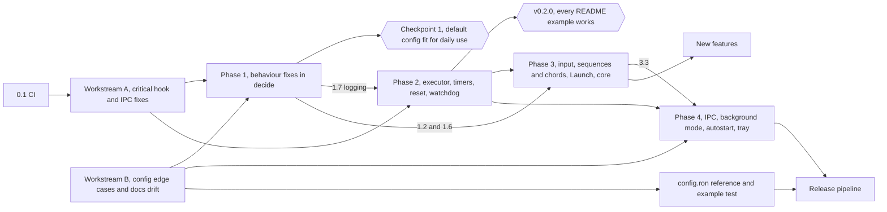

# Roadmap

This chapter sets out the order of work that would make key-switch-rs at commit `7cb3521` dependable enough for daily use. The verified defects from the [audit](audit.md) come first. The runtime and input-handling work behind them comes next, then operations (logging, background mode, autostart, tray), and new features last. Every item gives its effort, its dependencies, the issues it closes and an acceptance check.

> [!NOTE]
> The plan was synthesized from three independent drafts, written with a stability, an architecture and a product lens ([How the roadmap drafts were judged](methodology.md#how-the-roadmap-drafts-were-judged)). It is based on commit `7cb3521` and the verified audit of that commit. Effort: **S** is under half a day, **M** one to two days, **L** three days or more.

> [!IMPORTANT]
> **Progress at [`1dfd80a`](https://github.com/bluesteelll/key-switch-rs/commit/1dfd80a)** (2026-10-16). Phase 0 is done: [0.1 CI](#01-ci), [Workstream A](#workstream-a--critical-hook-and-ipc-fixes) and [Workstream B](#workstream-b--config-edge-cases-and-docs-drift) are merged into `master`, each item with a status block below. Phases 1 to 4 have not started. The item texts keep the plan as written against `7cb3521`, so their "Why" links show the old code. The owner has decided open questions [1, 2, 4 and 8](#open-questions-for-the-owner). The [issue coverage](#issue-coverage) table shows where each KS issue stands.

> [!NOTE]
> **Issue counts.** The drafts counted 27 confirmed bugs, 7 of them high severity. This chapter uses the audit's numbers and IDs: 26 verified issues, 6 high, 16 medium and 4 low ([KS-01](audit.md#ks-01) to [KS-26](audit.md#ks-26)), plus 16 unverified low-severity reports ([KS-27](audit.md#ks-27) to [KS-42](audit.md#ks-42)). The difference is one high-severity bug counted twice. The drafts listed the two paths of superset matching as separate bugs. On the Immediate path, rollover eats the next key. On the deferred path, a Tap, Hold or DoubleTap trigger arms on an unrelated key. Both come from the same subset test in `KeyCombination::matches`. The audit's [deduplication rules](methodology.md#deduplication-into-ks-ids) make one mechanism in the same code a single issue, so it merged them into [KS-04](audit.md#ks-04). The medium and low counts are the same in both.

## Summary

- **Current state.** The feature set is broad, and all 120 unit tests pass. No test covers the decision to suppress, pass or execute ([`handle_key_down`](https://github.com/bluesteelll/key-switch-rs/blob/7cb3521/src/hook/keyboard_hook_callback.rs#L183) and [`handle_key_up`](https://github.com/bluesteelll/key-switch-rs/blob/7cb3521/src/hook/keyboard_hook_callback.rs#L302)). The default configuration, used the way the README documents, runs into five of the six high-severity issues. It hits [KS-04](audit.md#ks-04) and [KS-05](audit.md#ks-05) directly, [KS-06](audit.md#ks-06) through the auto-blocker when Alt is released while Shift is still held, [KS-02](audit.md#ks-02) whenever `swch` in a normal terminal controls a release build, and [KS-01](audit.md#ks-01) after `swch off` followed by `swch on`. There is no CI, no log file, no autostart and no background mode.
- **Root causes.** The 26 verified issues reduce to eight root causes, RC1 to RC8 ([below](#root-causes)). Three of them are fixed first because their issues show up in everyday typing. Together they explain 12 of the 26 issues, including the high-severity KS-04, KS-05 and KS-06:
  - RC1: a combo matches any superset of the held keys, and there is no trigger-key rule;
  - RC2: auto-repeat breaks the symmetry between key-down and key-up;
  - RC5: heavy work runs on the hook thread.
- **Order.**
  - **Phase 0.** Workstreams A and B close the high-severity issues and extract a pure `decide()` function with tests.
  - **Phase 1.** Small behaviour fixes inside `decide()`.
  - **Phase 2.** The hook runtime.
  - **Phase 3.** Input correctness and consolidation of the core.
  - **Phase 4.** Operations.
  - New features come last.
- **Target architecture.** One main thread services the low-level keyboard hook, the WinEvent hook and the `SetTimer` timers, so the engine state lives on that thread without a `Mutex`. Side effects go to a separate executor thread. The move happens step by step, without a big rewrite. [Process and thread model](architecture.md#process-and-thread-model) describes the current design.
- **Checkpoints.**
  - After Phase 1 the default configuration is fit for daily use. Including A and B, this takes about two weeks.
  - After Phase 2 (tag v0.2.0) every README example works, including Tap/Hold and `Launch`/`OpenUrl`.

## Root causes

| RC | Cause | Typical symptoms | Issues | Closed by |
| --- | --- | --- | --- | --- |
| RC1 | A combo matches a superset of the held keys; nothing checks that the key just pressed belongs to the combo | Rollover eats a key; a deferred trigger arms on an unrelated key; the auto-blocker breaks Alt+Shift+X; a Sequence completes on rollover | [KS-04](audit.md#ks-04), [KS-05](audit.md#ks-05), [KS-13](audit.md#ks-13), [KS-15](audit.md#ks-15), [KS-16](audit.md#ks-16), [KS-18](audit.md#ks-18) | A, 1.2, 1.6, 3.2 |
| RC2 | Auto-repeat breaks the rule "a key-up is suppressed if and only if its key-down was suppressed" | Stuck keys; `sync_modifiers` erases suppressed modifiers; an Immediate binding fires on every repeat | [KS-06](audit.md#ks-06), [KS-14](audit.md#ks-14), [KS-10](audit.md#ks-10) | A, 1.1, 3.4 |
| RC3 | The OS sees modifiers that the hook does not account for | A lone Win or Alt opens the Start menu or the menu bar; `Alt+J -> PressKey("Left")` arrives as Alt+Left | [KS-12](audit.md#ks-12), [KS-19](audit.md#ks-19) | 1.2, 3.1 |
| RC4 | Modifier sides are not normalised | `LShift` or `RWin` in `keys`, and `Shift` in `chord`, never fire | [KS-07](audit.md#ks-07) | A |
| RC5 | Actions run inside the hook callback, and every timer is a thread of its own per press | Windows silently removes the hook; a stale timer corrupts the next press; Tap and Hold are not mutually exclusive | [KS-08](audit.md#ks-08), [KS-11](audit.md#ks-11), [KS-25](audit.md#ks-25) | 2.1, 2.2 |
| RC6 | Ownership of Win32 resources and privilege boundaries | The hook is installed on a short-lived thread; the pipe DACL; a second instance; `Launch` children get the administrator token | [KS-01](audit.md#ks-01), [KS-02](audit.md#ks-02), [KS-20](audit.md#ks-20), [KS-09](audit.md#ks-09), [KS-26](audit.md#ks-26) | A, 1.5, 3.3, 4.1 |
| RC7 | Incorrect use of a Win32 API | `AppEquals` never matches; `Hotkey = "3"` turns into an Alt+Shift blocker | [KS-03](audit.md#ks-03), [KS-17](audit.md#ks-17) | A, 1.4 |
| RC8 | Config edge cases and hot reload | Relative path, BOM, misspelled fields, deleted file | [KS-21](audit.md#ks-21), [KS-24](audit.md#ks-24), [KS-22](audit.md#ks-22), [KS-23](audit.md#ks-23) | B |

### Correspondence with the audit's root causes

The audit also names eight causes ([Root causes](audit.md#root-causes)), but it draws two boundaries differently and gives KS-03 no shared cause. Each issue appears in exactly one RC above. The audit lists KS-05 and KS-18 under two causes each.

| Roadmap | Audit root cause | Difference |
| --- | --- | --- |
| RC1 | [Superset matching without a trigger-key rule](audit.md#superset-matching-without-a-trigger-key-rule) | Same issues. The audit also lists KS-18 under lax validation, because the auto-blocker dedup looks only backwards. The roadmap keeps it in RC1, since Workstream A fixes it together with the exact auto-blockers. |
| RC2 | [Suppression and repeat state are not kept symmetric](audit.md#suppression-and-repeat-state-are-not-kept-symmetric) | Same. |
| RC3 | [The OS modifier state is not managed](audit.md#the-os-modifier-state-is-not-managed) | Same, except that the audit also lists KS-05 here. Item 1.2 removes this half of KS-05. |
| RC4 | [Sided keys are not canonicalised in one place](audit.md#sided-keys-are-not-canonicalised-in-one-place) | Same. |
| RC5 | [Actions run on the hook thread, in the daemon's context](audit.md#actions-run-on-the-hook-thread-in-the-daemons-context) (KS-08) and [Gesture timers carry no generation token](audit.md#gesture-timers-carry-no-generation-token) (KS-11, KS-25) | The roadmap joins the hook-thread half of the first cause with the second, because one main-thread executor and scheduler (2.1, 2.2) fixes both. |
| RC6 | [IPC runs commands on throwaway threads behind a default ACL](audit.md#ipc-runs-commands-on-throwaway-threads-behind-a-default-acl) (KS-01, KS-02, KS-20, KS-26) and the daemon-context half of [Actions run on the hook thread, in the daemon's context](audit.md#actions-run-on-the-hook-thread-in-the-daemons-context) (KS-09) | The roadmap groups the elevated child processes with the IPC issues as privilege-boundary problems. |
| RC7 | None for KS-03, which the audit gives no shared cause; [Lax configuration and input validation](audit.md#lax-configuration-and-input-validation) for KS-17 | The roadmap groups the two Win32 API mistakes. |
| RC8 | [Lax configuration and input validation](audit.md#lax-configuration-and-input-validation) (KS-21 to KS-24) | The rest of that cause, without KS-17 (RC7) and KS-18 (RC1). |

## Rules for every item

- One item, one pull request: first a regression test that fails on the current code, then the fix.
- Logic is tested through `decide()` from Workstream A. Tests substitute the clock, an `Env` (the foreground window, `GetAsyncKeyState`) and the action sink. A test that needs a real hook or `SendInput` is marked `#[ignore]` and gets a line in the smoke checklist.
- When the meaning of the config changes, the same pull request updates `README.md`, `src/config/default_config.ron` and the *Unreleased* section of `CHANGELOG.md`.
- New dependencies are added only where an item names them.
- Pressed keys are never logged, except with an explicit `--trace-keys`.

## Phase 0 — scoped workstreams

> [!NOTE]
> Workstreams A and B and item 0.1 are merged; their status blocks below give the commits. The later phases build on them, and "A" and "B" in the dependency columns refer to them.

### Workstream A — critical hook and IPC fixes

Effort L, no dependencies.

**What it does.**

- Implements `on` and `off` as an `AtomicBool` on the main thread, so the hook stays installed ([KS-01](audit.md#ks-01)). Gives the pipe an explicit SDDL ([KS-02](audit.md#ks-02)). Adds timeouts to `swch` ([swch read timeout](gaps.md#swch-read-timeout)).
- Reads the process name for `AppEquals` with `QueryFullProcessImageNameW` ([KS-03](audit.md#ks-03)).
- Adds a trigger-key rule for combos and for deferred triggers ([KS-04](audit.md#ks-04)).
- Makes auto-blockers match exactly and fixes their dedup ([KS-05](audit.md#ks-05), [KS-18](audit.md#ks-18)).
- Suppresses repeats symmetrically ([KS-06](audit.md#ks-06)), and makes `sync_modifiers` skip blocked keys ([KS-14](audit.md#ks-14)).
- Normalises modifier sides: `Shift` means either side, `LShift` only the left one ([KS-07](audit.md#ks-07)).
- Extracts `decide()` with regression tests.

**Scope additions before work starts.** They cost almost nothing now and avoid rework in 3.4:

1. `decide()` lives in `src/engine/`.
2. It returns `Decision { suppress, fire, arm, mask }` and executes nothing itself.
3. All Win32 access goes through an `Env` trait.
4. Tests take the form "RON plus a scenario of key events", without `TapState` or `ChordState`.

**Acceptance.**

- After `swch off; swch on` the bindings work.
- A non-elevated `swch status` gets an answer from an elevated daemon.
- With a hung daemon, `swch` exits within 5 s.
- `AppEquals` matches the test's own process.
- `decide()` tests: with CapsLock held, `a` passes through. A repeat of a suppressed key is suppressed, and its key-up is suppressed exactly once. `LShift` and `RWin` in `keys`, and `Shift` in `chord`, fire.

**Status: done.** Workstream A was merged as six lanes:

| Lane | Merge commit | Branch | What it delivered | Issues |
| --- | --- | --- | --- | --- |
| Decision core | [`16a0461`](https://github.com/bluesteelll/key-switch-rs/commit/16a0461) | `refactor/engine` | `src/engine`: `Engine::on_key`, `Engine::on_timer`, the `Env` trait and `Decision`; the scenario harness; the hook callback becomes an adapter | [KS-11](audit.md#ks-11); [KS-25](audit.md#ks-25) and [KS-33](audit.md#ks-33) partly |
| Matching | [`82f542f`](https://github.com/bluesteelll/key-switch-rs/commit/82f542f) | `fix/matching` | Trigger-key rule, exact modifiers with `allow_extra_modifiers`, sided keys through `KeySpec`, exact auto-blockers, auto-repeats that follow their key-down | [KS-04](audit.md#ks-04), [KS-06](audit.md#ks-06), [KS-07](audit.md#ks-07); [KS-32](audit.md#ks-32) partly |
| Suppression | [`44f79ac`](https://github.com/bluesteelll/key-switch-rs/commit/44f79ac) | `fix/suppression-symmetry` | The modifier resync skips swallowed modifiers; a key-down that reached Windows keeps its key-up; repeats stay swallowed across a foreground change | [KS-14](audit.md#ks-14), the rest of [KS-06](audit.md#ks-06), [KS-30](audit.md#ks-30), [KS-32](audit.md#ks-32) |
| Auto-blockers | [`b056b72`](https://github.com/bluesteelll/key-switch-rs/commit/b056b72) | `fix/auto-blockers` | Dedup over the whole file; a blocker acts only on the hotkey pressed on its own and fires nothing | [KS-18](audit.md#ks-18); [KS-05](audit.md#ks-05) partly |
| IPC | [`a1b5a27`](https://github.com/bluesteelll/key-switch-rs/commit/a1b5a27) | `fix/ipc-control` | `on` and `off` flip an enabled flag and reset the engine; an explicit pipe SDDL; a 5 s deadline in `swch`; `swch open` probes with `status` | [KS-01](audit.md#ks-01), [KS-02](audit.md#ks-02), [KS-31](audit.md#ks-31) for `on`/`off`, [KS-39](audit.md#ks-39); [KS-20](audit.md#ks-20) partly |
| AppEquals | [`4177540`](https://github.com/bluesteelll/key-switch-rs/commit/4177540) | `fix/app-equals` | `QueryFullProcessImageNameW`; Unicode case folding for `TitleEquals` and `AppEquals` | [KS-03](audit.md#ks-03), [KS-28](audit.md#ks-28) |

The scope additions as built:

1. The decision core lives in `src/engine/`, with `#![forbid(unsafe_code)]`.
2. `decide()` is `Engine::on_key`. It returns `Decision { suppress, fire, timers, mask }`: `timers` plays the role of `arm`, and `mask` is reserved for item 1.2 and never set.
3. All Win32 access goes through the `Env` trait: the clock, the OS key state and the foreground app and title.
4. Tests are scenarios in `engine::scenarios` on the `engine::testing::Scenario` harness: a RON config, a script of key events and a fake clock.

One departure from the target design: until item 2.2 the engine sits behind one `Mutex` in `KeyboardHook`, because Hold timers still run on their own threads. The [architecture chapter](architecture.md#threads-and-locking) describes the lock.

How each acceptance line is met:

| Acceptance | Evidence |
| --- | --- |
| After `swch off; swch on` the bindings work | `hook::keyboard_hook::tests::toggling_reports_changes_and_never_installs_a_hook`, `hook::keyboard_hook_callback::tests::extern_callback_swallows_a_bound_key_only_while_remapping_is_on`. The run against a live daemon is a manual check |
| A non-elevated `swch status` gets an answer from an elevated daemon | `hook::ipc_server::tests::pipe_sddl_grants_exactly_system_admins_and_interactive_users_and_labels_medium`. The cross-integrity run is a manual check |
| With a hung daemon, `swch` exits within 5 s | `request_times_out_against_a_server_that_never_replies` in `tests/ipc_roundtrip.rs` |
| `AppEquals` matches the test's own process | `data::condition::tests::app_equals_matches_the_current_process` |
| With CapsLock held, `a` passes through | `engine::scenarios::key_pressed_while_an_immediate_binding_key_is_held_passes` |
| A repeat of a suppressed key is suppressed, and its key-up is suppressed exactly once | `engine::scenarios::repeat_of_a_suppressed_key_is_suppressed_after_its_hold_fired`, `engine::scenarios::immediate_combo_that_stops_matching_mid_hold_keeps_its_key_suppressed_once` |
| `LShift` and `RWin` in `keys`, and `Shift` in `chord`, fire | `engine::scenarios::lshift_in_keys_fires_only_for_the_left_shift`, `engine::scenarios::rwin_and_lwin_in_keys_fire_only_for_their_side`, `engine::scenarios::unsided_shift_in_a_chord_fires_for_either_side` |

[Manual checks after Phase 0](#manual-checks-after-phase-0) lists the checks that need a live hook.

> [!WARNING]
> The exact blocker from Workstream A still swallows the second modifier. With Ctrl+Shift as the Windows language hotkey, pressing Ctrl, Shift, T reaches the application as Ctrl+T. Item 1.2 fixes this rest of [KS-05](audit.md#ks-05).

### Workstream B — config edge cases and docs drift

Effort M, no dependencies, runs in parallel with A.

**What it does.**

- Makes the config path absolute ([KS-21](audit.md#ks-21)) and compares the file name in the watcher case-insensitively.
- Keeps the current bindings when the file is gone at reload time ([KS-23](audit.md#ks-23)).
- Adds `deny_unknown_fields` ([KS-22](audit.md#ks-22)) and strips a BOM ([KS-24](audit.md#ks-24)).
- Accepts only 1..=10000 ms for `Tap`, `Hold`, `DoubleTap`, `window_ms` and `max_gap_ms` ([KS-27](audit.md#ks-27), unverified).
- Fixes [documentation drift](gaps.md#documentation-drift): "Reload requires restarting" ([src/config/default_config.ron:3](https://github.com/bluesteelll/key-switch-rs/blob/7cb3521/src/config/default_config.ron#L3)), "Five step variants" ([README.md:321](https://github.com/bluesteelll/key-switch-rs/blob/7cb3521/README.md?plain=1#L321)), and the references to TOML ([src/config/mod.rs:1](https://github.com/bluesteelll/key-switch-rs/blob/7cb3521/src/config/mod.rs#L1), [src/config/parsing.rs:39](https://github.com/bluesteelll/key-switch-rs/blob/7cb3521/src/config/parsing.rs#L39)).
- In the template, replaces the `["g","g"]` and `["j","k"]` examples ([src/config/default_config.ron:17-20](https://github.com/bluesteelll/key-switch-rs/blob/7cb3521/src/config/default_config.ron#L17-L20)), which eat typed letters ([KS-15](audit.md#ks-15)), with F13 and F14. Marks the `LShift` + `DoubleTap` example as not working until 1.3.

**Acceptance.** Tests for a relative path, a deleted file, the typo `bindngs:` (an error that names the field), a BOM, and `Tap(0)` (an error that names the binding number).

**Status: done** in [`1dfd80a`](https://github.com/bluesteelll/key-switch-rs/commit/1dfd80a) (`fix/config-edge-cases`). Two points differ from the plan:

- A config path given on the command line must now exist: a missing one is an error, and nothing is created for it. Only `<exe_dir>\config.ron` is still written from the template, and only at startup. This also closes part of [KS-41](audit.md#ks-41).
- The documentation drift was fixed in [`13ce323`](https://github.com/bluesteelll/key-switch-rs/commit/13ce323). The template marks the `LShift` + `DoubleTap` example as swallowing every left Shift until item 1.3, because Workstream A made it fire.

| Acceptance | Test |
| --- | --- |
| Relative path | `config::loader::tests::a_relative_config_argument_is_made_absolute`, `hook::config_watcher::tests::an_event_for_a_relative_config_path_matches` |
| Deleted file | `hook::config_watcher::tests::a_deleted_config_keeps_the_live_bindings`, `config::loader::tests::reload_of_a_missing_config_is_an_error_and_writes_nothing` |
| The typo `bindngs:` | `config::loader::tests::a_misspelled_bindings_field_is_an_error_that_names_it` |
| BOM | `config::loader::tests::a_utf8_bom_before_the_config_is_ignored` |
| `Tap(0)` | `config::loader::tests::a_zero_tap_term_is_an_error_that_names_the_binding`, `config::loader::tests::timing_values_outside_1_to_10000_ms_are_errors_that_name_the_binding` |

### 0.1 CI

Effort S. This is not a workstream but a separate pull request, preferably merged before A.

**What it does.**

- Adds `.github/workflows/ci.yml` on `windows-latest`: `cargo fmt --check`, `cargo clippy --all-targets --locked -- -D warnings` and `cargo test --locked`, cached with `Swatinem/rust-cache`.
- Fixes the lint at [src/hook/keyboard_hook.rs:72](https://github.com/bluesteelll/key-switch-rs/blob/7cb3521/src/hook/keyboard_hook.rs#L72).
- Adds `[[bin]] name = "key-switch-rs", path = "src/main.rs", test = false`, so that `cargo test --release` does not build a test binary with the `requireAdministrator` manifest ([build.rs:21-24](https://github.com/bluesteelll/key-switch-rs/blob/7cb3521/build.rs#L21-L24), [KS-38](audit.md#ks-38), unverified).

**Acceptance.** `master` is green; a pull request with a broken test is red.

**Status: done** in [`da58f5f`](https://github.com/bluesteelll/key-switch-rs/commit/da58f5f) (`chore/ci-license`). `.github/workflows/ci.yml` runs `cargo fmt --check`, clippy with `-D warnings`, `cargo test --locked` and a release build on `windows-latest`. It also checks the daemon's UAC manifest, that no test or bench harness is built for the daemon ([KS-38](audit.md#ks-38)), a `cargo check` with Rust 1.88, and a release build for `x86_64-pc-windows-gnu` ([KS-42](audit.md#ks-42)). The lint was fixed in [`091e30e`](https://github.com/bluesteelll/key-switch-rs/commit/091e30e). [Building, running and controlling the daemon](build-and-run.md#continuous-integration) describes the jobs.

### Merge order

A and B both touch `src/config/loader.rs` (different functions), the README and the template. A merges first, B rebases onto it, and the README edits go into the last commit.

As merged: the six lanes of A went in first, then B, each with `git merge --no-ff` into `master` ([commit history](overview.md#changes-since-the-audit)).

### Manual checks after Phase 0

Every acceptance line of Phase 0 has an automated test, but these checks need a live hook, injected keys or a second integrity level, and nobody has run them yet. Use a release build started with `swch open` from a normal console and the default config unless the row says otherwise. `osk.exe` shows which modifiers Windows holds.

| # | Setup | Steps | Expected | Lane |
| --- | --- | --- | --- | --- |
| 1 | Default config | `swch status`; CapsLock; `swch off`; CapsLock; `swch on`; CapsLock | `running`, the layout switches; after `off` CapsLock reaches Windows; after `on` the layout switches again | IPC |
| 2 | Daemon started elevated by `swch open` | From the same normal console: `swch status`, `swch off`, `swch on`, `swch exit` | Every command gets an answer; after `exit` the window closes without `[FATAL]` | IPC |
| 3 | Daemon running elevated | A second `swch open` from a normal console | `swch: daemon is already running`, no UAC prompt, one process | IPC |
| 4 | Default config, Notepad | Hold CapsLock and type `abc` within 0.4 s | `abc` appears, and the layout switched once | Matching |
| 5 | Add `( keys: "Ctrl+J", action: DoNothing )`, a Chromium browser | Ctrl+J, then Ctrl+Shift+J | Ctrl+J is swallowed; Ctrl+Shift+J opens the DevTools console | Matching |
| 6 | Uncomment the `keys: "LShift"` `DoubleTap(250)` example | Double-tap the left Shift, then the right Shift | The left one toggles CapsLock; the right one does not | Matching |
| 7 | README Tap/Hold pair on CapsLock | Tap CapsLock 20 times quickly; then hold it 2 s and release | 20 switches; after the hold nothing is stuck in `osk.exe` | Decision core, Suppression |
| 8 | Default config + `( keys: "Alt+Shift+X", action: ToggleCapsLock )` | Alt, Shift, X; release all; then Shift, Alt, X | CapsLock toggles once per round, no `x` is typed, nothing is stuck | Suppression |
| 9 | Default config, three windows | Hold Alt, hold Tab, press Shift while Tab is still held | The Alt+Tab switcher steps backward; nothing is stuck | Auto-blockers |
| 10 | Flagged `CapsLock` plus `( keys: "Alt+Shift", action: SwitchLanguageBackward )` | Read the startup lines; press Alt+Shift twice | `[INFO] no auto-blocker for Alt+Shift: binding #1 uses the same keys`; each Alt+Shift switches backward | Auto-blockers |
| 11 | `( keys: "F9", action: PressKey("A"), when: AppEquals("notepad.exe") )` | F9 in Notepad, then in a browser address bar | The A key is pressed in Notepad only | AppEquals |
| 12 | Default config | Delete `config.ron`, wait 2 s, press CapsLock, restore the file | `[ERROR] config reload failed:` with `config file … does not exist`; CapsLock still switches; no new file appears; the restore reloads | Config |
| 13 | A config named `my.ron` in a folder, elevated console there | `key-switch-rs.exe my.ron`; add a binding and save | `Watching <full path>\my.ron for changes`, then `[INFO] config reloaded` | Config |

Results of these runs belong in the [audit](audit.md) status lines.

## Phase 1 — default configuration fit for daily use

About 5 to 7 days. Items 1.1 to 1.3 and 1.6 change `decide()`; once A has merged they can proceed in parallel.

| # | Item | Effort | Depends on | Issues |
| --- | --- | --- | --- | --- |
| 1.1 | Per-binding `repeat` flag | S | A | [KS-10](audit.md#ks-10) |
| 1.2 | Mask key and auto-blocker v2 | M | A | [KS-12](audit.md#ks-12), [KS-05](audit.md#ks-05); unverified: [KS-35](audit.md#ks-35) |
| 1.3 | `block_default` for Tap, Hold and DoubleTap | S | A | none |
| 1.4 | Tri-state language hotkey | S | none | [KS-17](audit.md#ks-17) |
| 1.5 | Single instance | S | A (pipe SDDL) | [KS-20](audit.md#ks-20) |
| 1.6 | One winner per event | M | A | [KS-13](audit.md#ks-13) |
| 1.7 | File logging | M | A and B merged | none |

### 1.1 Per-binding `repeat` flag

**What.** A `repeat: bool` field. It defaults to `true` for `PressKey` and for `Media(VolumeUp)` and `Media(VolumeDown)`, and to `false` otherwise. A repeat of a binding without `repeat` does not run the action, but it is still suppressed when the original key-down was suppressed.

**Why.** Immediate bindings fire on every repeat ([src/hook/keyboard_hook_callback.rs:229-237](https://github.com/bluesteelll/key-switch-rs/blob/7cb3521/src/hook/keyboard_hook_callback.rs#L229-L237), [KS-10](audit.md#ks-10)). Holding CapsLock switches the layout about 30 times per second, and `Launch` and `Sequence` start a new process or thread per repeat ([src/data/sequence.rs:119](https://github.com/bluesteelll/key-switch-rs/blob/7cb3521/src/data/sequence.rs#L119)).

**Files.** `src/config/schema.rs`, `src/config/loader.rs`, `src/data/binding.rs`, `src/engine/`.

**Acceptance.** CapsLock down, 10 repeats and CapsLock up give one `SwitchLanguage`, and every event is suppressed. `PressKey("Backspace")` runs 11 times. `repeat: true` restores the old behaviour.

### 1.2 Mask key and auto-blocker v2

**What.**

- **Mask.** When `decide()` suppresses an event while Win or Alt is held, and that modifier's key-down has already reached the OS, the hook immediately injects `vk 0xE8` (down and up) tagged with the sentinel, as AutoHotkey's `#MenuMaskKey` does.
- **Blocker v2.** Starts with a half-day spike. The hypothesis is that Windows switches the language only on a "clean" release of Alt+Shift or Ctrl+Shift, with no other key in between. If it holds, the blocker stops suppressing the modifier and only injects the mask on an exact match. If it does not hold, the exact blocker from A stays and gains the mask.
- The blocker inherits the `when:` of the binding that requested it ([src/data/binding.rs:95](https://github.com/bluesteelll/key-switch-rs/blob/7cb3521/src/data/binding.rs#L95), [KS-35](audit.md#ks-35), unverified).

**Why.** A lone Win or Alt tap reaches the OS ([src/hook/keyboard_hook_callback.rs:294-297](https://github.com/bluesteelll/key-switch-rs/blob/7cb3521/src/hook/keyboard_hook_callback.rs#L294-L297), [KS-12](audit.md#ks-12)): `Win+Q -> PostMessage(WM_CLOSE)` opens the Start menu. With the default configuration, Shift pressed after Alt is swallowed and the menu bar activates; in Notepad, F then X runs File, Exit. This is the rest of the high-severity Alt+Shift+X issue, [KS-05](audit.md#ks-05).

**Files.** `src/engine/`, `src/hook/keyboard_hook_callback.rs`, `src/config/loader.rs`, `src/core/constants.rs`.

**Acceptance.** A test shows `mask = true` only when an event is suppressed after Alt or Win reached the OS. By hand: Alt then Shift in Notepad does not open the menu, and `Win+Q` does not open Start. For v2: `Ctrl+Shift+T` works, and a bare Alt+Shift does not switch the language.

> [!NOTE]
> The audit's suggested fix for KS-05 relies on the same Windows behaviour as the v2 hypothesis. [Open question 6](#open-questions-for-the-owner) asks for a manual check before v2 is built.

### 1.3 `block_default` for Tap, Hold and DoubleTap

**What.** `block_default`, which becomes an `Option<bool>`, applies to `Tap`, `Hold` and `DoubleTap`. For a combo made only of modifiers it defaults to `false`. A key-up is suppressed only if its key-down was.

**Why.** Deferred triggers suppress the key unconditionally ([src/hook/keyboard_hook_callback.rs:241](https://github.com/bluesteelll/key-switch-rs/blob/7cb3521/src/hook/keyboard_hook_callback.rs#L241), [:246](https://github.com/bluesteelll/key-switch-rs/blob/7cb3521/src/hook/keyboard_hook_callback.rs#L246), [:251](https://github.com/bluesteelll/key-switch-rs/blob/7cb3521/src/hook/keyboard_hook_callback.rs#L251)). Once A makes sided names work, the README example `LShift` + `DoubleTap` starts swallowing every left Shift. With `keys: "Shift"` that already happens today.

**Files.** `src/engine/`, `src/config/schema.rs`, `src/config/loader.rs`.

**Acceptance.** A double LShift fires `ToggleCapsLock`, and every LShift event reaches the OS. LShift + A types "A".

### 1.4 Tri-state language hotkey

**What.** `parse_language_hotkey` returns `Combo`, `Disabled` or `Unknown`. With `Disabled` there is no blocker and no fallback to Alt+Shift.

**Why.** A language hotkey that is switched off in Windows becomes an Alt+Shift blocker ([src/system/registry.rs:60-72](https://github.com/bluesteelll/key-switch-rs/blob/7cb3521/src/system/registry.rs#L60-L72), [src/system/registry.rs:196](https://github.com/bluesteelll/key-switch-rs/blob/7cb3521/src/system/registry.rs#L196), [KS-17](audit.md#ks-17)).

**Files.** `src/system/registry.rs`.

**Acceptance.** The registry values (`Hotkey`, `Language Hotkey`) = ("3", "3") give no blocker; ("2", anything) gives Ctrl+Shift; no values give Alt+Shift.

### 1.5 Single instance

**What.** The daemon creates the mutex `Local\key-switch-rs` with `CreateMutexW` before it loads the config and installs the hook; a second instance exits with code 2. A failure to create the pipe is fatal. `swch open` treats `ERROR_ACCESS_DENIED` and `ERROR_PIPE_BUSY` as "the daemon is running".

**Why.** The hook is installed before the pipe exists ([src/core/app.rs:91-98](https://github.com/bluesteelll/key-switch-rs/blob/7cb3521/src/core/app.rs#L91-L98), [KS-20](audit.md#ks-20)). Two hooks both see every key the newer one passes on, so a binding with `block_default: false` fires twice, and a double `SwitchLanguage` leaves the layout unchanged. Each daemon also takes the other's injected keys as physical input, and `swch off` reaches only the instance that owns the pipe.

**Files.** `src/main.rs`, `src/core/app.rs`, `src/hook/ipc_server.rs`, `src/bin/swch.rs`.

**Acceptance.** A second acquisition returns `Err(AlreadyRunning)`; a second start prints "already running".

### 1.6 One winner per event

**What.** Among the candidates that pass the trigger-key rule, exactly one wins: the one with more keys, then one with a `when:`, then the one earlier in the file. `Tap`, `Hold` and `DoubleTap` bindings with the same combo and condition form one group. Only the winner decides execution and suppression. The loader warns about duplicates. The owner decided [open question 2](#open-questions-for-the-owner): modifiers match exactly, with a per-binding `allow_extra_modifiers`. That rule already shipped with Workstream A ([`82f542f`](https://github.com/bluesteelll/key-switch-rs/commit/82f542f)), so this item covers only the choice of one winner.

**Why.** Specificity applies only between Immediate bindings ([src/hook/keyboard_hook_callback.rs:213-238](https://github.com/bluesteelll/key-switch-rs/blob/7cb3521/src/hook/keyboard_hook_callback.rs#L213-L238), [KS-13](audit.md#ks-13)), so a losing binding with `block_default: true` still swallows the key.

**Files.** `src/engine/`, `src/hook/keyboard_hook.rs`, `src/config/loader.rs`.

**Acceptance.** `Shift+CapsLock` (Immediate) together with `CapsLock` (Tap) fires only `ToggleCapsLock`. A conditional `Pause` binding wins in either file order. A winner with `block_default: false` lets the key through.

### 1.7 File logging

**What.** The `log` crate with an in-house rotating file sink (owner decision; [open question 8](#open-questions-for-the-owner)). The log goes to `%LOCALAPPDATA%\key-switch-rs\daemon.log`, with timestamps and rotation at 1 MB with three files. The hook callback only updates counters.

**Why.** When Task Scheduler starts the daemon, nobody sees reload errors ([src/hook/config_watcher.rs:107](https://github.com/bluesteelll/key-switch-rs/blob/7cb3521/src/hook/config_watcher.rs#L107)) or `Launch` errors. The change is mechanical but spread over many files, so done later it would conflict with every branch.

**Files.** The nine files outside `src/bin` that call `println!` or `eprintln!`, and `Cargo.toml`.

**Acceptance.** A reload error lands in the file with a timestamp. The log contains no typed text. `rg "println!|eprintln!" src --glob '!src/bin/**'` finds only the startup banner.

### Checkpoint 1 smoke checklist

Release build, daemon started with `swch open`, `swch` run from a non-elevated console.

1. After `swch off; swch on`, CapsLock switches the language. (A; [KS-01](audit.md#ks-01))
2. Holding CapsLock for 2 s gives one switch, and nothing is stuck after release; check in `osk.exe`. (A, 1.1; [KS-06](audit.md#ks-06), [KS-10](audit.md#ks-10))
3. With CapsLock held, typing `abc` delivers `abc`. (A; [KS-04](audit.md#ks-04))
4. `Ctrl+Shift+T` and `Alt+Shift+Tab` work; a bare Alt+Shift does not switch the language. (A, 1.2; [KS-05](audit.md#ks-05))
5. Alt then Shift in Notepad does not activate the menu; `Win+Q` does not open Start. (1.2; [KS-12](audit.md#ks-12))
6. A double `LShift` toggles CapsLock; left Shift + A types "A". (A, 1.3; [KS-07](audit.md#ks-07))
7. A binding with `when: AppEquals("notepad.exe")` fires only in Notepad. (A; [KS-03](audit.md#ks-03))
8. A typo in the config writes an error to the log and the old bindings keep working; a deleted `config.ron` is not recreated. (B, 1.7; [KS-22](audit.md#ks-22), [KS-23](audit.md#ks-23))
9. A second start prints "already running". (1.5; [KS-20](audit.md#ks-20))

### Known issues until Phases 2 and 3

> [!WARNING]
> These remain after Checkpoint 1 and belong in the README until the listed item lands. [Known configuration pitfalls](config/known-issues.md) collects the workarounds.
>
> - `OpenUrl` can freeze input while the browser starts cold (2.1; [KS-08](audit.md#ks-08)).
> - Tap+Hold on CapsLock loses quick presses (2.2; [KS-11](audit.md#ks-11)).
> - `Launch` starts programs as administrator (3.3; [KS-09](audit.md#ks-09)).
> - `Alt+J -> PressKey("Left")` arrives as Alt+Left (3.1; [KS-19](audit.md#ks-19)).
> - Sequences with modifiers in later steps are unreliable (3.2; [KS-16](audit.md#ks-16)).

## Phase 2 — the hook callback only decides

About 7 to 9 days, ending with tag v0.2.0.

| # | Item | Effort | Depends on | Issues |
| --- | --- | --- | --- | --- |
| 2.1 | Action executor | M | A | [KS-08](audit.md#ks-08) |
| 2.2 | Timers on the main thread | M | 2.1 | [KS-11](audit.md#ks-11), [KS-25](audit.md#ks-25); unverified: [KS-33](audit.md#ks-33) |
| 2.3 | Control window and state reset | M | 2.2 | unverified: [KS-29](audit.md#ks-29), [KS-31](audit.md#ks-31) |
| 2.4 | Hook watchdog | M | 2.3, 1.7 | [KS-08](audit.md#ks-08) |

### 2.1 Action executor

**What.**

- An executor thread with a `GetMessageW` loop and single-threaded COM (`COINIT_APARTMENTTHREADED | COINIT_DISABLE_OLE1DDE`), fed by a bounded queue. On overflow the job is dropped and logged.
- A job is `(Arc<BindAction>, hwnd, epoch)`. `Sequence` runs on the executor as well. A change of epoch (`swch off`, reload, exit) interrupts a `Delay` step.
- Only the fast actions stay in the callback, so that their output stays in order with the keys that follow: `PressKey`, `Media`, `ToggleCapsLock`, `SwitchLanguage*` and `PostMessage`.
- A counter records the longest callback duration.

**Why.** Six of the seven `.execute()` calls in `src/hook` run on the hook thread: [src/hook/keyboard_hook_callback.rs:231](https://github.com/bluesteelll/key-switch-rs/blob/7cb3521/src/hook/keyboard_hook_callback.rs#L231), [src/hook/tap_state.rs:83](https://github.com/bluesteelll/key-switch-rs/blob/7cb3521/src/hook/tap_state.rs#L83), [src/hook/tap_state.rs:148](https://github.com/bluesteelll/key-switch-rs/blob/7cb3521/src/hook/tap_state.rs#L148), [src/hook/chord_state.rs:100](https://github.com/bluesteelll/key-switch-rs/blob/7cb3521/src/hook/chord_state.rs#L100), [src/hook/sequence_state.rs:86](https://github.com/bluesteelll/key-switch-rs/blob/7cb3521/src/hook/sequence_state.rs#L86) and [src/hook/sequence_state.rs:106](https://github.com/bluesteelll/key-switch-rs/blob/7cb3521/src/hook/sequence_state.rs#L106). The seventh, the Hold action at [src/hook/tap_state.rs:116](https://github.com/bluesteelll/key-switch-rs/blob/7cb3521/src/hook/tap_state.rs#L116), runs on its timer thread, which 2.2 removes. `ShellExecuteW` is called with COM uninitialised. If the callback runs longer than `LowLevelHooksTimeout` (at most 1000 ms), Windows silently removes the hook ([KS-08](audit.md#ks-08)). A running `Sequence` cannot be cancelled ([No cancellation for macro workers](gaps.md#no-cancellation-for-macro-workers)).

**Files.** New `src/core/executor.rs`; `src/core/windows_actions.rs`, `src/data/sequence.rs`, `src/hook/tap_state.rs`, `src/hook/chord_state.rs`, `src/hook/sequence_state.rs`.

**Acceptance.** `rg "\.execute\(\)" src/hook` finds nothing. 100 `Sequence` runs in a row create no threads. `Delay(10000)` stops within 100 ms of `swch off`. With 20 `OpenUrl` calls against a cold browser, the callback stays under 5 ms.

**Status after Phase 0.** The three gesture files are gone: Workstream A moved their state into `src/engine/gestures.rs`, `chords.rs` and `sequences.rs` ([`16a0461`](https://github.com/bluesteelll/key-switch-rs/commit/16a0461)), which decide but execute nothing. Every action now runs from one place, `carry_out` in the hook adapter ([src/hook/keyboard_hook_callback.rs:185-195](https://github.com/bluesteelll/key-switch-rs/blob/1dfd80a/src/hook/keyboard_hook_callback.rs#L185-L195)), on the hook thread or, for a Hold, on its `hold-timer` thread. That is where the executor plugs in; the acceptance above is unchanged.

### 2.2 Timers on the main thread

**What.**

- One-shot `SetTimer(None, 0, ms, timer_proc)` timers arrive through the `GetMessageW` loop ([src/core/app.rs:125-131](https://github.com/bluesteelll/key-switch-rs/blob/7cb3521/src/core/app.rs#L125-L131)) in the same queue as keyboard events, so races between them cannot happen.
- Each timer carries a `TimerToken { generation, slot, seq }`; a stale token does nothing.
- Tap, Hold and DoubleTap on one key form one mutually exclusive state machine. When a key has both Tap and DoubleTap, Tap waits until the DoubleTap window closes.
- Chord and Sequence entries expire on their own timers.
- A `Scheduler` trait replaces the timers in tests.

**Why.** A stale timer removes or fires the entry of the next press ([src/hook/tap_state.rs:61-66](https://github.com/bluesteelll/key-switch-rs/blob/7cb3521/src/hook/tap_state.rs#L61-L66), [src/hook/tap_state.rs:103-119](https://github.com/bluesteelll/key-switch-rs/blob/7cb3521/src/hook/tap_state.rs#L103-L119), [src/hook/tap_state.rs:156-167](https://github.com/bluesteelll/key-switch-rs/blob/7cb3521/src/hook/tap_state.rs#L156-L167), [KS-11](audit.md#ks-11)). Tap and Hold are not mutually exclusive ([KS-25](audit.md#ks-25)). Every press spawns a thread, and `.expect` on a failed spawn aborts the daemon ([KS-33](audit.md#ks-33), unverified).

**Files.** `src/engine/gestures.rs`, which Workstream A created in place of `src/hook/tap_state.rs`; `src/hook/keyboard_hook_callback.rs` and `src/hook/keyboard_hook.rs`, which still start a `hold-timer` thread per Hold and keep the engine behind a `Mutex`; new `src/platform/timers.rs`; `src/core/app.rs`.

**Status after Phase 0.** Hold timers already carry a generation token and Tap and DoubleTap expire by deadline ([`16a0461`](https://github.com/bluesteelll/key-switch-rs/commit/16a0461)), so [KS-11](audit.md#ks-11) is fixed and equal Tap and Hold terms are exclusive. What remains is moving the timers onto the main thread, removing the engine lock, and arbitrating different terms on one key.

**Acceptance.** The tests `stale_tap_gc_eats_second_quick_tap` and `stale_hold_timer_fires_new_press_early` from the [gesture repro crate](methodology.md#gesture-repro-crate) are ported with their assertions inverted and pass; at `7cb3521` the inverted tests fail. With `Tap(200)` and `Hold(200)`, a release at 199 ms fires only Tap, and one at 201 ms only Hold. The thread count does not grow over 1000 presses.

### 2.3 Control window and state reset

**What.**

- A hidden top-level control window. It is not a message-only (`HWND_MESSAGE`) window, because those do not receive `TaskbarCreated`, which the tray (4.6) needs. `WTSRegisterSessionNotification`, `WM_QUERYENDSESSION`, `WM_ENDSESSION` and the `WM_APP_*` messages go through it.
- `reset_transient_state()` clears gestures, cancels macros and resyncs all 256 keys, except blocked ones. It runs on `swch off` and `swch on`, after a reload, on `WTS_SESSION_UNLOCK` and on `EVENT_SYSTEM_DESKTOPSWITCH`.

**Status after Phase 0.** `swch off` and `swch on` already reset the engine ([`a1b5a27`](https://github.com/bluesteelll/key-switch-rs/commit/a1b5a27), [`Engine::reset`](https://github.com/bluesteelll/key-switch-rs/blob/1dfd80a/src/engine/mod.rs#L342-L363)): pending gestures are dropped and every held key is taken from Windows as passed, with no blocked record kept. "Except blocked ones" therefore applies only to the reset after a reload and on unlock. Still open: cancelling macros, the reset on reload and unlock, and the foreground change itself. It forgets which key-ups are due to be swallowed, so the release of a key whose key-down was swallowed reaches Windows as a lone key-up unless a `Tap` or `Hold` of that press is still pending; the key's repeats stay swallowed ([KS-06](audit.md#ks-06) status). Whether a key acts on such a lone key-up (PrintScreen is a candidate) has not been checked; the acceptance of this item should pin the case.
- In an elevated daemon, `foreground_changed` no longer clears every blocked bit.

**Why.** A reload does not reset gestures, and pending entries keep actions from the old config ([src/hook/tap_state.rs:54](https://github.com/bluesteelll/key-switch-rs/blob/7cb3521/src/hook/tap_state.rs#L54), [src/hook/chord_state.rs:114](https://github.com/bluesteelll/key-switch-rs/blob/7cb3521/src/hook/chord_state.rs#L114); see also [KS-31](audit.md#ks-31), unverified). Win+L does not resync the keys ([KS-29](audit.md#ks-29), unverified). Clearing the blocked bits on every focus change ([src/hook/keyboard_hook_callback.rs:176-181](https://github.com/bluesteelll/key-switch-rs/blob/7cb3521/src/hook/keyboard_hook_callback.rs#L176-L181)) lets the trigger key's auto-repeat into a window that `Launch` just opened (compare step 5 of [KS-06](audit.md#ks-06)).

**Files.** `src/core/app.rs`, `src/hook/keyboard_hook.rs`, `src/hook/keyboard_hook_callback.rs`, `src/hook/config_watcher.rs`, `Cargo.toml` (feature `Win32_System_RemoteDesktop`).

**Acceptance.** With a Tap armed, a reload followed by the key-up does not run the old action. Holding `Win+Alt+T` while the foreground window changes keeps the T repeats suppressed. Nothing is stuck after Win+L.

### 2.4 Hook watchdog

**What.** Keyboard Raw Input (`RIDEV_INPUTSINK` on the 2.3 window) is compared with the callback counter. If key events arrive but the callback stays silent for more than 1 s, the hook is reinstalled on the main thread and the event is logged. `swch status` shows a `HookHealth` value. The watchdog does not ping with `SendInput`, because injected input resets the idle timer.

**Why.** `is_installed()` only checks that the stored handle is non-null ([src/hook/keyboard_hook.rs:137-139](https://github.com/bluesteelll/key-switch-rs/blob/7cb3521/src/hook/keyboard_hook.rs#L137-L139), [KS-08](audit.md#ks-08)).

**Files.** `src/core/app.rs`, `src/hook/keyboard_hook.rs`, `src/hook/keyboard_hook_callback.rs`, `src/hook/ipc_server.rs`.

**Acceptance.** A debug flag that holds the callback for 1.5 s leads to `reinstalls: 1` within 2 s. Ten minutes of idle time produce no injected input.

### Checkpoint 2 (v0.2.0)

20 quick CapsLock presses with `Tap(200)` and `Hold(200)` give 20 switches; `OpenUrl` does not freeze input; nothing is stuck after Win+L.

## Phase 3 — input correctness and the core

About 10 to 13 days.

| # | Item | Effort | Depends on | Issues |
| --- | --- | --- | --- | --- |
| 3.1 | Single input module | M | 1.2 | [KS-19](audit.md#ks-19); unverified: [KS-36](audit.md#ks-36) |
| 3.2 | Sequence and Chord matching | M | A, 2.2 | [KS-15](audit.md#ks-15), [KS-16](audit.md#ks-16); unverified: [KS-30](audit.md#ks-30), [KS-32](audit.md#ks-32) |
| 3.3 | `Launch` and `OpenUrl` without elevation | M, risk of L | 2.1 | [KS-09](audit.md#ks-09); unverified: [KS-34](audit.md#ks-34) |
| 3.4 | Core consolidation | L | 1.6, 2.2, 3.2 | RC1, RC2 and RC5 by construction |
| 3.5 | Hot-path budget | M | 3.4 | none; unverified [KS-28](audit.md#ks-28) was fixed in Workstream A |

### 3.1 Single input module

**What.** One module becomes the only place that calls `SendInput`. A pure function `build_inputs(payload, held_mods)` releases the modifiers that reached the OS, sends the payload, restores the physically held modifiers, and adds the `0xE8` mask after Alt or Win. `wScan` comes from `MapVirtualKeyW(MAPVK_VK_TO_VSC_EX)`, and `KEYEVENTF_EXTENDEDKEY` is set for the arrows, Ins, Del, Home, End, PgUp, PgDn, RCtrl, RAlt, Win and Apps. In `Text`, `\n` becomes Enter and `\t` becomes Tab.

**Why.** Synthesized keys combine with held modifiers ([KS-19](audit.md#ks-19)), and no scan code is sent ([KS-36](audit.md#ks-36), unverified). There are three copies of the `INPUT` builder, with five `SendInput` calls in three files: [src/core/windows_actions.rs:179](https://github.com/bluesteelll/key-switch-rs/blob/7cb3521/src/core/windows_actions.rs#L179), [src/data/sequence.rs:160](https://github.com/bluesteelll/key-switch-rs/blob/7cb3521/src/data/sequence.rs#L160), [:191](https://github.com/bluesteelll/key-switch-rs/blob/7cb3521/src/data/sequence.rs#L191), [:231](https://github.com/bluesteelll/key-switch-rs/blob/7cb3521/src/data/sequence.rs#L231) and [src/system/system_function.rs:152](https://github.com/bluesteelll/key-switch-rs/blob/7cb3521/src/system/system_function.rs#L152).

**Files.** New `src/platform/input.rs`; `src/core/windows_actions.rs`, `src/data/sequence.rs`, `src/system/system_function.rs`.

**Acceptance.** `rg "SendInput\(" src` finds one place. `(Left, [LAlt])` builds LAlt up, Left down (extended), Left up (extended), LAlt down, E8 down, E8 up. `Alt+J -> PressKey("Left")` moves the cursor in Notepad.

### 3.2 Sequence and Chord matching

**What.** A sequence step counts only if the key just pressed belongs to it. A strict subset of the next step, usually its modifier, does not abort the wait. On completion, only keys whose key-down was suppressed are blocked. A chord does not mark keys that were already released.

**Why.** Rollover completes a sequence ([src/hook/sequence_state.rs:76](https://github.com/bluesteelll/key-switch-rs/blob/7cb3521/src/hook/sequence_state.rs#L76), [:99](https://github.com/bluesteelll/key-switch-rs/blob/7cb3521/src/hook/sequence_state.rs#L99), [KS-15](audit.md#ks-15)), and the modifier of the next step aborts it ([src/hook/sequence_state.rs:91-95](https://github.com/bluesteelll/key-switch-rs/blob/7cb3521/src/hook/sequence_state.rs#L91-L95), [KS-16](audit.md#ks-16)). Completion also blocks keys whose key-downs were never suppressed ([KS-32](audit.md#ks-32), [KS-30](audit.md#ks-30), both unverified).

**Files.** `src/hook/sequence_state.rs`, `src/hook/chord_state.rs`, `src/engine/`.

**Acceptance.** `sequence_completes_on_rollover_of_unrelated_key`, `sequence_modifier_press_aborts_pending` and `chord_with_unsided_modifier_never_matches_raw_sided_vk` from the gesture repro crate are ported, inverted, and pass. `["F13", "Ctrl+S"]` fires, and Ctrl's key-up reaches the OS.

**Status after Phase 0.** The state machines now live in `src/engine/sequences.rs` and `src/engine/chords.rs`. Part of this item is done: completion marks only keys still held whose key-down did not reach Windows ([KS-30](audit.md#ks-30), [KS-32](audit.md#ks-32), fixed in [`44f79ac`](https://github.com/bluesteelll/key-switch-rs/commit/44f79ac)), and an unsided modifier completes a chord ([KS-07](audit.md#ks-07), fixed in [`82f542f`](https://github.com/bluesteelll/key-switch-rs/commit/82f542f)). The trigger-key rule and the modifier handling for sequence steps ([KS-15](audit.md#ks-15), [KS-16](audit.md#ks-16)) remain.

### 3.3 `Launch` and `OpenUrl` without elevation

**What.** Programs start through Explorer: `IShellWindows::FindWindowSW(SWC_DESKTOP)`, then `IShellBrowser`, `IShellView`, `IShellFolderViewDual` and finally `IShellDispatch2::ShellExecute`, called on the executor's STA thread. New fields `cwd:` and `elevated: true`, the second an explicit opt-in. If Explorer is not running, the action is refused and logged.

**Why.** Children inherit the administrator token and the daemon's console ([src/core/windows_actions.rs:205-247](https://github.com/bluesteelll/key-switch-rs/blob/7cb3521/src/core/windows_actions.rs#L205-L247), [KS-09](audit.md#ks-09); see also [KS-34](audit.md#ks-34), unverified).

**Files.** New `src/platform/launch.rs`; `src/core/windows_actions.rs`, `src/data/sequence.rs`, `src/config/schema.rs`, `Cargo.toml` (features `Win32_System_Com`, `Win32_System_Ole`, `Win32_System_Variant`).

**Acceptance.** `Launch(exe: "cmd.exe", args: ["/k", "whoami /groups"])` reports `Medium Mandatory Level`. A browser started by `OpenUrl` is not elevated; with `elevated: true` it is.

### 3.4 Core consolidation

**What.**

- `KeyState { physical[256], suppressed[256] }` replaces `active_keys: [AtomicBool; 256]`, `blocked_keys`, `sync_modifiers` and `ACTIVE_KEYS_CAP`.
- `CompiledBindings` in an `ArcSwap` holds a generation number, `KeySpec` values, a `by_vk[256]` index and `os_guards` (the auto-blockers) kept apart from user bindings. It also produces diagnostics for duplicates and for the suppression trap.
- Gesture state becomes fields of an `Engine` held in a `thread_local!` on the main thread. On re-entry, `try_borrow_mut` fails; the event is skipped and a counter is incremented.
- `#![forbid(unsafe_code)]` in `src/engine`.

**Status after Phase 0.** Part of this exists: Workstream A created `src/engine` with `#![forbid(unsafe_code)]`, an `Engine` that owns all gesture state, and a per-key table that replaces `active_keys` and `blocked_keys` ([`16a0461`](https://github.com/bluesteelll/key-switch-rs/commit/16a0461), [`82f542f`](https://github.com/bluesteelll/key-switch-rs/commit/82f542f)). The engine is still reached through a `Mutex` in `KeyboardHook`, not a `thread_local!`, and `CompiledBindings` does not exist yet.

**Why.** RC1, RC2 and RC5 disappear by construction. [README.md:92](https://github.com/bluesteelll/key-switch-rs/blob/7cb3521/README.md?plain=1#L92) ("lock-free") and [README.md:497](https://github.com/bluesteelll/key-switch-rs/blob/7cb3521/README.md?plain=1#L497) ("Hot-path allocations: none") become true ([Documentation drift](gaps.md#documentation-drift)).

**Files.** `src/engine/*`. `src/hook/keyboard_hook_callback.rs` becomes an adapter. `src/hook/tap_state.rs`, `src/hook/chord_state.rs` and `src/hook/sequence_state.rs` are removed.

**Acceptance.** `rg "Mutex|thread::|unsafe" src/engine` finds nothing. All regression tests from the earlier items pass. A pseudo-random test over 10,000 scenarios holds the invariant that a suppressed key-down implies a suppressed repeat and key-up. With a counting `#[global_allocator]`, `Engine::on_key` does not allocate.

### 3.5 Hot-path budget

**What.** `when:` is evaluated after the keys match. Today it is evaluated first, and as soon as one binding has a `when:`, `ForegroundContext::capture` runs on every key-down ([src/hook/keyboard_hook_callback.rs:207-221](https://github.com/bluesteelll/key-switch-rs/blob/7cb3521/src/hook/keyboard_hook_callback.rs#L207-L221)). The executable name and window title are cached per HWND from `EVENT_SYSTEM_FOREGROUND`. Case-insensitive comparison follows Unicode rules ([src/data/condition.rs:62](https://github.com/bluesteelll/key-switch-rs/blob/7cb3521/src/data/condition.rs#L62), [:71](https://github.com/bluesteelll/key-switch-rs/blob/7cb3521/src/data/condition.rs#L71), [KS-28](audit.md#ks-28), unverified).

**Why.** After A, every key press under a conditional binding makes a real process-name query, and all input on the system waits for it.

**Files.** `src/data/condition.rs`, new `src/platform/foreground.rs`.

**Acceptance.** 100 presses in one window cause one name query. `TitleEquals("КАЛЬКУЛЯТОР")` matches a window titled "Калькулятор". The callback stays under 100 µs with 50 bindings.

## Phase 4 — operations: install and forget

About 8 to 10 days.

| # | Item | Effort | Depends on | Issues |
| --- | --- | --- | --- | --- |
| 4.1 | IPC hardening | M | A, B | [KS-26](audit.md#ks-26); unverified: [KS-37](audit.md#ks-37), [KS-40](audit.md#ks-40) |
| 4.2 | Background mode | M | 1.7, 2.3 | unverified: [KS-41](audit.md#ks-41) |
| 4.3 | IPC v2 commands | M | 4.1 | none |
| 4.4 | Config location | S | B | none |
| 4.5 | `swch autostart` | M | 1.5, 4.2 | none |
| 4.6 | Tray icon | M | 4.2, 4.3, 3.3 | none |

### 4.1 IPC hardening

**What.** `reader.take(256)`, a read deadline, and one handler instead of a thread per connection. The reply to `exit` is written before `WM_QUIT` is posted. A reply without `OK:` or `ERR:` counts as an error. The pipe name comes from `KEY_SWITCH_PIPE` and includes the session ID. Integration tests.

**Why.** Read-only connections park threads forever ([src/hook/ipc_server.rs:72](https://github.com/bluesteelll/key-switch-rs/blob/7cb3521/src/hook/ipc_server.rs#L72), [:95](https://github.com/bluesteelll/key-switch-rs/blob/7cb3521/src/hook/ipc_server.rs#L95), [KS-26](audit.md#ks-26)). The `exit` reply races process teardown ([KS-37](audit.md#ks-37), unverified), and one machine-wide pipe name serves every session ([KS-40](audit.md#ks-40), unverified). IPC, `swch` and the watcher have no tests, which is how the broken `off`/`on` ([KS-01](audit.md#ks-01)) and `AppEquals` ([KS-03](audit.md#ks-03)) reached `master`.

**Files.** `src/hook/ipc_server.rs`, `src/ipc.rs`, `src/bin/swch.rs`, `tests/`.

**Acceptance.** `tests/ipc_roundtrip.rs` (`on`, `off`, `on`, `status`, `exit`) passes in CI without elevation. 50 silent clients do not block a command. A `config_watcher` test exists.

**Status after Phase 0.** Workstream A added `tests/ipc_roundtrip.rs`, which runs the `swch` client against test pipes, and the daemon's pipe server through `status`, `off`, `on`, `status` with a stand-in for the daemon and no hook. Workstream B added `config_watcher` tests. `exit`, the read deadline and the single handler are still to do.

### 4.2 Background mode

**What.** `#![windows_subsystem = "windows"]` plus a `--console` flag. Fatal errors go to the log and to a `MessageBoxW` instead of "Press Enter to exit" ([src/main.rs:15-17](https://github.com/bluesteelll/key-switch-rs/blob/7cb3521/src/main.rs#L15-L17)). An argument that starts with `-` is not taken as a config path ([src/main.rs:28-31](https://github.com/bluesteelll/key-switch-rs/blob/7cb3521/src/main.rs#L28-L31), [KS-41](audit.md#ks-41), unverified). A broken config at startup falls back to the last known good copy in `%LOCALAPPDATA%\key-switch-rs\last-good.ron`.

**Why.** The daemon keeps a console window open ([src/bin/swch.rs:112](https://github.com/bluesteelll/key-switch-rs/blob/7cb3521/src/bin/swch.rs#L112), `SW_SHOWNORMAL`), and a broken config at startup is fatal ([src/main.rs:33](https://github.com/bluesteelll/key-switch-rs/blob/7cb3521/src/main.rs#L33)).

**Files.** `src/main.rs`, `src/core/app.rs`, `src/bin/swch.rs`.

**Acceptance.** `swch open` shows no console. With a syntax error in the config, the daemon still starts, and `status` shows the error and that the bindings came from `last-good`.

### 4.3 IPC v2 commands

**What.** `reload`, with errors that give `line:col`. `check <path>`, which needs no daemon, creates no files and exits with 0, 1 or 2. `status [--json]` with pid, version, path, `enabled`, last reload and hook health. `logs [-f]`. `list`. `open [config]`, which passes the path through `lpParameters`.

**Why.** There is no `reload` or `check` command ([src/ipc.rs:20-31](https://github.com/bluesteelll/key-switch-rs/blob/7cb3521/src/ipc.rs#L20-L31); [No IPC reload, check or list commands](gaps.md#no-ipc-reload-check-or-list-commands)), and reload errors are visible only in the console.

**Files.** `src/ipc.rs`, `src/hook/ipc_server.rs`, `src/bin/swch.rs`, `src/config/mod.rs`, `src/hook/config_watcher.rs`.

**Acceptance.** `swch check bad.ron` exits with code 1 and prints `bad.ron:14:5: …`. PowerShell's `ConvertFrom-Json` reads the output of `status --json`.

### 4.4 Config location

**What.** A `config.ron` or a `portable` marker file next to the executable selects portable mode. Otherwise the config is `%APPDATA%\key-switch-rs\config.ron`.

**Why.** Under Program Files the elevated daemon creates the file, and a normal editor cannot save it ([src/config/loader.rs:83-96](https://github.com/bluesteelll/key-switch-rs/blob/7cb3521/src/config/loader.rs#L83-L96)).

**Files.** `src/config/loader.rs`, `src/main.rs`.

**Acceptance.** After installation into Program Files, an edit saved from a normal Notepad takes effect.

### 4.5 `swch autostart`

**What.** `swch autostart enable|disable|status` manages a Task Scheduler task created from XML (`schtasks /Create /XML`, UTF-16 LE with BOM) with `RunLevel=HighestAvailable`, `LogonType=InteractiveToken`, `ExecutionTimeLimit=PT0S`, `DisallowStartIfOnBatteries=false`, `StopIfGoingOnBatteries=false`, `MultipleInstancesPolicy=IgnoreNew` and `Priority=4`. `swch` creates it by running `key-switch-rs.exe --autostart enable` through `runas`, so the user sees one UAC prompt.

**Why.** Today there is only advice in the README ([README.md:456-460](https://github.com/bluesteelll/key-switch-rs/blob/7cb3521/README.md?plain=1#L456-L460); [Autostart with a Scheduled Task](build-and-run.md#autostart-with-a-scheduled-task)). A task created with plain `schtasks` flags is stopped after 72 hours, does not start on battery, and runs at priority 7.

**Files.** New `src/system/autostart.rs`; `src/bin/swch.rs`, `src/main.rs`.

**Acceptance.** After signing in again, the daemon runs with no UAC prompt and no window. If the executable has moved, `status` warns.

### 4.6 Tray icon

**What.** `Shell_NotifyIconW` on the 2.3 window, with the menu entries Enabled, Reload, Open config.ron (through 3.3, so without elevation), Log folder and Exit. `ChangeWindowMessageFilterEx` admits the callback message and `TaskbarCreated`; otherwise UIPI drops the clicks.

**Why.** In background mode there is no indicator, and no quick way to switch remapping off, for example during a game.

**Files.** New `src/core/tray.rs`; `src/core/app.rs`.

**Acceptance.** The menu works with an elevated daemon. The icon comes back after Explorer restarts. Switching off from the tray shows in `swch status`.

## New features after stabilisation

Ordered by value against effort.

| # | Feature | Value | Effort | Depends on |
| --- | --- | --- | --- | --- |
| 1 | `LockWorkstation`, `ShowDesktop` and `TaskManager` actions | Medium | S | 2.1 |
| 2 | AltGr handling and more key names | High with AltGr layouts, which would move it into Phase 1 | S | A |
| 3 | `SwitchLanguageTo` a given layout | High | M | 2.1 |
| 4 | `swch list` and conflict detection in `swch check` | Medium | S | 4.3 |
| 5 | Replay buffer for `chord` and `sequence` | High | L | 3.1, 3.2 |
| 6 | Mod-tap `HoldModifier` | High | L | 2.3, feature 5 |
| 7 | `Layout Hotkey` and Win+Space in `block_original_combo` | Low | S | 1.2 |
| 8 | Longest match for sequences with a common prefix | Low | M | 3.4 |

1. **`LockWorkstation`, `ShowDesktop`, `TaskManager`.** The code exists, but the config cannot reach it ([src/system/system_function.rs:18-27](https://github.com/bluesteelll/key-switch-rs/blob/7cb3521/src/system/system_function.rs#L18-L27), [src/core/windows_actions.rs:130-137](https://github.com/bluesteelll/key-switch-rs/blob/7cb3521/src/core/windows_actions.rs#L130-L137); [gap](gaps.md#lockworkstation-showdesktop-and-taskmanager-are-unreachable)). Call the `LockWorkStation()` API directly. Check the `WM_COMMAND` id: it is 419 today, which probably means "minimize all", while Win+D needs 407. Remove the registry lookups `LockWorkstationHotkey` and `ShowDesktopHotkey` ([src/system/registry.rs:32-49](https://github.com/bluesteelll/key-switch-rs/blob/7cb3521/src/system/registry.rs#L32-L49)), which do not appear to be real Windows settings; the audit did not check either detail. *Acceptance:* each action works, and `block_original_combo` on any of them is a load error.
2. **AltGr.** The synthetic LCtrl with `scanCode 0x21D` that AltGr produces no longer counts as Ctrl. New key names: `Apps`, `OEM102`, the numpad operators and `VK(0xNN)` ([Other functional gaps](gaps.md#other-functional-gaps)). *Acceptance:* LCtrl (0x21D) down, RAlt down, Q down does not fire `Ctrl+Alt+Q`.
3. **`SwitchLanguageTo("en-US")` or a KLID.** Sends `WM_INPUTLANGCHANGEREQUEST` to the focus window found with `GetGUIThreadInfo`. *Acceptance:* with three layouts installed, pressing the binding twice leaves EN active.
4. **`swch list`, and conflict detection in `swch check`.** *Acceptance:* the list matches the config.
5. **Replay buffer, `replay: true` for `chord` and `sequence`.** If the gesture does not complete, the suppressed events are re-injected in order. This removes the suppression trap ([README.md:234-236](https://github.com/bluesteelll/key-switch-rs/blob/7cb3521/README.md?plain=1#L234-L236); [Replay buffer for chord and sequence](gaps.md#replay-buffer-for-chord-and-sequence)). *Acceptance:* with the chord `["j","k"]`, "jump" is typed in full and "kj" gives Escape.
6. **Mod-tap `HoldModifier("LCtrl")`.** Allowed only with `Hold`. The modifier is always released on `off`, on reload and on Win+L ([README.md:294-297](https://github.com/bluesteelll/key-switch-rs/blob/7cb3521/README.md?plain=1#L294-L297); [Hold that keeps a synthesized modifier held](gaps.md#hold-that-keeps-a-synthesized-modifier-held)). *Acceptance:* CapsLock with Tap gives Escape and with Hold gives LCtrl, and Ctrl never sticks.
7. **`Layout Hotkey` and Win+Space.** [src/system/registry.rs:27](https://github.com/bluesteelll/key-switch-rs/blob/7cb3521/src/system/registry.rs#L27) reads two of the three values under `HKCU\Keyboard Layout\Toggle` ([gap](gaps.md#layout-hotkey-and-winspace)). *Acceptance:* parsing tests.
8. **Longest match** for sequences that share a prefix. *Acceptance:* `["g","g"]` and `["g","g","x"]` do not conflict.

## Project infrastructure

The current state of each item is in [Missing project infrastructure](gaps.md#missing-project-infrastructure).

| What | When | Effort | Acceptance |
| --- | --- | --- | --- |
| CI (item 0.1) | Phase 0 | S | A pull request with a broken test is red. **Done** in [`da58f5f`](https://github.com/bluesteelll/key-switch-rs/commit/da58f5f) |
| A LICENSE (usually `MIT OR Apache-2.0`); `Cargo.toml` metadata: `description`, `license`, `repository`, `readme`, `rust-version` | Alongside 0.1 | S | `cargo metadata` shows `license`. **Done** in [`da58f5f`](https://github.com/bluesteelll/key-switch-rs/commit/da58f5f): `MIT OR Apache-2.0` (owner decision), `rust-version = "1.88"` |
| `CHANGELOG.md` in the Keep a Changelog format; every pull request adds to *Unreleased*. SemVer: before 1.0, a breaking change to `config.ron` bumps the minor version and is listed under *Breaking*. Tags: v0.2.0 after Phase 2, v0.3.0 after Phase 3, v0.4.0 after Phase 4 | From A and B on | S | By v0.2.0 it describes A, B and Phases 1 and 2. **Started:** `CHANGELOG.md` exists and lists A and B under *Unreleased* |
| Logging: item 1.7 (file, rotation, no pressed keys); `swch logs` in 4.3 | Phase 1 | M | See 1.7 |
| Version: `VERSIONINFO` through `embed-resource`, the git hash from `build.rs`. `swch --version` reports the daemon's version, because starting the daemon itself with `--version` would raise a UAC prompt. Either embed `app.manifest` through `/MANIFESTINPUT` or delete it | Before the first release | S | The version shows in the file properties |
| Release on a `v*` tag: check the tag against `Cargo.toml`; a zip with both executables, `config.example.ron`, README, LICENSE and CHANGELOG; `SHA256SUMS.txt`; release notes from the CHANGELOG | After 4.4 | M | On a clean Windows 11 (Windows Sandbox), CapsLock switches the language |
| One reference for the `config.ron` syntax (`docs/CONFIG.md` or an mdBook such as the [configuration reference](config/index.md) in this book), plus a test that runs all its `ron` blocks through `from_ron_str`. That function is `pub(crate)`, so the test has to live inside the crate | After B | M | A syntax change without a matching change to the reference fails CI |
| Code signing, winget, Scoop | The owner decides | L | SmartScreen does not warn |

## Planned changes to the `config.ron` syntax

| Item | Change | Compatibility |
| --- | --- | --- |
| A | A combo fires only on the key-down of one of its own keys; an auto-blocker acts only when Windows would see its hotkey alone; `LShift`, `RCtrl` and `RWin` work everywhere, and `Shift`, `Ctrl` and `Alt` work in `chord` too; overlapping chord keys are a load error. **Shipped** | Breaking in behaviour |
| B | An unknown field is an error; `bindings` is required; a BOM is accepted; terms must be 1..=10000 ms; a command-line config path must exist. **Shipped** | Breaking for configs with typos |
| 1.1 | `repeat: bool` | Optional field |
| 1.3 | `block_default` applies to `Tap`, `Hold` and `DoubleTap`, and defaults to `false` for combos made only of modifiers | `Option<bool>` |
| A (owner decision, planned under 1.6) | Exact modifier matching, plus `allow_extra_modifiers: true`. **Shipped** in Workstream A | Breaking |
| 3.3 | `Launch(exe: ..., args: [...], cwd: "...", elevated: true)` | `elevated: false` by default, which is breaking |
| New features 1 to 6 | `LockWorkstation`, `ShowDesktop`, `TaskManager`, `SwitchLanguageTo("en-US")`, `HoldModifier("LCtrl")`, `replay: true`, the key names `Apps`, `OEM102` and `VK(0xNN)` | New variants |

## Issue coverage

Where each audit issue is fixed. RC is the roadmap's root cause from the [table above](#root-causes).

| Issue | Severity | RC | Fixed by | Status at `1dfd80a` |
| --- | --- | --- | --- | --- |
| [KS-01](audit.md#ks-01) | High | RC6 | A | Fixed (A) |
| [KS-02](audit.md#ks-02) | High | RC6 | A | Fixed (A) |
| [KS-03](audit.md#ks-03) | High | RC7 | A; 3.5 adds caching | Fixed (A) |
| [KS-04](audit.md#ks-04) | High | RC1 | A; 1.6 and 3.4 complete it | Fixed (A) |
| [KS-05](audit.md#ks-05) | High | RC1 | A (exact auto-blockers); 1.2 removes the rest | Partly fixed (A) |
| [KS-06](audit.md#ks-06) | High | RC2 | A | Fixed (A); lone key-up after a focus change open (2.3) |
| [KS-07](audit.md#ks-07) | Medium | RC4 | A; 3.2 ports the chord repro test | Fixed (A) |
| [KS-08](audit.md#ks-08) | Medium | RC5 | 2.1, 2.4 | Open |
| [KS-09](audit.md#ks-09) | Medium | RC6 | 3.3 | Open |
| [KS-10](audit.md#ks-10) | Medium | RC2 | 1.1 | Open |
| [KS-11](audit.md#ks-11) | Medium | RC5 | 2.2 | Fixed (A) |
| [KS-12](audit.md#ks-12) | Medium | RC3 | 1.2 | Open |
| [KS-13](audit.md#ks-13) | Medium | RC1 | 1.6 | Open |
| [KS-14](audit.md#ks-14) | Medium | RC2 | A; 3.4 | Fixed (A) |
| [KS-15](audit.md#ks-15) | Medium | RC1 | 3.2 | Open |
| [KS-16](audit.md#ks-16) | Medium | RC1 | 3.2 | Open |
| [KS-17](audit.md#ks-17) | Medium | RC7 | 1.4 | Open |
| [KS-18](audit.md#ks-18) | Medium | RC1 | A (dedup) | Fixed (A) |
| [KS-19](audit.md#ks-19) | Medium | RC3 | 3.1 | Open |
| [KS-20](audit.md#ks-20) | Medium | RC6 | 1.5 | Partly fixed (A) |
| [KS-21](audit.md#ks-21) | Medium | RC8 | B | Fixed (B) |
| [KS-22](audit.md#ks-22) | Medium | RC8 | B | Fixed (B) |
| [KS-23](audit.md#ks-23) | Low | RC8 | B | Fixed (B) |
| [KS-24](audit.md#ks-24) | Low | RC8 | B | Fixed (B) |
| [KS-25](audit.md#ks-25) | Low | RC5 | 2.2 | Partly fixed (A) |
| [KS-26](audit.md#ks-26) | Low | RC6 | 4.1 | Open |

The unverified reports were not part of the drafts' count, but several items fix them along the way:

| Issue | Fixed by | Status at `1dfd80a` |
| --- | --- | --- |
| [KS-27](audit.md#ks-27) | B (range check) | Fixed (B) |
| [KS-28](audit.md#ks-28) | 3.5 | Fixed (A) |
| [KS-29](audit.md#ks-29) | 2.3 | Partly addressed (A) |
| [KS-30](audit.md#ks-30) | 3.2 | Fixed (A) |
| [KS-31](audit.md#ks-31) | A (the hook is no longer reinstalled), 2.3 (state reset on `off` and `on`) | Fixed for on/off (A) |
| [KS-32](audit.md#ks-32) | 3.2 | Fixed (A) |
| [KS-33](audit.md#ks-33) | 2.2 | Partly fixed (A) |
| [KS-34](audit.md#ks-34) | 3.3 | Open |
| [KS-35](audit.md#ks-35) | 1.2 | Open |
| [KS-36](audit.md#ks-36) | 3.1 | Open |
| [KS-37](audit.md#ks-37) | 4.1 | Open |
| [KS-38](audit.md#ks-38) | 0.1 | Fixed (0.1) |
| [KS-39](audit.md#ks-39) | Not scheduled | Fixed (A) |
| [KS-40](audit.md#ks-40) | 4.1 | Open |
| [KS-41](audit.md#ks-41) | 4.2 | Partly fixed (B) |
| [KS-42](audit.md#ks-42) | Not scheduled | Fixed alongside 0.1 |

## Deliberately out of scope

- **No rewrite of `HKCU\Keyboard Layout\Toggle`** (`Hotkey = 3`) while the daemon runs. If the daemon crashes, the user is left with changed settings. The audit lists this as an alternative fix for [KS-05](audit.md#ks-05); the roadmap rejects it.
- **No periodic `SendInput` check of the hook.** Such a ping keeps the screen from turning off and the system from sleeping. The watchdog uses Raw Input instead (2.4). The audit mentions an injected self-test as one option for [KS-08](audit.md#ks-08).
- **No intermediate "thread per press plus generation number".** The timers move straight to the main thread (2.2). This skips the first step of the fix the audit suggests for [KS-11](audit.md#ks-11).
- **No partial config loading.** A last known good copy (4.2) and `swch check` (4.3) cover the same need.
- **No rewrite of the core before the visible fixes.** 3.4 builds on `decide()` and the regression tests.
- **Nothing runs silently as administrator** when Explorer is unavailable.
- **No MSI before 4.4**, no support for other operating systems, and no GUI editor.

## Open questions for the owner

1. **Default auto-repeat (1.1).** *Decided by the owner:* auto-repeat on by default only for `PressKey`, `VolumeUp` and `VolumeDown`. Recommendation was: `true` only for `PressKey`, `Media(VolumeUp)` and `Media(VolumeDown)`. Otherwise a held `PlayPause` toggles about 30 times per second. The audit's suggestion for [KS-10](audit.md#ks-10) also enables it for the other `Media` keys.
2. **Exact or superset modifier matching (1.6).** *Decided by the owner and implemented* in Workstream A ([`82f542f`](https://github.com/bluesteelll/key-switch-rs/commit/82f542f)): exact matching with a per-binding `allow_extra_modifiers`. Recommendation was: exact by default, as AutoHotkey hotkeys without `*` behave, plus `allow_extra_modifiers: true`. Without it, `Ctrl+J` intercepts the browser's `Ctrl+Shift+J`. The cost is a breaking change: `"CapsLock"` no longer fires while Shift is held.
3. **Deployment with `uiAccess="true"`** ([README.md:518-521](https://github.com/bluesteelll/key-switch-rs/blob/7cb3521/README.md?plain=1#L518-L521)). A signed executable under Program Files runs without administrator rights and still sees input in elevated windows. 3.3 and the UAC prompt at autostart then become almost unnecessary, but a code-signing certificate is required. Decide before 3.3 and 4.5.
4. **Keep RON.** *Decided by the owner:* the config stays RON. Recommendation was: yes. Action and condition enums map naturally onto RON, the parser and its tests exist, and B and `swch check` fix the quality of the error messages. A move to TOML or KDL would be a breaking change with no gain for users.
5. **Tap and DoubleTap on one key (2.2).** Recommendation: delay Tap until the DoubleTap window closes, but only when the key has both gestures ([Tap versus DoubleTap disambiguation](gaps.md#tap-versus-doubletap-disambiguation)).
6. **The mask hypothesis for Alt+Shift (1.2).** Check it by hand before implementing blocker v2.
7. **Timer resolution.** `SetTimer` has a granularity of about 15.6 ms, which is enough for terms from 100 ms up. If it is not enough, only `src/platform/timers.rs` needs replacing.
8. **Licence and logger.** *Decided by the owner:* `MIT OR Apache-2.0` (shipped in [`da58f5f`](https://github.com/bluesteelll/key-switch-rs/commit/da58f5f)), and the `log` crate with an in-house rotating file sink (item 1.7). The question was: the licence (the infrastructure table suggests `MIT OR Apache-2.0`), and `log` with a custom sink or `tracing`.

## Dependency graph

**Critical path:** A, 2.1, 2.2, 3.2, 3.4, the replay buffer (feature 5), mod-tap (feature 6).

