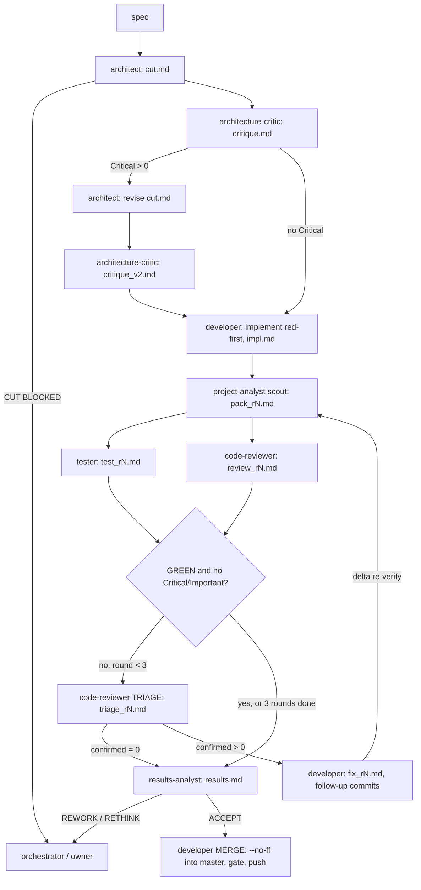

# Workflow: the orchestrator's manual

This file holds what the orchestrator needs to run agent work on `key-switch-rs`. The rules live in
[CLAUDE.md](../CLAUDE.md), which is always loaded and kept small. This file has the roles, the lane pipeline, how
to launch it, and the reasons behind the model, effort and token-economy rules. Where this file
restates a rule, CLAUDE.md is authoritative.

The setup mirrors the owner's sibling project **boyko-engine**. Its manual lives at the local path
`D:/claude/BoykoEngine/docs/WORKFLOW.md`, which is not part of this repository.

## Roles

The main Claude session is the **orchestrator**. It picks the roles, writes briefs, runs the
workflows, reads verdicts and asks the owner when needed. It stays on the session model. The roles
are defined in [.claude/agents/](../.claude/agents/README.md):

| Role | Model | Effort | Tools | Reads | Writes |
|---|---|---|---|---|---|
| `architect` | opus | xhigh | Read, Write, Glob, Grep, WebSearch, WebFetch | spec, book (audit/roadmap/architecture), tree, git history | `cut.md` (THE CUT), no product code |
| `architecture-critic` | opus | xhigh | Read, Write, Glob, Grep, WebSearch, WebFetch | `cut.md`, spec, cited KS/roadmap entries, tree | `critique.md`, `critique_v2.md` |
| `developer` | opus | xhigh | Read, Write, Edit, Glob, Grep, Bash | `cut.md`, critique, triage | code on the lane branch, `impl.md`, `fix_rN.md`, `merge.md` |
| `code-reviewer` | opus | xhigh | Read, Write, Glob, Grep, Bash, WebSearch, WebFetch | lane diff via `git show` / `git diff`, `cut.md`, pack | `review_rN.md`; in TRIAGE mode `triage_rN.md` |
| `tester` | **sonnet** | high | Read, Write, Edit, Glob, Grep, Bash | lane HEAD, `cut.md`, `impl.md`, pack | `test_rN.md`; scratch worktree under the lane dir; only `Tests:` commits of test code |
| `results-analyst` | opus | xhigh | Read, Write, Glob, Grep, Bash | every lane report + the actual diff | `results.md` (ACCEPT / REWORK / RETHINK) |
| `project-analyst` | opus | xhigh (high as pack scout) | Read, Write, Glob, Grep, Bash, WebSearch, WebFetch | anything, read-only | analysis reports; `pack_rN.md` as scout |
| `researcher` | opus | high | WebSearch, WebFetch, Read, Write, Glob, Grep | Win32 / crate docs, the web, the tree | a research report with citations |
| `doc-writer` | opus | high | Read, Write, Edit, Glob, Grep, Bash, WebFetch | master's diff, lane reports, loader | `book/src`, `README.md`, `default_config.ron` comments, `book.md` |

Duties are separate. The developer owns fmt, check, clippy and its red-firsts, and leaves the full suite to the
tester (except at the merge step). The reviewer finds and does not fix. The critic critiques and does
not design. The analyst answers and does not edit. A subagent that hits an ambiguity stops and returns
`BLOCKED` / `CUT BLOCKED` / `STOPPED`, because it cannot ask the user. The orchestrator asks the owner.

## The lane pipeline

One lane is one roadmap item, audit fix or feature. It runs on one branch from `master`, end to end:



Notes on the stages:

- **Cut**: the architect re-locates every spec item on the current tree and writes the touch set,
  the design (threading: which thread owns which hook, window, timer or COM apartment), commits with
  red-first tests and predicted failures, an acceptance proof per criterion, the docs impact and the risks against R1-R10.
- **Critique**: if there is any Critical, the cut gets one revision and a second critique. Everything else goes to the
  developer, who resolves or refutes it.
- **Verify round 1**: a scout writes the context pack. The tester and code-reviewer then run in parallel from it.
  The tester runs the full gate, replays every red-first on the parent (`master` in round 1) in a scratch worktree
  under `wt/` with its own `CARGO_TARGET_DIR` under `target-wt/`, makes at least two mutations of its own, and maps every acceptance criterion to a test.
- **Triage** (the code-reviewer in TRIAGE mode) tries to refute every red test and every Critical/Important remark.
  Only the items it cannot refute are CONFIRMED and go to the fix.
- **Rounds 2-3 are delta-scoped**: the fix's diff, the confirmed items' red-first on the parent and on HEAD,
  two NEW mutations at the fix, and one full `cargo test --locked` on HEAD. A lane runs at most 3 verify rounds.
- **Rulings.** When a cut or critique leaves questions, the orchestrator writes `rulings.md` in the lane dir before the developer starts (and a second round after a cut revision). A ruling that needs live-daemon evidence becomes a manual check for the owner from the start, never an item in `impl.md`, because agents may not run the daemon.
- **Results** decides ACCEPT, REWORK (and the stage to return to) or RETHINK.
- **Merge** happens only on ACCEPT: `--no-ff` into `master`, the full gate on the merge commit, `git push origin master`,
  and deletion of the lane branch.

## How to run it

Two named workflows live in [.claude/workflows/](../.claude/workflows/).

**`ks-lane`**: one lane end to end.

```js
workflow('ks-lane', {
  name: 'p0-engine-core',        // lane id; also the reports dir D:/tmp/ks-orch/<name>/
  branch: 'feat/engine-core',    // the lane branch, cut from base
  title: 'Phase 0: pure decision core',
  spec: '<what, why, acceptance criteria; cite KS-xx / roadmap IDs>',
  base: 'master',                // optional, default 'master'
  wt: 'D:/key-switch-rs/key-switch-rs', // optional work tree, default the main checkout
  merge: true,                   // optional; false stops after results
  stopAfter: 'cut',              // optional: 'cut' | 'critique' | 'results'
  testerModel: 'sonnet',         // optional; default 'sonnet'
})
```

It returns `{name, branch, stage, merged, head?, reports, ...verdict briefs}`. When `merged` is false,
`stage` is where it stopped, so read that stage's report. `resumeNote` (optional) keeps cut and critique
on a resume and tells the developer where to pick up.

**`ks-phase`**: a roadmap phase. Lanes run **in order** in the main checkout, and each is merged into `master`
before the next starts, because later items build on earlier ones. A lane that does not merge stops
the phase unless `continueOnFailure: true` is set. After the lanes, a `doc-writer` book sync runs (on by default),
on the branch `docs/book-<phase>`. It updates audit status lines, the config pages with validated RON, architecture and
roadmap, then builds, link-checks, merges and pushes.

```js
workflow('ks-phase', {
  phase: 'phase-0',
  items: [ /* ks-lane args, one object per lane */ ],
  bookSync: true,                // optional, default true
})
```

Use `stopAfter: 'cut'` or `'critique'` when the owner must see a design before code is written.
Use `merge: false` when the owner wants to look before the merge.

## Reports directory

Each lane has its own `D:/tmp/ks-orch/<lane>/`. A phase's book sync writes `D:/tmp/ks-orch/<phase>/book.md`.

| File | Written by |
|---|---|
| `cut.md` (+ "Critique response", developer addendum) | architect, developer |
| `critique.md`, `critique_v2.md` | architecture-critic |
| `impl.md` | developer |
| `pack_rN.md` | project-analyst (scout) |
| `test_rN.md` | tester |
| `review_rN.md`, `triage_rN.md` | code-reviewer |
| `fix_rN.md`, `merge.md` | developer |
| `results.md` | results-analyst |
| `wt/`, `target-wt/`, `ron/`, `cfgcheck/` | scratch (tester worktree, doc-writer validation) |

Briefs refer to reports by path, so reports are never pasted into a brief. Read a report by section, starting with its verdict line.

## Model routing

**Owner decision, 2026-10-14, mirroring boyko-engine.**

- **Every role runs on Opus except `tester`, which runs on Sonnet.**
- **Effort `xhigh`:** `architect`, `architecture-critic`, `developer`, `code-reviewer`,
  `results-analyst`, `project-analyst`.
- **Effort `high`:** `tester`, `researcher`, `doc-writer`.
- **Nothing runs below `high`.**

The model and effort are set in each agent's frontmatter (`model:`, `effort:`). The lane templates mirror
them with explicit per-call `MODEL` and `EFFORT` maps in `ks-lane.js`, plus `opus`/`high` for the
doc-writer in `ks-phase.js`, so a workflow never inherits the session's model or effort. One per-call
override: `project-analyst` used as the context-pack scout runs `high`, because it collects file:line
facts and makes no judgement. The lane argument `testerModel` (default `sonnet`) can put the tester back
on Opus for one lane, for example while its escape rate is under review. The orchestrator stays on the session model.

**Why: boyko-engine's measurements.** These are in `D:/claude/BoykoEngine/docs/WORKFLOW.md#model-routing`, the owner's sibling project.

- On **27 retrieval questions**, each with a ripgrep-verified ground truth and phrased without the target's own
  vocabulary, **Sonnet was confidently wrong 4 times and Opus 0 times** (Haiku 8). The task was the
  most mechanical one an agent does (search, read, report a file:line span), so it was the friendliest case for a
  cheaper tier. The decisive column is *confident-but-wrong*, not *found*. A confident wrong answer
  is the failure a downstream reader cannot detect.
- A 6-question pilot of the same experiment showed a tie, and it was wrong. Any routing measurement needs at least ~25
  items and must score *confident-but-wrong* separately from *missed*.
- A historical before/after on the same repo (Sonnet era vs Opus era) found the same fix rate but
  a much higher rate of the workflow refuting its own output under Opus. Two independent
  measurements point at one faculty: self-scepticism.
- **Sonnet 5.5 as tester scored 26/27 with 1 confident-wrong**, so only the tester was moved.
  The tester's verdict is backed up by the code-reviewer, triage and results-analyst, which all stay on Opus.
  **Watch the escape rate of Sonnet-tester GREENs**: a defect found later in a lane the tester called GREEN
  counts against the tier.

**Rules that follow:**

- Never downgrade a role because it is "mechanical". boyko-engine tested that premise and it failed.
  The roles called mechanical were the ones catching defects, and only facts are gated downstream,
  never judgement. Cargo does not catch UB in an `unsafe` block, a test that cannot fail reads as green, and
  nothing gates the doc-writer.
- A downgrade needs a measured before/after quality diff over at least ~25 items, with *confident-but-wrong*
  scored apart from *missed*.
- Optimise effort, batch size and redundant arms instead of the tier. `code-reviewer` stays the last line
  against `unsafe`, atomics and hook-callback defects.

## Token economy

Adapted from boyko-engine's audit of 1,148 agents. Cost is roughly turns times context. About 95 % of the volume there
was cache re-reads, and most of it was context growing inside ONE agent. The number of agents was not
the driver, and every modelled stage merge cost more.

- **Do not merge stages to save agents.** A merged agent re-reads the earlier stage on every later
  turn, and merging kills independent refutation (tester ∥ reviewer, triage then fix). Parallel arms buy
  wall time, not tokens, so run them when their inputs or roles differ.
- **One context pack for parallel checkers.** Reviewers and triage spend roughly half their tokens orienting
  before their first action. When at least 2 agents of a run need the same orientation, one scout writes a pack of
  at most 15k tokens (files + line ranges, key facts, the delta, exact test commands) to disk, and every brief points at it.
  The checkers stay separate agents. In `ks-lane` this is `pack_rN.md`.
- **One owner per heavy gate per round.** The developer owns fmt, check, clippy, its red-firsts and the tests its
  diff touches. The tester owns the full `cargo test --locked`, the red-first replay on the parent and the mutations.
  The merge step owns the gate on the merge commit.
- **Rounds >= 2 are delta-scoped:** the confirmed items' red-first on the parent and on HEAD, at least 2 new mutations at
  the fix delta and at the tests the last round added, the touched gates, and one full suite on HEAD.
- **Keep every checking arm**: critique, triage, tester mutations, and review in every round. In boyko-engine,
  triage confirmed a defect in every round and a review caught a defect after a green tester. Cut an
  arm only on a measured escape-rate diff over at least ~25 items. Lower effort was measured and rejected.
- **Hand off through files.** Briefs carry paths and section names, never pasted documents. Every report
  is saved. A resume is a commit plus a `handoff.md` of at most one page (or `resumeNote`).
- **Logs live on disk, not in context.** Use `rg -n` and ranged reads (at most ~200 lines). Read summaries, verdict
  lines and failure excerpts, never whole logs. Check the `test result:` lines target BY NAME against the expected
  set, because equal counts over different sets are a vacuous green.
- **Small always-loaded floor.** Every 1k tokens in CLAUDE.md is paid on every turn of every agent,
  so measurement tables live here. Prefer typed agents, which start with a smaller context.
- **Orchestrator:** workflows return verdicts and paths (about 2k tokens at most), not full agent texts. Read reports
  by section.

## Safety

These rules are repeated in every role file (some roles add lines of their own), in the lane header of
`ks-lane.js` and in the book-sync brief of `ks-phase.js`:

- The owner uses this Windows machine while agents work.
- Never run `key-switch-rs.exe` or the daemon. Never install a global keyboard or WinEvent hook.
  Never call `SendInput` or otherwise inject input. Never write the registry or change system
  settings. Reads are fine.
- Tests that would need any of that are `#[ignore = "manual: <what a human checks>"]`.
- Never push, tag, release or change GitHub settings unless the brief is the merge step of a lane.

Consequences for the pipeline: acceptance criteria that need a live hook become manual checks listed
in `results.md` for the owner. RON examples are validated with the parse-only `cfgcheck` harness,
which installs no hook. `settings.json` denies force-push, `reset --hard`, `stash`, `clean`,
`restore` and `--no-verify`.

## Git flow

- One branch per feature, from `master` (the `base` arg). No pull requests.
- Commits on the lane branch: one coherent item each, red-first (the failing line goes in the
  message body), subject `<Area>: <what>`. Every message ends with a blank line and
  `Co-Authored-By: Claude <model> 5.5 <noreply@anthropic.com>` naming the model that wrote it (`Opus` for every role except the tester, which runs on `Sonnet`).
- Fix rounds add follow-up commits and never amend.
- Merge step only: `git checkout master`, `git merge --no-ff <branch>` with the message
  `Merge branch '<branch>': <title>` + the trailer. For CHANGELOG/README conflicts, keep both sides.
  Run the full gate on `master`, then `git push origin master` and `git branch -d <branch>`. Never tag or release.
- `CHANGELOG.md` follows Keep a Changelog. The developer adds `## [Unreleased]` entries citing KS-xx or roadmap IDs.
- The book sync runs on its own branch, `docs/book-<phase>`, and is merged the same way. `book.yml` deploys Pages
  on that push to `master`.
